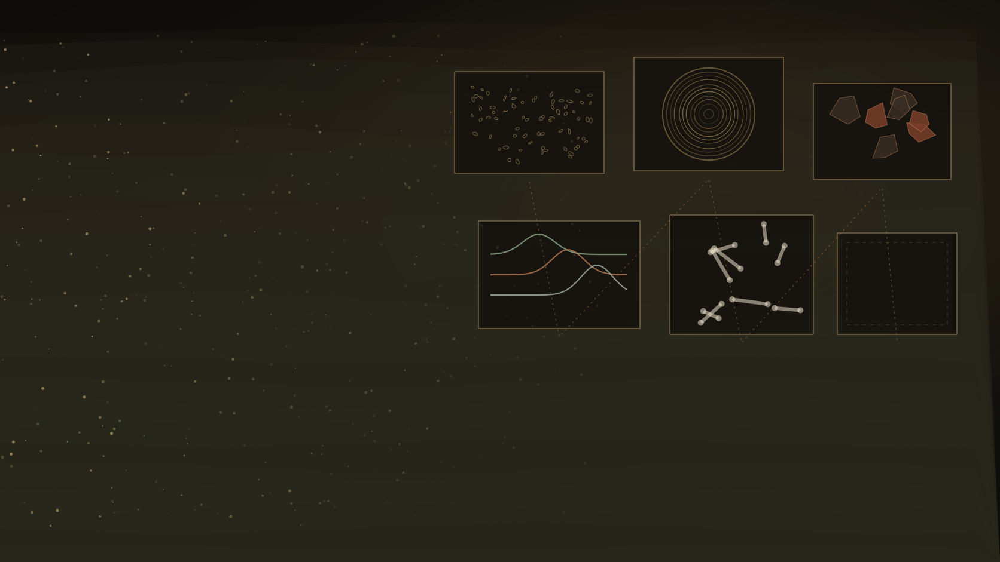
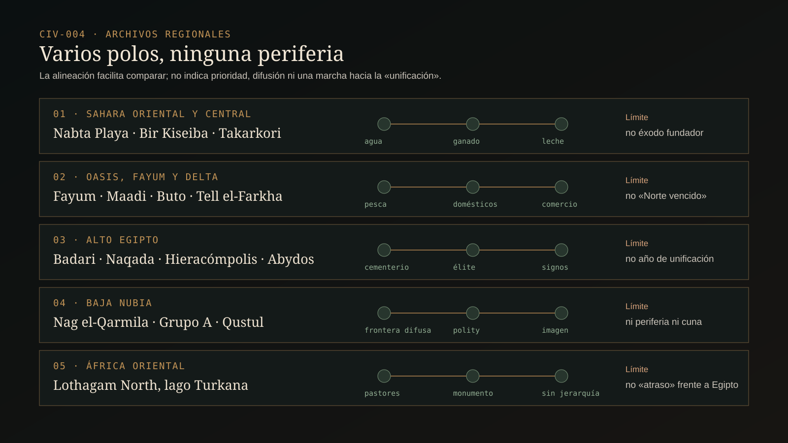
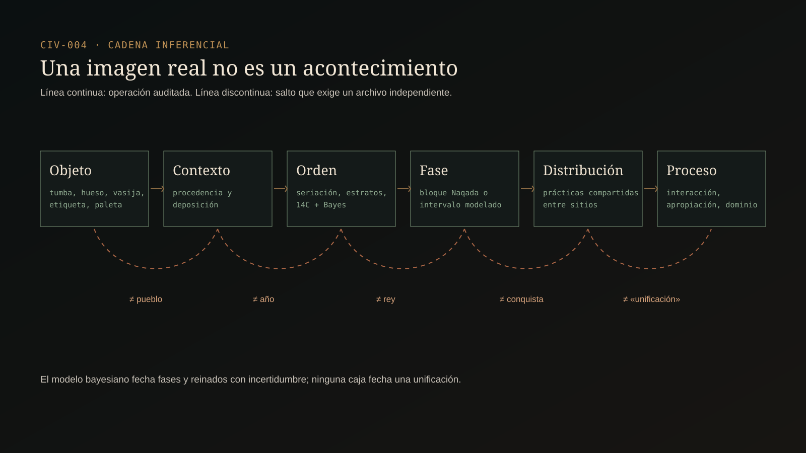

# CIV-004 — Valle del Nilo y África nororiental: del Sahara verde a los Estados nilóticos







## Pregunta central

¿Cómo reconstruimos el paso de campamentos y cementerios del Sahara y del Nilo a los Estados nilóticos sin convertir la «unificación» de Egipto en un instante, ni el resto de África nororiental en su periferia?

## Respuesta breve

No hubo una línea que fuera del Sahara verde a la primera dinastía. El Sahara oriental se ocupó cuando llegó la humedad del Holoceno y se vació de forma escalonada al terminar; esa coincidencia es fuerte a escala de subcontinente, pero no prueba que la civilización faraónica naciera de un éxodo. El ganado temprano de Nabta Playa sigue en disputa, los caprinos llegaron domesticados y la leche se procesaba en el Sahara central en el quinto milenio a. C. sin dependencia del cereal. Nabta conserva megalitos y enterramientos de ganado; su lectura astronómica es una propuesta, no un calendario.

En el valle, el Badariense y el Naqada no son pueblos sino conjuntos ordenados. La seriación de Petrie aguanta el radiocarbono por bloques y falla por fases; el modelo bayesiano de `186` fechas comprime el Predinástico a unos `600–700` años y coloca a Aha entre `3218` y `3035` a. C. (`95 %`). Hieracómpolis, Abydos U-j, la paleta de Narmer, Nag el-Hamdulab y Qustul son archivos distintos —cementerio, tumba, objeto ceremonial, arte rupestre, cementerio nubio— y ninguno registra una unificación fechable. El resultado auditado es un proceso largo de conexión, desigualdad funeraria y apropiación de símbolos, con varios polos y con trayectorias africanas propias.

## LO OBSERVADO

Se observan carbones, semillas, huesos de animales, residuos de lípidos en cerámica, tumbas y sus ajuares, megalitos, cerámica clasificada, etiquetas de marfil con signos, una paleta tallada, grabados rupestres, genomas y sedimentos lacustres. No se observan «los primeros pastores africanos», «el pueblo badariense», «el templo astronómico», «el rey Escorpión unificador», «la conquista del Norte» ni «el nacimiento de Egipto».

## 1. La región es un marco de comparación, no una sociedad

«Valle del Nilo y África nororiental» reúne aquí el Sahara oriental y central, los oasis, el Alto y el Bajo Egipto, el Delta, la Baja Nubia y el Sudán central. Cada zona tiene ecología, conservación y tradición de investigación diferentes; los cementerios de desierto bajo se conservan, las aldeas de la llanura aluvial quedaron bajo el limo y el Delta se excava hace pocas décadas (`CLAIM-CIV-NILE-REGION-001`, `SRC-STEVENSON-PREDYNASTIC-2016`).

| Zona | Archivo característico | Resultado permitido | Salto prohibido |
|---|---|---|---|
| Sahara oriental y central | playas, abrigos, fogones, fauna, cerámica, genomas | ocupación por fases húmedas, pastoralismo, ritual | «pueblo sahariano» homogéneo |
| oasis y Fayum | concheros, fauna, plantas, herramientas | movilidad y producción mixtas | aldea agrícola por defecto |
| Alto Egipto | cementerios de desierto bajo, sitios de producción | desigualdad funeraria, especialización, ritual | Estado por tamaño de tumba |
| Bajo Egipto y Delta | aldeas de casas ligeras, cementerios modestos | trayectorias propias y contacto levantino | «Norte vencido» |
| Baja Nubia | cementerios del Grupo A, arte rupestre | polity propia y redes de intercambio | periferia o cuna del faraón |
| África oriental | cementerios monumentales de pastores | monumentalidad sin jerarquía demostrada | retraso respecto de Egipto |

## 2. Los nombres arqueológicos no son pueblos observados

Badariense, Tasiense, Naqada I–III, «Maadi-Buto» y «Grupo A» agrupan cerámica, ajuares, prácticas funerarias y fases definidas por investigadores. Amratiense, Gerzeense y Semainiense son incluso etiquetas de Petrie que sobreviven en la numeración Naqada I, II y III (`SRC-DEE-NAQADA-2014`). Ninguno identifica por sí solo lengua, ascendencia, autodenominación o entidad política. La regla de CIV-003 se aplica sin cambios: «el Naqada se expandió» describe una distribución material, no a un sujeto colectivo que decide.

## 3. Sahara verde: la ocupación siguió al agua

Una síntesis de radiocarbono de `150` excavaciones en el Sahara oriental (Egipto, Sudán, Libia y Chad) relaciona la ocupación con las fases climáticas: asentamiento tras el inicio súbito de condiciones húmedas hacia `8500 a. C.` y salida durante la desecación gradual desde `5300 a. C.` (`SRC-KUPER-KROPELIN-SAHARA-2006`). Una curva de probabilidad sumada de `3287` fechas calibradas de `1011` sitios muestra un cambio demográfico mayor entre `10,500` y `5500` años BP, con un desfase de unos mil años en la respuesta terrestre al inicio y una caída amplia entre `7500` y `6500` BP (`SRC-MANNING-TIMPSON-SAHARA-2014`).

Las dos series miden presencia de fechas, no personas. La suma de probabilidades depende de cuánto se excavó y fechó, de la conservación y de la calibración; los autores la tratan como proxy de capacidad de carga efectiva, no como censo (`CLAIM-CIV-NILE-GREEN-SAHARA-001`). CIV-002 ya auditó por qué una fecha pertenece primero a su muestra (`CLAIM-CIV-DATING-CONTEXT-001`).

## 4. El abandono no fue un éxodo único hacia el Nilo

Kuper y Kröpelin propusieron que el corrimiento del borde del desierto hacia el sur «ayudó a disparar» la civilización faraónica. Es una hipótesis de escala continental. Dos archivos la restringen:

- el registro hidrológico de África muestra que el fin del Periodo Húmedo fue abrupto en cada sitio pero más tardío a menor latitud: un proceso escalonado, no un evento único (`SRC-SHANAHAN-AHP-2015`);
- la recronología del Neolítico del Nilo con nuevas fechas AMS del Egipto Medio sitúa en el quinto milenio a. C. una convergencia cultural —la «comunidad pastoral primaria»— en los tramos egipcio y sudanés del valle, y discute expresamente que el estrés ambiental sea el motor de la adaptación (`SRC-WENGROW-CONVERGENCE-2014`).

El resultado permitido es una restricción ambiental fuerte sobre dónde se podía vivir; el puente hacia una causa de la complejidad nilótica sigue abierto (`CLAIM-CIV-NILE-ABANDONMENT-001`). Para afirmarlo harían falta lo que CIV-003 exigió al clima de Asia sudoccidental: exposición local, mecanismo, tiempo de respuesta, alternativa y caso negativo.

## 5. Ganado temprano: el debate de la domesticación local

La Expedición Prehistórica Combinada interpretó restos de *Bos* del noveno–octavo milenio a. C. en Nabta Playa–Bir Kiseiba como ganado domesticado localmente, en un ambiente donde un uro silvestre difícilmente habría sobrevivido sin manejo (`SRC-WENDORF-SCHILD-NABTA-2001`). Brass reexaminó la geología, la botánica y la fauna: rechaza los fundamentos ecológicos del modelo, interpreta esos restos como uros cazados, propone que los caprinos domésticos precedieron al ganado en el nordeste de África y sitúa la visibilidad arqueológica del ganado doméstico desde mediados del sexto milenio a. C., sin excluir introgresión limitada de uro africano (`SRC-BRASS-CATTLE-2018`).

La genética no zanja el caso: abrió el debate sobre la contribución del uro africano a los bovinos domésticos y reformuló la domesticación como proceso coevolutivo y local, no como invento (`SRC-GIFFORD-GONZALEZ-HANOTTE-2011`). CIV-004 conserva el ganado doméstico de los milenios IX–VIII a. C. como hipótesis disputada, no como hecho de fondo (`CLAIM-CIV-NILE-CATTLE-DEBATE-001`).

## 6. Pastorear y ordeñar antes de depender del cereal

En el Fayum, los sitios de `4850–4250 a. C.` muestran domésticos junto a un dominio del pescado; los primeros domésticos aparecen hacia `5400 a. C.`. La revisión de Linseele y colaboradores concluye que los domésticos indiscutidos más antiguos de Egipto fuera de Nabta son caprinos escasos del sexto milenio a. C. y que los sitios con domésticos aumentan sólo desde el quinto, con fuerte variación regional (`SRC-LINSEELE-FAYUM-2014`). Lípidos de cerámica del Sahara central, con `δ13C` y `Δ13C` de los ácidos grasos de la leche, prueban procesamiento lácteo en el quinto milenio a. C. dentro de contextos pastoriles (`SRC-DUNNE-SAHARA-DAIRY-2012`; véase `EVID-SAHARA-PASTORAL-DAIRY-001`).

Manejo animal, ordeña, cultivo de cereal y residencia anual son, como en CIV-003, resultados separables (`CLAIM-CIV-NILE-HERDING-BEFORE-FARMING-001`).

## 7. Quiénes vivían en el Sahara verde

Dos mujeres del Neolítico Pastoral enterradas hace unos `7000` años en el abrigo de Takarkori (suroeste de Libia) proporcionaron los primeros genomas antiguos del Sahara central. La mayor parte de su ascendencia procede de un linaje norteafricano hasta ahora desconocido, divergente de los linajes subsaharianos hacia la misma época que los humanos fuera de África y aislado durante casi toda su existencia; están emparentadas con los recolectores de Taforalt de hace `15,000` años. Los autores concluyen que el pastoralismo se difundió allí sobre todo por difusión cultural, no por reemplazo de población (`SRC-SALEM-TAKARKORI-2025`).

Son dos individuos de un abrigo. El resultado limita modelos de migración masiva en ese lugar; no fija la ascendencia de todo el Sahara ni la de los grupos del Nilo, y una afinidad genética no es una identidad (`CLAIM-CIV-NILE-SAHARA-ANCESTRY-001`).

## 8. Nabta Playa: megalitos sin calendario demostrado

Nabta conserva, junto a ocupaciones del Neolítico medio y tardío, megalitos, círculos de piedra, alineamientos, túmulos del llamado complejo ceremonial del Neolítico tardío y estructuras complejas. El informe de excavación dedica capítulos separados a los túmulos del norte, a los alineamientos megalíticos y a un círculo que titula «posible calendario solar»: el adjetivo es de los propios excavadores (`SRC-WENDORF-SCHILD-NABTA-2001`). Malville y colaboradores propusieron que los alineamientos siguen direcciones cardinales y solsticiales, que la geometría podría ser funeraria y que un movimiento de población desde el desierto nubio habría contribuido al cambio social del Alto Egipto predinástico (`SRC-MALVILLE-NABTA-1998`).

CIV-004 separa tres niveles. La arquitectura y los enterramientos de ganado son archivo. La orientación astronómica es una hipótesis que depende de qué piedras están en posición original, de la fecha de cada pieza y de cuántas direcciones posibles se descartaron antes de elegir las significativas. La conexión con el faraonismo es el salto más largo y no tiene archivo intermedio. El expediente no repite cifras de «observatorio» ni lecturas estelares que circulan fuera de la literatura revisada (`CLAIM-CIV-NILE-NABTA-MONUMENT-001`).

## 9. Movilidad, agregación y cementerios del quinto milenio

Del Egipto Medio al Sudán central, cementerios pequeños de grupos móviles comparten, en el quinto milenio a. C., un repertorio de adorno corporal, tratamiento del cuerpo y ofrendas: la «comunidad pastoral primaria» de Wengrow. No es una unidad social ni una identidad consciente, sino un conjunto recurrente de prácticas (`SRC-WENGROW-CONVERGENCE-2014`, `SRC-STEVENSON-PREDYNASTIC-2016`). En Gebel Ramlah, en el desierto suroccidental egipcio, `32` tumbas contenían `69` enterramientos y unos `568` objetos, con cerámica afín a la de Kadruka y R12 en Sudán (`SRC-STEVENSON-PREDYNASTIC-2016`, que sintetiza las excavaciones primarias).

El cementerio es aquí el lugar de la agregación: grupos que se mueven vuelven, generación tras generación, a enterrar en los mismos puntos. La permanencia está en el paisaje de los muertos antes que en la casa (`CLAIM-CIV-NILE-PASTORAL-COMMUNITY-001`).

## LO MEDIDO

Se miden edades radiocarbónicas y su calibración, frecuencias de tipos cerámicos, órdenes de seriación, conteos de tumbas y de objetos, tamaños de estructuras, isótopos de carbono de lípidos, proporciones de ascendencia genómica, orientaciones de piedras y estratigrafías. Cada medición pertenece a una unidad; ninguna mide «grado de civilización» ni «momento de la unificación».

## 10. Badari: cementerios ricos, casas inciertas

El modelo bayesiano de Dee y colaboradores amplió de `12` a `20` las fechas badarienses (seis nuevas de el-Badari) y sitúa el inicio del Badariense en `4489–4266 a. C.` y su final en `3896–3616 a. C.` (`95 %`), unos `200–300` años después de lo supuesto (`SRC-DEE-2013`). El debate sobre la base económica sigue abierto: los basureros muestran arquitectura efímera, más cercana a campamentos que a aldeas, y el cultivo parece limitado; otros autores sostienen sedentarismo pleno con depósitos enterrados bajo la llanura aluvial (`SRC-STEVENSON-PREDYNASTIC-2016`).

Lo que es firme es la inversión comunal en cementerios con ajuar personal. No hay transición continua Badariense → Naqada I en ningún cementerio; un modelo unilineal entre ambos no explica la evidencia (`CLAIM-CIV-NILE-BADARI-001`).

## 11. Petrie frente al radiocarbono: bloques sí, fases no

Petrie ordenó más de `900` tumbas con cinco o más tipos cerámicos y creó las fechas de secuencia antes de que existiera el radiocarbono (`SRC-PETRIE-SEQUENCE-UCL`; método auditado en CIV-002, `CLAIM-CIV-STRATIGRAPHY-SERIATION-001`). Kaiser y Hendrickx refinaron el sistema en las «Stufen» Naqada IA–IIIB. Savage advirtió una tautología: las seriaciones se construyeron con vasijas completas de cementerios, mientras casi todas las fechas procedían de contextos domésticos sin vasijas completas, y empezó a fechar tumbas de Naga ed-Der con AMS (`SRC-SAVAGE-NAQADA-2001`).

El contraste sistemático de 2014 concluye que los grandes bloques de la secuencia forman una cronología verdadera, pero que el sistema es mucho menos fiable al nivel de fases individuales (`SRC-DEE-NAQADA-2014`). Una secuencia cerámica estratificada en Nekhen ofrece una prueba independiente de la seriación funeraria, porque el orden viene de la deposición y no de la semejanza (`SRC-DIPIETRO-NEKHEN-2019`). El resultado auditado es ordinal y por bloques (`CLAIM-CIV-NILE-SERIATION-BLOCKS-001`).

```text
seriación funeraria → orden por semejanza [B por bloques; C por fase]
estratigrafía de asentamiento → orden por deposición [B-LOCAL]
radiocarbono + Bayes → límites de fase condicionados a priors [B-COND]

ninguna flecha autoriza:
fase cerámica → dinastía → rey → conquista
```

## 12. El tempo: más rápido de lo supuesto

El modelo de `186` fechas (`74` nuevas), con materiales de vida corta y priors arqueológicos, da estos intervalos al `95 %`: Naqada IB/IC `3731–3550`, IIB/IIC `3562–3367`, IID/IIIA `3377–3238`, acceso de Aha `3218–3035` (mediana `3085`) y Den `2945–2904 a. C.`. El Predinástico habría durado entre `600` y `700` años y la asimilación cultural de IIB/IIC a IID/IIIA, unas cinco o seis generaciones (`SRC-DEE-2013`).

La precisión es condicional. Con el supuesto de que ningún rey reinó más de `100` años, Aha pasa a `3152–3032 a. C.`; la cola antigua se debe en parte a la forma de la curva; Tarkhan se excluyó por problemas de asignación; y el intervalo Djer–Djet puede ser un hiato político o un vacío de archivo. CIV-002 auditó el modelo como caso de método (`CLAIM-CIV-EGYPT-CHRONOLOGY-002`); CIV-004 usa sus resultados para el tempo regional y no les añade soberanía (`CLAIM-CIV-NILE-NAQADA-TEMPO-001`).

## 13. Hieracómpolis: concentración, banquete y cementerio de élite

Hieracómpolis (Nekhen) es el sitio más grande conocido de Naqada I–IIB: unos `2.5 km` a lo largo del borde del desierto y `3 km` hacia el Wadi Abu Suffian. Tiene cervecerías (HK24A) capaces de unos `390` litros por proceso, zonas de procesamiento de carne y pescado a escala supradoméstica, un recinto ovalado de postes (HK29A) con fauna de sacrificio y banquete, un cementerio no elitista (HK43) de al menos `453` tumbas y un cementerio de élite (HK6) de casi `70` tumbas. La tumba 16 (`4.3 × 2.6 m`, Naqada IC–IIA) estaba rodeada de tumbas humanas y de animales: uros, babuinos, un elefante, gatos, un búbalo y `35` perros (`SRC-STEVENSON-PREDYNASTIC-2016`, síntesis de las excavaciones de Friedman y colaboradores).

Los excavadores hablan de «los primeros reyes de Egipto». Stevenson señala tres límites: muchas tumbas de HK6 anteriores a Naqada IIC contienen varios individuos de ambos sexos y distintas edades, el sacrificio humano acompañante no está demostrado y atribuir realeza faraónica a paralelos prehistóricos arriesga anacronismo. Un caso de corrección interna: los grandes agujeros de poste de HK29A se leyeron como santuario de madera y excavaciones posteriores los reinterpretaron como entrada de un patio (`CLAIM-CIV-NILE-HIERAKONPOLIS-001`).

## 14. Desigualdad funeraria: qué mide una tumba

La separación espacial entre HK6 y HK43 mide acceso diferencial a ubicación, arquitectura y ajuar funerario; no mide clase hereditaria ni riqueza en vida. En Naqada IIC–D, materiales como el lapislázuli y los vasos de piedra aparecen en tumbas de varios sitios y niveles, y las tumbas «ricas» se componen de formas distintas, un patrón compatible con organización más heterárquica. En Naqada III, en cambio, los ajuares de la mayoría se empobrecen («simplificación») mientras Abydos acumula materiales exóticos (`SRC-STEVENSON-PREDYNASTIC-2016`).

La desigualdad funeraria creció, se dispersó y se reconcentró; no subió en línea recta (`CLAIM-CIV-NILE-FUNERARY-INEQUALITY-001`).

## 15. La «expansión Naqada»: distribución, no conquista

Desde Naqada IIC, cerámica y prácticas funerarias del Alto Egipto aparecen hacia el sur hasta la Segunda Catarata y hacia el norte en diez nuevos cementerios del Fayum, la región menfita y el Delta oriental. Cómo ocurrió —migración, aculturación o interacción— sigue disputado. Los modelos de dominio completo del Alto sobre el Bajo Egipto ya no se sostienen: el Delta conserva secuencias de afiliación complejas y aportó tecnologías como la arquitectura de adobe; Tell el-Farkha fue un nodo de comercio con el Levante (`SRC-STEVENSON-PREDYNASTIC-2016`).

Las fechas de Dee y colaboradores hacen además compatible la cronología egipcia con la extensión de materiales Uruk hacia Siria hacia `3600–3400 a. C.`: la interacción con Asia sudoccidental de CIV-003 corre en paralelo, no como causa única (`CLAIM-CIV-NILE-NAQADA-EXPANSION-001`).

## 16. Abydos U-j: la escritura empieza en una tumba excepcional

La tumba U-j del cementerio U de Umm el-Qaab, de doce cámaras y fechada en Naqada IIIA2, contenía unas `2000` vasijas pese al saqueo —más de un tercio reportadas como importaciones levantinas; un estudio petrográfico las leyó como imitaciones locales y el análisis de pastas y contenidos, con vino aromatizado, sostuvo la importación— y las etiquetas de marfil con los signos jeroglíficos más antiguos conocidos (`SRC-STEVENSON-PREDYNASTIC-2016`). Las fechas del modelo bayesiano colocan el inicio de Naqada IIIA hacia finales del siglo XXXIV a. C. (`SRC-DEE-2013`).

Leer esas etiquetas como prueba de burocracia estatal fue cuestionado: la evidencia queda restringida a esa tumba y a su ritual, con unos dos siglos sin ejemplos equivalentes (`SRC-STEVENSON-PREDYNASTIC-2016`). La escritura egipcia tardó siglos en codificar habla continua; el repertorio de signos se amplió, se estandarizó y luego se redujo de forma notable a comienzos del tercer milenio a. C. (`SRC-REGULSKI-WRITING-2016`). U-j prueba objeto, contexto y fase; no prueba administración territorial ni alfabetización (`CLAIM-CIV-NILE-UJ-WRITING-001`). Es la misma regla que CIV-003 aplicó a la tablilla `P003414`.

## 17. Imágenes de poder: grabados, mazas y paletas

En Nag el-Hamdulab, cerca de Asuán, grabados rupestres de barcos con prisioneros y animales incluyen una figura que los autores identifican como la representación más antigua de un faraón y sitúan, por iconografía, en la Dinastía 0; la lectura de una procesión religiosa convertida en gira triunfal de un monarca recaudador es interpretación de los autores (`SRC-HENDRICKX-HAMDULAB-2012`). Las paletas de grauvaca y las mazas piriformes, objetos de uso comunitario durante todo el Predinástico, se fabricaron en Naqada III en versiones ceremoniales de gran tamaño con acceso restringido: un proceso de apropiación de símbolos comunes por aspirantes a la realeza (`SRC-STEVENSON-PREDYNASTIC-2016`).

La violencia aparece sobre todo en la imagen, no en el registro material de conflicto (`CLAIM-CIV-NILE-ROYAL-IMAGERY-001`).

## 18. La paleta de Narmer como objeto, no como relato

La paleta de Narmer es una paleta ceremonial de grauvaca recuperada en Hieracómpolis en las excavaciones de fines del siglo XIX, el mismo sitio que dio las mazas ceremoniales del Depósito Principal; este expediente no reconstruye su contexto exacto de depósito, que no forma parte de las fuentes auditadas. Como objeto tiene forma, función y procedencia de sitio: deriva de una clase de paletas cosméticas neolíticas y su decoración toma un archivo visual pastoral —ganado y otros animales incorporados al adorno y al ritual del cuerpo desde el quinto milenio a. C.— que sus fabricantes transformaron (`SRC-WENGROW-NARMER-2001`).

Leerla como acta de una conquista del Norte por el Sur proyecta convenciones dinásticas posteriores sobre una imagen. Es una pieza de ideología real fabricada en un contexto de depósito ritual; no fecha un acontecimiento, no mide territorio y no prueba que Narmer «unificara» (`CLAIM-CIV-NILE-NARMER-OBJECT-001`). Intentar señalar qué gobernante consolidó Egipto puede ser arqueológicamente fútil (`SRC-STEVENSON-PREDYNASTIC-2016`).

## 19. Baja Nubia: el Grupo A y el debate de Qustul

En el cuarto milenio a. C., la Baja Nubia desarrolló una polity propia: el Grupo A, con economía de varias actividades, el pastoreo con valor social distintivo, autoridad distribuida y control de rutas e intercambio, cuyo apogeo coincide con la época de la unificación egipcia hacia `3100 a. C.` (`SRC-GATTO-AGROUP-2021`). En Nag el-Qarmila, cerca de Asuán, cerámica y líticos nubios, altoegipcios e híbridos conviven en Naqada IC–IIA y contradicen una frontera cultural nítida en la Primera Catarata (`SRC-STEVENSON-PREDYNASTIC-2016`).

El Cementerio L de Qustul, excavado en el salvamento de Nubia y publicado por Williams, contiene tumbas ricas con imágenes faraónicas sobre objetos del Grupo A, atribuidas a gobernantes anteriores a la Primera Dinastía (`SRC-WILLIAMS-QUSTUL-1986`). La propuesta de que esos gobernantes precedieran o contribuyeran de forma decisiva a la realeza egipcia es minoritaria y disputada; la cronología de U-j en Naqada IIIA2 pesa en contra de la prioridad nubia, y la síntesis de Stevenson lee Qustul como participación nubia en un «estilo internacional» de élite (`SRC-STEVENSON-PREDYNASTIC-2016`).

CIV-004 rechaza ambos extremos: ni la Baja Nubia fue periferia pasiva ni está demostrado que fuera la cuna del faraón. Con la Primera Dinastía, el Grupo A desaparece de la frontera, Elefantina recibe una fortaleza y el arte rupestre de Gebel Sheikh Suleiman sugiere una actitud agresiva hacia el sur (`CLAIM-CIV-NILE-LOWER-NUBIA-001`).

## 20. Primera Dinastía: escala real y costo humano

Desde Aha, las tumbas reales del cementerio B de Abydos son órdenes de magnitud mayores que las de la Dinastía 0. La de Djer (cámara de `10.4 × 9.2 m`) estaba rodeada de al menos `318` enterramientos subsidiarios, y unas `2000` personas fueron enterradas alrededor de los monumentos reales de Abydos, Saqqara, Abu Rawash y Giza. El sacrificio humano es la explicación más aceptada —los subsidiarios de Aha son todos hombres jóvenes y comparten techumbre con la tumba real—, pero la causa de muerte no está demostrada en todos los casos. Cada recinto de culto de Abydos se desmanteló antes de levantar el siguiente: la realeza se rehacía en cada reinado (`SRC-STEVENSON-PREDYNASTIC-2016`).

El aparato estatal siguió desarrollándose mucho después: santuarios locales de Elefantina y Tell Ibrahim Awad muestran en sus primeros niveles prácticas votivas sin patrocinio real visible (`CLAIM-CIV-NILE-FIRST-DYNASTY-001`).

## 21. Genomas: contacto con personas, no identidad de «los egipcios»

El primer genoma completo de un egipcio antiguo procede de un hombre enterrado en una vasija en una tumba excavada en roca en Nuwayrat, fechado en `2855–2570 cal a. C.`. La mayor parte de su genoma se representa mejor con ascendencia neolítica norteafricana; cerca de un `20 %` se vincula con genomas del Creciente Fértil oriental, incluida Mesopotamia. Los autores concluyen que los contactos con esa región incluyeron migración humana, no sólo objetos e imágenes (`SRC-MOREZ-NUWAYRAT-2025`).

Un individuo con cobertura `2×` no describe una población ni fecha cuándo llegó esa ascendencia; y ninguna proporción genética define quién era «egipcio» (`CLAIM-CIV-NILE-GENOME-CONTACT-001`).

## LO INFERIDO

El expediente infiere ocupaciones saharianas condicionadas por el agua, manejo animal y ordeña sin dependencia del cereal, cementerios como lugares de agregación de grupos móviles, desigualdad funeraria creciente y reversible, interacción a escala del valle desde Naqada IIC, apropiación de símbolos por élites en Naqada III y una realeza que se escenificaba en cada reinado. Las inferencias se detienen donde termina su archivo.

## 22. África nororiental no es la periferia de Egipto

En la orilla del lago Turkana, los primeros pastores de África oriental construyeron entre `~5000` y `4300` años atrás el cementerio de Lothagam North: pilares megalíticos, círculos de piedra, montículos y una plataforma con varios cientos de enterramientos estimados, de edades y sexos mezclados y con adornos diversos; la colocación y el adorno no sugieren jerarquía (`SRC-HILDEBRAND-LOTHAGAM-2018`). La monumentalidad, otra vez, no hereda Estado.

Con el Grupo A, la comunidad pastoral primaria, Takarkori y la domesticación como proceso local, el resultado es que varias trayectorias africanas tienen su propio tiempo y su propia escala; medirlas por su distancia a Egipto es el error que el programa CIV advierte (`CLAIM-CIV-NILE-AFRICA-NOT-PERIPHERY-001`).

## 23. «Unificación»: texto, imagen y proceso

La palabra mezcla tres cosas. La tradición textual dinástica, muy posterior, presenta un fundador y una unión de las Dos Tierras. Las imágenes de Naqada III y la Dinastía 0 —paletas, mazas, grabados— presentan a un gobernante que domina. El archivo arqueológico muestra un proceso de varios siglos: expansión de materiales desde Naqada IIC, polos competidores (Hieracómpolis, Naqada, Abydos y el Delta), apropiación de símbolos y una realeza que siguió construyéndose después de Aha.

El modelo bayesiano fecha fases y reinados con incertidumbre; no fecha una unificación. La pregunta útil no es en qué año nació el Estado, sino cuándo la idea de Estado y sus sistemas se equilibraron lo bastante para sostenerse (`CLAIM-CIV-NILE-NO-UNIFICATION-INSTANT-001`, `SRC-STEVENSON-PREDYNASTIC-2016`, `SRC-DEE-2013`).

## 24. Lo que el expediente regional permite afirmar

1. la ocupación del Sahara oriental siguió fases húmedas a escala de subcontinente;
2. el fin del periodo húmedo fue escalonado y no prueba un éxodo fundador hacia el Nilo;
3. el ganado doméstico local más temprano sigue en disputa;
4. pastoreo, ordeña y cultivo de cereal tuvieron relojes distintos;
5. Nabta conserva monumentos de pastores; su astronomía es hipótesis;
6. los cementerios de grupos móviles fueron lugares de agregación;
7. la seriación de Petrie aguanta por bloques y no por fases;
8. el Predinástico fue más breve y el cambio más rápido de lo supuesto;
9. Hieracómpolis concentró producción, banquete y élite sin realeza demostrada;
10. la desigualdad funeraria no subió en línea recta;
11. U-j, Narmer y Nag el-Hamdulab prueban objetos, imágenes y fases, no una conquista;
12. la Baja Nubia y África oriental siguieron trayectorias propias.

## 25. Matriz de auditoría de un relato nilótico

| Pregunta | Respuesta exigible |
|---|---|
| ¿qué archivo y qué zona? | Sahara, oasis, valle, Delta, Nubia o África oriental, con su conservación |
| ¿qué nombre se usa? | fase cerámica, cultura funeraria, polity, dinastía o etiqueta moderna |
| ¿qué reloj? | seriación, estratigrafía, `14C` calibrado, modelo, año de reinado |
| ¿qué mide la tumba? | ubicación, arquitectura, ajuar, número de individuos, no clase en vida |
| ¿qué hace el objeto? | uso, contexto de depósito, público, no relato |
| ¿qué circuló? | cerámica, vino, lapislázuli, personas, signos, prácticas |
| ¿qué alternativa sobrevive? | lista y prueba discriminatoria |
| ¿qué no está demostrado? | conquista, fecha de unificación, burocracia, identidad, prioridad |

## LOS SUPUESTOS

1. las fases Naqada y el Badariense son comparables sólo por bloques y con fechas directas;
2. las curvas de probabilidad sumada siguen ocupación, no sólo intensidad de investigación;
3. las fechas del modelo bayesiano son condicionales a sus priors y exclusiones;
4. los cementerios de desierto bajo no representan a toda la población del valle;
5. las imágenes reales son ideología, no crónica;
6. la tradición textual tardía no fecha el proceso arqueológico;
7. un genoma o dos no describen una población;
8. la ausencia de aldeas excavadas en la llanura aluvial no equivale a ausencia histórica.

## LAS INCERTIDUMBRES

- domesticación local de bovinos en Nabta–Bir Kiseiba;
- sesgos de la suma de probabilidades en el Sahara;
- base económica y residencia del Badariense;
- fiabilidad de las fases Naqada individuales;
- función y orientación de los megalitos de Nabta;
- identidad social de las tumbas múltiples de HK6;
- mecanismo de la expansión Naqada;
- alcance administrativo de las etiquetas de U-j;
- cronología relativa de Qustul y U-j;
- causa de muerte de los enterramientos subsidiarios;
- representatividad de los genomas;
- series isotópicas de movilidad predinástica: este expediente no localizó series comparables a las de Jericó o Siria (CIV-003); es un faltante declarado, no un resultado;
- aldeas bajo el limo, Delta poco excavado y arqueología colonial de Nubia sumergida por el lago Nasser.

## LAS CONTROVERSIAS

1. clima como motor o como condición de la complejidad nilótica;
2. ganado doméstico temprano local o uro cazado;
3. astronomía de Nabta Playa;
4. sedentarismo badariense;
5. fiabilidad de la seriación por fases;
6. «primeros reyes» en Hieracómpolis;
7. migración, aculturación o interacción en la expansión Naqada;
8. función administrativa de las etiquetas de U-j;
9. prioridad nubia en Qustul;
10. sacrificio humano en la Primera Dinastía;
11. «unificación» como acontecimiento o como proceso.

## LAS ALTERNATIVAS

| Señal | Lectura focal | Alternativas vivas |
|---|---|---|
| curva de fechas sumadas | población | intensidad de investigación, conservación, calibración |
| *Bos* del IX–VIII milenio a. C. | ganado doméstico local | uro cazado, introgresión, muestra pequeña |
| alineamiento de piedras | observación astronómica | orientación funeraria, desplazamiento, selección *a posteriori* |
| basurero badariense | campamento estacional | aldea enterrada bajo la llanura aluvial |
| orden de seriación | tiempo | región, función, estilo local |
| tumba grande con animales | rey | líder ritual, grupo familiar, élite local efímera |
| cerámica altoegipcia en el Delta | conquista | migración parcial, intercambio, imitación |
| etiqueta con signos | administración | marcado ritual, prestigio, inventario funerario |
| paleta con rey vencedor | acontecimiento | ideología, ritual de depósito, convención |
| imágenes faraónicas en Qustul | prioridad nubia | estilo internacional compartido, importación, imitación |
| subsidiarios jóvenes | sacrificio | muertes no simultáneas, enterramiento diferido |
| ascendencia oriental | migración | mezcla antigua, flujo gradual, muestra única |

## QUÉ PODRÍA FALSARLO

1. series de fechas con control de esfuerzo de investigación muestran que la curva sahariana no sigue ocupación;
2. un registro hidrológico local muestra fin simultáneo del periodo húmedo en todo el Sahara oriental;
3. morfometría, isótopos o ADN antiguo de los *Bos* de Nabta–Bir Kiseiba demuestran animales domésticos del IX–VIII milenio a. C.;
4. una reexcavación con posiciones originales fechadas confirma alineamientos astronómicos no seleccionados *a posteriori*;
5. una aldea badariense estratificada y sustancial aparece bajo la llanura aluvial;
6. nuevas fechas directas sobre tumbas validan las fases Naqada individuales;
7. un nuevo modelo con más fechas desplaza sustancialmente el acceso de Aha o alarga el Predinástico;
8. restos con trauma perimortem demuestran sacrificio acompañante en HK6;
9. archivos sellados o etiquetas fuera de U-j muestran administración territorial en Naqada IIIA;
10. fechas directas sitúan las tumbas de Qustul antes de U-j con imaginería real nubia original;
11. un archivo contemporáneo registra un acto puntual de unificación;
12. genomas predinásticos múltiples muestran una población homogénea o un reemplazo.

## NIVEL DE CONFIANZA

| Resultado | Confianza | Motivo |
|---|---|---|
| región y etiquetas no equivalen a sociedad | A-SEM | unidades analíticas distintas |
| ocupación sahariana ligada a fases húmedas | B-REG | `150` excavaciones y `3287` fechas; proxy, no censo |
| abandono escalonado, no éxodo fundador | B-REG; C causa | hidrología transgresiva y debate abierto |
| ganado doméstico local temprano | C / disputado | reanálisis de 2018 contra modelo de la expedición |
| pastoreo y ordeña antes de dependencia del cereal | B-COND | fauna del Fayum y lípidos del Sahara |
| linaje norteafricano en Takarkori | B-LOCAL-COND | dos genomas |
| monumentos de Nabta | B archivo; C astronomía; D origen faraónico | arquitectura publicada; orientación y causalidad no demostradas |
| comunidad pastoral primaria | B-COND | cementerios y fechas AMS; no identidad |
| Badariense fechado; base económica abierta | B-COND | modelo bayesiano; arquitectura efímera |
| seriación por bloques | B | contraste con todas las fechas pertinentes |
| tempo Predinástico y Primera Dinastía | B-COND | `186` fechas con priors y sensibilidad declarados |
| Hieracómpolis como centro de élite | B archivo; C realeza | síntesis de excavaciones; tumbas múltiples |
| desigualdad funeraria no lineal | B-COND | distribución de materiales por fase |
| expansión Naqada sin conquista total | B-COND | evidencia del Delta; mecanismo abierto |
| U-j y escritura temprana | A objeto; C administración | tumba excepcional, sin equivalentes durante siglos |
| paleta de Narmer como objeto ceremonial | A-SEM; B objeto | forma, procedencia y repertorio pastoral |
| Grupo A como polity propia | B-COND; C prioridad de Qustul | síntesis 2021; cronología relativa en disputa |
| escala y costo humano de la Primera Dinastía | B archivo; C causa | subsidiarios contados; muerte no demostrada en todos |
| contacto con el Creciente Fértil oriental | B-LOCAL-COND | un genoma `2×` |
| África oriental con monumentalidad propia | B-COND | Lothagam North |
| «año de la unificación» | D / no operacional | proceso de siglos sin acto registrado |

## QUÉ SABEMOS REALMENTE

Sabemos que el Sahara oriental se pobló y se vació con el agua; que el ganado, las cabras y la leche llegaron por caminos distintos y que el cereal no fue el punto de partida; que los cementerios de grupos móviles fijaron paisajes de memoria antes que las casas; que Petrie acertó en los bloques y que el radiocarbono comprimió el Predinástico; que Hieracómpolis, Abydos y el Delta fueron polos con trayectorias propias; que la escritura empezó en una tumba excepcional y que la realeza se fabricó apropiando símbolos comunes y gastando vidas.

También sabemos lo que no se debe publicar: un año de unificación, un rey unificador identificado por una paleta, un templo astronómico en Nabta, una Nubia periférica o fundadora, o un genoma como retrato de «los egipcios».

## QUÉ TODAVÍA NO SABEMOS

No sabemos cuándo se domesticó localmente el ganado, si es que ocurrió; cuánta gente vivía en el valle en el quinto y el cuarto milenios; cómo eran las aldeas bajo la llanura aluvial; qué movilidad individual tuvieron los habitantes del valle predinástico; qué lengua hablaban los grupos del Grupo A; ni cómo se distribuyó en el territorio el poder que las imágenes reales reclaman. El lago Nasser cubrió buena parte de la Baja Nubia y el Delta empezó a excavarse en serio hace pocas décadas: el mapa del archivo no es el mapa del pasado.

## Conclusión

CIV-004 sustituye «la unificación de Egipto» por seis archivos conectados: agua y ocupación del Sahara, animales y leche, cementerios de agregación, orden cerámico y radiocarbono, polos de élite e imágenes de poder. Usa CIV-002 como fundamento cronológico sin repetir su método y aplica las reglas de CIV-003 sobre nombres, monumentos, clima y escritura. Ningún claim de CIV-001 cambia de estado por este expediente.

La siguiente comparación regional puede partir de una regla más: el centro mejor documentado no es la medida de sus vecinos.

## Fuentes núcleo auditadas

- Dee et al. (2013), DOI `10.1098/rspa.2013.0395`.
- Dee et al. (2014), DOI `10.1016/j.jas.2014.03.016`.
- Savage (2001), DOI `10.1017/S0033822200038534`.
- Di Pietro (2019), DOI `10.15184/aqy.2019.140`.
- Kuper & Kröpelin (2006), DOI `10.1126/science.1130989`.
- Shanahan et al. (2015), DOI `10.1038/ngeo2329`.
- Manning & Timpson (2014), DOI `10.1016/j.quascirev.2014.07.003`.
- Wengrow et al. (2014), DOI `10.1017/S0003598X00050249`.
- Brass (2018), DOI `10.1007/s10963-017-9112-9`.
- Gifford-Gonzalez & Hanotte (2011), DOI `10.1007/s10963-010-9042-2`.
- Linseele et al. (2014), DOI `10.1371/journal.pone.0108517`.
- Dunne et al. (2012), DOI `10.1038/nature11186`.
- Salem et al. (2025), DOI `10.1038/s41586-025-08793-7`.
- Wendorf & Schild (2001), DOI `10.1007/978-1-4615-0653-9`.
- Malville et al. (1998), DOI `10.1038/33131`.
- Stevenson (2016), DOI `10.1007/s10814-016-9094-7`.
- Regulski (2016), DOI `10.1093/oxfordhb/9780199935413.013.61`.
- Hendrickx, Darnell & Gatto (2012), DOI `10.1017/S0003598X00048250`.
- Wengrow (2001), DOI `10.1017/S0959774301000051`.
- Williams (1986), ISBN `978-0-918986-46-7`.
- Gatto (2021), DOI `10.1093/oxfordhb/9780190496272.013.8`.
- Hildebrand et al. (2018), DOI `10.1073/pnas.1721975115`.
- Morez Jacobs et al. (2025), DOI `10.1038/s41586-025-09195-5`.
