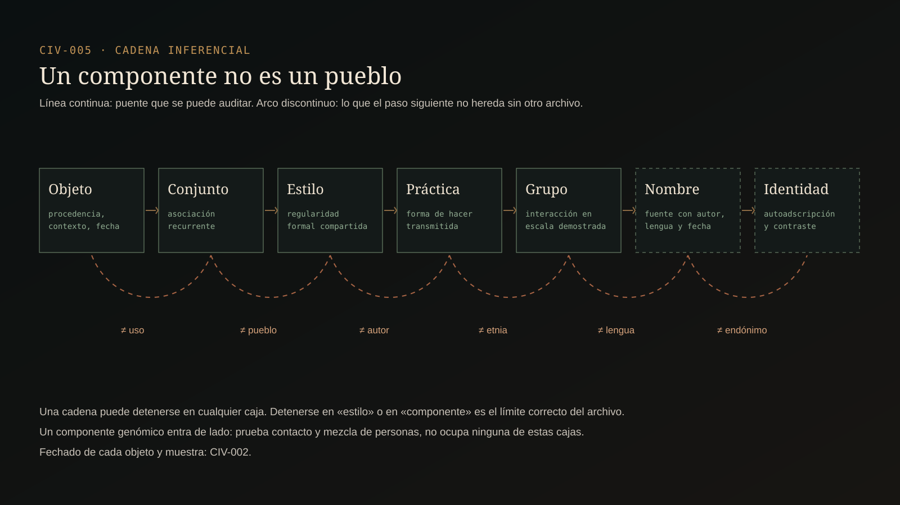
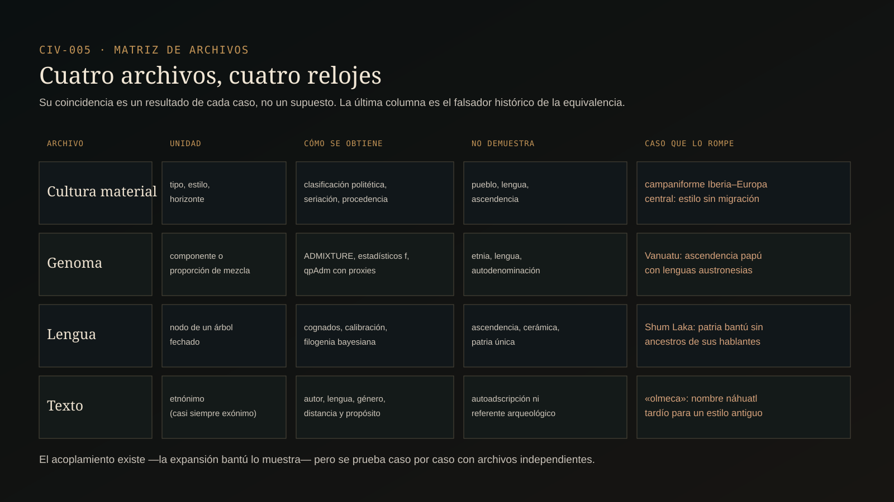

# CIV-005 — Nombres e identidades: del objeto al pueblo sin atajos






## Pregunta central

¿Cómo pasamos de un objeto, un estilo cerámico, una lengua reconstruida o un componente de ancestría a hablar de un «pueblo» con nombre e identidad, sin convertir cada clasificación moderna en un sujeto histórico?

CIV-005 es un expediente metodológico, como [CIV-002](INVESTIGACION_CIV_002_FECHADO_ARQUEOLOGICO_HISTORICO.md) lo fue para el fechado. No narra la historia de un grupo: fija la cadena que los expedientes regionales deben recorrer antes de escribir «los X hicieron» y deja visible dónde se detiene cada archivo.

```text
1 objeto
        ↓ procedencia, contexto y fecha (CIV-002)
2 conjunto
        ↓ asociación recurrente y criterio de clasificación declarado
3 estilo / «cultura arqueológica»
        ↓ cadena operativa, uso y contexto de acción
4 práctica
        ↓ escala de interacción demostrada (hogar, red, región)
5 grupo
        ↓ fuente lingüística, textual u oral independiente
6 nombre
        ↓ autoadscripción, contraste y situación histórica
7 identidad
```

Una cadena puede terminar legítimamente en cualquier nivel. Detenerse en «estilo» o en «componente de ancestría» no es un fracaso: es el límite correcto de ese archivo (`CLAIM-CIV-IDENTITY-CHAIN-001`).

## Respuesta breve

Ninguno de los cuatro archivos que suelen invocarse —cultura material, lengua, ADN y textos— lleva por sí solo hasta una identidad. La cerámica agrupa objetos; un componente genómico estima proporciones de ascendencia bajo un modelo con poblaciones de referencia; una lengua reconstruida es un nodo de un árbol con calibraciones; un etnónimo en un texto es casi siempre el nombre que otro dio. Cada uno puede coincidir con los demás en un caso concreto, pero la coincidencia es un resultado empírico que hay que demostrar, no un supuesto de partida.

La historia de la disciplina explica por qué la regla importa. Kossinna convirtió «provincias culturales» en pueblos y esos pueblos en reclamos territoriales; Childe hizo de la «cultura arqueológica» un instrumento de clasificación, pero asumió que expresaba un «pueblo». Las críticas procesual y posprocesual separaron estilo, función e identidad. La paleogenómica reabrió la pregunta con datos nuevos y potentes —el campaniforme, la ascendencia esteparia, Lapita, la expansión bantú— y con ella el riesgo de volver a nombrar «pueblos» con etiquetas cerámicas. Los casos auditados muestran tres desenlaces distintos: ancestría que cambia sin que cambie la lengua (Vanuatu), un estilo que se difunde en parte sin migración (campaniforme entre Iberia y Europa central) y lengua, gente y cerámica que se mueven juntas con mezcla local (bantú). Por eso el acoplamiento se evalúa caso por caso (`CLAIM-CIV-IDENTITY-COUPLING-CASEWISE-001`).

## LO OBSERVADO

Se observan objetos con procedencia, asociaciones recurrentes, frecuencias de atributos, contextos funerarios y domésticos, composiciones químicas y petrográficas de pastas, genotipos de individuos fechados, vocabularios de lenguas actuales y documentadas, y textos que nombran colectividades. No se observan «los campaniformes», «los yamnaya», «los olmecas» ni «los protobantúes»: esos nombres son clasificaciones modernas o exónimos con autor, fecha y propósito.

## 1. Siete niveles que no se heredan

| Nivel | Unidad | Qué exige para afirmarse | No demuestra por sí solo |
|---|---|---|---|
| objeto | pieza con procedencia | contexto, asociación y fecha (CIV-002) | uso, autor ni pertenencia |
| conjunto | asociación recurrente de tipos | criterio de clasificación, muestra y escala declarados | límite social |
| estilo | regularidad formal compartida | cadena operativa, producción y circulación | quién lo hizo ni con qué sentido |
| práctica | forma de hacer reproducida (enterrar, cocinar, construir) | contextos múltiples y aprendizaje o transmisión plausibles | grupo consciente de sí |
| grupo | colectividad que interactúa en una escala | redes, parentesco, movilidad o residencia demostradas | nombre, lengua ni frontera |
| nombre | designación documentada | fuente que lo registra, autor, lengua y fecha | autoadscripción |
| identidad | adscripción relacional y situada | autodenominación, contraste con otros y contexto histórico | permanencia, homogeneidad ni ascendencia común |

El [marco crítico](MARCO_CRITICO_CIVILIZACION.md) ya separaba cerámica y pueblo, lengua y ascendencia, ADN e identidad. CIV-005 convierte esas parejas en una cadena con exigencias explícitas y prueba la regla en casos donde los datos son abundantes, no sólo donde faltan.

## 2. Kossinna: la Siedlungsarchäologie y su uso político

Gustaf Kossinna presentó en 1911 la «arqueología de asentamiento» como método para remontar pueblos históricos hacia la prehistoria: las provincias culturales nítidamente delimitadas corresponderían a pueblos o tribus determinados, de modo que la continuidad material permitiría seguir a los «germanos» hacia atrás en el tiempo (`SRC-KOSSINNA-HERKUNFT-1911`). La fórmula se cita aquí a través de la historiografía; CIV-005 no reprodujo el texto original.

Su consecuencia política fue directa. La equivalencia cultura = pueblo = territorio permitió reclamar como «antiguamente germánicos» los lugares donde aparecían ciertos tipos, y la arqueología del régimen nazi la convirtió en instrumento institucional de propaganda y de legitimación expansiva (`SRC-ARNOLD-NAZI-ARCHAEOLOGY-1990`). El método no se invalida por su uso, sino por su inferencia: la frontera de una distribución de objetos no observa una frontera de pertenencia (`CLAIM-CIV-IDENTITY-KOSSINNA-001`).

Heyd volvió a ese nombre en 2017 para advertir que las grandes síntesis paleogenómicas de 2015 reproducían, con mejores datos, la misma ecuación entre identificación étnica y cultura arqueológica (`SRC-HEYD-KOSSINNA-2017`).

## 3. Childe: la «cultura» como clasificación y el «pueblo» como supuesto

En el prefacio de *The Danube in Prehistory* (1929), Childe definió la cultura arqueológica como un complejo de tipos —cerámica, útiles, adornos, ritos funerarios, formas de casa— que aparecen asociados de manera recurrente; en la misma página añadió que asumía que ese complejo era la expresión material de lo que hoy se llamaría un «pueblo», y que sólo si se asociaba de forma regular y exclusiva con restos esqueléticos de un tipo físico específico se atrevería a hablar de «raza» (`SRC-CHILDE-DANUBE-1929`, pp. v–vi, texto consultado).

La lectura auditada separa las dos frases. La primera es un procedimiento de clasificación verificable; la segunda es un puente no demostrado. El tercer escalón —tipo físico como «raza»— anticipa el riesgo actual: sustituir el esqueleto por el genoma no cambia la estructura del argumento (`CLAIM-CIV-IDENTITY-CHILDE-CULTURE-001`). Chapman muestra además que las categorías de Childe, como la oposición entre tells y sitios planos, cargaban de antemano supuestos sobre permanencia y complejidad (`SRC-CHAPMAN-DANUBE-2009`).

## 4. Las críticas: función, etnicidad situacional y clasificación politética

**Procesual.** Binford sostuvo en 1962 que la cultura material no es un conjunto de rasgos equivalentes: clases tecnómicas, sociotécnicas e ideotécnicas responden a subsistemas distintos, y explicar semejanzas por «influencias» o «migraciones» entre unidades geográficas no es una explicación (`SRC-BINFORD-ANTHROPOLOGY-1962`). La crítica desplazó la pregunta de «quién» a «qué función» (`CLAIM-CIV-IDENTITY-PROCESSUAL-001`).

**Posprocesual.** Siân Jones reunió la teoría antropológica de la etnicidad para la arqueología: la identidad étnica es relacional, situada y cambiante; la cultura material puede participar en su expresión en ciertos contextos, pero no existe una correspondencia uno a uno entre distribuciones de objetos y grupos étnicos (`SRC-JONES-ETHNICITY-1997`, consultado por metadatos e índice). La etnicidad pasa a ser algo que se demuestra en un contexto, no una propiedad que se lee en un mapa de tipos (`CLAIM-CIV-IDENTITY-ETHNICITY-SITUATIONAL-001`).

**Politética.** Las culturas arqueológicas se definen hoy como clasificaciones politéticas: ningún rasgo es necesario ni suficiente, y el resultado depende de la escala, del conjunto de atributos y de la tradición nacional que las construyó (`SRC-ROBERTS-VANDERLINDEN-CULTURES-2011`). Una «cultura» puede ser útil como unidad de comparación y, a la vez, no corresponder a ningún colectivo que se reconociera como tal (`CLAIM-CIV-IDENTITY-POLYTHETIC-001`).

## LO MEDIDO

Se miden frecuencias de atributos, composición elemental y mineralógica de pastas, genotipos en cientos de miles de posiciones del genoma, estadísticos de alelos compartidos, cognados en listas de vocabulario básico y fechas radiocarbónicas asociadas a estilos. Cada medición pertenece a su archivo: un estadístico `f4` no mide pertenencia, ni un cognado mide ascendencia, ni un análisis de activación neutrónica mide quién controlaba el intercambio.

## 5. Qué mide un componente de ancestría

Un «componente» genómico no es una población que existió, sino un parámetro de un modelo.

- **Agrupamiento (ADMIXTURE).** Estima, por máxima verosimilitud, la fracción de cada individuo atribuible a `K` poblaciones ancestrales hipotéticas a partir de genotipos de individuos no emparentados (`SRC-ALEXANDER-ADMIXTURE-2009`). `K` lo elige el analista, las «poblaciones» se definen por la muestra disponible y el gráfico de barras resultante es una descomposición estadística.
- **Ajuste de mezclas (estadísticos `f` y qpAdm).** ADMIXTOOLS proporciona pruebas formales de mezcla y estimaciones de proporción y fecha bajo un conjunto declarado de fuentes y de poblaciones de referencia externas (`SRC-PATTERSON-ADMIXTOOLS-2012`). Una proporción como «`~75 %` de ascendencia afín a Yamnaya» significa: el modelo con esas fuentes, en ese conjunto de referencias, no se rechaza y asigna esa fracción.
- **Proxies.** Las fuentes son individuos muestreados que *representan* a una población no observada directamente; el nombre de la fuente —«Yamnaya», «Anatolia Neolítico»— es el nombre del lugar o la cultura donde se excavó el proxy.

Dos resultados metodológicos limitan la lectura. Lawson, van Dorp y Falush mostraron que el mismo gráfico de barras puede surgir de historias distintas —deriva fuerte, aislamiento, mezcla real— y que sin pruebas de ajuste puede ser engañoso (`SRC-LAWSON-BADMIXTURE-2018`). Harney y colaboradores hallaron por simulación que qpAdm es robusto en muchos escenarios, incluidos baja cobertura y daño, pero desaconsejaron mezclar datos antiguos y actuales, usar demasiadas referencias en un modelo y analizar historias con flujo génico prolongado (`SRC-HARNEY-QPADM-2021`).

Conclusión de método: un componente de ancestría puede probar contacto, mezcla y desplazamiento de personas; no prueba lengua, etnia, autodenominación ni frontera social (`CLAIM-CIV-IDENTITY-ANCESTRY-COMPONENT-001`, `CLAIM-CIV-IDENTITY-MODEL-FIT-001`). CIV-003 ya aplicó esa regla en Asia sudoccidental (`CLAIM-CIV-SWASIA-ANCESTRY-NOT-IDENTITY-001`) y CIV-004 la aplica a un genoma de Nuwayrat, que prueba contacto y no la composición de «los egipcios» (`CLAIM-CIV-NILE-GENOME-CONTACT-001`).

### El problema del nombre de los grupos genéticos

Los estudios suelen nombrar los conglomerados genéticos con designaciones culturales («ascendencia esteparia», «grupo campaniforme»). Eisenmann y colaboradores advirtieron que ese préstamo ignora la historia problemática del concepto de cultura y propusieron tres alternativas —numérica, mixta y geográfico-temporal— con sus ventajas y costos (`SRC-EISENMANN-CLUSTER-NAMES-2018`). Nombrar un conglomerado con una cultura no es neutral: hace que el lector oiga un pueblo donde hay un parámetro (`CLAIM-CIV-IDENTITY-CLUSTER-NAMES-001`).

## 6. El campaniforme: un fenómeno con dos respuestas

Entre `~2750` y `2500 a. C.` la cerámica campaniforme se difundió por Europa occidental y central y desapareció entre `2200` y `1800 a. C.`. Olalde y colaboradores publicaron datos genómicos de `400` europeos del Neolítico, la Edad del Cobre y del Bronce, `226` de ellos asociados con artefactos campaniformes. Hallaron afinidad genética limitada entre los individuos campaniformes de Iberia y los de Europa central, lo que excluye la migración como mecanismo importante de difusión entre ambas regiones; en cambio, en Gran Bretaña la llegada del complejo campaniforme introdujo mucha ascendencia esteparia y se asoció con el reemplazo de aproximadamente el `90 %` del acervo genético en unos pocos siglos (`SRC-OLALDE-BEAKER-2018`).

El caso es decisivo para el método: **el mismo estilo** circuló por dos mecanismos. Los individuos enterrados con vasos campaniformes no comparten una ascendencia, por lo que «los campaniformes» no designan un pueblo; designan un conjunto de prácticas —ajuar, vaso, adorno, rito— adoptado por poblaciones distintas y, en algunas regiones, llevado por gente que llegaba (`CLAIM-CIV-IDENTITY-BEAKER-001`). El estudio, además, no mide lengua ni autodenominación.

## 7. Yamnaya, la cerámica cordada y las lenguas indoeuropeas

### Lo que el archivo genómico sostiene

Haak y colaboradores generaron datos de `69` europeos de hace `8000–3000` años: los individuos de la cerámica cordada de Alemania remontaban `~75 %` de su ascendencia a una población afín a los pastores Yamnaya de la estepa, una señal que los autores leyeron como migración masiva y como apoyo a un origen estepario de al menos parte de las lenguas indoeuropeas de Europa (`SRC-HAAK-STEPPE-2015`). Allentoft y colaboradores, con `101` genomas de baja cobertura de Eurasia, describieron la Edad del Bronce como periodo de migraciones y reemplazos a gran escala, «consistentes» con esa difusión lingüística (`SRC-ALLENTOFT-BRONZE-2015`). En 2024, con `317` genomas nuevos e imputación de más de `1600` individuos, el mismo grupo describió una segunda gran sustitución de ascendencia que alcanzó la mayor parte de Europa en `~1000` años tras `~5000 BP` (`SRC-ALLENTOFT-POSTGLACIAL-2024`).

El cambio de ascendencia en Europa central y septentrional en el III milenio a. C. está bien sostenido por varias series independientes de muestras (`CLAIM-CIV-IDENTITY-STEPPE-TURNOVER-001`).

### Lo que no sostiene por sí solo

La lengua no está en el genoma. El vínculo entre ascendencia esteparia e indoeuropeo es una inferencia que combina tres archivos con relojes distintos:

| Archivo | Resultado | Fuente |
|---|---|---|
| filogenia léxica bayesiana, `103` lenguas | apoyo decisivo a un origen anatolio agrícola `8000–9500` años atrás | `SRC-BOUCKAERT-IE-2012` |
| filogenia con restricciones de ancestralidad | apoyo fuerte al origen estepario, `6500–5500 BP` | `SRC-CHANG-IE-2015` |
| filogenia con ancestros muestreados y cognados recodificados | raíz `~8120` años; modelo «híbrido» con patria al sur del Cáucaso y rama posterior hacia la estepa | `SRC-HEGGARTY-INDOEUROPEAN-2023` |
| ADN antiguo de `435` individuos | clina Cáucaso–bajo Volga que aporta ~cuatro quintos de la ascendencia Yamnaya y al menos un décimo a la de los anatolios de la Edad del Bronce de habla hitita; propone la última unidad protoindoanatolia entre `4400` y `4000 a. C.` | `SRC-LAZARIDIS-IE-2025` |

Las filogenias lingüísticas cambian con la codificación de cognados y las calibraciones; el ADN localiza poblaciones, no hablantes. La propuesta de Lazaridis y colaboradores es la síntesis genómica más detallada hasta 2026, pero la frase «los hablantes del protoindoanatolio fueron la gente de la clina CLV» sigue siendo un puente entre un modelo genético y uno lingüístico. El hogar y el tiempo de la familia indoeuropea continúan abiertos entre modelos que hoy convergen parcialmente (`CLAIM-CIV-IDENTITY-IE-LANGUAGE-OPEN-001`).

### Las críticas: Heyd, Furholt, Frieman y Hofmann, Hakenbeck

- Heyd argumenta que, en lugar de una transmisión única de Yamnaya a la cerámica cordada, el registro muestra siglos de conexiones e interacciones a escala continental, hasta Iberia, y que las muestras yamnaya de 2015 procedían de pocos sitios de una sola región (`SRC-HEYD-KOSSINNA-2017`, consultado por resumen y extractos).
- Furholt sostiene que los nuevos datos se presentan con supuestos de la arqueología histórico-cultural criticada entre 1970 y 1990: cultura material compartida = grupo social; culturas homogéneas y delimitadas que actúan como agentes externos del cambio (`SRC-FURHOLT-MASSIVE-2018`). En 2021 propone leer las grandes sustituciones como suma de movilidad a pequeña escala, circulación de personas, fisión y fusión de comunidades e interacción translocal (`SRC-FURHOLT-MOBILITY-2021`).
- Frieman y Hofmann examinan cómo se combinó el ADN antiguo con el estudio de migraciones y cómo activistas de extrema derecha reutilizan esos resultados para una imagen de Europa amenazada (`SRC-FRIEMAN-HOFMANN-2019`); Hakenbeck documenta que tratar conglomerados genéticos como grupos étnicos alimenta discursos de pureza racial (`SRC-HAKENBECK-FAR-RIGHT-2019`).

Estas críticas no niegan los datos de reemplazo: discuten la escala de la unidad que migra, el lenguaje de «pueblos» y los usos públicos (`CLAIM-CIV-IDENTITY-MIGRATION-CRITIQUE-001`).

## 8. Lapita y los austronesios: ascendencia y lengua desacopladas

La filogenia de `400` lenguas austronesias sitúa su origen en Taiwán hace `~5230` años, con pausas y pulsos de expansión (`SRC-GRAY-AUSTRONESIAN-2009`). Los primeros genomas antiguos de Vanuatu (`~3100–2700 BP`) y Tonga (`~2700–2300 BP`) asociados con la cultura Lapita tenían poca o ninguna ascendencia papú y coincidían con una población de origen asiático oriental que ya no existe sin mezcla (`SRC-SKOGLUND-PACIFIC-2016`). Lipson y colaboradores mostraron que gente de ascendencia casi enteramente papú llegó a Vanuatu hacia `2300 BP` y que esa ascendencia sigue siendo de `80–90 %` en la mayoría de las islas (`SRC-LIPSON-VANUATU-2018`). Posth y colaboradores documentaron el reemplazo casi completo de la ascendencia Lapita-austronesia por ascendencia de Oceanía Cercana **sin** que las lenguas papúes reemplazaran a las austronesias; lo describen como continuidad lingüística con reemplazo de población, extremadamente rara (`SRC-POSTH-VANUATU-2018`).

En 2026, `21` individuos de Palau (`2900–500 BP`) mostraron `~60 %` de ascendencia afín a Asia oriental y `~40 %` papú desde la primera ocupación, con mezcla anterior al poblamiento: un patrón distinto al de los individuos Lapita del suroeste del Pacífico (`SRC-LIU-PALAU-2026`).

El caso es el falsador histórico de la regla «genes y lenguas viajan juntos»: en Vanuatu la ascendencia cambió y la lengua permaneció. «Lapita» sigue siendo un estilo cerámico y un horizonte arqueológico, no un pueblo con una sola ascendencia, y la expansión austronesia no fue un único bloque demográfico (`CLAIM-CIV-IDENTITY-LAPITA-DECOUPLING-001`).

## 9. La expansión bantú: tres archivos que convergen sin fundirse

**Lingüística.** La dispersión de lenguas bantúes desde la región de los Grassfields, entre Nigeria y Camerún, entre `~5000` y `1500` años atrás es el proceso lingüístico y demográfico principal del Holoceno tardío africano; sus motores siguen en debate (`SRC-BOSTOEN-BANTU-2018`). Una filogenia fechada de `~400` lenguas indica que las poblaciones siguieron corredores de sabana y que entrar en selva retrasó la ocupación en promedio `300` años (`SRC-GROLLEMUND-BANTU-2015`).

**Cerámica y radiocarbono.** `1149` fechas asociadas a `115` estilos cerámicos en `726` sitios de la selva del Congo muestran dos periodos de actividad, cada uno con fase de expansión y fase de regionalización, separados por un colapso poblacional amplio entre `400` y `600 d. C.`; la distribución actual de las lenguas no refleja directamente las etapas tempranas (`SRC-SEIDENSTICKER-CONGO-2021`).

**Genética.** `1318` individuos de `35` poblaciones del centro-oeste de África indican un primer movimiento hacia el sur a través de la selva y adaptación facilitada por mezcla con poblaciones locales (`SRC-PATIN-BANTU-2017`); `1763` participantes —`1526` hablantes bantúes de `147` poblaciones— y `12` genomas de la Edad del Hierro tardía apoyan un modelo de fundadores en serie con flujo génico local significativo (`SRC-FORTES-LIMA-BANTU-2024`). Y un dato adversario: los cuatro niños de Shum Laka, en la probable patria bantú, no son ancestros sustanciales de los hablantes bantúes actuales (`SRC-LIPSON-SHUMLAKA-2020`).

Aquí lengua, gente y prácticas sí se desplazaron en buena medida juntas; la convergencia de tres archivos independientes es fuerte. Aun así, ningún estilo cerámico equivale a una lengua, la expansión fue un proceso de «oleada sobre oleada» con colapsos y reasentamientos, la mezcla local fue constante y el sitio de la patria lingüística no conserva la ascendencia de sus hablantes posteriores (`CLAIM-CIV-IDENTITY-BANTU-CONVERGENCE-001`).

## LO INFERIDO

Se infieren mezclas, sustituciones y continuidades de ascendencia bajo modelos; difusiones de estilos por contacto o por movimiento de gente; filogenias de lenguas con fechas condicionadas; y, sólo cuando convergen archivos independientes con sus propios relojes, desplazamientos conjuntos de personas, prácticas y hablas. No se infiere identidad colectiva a partir de ninguno de esos resultados sin una fuente que registre adscripción.

## 10. Olmeca: estilo, exónimo y «cultura madre»

«Olmeca» procede del náhuatl (*ōlmēcah*, «gente del hule») y en el siglo XVI designaba a gente de las tierras bajas del Golfo de esa época; los investigadores del siglo XX lo aplicaron a un estilo del Formativo que floreció unos dos mil años antes. Esa etimología es la de las obras de referencia y no se verificó aquí en el texto de Pool, que sí define el objeto como la «cultura arqueológica llamada olmeca», surgida hace `~3500` años en el sur de Veracruz y Tabasco (`SRC-POOL-OLMEC-2007`). La autodenominación de quienes vivieron en San Lorenzo o La Venta no está documentada.

El debate de 2005 muestra cómo un archivo de procedencia no zanja una tesis sobre pueblos y poder. Blomster, Neff y Glascock determinaron por análisis elemental el origen de `725` muestras cerámicas y concluyeron que las vasijas de estilo olmeca exportadas procedían de la región de San Lorenzo, lo que apoyaba la prioridad olmeca en el primer estilo unificado (`SRC-BLOMSTER-OLMEC-2005`). La petrografía de cinco sitios indicó, en cambio, intercambios recíprocos y orígenes múltiples de las cerámicas con motivos (`SRC-STOLTMAN-OLMEC-2005`), y Flannery y colaboradores señalaron sesgo de muestreo y la ausencia de un argumento puente entre motivos en la cerámica e instituciones sociales, políticas y religiosas (`SRC-FLANNERY-OLMEC-2005`).

Lo auditado es estrecho: hubo un estilo con iconografía reconocible, producido en varios lugares y circulante, con San Lorenzo como productor importante. «Cultura madre» es una tesis sobre prioridad y dominio que el archivo de pastas no alcanza; «los olmecas» es un exónimo aplicado a un estilo (`CLAIM-CIV-IDENTITY-OLMEC-STYLE-001`).

## 11. Endónimos, exónimos y fuentes escritas foráneas

Los nombres que llegan por escrito suelen ser exónimos: «celtas» procede de *Keltoi*, término que autores griegos y romanos aplicaron a pueblos del continente; su extensión a los hablantes de lenguas de Irlanda, Gales o Bretaña nació de la filología comparada de comienzos del siglo XVIII, con Pezron y Lhuyd, y se volvió identidad nacional después (`SRC-COLLIS-CELTS-2003`, tesis atribuida por reseñas y síntesis; el libro no se leyó). «Olmeca» es un nombre náhuatl tardío. «Badariense» o «Naqada» son topónimos modernos de sitios convertidos en fases (CIV-004), y «natufiense», «PPNB» o «Uruk» son etiquetas arqueológicas (`CLAIM-CIV-SWASIA-NAMES-001`).

Un exónimo informa sobre quien nombra: su lengua, sus categorías, su distancia y su propósito (etnografía griega o romana, tributo mexica, crónica castellana, censo colonial). Trasladarlo a una cultura arqueológica exige demostrar que el autor designaba a la misma gente en el mismo lugar y tiempo, y aun así no recupera la autoadscripción (`CLAIM-CIV-IDENTITY-EXONYMS-001`).

## 12. Ética: los datos genómicos y las comunidades descendientes

El muestreo de ADN antiguo destruye tejido. Fox y Hawks señalaron en 2019 que nadie llevaba un registro completo de los restos humanos muestreados ni de la tasa de éxito entre laboratorios, y que las comunidades descendientes debían participar en las preguntas y prioridades; el tamaño de muestra no es el único objetivo (`SRC-FOX-HAWKS-2019`). Wagner y colaboradores propusieron cinco recomendaciones: consultar formalmente, atender consideraciones culturales y éticas, involucrar a las comunidades y fortalecer capacidades, planear la devolución de resultados y la gestión de datos, y asumir responsabilidad a largo plazo (`SRC-WAGNER-ADNA-2020`). En 2021, `64` investigadores de `31` países propusieron cinco pautas globales: cumplir las normas de cada lugar, preparar un plan detallado, minimizar el daño, poner los datos a disposición tras la publicación y comprometer a otras partes interesadas desde el inicio, señalando que las recomendaciones nacidas en Norteamérica no siempre se generalizan (`SRC-ALPASLAN-ETHICS-2021`).

El caso de Chaco Canyon ilustra la tensión. Kennett y colaboradores identificaron en Pueblo Bonito un matrilinaje de élite persistente `~330` años a partir de nueve individuos con mitogenomas idénticos (`SRC-KENNETT-CHACO-2017`); investigadores indígenas y aliados objetaron la ausencia de consulta tribal, descripciones culturalmente insensibles y posibles efectos sobre comunidades marginadas (`SRC-CLAW-CHACO-2017`).

Para CIV-005 la ética es parte del método, no un apéndice: quién define la pregunta y el nombre del grupo condiciona qué se mide y qué se publica, y un componente rotulado con una etnia actual puede afectar reclamaciones de tierra, restitución o identidad (`CLAIM-CIV-IDENTITY-ETHICS-001`).

## 13. El adversario fuerte: a veces ancestría y lengua sí viajan juntas

La mejor versión del modelo contrario dice: cuando una migración es grande y rápida, los recién llegados aportan la mayor parte de los genes, la lengua y muchas prácticas; la etnicidad situacional es real pero secundaria frente a sustituciones del `75–90 %`. Kristiansen y colaboradores defienden un proceso de hibridación entre migrantes de la estepa y grupos neolíticos del norte de Europa que habría formado una nueva cultura material, la cordada, y un nuevo dialecto, el protogermánico, con exogamia como mecanismo de integración (`SRC-KRISTIANSEN-CORDED-2017`). El caso bantú y el británico del campaniforme muestran desplazamientos donde gente, objetos y, en el primero, lenguas sí se movieron juntos.

CIV-005 acepta el núcleo empírico: el acoplamiento existe y puede ser fuerte. Rechaza su conversión en regla: Vanuatu desacopla lengua y ascendencia; el campaniforme ibérico desacopla estilo y ascendencia; Shum Laka desacopla patria lingüística y ascendencia de los hablantes posteriores. El acoplamiento es una hipótesis que cada caso debe probar con archivos independientes y no un supuesto en ninguna dirección (`CLAIM-CIV-IDENTITY-COUPLING-CASEWISE-001`).

## 14. Protocolo de nombres para los expedientes regionales

Cada expediente regional que use un nombre colectivo declarará en una tabla:

| Pregunta | Respuesta exigible |
|---|---|
| ¿qué clase de nombre es? | tipo/estilo, cultura arqueológica, conglomerado genético, lengua o familia, etnónimo documentado, polity |
| ¿quién lo acuñó y cuándo? | autor, fecha, tradición académica o fuente antigua |
| ¿qué archivo lo sostiene? | objetos, genomas, cognados, texto, tradición oral |
| ¿con qué escala? | sitio, red, región, horizonte |
| ¿qué puente lo une a otro archivo? | covariación demostrada con muestra, fecha y modelo |
| ¿es endónimo o exónimo? | lengua y autor de la forma registrada |
| ¿qué no demuestra? | lengua, ascendencia, autoadscripción, frontera, continuidad |
| ¿quién fue consultado? | comunidades descendientes, instituciones patrimoniales, normas locales |

Un enunciado como «los X migraron» se reescribe como «individuos enterrados con el conjunto X en los sitios Y muestran, bajo el modelo Z, ascendencia de la fuente W» hasta que exista el puente que autorice más (`CLAIM-CIV-IDENTITY-PROTOCOL-001`).

## LOS SUPUESTOS

1. los objetos y los individuos muestreados tienen procedencia y fecha auditadas (CIV-002);
2. las clasificaciones materiales declaran atributos, escala y tradición que las define;
3. las poblaciones de referencia de un modelo genómico representan razonablemente a las fuentes invocadas;
4. el ajuste estadístico de un modelo de mezcla no implica que sea la única historia compatible;
5. las filogenias lingüísticas dependen de cognados, calibraciones y préstamos declarados;
6. los textos que nombran colectividades se leen con autor, lengua, género y distancia;
7. las identidades son relacionales y cambian; no se suponen continuas desde un origen;
8. las comunidades descendientes y las normas locales forman parte del diseño del estudio.

## LAS INCERTIDUMBRES

- muestreo genómico desigual por región, periodo y tipo de enterramiento;
- elección de `K`, de fuentes y de referencias en los modelos de ascendencia;
- confusión entre deriva, aislamiento y mezcla en los gráficos de barras;
- ventanas de mezcla largas frente a pulsos únicos;
- codificación de cognados, préstamos y calibraciones en filogenias lingüísticas;
- fechas de estilos cerámicos asociadas indirectamente;
- procedencia de pastas por química frente a petrografía;
- exónimos sin equivalente documentado del propio grupo;
- ausencia de datos de autoadscripción para casi toda la prehistoria.

## LAS ALTERNATIVAS

| Señal | Lectura focal | Alternativas |
|---|---|---|
| distribución de un tipo cerámico | territorio de un pueblo | intercambio, imitación, moda, producción especializada, red de élites |
| reemplazo de ascendencia | sustitución de lengua y cultura | continuidad lingüística (Vanuatu), adopción por los recién llegados, bilingüismo |
| ascendencia compartida | identidad común | parentesco lejano sin conciencia colectiva; conglomerado definido por el muestreo |
| estilo compartido sin ascendencia compartida | difusión cultural pura | movilidad de pocos individuos, especialistas o matrimonios no detectados |
| árbol lingüístico fechado | migración en esa fecha | cambio de lengua sin movimiento masivo; error de calibración |
| exónimo en un texto | nombre del grupo arqueológico | otro grupo en el mismo lugar; categoría del autor; nombre posterior |
| exportación de cerámica con motivos | dominio político del productor | intercambio recíproco; prestigio sin control |
| componente rotulado con una cultura | pueblo de esa cultura | parámetro de un modelo con proxies de ese sitio |

## LAS CONTROVERSIAS

1. escala de las migraciones del III milenio a. C.: eventos masivos o suma de movilidad local;
2. hogar y cronología del indoeuropeo: estepa, Anatolia, modelo híbrido o clina Cáucaso–bajo Volga;
3. campaniforme: fenómeno de prácticas o desplazamiento de gente según la región;
4. por qué persistieron las lenguas austronesias tras el reemplazo de ascendencia en Vanuatu;
5. expansión bantú: proceso único o «oleada sobre oleada» con colapsos;
6. olmeca: «cultura madre» o «culturas hermanas»;
7. cómo nombrar conglomerados genéticos;
8. consentimiento y consulta para restos sin afiliación documentada y pautas globales frente a locales.

Los modelos, pruebas discriminatorias y estados se registran en `CONTROVERSIES.md`; CIV-005 no resuelve ninguna por elección editorial de un bando.

## QUÉ PODRÍA FALSARLO

1. un caso donde una cultura arqueológica, un conglomerado genético y un etnónimo coincidan con fronteras nítidas y una autoadscripción documentada, de modo que la cadena colapse legítimamente en ese caso (refutaría la generalidad de la separación, no su uso como protocolo);
2. una prueba de que los gráficos de agrupamiento y qpAdm no confunden deriva con mezcla bajo las condiciones habituales de muestreo antiguo;
3. un archivo independiente que fije el hogar indoeuropeo con un vínculo directo entre población y habla;
4. nuevas muestras campaniformes ibéricas y centroeuropeas que muestren ascendencia compartida;
5. un caso de reemplazo de ascendencia casi completo con continuidad lingüística que resulte ser artefacto de muestreo en Vanuatu;
6. ADN antiguo de la patria bantú que sí sea ancestral a los hablantes posteriores y una cerámica que covaríe estrictamente con la lengua;
7. análisis de procedencia que reconcilien química y petrografía y muestren exportación unidireccional desde San Lorenzo con evidencia institucional del dominio;
8. una fuente que documente el endónimo de una población prehistórica nombrada hoy con un exónimo.

## NIVEL DE CONFIANZA

| Resultado | Confianza | Motivo |
|---|---|---|
| siete niveles no equivalentes | A-SEM | objetos, operaciones y fuentes diferentes |
| Kossinna y su uso político | A historiográfico | texto, recepción y uso institucional documentados |
| definición de Childe y su supuesto | A textual | prefacio consultado |
| componente = parámetro de modelo | A método | definición del algoritmo y de los estadísticos |
| límites de ADMIXTURE y qpAdm | A/B método | simulaciones publicadas |
| campaniforme con dos mecanismos | B-COND | `400` genomas; muestreo regional desigual |
| sustitución de ascendencia en el III milenio a. C. | B | varias series independientes |
| hogar y fecha del indoeuropeo | C / abierto | modelos lingüísticos y genómicos no convergen del todo |
| desacoplamiento lengua–ascendencia en Vanuatu | B-COND | series antiguas y actuales; mecanismo lingüístico abierto |
| convergencia bantú de tres archivos | B-COND | lingüística, cerámica y genética independientes |
| «cultura madre» olmeca | C / disputado | química y petrografía discrepan; falta puente institucional |
| un exónimo como endónimo | D / no operacional | requiere fuente que no existe para casi toda la prehistoria |

## QUÉ SABEMOS REALMENTE

Sabemos que la cultura material, la ascendencia, la lengua y los nombres escritos son archivos distintos, cada uno con su unidad, su reloj y su modelo. Sabemos que pueden coincidir —la expansión bantú es el ejemplo más fuerte— y que pueden separarse por completo —Vanuatu, el campaniforme ibérico, Shum Laka—. Sabemos que la ecuación cultura = pueblo tuvo usos políticos documentados y que vuelve con cada técnica nueva si nadie declara el puente. Y sabemos que un componente de ancestría es una estimación condicional a fuentes y referencias, útil para probar movimientos de personas e inútil para asignar etnias.

## QUÉ TODAVÍA NO SABEMOS

No sabemos dónde y cuándo se habló el protoindoeuropeo con un vínculo directo entre hablantes y genomas; por qué las lenguas austronesias sobrevivieron al reemplazo de ascendencia en Vanuatu; cómo se repartieron en la expansión bantú los movimientos de gente, la adopción de lenguas y la difusión de cerámica en cada región; si hubo o no una red asimétrica centrada en San Lorenzo. Para casi toda la prehistoria no conocemos cómo se llamaban a sí mismos los grupos, y es probable que nunca lo sepamos.

## Conclusión

CIV-005 no prohíbe hablar de grupos. Exige que cada nombre declare qué es: tipo, cultura, conglomerado, lengua, etnónimo o polity; quién lo acuñó; qué archivo lo sostiene y qué puente lo une a los demás. Con esa regla, la paleogenómica deja de ser un oráculo de pueblos y se convierte en lo que mide bien: movimiento, mezcla y parentesco de personas fechadas. CIV-005 no cambia el estado de ningún claim de CIV-001, CIV-003 ni CIV-004; sus expedientes regionales futuros aplicarán el protocolo del punto 14.

## Fuentes núcleo auditadas

- Childe (1929), *The Danube in Prehistory*, Oxford: Clarendon Press, prefacio pp. v–vi (Internet Archive `in.ernet.dli.2015.283123`).
- Binford (1962), DOI `10.2307/278380`.
- Alexander, Novembre y Lange (2009), DOI `10.1101/gr.094052.109`.
- Patterson et al. (2012), DOI `10.1534/genetics.112.145037`.
- Haak et al. (2015), DOI `10.1038/nature14317`.
- Olalde et al. (2018), DOI `10.1038/nature25738`.
- Lawson, van Dorp y Falush (2018), DOI `10.1038/s41467-018-05257-7`.
- Posth et al. (2018), DOI `10.1038/s41559-018-0498-2`.
- Harney et al. (2021), DOI `10.1093/genetics/iyaa045`.
- Seidensticker et al. (2021), DOI `10.1126/sciadv.abd8352`.
- Alpaslan-Roodenberg et al. (2021), DOI `10.1038/s41586-021-04008-x`.
- Fortes-Lima et al. (2024), DOI `10.1038/s41586-023-06770-6`.
- Lazaridis et al. (2025), DOI `10.1038/s41586-024-08531-5`.
- Liu et al. (2026), DOI `10.1016/j.cell.2026.02.011`.
