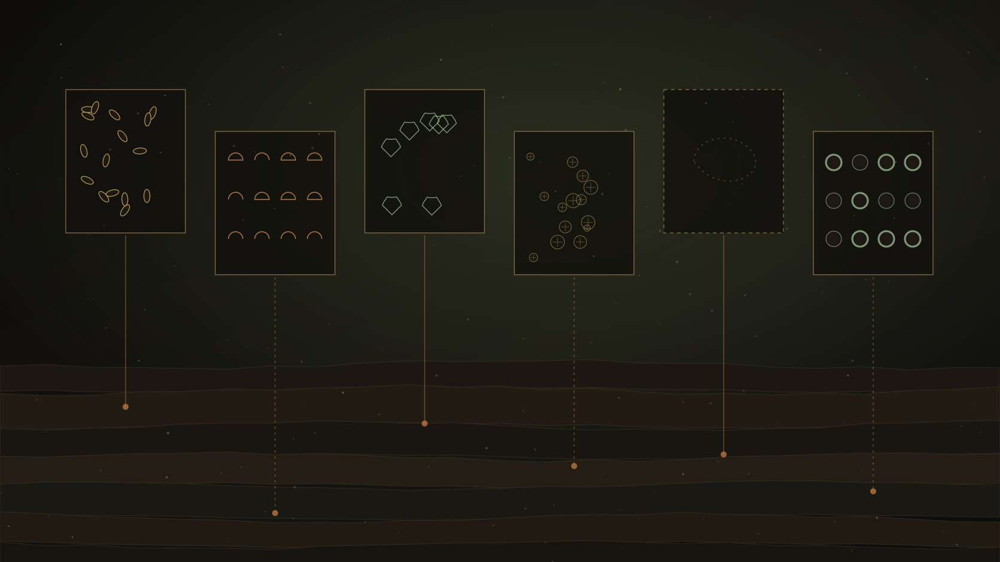
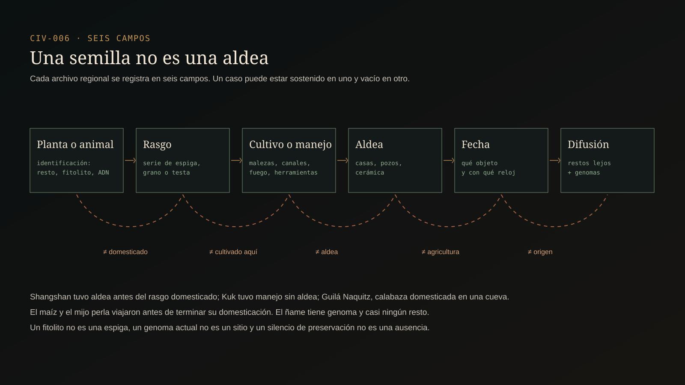
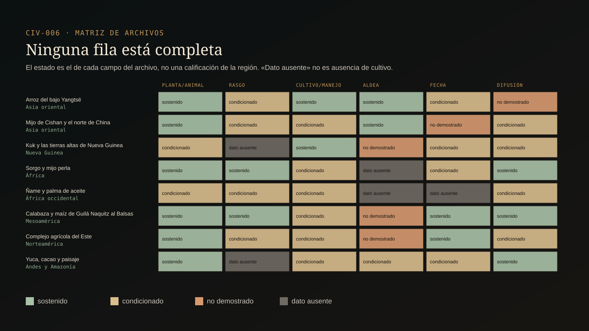

# CIV-006 — Domesticaciones y aldeas por archivos regionales: una semilla no es una aldea

## Pregunta central

¿Qué sostiene cada archivo regional —el arroz del Yangtsé, el mijo de Cishan, los drenajes de Kuk, los cereales y tubérculos africanos, la calabaza y el maíz mesoamericanos, el complejo agrícola del Este de Norteamérica, la yuca y el cacao de la Amazonía— cuando se separan la planta o el animal, el rasgo de domesticación, el cultivo o manejo, la aldea, la fecha y la difusión?

CIV-006 es el sexto punto de [`PROGRAMA_CRONOLOGICO_GLOBAL.md`](PROGRAMA_CRONOLOGICO_GLOBAL.md) y el tercer expediente regional, después de [CIV-003](INVESTIGACION_CIV_003_ASIA_SUDOCCIDENTAL_CAMPAMENTOS_ALDEAS_URBANISMOS.md) y [CIV-004](INVESTIGACION_CIV_004_VALLE_NILO_AFRICA_NORORIENTAL.md). No repite la [Investigación 050](INVESTIGACION_050_AGRICULTURAS_DOMESTICACIONES_MULTIPLES.md), que fijó el vocabulario (manejo ≠ cultivo ≠ domesticación ≠ dependencia) y la comparación entre continentes. Aquí se baja a los archivos: qué pieza, de qué capa, con qué reloj y contra qué adversario. El fechado se lee con [CIV-002](INVESTIGACION_CIV_002_FECHADO_ARQUEOLOGICO_HISTORICO.md) y los nombres de culturas con el protocolo de [CIV-005](INVESTIGACION_CIV_005_NOMBRES_IDENTIDADES.md).

## Respuesta breve

En ninguna de las regiones auditadas una sola pieza fecha «el origen de la agricultura». Lo que se observa son seis campos que avanzan a ritmos propios. En el bajo Yangtsé hubo aldea y arroz consumido hacia `10–9 ka cal BP`, pero el rasgo decisivo —la espiga que no se desgrana— siguió seleccionándose durante milenios; la fecha de `~11 ka` para la domesticación depende de fitolitos cuya morfología y cuyo carbono siguen en disputa. En Cishan se almacenó mijo común en pozos, pero la fecha de esos depósitos y el estado domesticado de ese mijo no salen del mismo archivo. En Kuk hay manejo de humedal y procesamiento de taro desde `~10 ka`, sin aldea y sin cereal; su propio excavador reabrió en 2026 si la fase 1 fue cultivo. En África los cereales tienen series y genomas; el ñame y la palma de aceite casi no dejan restos, y ese silencio es de preservación, no de historia. En Mesoamérica, calabaza y maíz no llegaron juntos; el maíz moderno es una mezcla con otro teosinte miles de años después del inicio. En el Este de Norteamérica, el rasgo que define a un cultivo domesticado resultó parcialmente plástico. En la Amazonía, la yuca y el cacao tienen archivos directos, y el «paisaje domesticado» es real en lugares concretos y disputado como regla de toda la cuenca.

## LO OBSERVADO

Se observan granos, bases de espiguilla, fitolitos, almidones en herramientas, residuos en cerámica, mazorcas, cáscaras y semillas desecadas, pozos de almacenamiento, paleocanales y superficies de cultivo, polen, carbón, genomas de plantas antiguas y actuales, y genomas de personas fechadas. No se observan «la revolución neolítica», «el centro de origen», la intención de domesticar ni la economía completa de una aldea.

## 1. Seis campos que no se heredan

Cada caso de este expediente se registra en seis campos. La regla es la de 050 llevada al archivo: ningún campo se deduce del anterior (`CLAIM-CIV-DOMREG-SIX-FIELDS-001`).

| Campo | Qué se pregunta | Archivo típico | No demuestra por sí solo |
|---|---|---|---|
| organismo | ¿qué taxón está presente y cómo se identificó? | macrorrestos, fitolitos, almidones, ADN | que esté domesticado |
| rasgo de domesticación | ¿qué carácter heredable cambió y en qué proporción? | bases de espiguilla, tamaño de grano, testa, genomas | que se cultivara en ese sitio ni que dominara la dieta |
| cultivo o manejo | ¿qué hicieron las personas con la planta o el paisaje? | malezas, canales, fuego, herramientas, residuos | rasgo domesticado ni aldea |
| aldea | ¿hubo residencia prolongada, almacenamiento, casas? | arquitectura, pozos, cerámica, cementerios | agricultura ni dependencia |
| fecha | ¿qué objeto se fechó y con qué método? | `14C` de semilla, carbón, fitolito, sedimento; OSL; modelos genómicos | que la fecha sea la del cultivo, la del rasgo o la de la aldea |
| difusión | ¿qué se movió: personas, plantas, técnicas o genes? | distribución de restos fechados, genomas de cultivo y de personas | que se moviera un «paquete» ni un pueblo |

El campo «fecha» es el más traicionero porque cada archivo fecha un objeto distinto: la muerte de una semilla, el carbono ocluido en un fitolito, el carbón de una capa, la coalescencia de un modelo genómico. Una fecha pertenece a su muestra y a su contexto (`CLAIM-CIV-DATING-CONTEXT-001`, auditado en CIV-002); en este expediente se declara siempre qué se fechó (`CLAIM-CIV-DOMREG-DATED-OBJECT-001`).

## 2. Asia oriental: arroz en el bajo Yangtsé

### Shangshan: aldea y arroz antes de la espiga domesticada

Jiang y Liu presentaron Shangshan, en el bajo Yangtsé, como la aldea sedentaria al aire libre más antigua del sur de China, con arroz que interpretaron como domesticado (`SRC-JIANG-LIU-SHANGSHAN-2006`). En 2024, el análisis de microfósiles —fitolitos, almidones y hongos— asociados a vasijas de la fase más temprana de Shangshan (`~10 000–9000 cal BP`) indicó que el arroz se consumía como alimento básico y se usaba para elaborar bebidas fermentadas con un iniciador de mohos y levaduras, junto con lágrimas de Job, otras gramíneas, bellotas y lirio (`SRC-LIU-SHANGSHAN-BEER-2024`).

Los seis campos quedan así: organismo, arroz identificado por microfósiles; manejo, uso intensivo y preparación compleja; aldea, sí, con cerámica; fecha, la de la fase del sitio; rasgo y dependencia, no establecidos por ese archivo. Shangshan es un caso de aldea con arroz, no de agricultura de arroz demostrada (`CLAIM-CIV-DOMREG-SHANGSHAN-VILLAGE-001`).

### La serie larga de fitolitos y su doble incertidumbre

Zhang y colaboradores publicaron en 2024 una secuencia de fitolitos de arroz de Shangshan y Hehuashan que propone cuatro etapas: arroz silvestre presente al menos desde hace `100 000` años, explotación como recurso recolectado hacia `24 000`, cultivo predoméstico hacia `13 000` y domesticación hacia `11 000` años antes del presente (`SRC-ZHANG-RICE-TRAJECTORY-2024`). Zuo y colaboradores ya habían fechado directamente fitolitos y usado la morfología de los fitolitos bulliformes para situar arroz domesticado en `~9.4–9.0 ka cal BP` (`SRC-ZUO-RICE-2017`).

El resultado depende de dos puentes que no son los de una semilla:

- **El rasgo.** Los fitolitos bulliformes no son la espiguilla. Su morfología se usa como indicador de domesticación, pero responde también a ambiente, agua y maduración; 050 ya registró esa disputa (`CONT-RICE-DOMESTICATION-PROXIES-001`), y Ma y colaboradores encontraron en 2026 trayectorias subregionales con efecto ambiental reconocido (`SRC-MA-RICE-2026`).
- **La fecha.** Lo que se fecha es carbono ocluido en el sílice. Zuo y colaboradores compararon fitolitos con carbón y semillas de la misma profundidad en siete pozos de seis sitios y hallaron edades en general coherentes, salvo un valor atípico que atribuyeron a procesos posdeposicionales (`SRC-ZUO-PHYTOLITH-DATING-2016`). Santos, Masion y Alexandre sostienen lo contrario: el carbono de los fitolitos es una mezcla de carbono fotosintético y carbono del suelo de edades múltiples, y como no puede conocerse de antemano esa proporción, el método no es una herramienta fiable de datación `14C` (`SRC-SANTOS-PHYTOLITH-CARBON-2018`).

Conclusión: la secuencia de 2024 es la propuesta más larga y continua del registro, pero «domesticación hacia `11 000` años» es una inferencia condicionada a un proxy morfológico y a un reloj discutido (`CLAIM-CIV-DOMREG-RICE-PHYTOLITH-001`).

### Bases de espiguilla: el rasgo que tardó milenios

La base de espiguilla registra si el grano se desprendía solo (silvestre) o quedaba en la planta hasta la trilla. En Huxi, restos de `9000–8400 BP` en una probable zanja incluyen bases silvestres, intermedias y domesticadas; las series de Kuahuqiao (`8000–7700 BP`), Tianluoshan (`7000–6500 BP`), Majiabang y Liangzhu muestran que la selección hacia el no desprendimiento continuó (`SRC-ZHENG-HUXI-RICE-2016`). En Tianluoshan las bases no desprendibles pasan de `27 %` a `39 %` en unos tres siglos (`SRC-FULLER-RICE-2009`; `CLAIM-CIV-RICE-TRAJECTORY-001`, que este expediente audita).

El debate de 2007 sigue vivo en la escala. Fuller, Harvey y Qin propusieron cultivo predoméstico desde `~5000 a. C.` y domesticación hacia `4000 a. C.` en el bajo Yangtsé (`SRC-FULLER-PRESUMED-RICE-2007`); Liu, Lee, Jiang y Zhang respondieron que hacia `9000 cal BP` ya se cosechaba arroz silvestre y se iniciaba un cultivo que llevaría a la domesticación, y discutieron los criterios de granos inmaduros, tamaño y forma (`SRC-LIU-RICE-RESPONSE-2007`). La síntesis de Gross y Zhao deja el punto en que ambos convergen: cultivo desde al menos `~8000 BP` y el rasgo del no desprendimiento sin fijarse durante otros mil años o más (`SRC-GROSS-ZHAO-RICE-2014`). La diferencia entre «primer arroz cultivado» y «población domesticada» se mide en milenios (`CLAIM-CIV-DOMREG-RICE-RACHIS-001`).

### Kuahuqiao: manejo del humedal con fuego e inundación

Polen, algas, esporas de hongos y microcarbón de los sedimentos de Kuahuqiao indican que hacia `7700 cal BP` sus habitantes eligieron pantanos costeros para cultivar arroz y asentarse, usaron fuego para despejar matorral de aliso y mantener un pastizal húmedo de tipo arrozal, y probablemente controlaron con bordos las inundaciones de agua salobre, hasta que una transgresión marina cubrió el sitio hacia `7550 cal BP` (`SRC-ZONG-KUAHUQIAO-2007`). Índices de carbón construidos con experimentos modernos muestran, en cambio, que durante el periodo Kuahuqiao (`8250–7450 BP`) la intensidad del fuego disminuyó y que no hubo roza y quema a gran escala: el cultivo fue de área pequeña (`SRC-HU-KUAHUQIAO-FIRE-2020`).

Los dos archivos convergen en un manejo local e intenso de un humedal costero durante unos dos siglos, y divergen en la escala del fuego. Kuahuqiao es aldea, manejo y arroz con selección en curso; no es todavía un paisaje regional de arrozales (`CLAIM-CIV-DOMREG-KUAHUQIAO-001`).

### Lo que dicen los genomas actuales

El mapa de `446` arroces silvestres y `1083` cultivados de Huang y colaboradores ubica la primera domesticación de *japonica* en la zona media del río Perla, en el sur de China, y deriva a *indica* de cruces posteriores (`SRC-HUANG-RICE-GENOME-2012`). La arqueología la sitúa en el Yangtsé (`SRC-GROSS-ZHAO-RICE-2014`). La discrepancia no se resuelve votando: un genoma actual registra dónde sobreviven hoy los haplotipos de poblaciones silvestres emparentadas, después de milenios de extinción local y flujo génico; un depósito fechado registra dónde se usó y seleccionó arroz. El lugar de origen del linaje y el lugar del cultivo más antiguo pueden no coincidir (`CLAIM-CIV-DOMREG-RICE-GENOME-ORIGIN-001`).

## 3. Asia oriental: mijo en el norte de China

### Cishan: pozos llenos, fecha y estado en disputa

Cishan, en el norte de China, es célebre por pozos de almacenamiento con grano. Lu y colaboradores analizaron `46` muestras de grano de cinco pozos nuevos y una conservada en el museo del sitio; los fitolitos de la cascarilla y los componentes biomoleculares identifican mijo común (*Panicum miliaceum*), y las nuevas fechas `14C` sitúan los depósitos entre `~10 300` y `~8700 cal BP`, con una pequeña proporción de mijo cola de zorra (*Setaria italica*) sólo después. El mismo artículo recuerda que las dos fechas de carbón de los pozos excavados antes daban `7355 ± 100` y `7235 ± 105` años `14C` sin calibrar (`SRC-LU-CISHAN-MILLET-2009`, texto completo consultado).

Separado en campos: el **organismo** está bien identificado; el **almacenamiento** a gran escala está documentado; la **fecha** depende de qué se fechó en restos de grano descompuestos y choca con las fechas anteriores de carbón del mismo sitio; el **rasgo** de domesticación no lo mide un fitolito de cascarilla, que distingue especies, no estados silvestre/doméstico. Los almidones en herramientas del norte de China prueban uso temprano de mijos, no su domesticación (`SRC-YANG-MILLET-2012`). Cishan sostiene un mijo común almacenado; «el mijo domesticado más antiguo hacia `10 300` años» es una inferencia condicionada (`CLAIM-CIV-DOMREG-CISHAN-001`).

### La ventana del rasgo

Stevens y colaboradores reunieron medidas de grano de `43` sitios: el tamaño medio del mijo común aumenta sin pausa entre `6000` y `3300 a. C.` y luego diverge entre poblaciones; atribuyen el aumento inicial a la domesticación, sitúan la ventana de domesticación entre `7000` y `3300 a. C.` y suponen un largo periodo previo de cosecha y manejo a pequeña escala (`SRC-STEVENS-BROOMCORN-2020`). Zhuang y Fuller describen las culturas anteriores a Yangshao como etapas de manejo creciente del paisaje y cultivo predoméstico de mijos, con compromisos variables con el manejo del cerdo, y advierten que no todas esas trayectorias llegaron a la domesticación: hubo economías intermedias y callejones sin salida (`SRC-ZHUANG-FULLER-LOESS-2024`). El rasgo del mijo, como el del arroz, se fija milenios después de su primer uso (`CLAIM-CIV-DOMREG-MILLET-WINDOW-001`).

### Lo nuevo de 2026: personas, no plantas

Siete individuos de Donghulin y otros dos sitios, de `11 000` a `7300` años atrás, muestran continuidad genética profunda desde el Holoceno temprano hasta la intensificación del cultivo de mijo; los autores lo leen como desarrollo local y no como difusión démica desde fuera (`SRC-YANG-DONGHULIN-2026`). Es un archivo de personas: apoya que quienes cultivaron mijo descendían de los recolectores locales, no fecha el rasgo del mijo ni nombra a un «pueblo del mijo» (`CLAIM-CIV-DOMREG-MILLET-CONTINUITY-2026-001`; véase `CLAIM-CIV-IDENTITY-ANCESTRY-COMPONENT-001`).

## 4. Nueva Guinea: Kuk sin cereal y sin aldea

Denham y colaboradores fecharon en Kuk, en las tierras altas de Papúa Nueva Guinea, una fase 1 de alteración y manejo del humedal hacia `10.22–9.91 ka cal BP`, montículos de cultivo en la fase 2 (`6.95–6.44 ka`) y zanjas de drenaje posteriores (`SRC-DENHAM-KUK-2003`). El archivo de herramientas añade procesamiento: un artefacto de la fase 1 (`~10 ka`) conserva almidones de taro (*Colocasia esculenta*) y, según el reanálisis estadístico de 2025, también de kudzu (*Pueraria montana* var. *lobata*); el mismo estudio advierte que los almidones de taro y de un ñame (*Dioscorea esculenta*) son morfológicamente indistinguibles y que la identificación descansa en el contexto sedimentario, el hábitat y el uso (`SRC-COSTER-KUK-STARCH-2025`; `CLAIM-CIV-DOMREG-KUK-STARCH-001`).

En 2026 Denham propuso un método multidisciplinario para reconocer cultivo itinerante en el pasado y lo aplicó a la propia superficie de `~10 000` años de Kuk para evaluar si su uso breve representa cultivo itinerante u otras formas de explotación vegetal (`SRC-DENHAM-KUK-REASSESS-2026`). Que el autor del hallazgo reabra la lectura de la fase 1 es un dato epistémico: el manejo del humedal está sostenido; el cultivo en la fase 1 es una de las hipótesis en evaluación (`CLAIM-CIV-DOMREG-KUK-PHASE1-OPEN-001`). Por eso CIV-006 deja `CLAIM-CIV-KUK-CULTIVATION-001` en `TRAZADO`.

El banano añade la escala: genética, arqueología y lingüística reconstruyen una domesticación en varias etapas y por varias rutas, con personas que movieron y cultivaron bananos desde Nueva Guinea hasta África occidental durante el Holoceno (`SRC-PERRIER-BANANA-2011`). Y Waim, en las tierras altas, conserva entre `5050` y `4200` años atrás la talla figurativa en piedra y las manos de mortero más antiguas de Oceanía, hachas-azuela planilaterales, fibras y transferencia de obsidiana entre islas; los autores lo leen como un «Neolítico» independiente unos mil años antes de la llegada de Lapita (`SRC-SHAW-WAIM-2020`). Los objetos son archivo; «Neolítico» es un rótulo clasificatorio que CIV-005 obliga a declarar como tal (`CLAIM-CIV-DOMREG-BANANA-WAIM-001`).

Kuk es el caso más claro de cultivo y manejo sin aldea de piedra, sin cereal y sin animal domesticado: los seis campos no avanzan juntos.

## 5. África: cereales con series, tubérculos con silencios

### Ganado: el debate ya auditado

El ganado doméstico temprano de Nabta Playa y su contraargumento —uros cazados y caprinos domésticos antes que el bovino— quedaron auditados en CIV-004 (`CLAIM-CIV-NILE-CATTLE-DEBATE-001`). CIV-006 no los repite: los cita como recordatorio de que en África el manejo animal y el cereal no comparten reloj (`CLAIM-CIV-NILE-HERDING-BEFORE-FARMING-001`).

### Sorgo

En KG23, en el este de Sudán, impresiones de espiguillas en cerámica del IV milenio a. C. combinan morfologías silvestres y domesticadas (`SRC-WINCHELL-SORGHUM-2017`). Los genomas antiguos agregan una serie temporal: archaeogenomas de sorgo de una sola localidad de la Nubia egipcia no muestran el cuello de botella esperado por la domesticación, sino un descenso gradual de la diversidad y una carga de mutaciones acumulada; las presiones de selección actuaron de forma escalonada sobre la arquitectura de la planta, la nutrición y la adaptación local, y la introgresión posterior entre razas intercambió rasgos (`SRC-SMITH-SORGHUM-GENOMES-2019`). La domesticación del sorgo no se concentró en su inicio: siguió durante toda su historia de cultivo (`CLAIM-CIV-DOMREG-SORGHUM-GENOMES-001`).

### Mijo perla

En el valle del Tilemsi (Malí), granos y valvas de `~4500` años muestran que el raquis no quebradizo antecedió al aumento de tamaño del grano (`SRC-MANNING-PEARL-MILLET-2011`). Los genomas completos sitúan el origen del mijo perla cultivado en el Sahara occidental y el inicio de su expansión en África hacia `4900` años atrás, con flujo génico del silvestre al cultivado (`SRC-BURGARELLA-PEARL-MILLET-2018`). En 2025, dos cariópsides de Bhando Qubo, en el bajo Indo (Sindh), fechadas directamente en `2578–2358` y `2576–2356 cal a. C.`, resultaron contemporáneas de la evidencia más antigua de mijo perla domesticado en África (`SRC-JIMENEZ-ARTEAGA-PEARL-MILLET-2025`).

La difusión del mijo perla al sur de Asia fue tan temprana como su primer rasgo domesticado visible en África: la planta viajó mientras su domesticación seguía en curso (`CLAIM-CIV-DOMREG-PEARL-MILLET-001`).

### Ñame y palma de aceite: los silencios de preservación

El ñame africano (*Dioscorea rotundata*) se domesticó, según el resecuenciado de genomas completos y modelos estadísticos, a partir de una especie de bosque, y su expansión agrícola empezó en la cuenca del Níger, como el arroz africano y el mijo perla (`SRC-SCARCELLI-YAM-2019`, `SRC-CUBRY-AFRICAN-RICE-2018`). Ese resultado no tiene contraparte arqueológica comparable: los tubérculos casi no se carbonizan de forma reconocible, sus almidones pueden confundirse con los de otras plantas (`SRC-COSTER-KUK-STARCH-2025`) y el registro excavado del bosque tropical africano es escaso.

La palma de aceite deja más: en tres abrigos rocosos del centro de Ghana con material Kintampo, los macrorrestos indican un uso significativo del fruto; el polen de palma aumenta en el Holoceno tardío y su lectura —clima o acción humana— está en disputa; los autores concluyen que la arboricultura formó parte de la subsistencia y que las personas no deben descartarse como agentes del paisaje (`SRC-DANDREA-OIL-PALM-2006`). Uso y probable manejo están sostenidos; un rasgo domesticado de la palma no se ha medido.

En el bosque africano, la ausencia de restos de tubérculos y frutos no es evidencia de ausencia de cultivo. El genoma fecha linajes; el depósito, cuando existe, fecha uso. Para el ñame, la fecha arqueológica de su domesticación es hoy un dato ausente (`CLAIM-CIV-DOMREG-TUBER-PALM-SILENCE-001`).

## LO MEDIDO

Se miden proporciones de bases de espiguilla desprendibles y no desprendibles, tamaños de grano y de semilla, grosor de testa, morfometría de fitolitos bulliformes y de cascarilla, almidones en herramientas, edades `14C` de semillas, mazorcas, carbón, fitolitos y residuos, diversidad y estructura de genomas de cultivos antiguos y actuales, proporciones de mezcla entre linajes y abundancias de especies arbóreas en inventarios forestales. Cada cifra conserva su objeto: una edad de fitolito no es la de la semilla vecina, ni un porcentaje de espiguillas mide la dieta.

## 6. Américas: Mesoamérica

### Guilá Naquitz: calabaza temprana, maíz tardío

En la cueva de Guilá Naquitz (Oaxaca), especímenes de *Cucurbita pepo* con morfología domesticada tienen nueve edades AMS entre `~10` y `8 ka cal BP` (`SRC-SMITH-CUCURBITA-1997`; `CLAIM-CIV-GUILA-CUCURBITA-001`, que este expediente audita). En la misma cueva, las mazorcas de maíz fechadas por AMS dieron `5400` años `14C` (`~6250` años calendario), entonces las más antiguas de América; los estratos más antiguos carecen de macrorrestos y fitolitos de *Zea*, aunque se había reportado polen, por lo que Piperno y Flannery concluyeron que las prácticas que llevaron a la domesticación ocurrieron probablemente en otro lugar de México (`SRC-PIPERNO-FLANNERY-GUILA-2001`).

Ese «otro lugar» se buscó en el Balsas: en Xihuatoxtla, almidones y fitolitos de maíz y una calabaza domesticada en herramientas de molienda están presentes al menos desde `8.7 ka cal BP`, en una pequeña ocupación estacional (`SRC-RANERE-BALSAS-2009`, `SRC-PIPERNO-BALSAS-2009`). De Guilá Naquitz al Balsas, el archivo pasa de mazorcas a microrrestos: la fecha más antigua del maíz pertenece a otro tipo de objeto que su primera mazorca. Ninguno de los dos sitios es una aldea (`CLAIM-CIV-DOMREG-GUILA-MAIZE-001`).

En El Gigante (Honduras), fechas directas sobre semillas, cáscaras y tallos muestran uso de guaje y de *Cucurbita* silvestre desde `~10 950 cal BP`, sobre todo como recipientes; *C. moschata* domesticada aparece hacia `4035 cal BP` y *C. pepo* hacia `2190 cal BP` (`SRC-DOMIC-CUCURBIT-2024`). Usar una calabaza no es haberla domesticado, y la primera calabaza útil pudo ser un recipiente, no un alimento.

### El maíz: una domesticación con mezcla tardía

Con `264` plantas genotipadas en `99` microsatélites, Matsuoka y colaboradores sostuvieron una domesticación única del maíz en el sur de México hace `~9000` años (`SRC-MATSUOKA-MAIZE-2002`). En 2023, Yang y colaboradores mostraron que el maíz moderno procede de una mezcla entre aquel maíz antiguo y *Zea mays* ssp. *mexicana* en las tierras altas de México, unos `4000` años después de iniciada la domesticación (`SRC-YANG-TEOSINTES-2023`). El maíz llegó a Sudamérica como domesticado parcial hacia al menos `7000 cal BP` y allí siguió su selección (`SRC-KISTLER-MAIZE-2018`); genomas de El Gigante de `2300–1900 cal BP` muestran mezcla entre la primera y la segunda oleada y reintroducción en Centroamérica (`SRC-KISTLER-GIGANTE-2020`); en el valle de Peruaçu (Brasil) se conservaron mazorcas con caracteres primitivos entre `1010` y `570` años atrás (`SRC-COSTA-PERUACU-MAIZE-2024`). En Tehuacán, isótopos de venados y conejos indican que el cultivo de maíz comenzó en un periodo relativamente húmedo y que la intensificación agrícola llegó siglos después (`SRC-SOMERVILLE-TEHUACAN-2026`).

«Una domesticación» describe el inicio de un linaje, no un acontecimiento cerrado: el maíz se cruzó, viajó y se seleccionó durante milenios, y el cultivo precedió en siglos a la intensificación (`CLAIM-CIV-DOMREG-MAIZE-ADMIXTURE-001`).

## 7. Américas: el complejo agrícola del Este de Norteamérica

Smith sintetizó la evidencia arqueológica y genética de cuatro plantas —*Iva annua*, *Chenopodium berlandieri*, *Cucurbita pepo* y *Helianthus annuus*— y concluyó que las cuatro se domesticaron de forma independiente en el este de Estados Unidos (`SRC-SMITH-ENA-2006`). En Riverton (Illinois), una ocupación breve fechada por AMS documenta hacia `3800 BP` el cultivo contemporáneo de guaje, *Iva*, girasol y dos variedades de quenopodio, con posible calabaza y cebadilla: antes de `4000 BP` sólo hay especies domesticadas aisladas (`SRC-SMITH-YARNELL-RIVERTON-2009`). La formación del complejo fue una ampliación de economías de caza y recolección en valles ricos, no una ruptura (`CLAIM-CIV-DOMREG-EAC-001`).

El archivo tiene un silencio de origen: no hay registros escritos ni orales de cómo se cultivaban esos «cultivos perdidos», que hoy se estudian con jardines experimentales (`SRC-MUELLER-LOST-CROPS-2017`). Y tiene un adversario fuerte en el rasgo: el quenopodio domesticado se reconoce por una testa delgada, y se suponía que las plantas no domesticadas producían ese tipo de semilla en `1–3 %`. Un jardín común y experimentos de carbonización mostraron que el quenopodio produce muchas más semillas de testa delgada (media de `50 %` en el experimento, `15–34 %` en las poblaciones parentales libres), que el cultivo aumenta esa proporción por plasticidad y que las semillas delgadas se preservan mejor de lo esperado (`SRC-BELCHER-GOOSEFOOT-2023`). Un conjunto carbonizado con semillas delgadas ya no basta para diagnosticar una población domesticada (`CLAIM-CIV-DOMREG-EAC-PLASTICITY-001`).

Lo nuevo de 2026 llega por un insecto: modelos demográficos de una mosca parásita especialista del tupinambo (*Helianthus tuberosus*) sitúan la separación entre sus poblaciones occidentales y las del valle de Ohio entre `6850` y `2700` años atrás, coherente con una expansión antropogénica del cultivo coetánea del complejo (`SRC-HIPPEE-SUNCHOKE-2026`). Es un archivo indirecto y modelado: apoya movimiento de la planta, no la fecha de su cultivo.

## 8. Américas: Andes y Amazonía

### Yuca

Un gen nuclear de copia única en `212` individuos indica que la yuca se domesticó a partir de poblaciones silvestres de *Manihot esculenta* en el borde sur de la cuenca amazónica (`SRC-OLSEN-SCHAAL-CASSAVA-1999`). El archivo arqueológico coincide en la región: en Teotonio, sobre el río Madeira, depósitos de `~9000–5000 cal BP` contienen yuca, calabaza y frijol, además de frutos comestibles que apuntan al inicio de la domesticación del paisaje (`SRC-WATLING-TEOTONIO-2018`), y en los Llanos de Moxos hay yuca desde `~10.35 ka` en islas de bosque (`SRC-LOMBARDO-AMAZONIA-2020`). En la vertiente andina, Nanchoc conserva adopciones escalonadas de maní, calabaza y algodón (`SRC-DILLEHAY-NANCHOC-2007`).

### Cacao de Santa Ana-La Florida

En Santa Ana-La Florida, en el sureste de Ecuador, tres líneas independientes —granos de almidón de cacao, residuos de teobromina absorbidos y ADN antiguo— documentan uso de *Theobroma cacao* hacia `5300` años atrás, la evidencia más antigua de su uso en América y la primera inequívoca en Sudamérica (`SRC-ZARRILLO-CACAO-2018`). Sus excavadores adscriben el sitio a la tradición arqueológica Mayo-Chinchipe; ese nombre es un topónimo moderno de ríos aplicado a un conjunto material, no un etnónimo (protocolo de `CLAIM-CIV-IDENTITY-PROTOCOL-001`; el resumen auditado no lo nombra). En 2024, residuos de cerámica de muchas culturas precolombinas mostraron uso de cacao fuera de su área amazónica de origen desde hace `5000` años y mezcla genética temprana entre poblaciones distantes de cacao, impulsada por personas (`SRC-LANAUD-CACAO-2024`).

Para el cacao, el campo «uso» está sostenido por tres archivos, el campo «difusión» por residuos y genomas, y el campo «rasgo de domesticación» sigue sin una serie morfológica comparable a las de los cereales (`CLAIM-CIV-DOMREG-CACAO-MANIOC-001`).

### Domesticación del paisaje y su adversario

Clement y colaboradores cuentan al menos `83` especies nativas con poblaciones domesticadas en algún grado y proponen paisajes domesticados con suelos antrópicos (`SRC-CLEMENT-AMAZONIA-2015`). Levis y colaboradores mostraron, con inventarios forestales de toda la cuenca, que `85` especies leñosas domesticadas tienen cinco veces más probabilidad de ser hiperdominantes y que su abundancia aumenta cerca de los sitios arqueológicos (`SRC-LEVIS-AMAZON-FORESTS-2017`). Iriarte y colaboradores sintetizan dos áreas de cultivo precoz —el bosque montano subandino y el suroeste amazónico— y documentan policultivo de maíz, yuca, camote y calabaza bajo dosel en tierras oscuras del Holoceno tardío (`SRC-IRIARTE-AMAZON-ORIGINS-2020`).

El adversario es empírico: suelos de `55` sitios del centro y oeste amazónicos mostraron carbón escaso y ausencia de fitolitos de cultivos y de perturbación en tiempos precolombinos en los interfluvios; el impacto humano fue pequeño, infrecuente y muy local allí (`SRC-MCMICHAEL-SPARSE-2012`). Los dos resultados se reconcilian en la escala: el paisaje domesticado está sostenido en riberas, sitios y regiones concretas, y su extensión a toda la cuenca sigue abierta (`CLAIM-CIV-DOMREG-AMAZON-LANDSCAPE-001`). La frase no autoriza tratar a la Amazonía como naturaleza intacta ni como jardín continuo.

## LO INFERIDO

Se infieren cultivo predoméstico, selección prolongada, manejo de humedales y bosques, almacenamiento y desplazamientos de plantas cuando el puente está presente en el mismo archivo. Se infiere que la aldea precedió en algunos lugares al rasgo domesticado (Shangshan), que el cultivo existió sin aldea (Kuk, Xihuatoxtla, Guilá Naquitz) y que las plantas viajaron antes de completar su domesticación (maíz, mijo perla). No se infieren centros únicos, paquetes, pueblos agricultores con nombre ni dependencia económica sin archivo de dieta.

## 9. Aldea y domesticación: cinco desacoples

| Caso | Aldea | Rasgo domesticado | Desacople |
|---|---|---|---|
| Shangshan | sí, `~10–9 ka` | fijación del no desprendimiento milenios después | aldea antes del rasgo |
| Kuahuqiao | sí, `~7.7 ka` | selección en curso | aldea con cultivo incompleto |
| Kuk | no demostrada | no medido en la fase 1 | manejo sin aldea |
| Guilá Naquitz / Xihuatoxtla | cueva y ocupación estacional | calabaza sí; maíz microrrestos | domesticación sin aldea |
| Riverton | ocupación breve | cinco especies | complejo de cultivos sin aldea agrícola |

La aldea y el cultivo domesticado aparecen juntos a veces, pero ninguno es condición del otro en los archivos auditados (`CLAIM-CIV-DOMREG-VILLAGE-DECOUPLED-001`). Este resultado audita en archivos de cuatro continentes `CLAIM-CIV-DOMESTICATION-MULTIREGIONAL-001`, que CIV-001 dejó trazado.

## 10. Difusión: las plantas viajan antes de terminar

| Planta | Viaje fechado | Estado del rasgo al viajar | Fuente |
|---|---|---|---|
| maíz | a Sudamérica al menos `~7000 cal BP` | domesticado parcial | `SRC-KISTLER-MAIZE-2018`, `SRC-KISTLER-GIGANTE-2020` |
| mijo perla | al bajo Indo `~2578–2356 cal a. C.` | contemporáneo del primer rasgo visible en África | `SRC-JIMENEZ-ARTEAGA-PEARL-MILLET-2025` |
| cacao | fuera de la Amazonía desde `~5000` años | sin serie de rasgos | `SRC-LANAUD-CACAO-2024` |
| banano | de Nueva Guinea hacia el oeste en el Holoceno | domesticación en varias etapas | `SRC-PERRIER-BANANA-2011` |

En estos casos la difusión no esperó a la domesticación completa: plantas parcialmente domesticadas circularon, se mezclaron y se siguieron seleccionando lejos de su origen (`CLAIM-CIV-DOMREG-DIFFUSION-BEFORE-FIXATION-001`). Mover una planta no exige mover un pueblo; en el norte de China, la continuidad genética de los cultivadores de mijo apunta a desarrollo local (`SRC-YANG-DONGHULIN-2026`).

## 11. El adversario fuerte: un reloj largo de fitolitos y un centro de verdad

La mejor versión contraria dice: la serie de fitolitos de Shangshan y Hehuashan es continua durante `100 000` años, está fechada y muestra etapas ordenadas; si se acepta, el bajo Yangtsé tuvo cultivo predoméstico hacia `13 000` años y domesticación hacia `11 000`, a la par del Creciente Fértil, y la búsqueda de «centros» sigue siendo legítima (`SRC-ZHANG-RICE-TRAJECTORY-2024`). En el mismo sentido, Cishan con `10 300` años y Kuk con `10 000` mostrarían inicios casi simultáneos en el Holoceno temprano.

CIV-006 acepta la parte empírica: hubo uso y cultivo temprano de arroz y mijo, y manejo temprano en Kuk. Rechaza la conversión en fechas de domesticación por tres razones verificables: el proxy bulliforme responde al ambiente; el carbono de los fitolitos tiene un componente del suelo cuya proporción no se conoce de antemano; y los rasgos de la espiga y del grano medidos en macrorrestos se fijan milenios después. Que el propio Denham reevalúe Kuk muestra que el debate no es entre escuelas, sino entre archivos.

## 12. Protocolo de nombres aplicado

Siguiendo `CLAIM-CIV-IDENTITY-PROTOCOL-001`, los nombres de este expediente se declaran así: «Shangshan», «Kuahuqiao», «Cishan», «Hemudu», «Yangshao» y «Kintampo» son topónimos de sitios convertidos en culturas arqueológicas; «Mayo-Chinchipe» es un topónimo fluvial aplicado a un conjunto material; «complejo agrícola del Este» es una categoría botánica de investigadores; «Neolítico» es un rótulo cronocultural. Ninguno es un endónimo ni designa a un grupo que se reconociera como tal. Las plantas y los paisajes estudiados son también conocimiento de comunidades indígenas y locales actuales, cuyas variedades y saberes forman parte de la cadena de evidencia (`CLAIM-DOMESTICATION-COEVOLUTION-AGENCY-001`).

## LOS SUPUESTOS

1. cada objeto fechado tiene procedencia y contexto auditados (CIV-002);
2. los criterios morfológicos de domesticación se calibran contra poblaciones silvestres y cultivadas actuales que abarcan su variación, incluida la plástica;
3. el carbono fechado pertenece al objeto que se declara;
4. los genomas actuales representan sólo linajes supervivientes;
5. la ausencia de restos de tubérculos y frutos se evalúa contra su probabilidad de preservación;
6. un sitio no representa una región ni una región un continente;
7. los nombres de culturas son clasificaciones modernas (CIV-005).

## LAS INCERTIDUMBRES

- morfología de fitolitos bulliformes como indicador de domesticación;
- carbono ocluido en fitolitos y su componente del suelo;
- fechas de restos de grano descompuestos frente a carbón del mismo sitio (Cishan);
- identificación de almidones de taro y ñame;
- plasticidad de la testa del quenopodio y de otros rasgos;
- genomas actuales frente a poblaciones silvestres extinguidas;
- muestreo arqueológico escaso en el bosque tropical africano y en los interfluvios amazónicos;
- modelos demográficos indirectos (mosca del tupinambo).

## LAS ALTERNATIVAS

| Señal | Lectura focal | Alternativas |
|---|---|---|
| fitolito bulliforme «doméstico» | población domesticada | ambiente, agua, maduración; variación silvestre |
| fecha de fitolito | edad de la planta | mezcla con carbono del suelo |
| pozos con mijo | agricultura de mijo domesticado | recolección y almacenamiento de mijo silvestre o predoméstico |
| almidón de taro | cultivo de taro | ñame u otra planta de almidón similar; recolección |
| superficie de Kuk | cultivo itinerante | otras formas de explotación vegetal |
| testa delgada | quenopodio domesticado | plasticidad en jardín o en poblaciones libres |
| genoma actual del arroz en el Perla | origen en el Perla | supervivencia diferencial de haplotipos silvestres |
| abundancia de especies domesticadas cerca de sitios | paisaje domesticado de la cuenca | efecto local; sesgo de muestreo hacia riberas |
| ausencia de ñame excavado | cultivo tardío | preservación diferencial |

## LAS CONTROVERSIAS

1. inicio de la domesticación del arroz: `~11 ka` por fitolitos o fijación del rasgo milenios después;
2. fiabilidad del `14C` de fitolitos;
3. origen del arroz *japonica*: Yangtsé arqueológico o Perla genómico;
4. fecha y estado del mijo de Cishan;
5. qué fue la fase 1 de Kuk;
6. testa delgada del quenopodio: rasgo domesticado o plasticidad;
7. extensión del paisaje domesticado amazónico;
8. fecha de domesticación del ñame y de la palma de aceite frente a un registro casi mudo.

Los modelos, las pruebas discriminatorias y el estado de cada una se registran en `CONTROVERSIES.md`; CIV-006 no resuelve ninguna eligiendo un bando.

## QUÉ PODRÍA FALSARLO

1. series de bases de espiguilla directamente fechadas en la fase temprana de Shangshan que muestren no desprendimiento fijado hacia `11 000` años;
2. dataciones pareadas a ciegas, en varios laboratorios, en las que el carbono de fitolitos coincida sistemáticamente con semillas de vida corta del mismo contexto;
3. genomas antiguos de arroz de ambas cuencas que fijen el origen de *japonica*;
4. fechas AMS sobre granos individuales de Cishan con morfología domesticada en `~10 ka`;
5. micromorfología y microrrestos de la superficie de Kuk, con controles fuera del sitio, que excluyan el cultivo o lo demuestren;
6. ADN antiguo de quenopodio que separe testa delgada genética de testa delgada plástica;
7. muestreo aleatorio de interfluvios amazónicos con señales de cultivo comparables a las de las riberas;
8. restos de ñame o parénquima con rasgos domesticados fechados en el Holoceno medio de África occidental;
9. un caso donde aldea, rasgo domesticado, cultivo y dependencia aparezcan juntos en el mismo horizonte fechado, que refutaría el desacople como regla, no como hallazgo de estos casos.

## NIVEL DE CONFIANZA

| Resultado | Confianza | Motivo |
|---|---|---|
| seis campos no equivalentes | A-SEM | objetos, métodos y relojes distintos |
| aldea y arroz en Shangshan `~10–9 ka` | B-LOCAL-COND | microfósiles y cerámica de un sitio |
| domesticación del arroz hacia `11 ka` | C | proxy bulliforme y reloj de fitolitos disputados |
| selección prolongada del no desprendimiento | B | series de varios sitios y síntesis |
| manejo del humedal en Kuahuqiao | B-LOCAL-COND | polen, carbón y sedimentos; escala del fuego discutida |
| origen genómico del arroz en el Perla | C / abierto | genomas actuales frente a arqueología |
| mijo común almacenado en Cishan | B especie; C fecha y estado | fechas en conflicto; fitolito de cascarilla no mide domesticación |
| ventana de domesticación del mijo `7000–3300 a. C.` | B-COND | serie de tamaño de grano de `43` sitios |
| continuidad genética de los cultivadores de mijo | B-COND | siete individuos |
| manejo y procesamiento en Kuk | B-COND | estratigrafía y almidones con identificación contextual |
| cultivo en la fase 1 de Kuk | C | reevaluado por su excavador en 2026 |
| sorgo sin cuello de botella inicial | B-LOCAL | serie de una localidad |
| mijo perla domesticado y difundido al Indo hacia `2500 a. C.` | B-COND | genomas y dos cariópsides fechadas |
| fecha arqueológica de domesticación del ñame | D / dato ausente | preservación |
| maíz con mezcla tardía de *mexicana* | B-COND | genética de poblaciones |
| complejo del Este hacia `3800 BP` | B | AMS y reanálisis de un sitio |
| testa delgada como diagnóstico | C tras 2023 | plasticidad experimental |
| cacao en Santa Ana-La Florida hacia `5300` años | B-COND | tres archivos independientes en un sitio |
| paisaje domesticado de toda la cuenca amazónica | C | evidencia local fuerte; interfluvios con poca señal |

## QUÉ SABEMOS REALMENTE

Sabemos que en Asia oriental, Nueva Guinea, África y las Américas hubo uso, manejo y cultivo de plantas desde el Holoceno temprano, cada uno con su archivo y su reloj; que el rasgo que define a un cultivo domesticado tardó milenios en fijarse en el arroz, el mijo, el sorgo y el maíz; que hubo aldeas antes que cultivos domesticados y cultivos sin aldeas; que plantas parcialmente domesticadas viajaron lejos; y que los tubérculos y frutos tropicales tienen genomas que hablan y depósitos casi mudos.

## QUÉ TODAVÍA NO SABEMOS

No sabemos si el arroz se domesticó hacia `11 000` años o milenios después, ni si su linaje nació en el Yangtsé o en el Perla; cuándo exactamente se domesticó el mijo de Cishan; si la fase 1 de Kuk fue cultivo; cuándo se domesticaron el ñame y la palma de aceite; cuánto del complejo del Este se definió por plasticidad; ni qué fracción de la Amazonía fue paisaje manejado. Tampoco sabemos cómo se llamaban a sí mismos quienes vivieron en estas aldeas.

## Conclusión

CIV-006 baja la comparación de 050 a los archivos y deja el mismo resultado con más resolución: una semilla no es una aldea, un fitolito no es una espiga, un genoma actual no es un sitio y un silencio de preservación no es una ausencia. Audita `CLAIM-CIV-DOMESTICATION-MULTIREGIONAL-001`, `CLAIM-CIV-GUILA-CUCURBITA-001` y `CLAIM-CIV-RICE-TRAJECTORY-001` de CIV-001 y deja `CLAIM-CIV-KUK-CULTIVATION-001` en `TRAZADO` mientras se resuelve la reevaluación de 2026. CIV-001 sigue `TRAZADO`.

## Fuentes núcleo auditadas

- Lu et al. (2009), DOI `10.1073/pnas.0900158106` (texto completo consultado).
- Zong et al. (2007), DOI `10.1038/nature06135`.
- Zheng et al. (2016), DOI `10.1038/srep28136`.
- Zhang et al. (2024), DOI `10.1126/science.ade4487`.
- Santos, Masion y Alexandre (2018), DOI `10.1016/j.quascirev.2018.08.007`.
- Stevens et al. (2020), DOI `10.1007/s00334-020-00804-z`.
- Coster et al. (2025), DOI `10.1017/qua.2025.10022`.
- Denham (2026), DOI `10.3389/fearc.2026.1818722`.
- Smith et al. (2019), DOI `10.1038/s41477-019-0397-9`.
- Jiménez-Arteaga et al. (2025), DOI `10.1038/s41598-025-20110-w`.
- Piperno y Flannery (2001), DOI `10.1073/pnas.98.4.2101`.
- Yang et al. (2023), DOI `10.1126/science.adg8940`.
- Belcher, Williams y Mueller (2023), DOI `10.1017/aaq.2023.54`.
- Zarrillo et al. (2018), DOI `10.1038/s41559-018-0697-x`.
- McMichael et al. (2012), DOI `10.1126/science.1219982`.
