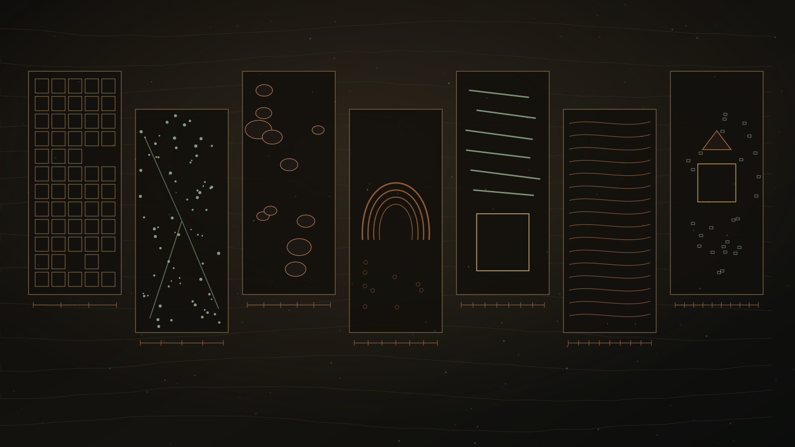
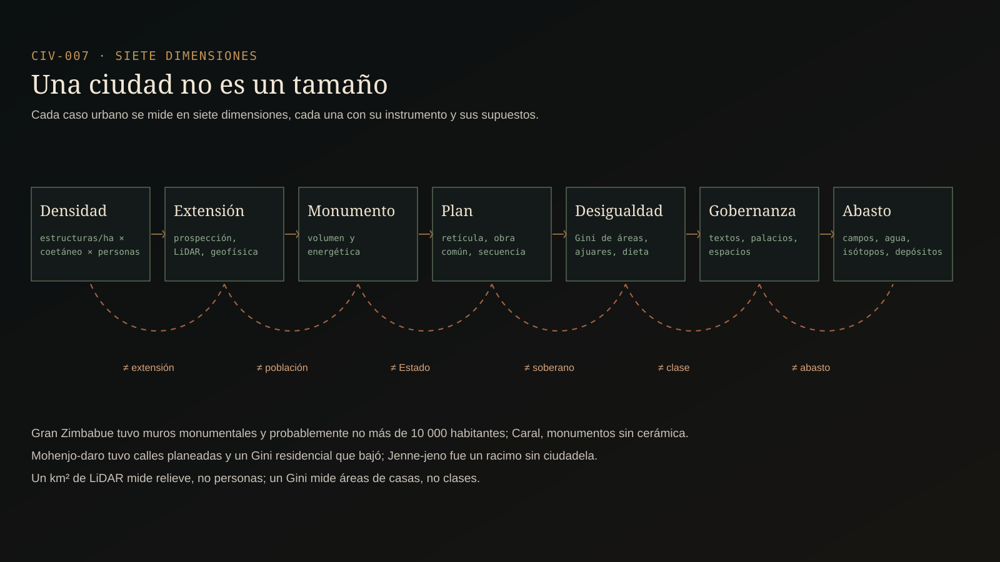
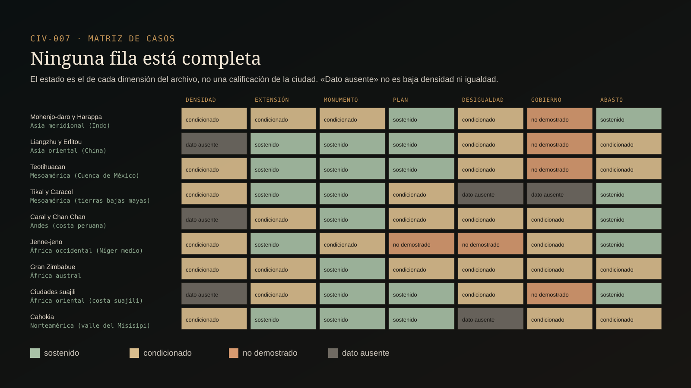

# CIV-007 — Urbanismos comparados: una ciudad no es un tamaño

## Pregunta central

¿Qué forma tuvo cada urbanismo temprano —Mohenjo-daro y Harappa, Liangzhu y Erlitou, Teotihuacan, Tikal y Caracol, Caral y Chan Chan, Jenne-jeno, Gran Zimbabue, las ciudades suajili y Cahokia— cuando se separan densidad, extensión, monumentalidad, planificación, desigualdad, gobernanza y abastecimiento, y con qué instrumento y qué supuestos se mide cada una?

CIV-007 es el séptimo punto de [`PROGRAMA_CRONOLOGICO_GLOBAL.md`](PROGRAMA_CRONOLOGICO_GLOBAL.md). No repite la [Investigación 051](INVESTIGACION_051_CIUDADES_ESTADOS.md), que fijó que aldea, ciudad, Estado e imperio son resultados distintos y que ningún archivo hereda las conclusiones de otro (`CLAIM-CITIES-STATES-SCOPE-001`, `CLAIM-URBANISM-STATE-SEPARATE-001`), ni [CIV-003](INVESTIGACION_CIV_003_ASIA_SUDOCCIDENTAL_CAMPAMENTOS_ALDEAS_URBANISMOS.md), que auditó las urbanizaciones de Mesopotamia septentrional y meridional y su abastecimiento (`CLAIM-CIV-SWASIA-SOUTH-LANDSCAPE-001`, `CLAIM-CIV-SWASIA-URBAN-HINTERLAND-001`). Aquí Uruk queda como referencia citada y la comparación baja un nivel: no «¿era una ciudad?», sino «¿qué tan densa, qué tan extensa, qué tan monumental, qué tan planeada, qué tan desigual, cómo gobernada y cómo abastecida, según qué medida?». El fechado se lee con [CIV-002](INVESTIGACION_CIV_002_FECHADO_ARQUEOLOGICO_HISTORICO.md) y los nombres con [CIV-005](INVESTIGACION_CIV_005_NOMBRES_IDENTIDADES.md).

## Respuesta breve

Ningún caso reúne las siete dimensiones en su valor máximo, y ninguna dimensión predice a las demás. Mohenjo-daro combina planificación de calles, más de `700` pozos y drenajes con una desigualdad residencial moderada que, según el reanálisis de 2026, bajó con el tiempo. Liangzhu tuvo una ciudad amurallada de `~300 ha` y un sistema de presas fechado en `5200–4800 cal BP`, pero «Estado» sigue siendo una lectura. Teotihuacan alojó a la mayoría de su población en más de `2000` conjuntos de departamentos, recibió migrantes nacidos fuera y combinó trabajo estatal y comunal; si fue gobernada colectivamente es una hipótesis modelada. Tikal y Caracol son ciudades de baja densidad repartidas en cientos de kilómetros cuadrados, y las cifras regionales de población mayas pasaron de `7–11` a `9.5–16` millones al cambiar el muestreo y el método, no al excavar más casas. Caral levantó monumentos sin cerámica; Chan Chan guardó bienes tras puntos de control. Jenne-jeno fue un racimo de montículos sin ciudadela; Gran Zimbabue tuvo muros monumentales y probablemente no más de `10 000` habitantes; Songo Mnara tuvo espacios públicos medibles por química del suelo. Cahokia se planificó de golpe hacia `1050–1100` d. C., tuvo un tercio de inmigrantes en la muestra analizada por estroncio y perdió la mitad de su población hacia `1200`, sin que la tesis del ecocidio resista el estrato. La mejor prueba de que «ciudad» no es un tamaño es que los casos se ordenan de forma distinta en cada columna.

## LO OBSERVADO

Se observan trazas de calles, muros y plataformas; pozos, drenajes, presas y diques; planos de casas y conjuntos residenciales levantados en excavaciones antiguas y recientes; nubes de puntos LiDAR y modelos de terreno; anomalías geofísicas; muestras de suelo con elementos químicos; huesos y dientes humanos; depósitos de almacenamiento con medidas; sedimentos lacustres con moléculas fecales; tiestos y montículos registrados en prospección. No se observan «la ciudad», su población, su gobierno, su clase dirigente ni su colapso.

## 1. Siete dimensiones que no se heredan

Cada caso de este expediente se registra en siete dimensiones. La regla prolonga la de 051 —ciudad no es Estado— hacia dentro de la ciudad: ninguna dimensión se deduce de otra (`CLAIM-CIV-URBCOMP-SEVEN-DIMENSIONS-001`).

| Dimensión | Qué se pregunta | Cómo se mide | Supuesto que hay que declarar | No demuestra por sí sola |
|---|---|---|---|---|
| densidad | ¿cuántas personas o unidades por hectárea? | casas o estructuras por área × personas por casa × fracción ocupada a la vez | coetaneidad, ocupación y tamaño de hogar | urbanismo, poder ni desigualdad |
| extensión | ¿cuánta superficie ocupó en una fase? | prospección de superficie, LiDAR, geofísica, límites de muros | fase asignada y visibilidad | población ni ciudad |
| monumentalidad | ¿cuánta obra supera la escala doméstica? | volumen construido, energética (personas × días), altura | tasas de trabajo y duración | Estado, coerción ni dinastía |
| planificación | ¿hay orden previo a la ocupación? | orientaciones, retícula, infraestructura común, secuencia de obras | que el orden sea simultáneo y no acumulado | autoridad central |
| desigualdad | ¿cómo se reparte un recurso medible? | Gini de áreas residenciales, ajuares, dieta, acceso | que el proxy mida riqueza y que las casas sean coetáneas | clase ni gobierno |
| gobernanza | ¿quién decidía y cómo? | textos, iconografía, espacios de reunión, palacios, patrones de inversión | que el espacio revele la institución | forma política única |
| abastecimiento | ¿de dónde venía el alimento, el agua y la materia? | arqueobotánica, fauna, isótopos, campos, depósitos, agua | que la muestra represente a la ciudad | autosuficiencia ni redistribución |

La tabla no es un umbral. Childe propuso diez criterios de la «revolución urbana» como rasgos de una transformación histórica (`SRC-CHILDE-URBAN-1950`); Smith mostró cómo esa lista se leyó luego como paquete y escalera (`SRC-SMITH-CHILDE-2009`) y defiende hoy definiciones explícitas y comparables (`SRC-SMITH-EARLY-CITIES-2023`). Este expediente acepta la exigencia de comparar y rechaza la de un paquete: cada dimensión se mide y se reporta por separado.

## 2. Cómo se mide cada dimensión, y qué supone

Cada instrumento mide un objeto distinto y lleva sus supuestos; ninguno entrega una población (`CLAIM-CIV-URBCOMP-MEASUREMENT-001`).

- **Prospección de superficie.** Registra tiestos, montículos y rasgos visibles en franjas o bloques. En Tikal, la prospección de cuatro franjas cardinales de `12 km` desde el centro fijó durante décadas la imagen del asentamiento disperso maya (`SRC-PULESTON-TIKAL-1983`). Supone que lo visible representa lo ocupado y que la cerámica de superficie fecha la fase.
- **LiDAR aerotransportado.** Penetra el dosel y entrega relieve: en Caracol, el primer vuelo cubrió `200 km²` y mostró estructuras, calzadas y terrazas agrícolas de `5–30 cm` de altura (`SRC-CHASE-CARACOL-LIDAR-2011`). Sus autores insisten en la verificación en tierra (`SRC-CHASE-LIDAR-MESOAMERICA-2012`). Detecta formas, no fechas: una plataforma de `600 a. C.` y una de `800 d. C.` aparecen juntas.
- **Geofísica.** Magnetometría y georradar detectan estructuras enterradas sin excavar. En Cahokia permitió comparar la proporción largo/ancho de casas de dos barrios periféricos con las del centro y usarla como reloj aproximado de la densidad (`SRC-BAIRES-CAHOKIA-2025`). Supone que la forma de la casa fecha la casa.
- **Química del suelo.** En Songo Mnara, geofísica, muestreo sistemático de suelos y distribución de artefactos delimitaron áreas públicas protegidas donde pudo haber producción a pequeña escala (`SRC-FLEISHER-SULAS-SONGO-2015`). Mide uso del espacio abierto, no quién lo controlaba.
- **Estimación demográfica.** Se construye como estructuras × fracción residencial × fracción ocupada a la vez × personas por unidad. Cada factor es un supuesto; por eso la misma ciudad admite cifras que difieren por un factor de dos o más (`CLAIM-CIV-URBCOMP-POPULATION-ASSUMPTIONS-001`, sección 9).
- **Gini residencial.** Calcula la concentración de áreas de casa. Kohler y colaboradores lo usaron como proxy comparativo de riqueza en `63` sitios o grupos de sitios coetáneos (texto completo, PMC5714260; `SRC-KOHLER-INEQUALITY-2017`), y Ortman y colaboradores encontraron en 2025 que el área residencial aproxima bien la distribución de productividad y sólo es un estimador mínimo de la riqueza (`SRC-ORTMAN-INEQUALITY-2025`). Nota para el registro: `CLAIM-CIV-INEQUALITY-PROXY-001` (CIV-001, `TRAZADO`) decía «64 sitios»; el texto del artículo dice `63`, y la integración de CIV-007 (`0.4.21`) corrigió la cifra en ese claim, en `EVID-CIV-HOUSE-GINI-001`, `EVID-INEQUALITY-051-001`, 051 e `HISTORIA_051` sin cambiar su estado.
- **Isótopos de estroncio.** Comparan la firma geológica del esmalte (infancia) con la local; detectan a quien migró de niño, no a quien llegó adulto ni su identidad (`SRC-PRICE-TEOTIHUACAN-SR-2000`, `SRC-SLATER-CAHOKIA-SR-2014`).
- **Energética.** Convierte volúmenes en personas × días. En Liangzhu, `2.88` millones de m³ de tierra equivalen a unas `3000` personas durante casi `8` años según el modelo de los autores (`SRC-LIU-LIANGZHU-HYDRAULIC-2017`). La cifra depende de la tasa de trabajo supuesta.

## 3. Uruk como referencia

Uruk no se repite aquí. CIV-003 auditó que el sur mesopotámico tuvo un urbanismo denso y multicéntrico condicionado por paisajes fluviales cuya población y mecanismo económico siguen modelados (`CLAIM-CIV-SWASIA-SOUTH-LANDSCAPE-001`; `SRC-GIOSAN-SUMER-2025`), que el norte siguió rutas propias (`SRC-OATES-BRAK-2007`, `SRC-LAWRENCE-URBANISM-2015`) y que el abastecimiento animal urbano dependió de paisajes rurales (`CLAIM-CIV-SWASIA-URBAN-HINTERLAND-001`). Uruk funciona en esta comparación como el caso que inspiró la lista de Childe: denso, monumental, con archivo escrito. Los demás casos se leen contra él, no por debajo de él.

## 4. Indo: planificación e infraestructura sin clase dirigente demostrada

### Agua, calles y oficios

Mohenjo-daro, centro del Indo a mediados del tercer milenio a. C., tuvo un sistema de abastecimiento de agua de más de `700` pozos que servía a la demanda doméstica, a baños privados y al Gran Baño, y drenajes y alcantarillas construidos para evacuar desechos (`SRC-JANSEN-MOHENJO-WATER-1989`). En Harappa, conchas, cerámica y cuentas de ágata y esteatita vidriada se trabajaron desde los niveles más antiguos (`c. 3300 a. C.`) hasta el final de la ocupación (`c. 1700 a. C.`), con materias primas de procedencia lejana (`SRC-KENOYER-HARAPPA-CRAFTS-1997`). Planificación e infraestructura común están sostenidas por el archivo excavado (`CLAIM-CIV-URBCOMP-INDUS-INFRASTRUCTURE-001`); quién las ordenó no está en ese archivo.

### Desigualdad medida en 2026

Green, Alam y Petrie georreferenciaron y vectorizaron los planos de Marshall (1931) y Mackay (1938) y calcularon el Gini de área residencial: `0.44` para el conjunto (`n = 162`, `c. 2500–1900 a. C.`), con barrios entre `0.27` y `0.44`; en la secuencia de DK-G Sur el valor baja de `0.39` (`c. 2500 a. C.`) a `0.23` (`c. 2100 a. C.`), a la vez que se consolidaba el trazado de calles (`SRC-GREEN-MOHENJO-2026`, texto completo). Los autores leen la caída como gobernanza que limitó la desigualdad. Ellos mismos advierten que los planos antiguos mezclan edificios de periodos distintos, que las fases se fecharon dividiendo la ocupación entre el número de fases, que el vínculo entre prosperidad y menor desigualdad no es estadísticamente robusto y que no todas las estructuras fueron casas; además, el método declara `309` áreas residenciales y la tabla resume `162` sin explicar la diferencia (`CLAIM-CIV-URBCOMP-MOHENJO-GINI-001`).

### El adversario interno: ¿igualdad o ausencia de archivo?

Green sostuvo en 2021 que la ausencia de tumbas elaboradas, monumentos de exaltación individual, grandes templos y palacios no es un hueco del registro: tras casi un siglo de excavación no aparece una clase dirigente de élites administrativas, y la complejidad del Indo no la requirió (`SRC-GREEN-INDUS-PRIESTKING-2021`). La lectura contraria es que la escritura no descifrada y los planos antiguos ocultan instituciones que el registro material no expone (`CLAIM-CIVILIZATIONS-INDUS-UNDECIPHERED-001`). CIV-007 registra los dos lados: la ausencia de palacios no demuestra igualdad y la presencia de calles planeadas no demuestra un soberano (`CLAIM-CIV-URBCOMP-INDUS-RULING-CLASS-001`). La desurbanización posterior ya quedó auditada en 051 (`CLAIM-INDUS-DEURBANIZATION-TRANSFORMATION-001`; `SRC-GREEN-PETRIE-2018`).

## 5. China: urbanismo hidráulico en Liangzhu y la sombra de los textos en Erlitou

### Liangzhu

La ciudad de Liangzhu, en el delta del Yangtsé, cubría unas `300 ha` (`~1.9 × 1.7 km`) dentro de su muralla. Al norte y noroeste, un sistema de presas altas, presas bajas y un dique —`11` presas numeradas más el dique de Tangshan, `10` presas y `1` dique fechados— se construyó hacia `5200–4800 cal BP` (presas altas) y `5000–4800 cal BP` (bajas y dique); movió unos `2.88` millones de m³ de tierra y formó una pantalla protectora de `1300 ha`. Los autores le atribuyen control de crecidas, transporte y apoyo a la agricultura de arroz (`SRC-LIU-LIANGZHU-HYDRAULIC-2017`, texto completo). La obra está fechada y medida; su organización está inferida (`CLAIM-CIV-URBCOMP-LIANGZHU-HYDRAULIC-001`).

Renfrew y Liu describen el asentamiento como ciudad fortificada de `3300–2300 a. C.` con una plataforma central que «probablemente» sostuvo un palacio y ajuares de jade de alto rango en Fanshan, y concluyen que Liangzhu «puede ser» la sociedad estatal más antigua de Asia oriental (`SRC-RENFREW-LIU-LIANGZHU-2018`). Los verbos son los de los autores: el palacio y el Estado son lecturas, no observaciones. El final tampoco es un colapso simple: un registro de espeleotemas asocia inundaciones y megasequías a las culturas del delta entre `4300` y `4000` años atrás (`SRC-ZHANG-LIANGZHU-COLLAPSE-2021`); la correlación está fechada, el mecanismo social no (`CLAIM-CIV-URBCOMP-LIANGZHU-STATE-001`).

### Erlitou

051 auditó la nucleación, la jerarquía de cuatro niveles y la red vial de Erlitou y dejó «capital» y «Estado» condicionados (`CLAIM-ERLITOU-STATE-CONDITIONAL-001`; `SRC-LIU-YILUO-2004`, `SRC-ZHAO-ERLITOU-2021`). CIV-007 añade la variable que en China pesa más que en ningún otro caso: los textos dinásticos tardíos. Liu y Xu desacoplaron las historias semilegendarias de Xia y Shang de la secuencia arqueológica de Erlitou y la explicaron sin dinastías como actores étnicos (`SRC-LIU-XU-ERLITOU-2007`). La planificación de Erlitou se mide en sus calles y recintos; su nombre dinástico no se mide (`CLAIM-CIV-URBCOMP-ERLITOU-TEXT-001`).

## 6. Mesoamérica: Teotihuacan

### Vivienda colectiva

Teotihuacan es el caso donde la densidad sí se mide con casas. Smith y colaboradores reanalizaron el mapa del Teotihuacan Mapping Project (`SRC-MILLON-TEOTIHUACAN-1970`), confirmaron su tipología residencial por riqueza, identificaron con métodos de red el tamaño y la disposición de las viviendas dentro de los conjuntos excavados y extrapolaron a todo el mapa: `100 000` personas es la estimación que consideran más razonable para Xolalpan–Metepec (`SRC-SMITH-TEOTIHUACAN-2019`). Murakami muestra que durante Tlamimilolpa (`250–350 d. C.`) se construyeron más de `2000` conjuntos de departamentos; la energética indica que los residentes dependieron de mano de obra externa a su conjunto y el análisis de materiales no locales —enlucido de cal y bloques de andesita— indica obtención y producción organizadas centralmente, compatibles con un tributo en trabajo; concluye que los conjuntos se levantaron por intercambio de trabajo entre grupos corporativos o por cooperación vecinal, con apoyo estatal variable (`SRC-MURAKAMI-TEOTIHUACAN-LABOR-2019`). La retícula orientada sugiere planificación desde arriba; la construcción fue mixta (`CLAIM-CIV-URBCOMP-TEOTIHUACAN-HOUSING-001`).

### Barrios multiétnicos

Algunos conjuntos tienen arquitectura, objetos y enterramientos propios de Oaxaca y de la costa del Golfo. Price, Manzanilla y Middleton compararon `87Sr/86Sr` de esmalte y hueso y concluyeron que varios individuos nacieron fuera de la ciudad (`SRC-PRICE-TEOTIHUACAN-SR-2000`, texto completo del resumen). Manzanilla interpreta Teotihuacan como una sociedad multiétnica que absorbió a poblaciones desplazadas por erupciones y a especialistas de otras regiones, con barrios que competían en artesanías y bienes suntuarios (`SRC-MANZANILLA-TEOTIHUACAN-2015`). El estroncio mide lugar de infancia; «barrio oaxaqueño» es una lectura que suma arquitectura, cerámica y entierro (`CLAIM-CIV-URBCOMP-TEOTIHUACAN-MULTIETHNIC-001`; protocolo de `CLAIM-CIV-IDENTITY-PROTOCOL-001`).

### ¿Gobierno colectivo?

Froese, Gershenson y Manzanilla parten de que buena parte de los datos apunta a un gobierno de cogobernantes y de que la tradición artística expresó una ideología igualitaria, y de que esa alternativa se margina porque es difícil concebir cómo funcionaría la acción colectiva. Construyeron entonces un modelo matemático de una red de representantes y mostraron que la cooperación distribuida era *posible* (`SRC-FROESE-TEOTIHUACAN-2014`). Feinman y Carballo sostienen, comparando ciudades mesoamericanas, que los sistemas más colectivos tendieron a ser mayores y más duraderos (`SRC-FEINMAN-CARBALLO-COLLECTIVE-2018`). Un modelo prueba viabilidad, no historia; una tendencia comparativa no fija el caso. La gobernanza colectiva de Teotihuacan es una hipótesis seria y no demostrada (`CLAIM-CIV-URBCOMP-TEOTIHUACAN-GOVERNANCE-001`).

## 7. Mesoamérica: Tikal, Caracol y la baja densidad

Desde la prospección por franjas de Tikal (`SRC-PULESTON-TIKAL-1983`) se sabía que las ciudades mayas del Clásico no eran compactas. LiDAR lo convirtió en mapa: en Caracol, estructuras, calzadas y terrazas en `200 km²` muestran un paisaje urbano agrícola modificado a gran escala (`SRC-CHASE-CARACOL-LIDAR-2011`). Canuto y colaboradores cartografiaron más de `2000 km²` de las tierras bajas del norte de Guatemala y describieron ciudades densamente pobladas y defendidas, conectadas con zonas rurales e intensificación agrícola (`SRC-CANUTO-MAYA-LIDAR-2018`). La forma es de baja densidad y gran extensión: ciudad y campo intercalados, no un núcleo rodeado de vacío (`CLAIM-CIV-URBCOMP-MAYA-LOWDENSITY-001`). Hawken y Fletcher la sitúan como un rasgo frecuente del mundo agrario-urbano, sobre todo tropical (`SRC-HAWKEN-FLETCHER-2021`), y Fletcher, White y Penny analizan las redes urbanas de baja densidad mayores de `100 km²`, como Caracol, y su riesgo ante el clima (`SRC-FLETCHER-LOWDENSITY-2024`).

### Lo nuevo hasta 2025: el muestreo cambia la cifra

La población regional es la cifra más inestable del expediente. El LiDAR de 2018 se extrapoló a `7–11` millones para las tierras bajas centrales. En 2024, un LiDAR ambiental de Campeche, tomado sin fines arqueológicos y por tanto sin sesgo hacia sitios conocidos, permitió un muestreo pseudoaleatorio y reveló urbanismo y asentamiento regional denso antes no registrados; sus autores sostienen que ambos son ubicuos en las tierras bajas centrales (`SRC-AULD-THOMAS-CAMPECHE-2024`). En 2025, Estrada-Belli y colaboradores agregaron LiDAR público y privado, reprocesaron el ambiental del sur de Campeche y Quintana Roo y elevaron la estimación a `9.5–16` millones en `95 000 km²` (`SRC-ESTRADA-BELLI-MAYA-POP-2025`). Lo que cambió fue el muestreo, la visibilidad de estructuras y el modelo de extrapolación; ninguna de las dos cifras resulta de excavar las casas que cuenta. La densidad de estructuras es una medida; la población es un modelo (`CLAIM-CIV-URBCOMP-MAYA-POPULATION-001`). La monumentalidad temprana de Aguada Fénix, sin Estado automático, ya quedó auditada en 051 (`CLAIM-MONUMENT-NOT-STATE-001`; `SRC-INOMATA-AGUADA-2020`).

## 8. Andes: Caral y Chan Chan

### Caral: monumentos sin cerámica

Las fechas de Caral sitúan arquitectura monumental corporativa, asentamiento urbano y agricultura de riego entre `2627` y `1977 cal a. C.`; la zona central de arquitectura monumental, residencial y no residencial cubre `65 ha`, y Caral es uno de `18` sitios precerámicos grandes del valle de Supe (`SRC-SHADY-CARAL-2001`). La región de Norte Chico ya tiene su cronología auditada (`CLAIM-ANDES-MONUMENT-NOT-STATE-001`; `SRC-HAAS-2004`). El abastecimiento es lo que distingue el caso: pesca intensiva con redes, huertos irrigados y campos de algodón con pocos comestibles sostuvieron sociedades que no usaban cerámica ni tejido de telar, hasta un abandono abrupto que Sandweiss y colaboradores asocian, como hipótesis, a un ciclo de desastres naturales hacia `3800 BP` (`SRC-SANDWEISS-SUPE-2009`). Monumentalidad alta, cerámica ausente y abastecimiento marino-agrícola mixto: tres dimensiones que la escalera clásica habría puesto en orden inverso (`CLAIM-CIV-URBCOMP-CARAL-001`).

**Lo nuevo de 2026, con su límite.** Kim y Singh combinaron radar de apertura sintética (Sentinel-1, ALOS PALSAR) y modelos de elevación con superresolución por redes neuronales y clasificadores entrenados con sitios conocidos, y detectaron rasgos estructurales no documentados en la costa y el valle de Supe (`SRC-KIM-SINGH-CARAL-2026`). Son candidatos sin verificación de campo publicada: amplían la pregunta de extensión, no la responden (`CLAIM-CIV-URBCOMP-CARAL-REMOTE-2026-001`).

### Chan Chan: almacenar tras una audiencia

En Chan Chan, la capital chimú de la costa norte, los palacios Chayhuac, Uhle, Bandelier, Gran Chimú, Tschudi y Rivero tienen áreas de depósitos; el mayor depósito mide `27.09 m²` y `22.76 m³`, y el palacio Uhle concentra la mayor capacidad (`1852.68 m²`, `1671.50 m³`). El acceso se organizó desde puntos de control llamados «audiencias», y el autor reconoce políticas administrativas distintas entre la construcción de Uhle y la de Bandelier (`SRC-CORREA-CHANCHAN-2021`). Abastecimiento y control de acceso están medidos en planta; qué se almacenaba —granos, sobre todo maíz para chicha— es la lectura probable del autor (`CLAIM-CIV-URBCOMP-CHANCHAN-STORAGE-001`). Caral y Chan Chan, separados por más de tres milenios, muestran en la costa peruana dos formas urbanas sin parentesco que no deben fundirse en «el urbanismo andino».

## 9. África: racimos, muros y puertos

### Jenne-jeno: ciudad sin ciudadela

Jenne-jeno estaba ocupado desde el siglo III a. C. por productores de hierro, superó las `33 ha` en su apogeo (`750–1100 d. C.`) y su prospección de `1100 km²` sugiere una densidad rural hasta diez veces la actual (`SRC-MCINTOSH-JENNE-1981`). R. J. McIntosh describe los racimos urbanos del Níger medio: muchos montículos discretos y cercanos, ocupados a la vez, que juntos alojaban una población heterogénea y servían a un amplio entorno; la forma fue casi invisible a los arqueólogos porque no encajaba en la expectativa de un aparato coercitivo que obliga a apiñarse (`SRC-MCINTOSH-CLUSTERS-1991`). En su síntesis de 2021, unos setenta caseríos y montículos de especialistas aparentemente contemporáneos forman el Complejo Urbano de Jenne-jeno, una «ciudad sin ciudadela» con autoridad dispuesta horizontalmente (`SRC-MCINTOSH-MIDDLE-NIGER-2021`). «Heterarquía» es el concepto de Crumley para relaciones de poder no jerárquicas o jerarquizables de varias maneras (`SRC-CRUMLEY-HETERARCHY-1995`). Extensión, densidad regional y especialización están medidas; la heterarquía es la mejor lectura disponible de una ausencia de palacio, no una observación (`CLAIM-CIV-URBCOMP-JENNE-CLUSTER-001`).

### Gran Zimbabue: muros monumentales, población modesta

La lectura tradicional atribuía a Gran Zimbabue `20 000` habitantes concentrados en `2.9 km²` (`40 %` de `720 ha`), una densidad de `6897` personas por km². Chirikure y colaboradores combinaron arqueología, etnografía, historia y modelos ecológicos y estadísticos y concluyeron que la población simultánea difícilmente excedió `10 000`, porque no hay grandes basureros y varias áreas tenidas por coetáneas no lo eran (`SRC-CHIRIKURE-GZ-POP-2017`; cronología en `SRC-CHIRIKURE-GZ-CHRONOLOGY-2013`). En 2018 mostraron que Khami no nació del declive de Gran Zimbabue: sus tradiciones cerámicas difieren, Khami floreció desde fines del siglo XIV o inicios del XV y Gran Zimbabue siguió ocupada hasta los siglos XVII–XVIII; la relación entre ambos centros fue heterárquica y, dentro de cada uno, las jerarquías fueron maleables (`SRC-CHIRIKURE-KHAMI-2018`). La monumentalidad no predice la densidad (`CLAIM-CIV-URBCOMP-ZIMBABWE-HETERARCHY-001`). 051 ya auditó el policentrismo africano como clase (`CLAIM-AFRICA-URBANISM-POLYCENTRIC-001`).

### Ciudades suajili: puerto, espacio público y ancestría

Las ciudades de piedra de la costa suajili no fueron marítimas desde su origen: la orientación al mar creció con el tiempo y sólo se completó a inicios del segundo milenio d. C., visible en la permanencia de los asentamientos, la pesca y la navegación, y en puertos, mezquitas y casas (`SRC-FLEISHER-SWAHILI-MARITIME-2015`). En Songo Mnara (siglos XV–XVI), los espacios abiertos contenían áreas públicas definidas y protegidas (`SRC-FLEISHER-SULAS-SONGO-2015`). El ADN antiguo de `80` individuos de seis ciudades costeras medievales y tempranas modernas (`1250–1800 d. C.`) y una del interior muestra mezcla de ancestros africanos —sobre todo por línea femenina— y asiáticos desde hacia el año `1000`, con `80–90 %` del ADN asiático procedente de hombres de ascendencia persa antes de `~1500` (`SRC-BRIELLE-SWAHILI-2023`). Es un archivo de parentesco y movilidad; no define quién era suajili, que fue y es una identidad cultural y lingüística (`CLAIM-CIV-URBCOMP-SWAHILI-001`; `CLAIM-CIV-SWASIA-ANCESTRY-NOT-IDENTITY-001`).

## LO MEDIDO

Se miden superficies amuralladas o construidas (`~300 ha` en Liangzhu, `65 ha` en el núcleo de Caral, `>33 ha` en Jenne-jeno, `720 ha` en Gran Zimbabue), áreas cubiertas por LiDAR (`200 km²` en Caracol, `>2000 km²` en el norte de Guatemala, `95 000 km²` agregados en 2025), número de pozos (`>700`), volúmenes de tierra (`2.88` millones de m³), número de conjuntos residenciales (`>2000`), coeficientes de Gini (`0.44`; `0.39 → 0.23`), áreas y volúmenes de depósitos (`1852.68 m²`, `1671.50 m³`), proporciones de inmigrantes por estroncio (`1/3` en Cahokia), concentraciones de estanoles fecales y fechas `14C` calibradas. Cada cifra conserva su objeto: un Gini mide áreas de casas, no ingresos; un km² de LiDAR mide relieve, no personas.

## 10. Norteamérica: Cahokia

### Planificación súbita y escala disputada

Durante la fase Lohmann (`1050–1100 d. C.`), el American Bottom vivió una transformación: construcción planificada y abrupta del centro de Cahokia, llegada masiva de personas al «centro», abandono de aldeas previas, reorganización agrícola en la llanura y fundación del complejo agrícola de Richland. Hacia `1150` se levantó una empalizada de unos `20 000` troncos alrededor de Monks Mound y la Gran Plaza; hacia el final de la fase Stirling (`1200`) la población había bajado cerca de `50 %`, y hacia `1350` Cahokia y buena parte del valle central del Misisipi estaban abandonados (`SRC-BENSON-CAHOKIA-2009`). La migración se mide: un tercio de los individuos analizados por estroncio eran no locales, con firmas variadas que apuntan a orígenes diversos (`SRC-SLATER-CAHOKIA-SR-2014`). La densidad se reconstruye barrio por barrio: la geofísica de 2025 en Rouch Mound Group y Rattlesnake West compara formas de casas con las del centro y East St. Louis para fechar y estimar la densidad de la periferia, y muestra que los barrios adoptaron el estilo constructivo y la infraestructura del centro (`SRC-BAIRES-CAHOKIA-2025`).

La escala de Cahokia —gran ciudad o centro regional de densidad moderada— se disputa porque cada proxy mide otra cosa: los estanoles fecales miden tendencia relativa, el estroncio mide proporción de migrantes de una muestra funeraria, la geofísica mide casas sin fecha absoluta. Ninguno entrega un número de habitantes por sí solo (`CLAIM-CIV-URBCOMP-CAHOKIA-SCALE-001`).

### Declive: correlación fechada y ecocidio refutado en el estrato

Cahokia surgió en un periodo de menor frecuencia de grandes crecidas del Misisipi y su declive siguió al regreso de las crecidas (`SRC-MUNOZ-CAHOKIA-FLOODS-2015`). Los estanoles fecales de un lago cercano muestran, hacia `1150`, disminución de las lluvias de verano, una crecida y descenso de la población, y los autores subrayan que varios estresores ambientales concurrieron con tensiones sociales (`SRC-WHITE-CAHOKIA-STANOLS-2019`). La hipótesis del ecocidio —tala en las tierras altas, erosión e inundaciones locales— no se sostiene en el montículo excavado por Rankin, Barrier y Horsley: el horizonte sobre el que se construyó permaneció estable hasta la industrialización del siglo XIX (`SRC-RANKIN-CAHOKIA-ECOCIDE-2021`). Clima y crecidas están fechados como correlación; la causa del abandono no (`CLAIM-CIV-URBCOMP-CAHOKIA-DECLINE-001`; véase `CLAIM-COLLAPSE-TRANSFORMATION-001`).

## LO INFERIDO

Se infieren planificación cuando la infraestructura es común y su secuencia es corta (Mohenjo-daro, Cahokia, Teotihuacan); obra colectiva coordinada cuando el volumen supera lo doméstico (Liangzhu, Caral); migración cuando el estroncio del esmalte difiere del local (Teotihuacan, Cahokia); baja densidad urbana cuando estructuras y campos se intercalan en grandes extensiones (Caracol, Tikal); y desigualdad residencial moderada o decreciente cuando el Gini se calcula sobre casas coetáneas (Mohenjo-daro). No se infieren población exacta, forma de gobierno, clase dirigente, Estado ni causa del abandono sin un archivo independiente para cada una.

## 11. Población: el modelo detrás de la cifra

| Caso | Cifra | Qué se midió | Supuesto decisivo | Fuente |
|---|---|---|---|---|
| Teotihuacan | `~100 000` (la más razonable) | tamaño medio de viviendas en conjuntos excavados, extrapolado al mapa | todos los conjuntos ocupados a la vez; personas por vivienda | `SRC-SMITH-TEOTIHUACAN-2019` |
| tierras bajas mayas | `7–11` millones (2018) → `9.5–16` millones (2025) | estructuras por km² en LiDAR | fracción residencial, ocupación simultánea, extrapolación a `95 000 km²` | `SRC-CANUTO-MAYA-LIDAR-2018`, `SRC-ESTRADA-BELLI-MAYA-POP-2025` |
| Gran Zimbabue | `20 000` tradicional → `≤10 000` | ecología, basureros, cronología de sectores | coetaneidad de áreas; capacidad de carga | `SRC-CHIRIKURE-GZ-POP-2017` |
| Cahokia | tendencia: `-50 %` hacia `1200` | estanoles fecales y secuencia de ocupación | tasa de excreción y depósito constantes | `SRC-BENSON-CAHOKIA-2009`, `SRC-WHITE-CAHOKIA-STANOLS-2019` |
| Mohenjo-daro | sin cifra en el reanálisis de 2026 | áreas residenciales | — | `SRC-GREEN-MOHENJO-2026` |

La misma regla vale para todos: la cifra de población es una multiplicación de supuestos, y cambiar uno —la coetaneidad, sobre todo— puede reducirla a la mitad (`CLAIM-CIV-URBCOMP-POPULATION-ASSUMPTIONS-001`). Las cifras de habitantes que circulan para Mohenjo-daro, Harappa, Liangzhu, Caral o Chan Chan no se auditaron en este expediente y no se reproducen.

## 12. El adversario fuerte: criterios universales y leyes de escala

La mejor versión contraria tiene dos formas.

**Childe y Smith: una ciudad se define antes de compararla.** Childe extrajo, sobre todo de Mesopotamia, Egipto y el Indo, diez criterios de la transformación urbana (`SRC-CHILDE-URBAN-1950`). Smith, su lector más cuidadoso, rechaza la lectura de paquete pero defiende que sin definiciones explícitas la palabra «ciudad» deja de comparar (`SRC-SMITH-CHILDE-2009`, `SRC-SMITH-EARLY-CITIES-2023`). CIV-007 acepta esa exigencia: por eso mide siete dimensiones con instrumentos declarados.

**La teoría del escalamiento de asentamientos: una ley común.** Ortman, Cabaniss, Sturm y Bettencourt derivaron de redes sociales e infraestructurales una relación entre población y área asentada y la probaron en más de `1500` asentamientos de la Cuenca de México a lo largo de dos milenios: el área total crece con la población según una relación invariante de escala, como en las ciudades actuales (`SRC-ORTMAN-SCALING-2014`); en 2015 mostraron rendimientos crecientes en el mismo sistema (`SRC-ORTMAN-SCALING-2015`), y Lobo, Bettencourt, Smith y Ortman lo generalizaron a sistemas antiguos y contemporáneos (`SRC-LOBO-SCALING-2020`). Si la ley es universal, las diferencias de forma serían ruido alrededor de una sola curva.

CIV-007 acepta la regularidad donde se probó —sistemas regionales con estimaciones de población y área compatibles— y rechaza su uso como criterio para excluir formas: los casos de baja densidad (Caracol, Tikal, Jenne-jeno, la Amazonía de `SRC-ROSTAIN-AMAZON-2024`) y de monumentalidad con población modesta (Gran Zimbabue) son precisamente los que pondrían a prueba la ley, y en muchos de ellos la población que la ley necesita como variable es la cifra más modelada del expediente (`CLAIM-CIV-URBCOMP-SCALING-ADVERSARY-001`). Una ley de escala necesita poblaciones independientes de las áreas con que se contrasta; si la población se estimó a partir del área, la ley se confirma por construcción.

## 13. Lo que no se ordena en escalera

| Caso | Densidad | Extensión | Monumentalidad | Planificación | Desigualdad | Gobernanza | Abastecimiento |
|---|---|---|---|---|---|---|---|
| Mohenjo-daro / Harappa | alta en el núcleo excavado | condicionada | moderada | sostenida | Gini `0.44`, decreciente | no demostrada | `>700` pozos; oficios |
| Liangzhu / Erlitou | dato ausente | `~300 ha` (Liangzhu) | alta | sostenida en obra | ajuares de jade | Estado inferido | presas y arroz |
| Teotihuacan | alta, por conjuntos | sostenida | muy alta | sostenida; construcción mixta | tipología por riqueza | colectiva: hipótesis | migrantes; materiales no locales |
| Tikal / Caracol | baja | muy grande | alta en núcleos | calzadas y terrazas | no medida aquí | dinástica en textos (fuera de este expediente) | terrazas agrícolas intercaladas |
| Caral / Chan Chan | dato ausente | `65 ha` (núcleo de Caral) | alta sin cerámica | condicionada | depósitos controlados (Chan Chan) | no demostrada en Caral | pesca, riego, algodón; depósitos |
| Jenne-jeno | regional alta | `>33 ha` + racimo | baja | no impuesta | no demostrada | heterarquía inferida | arroz, pescado, hierro, cobre lejano |
| Gran Zimbabue | baja (`≤10 000`) | `720 ha` | muros monumentales | condicionada | condicionada | heterárquica entre centros | ganado e intercambio (no auditado aquí) |
| ciudades suajili | condicionada | condicionada | mezquitas y casas de piedra | espacios públicos definidos | élite urbana inferida | no demostrada | mar creciente desde el segundo milenio |
| Cahokia | condicionada | sostenida | Monks Mound, empalizada | súbita (`1050–1100`) | no medida aquí | condicionada | Richland; un tercio de migrantes |

Leída por columnas, la tabla muestra que cada dimensión ordena los casos de otro modo; leída por filas, que ninguna fila está completa. Ésa es la evidencia de `CLAIM-CIV-URBCOMP-NO-SINGLE-FORM-001`, que prolonga dentro de la ciudad lo que `CLAIM-URBANISM-STATE-SEPARATE-001` estableció entre ciudad y Estado, y de `CLAIM-CIV-URBCOMP-LOW-DENSITY-001`: la baja densidad es una forma urbana, no una ciudad fallida.

## 14. Protocolo de nombres aplicado

Siguiendo `CLAIM-CIV-IDENTITY-PROTOCOL-001`: «Mohenjo-daro» es un nombre sindhi moderno («montículo de los muertos») y «Harappa», «Liangzhu», «Erlitou», «Caral», «Jenne-jeno» (Jenne antiguo), «Gran Zimbabue» y «Songo Mnara» son topónimos de sitio; «Teotihuacan» es el nombre náhuatl posterior que dieron los mexicas; «Cahokia» toma el nombre de un grupo illinois del siglo XVII que no construyó los montículos; «Chan Chan» es el nombre usado desde la Colonia; «Indo», «Harappa» y «Liangzhu» como culturas son clasificaciones arqueológicas; «suajili» es una identidad cultural y lingüística viva que no se deduce de genomas. Ninguno de estos nombres es un endónimo comprobado de quienes vivieron en esas ciudades, salvo en lo que los textos locales permitan documentar caso por caso.

## LOS SUPUESTOS

1. los planos legados representan casas de una misma fase o sus errores se pueden acotar;
2. las estructuras detectadas por LiDAR o geofísica son residenciales en la proporción supuesta y coetáneas en la medida declarada;
3. las tasas de trabajo de la energética son razonables para la tecnología del caso;
4. el área residencial es un proxy de productividad o riqueza (CIV-007 toma la conclusión de `SRC-ORTMAN-INEQUALITY-2025`);
5. las firmas de estroncio locales están bien calibradas con fauna;
6. un barrio o una muestra funeraria no representan a toda la ciudad;
7. los nombres de sitios y culturas son clasificaciones modernas (CIV-005).

## LAS INCERTIDUMBRES

- coetaneidad de estructuras en planos antiguos, LiDAR y geofísica;
- fracción residencial y personas por unidad en las estimaciones demográficas;
- sesgo de muestreo de los vuelos LiDAR hacia sitios conocidos (corregido en parte por datos ambientales);
- tasas de trabajo en la energética de Liangzhu y de Teotihuacan;
- discrepancia entre `309` y `162` áreas residenciales en el reanálisis de Mohenjo-daro;
- identidad e intención detrás de los conjuntos «extranjeros» de Teotihuacan;
- verificación en campo de los rasgos detectados por radar en Supe (2026);
- estanoles fecales como proxy de población absoluta;
- ausencia de textos descifrados en el Indo y de textos propios en Cahokia, Caral y Jenne-jeno.

## LAS ALTERNATIVAS

| Señal | Lectura focal | Alternativas |
|---|---|---|
| calles en retícula | planificación central | crecimiento acumulado con normas compartidas; trabajo vecinal |
| Gini bajo o decreciente | gobernanza igualadora | planos que mezclan fases; casas grandes no excavadas; proxy incompleto |
| ausencia de palacio | heterarquía o gobierno colectivo | palacio no identificado; poder en otro soporte |
| gran volumen construido | Estado | cooperación comunitaria por etapas |
| densidad de estructuras LiDAR | población alta | estructuras de fases distintas; estructuras no residenciales |
| estroncio no local | migrantes | movilidad estacional; alimentos importados |
| conjuntos con estilo oaxaqueño | barrio de migrantes | adopción de costumbres por locales; mezcla |
| muros monumentales | megaciudad | centro ceremonial o político de población modesta |
| baja densidad | ciudad fallida o rural | forma urbana agraria propia |
| crecidas y sequías antes del abandono | causa climática | tensiones sociales; migración elegida |

## LAS CONTROVERSIAS

1. criterios universales de ciudad frente a dimensiones regionales;
2. estimaciones de población y sus supuestos;
3. igualdad o archivo incompleto en el Indo;
4. Liangzhu como Estado;
5. gobernanza colectiva de Teotihuacan;
6. sesgo y extrapolación del LiDAR maya;
7. heterarquía como modelo del urbanismo africano;
8. escala de Cahokia.

Los modelos, las pruebas discriminatorias y el estado de cada una se registran en `CONTROVERSIES.md`; CIV-007 no resuelve ninguna eligiendo un bando.

## QUÉ PODRÍA FALSARLO

1. un conjunto de casos regionales independientes donde las siete dimensiones covaríen siempre en el mismo orden, con poblaciones estimadas sin usar el área, refutaría la independencia de las dimensiones como regla;
2. una ley de escala que se cumpla en casos de baja densidad con poblaciones estimadas por un archivo independiente del área (por ejemplo, demografía funeraria o estanoles calibrados) refutaría que la baja densidad pone a prueba la ley;
3. excavaciones estratigráficas modernas en Mohenjo-daro que fechen las casas de un solo contexto y den un Gini creciente refutarían el descenso de 2026;
4. un palacio o archivo administrativo fechado en el núcleo de Mohenjo-daro o de Jenne-jeno refutaría la ausencia de clase dirigente o de ciudadela;
5. textos, retratos o tumbas de un gobernante único en Teotihuacan durante Tlamimilolpa–Xolalpan debilitarían la hipótesis colectiva;
6. excavación de una muestra aleatoria de estructuras LiDAR mayas con proporciones residenciales y coetaneidad muy inferiores a las supuestas reduciría las cifras de 2025;
7. verificación en campo de los rasgos de radar en Supe que resulten naturales;
8. un registro sedimentario con erosión y crecidas locales inducidas por tala antes de `1150` en Cahokia rehabilitaría el ecocidio;
9. grandes basureros fechados y sectores coetáneos en Gran Zimbabue que sostengan `20 000` habitantes simultáneos.

## NIVEL DE CONFIANZA

| Resultado | Confianza | Motivo |
|---|---|---|
| siete dimensiones no equivalentes | A-SEM | instrumentos y objetos distintos |
| cada instrumento con supuestos propios | A-MET | LiDAR, geofísica, Gini, estroncio y energética documentados |
| población como modelo de supuestos | B-COND | cifras que cambian al cambiar supuestos |
| pozos, drenajes y oficios del Indo | B | excavación y análisis de materiales |
| Gini de Mohenjo-daro `0.44` y descenso | B-COND cifra; C tendencia | planos legados; muestras pequeñas |
| ausencia de clase dirigente en el Indo | C | ausencia de archivo frente a escritura no descifrada |
| ciudad y presas de Liangzhu | B | fechas `14C`, excavación y volumen |
| Liangzhu como Estado | C | palacio «probable», Estado «posible» |
| Erlitou sin dinastías textuales | B | desacople metodológico |
| vivienda colectiva y `~100 000` en Teotihuacan | B-COND | reanálisis de mapa y energética |
| migrantes en Teotihuacan y Cahokia | B-COND | estroncio de muestras funerarias |
| gobierno colectivo de Teotihuacan | C | modelo de viabilidad y comparación |
| baja densidad maya | B | LiDAR con verificación en tierra |
| población maya `9.5–16` millones | C | extrapolación regional |
| Caral: monumentos sin cerámica y abastecimiento mixto | B | fechas, planos y arqueofauna/botánica |
| rasgos de radar en Supe | C | sin verificación de campo |
| depósitos de Chan Chan | B-LOCAL | medidas de planta |
| racimo urbano de Jenne-jeno | B archivo; C heterarquía | prospección y excavación |
| Gran Zimbabue `≤10 000` y heterarquía con Khami | B-COND | modelo y cronologías cerámicas |
| ciudades suajili: maritimidad tardía y mezcla genética | B-COND | archivos independientes |
| Cahokia: planificación súbita y caída de `~50 %` | B-COND | secuencia, proxies |
| Cahokia: causa climática | C | correlación fechada |
| ecocidio en Cahokia | refutado localmente (B-LOCAL) | estrato estable en un montículo |
| ley de escala como criterio universal | C | probada en sistemas regionales, no en baja densidad |

## QUÉ SABEMOS REALMENTE

Sabemos que hubo urbanismos densos y planificados con desigualdad residencial moderada (Mohenjo-daro), urbanismos hidráulicos de gran obra (Liangzhu), ciudades de vivienda colectiva y migrantes (Teotihuacan), ciudades de baja densidad y gran extensión (Tikal, Caracol), monumentalidad sin cerámica (Caral), almacenes palaciegos controlados (Chan Chan), racimos urbanos sin ciudadela (Jenne-jeno), centros monumentales de población modesta (Gran Zimbabue), puertos que se volvieron marítimos con el tiempo (costa suajili) y una ciudad planificada de golpe que recibió migrantes y se vació en dos siglos (Cahokia). Sabemos también cómo se midió cada una de esas cosas y qué supuso cada medida.

## QUÉ TODAVÍA NO SABEMOS

No sabemos cuántas personas vivieron a la vez en casi ninguna de estas ciudades; quién gobernaba Mohenjo-daro, Teotihuacan o Jenne-jeno; si Liangzhu fue un Estado; por qué se abandonaron Caral y Cahokia; ni si una ley de escala común vale fuera de los sistemas donde se probó. Tampoco sabemos cómo llamaban a sus ciudades la mayoría de quienes las habitaron.

## Conclusión

CIV-007 baja la regla de 051 —ciudad no es Estado— al interior de la ciudad: densidad no es extensión, monumento no es población, retícula no es soberano, Gini no es clase y migrante no es etnia. Ninguno de los nueve casos ocupa el primer lugar en las siete columnas. La comparación útil no es la que pregunta cuál llegó antes a ser ciudad, sino la que declara, para cada dimensión, qué se midió, con qué instrumento y bajo qué supuesto. Cita `CLAIM-CIV-SWASIA-SOUTH-LANDSCAPE-001`, `CLAIM-CIV-SWASIA-URBAN-HINTERLAND-001`, `CLAIM-URBANISM-STATE-SEPARATE-001` y `CLAIM-AFRICA-URBANISM-POLYCENTRIC-001` sin cambiar su estado, y corrige a `63` los sitios de `CLAIM-CIV-INEQUALITY-PROXY-001` sin cambiar su estado. CIV-001 sigue `TRAZADO`.

## Fuentes núcleo auditadas

- Jansen (1989), DOI `10.1080/00438243.1989.9980100`.
- Green (2021), DOI `10.1007/s10814-020-09147-9`.
- Green, Alam y Petrie (2026), DOI `10.15184/aqy.2026.10359` (texto completo consultado).
- Liu et al. (2017), DOI `10.1073/pnas.1710516114` (texto completo consultado).
- Renfrew y Liu (2018), DOI `10.15184/aqy.2018.60`.
- Liu y Xu (2007), DOI `10.1017/S0003598X00095983`.
- Murakami (2019), DOI `10.1017/laq.2019.78`.
- Price, Manzanilla y Middleton (2000), DOI `10.1006/jasc.1999.0504`.
- Froese, Gershenson y Manzanilla (2014), DOI `10.1371/journal.pone.0109966`.
- Chase et al. (2011), DOI `10.1016/j.jas.2010.09.018`.
- Estrada-Belli et al. (2025), DOI `10.1016/j.jasrep.2025.105288`.
- Shady Solís, Haas y Creamer (2001), DOI `10.1126/science.1059519`.
- Correa-Trigoso (2021), DOI `10.12795/spal.2021.i30.12`.
- McIntosh (1991), DOI `10.1179/009346991792208272`.
- Chirikure et al. (2018), DOI `10.1017/S0959774317000555`.
- Brielle et al. (2023), DOI `10.1038/s41586-023-05754-w`.
- Benson, Pauketat y Cook (2009), DOI `10.1017/S000273160004871X`.
- Rankin, Barrier y Horsley (2021), DOI `10.1002/gea.21848`.
- Ortman et al. (2014), DOI `10.1371/journal.pone.0087902`.
