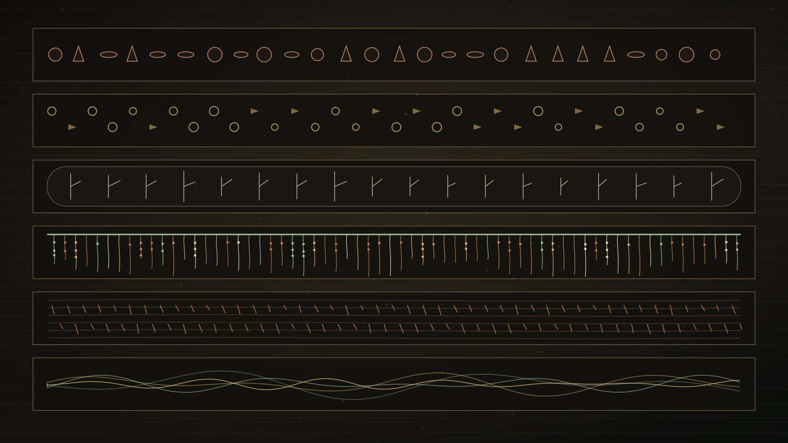
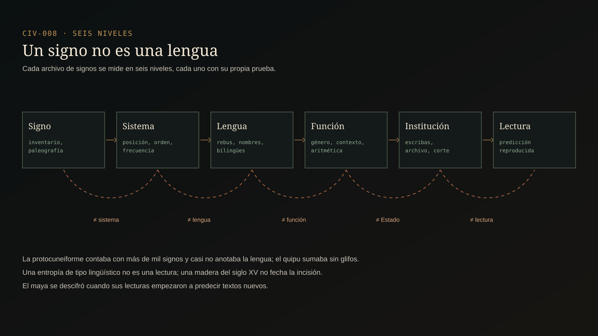
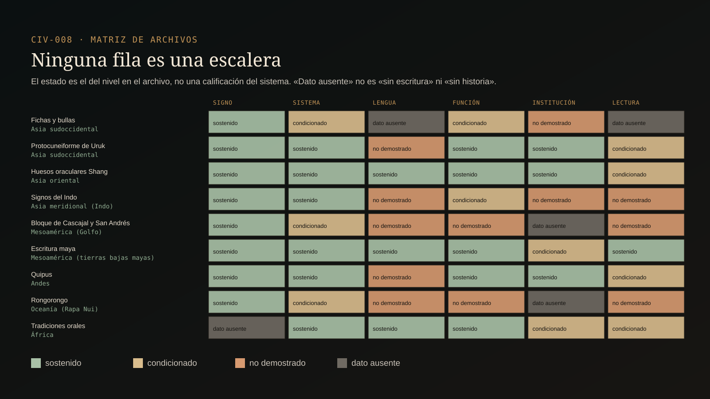

# CIV-008 — Escrituras, notaciones y oralidad: un signo no es una lengua

## Pregunta central

¿Qué registraban las fichas y bullas de Asia sudoccidental, la protocuneiforme de Uruk, los huesos oraculares Shang, los signos del Indo, el bloque de Cascajal, la escritura maya, los quipus incas, el rongorongo y las tradiciones orales africanas cuando se separan signo, sistema, lengua codificada, función, institución y desciframiento, y cómo se prueba, en cada caso, que un sistema de signos codifica una lengua?

CIV-008 es el octavo punto de [`PROGRAMA_CRONOLOGICO_GLOBAL.md`](PROGRAMA_CRONOLOGICO_GLOBAL.md). No repite la [Investigación 052](INVESTIGACION_052_COMPARACION_PRIMERAS_CIVILIZACIONES.md), que dejó establecido que el corpus del Indo no está descifrado (`CLAIM-CIVILIZATIONS-INDUS-UNDECIPHERED-001`), que los huesos oraculares fechan un archivo Shang tardío y no el origen de la escritura china (`CLAIM-CIVILIZATIONS-CHINA-NAME-LIMIT-001`) y que los Andes administraron sin escritura glotográfica demostrada (`CLAIM-CIVILIZATIONS-ANDES-ORALITY-001`); ni la 051, que separó escritura y Estado (`CLAIM-WRITING-NOT-STATE-REQUIREMENT-001`); ni [CIV-004](INVESTIGACION_CIV_004_VALLE_NILO_AFRICA_NORORIENTAL.md), que auditó las etiquetas de Abydos U-j (`CLAIM-CIV-NILE-UJ-WRITING-001`); ni CIV-001, que fijó P003414 como tablilla administrativa de Uruk IV (`CLAIM-CIV-WRITING-ADMIN-001`). Aquí la comparación baja un nivel: no «¿tenían escritura?», sino «¿qué signo, qué sistema, qué lengua, qué función, qué institución y qué grado de desciframiento, según qué prueba?».

## Respuesta breve

Ningún archivo reúne los seis niveles en el mismo estado, y ningún nivel se deduce de otro. Las pequeñas figuras de arcilla del Neolítico de Asia sudoccidental aparecen desde el X milenio cal a. C. y fueron objetos multifuncionales, no un código unificado; la hipótesis de Schmandt-Besserat que las convierte en el origen directo de la escritura sostiene la continuidad de los numerales impresos, no la de la mayoría de los signos. La protocuneiforme de Uruk, de fines del IV milenio a. C., suma unos `6000` textos y fragmentos, en su mayoría contabilidad, con fonetismo escaso o nulo: es un sistema maduro de registro antes de ser una notación de la lengua. Los huesos oraculares Shang sí registran una lengua, dentro de una práctica regia de adivinación. Los signos del Indo tienen un promedio de `4.6` signos por objeto en `2905` objetos y no hay acuerdo sobre si codifican lengua; los argumentos estadísticos de ambos lados no lo resuelven. El bloque de Cascajal es un posible sistema olmeca sin contexto estratigráfico seguro; la escritura maya ya era una tradición establecida entre `300` y `200 a. C.` y se descifró cuando la lectura fonética de Knorozov y la lectura histórica de Proskouriakoff empezaron a predecir textos nuevos. Los quipus registraban números en sumas jerárquicas en al menos `74 %` de `650` ejemplares, y un conjunto colonial coincide con un padrón de tributarios; si codificaban lengua sigue abierto. Una tablilla de rongorongo es de madera del siglo XV, lo que sugiere un horizonte anterior al contacto, sin fechar la incisión. Las tradiciones orales africanas son archivos con método propio y límites medibles. La «Gran División» entre mentes orales y letradas no sobrevivió a la prueba empírica. Escribir no es un grado de inteligencia: es un conjunto de soportes, códigos, funciones e instituciones que se miden por separado.

## LO OBSERVADO

Se observan figuras de arcilla de formas geométricas, envolturas de arcilla con impresiones y con figuras dentro, tablillas con impresiones numéricas y signos incisos, etiquetas de hueso y marfil, omóplatos de bovino y caparazones de tortuga con grietas y signos tallados, sellos con secuencias breves de signos, un bloque de serpentina con signos tallados, murales pintados y fragmentos de enlucido con glifos, estelas con fechas, cuerdas de algodón y fibra animal con nudos, colores y torsiones, tablillas de madera con glifos incisos, y relatos orales transcritos con sus variantes. No se observan «la escritura», la lengua de los usuarios, sus lectores, su alfabetización ni su manera de pensar.

## 1. Seis niveles que no se heredan

Cada archivo se registra en seis niveles. La regla prolonga la de 052 —soporte, sistema, lengua, género y usuarios son cosas distintas— hacia una pregunta precisa: qué nivel prueba cada observación (`CLAIM-CIV-SCRIPTS-SIX-LEVELS-001`).

| Nivel | Qué se pregunta | Cómo se mide | Supuesto que hay que declarar | No demuestra por sí solo |
|---|---|---|---|---|
| signo | ¿hay marcas convencionales repetidas? | inventario, paleografía, contexto de cada pieza | que las marcas sean intencionales y no decoración libre | sistema ni lengua |
| sistema | ¿las marcas se combinan con reglas? | posición, frecuencia, orden, concordancias | que el corpus represente el uso | lengua |
| lengua codificada | ¿los signos representan palabras o sonidos de una lengua? | valores fonéticos reutilizados, complementos, nombres propios, bilingües, lecturas que predicen textos nuevos | que la lengua candidata sea la de los usuarios | función ni alfabetización |
| función | ¿para qué se usó? | género del documento, contexto de hallazgo, aritmética interna | que el contexto de hallazgo sea el de uso | institución |
| institución | ¿quién lo producía y quién lo controlaba? | archivos, escribas, escuelas, sellos de cargo, depósito | que el archivo preservado represente a la sociedad | Estado ni alcance territorial |
| desciframiento | ¿se lee hoy y con qué grado de acuerdo? | lecturas reproducidas por equipos independientes | que la lectura no sea circular | el contenido de los textos no leídos |

La distinción entre escritura glotográfica —que representa una lengua— y semasiografía —que comunica sin pasar por una lengua— viene de la tradición de DeFrancis, que reserva «escritura plena» para los sistemas que representan habla (`SRC-DEFRANCIS-1989`). CIV-008 la usa como herramienta de clasificación, no como escala de valor: un sistema semasiográfico eficaz no es una escritura fallida (`CLAIM-CIV-SCRIPTS-NO-COGNITIVE-HIERARCHY-001`). Tampoco el nivel «institución» decide el Estado: en `868` culturas codificadas, escritura, tributación y Estado se asocian con excepciones y sin que la escritura sea requisito (`SRC-OPIE-ATKINSON-2025`; `CLAIM-WRITING-NOT-STATE-REQUIREMENT-001`).

## 2. Cómo se prueba que algo es escritura glotográfica

Una colección de signos puede ser ordenada, frecuente y estable sin representar una lengua. La prueba de glotografía exige al menos una de estas observaciones, y mejor varias independientes (`CLAIM-CIV-SCRIPTS-GLOTTOGRAPHY-TEST-001`):

1. **Rebus y reutilización fonética.** Un signo se usa por su sonido para escribir una palabra sin relación de sentido con su imagen.
2. **Complementos fonéticos.** Signos auxiliares que indican la pronunciación de un logograma ambiguo.
3. **Nombres propios.** Nombres de personas o lugares escritos fonéticamente, sobre todo extranjeros, que no tienen imagen posible.
4. **Orden ligado a la sintaxis.** La secuencia de signos sigue el orden de las palabras de una lengua y no sólo el orden de un formulario.
5. **Bilingües o referentes externos.** Un texto paralelo en un sistema leído, o nombres conocidos por otra vía.
6. **Predicción.** Una lectura propuesta permite leer textos que no se usaron para construirla, y equipos independientes llegan a las mismas lecturas.

Las comparaciones de las primeras invenciones de escritura muestran que estos rasgos aparecen de forma gradual, no de golpe (`SRC-HOUSTON-FIRST-WRITING-2004`, `SRC-WOODS-VISIBLE-LANGUAGE-2010`), y que las estrategias visuales para construir signos pueden converger en sistemas sin contacto (`SRC-OTTAVIANO-SCRIPTS-2026`). Un **desciframiento** se acepta cuando cumple el punto 6; antes de eso es una propuesta (`CLAIM-CIV-SCRIPTS-DECIPHERMENT-CRITERIA-001`).

### Lo que la estadística no prueba

En 2009, Rao y colaboradores midieron la entropía condicional de pares de signos del Indo y la encontraron en el intervalo de las lenguas escritas, entre sistemas no lingüísticos muy rígidos y muy aleatorios (`SRC-RAO-INDUS-ENTROPY-2009`); su modelo de Markov ya registrado en 052 encuentra dependencias posicionales (`SRC-RAO-INDUS-MARKOV-2009`). En 2010, Lee, Jonathan y Ziman propusieron un árbol de decisión de dos parámetros y clasificaron los símbolos pictos como escritura (`SRC-LEE-PICTISH-2010`). Sproat objetó que esas medidas no se habían probado contra sistemas no lingüísticos suficientes (`SRC-SPROAT-REVIEWING-2010`); Rao y colaboradores respondieron que su argumento era inductivo, no una prueba de clasificación (`SRC-RAO-REPLY-2010`). En 2014, con un conjunto mayor de corpus lingüísticos y no lingüísticos, Sproat mostró que ninguno de los métodos publicados funcionaba tal como se publicó, y que una variante del de Lee y una medida nueva basada en la repetición clasificaban tanto los signos del Indo como los pictos como **no lingüísticos** (`SRC-SPROAT-SYMBOLS-2014`). La regla que deja el debate: una medida estadística sólo sirve si se calibró contra sistemas de estatus conocido, y aun calibrada clasifica, no lee (`CLAIM-CIV-SCRIPTS-STATISTICS-LIMIT-001`).

## 3. Asia sudoccidental: fichas, bullas y protocuneiforme

### La hipótesis de las fichas

Schmandt-Besserat propuso en 1978 que pequeñas figuras de arcilla de formas geométricas —conos, esferas, discos, cilindros— eran fichas de contabilidad usadas desde el Neolítico, que hacia el IV milenio a. C. se encerraron en envolturas de arcilla (bullas) marcadas por fuera con su impresión, y que esas impresiones dieron lugar a las tablillas numéricas y de ahí a la escritura (`SRC-SCHMANDT-PRECURSOR-1978`, `SRC-SCHMANDT-ORIGINS-1986`); la tesis completa se publicó en 1992 (`SRC-SCHMANDT-BEFORE-WRITING-1992`). La secuencia ficha → bulla con impresiones → tablilla impresa está documentada en piezas y explica bien la continuidad de los signos numéricos impresos.

### Las críticas

Michalowski y Zimansky, en sus reseñas de 1993, señalaron que la tipología agrupa objetos de muchos milenios y contextos, que el significado de cada forma se asigna por su parecido con signos cuneiformes posteriores y que la derivación de la mayoría de los signos no numéricos a partir de fichas no está demostrada (`SRC-MICHALOWSKI-TOKENISM-1993`, `SRC-ZIMANSKY-REVIEW-1993`). La crítica más fuerte es empírica y reciente: Bennison-Chapman estudió casi `3000` objetos neolíticos uno por uno y los datos de `56` sitios más, y concluyó que las figuras de arcilla aparecen desde el X milenio cal a. C., antes de lo que se creía, que no son un componente necesario de las aldeas agropastoriles, que fueron multifuncionales —incluso dentro de un mismo sitio— y que no hay evidencia de que en el Neolítico formaran un sistema simbólico unificado ni de que se crearan para administrar productos agrícolas; probablemente se usaron para contar, entre otras cosas (`SRC-BENNISON-TOKENS-2018`). CIV-008 separa así dos afirmaciones: fichas como herramientas de conteo entre otras funciones (`CLAIM-CIV-SCRIPTS-TOKENS-MULTIFUNCTION-001`), y fichas como origen directo de la escritura (`CLAIM-CIV-SCRIPTS-TOKENS-THESIS-001`), sostenida sólo para la continuidad numérica.

### Protocuneiforme: contabilidad antes que lengua

Nissen sitúa la protocuneiforme dentro de una larga tradición de almacenamiento de información con sellos y contadores desde el VII milenio a. C.; con la densidad de población del IV milenio en la llanura aluvial, las administraciones centrales ampliaron esos instrumentos hasta inventar un sistema de cerca de `600` signos, destinado sobre todo a la administración económica, donde «no se pretendía representar la lengua»; el sistema también se usó para listas léxicas de títulos, profesiones, ciudades y animales, y la identificación del sumerio como lengua detrás de los textos es probable pero no está probada (`SRC-NISSEN-URUK-2016`). Damerow cuenta unos `6000` textos y fragmentos y, en su tabla, unas `40 000` apariciones de `1617` signos no numéricos, de los que `530` aparecen una sola vez y sólo `104` más de cien veces; sostiene que la protocuneiforme fue el último paso de una larga tradición administrativa, que sus estructuras no corresponden a la sintaxis de una lengua y que el fonetismo tuvo un papel menor o nulo hasta una segunda etapa (`SRC-DAMEROW-WRITING-2006`). La diferencia entre «cerca de `600`» y `1617` no es un error de uno de los dos: depende de si se cuentan las variantes gráficas y los signos de aparición única. P003414 es un ejemplar excavado de ese género (`CLAIM-CIV-WRITING-ADMIN-001`; `SRC-CDLI-P003414`).

La protocuneiforme es, por tanto, un sistema plenamente desarrollado en signo, sistema, función e institución, y débil en lengua codificada (`CLAIM-CIV-SCRIPTS-PROTOCUNEIFORM-ACCOUNTING-001`, `CLAIM-CIV-SCRIPTS-PROTOCUNEIFORM-LANGUAGE-001`). Por eso «la escritura nació en Uruk» mezcla dos afirmaciones: el registro sistemático sí; la notación de una lengua vino después.

### Abydos U-j, citado

Las etiquetas de hueso y marfil de la tumba U-j, en Naqada IIIA2, ya quedaron auditadas en CIV-004: son los signos más antiguos conocidos de Egipto, en una tumba excepcional, sin equivalentes durante unos dos siglos, y la escritura egipcia tardó siglos en codificar habla continua (`CLAIM-CIV-NILE-UJ-WRITING-001`; `SRC-STEVENSON-PREDYNASTIC-2016`, `SRC-REGULSKI-WRITING-2016`). CIV-008 no las repite; las usa para recordar que dos sistemas tempranos, en Uruk y en Abydos, empiezan en contextos e instituciones distintos y que su orden de prioridad no decide si hubo difusión.

### Lineal elamita: un desciframiento propuesto en 2022

Desset y colaboradores publicaron en 2022 un desciframiento del elamita lineal, usado en el sur de Irán hacia `2300–1880 a. C.`, a partir de ocho vasos de plata inscritos publicados en 2018, con una descripción completa del sistema como notación de la lengua elamita y una discusión de su fonología (`SRC-DESSET-ELAMITE-2022`). Es el ejemplo más reciente de un desciframiento propuesto con nombres propios y paralelos como anclas. Según la regla de la sección 2, su estado depende de que otros equipos reproduzcan las lecturas y de que lean textos que no se usaron para construir el silabario; CIV-008 lo registra como propuesta fuerte, no como resultado cerrado (`CLAIM-CIV-SCRIPTS-LINEAR-ELAMITE-001`).

## 4. China: huesos oraculares y signos neolíticos

Los huesos oraculares de Anyang son omóplatos de bovino y caparazones de tortuga preparados, calentados hasta agrietarse e inscritos con la pregunta planteada, a veces el pronóstico y a veces el resultado, en una práctica de adivinación de la corte de los reyes Shang tardíos (`SRC-KEIGHTLEY-SHANG-1978`). La serie AMS y bayesiana de 052 restringe sus fases y sitúa el final hacia `1041 cal a. C.` (`SRC-LIU-ORACLE-BONES-2021`). Aquí el archivo es glotográfico y maduro: registra una lengua con logogramas y signos usados por su sonido. Lo que no hace es fechar el origen de la escritura china ni representar el uso fuera de la corte (`CLAIM-CIV-SCRIPTS-SHANG-ORACLE-001`; `CLAIM-CIVILIZATIONS-CHINA-NAME-LIMIT-001`).

Antes de Anyang hay marcas en cerámica y otros soportes de varios sitios del Neolítico final. Demattè analiza tres de esos sistemas y sostiene que la escritura madura de los huesos oraculares probablemente evolucionó a partir de ellos, al crecer la complejidad social y política, y que los sistemas visuales no lingüísticos tuvieron un papel en su aparición (`SRC-DEMATTE-CHINESE-2010`). El vínculo es una hipótesis razonable: no hay una serie continua de textos que muestre el paso de la marca al signo fonético (`CLAIM-CIV-SCRIPTS-CHINA-NEOLITHIC-SIGNS-001`).

## 5. El Indo: brevedad, estadística y el adversario no lingüístico

Farmer, Sproat y Witzel reunieron en 2004 el argumento más fuerte contra la idea de una civilización letrada del Indo. Las inscripciones son extremadamente breves: la más larga tiene `17` signos en una superficie, menos de `1` de cada `100` llega a `10`, y el promedio de los `2905` objetos del concordato de Mahadevan es de `4.6` signos; cuatro de `417` signos suman el `21 %` de `13 372` apariciones. Sostienen que no hay textos largos perdidos en materiales perecederos, que los signos no evolucionaron en dirección lingüística en al menos `600` años de uso y que funcionaron como símbolos religiosos, políticos y sociales sin codificar habla, comparables a sistemas no lingüísticos del Próximo Oriente (`SRC-FARMER-INDUS-2004`, texto completo consultado). La brevedad está medida (`CLAIM-CIV-SCRIPTS-INDUS-BREVITY-001`); su conclusión es una interpretación.

Del otro lado, Parpola sostiene una lectura logosilábica de una lengua drávida (`SRC-PARPOLA-INDUS-1994`) y Rao y colaboradores, la estructura de tipo lingüístico de la sección 2. La situación auditada es la de 052: estructura sí, lengua no demostrada; y CIV-008 añade que la evidencia estadística citada a favor fue reclasificada en contra con una calibración mayor, sin que ninguna clasificación sea una lectura (`CLAIM-CIV-SCRIPTS-INDUS-STATUS-001`; `CLAIM-CIVILIZATIONS-INDUS-UNDECIPHERED-001`). La pregunta por la clase dirigente del Indo, que depende en parte de este silencio, quedó registrada en CIV-007.

## LO MEDIDO

Se miden números de objetos y signos (`~3000` figuras neolíticas estudiadas y `56` sitios; `~6000` textos protocuneiformes con `1617` signos no numéricos en `~40 000` apariciones; `2905` objetos del Indo con `13 372` apariciones de `417` signos, promedio `4.6`, máximo `17`; `62` signos en el bloque de Cascajal según sus editores, `28` distintos; `650` quipus en el análisis computacional y `≥74 %` con relaciones de suma; `132` tributarios en la revisita de 1670 frente a `133` grupos de cuerdas; `95` combinaciones de color, fibra y torsión en los quipus de Collata; `21` lugares costeros en los relatos australianos), fechas `14C` calibradas (`1041 cal a. C.` para el final de los huesos oraculares; `300–200 a. C.` para el registro «7 Venado» de San Bartolo; mediados del siglo XV para la madera de una tablilla de rongorongo), y medidas de entropía y repetición sobre corpus. Cada cifra conserva su objeto: una fecha de la madera no es una fecha de la inscripción; una entropía no es una lectura.

## 6. Mesoamérica: el bloque de Cascajal y el desciframiento maya

### Cascajal: un sistema posible sin estratigrafía

En 2006, Rodríguez Martínez y colaboradores publicaron un bloque de serpentina hallado en Cascajal, Veracruz, en el corazón olmeca, con un sistema de signos desconocido hasta entonces; lo fecharon por estilo y asociación a inicios del primer milenio a. C. y lo presentaron como la escritura más antigua del Nuevo Mundo (`SRC-RODRIGUEZ-CASCAJAL-2006`). Según los editores, el bloque tiene `62` signos, `28` de ellos distintos (cifras del artículo; el texto completo no se consultó en esta auditoría). El bloque fue recuperado por trabajadores en un banco de material removido para la construcción de un camino, de modo que su contexto no es estratigráfico. Bruhns y Kelker preguntaron en 2007 si los olmecas sabían escribir y cuestionaron la base de esa fecha y de esa atribución (`SRC-BRUHNS-CASCAJAL-2007`). El signo y cierto orden están observados; la lengua codificada no está probada porque el texto es único y no se ha leído, y la fecha depende del estilo (`CLAIM-CIV-SCRIPTS-CASCAJAL-001`).

En San Andrés, cerca de La Venta, Pohl, Pope y von Nagy publicaron en 2002 un sello cilíndrico y una placa con glifos de hacia `650 a. C.`, y los leyeron como combinación de elementos pictográficos y glíficos para representar habla, con el calendario sagrado de `260` días y un vínculo entre escritura, calendario y realeza (`SRC-POHL-OLMEC-2002`). El calendario está bien sostenido por el signo de día; la representación de habla es la lectura de los autores (`CLAIM-CIV-SCRIPTS-OLMEC-SANANDRES-001`).

### San Bartolo: una tradición maya temprana

En San Bartolo, Guatemala, textos pintados en muros y fragmentos de enlucido sellados en fases constructivas de la pirámide «Las Pinturas» se asocian a madera carbonizada fechada en `200–300 a. C.`, lo que implicó un sistema maya desarrollado siglos antes de lo que se pensaba (`SRC-SATURNO-SANBARTOLO-2006`). En 2022, Stuart, Hurst, Beltrán y Saturno publicaron fragmentos de una fase anterior, asignados a `300–200 a. C.`, con el registro de día «7 Venado» del calendario de `260` días y otros `10` fragmentos de texto que revelan una tradición escrita establecida y varias manos de escribas (`SRC-STUART-SANBARTOLO-2022`; `CLAIM-CIV-SCRIPTS-MAYA-EARLY-001`).

### Cómo se descifró el maya

El desciframiento maya es el caso de control de la sección 2. Knorozov propuso en la década de 1950 que el «alfabeto» que fray Diego de Landa registró en el siglo XVI era en realidad un conjunto de valores silábicos obtenidos al pedir letras a un informante, y que la escritura combinaba logogramas y signos fonéticos (`SRC-KNOROZOV-MAYA-1958`). Proskouriakoff mostró en 1960 que las fechas de las estelas de Piedras Negras se agrupaban en series del tamaño de una vida humana, con nacimientos y accesos al trono, y que los textos registraban historia dinástica y no sólo calendario y ritual (`SRC-PROSKOURIAKOFF-PIEDRAS-1960`). La resistencia de la escuela que veía en los glifos sólo ideas y calendario retrasó la aceptación durante décadas; lo que la cerró fue que las lecturas silábicas y las historias dinásticas empezaron a predecir y leer textos nuevos de manera reproducible (`SRC-COE-MAYA-CODE-1992`; `CLAIM-CIV-SCRIPTS-MAYA-DECIPHERMENT-001`). Ese mecanismo —predicción, no plausibilidad— es el criterio que este expediente aplica a los demás casos.

## 7. Andes: quipus como registro y la pregunta por la lengua

### Contabilidad en sumas

Los quipus registran información con cuerdas, nudos, posición, color y dirección de torsión. Urton y Brezine mostraron en Puruchuco correspondencias jerárquicas entre totales de distintos quipus (`SRC-URTON-BREZINE-KHIPU-2005`, ya en 052). En 2024, Medrano y Khosla generalizaron las relaciones aritméticas descritas por Marcia Ascher a un corpus de `650` quipus, el mayor estudiado por computadora: al menos el `74 %` muestra arreglos significativos de sumas internas; las cuerdas superiores registran una minoría de esas relaciones y marcan quipus de trabajo; reunieron dos fragmentos de un quipu roto por sus propiedades aritméticas y propusieron que las cuerdas pendientes blancas delimitan grupos de cuerdas suma (`SRC-MEDRANO-KHOSLA-KHIPU-2024`). Florio y Overmann, al revisar la historia del desciframiento de quipus y yupanas, sostienen que el sistema numérico inca probablemente no era posicional ni incluía un cero, contra la lectura dominante (`SRC-FLORIO-OVERMANN-INKA-2025`). La función contable está sostenida; el modelo aritmético exacto sigue en discusión (`CLAIM-CIV-SCRIPTS-KHIPU-ACCOUNTING-001`).

### Un padrón y seis quipus

Medrano y Urton compararon una revisita de 1670 en San Pedro de Corongo, valle bajo del Santa, que identifica `132` tributarios en seis pachacas casi todos con nombre, con seis quipus que se dijo procedían de un entierro del mismo valle: suman `133` grupos de seis cuerdas, los valores de las primeras cuerdas suman el mismo tributo que la revisita y los nudos de inserción varían en forma binaria, lo que leen como división en mitades; sugieren que los nombres de los tributarios podrían estar señalados por el color (`SRC-MEDRANO-URTON-KHIPU-2018`). La coincidencia numérica entre un documento y un conjunto de cuerdas está medida; la procedencia de los quipus es de oídas y la lectura de nombres por color es hipótesis (`CLAIM-CIV-SCRIPTS-KHIPU-CENSUS-001`).

### ¿Codificaban lengua?

Hyland estudió dos quipus de San Juan de Collata, descritos por la comunidad como cartas narrativas, y encontró `95` combinaciones distintas de color, fibra animal y dirección de torsión, una cifra dentro del intervalo de las escrituras logosilábicas y mayor que en los quipus contables regionales; sostiene que un sistema así presupone una escritura, «posiblemente» logosilábica, y que las secuencias finales de cuerdas parecen representar nombres de linajes (`SRC-HYLAND-KHIPU-2017`, resumen). Urton había propuesto antes que los quipus codificaban información mediante elecciones binarias de construcción (`SRC-URTON-SIGNS-KHIPU-2003`). Ninguna de esas propuestas cumple todavía el criterio de predicción: no hay lecturas reproducidas de textos no usados para construirlas. Que los quipus fueran un archivo administrativo y de memoria está sostenido; que codificaran una lengua, no demostrado y abierto (`CLAIM-CIV-SCRIPTS-KHIPU-LANGUAGE-001`; `CLAIM-CIVILIZATIONS-ANDES-ORALITY-001`).

## 8. Oceanía: rongorongo

El rongorongo de Rapa Nui sobrevive en menos de `30` objetos de madera y no está descifrado. Hasta 2024 sólo dos tablillas tenían fecha directa, ambas del siglo XIX, lo que no resolvía si el sistema se inventó antes del contacto europeo del siglo XVIII. Ferrara y colaboradores fecharon por radiocarbono cuatro tablillas conservadas en Roma: una dio una fecha única y segura de mediados del siglo XV y las otras caen en el siglo XIX; concluyen que el uso del sistema podría situarse en un horizonte anterior a la influencia externa (`SRC-FERRARA-RONGORONGO-2024`). La madera puede ser más antigua que la incisión —un tronco viejo o una pieza reutilizada—, de modo que la fecha sostiene la posibilidad de una invención independiente sin fecharla (`CLAIM-CIV-SCRIPTS-RONGORONGO-DATE-001`).

Sobre el contenido sólo hay hipótesis estructurales. En 2025, Gregorio de Souza segmentó las colocaciones de glifos de tres textos y encontró en uno de ellos un segmento que comparte glifos con inscripciones breves de adornos personales, lo que indica nombres propios; sugiere reconsiderar la hipótesis cosmogónica de Fischer para otro texto y subraya que genealogía y cosmogonía no se excluyen en Polinesia (`SRC-DESOUZA-RONGORONGO-2025`). Signo y sistema están observados; lengua, contenido y desciframiento no (`CLAIM-CIV-SCRIPTS-RONGORONGO-CONTENT-001`).

## 9. África: la oralidad como archivo

### Un método con reglas

Vansina convirtió la tradición oral en una fuente histórica con método: cada tradición se registra en sus variantes, se analiza su género y su función social, se reconstruye la cadena de transmisión y se contrasta su cronología con otras fuentes (`SRC-MED-AFRICA-VANSINA-1985`). Henige mostró en 1974 los límites cronológicos: las listas de reyes y las genealogías se comprimen, se alargan o se ajustan a las necesidades del presente, y las fuentes escritas tempranas pueden contaminar la tradición que luego se recoge como «oral» (`SRC-HENIGE-CHRONOLOGY-1974`). La tradición oral es un archivo con un instrumento propio y un error típico propio: sirve para estructuras sociales, nombres, lugares y secuencias relativas, y es débil para fechas absolutas sin un ancla externa (`CLAIM-CIV-SCRIPTS-ORAL-METHOD-001`; `CLAIM-CIVILIZATIONS-ANDES-ORALITY-001`).

### Tiempo profundo: el adversario dentro de la oralidad

Nunn y Reid analizaron relatos de `21` lugares de la costa australiana que describen inundaciones de tierras, calcularon para cada lugar la profundidad mínima del mar que haría verdadero el relato y sostuvieron que la mayoría remite plausiblemente a sucesos de hace más de `~7000` años, al final de la subida del nivel del mar posglacial (`SRC-NUNN-REID-2016`). Henige respondió que esas afirmaciones de tiempo profundo son a la vez imposibles de refutar e imposibles de creer: la coincidencia entre un relato y un fenómeno geológico no prueba transmisión continua, y una tradición capaz de conservarse milenios debería mostrar también una cadena verificable (`SRC-HENIGE-DEEPTIME-2009`). CIV-008 registra el caso como ejemplo fuera de África del límite que Vansina y Henige describieron para África: la coincidencia es medible, la transmisión no (`CLAIM-CIV-SCRIPTS-ORAL-DEEPTIME-001`).

## LO INFERIDO

Se infiere función contable cuando hay aritmética interna (protocuneiforme, quipus); lengua codificada cuando hay valores fonéticos reutilizados, nombres propios y lecturas que predicen (maya, huesos oraculares); tradición establecida cuando hay varias manos y textos en contexto sellado (San Bartolo); posibilidad de invención independiente cuando el soporte es anterior al contacto (rongorongo); y estructuras sociales cuando una tradición oral concuerda con otro archivo. No se infieren lengua, contenido, alfabetización general ni capacidad cognitiva a partir de la mera existencia de signos, de su frecuencia o de su ausencia.

## 10. La «Gran División» y sus críticas

Goody y Watt sostuvieron en 1963 que la escritura alfabética tuvo consecuencias cognitivas y sociales propias: hizo posible separar el pasado del presente, la lógica formal y el escepticismo histórico, frente a la «homeostasis» de las sociedades orales que reajustan su memoria al presente (`SRC-GOODY-WATT-1963`). Goody lo amplió en 1977 al estudiar la lista, la tabla y la fórmula como tecnologías del intelecto (`SRC-GOODY-SAVAGE-1977`), y Ong describió en 1982 una «psicodinámica» de la oralidad —acumulativa, agregativa, situacional— opuesta al pensamiento analítico que atribuía a la escritura (`SRC-ONG-ORALITY-1982`).

Es el adversario más fuerte de este expediente en su forma cognitiva: si la escritura cambia la mente, los seis niveles serían, en el fondo, una escala. La prueba empírica más directa vino de Liberia. Scribner y Cole estudiaron a los vai, que usaban un silabario propio aprendido fuera de la escuela, además del árabe coránico y del inglés escolar; los efectos sobre tareas de clasificación y razonamiento se asociaron con la escolarización y no con saber leer y escribir en sí, y cada práctica letrada produjo habilidades específicas de esa práctica (`SRC-SCRIBNER-COLE-1981`). Street llamó «modelo autónomo» a la idea de una escritura con efectos propios y propuso un «modelo ideológico», en el que los usos de la escritura dependen de las instituciones que la enmarcan (`SRC-STREET-LITERACY-1984`). Halverson mostró que el propio Goody fue matizando la tesis hasta que lo que quedaba de ella no requería una división cognitiva (`SRC-HALVERSON-GOODY-1992`). La versión débil sobrevive: la escritura permite listas, tablas y archivos que cambian lo que una institución puede hacer. La versión fuerte —mentes orales y mentes letradas— queda refutada en su forma general (`CLAIM-CIV-SCRIPTS-GREAT-DIVIDE-001`).

## 11. Lo que no se ordena en escalera

| Archivo | Signo | Sistema | Lengua codificada | Función | Institución | Desciframiento |
|---|---|---|---|---|---|---|
| fichas y bullas | sostenido | condicionado | dato ausente | conteo entre otras | no demostrada (sólo en la fase de las bullas) | no aplica (no hay texto) |
| protocuneiforme de Uruk | sostenido | sostenido | débil o nula; sumerio probable | contabilidad y listas | administraciones centrales | numerales y muchos signos leídos; lengua no fijada |
| huesos oraculares Shang | sostenido | sostenido | sostenida | adivinación regia | corte Shang | leído |
| signos del Indo | sostenido | sostenido | no demostrada | sellos y marcas breves (condicionada) | no demostrada | no descifrado |
| bloque de Cascajal | sostenido | condicionado | no demostrada | desconocida | dato ausente | no descifrado |
| escritura maya | sostenido | sostenido | sostenida | historia dinástica, ritual, calendario | cortes y escribas | descifrado en su mayor parte |
| quipus | sostenido | sostenido | no demostrada | contabilidad, censo; narrativa reportada | administración inca y colonial | numérico leído; lo demás abierto |
| rongorongo | sostenido | condicionado | no demostrada | desconocida (nombres probables) | dato ausente | no descifrado |
| tradición oral africana | no aplica (sin soporte gráfico) | géneros con reglas | la lengua misma | memoria, legitimidad, genealogía | cortes, linajes, especialistas | se transcribe y se critica |

Leída por columnas, la tabla ordena cada nivel de otro modo; por filas, ninguna está completa en el mismo estado. Esa es la evidencia de `CLAIM-CIV-SCRIPTS-NO-COGNITIVE-HIERARCHY-001`: la protocuneiforme es institucionalmente madura y lingüísticamente débil; el quipu es aritméticamente preciso y lingüísticamente abierto; la tradición oral codifica la lengua sin signo gráfico. Ningún orden de columnas produce una escalera.

## 12. Protocolo de nombres aplicado

Siguiendo `CLAIM-CIV-IDENTITY-PROTOCOL-001`: «protocuneiforme», «elamita lineal», «escritura del Indo», «rongorongo» y «quipu» son términos de investigación o préstamos tardíos; «rongorongo» es una palabra rapanui registrada en el siglo XIX y «quipu» (khipu) es quechua; «olmeca» es una designación arqueológica tomada de un exónimo náhuatl; «maya» designa una familia lingüística y una tradición, no un pueblo único; «Shang» es el nombre dinástico de la historiografía china posterior, que también la llama «Yin»; «vai» es el nombre del pueblo y de su silabario en el estudio de Scribner y Cole. Ninguno de estos nombres decide qué lengua codificaba un sistema de signos.

## LOS SUPUESTOS

1. el corpus preservado representa el uso del sistema en el soporte que se conservó (hueso, arcilla, piedra, madera) y no en los perecederos;
2. la fecha del soporte se acerca a la de la inscripción, salvo que se declare lo contrario;
3. una lectura que predice textos nuevos no es circular;
4. las medidas estadísticas se calibran contra sistemas de estatus conocido;
5. el contexto de hallazgo es el de uso, salvo en piezas sin estratigrafía (Cascajal) o de procedencia referida (quipus del Santa);
6. las transcripciones de tradiciones orales conservan sus variantes;
7. los nombres de sistemas y culturas son clasificaciones modernas (CIV-005).

## LAS INCERTIDUMBRES

- recuento de signos protocuneiformes según se cuenten variantes (`~600` frente a `1617`);
- lengua de la protocuneiforme y del Indo;
- relación entre fichas neolíticas y signos no numéricos;
- contexto, fecha y autenticidad del bloque de Cascajal;
- procedencia de los quipus del Santa y lectura de nombres por color;
- edad de la incisión frente a la de la madera en el rongorongo;
- reproducción independiente del desciframiento del elamita lineal;
- transmisión continua en tradiciones orales de tiempo profundo;
- calibración de las medidas estadísticas con corpus pequeños.

## LAS ALTERNATIVAS

| Señal | Lectura focal | Alternativas |
|---|---|---|
| figuras geométricas de arcilla | fichas contables | juguetes, piezas de juego, herramientas, contadores de otras cosas |
| bulla con impresiones | precursor de la tablilla | sello de garantía de un contrato sin relación con los signos no numéricos |
| signo protocuneiforme | palabra sumeria | concepto administrativo sin lengua fija |
| secuencias breves del Indo | lengua no descifrada | emblemas, marcas de cargo o de clan, símbolos religiosos |
| entropía de tipo lingüístico | escritura | sistema no lingüístico con estructura semejante |
| bloque de Cascajal | escritura olmeca | sistema emblemático; pieza fuera de contexto |
| coincidencia quipu–padrón | lectura del quipu | coincidencia numérica en un corpus pequeño |
| `95` combinaciones de cuerda | logosilabario | código de convenciones locales no lingüístico |
| madera del siglo XV | invención antes del contacto | madera vieja inscrita después del contacto |
| relato de inundación | memoria de `7000` años | inferencia de paisajes sumergidos; relato reciente que coincide |
| prueba cognitiva diferente | efecto de la escritura | efecto de la escolarización y de prácticas específicas |

## 13. El adversario fuerte

La mejor versión contraria tiene dos formas.

**La definición estrecha: sólo es escritura lo que representa una lengua.** DeFrancis y, con él, Farmer, Sproat y Witzel reservan «escritura» para los sistemas glotográficos y advierten que las definiciones amplias que incluyen quipus, pictografía o wampum vacían la palabra (`SRC-DEFRANCIS-1989`, `SRC-FARMER-INDUS-2004`). CIV-008 acepta la definición como clasificación —por eso separa el nivel «lengua codificada»— y rechaza que la clasificación ordene capacidades: un sistema no glotográfico sigue siendo un archivo y un instrumento institucional.

**La división cognitiva: la escritura cambia la mente.** Goody, Watt y Ong (`SRC-GOODY-WATT-1963`, `SRC-ONG-ORALITY-1982`) ofrecen una teoría con predicciones: si fuera cierta, las personas letradas sin escolarización deberían mostrar las mismas diferencias que las escolarizadas. El estudio vai mostró que no (`SRC-SCRIBNER-COLE-1981`). La forma débil —la escritura como tecnología institucional— queda dentro del expediente; la fuerte, fuera.

## LAS CONTROVERSIAS

1. fichas como origen de la escritura;
2. lengua del Indo y valor de la estadística;
3. medidas estadísticas como prueba de lengua;
4. contexto y estatus del bloque de Cascajal;
5. si los quipus codificaban lengua;
6. rongorongo antes del contacto;
7. tradición oral de tiempo profundo;
8. la «Gran División» oralidad/escritura.

Los modelos, las pruebas discriminatorias y el estado de cada una se registran en `CONTROVERSIES.md`; CIV-008 no resuelve ninguna eligiendo un bando.

## QUÉ PODRÍA FALSARLO

1. un corpus en el que la lengua codificada se pueda deducir del sistema y la función sin ninguna prueba fonética refutaría la independencia de los niveles;
2. una medida estadística calibrada que separe sin errores sistemas lingüísticos y no lingüísticos de estatus conocido, incluidos los corpus breves, rehabilitaría la estadística como prueba de clase;
3. una serie de fichas en contextos fechados que muestre la derivación de la mayoría de los signos no numéricos protocuneiformes refutaría la crítica a la tesis de las fichas;
4. valores fonéticos protocuneiformes sistemáticos en Uruk IV, con nombres propios fonéticos, refutarían la lectura de «contabilidad antes que lengua»;
5. textos largos del Indo en un soporte nuevo, o un bilingüe, refutarían el argumento de la brevedad;
6. un segundo texto con el sistema de Cascajal en contexto estratigráfico fechado sostendría el sistema y su fecha; una prueba de falsificación lo eliminaría;
7. una lectura de quipu narrativo que prediga un texto colonial independiente sostendría la codificación lingüística;
8. una fecha directa de la incisión de un rongorongo posterior a 1770 debilitaría la invención independiente;
9. una tradición oral de tiempo profundo con una cadena de transmisión verificable y un ancla independiente del fenómeno descrito refutaría la objeción de Henige;
10. diferencias cognitivas atribuibles a la escritura en personas letradas no escolarizadas, replicadas, rehabilitarían la Gran División fuerte.

## NIVEL DE CONFIANZA

| Resultado | Confianza | Motivo |
|---|---|---|
| seis niveles no equivalentes | A-SEM | objetos y pruebas distintos |
| criterios de glotografía y de desciframiento | A-MET | historia de los desciframientos aceptados |
| estadística no prueba lengua | B-COND | debate Rao–Sproat con calibración ampliada |
| fichas neolíticas multifuncionales | B | `~3000` objetos y `56` sitios |
| fichas como origen directo | C | continuidad numérica sí; resto no |
| protocuneiforme contable | B | corpus y género |
| lengua de la protocuneiforme | C | sumerio probable, no probado |
| huesos oraculares glotográficos y regios | B | corpus leído y fechado |
| signos neolíticos chinos como antecedentes | C | hipótesis sin serie continua |
| brevedad del Indo | B | concordancia medida |
| lengua del Indo | D | sin lectura ni bilingüe |
| desciframiento del elamita lineal | C | propuesta reciente, pendiente de reproducción |
| Cascajal como escritura olmeca | C | pieza única sin estratigrafía |
| San Andrés con calendario de `260` días | B-COND calendario; C habla | lectura de los autores |
| tradición maya establecida en `300–200 a. C.` | B | contexto sellado y fechado |
| desciframiento maya | A-MET | lecturas predictivas reproducidas |
| quipus contables | B | `≥74 %` de `650` |
| quipus y padrón de 1670 | B-COND coincidencia; C nombres | procedencia referida |
| quipus como lengua | D | sin lecturas predictivas |
| madera de rongorongo del siglo XV | B-COND | una tablilla |
| rongorongo antes del contacto | C | madera ≠ incisión |
| contenido del rongorongo | D | no descifrado |
| método de la tradición oral | B-MET | crítica de fuentes establecida |
| tradiciones de tiempo profundo | C | coincidencia sin cadena |
| Gran División fuerte | refutada en su forma general (B) | estudio vai |
| sin jerarquía cognitiva entre soportes | A-SEM; B | matriz de nueve archivos |

## QUÉ SABEMOS REALMENTE

Sabemos que hubo sistemas de registro sin lengua codificada demostrada que sostuvieron administraciones complejas (protocuneiforme temprana, quipus), escrituras glotográficas plenas en contextos rituales y políticos (huesos oraculares, maya), sistemas breves cuyo estatus lingüístico no se puede decidir (Indo, Cascajal, rongorongo) y tradiciones orales que se pueden someter a crítica de fuentes. Sabemos también cómo se prueba que un sistema codifica una lengua, y que la prueba que cerró el desciframiento maya fue la predicción, no la estadística ni la autoridad.

## QUÉ TODAVÍA NO SABEMOS

No sabemos qué lengua hablaban los usuarios de la protocuneiforme más antigua ni los del Indo; si los quipus narrativos codificaban una lengua; qué dicen el rongorongo y el bloque de Cascajal; cuándo se grabó la primera tablilla de rongorongo; si el desciframiento del elamita lineal resistirá la prueba de textos nuevos; ni cuánto tiempo puede conservar una tradición oral una información verificable. Tampoco sabemos cómo llamaban a sus propios sistemas de signos casi todos quienes los usaron.

## Conclusión

CIV-008 baja la regla de 052 —soporte, sistema, lengua y usuarios son cosas distintas— a seis niveles con pruebas propias: signo no es sistema, sistema no es lengua, lengua no es función, función no es institución y ninguna de ellas es desciframiento. Fija la prueba de la glotografía en la predicción reproducible y deja la estadística como clasificador calibrable, no como lectura. Cita `CLAIM-CIV-WRITING-ADMIN-001`, `CLAIM-CIV-NILE-UJ-WRITING-001`, `CLAIM-WRITING-NOT-STATE-REQUIREMENT-001`, `CLAIM-CIVILIZATIONS-INDUS-UNDECIPHERED-001`, `CLAIM-CIVILIZATIONS-CHINA-NAME-LIMIT-001` y `CLAIM-CIVILIZATIONS-ANDES-ORALITY-001` sin cambiar su estado. CIV-001 sigue `TRAZADO`.

## Fuentes núcleo auditadas

- Bennison-Chapman (2018), DOI `10.1017/S0959774318000513`.
- Nissen (2016), DOI `10.3406/arnil.2016.1102`.
- Damerow (2006), *Cuneiform Digital Library Journal* 2006:1 (texto completo consultado).
- Farmer, Sproat y Witzel (2004), *Electronic Journal of Vedic Studies* 11(2) (texto completo consultado).
- Rao et al. (2009), DOI `10.1126/science.1170391`.
- Sproat (2014), DOI `10.1353/lan.2014.0031`.
- Desset et al. (2022), DOI `10.1515/za-2022-0003`.
- Rodríguez Martínez et al. (2006), DOI `10.1126/science.1131492`.
- Stuart et al. (2022), DOI `10.1126/sciadv.abl9290`.
- Proskouriakoff (1960), DOI `10.2307/276633`.
- Medrano y Urton (2018), DOI `10.1215/00141801-4260638`.
- Medrano y Khosla (2024), DOI `10.1017/laq.2024.5`.
- Ferrara et al. (2024), DOI `10.1038/s41598-024-53063-7`.
- Henige (2009), DOI `10.1353/hia.2010.0014`.
- Goody y Watt (1963), DOI `10.1017/S0010417500001730`.
