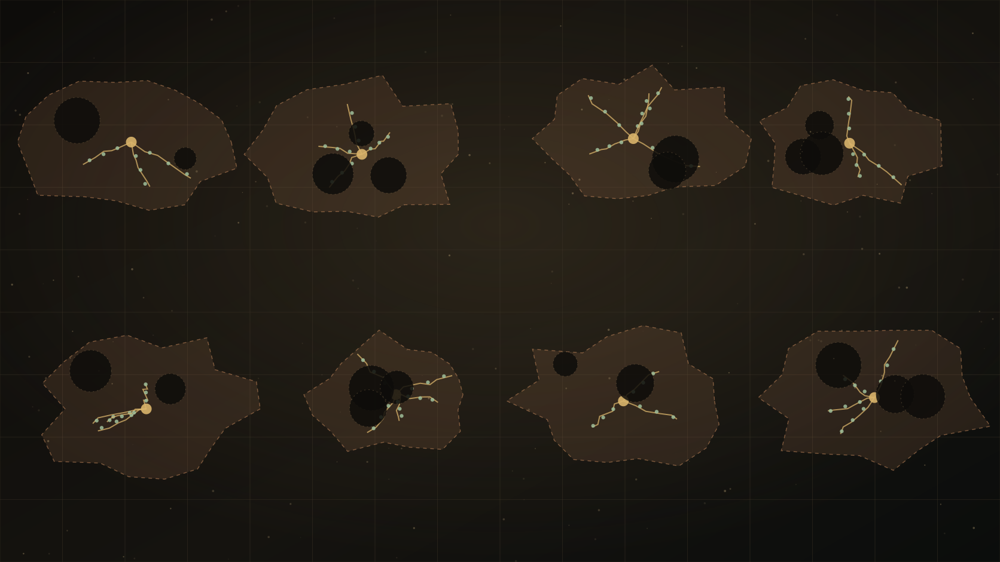
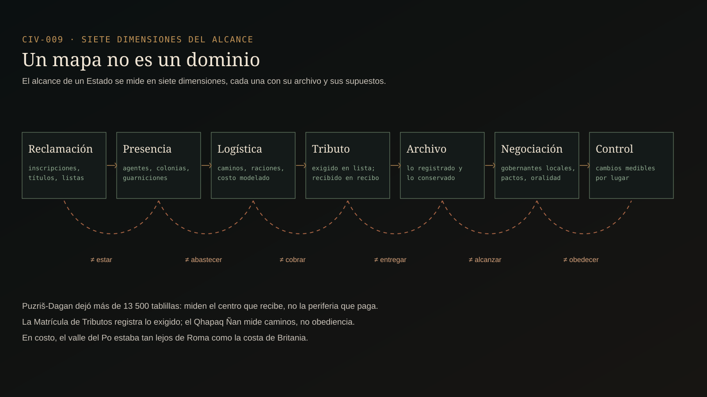
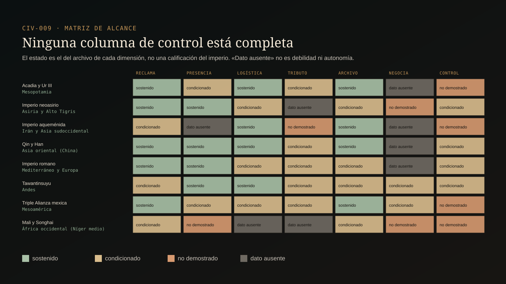

# CIV-009 — Estados e imperios: un mapa no es un dominio

## Pregunta central

¿Hasta dónde llegaba realmente un Estado o un imperio —Acadia y Ur III, Asiria, el imperio aqueménida, Qin y Han, Roma, el Tawantinsuyu, la Triple Alianza mexica, Mali y Songhai— cuando se separa lo que reclamaba de dónde estaba presente, qué podía mover, qué cobraba, qué registraba, qué negociaba y qué controlaba de hecho, y con qué archivo se mide cada cosa?

CIV-009 es el noveno punto de [`PROGRAMA_CRONOLOGICO_GLOBAL.md`](PROGRAMA_CRONOLOGICO_GLOBAL.md). No repite la [Investigación 051](INVESTIGACION_051_CIUDADES_ESTADOS.md), que fijó que ciudad, Estado e imperio son resultados distintos (`CLAIM-CITIES-STATES-SCOPE-001`, `CLAIM-URBANISM-STATE-SEPARATE-001`) y que la escritura no es requisito del Estado (`CLAIM-WRITING-NOT-STATE-REQUIREMENT-001`), ni [CIV-007](INVESTIGACION_CIV_007_URBANISMOS_COMPARADOS.md), que bajó esa regla al interior de la ciudad con siete dimensiones (`CLAIM-CIV-URBCOMP-SEVEN-DIMENSIONS-001`). Aquí la misma lógica sube un nivel: no «¿era un imperio?», sino «¿qué parte del territorio pintado en el mapa estaba alcanzada, y cómo lo sabemos?». La 051 definió imperio como dominio desigual sobre varias comunidades con mecanismos de incorporación; CIV-009 pregunta por la medida de esa desigualdad. Las notaciones y archivos administrativos como tales —quipus, tablillas, tiras de bambú, códices— son el objeto de [CIV-008](INVESTIGACION_CIV_008_ESCRITURAS_NOTACIONES_ORALIDAD.md) (`INV-CIV-SCRIPTS-001`); aquí se usan sólo como instrumentos para medir alcance.

## Respuesta breve

Ningún caso tiene el control efectivo sostenido sobre todo lo que reclamaba, y en ninguno el archivo más denso coincide con el territorio mejor controlado. Ur III dejó más de `13 500` tablillas de una sola agencia de ganado en Puzriš-Dagan, que registran sobre todo tributo de la periferia: miden el centro que recibe, no la periferia que paga. Las prospecciones asirias del Alto Tigris muestran colonias en zonas anexadas, zonas de amortiguamiento y un control discontinuo. El archivo de la Fortificación de Persépolis (Hallock editó `2087` textos) alimentaba viajeros oficiales con autorizaciones selladas a lo largo de caminos, y Colburn sostiene que eso dio al imperio un potencial de comunicación enorme; potencial no es obediencia. El pozo de Liye conserva el archivo de un condado Qin con logística militar, raciones de convictos y multas; es un condado. Roma se puede medir en costo con ORBIS: la razón de precios mar:río:carreta implícita en el Edicto de Diocleciano es `1:5/10:52`, y en verano el valle del Po estaba tan lejos de Roma, en costo, como la costa de Britania; las unas `300` declaraciones censales de Egipto son de una provincia. Los khipus sirvieron a censo y tributo, y en 2025 un khipu con cuerda de cabello humano reveló a un autor de dieta común. El Qhapaq Ñan mide más de `30 000` km, y aun así la incorporación «pacífica» de Acarí implicó reasentar gente. La Matrícula de Tributos registra lo exigido, no lo entregado, y el control mexica fue indirecto. La capital de Mali no está localizada y una de las dos crónicas de Tombuctú es en parte del siglo XIX. Mann llama a este patrón poder despótico alto con poder infraestructural limitado; Scott lo convierte en una historia de huida deliberada; ambas lecturas se miden aquí contra archivos concretos.

## LO OBSERVADO

Se observan tablillas, tiras de bambú, papiros y cuerdas anudadas con números; asentamientos registrados en prospección; caminos, depósitos y puentes; restos humanos con firmas isotópicas; palacios excavados; manuscritos copiados en distintos siglos; tradiciones orales registradas en el siglo XX; precios máximos fijados por un edicto. No se observan «el imperio», su frontera real, la obediencia de una aldea ni la intensidad del control en un valle concreto.

## 1. Siete dimensiones del alcance que no se heredan

Cada caso se registra en siete dimensiones. La regla prolonga la de 051 —Estado no es imperio, monumento no es soberanía— hacia el territorio: ninguna dimensión se deduce de otra (`CLAIM-CIV-EMPREACH-SEVEN-DIMENSIONS-001`).

| Dimensión | Qué se pregunta | Archivo típico | Supuesto que hay que declarar | No demuestra por sí sola |
|---|---|---|---|---|
| reclamación | ¿qué decía el centro que gobernaba? | inscripciones reales, títulos, crónicas, listas | que el texto describe y no sólo proclama | presencia ni control |
| presencia | ¿dónde había agentes, guarniciones o asentamientos del Estado? | arqueología provincial, nombramientos, fuertes | coetaneidad y función de los sitios | obediencia de la población |
| logística | ¿qué podía mover y a qué costo? | caminos, depósitos, raciones, modelos de costo | tasas de transporte y temporadas | uso real de esa capacidad |
| tributo | ¿qué se exigía y qué se registró como recibido? | listas de tributo, recibos, censos | que lo exigido se entregó | control fuera de quien paga |
| archivo | ¿qué se registró y qué sobrevivió? | tablillas, tiras, papiros, khipus, códices | que la preservación no sesga el mapa | densidad de control |
| negociación | ¿qué se pactó con élites y comunidades locales? | correspondencia, tratados, gobernantes locales en su lugar, tradición oral | que la permanencia local revele un pacto | autonomía ni sumisión |
| control efectivo | ¿qué decisiones del centro se cumplían, dónde y con qué intensidad? | reasentamientos, cambios de producción, censos repetidos, conflictos | que el cambio responda al centro | uniformidad sobre todo lo reclamado |

La tabla no es una escalera: un caso puede tener archivo denso y control débil, o logística alta y tributo no documentado.

## 2. El adversario conceptual: poder despótico frente a poder infraestructural

Mann distinguió dos sentidos del poder del Estado. El **despótico** es el rango de acciones que la élite puede emprender sin negociación rutinaria e institucionalizada con los grupos de la sociedad civil; el **infraestructural**, la capacidad del Estado de penetrar efectivamente la sociedad civil y aplicar logísticamente decisiones políticas en todo su territorio (`SRC-MANN-AUTONOMOUS-POWER-1984`, texto completo). Su tipología cruza ambos: el Estado «imperial» tiene agentes propios pero capacidad limitada de penetrar y coordinar la sociedad sin la ayuda de otros grupos de poder, y Mann sitúa ahí a Acadia, Egipto, Asiria, Persia y Roma. Las técnicas que aumentan el poder infraestructural son la división del trabajo coordinada, la escritura, la moneda y las medidas, y la rapidez de comunicación y transporte; ninguna es exclusiva del Estado (`CLAIM-CIV-EMPREACH-MANN-001`).

La distinción es una definición útil (A-SEM); la clasificación de cada imperio antiguo es una hipótesis que este expediente contrasta con archivos (B-COND). Soifer mostró que el concepto se aplica mucho y se mide poco, y separó tres lentes que no deben mezclarse: las capacidades del Estado central, su alcance territorial y sus efectos sobre la sociedad (`SRC-SOIFER-INFRASTRUCTURAL-2008`). CIV-009 traduce esas lentes a archivos antiguos: capacidades = logística y archivo; alcance = presencia y tributo; efectos = control efectivo (`CLAIM-CIV-EMPREACH-MEASUREMENT-001`).

## 3. Estados débiles y «el arte de no ser gobernado»

**Scott.** En *The Art of Not Being Governed*, Scott sostiene que durante unos dos mil años los pueblos de Zomia —una región montañosa del tamaño de Europa repartida entre siete países asiáticos— huyeron de los proyectos estatales: esclavitud, conscripción, impuestos, trabajo forzado, epidemias y guerra. La dispersión en terreno abrupto, la agricultura móvil, las identidades étnicas flexibles y una cultura oral que permite rehacer la historia serían estrategias para seguir sin Estado de forma deliberada y reactiva (`SRC-SCOTT-NOT-GOVERNED-2009`, resumen editorial). Es el adversario más fuerte de cualquier mapa imperial coloreado: si la gente se iba donde el Estado no llegaba, la frontera reclamada encierra poblaciones que eligieron no ser alcanzadas.

**Sus críticas.** Lieberman objeta el uso escaso y anacrónico de fuentes birmanas, errores de fecha, la tesis de que los interregnos duraban más que los reinados, el radio de `300 km` de extracción cortesana frente a levas de arroz de `700 km`, y sobre todo la cronología de la migración: las grandes migraciones de minorías hacia la península fueron sobre todo de las décadas de 1860–1890 y varios ejemplos de Scott describen huidas desde China o entre colinas, no de los Estados de las llanuras hacia las montañas (`SRC-LIEBERMAN-ZOMIA-2010`, consultado en sus notas). Korolkov y Hein toman de Scott la idea de «espacios estatales» y la usan en sentido opuesto: los imperios Qin y Han produjeron territorio moviendo poblaciones (`SRC-KOROLKOV-HEIN-QIN-2020`). CIV-009 conserva de Scott lo medible —los límites del alcance son un dato y no un hueco— y rechaza su generalización como historia demostrada de toda población sin Estado (`CLAIM-CIV-EMPREACH-SCOTT-001`, C).

**Herbst.** Para África, Herbst sostiene que el problema de proyectar poder sobre tierras de baja densidad es anterior a la colonia: en el periodo precolonial las fronteras se definían por hasta dónde un Estado podía extender su poder, mientras que bajo la colonia pasaron a definirse por hasta dónde los gobernantes creían que debía llegar (`SRC-HERBST-AFRICA-POWER-2000`, resumen). Es un modelo de distancia y densidad, no una medida de Mali o Songhai (`CLAIM-CIV-EMPREACH-HERBST-001`).

## 4. Medir con distancia y costo, y lo que limita esa medida

### ORBIS

ORBIS simula el tiempo y el precio de viajar por tierra, río y mar en la red imperial romana madura, en condiciones aproximadas de `200 d. C.`. En la versión usada por Scheidel enlaza unos `750` sitios mediante c. `85 000` km de caminos, c. `28 000` km de ríos y canales navegables y `900` rutas marítimas cuya longitud simulada varía con la estación y promedia c. `180 000` km, con catorce modos de viaje terrestre, barcos fluviales y dos tipos de nave. Para el precio usa los máximos del Edicto de Diocleciano de `301 d. C.`, del que sólo importan las razones entre modos: mover una unidad de carga una unidad de distancia cuesta `1` por mar, `5` río abajo, `10` río arriba y `52` en carreta (`SRC-SCHEIDEL-ORBIS-WP-2013`, texto completo de la versión 1.0; versión publicada en `SRC-SCHEIDEL-ORBIS-2014`). En costo, la forma del imperio no es la del mapa: en verano era tan caro llegar a Roma desde el valle del Po como desde la costa de Britania o, quizá más realista, desde el Egipto medio (`CLAIM-CIV-EMPREACH-ORBIS-001`).

### Lo que ORBIS no mide

El propio Scheidel declara los límites: los costos computados no capturan ningún viaje real sino promedios de infinitos viajes bajo el mejor camino disponible y sin interrupciones; el modelo funciona mejor en agregado y a gran escala; el precio depende de que los máximos del Edicto no estén «masiva e inconsistentemente» equivocados; las simulaciones se centran en verano y no recogen la frecuencia estacional de los viajes; y las simulaciones «no pueden predecir lo que ocurrió», sólo iluminar las restricciones (`CLAIM-CIV-EMPREACH-ORBIS-LIMITS-001`). A esos límites CIV-009 añade dos: un modelo de costo mide la capacidad de alcanzar, no la decisión de hacerlo; y una red trazada sobre caminos conocidos hereda el sesgo de lo que se excavó y se cartografió.

### Costo de transporte sin animales de carga: el debate mesoamericano

En Mesoamérica, sin animales de carga, el costo se modeló en energía humana. Drennan sostuvo que, por las distancias entre centros del Formativo y el Clásico, los alimentos básicos no podían moverse con provecho entre ellos (`SRC-DRENNAN-TRANSPORT-1984`). Sluyter respondió con un modelo cuantitativo que hace posible el transporte terrestre de larga distancia de maíz de tributo entre Zempoala y Tenochtitlan (`SRC-SLUYTER-STAPLES-1993`). Cowgill juzgó incorrecto que no haya límite: alimentar a los cargadores en postas es más eficiente que hacerles cargar su comida y, en escasez, se aceptan ganancias netas pequeñas, pero existe un radio más allá del cual ampliar la procuración no aumenta el alimento que llega al centro (`SRC-COWGILL-STAPLES-1993`). El límite está sostenido; su distancia depende de supuestos de carga, ración y postas (`CLAIM-CIV-EMPREACH-TRANSPORT-MESOAMERICA-001`).

## 5. Acadia y Ur III: el archivo del centro que recibe

Foster describe el periodo de Agade como el primer estudio de libro completo sobre Acadia y documenta gobernadores, escribas, administradores y oficiales que dependían del patrocinio real; Sargón quiso ser recordado por poner acadios en las gobernaciones de las tierras conquistadas. Que el sistema fuera radicalmente nuevo e «imperial» es la tesis del autor, disputada por otros asiriólogos (`SRC-FOSTER-AGADE-2016`, resumen y reseñas; `CLAIM-CIV-EMPREACH-AKKAD-001`).

Ur III dejó el ejemplo más claro de logística como archivo. Puzriš-Dagan (Drehem), agencia central de ganado, está documentada en más de `13 500` tablillas; Tsouparopoulou reconstruye sus oficinas y funcionarios hasta Ibbi-Suen 2 y, siguiendo a Steinkeller (1987), identifica la mayor parte de los animales entregados como tributo de las periferias —el impuesto gun mada—, distinto de las obligaciones bala del núcleo (`SRC-TSOUPAROPOULOU-DREHEM-2013`, texto completo; el trabajo de Steinkeller no se leyó aquí). El archivo mide un flujo hacia el centro con nombres, fechas y cabezas de ganado; no mide si cada provincia periférica entregó lo debido ni qué pasaba con quien no lo hacía. El control fiscal era desigual por diseño: núcleo y periferia pagaban de modo distinto (`CLAIM-CIV-EMPREACH-UR3-DREHEM-001`).

## 6. Asiria: colonias, amortiguamiento y control discontinuo

Parker usó prospecciones de tres áreas del Alto Tigris, en Anatolia sudoriental, para la Edad del Hierro (`c. 1100–600 a. C.`), y encontró tres rasgos recurrentes del dominio asirio: colonias establecidas en áreas recién anexadas, zonas de amortiguamiento a lo largo de las fronteras y un control imperial discontinuo; la integración imperial afecta al registro arqueológico de modo significativo e identificable (`SRC-PARKER-ASSYRIA-2003`, resumen). La presencia está sostenida; el control es desigual en el espacio y deja huecos dentro de lo reclamado (`CLAIM-CIV-EMPREACH-ASSYRIA-001`).

**Lo que no se reproduce.** Circulan cifras de millones de deportados por el imperio neoasirio, extrapoladas de inscripciones reales. CIV-009 no las audita y no las usa: una inscripción real es una reclamación, y convertirla en conteo es el error `ERR-CIV-EMPREACH-ROYAL-COUNT-001`.

## 7. El imperio aqueménida: raciones en ruta y el adversario de la distancia

Las tablillas de la Fortificación de Persépolis son registros administrativos elamitas fechados por años de reinado de Darío I (los editados van de su año `13` al `28`, c. `509–493 a. C.`). Hallock editó `2087` textos en 1969; una gran parte registra raciones entregadas en ruta a viajeros oficiales que llevaban documentos sellados por el rey o por funcionarios de rango satrapal (`SRC-HALLOCK-PFT-1969`). El archivo completo es varias veces mayor; las estimaciones publicadas de su tamaño varían y no se auditaron aquí (`CLAIM-CIV-EMPREACH-PERSIA-ARCHIVE-001`).

**Adversario.** Colburn discute que la extensión del imperio impidiera la comunicación: la red extensa de caminos y la alta velocidad del servicio *pirradaziš* muestran un potencial enorme de movimiento e interacción (`SRC-COLBURN-ACHAEMENID-2013`). Es el mejor argumento contra Mann en este expediente. CIV-009 lo acepta como medida de capacidad logística y lo rechaza como medida de control: el archivo procede de Fars, el corazón del imperio, y la capacidad de mover mensajeros no dice cuánto de lo que llevaban se cumplía en cada satrapía (`CLAIM-CIV-EMPREACH-PERSIA-ROADS-001`).

## 8. Qin y Han: el archivo de un condado y la producción de territorio

En el pozo número 1 de Liye (Hunan) apareció el archivo del condado Qin de Qianling. Yates presentó en 2013 los documentos publicados de los niveles `5`, `6` y `8`: tratan de logística militar, multas y castigos, recompensas, raciones de convictos, distinciones de estatus y compra de rango, formularios y ordenanzas, y actividades religiosas de oficiales locales; el ensayo discute además problemas de las dos ediciones de 2012 y por qué los documentos se arrojaron al pozo cuando Qin empezaba a derrumbarse (`SRC-YATES-LIYE-2013`, resumen). El total de piezas que circula en informes de difusión —más de `36 000`— no se verificó en la fuente primaria, y la publicación sigue siendo parcial (`CLAIM-CIV-EMPREACH-LIYE-001`).

Korolkov y Hein muestran que Qin (`221–207 a. C.`) y Han (`202 a. C.–220 d. C.`) no ocuparon simplemente un territorio dado: lo produjeron transformando paisajes, moviendo poblaciones y fijando jerarquías territoriales; la migración y el asentamiento inducidos por el Estado fueron instrumentos de control militar, incorporación administrativa e intensificación económica, y el estudio se prueba en la región metropolitana de Guanzhong advirtiendo que la situación varía según el lugar (`SRC-KOROLKOV-HEIN-QIN-2020`; `CLAIM-CIV-EMPREACH-QIN-MIGRATION-001`). Liye mide la presencia y la logística de un condado; Guanzhong, el control de un núcleo. Ninguno mide el imperio entero.

## 9. Roma: censos de una provincia, ejército dentro y costo de la periferia

**Censo.** Bagnall y Frier construyeron la demografía de Egipto romano sobre unas `300` declaraciones censales, la más antigua de `12 d. C.` y la más tardía de `259 d. C.` (conservada en copia posterior) (`SRC-BAGNALL-FRIER-EGYPT-1994`, resumen y reseñas). Es la mejor serie demográfica del mundo antiguo y es de una provincia: el papiro se conservó en Egipto. Archivo abundante en Egipto no significa control más intenso allí que en Galia (`CLAIM-CIV-EMPREACH-EGYPT-CENSUS-001`).

**Limes.** Luttwak propuso una «gran estrategia» romana defensiva con fronteras organizadas (`SRC-LUTTWAK-STRATEGY-2016`). Isaac respondió que esa imagen de un imperio que guarda sus bordes es moderna y anacrónica: el imperio fue agresivo en ideología y postura, y el ejército del Principado en el Oriente actuó sobre todo como fuerza de ocupación y policía; sus críticos le reprochan generalizar desde Palestina y olvidar que un fuerte sirve a la vez a la seguridad interna y externa (`SRC-ISAAC-LIMITS-1992`, resumen y reseñas). Si Isaac tiene razón, la línea del limes no marca el borde del control efectivo; el control se ejercía también, y sobre todo, dentro (`CLAIM-CIV-EMPREACH-ROME-FRONTIER-001`, C).

**Costo.** ORBIS muestra una segmentación Oriente–Occidente que se remonta al inicio del Principado; los intentos de conquista de Germania (`12 a. C.–9/16 d. C.`), la invasión de Armenia y Mesopotamia por Trajano (`114–117`) y las campañas de `172–180` en Bohemia, Moravia, Eslovaquia y la llanura húngara ocurrieron en lugares excepcionalmente remotos en costo de conexión con la capital, y Dacia, la excepción, fue la primera provincia establecida que se abandonó (`SRC-SCHEIDEL-ORBIS-WP-2013`; `CLAIM-CIV-EMPREACH-ROME-SEGMENT-001`). Es una correlación de modelo: la decisión de abandonar tiene causas que el costo no observa.

## 10. Tawantinsuyu: caminos, cuerdas y gente movida

**Qhapaq Ñan.** La red vial inca es un sistema de comunicación, comercio y defensa de más de `30 000` km; en 2014 se inscribieron `273` componentes en seis países (`SRC-UNESCO-QHAPAQNAN-2014`). Las cifras totales que circulan varían según qué tramos se cuenten; CIV-009 usa la de la inscripción. Un camino mide capacidad de movimiento; no mide control sobre quien vive a sus lados (`CLAIM-CIV-EMPREACH-INKA-ROADS-001`).

**Khipus como administración.** Urton y Brezine mostraron jerarquías numéricas de contabilidad entre khipus de Puruchuco (`SRC-URTON-BREZINE-KHIPU-2005`, reutilizada). Medrano y Urton compararon una revisita de `1670` en San Pedro de Corongo, en el bajo Santa, que registra `132` tributarios en seis pachacas, con seis khipus de una tumba del valle organizados en `133` grupos de seis cuerdas: los nudos de las primeras cuerdas suman el mismo valor que el tributo fijado, y la forma de anudar divide a los tributarios en mitades (`SRC-MEDRANO-URTON-KHIPU-2018`, registrada por CIV-008). CIV-008 audita esa correspondencia como notación (`CLAIM-CIV-SCRIPTS-KHIPU-CENSUS-001`) y la función contable de los quipus (`CLAIM-CIV-SCRIPTS-KHIPU-ACCOUNTING-001`); CIV-009 la usa como instrumento de alcance: los khipus sirvieron al censo y al tributo al menos en la administración colonial temprana, y proyectarlo al Estado inca necesita el puente de Puruchuco. En 2025, Hyland y colaboradores analizaron la cuerda primaria de cabello humano del khipu `KH0631` —el cabello funcionaba como «firma» del autor— y midieron carbono, nitrógeno y azufre: su autor tenía una dieta propia de gente común de bajo rango, contra la idea, basada en crónicas coloniales, de que sólo una élite burocrática masculina hacía khipus (`SRC-HYLAND-KHIPU-HAIR-2025`; `CLAIM-CIV-EMPREACH-KHIPU-COMMONERS-001`, un caso). La administración sin escritura glotográfica ya quedó auditada en 052 (`CLAIM-CIVILIZATIONS-ANDES-ORALITY-001`).

**Mitmaq y negociación.** Los isótopos de oxígeno, estroncio y plomo de los residentes permanentes de Machu Picchu indican infancias en regiones diversas, no una población campesina local ni grupos enviados desde uno o dos lugares; que fueran yanacona u otra categoría es una lectura de documentos coloniales (`SRC-TURNER-MACHUPICCHU-2009`, resumen secundario). Valdez discute la idea de que el Estado inca apenas interfería donde la incorporación fue pacífica: en el valle de Acarí, en la costa sur, la ocupación inca creó asentamientos nuevos a los que la población local parece haber sido reubicada (`SRC-VALDEZ-ACARI-2024`). Negociar la incorporación con un señorío no excluyó mover a su gente; el control efectivo sobre personas existió en ciertos lugares y no se mide en otros (`CLAIM-CIV-EMPREACH-MITMAQ-001`).

## LO MEDIDO

Se miden tablillas de una agencia (`>13 500`), textos editados de un archivo (`2087`), declaraciones censales (`~300`, `12–259 d. C.`), kilómetros de una red modelada (`~85 000` de caminos, `~28 000` de ríos, `900` rutas marítimas) y de una red inscrita (`>30 000`; `273` componentes), razones de precios (`1:5/10:52`), tributarios de una revisita (`132`) y grupos de cuerdas de un conjunto de khipus (`133`), isótopos de carbono, nitrógeno, azufre, oxígeno, estroncio y plomo, y fechas de reinado. Cada cifra conserva su objeto: un kilómetro de camino mide infraestructura, una tablilla mide un registro, un precio máximo mide una razón entre modos de transporte.

## 11. Triple Alianza mexica: lo exigido, lo pintado y lo controlado

**Matrícula y Códice Mendoza.** La Matrícula de Tributos es un documento prehispánico que registró el tributo pagado al imperio mexica por pueblos conquistados; probablemente se pintó en la última década del gobierno de Moctezuma II, aunque algunas páginas pueden ser anteriores, y muestra el trabajo de al menos seis tlacuiloque. Su contenido lo copió un solo pintor hacia `1542` como segunda parte del Códice Mendoza, enviado al emperador español, y ese pintor es el mismo que hizo los folios `6r–11v` de la Matrícula unos veinte años antes (`SRC-BATALLA-MATRICULA-2007`). La edición de Berdan y Anawalt del Códice Mendoza estudia su lista de tributo imperial (`SRC-BERDAN-ANAWALT-MENDOZA-1992`), y en el recuento de Berdan las provincias tributarias son `38` (`SRC-BERDAN-AZTEC-STRATEGIES-1996`). Lo registrado es lo exigido y lo que un pintor colonial eligió mostrar a la Corona; lo entregado no está en la lista (`CLAIM-CIV-EMPREACH-MEXICA-TRIBUTE-001`).

**Control indirecto.** Berdan, Blanton, Boone, Hodge, Smith y Umberger distinguieron provincias tributarias, por lo general en el interior y separadas de enemigos mayores, y provincias estratégicas que aislaban el núcleo de fronteras peligrosas (`SRC-BERDAN-AZTEC-STRATEGIES-1996`). Smith y Montiel construyeron un modelo arqueológico para detectar imperios —calibrado en el mexica precisamente porque su extensión está documentada en textos— para probar si Teotihuacan y Tula gobernaron imperios (`SRC-SMITH-MONTIEL-EMPIRES-2001`, consultado por fuentes secundarias). La huella material del control en las provincias es débil, el tributo pasaba por gobernantes locales y el número de provincias estratégicas no se verificó aquí (`CLAIM-CIV-EMPREACH-MEXICA-INDIRECT-001`).

## 12. Mali y Songhai: fuentes árabes, oralidad y una capital que no aparece

**Fuentes árabes.** El corpus de Levtzion y Hopkins reúne escritos árabes contemporáneos o casi contemporáneos sobre la historia temprana de África occidental, incluidos Ghana, Mali y los almorávides (`SRC-LEVTZION-HOPKINS-CORPUS-1981`). Son observadores externos: describen cortes y riquezas, no cuentas.

**Oralidad.** Conrad combinó tradición oral, textos árabes y sitios: la sede de gobierno de Mali cambió más de una vez entre los siglos XII y XVI; Dakajalan fue según la tradición la base de Sunjata, la sede probablemente se movió río abajo para aprovechar el comercio y gobernar a una población súbdita creciente que incluía musulmanes de antiguos territorios soninké, y Niani, ciudad antigua y siderúrgica, habría sido capital, si acaso, en el siglo XVI (`SRC-CONRAD-DAKAJALAN-1994`). Fauvelle-Aymar revisó los datos arqueológicos de Niani y concluyó que no hay argumentos para identificarlo con la capital del siglo XIV: la hipótesis se construyó al margen de la arqueología (`SRC-FAUVELLE-NIANI-2012`). La capital imperial de Mali no está localizada; ausencia de capital localizada no es ausencia de Estado (`CLAIM-CIV-EMPREACH-MALI-CAPITAL-001`). Jenne-jeno ya existía como urbanismo mucho antes del imperio (`SRC-MCINTOSH-JENNE-1981`).

**Crónicas de Tombuctú y arqueología de Gao.** El *Tārīkh al-sūdān* de al-Saʿdī, del siglo XVII, es la fuente principal de Songhai y se traduce con otros documentos contemporáneos en Hunwick (`SRC-HUNWICK-TIMBUKTU-1999`). Nobili y Mathee mostraron, con manuscritos antes no usados, que el texto editado como *Tārīkh al-fattāsh* funde una crónica del siglo XVII con otra del XIX (`SRC-NOBILI-MATHEE-FATTASH-2015`). Las excavaciones de Takezawa y Cissé en Gao muestran que Gao Saney estuvo ocupada por mercaderes y artesanos norteafricanos entre los siglos VIII y X, no XI–XIII, y que en Gao Antigua hubo edificios de piedra —una residencia real con un gran recinto— construidos a inicios del siglo X y abandonados a fines del mismo siglo: confirman las ciudades gemelas que mencionan los escritores árabes y corrigen las crónicas, que no describieron bien los orígenes de Gao (`SRC-TAKEZAWA-CISSE-GAO-2012`). Gomez integra fuentes árabes internas y externas y compara las dos crónicas de Tombuctú en una historia de Mali y Songhai hasta la invasión marroquí de `1591` (`SRC-GOMEZ-DOMINION-2018`). El archivo escrito de Songhai es tardío y en parte compuesto después (`CLAIM-CIV-EMPREACH-SONGHAY-SOURCES-001`).

## LO INFERIDO

Se infiere presencia cuando hay asentamientos nuevos, oficiales o colonias fechados en zonas incorporadas (Asiria, Qianling, Acarí); capacidad logística cuando hay caminos, raciones y depósitos registrados (Persia, Ur III, Qhapaq Ñan) o un modelo de costo con supuestos declarados (ORBIS); tributo exigido cuando una lista lo fija (Matrícula) y tributo recibido cuando un recibo lo registra (Puzriš-Dagan); control efectivo sólo cuando el centro cambió algo medible —dónde vivía la gente, qué producía— en un lugar concreto. No se infiere control uniforme sobre lo reclamado, ni debilidad del Estado por falta de archivo, ni autonomía local por permanencia de gobernantes locales.

## 13. Archivo no es alcance

Los archivos de este expediente sobrevivieron donde había un soporte durable o una administración que escribía en el centro: Drehem es una agencia central, Persépolis está en el corazón del imperio, Liye es un condado conservado por un pozo, los papiros son de Egipto, la Matrícula es lo que se pintó para Tenochtitlan y luego para la Corona. Tomar la densidad del archivo como intensidad del control produce mapas con el centro hipertrofiado y las provincias en blanco (`CLAIM-CIV-EMPREACH-ARCHIVE-BIAS-001`). Opie y Atkinson hallan en `868` culturas asociaciones evolutivas entre tributación, escritura y Estado con excepciones (`SRC-OPIE-ATKINSON-2025`, reutilizada): escribir ayuda a cobrar, pero no hace que todo lo cobrado se registre ni que todo lo registrado se conserve.

## 14. El adversario fuerte

La mejor versión contraria tiene tres formas.

**El imperio infraestructural.** Colburn para Persia, el archivo de Liye para Qin y la red de khipus para el Tawantinsuyu sugieren que algunos Estados antiguos tuvieron más poder infraestructural del que Mann les concedió: mensajeros rápidos, condados que registraban raciones de convictos, cuerdas que contaban tributarios. Si fuera general, el control efectivo se acercaría a lo reclamado. CIV-009 acepta que la capacidad logística fue alta en esos casos y sostiene que la capacidad no es el control: los tres archivos son del centro o de un punto, y en ninguno se mide la obediencia de la periferia.

**El imperio de mapa.** Inscripciones reales, títulos y listas de tributo presentan dominio continuo; Luttwak leyó en Roma una gran estrategia de fronteras. Si la reclamación fuera una buena aproximación del control, bastaría con colorear. CIV-009 la rechaza con el limes de Isaac, el control discontinuo asirio y la huella débil mexica.

**El no-Estado deliberado.** Scott convierte los límites del alcance en estrategia de quienes huyen. Si fuera general, todo hueco de control sería resistencia elegida. CIV-009 la acepta como hipótesis y la rechaza como regla con las objeciones de Lieberman y con Acarí y Guanzhong, donde el Estado alcanzó y movió a poblaciones que no resistieron.

## 15. Lo que no se ordena en escalera

| Caso | Reclamación | Presencia | Logística | Tributo | Archivo | Negociación | Control efectivo |
|---|---|---|---|---|---|---|---|
| Acadia y Ur III | sostenida | condicionada | sostenida (Drehem) | condicionado (gun mada) | sostenido | dato ausente | no demostrado |
| Asiria | sostenida | sostenida (colonias) | condicionada | dato ausente | condicionado | no demostrada | condicionado (discontinuo) |
| Persia aqueménida | condicionada | dato ausente | sostenida (raciones, caminos) | no demostrado fuera de Fars | sostenido (`2087`) | dato ausente | no demostrado |
| Qin y Han | sostenida | sostenida (Qianling) | sostenida | condicionado | sostenido | dato ausente | condicionado (Guanzhong) |
| Roma | sostenida | sostenida (ejército) | condicionada (ORBIS) | condicionado (Egipto) | condicionado | dato ausente | condicionado (segmentado) |
| Tawantinsuyu | condicionada | sostenida (Acarí) | sostenida (`>30 000` km) | condicionado (khipus) | condicionado | condicionada | condicionado |
| Triple Alianza | sostenida (Matrícula) | condicionada | condicionada (cargadores) | condicionado | sostenido | condicionada (indirecta) | no demostrado |
| Mali y Songhai | condicionada | no demostrada (capital) | dato ausente | dato ausente | condicionado (crónicas tardías) | no demostrada | no demostrado |

Leída por columnas, cada dimensión ordena los casos de otro modo; leída por filas, ninguna tiene el control sostenido. Ésa es la evidencia de `CLAIM-CIV-EMPREACH-NO-UNIFORM-CONTROL-001`: el alcance de un Estado premoderno fue desigual en el espacio y entre dimensiones, y su mapa reclamado no lo describe.

## 16. Protocolo de nombres aplicado

Siguiendo `CLAIM-CIV-IDENTITY-PROTOCOL-001`: «Acadia» y «Agade» nombran una ciudad no localizada con certeza y por extensión una dinastía; «Ur III» es una convención moderna de la lista real; «aqueménida» es el nombre de un linaje usado por sus reyes; «Tawantinsuyu» («las cuatro partes juntas») es un endónimo quechua documentado en época colonial, e «inca» designaba al gobernante y a un grupo, no a todos los súbditos; «azteca» es una etiqueta moderna, y «Triple Alianza» y «mexica» nombran respectivamente la coalición de Tenochtitlan, Texcoco y Tlacopan y al grupo de Tenochtitlan; «Mali» y «Songhai» proceden de fuentes árabes y de las lenguas mande y songhay con variantes. Ningún nombre de imperio describe a todos los pueblos que vivían dentro de su mapa.

## LOS SUPUESTOS

1. las inscripciones y listas reflejan la reclamación del centro, no la experiencia de los gobernados;
2. los archivos conservados son una muestra sesgada por soporte, lugar y administración;
3. las razones de precios del Edicto de Diocleciano no son masiva e inconsistentemente erróneas (Scheidel);
4. las firmas isotópicas locales están bien calibradas;
5. la correspondencia entre khipus y revisita de `1670` no es una coincidencia numérica;
6. la presencia arqueológica de colonias o asentamientos nuevos responde a decisiones del centro;
7. los nombres de imperios son convenciones (CIV-005).

## LAS INCERTIDUMBRES

- tamaño total de los archivos de Persépolis y Liye y fracción publicada;
- correspondencia entre lo exigido en la Matrícula y lo entregado;
- extensión del control asirio fuera del Alto Tigris;
- costo real de los viajes romanos frente al modelo en cada temporada;
- distancia máxima rentable del transporte por cargadores en Mesoamérica;
- categoría social de los residentes de Machu Picchu;
- localización de las sedes de gobierno de Mali;
- composición del *Tārīkh al-fattāsh* y su uso en historias anteriores;
- cifras de deportados neoasirios que circulan sin auditar.

## LAS ALTERNATIVAS

| Señal | Lectura focal | Alternativas |
|---|---|---|
| inscripción de conquista | dominio | campaña sin ocupación; tributo esporádico; propaganda |
| archivo central denso | Estado fuerte en todo el territorio | administración intensa sólo en el núcleo |
| camino imperial | control del territorio | capacidad de paso; uso estacional; tramos preexistentes |
| lista de tributo | recaudación efectiva | exigencia nominal; entrega parcial; negociación |
| gobernante local en su lugar | autonomía | control indirecto pactado; cooptación |
| frontera fortificada | límite del control | zona de ocupación y policía; control dentro y fuera |
| hueco sin archivo | ausencia del Estado | pérdida de soporte; administración oral |
| población que no aparece en registros | huida deliberada (Scott) | despoblamiento; registro perdido; poca relevancia fiscal |
| isótopos no locales | mitmaq o deportados | migración voluntaria; movilidad estacional |
| capital no localizada | Estado sin centro | sede móvil; sitio no excavado |

## LAS CONTROVERSIAS

1. alcance infraestructural de los imperios antiguos (Mann frente a Colburn y los archivos de condado);
2. Zomia y la huida del Estado (Scott frente a Lieberman);
3. costo modelado frente a costo vivido (ORBIS);
4. distancia rentable del transporte de alimentos sin animales (Drennan, Sluyter, Cowgill);
5. gran estrategia romana o ejército de ocupación (Luttwak frente a Isaac);
6. Acadia como primer imperio;
7. interferencia inca en incorporaciones pacíficas;
8. sedes de gobierno de Mali.

Los modelos, las pruebas discriminatorias y el estado de cada una se registran en `CONTROVERSIES.md`; CIV-009 no resuelve ninguna eligiendo un bando.

## QUÉ PODRÍA FALSARLO

1. un archivo provincial que muestre, para una periferia concreta, órdenes del centro cumplidas de forma regular y medible (censos repetidos, entregas que coinciden con lo exigido, sanciones aplicadas) refutaría que el control efectivo nunca está sostenido en estos casos;
2. recibos de entrega mexicas o coloniales tempranos que coincidan con la Matrícula pueblo por pueblo harían del tributo exigido una buena medida del recibido;
3. una distribución de archivos que no se concentre en el centro (por ejemplo, archivos de condado Qin en decenas de lugares con contenidos equivalentes) debilitaría el sesgo de archivo como explicación;
4. costos de viaje documentados en papiros o cartas que difieran sistemáticamente de ORBIS en orden de magnitud invalidarían su uso para medir la forma del imperio;
5. registros etnohistóricos o arqueológicos de huidas masivas de los Estados de las llanuras a las montañas antes del siglo XIX en el Sudeste asiático rehabilitarían la cronología de Scott frente a Lieberman;
6. una excavación con contextos fechados que localice una sede real de Mali del siglo XIV refutaría que la capital no está localizada;
7. fortificaciones de frontera con ocupación continua y sin funciones internas a lo largo del limes oriental devolverían peso a la lectura de Luttwak;
8. firmas isotópicas locales en la mayoría de los residentes de Machu Picchu y continuidad de asentamiento en Acarí refutarían la reubicación;
9. textos de gobernadores acadios que muestren tributo regular de provincias lejanas sostendrían un control efectivo más alto que el concedido por Mann.

## NIVEL DE CONFIANZA

| Resultado | Confianza | Motivo |
|---|---|---|
| siete dimensiones del alcance no equivalentes | A-SEM | objetos y archivos distintos |
| distinción despótico/infraestructural | A-SEM definición; B-COND clasificación | texto completo de Mann; clasificación contrastable |
| medir alcance por lentes separadas | A-MET | Soifer |
| archivo no es alcance | B síntesis | ocho casos |
| Zomia como historia general | C | críticas de fuentes y cronología |
| alcance según densidad en África (Herbst) | B-COND modelo; C casos | modelo, no medida |
| razones de costo de ORBIS | B-COND | modelo con supuestos declarados |
| límites de ORBIS | A-MET | declarados por el autor |
| límite energético del transporte por cargadores | B-COND límite; C distancia | modelos en debate |
| Acadia: gobernadores y reclamación | B-COND; C «imperio» | categoría disputada |
| Drehem: `>13 500` tablillas, gun mada | B | texto completo |
| Asiria: colonias y control discontinuo | B-COND | prospección regional |
| Persépolis: `2087` textos, raciones de viajeros | B | edición |
| Persia: potencial de comunicación | B-COND potencial; C control | argumento de Colburn |
| Liye: archivo de condado | B; C total de piezas | resumen; cifra no verificada |
| Qin–Han: migración inducida | B-COND | un caso regional |
| censo de Egipto: `~300` declaraciones | B | monografía |
| limes como ejército de ocupación | C | debate abierto |
| segmentación romana por costo | B-COND | modelo |
| khipus de censo y tributo (claim de CIV-008, usado como instrumento) | B-COND | correspondencia colonial |
| autor común de un khipu | B-LOCAL | un khipu |
| Qhapaq Ñan `>30 000` km | B | inscripción UNESCO |
| reubicación inca | B-COND | dos casos |
| Matrícula y Mendoza | B | paleografía |
| control mexica indirecto | B-COND | modelo y textos |
| capital de Mali no localizada | B rechazo de Niani; C sede | arqueología y oralidad |
| crónicas de Songhai tardías y compuestas | B | manuscritos |
| ningún control uniforme | B síntesis | matriz de ocho casos |

## QUÉ SABEMOS REALMENTE

Sabemos que los Estados e imperios premodernos reclamaron más de lo que alcanzaban; que algunos tuvieron una capacidad logística alta y medible —raciones en ruta en Persia, una agencia de ganado en Ur III, un condado Qin que registraba convictos, caminos andinos de decenas de miles de kilómetros—; que el tributo se fijó en listas que no dicen cuánto se entregó; que el control efectivo se observa en lugares concretos donde el Estado movió gente o reorganizó asentamientos; y que los archivos que lo documentan se concentran en los centros y en los lugares donde el soporte se conservó. Sabemos también cómo medir la distancia en costo y qué supone esa medida.

## QUÉ TODAVÍA NO SABEMOS

No sabemos qué fracción del territorio reclamado obedecía en casi ninguno de estos casos; cuánto del tributo exigido se entregaba; dónde estuvieron las sedes de gobierno de Mali; cuánta gente fue deportada o reasentada por Asiria o el Tawantinsuyu; ni si los huecos del control fueron incapacidad del centro, negociación o huida deliberada. Tampoco sabemos, en la mayoría de los casos, cómo se nombraban a sí mismas las comunidades que vivían dentro del mapa.

## Conclusión

CIV-009 sube la regla de 051 —Estado no es imperio— al territorio: reclamar no es estar, estar no es abastecer, abastecer no es cobrar, cobrar no es registrar, registrar no es controlar. Ninguno de los ocho casos tiene el control efectivo sostenido sobre todo lo que reclamaba. La comparación útil no pregunta qué imperio fue más grande, sino qué dimensión del alcance se midió, con qué archivo y bajo qué supuesto. Cita `CLAIM-CITIES-STATES-SCOPE-001`, `CLAIM-URBANISM-STATE-SEPARATE-001`, `CLAIM-WRITING-NOT-STATE-REQUIREMENT-001`, `CLAIM-CIVILIZATIONS-ANDES-ORALITY-001`, `CLAIM-COLLAPSE-TRANSFORMATION-001`, `CLAIM-CIV-URBCOMP-SEVEN-DIMENSIONS-001`, `CLAIM-CIV-SCRIPTS-KHIPU-ACCOUNTING-001` y `CLAIM-CIV-SCRIPTS-KHIPU-CENSUS-001` sin cambiar su estado. CIV-001 sigue `TRAZADO`.

## Fuentes núcleo auditadas

- Mann (1984), DOI `10.1017/S0003975600004239` (texto completo consultado).
- Soifer (2008), DOI `10.1007/s12116-008-9028-6`.
- Lieberman (2010), DOI `10.1017/S1740022810000112`.
- Scheidel (2013), versión de trabajo 1.0 (texto completo consultado); versión publicada DOI `10.1017/S1047759414001147`.
- Sluyter (1993), DOI `10.1017/s0956536100000882`; Cowgill (1993), DOI `10.1017/s0956536100000894`.
- Tsouparopoulou (2013), *Cuneiform Digital Library Journal* 2013:2 (texto completo consultado).
- Parker (2003), DOI `10.3764/aja.107.4.525`.
- Colburn (2013), DOI `10.1163/15685209-12341278`.
- Yates (2013), DOI `10.1017/s0362502800000523`.
- Korolkov y Hein (2020), DOI `10.1017/jch.2020.45`.
- Medrano y Urton (2018), DOI `10.1215/00141801-4260638`.
- Hyland et al. (2025), DOI `10.1126/sciadv.adv1950`.
- Valdez (2024), DOI `10.15381/arqueolsoc.2024n40.e25471`.
- Batalla Rosado (2007), DOI `10.1017/s0956536107000077`.
- Conrad (1994), DOI `10.1017/S002185370002675X`.
- Fauvelle-Aymar (2012), DOI `10.4000/palethnologie.6320`.
- Takezawa y Cissé (2012), DOI `10.4000/etudesafricaines.17167`.
- Nobili y Mathee (2015), DOI `10.1017/hia.2015.18`.
