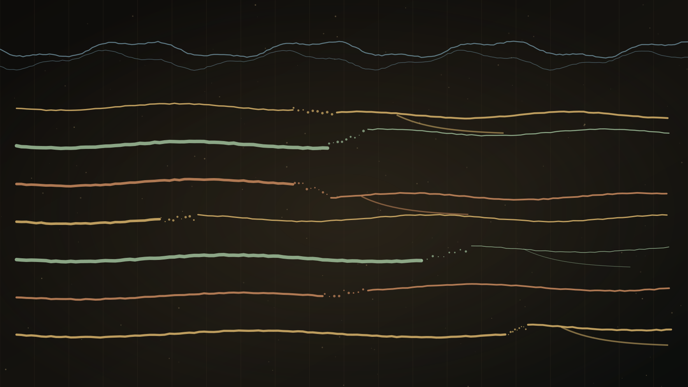
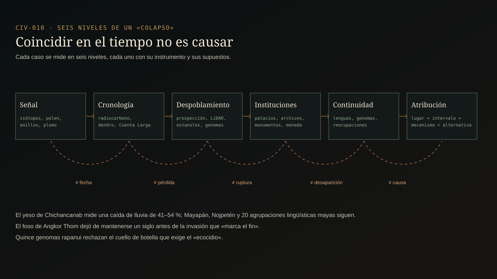
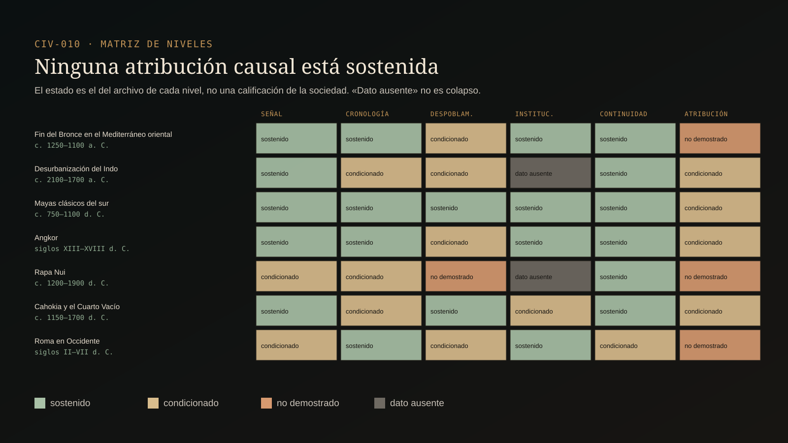

# CIV-010 — Lo que se rompe y lo que sigue: transformaciones sin «colapso de la civilización»

## Pregunta central

Cuando se dice que una civilización «colapsó» —el Mediterráneo oriental hacia `1200 a. C.`, el Indo hacia `1900 a. C.`, los mayas clásicos del sur, Angkor, Rapa Nui, Cahokia, Roma en Occidente—, ¿qué se observó exactamente: una señal climática, una fecha, un despoblamiento, un cambio de instituciones, una ruptura de la población o de la cultura, o una causa? ¿Y qué parte de la palabra «colapso» es una explicación que el archivo no sostiene?

CIV-010 es el décimo y último punto de [`PROGRAMA_CRONOLOGICO_GLOBAL.md`](PROGRAMA_CRONOLOGICO_GLOBAL.md) y cierra el programa CIV. No repite la [Investigación 051](INVESTIGACION_051_CIUDADES_ESTADOS.md), que fijó como regla que «colapso» debe desagregarse en transformación, fragmentación, migración, cambio institucional o pérdida de archivo (`CLAIM-COLLAPSE-TRANSFORMATION-001`) y que la desurbanización del Indo no fue desaparición de su gente (`CLAIM-INDUS-DEURBANIZATION-TRANSFORMATION-001`). Aquí esa regla se convierte en procedimiento: seis niveles por caso, con el instrumento de cada uno y la prueba que exigiría pasar de uno al siguiente. Toma de [CIV-002](INVESTIGACION_CIV_002_FECHADO_ARQUEOLOGICO_HISTORICO.md) los seis niveles del fechado (`CLAIM-CIV-DATING-LAYERS-001`, `CLAIM-CIV-DATING-CONTEXT-001`), de [CIV-003](INVESTIGACION_CIV_003_ASIA_SUDOCCIDENTAL_CAMPAMENTOS_ALDEAS_URBANISMOS.md) el precedente de que los eventos climáticos de `9.2` y `8.2 ka` no produjeron abandonos simultáneos (`CLAIM-CIV-SWASIA-CLIMATE-NONDETERMINISM-001`), de [CIV-007](INVESTIGACION_CIV_007_URBANISMOS_COMPARADOS.md) el declive de Cahokia como correlación fechada (`CLAIM-CIV-URBCOMP-CAHOKIA-DECLINE-001`) y la población maya como modelo (`CLAIM-CIV-URBCOMP-MAYA-POPULATION-001`), y de [CIV-009](INVESTIGACION_CIV_009_ESTADOS_IMPERIOS_CONTROL_DESIGUAL.md) la regla de que un Estado nunca controló todo lo que reclamaba (`CLAIM-CIV-EMPREACH-NO-UNIFORM-CONTROL-001`): si el control era desigual, su pérdida también lo fue.

## Respuesta breve

En los siete casos hay pérdidas reales y medibles, y en ninguno la palabra «colapso» explica algo que los datos no expliquen mejor por partes. Las señales climáticas están bien fechadas: el polen del mar de Galilea marca la fase más seca de las edades del Bronce y del Hierro hacia `1250–1100 a. C.` y los anillos de enebro de Anatolia una sequía de `1198–1196 (±3) a. C.`; el yeso del lago Chichancanab mide una caída de la lluvia de `41–54 %` durante el Clásico Terminal; los anillos de Vietnam registran sequías de décadas en Angkor. Lo que falta casi siempre es el puente: que la sequía estuviera donde estaba la gente, en el mismo intervalo calibrado, y que haya un mecanismo que excluya las alternativas. Los mayas del sur se despoblaron antes y más que los del norte, pero Mayapán gobernó Yucatán en los siglos XIII–XV, los itzá resistieron hasta `1697` y el catálogo oficial de México cuenta `20` agrupaciones lingüísticas de la familia maya. Angkor Thom dejó de mantener su foso a fines del siglo XIV, un siglo antes de la invasión que «marca el fin», y Angkor Wat siguió ocupado hasta los siglos XVII–XVIII. En Rapa Nui, `15` genomas antiguos rechazan el cuello de botella del siglo XVII que exige el «ecocidio». Cahokia tocó su mínimo hacia `1400` y la región se repobló hacia `1500` con la Confederación de Illinois. En Roma, el plomo del hielo de Groenlandia cae con la peste del siglo II y no se recupera en más de `500` años, mientras Ward-Perkins mide en Occidente menos cerámica, tejas y moneda en los siglos V–VII: hubo pérdida material medible, y aun así «la civilización» no es la unidad que se perdió. Coincidir en el tiempo no es causar.

## LO OBSERVADO

Se observan isótopos de oxígeno en conchas, foraminíferos, espeleotemas y yeso; polen en núcleos lacustres; titanio en sedimentos marinos; anchos y química de anillos de árboles; plomo en hielo; estanoles fecales; capas de destrucción fechadas por radiocarbono; monumentos con fecha de Cuenta Larga; casas, campos y terrazas vistos por LiDAR y satélite; genomas antiguos; cerámica, tejas y monedas contadas en excavación; crónicas y padrones. No se observa «el colapso», ni «la civilización» como un sujeto que muere, ni la causa de un abandono.

## 1. Seis niveles que no se heredan

Cada caso se registra en seis niveles. Ninguno se deduce del anterior y el sexto —la causa— es el que más se afirma y el que menos se mide (`CLAIM-CIV-TRANSFORM-SIX-LEVELS-001`).

| Nivel | Qué se pregunta | Instrumento típico | Supuesto que hay que declarar | No demuestra por sí solo |
|---|---|---|---|---|
| señal climática o ambiental | ¿qué cambió en lluvia, temperatura, crecidas o vegetación? | isótopos, polen, titanio, anillos, estanoles | que el proxy registra el clima del lugar habitado y no otro | impacto sobre la gente |
| cronología fina | ¿cuándo, con qué incertidumbre y en qué orden? | radiocarbono calibrado y modelado, dendrocronología, fechas de reinado o de Cuenta Larga | asociación muestra–contexto–acontecimiento (CIV-002) | simultaneidad ni secuencia causal |
| despoblamiento | ¿cuánta gente dejó de vivir dónde, y cuándo? | prospección, LiDAR, SPD de radiocarbono, estanoles, genomas | coetaneidad de sitios, visibilidad, tasas de muestreo | mortalidad ni desaparición |
| cambio institucional | ¿qué dejó de funcionar: corte, archivo, monumentos, redes, moneda? | inscripciones, palacios, archivos, intercambio, acuñación | que el registro de la élite mida a la sociedad | qué pasó con el resto |
| continuidad poblacional o cultural | ¿quién siguió, dónde y con qué lengua, prácticas o descendencia? | genomas, cerámica de uso diario, lenguas, crónicas posteriores, reocupaciones | que la continuidad se busque con la misma intensidad que la ruptura | ausencia de pérdidas |
| atribución causal | ¿qué produjo el cambio y por qué mecanismo? | modelos, contrastes entre regiones, pruebas que excluyan alternativas | exposición, mecanismo y alternativa descartada | nada sin los cinco niveles anteriores |

La tabla no es una escalera: un caso puede tener señal sostenida, cronología condicionada y atribución no demostrada, como casi todos aquí.

## 2. Coincidencia temporal no es mecanismo

Que una sequía y un abandono caigan en el mismo siglo es una observación de dos series; que una cause la otra exige cuatro cosas más (`CLAIM-CIV-TRANSFORM-COINCIDENCE-001`):

1. **Lugar.** El proxy tiene que registrar el clima de donde vivía la gente. El titanio de la cuenca de Cariaco mide el ciclo hidrológico del norte de Sudamérica tropical (`SRC-HAUG-CARIACO-2003`); los foraminíferos del mar Arábigo, el caudal del Indo (`SRC-STAUBWASSER-INDUS-2003`). Dixit, Hodell y Petrie lo dicen al justificar su lago: la evidencia previa de clima para el Indo venía «de lugares bien fuera» de la distribución de sus asentamientos (`SRC-DIXIT-KOTLA-2014`).
2. **Intervalo.** Dos fechas calibradas con incertidumbres de décadas o siglos se solapan sin ser simultáneas. Carleton, Campbell y Collard simularon series fechadas por radiocarbono: con una correlación real de `0.25` y poco ruido, el método que probaron la detecta sólo en `20–30 %` de los casos; con `0.5`, en más de `90 %` (`SRC-CARLETON-PEWMA-2018`). La incertidumbre cronológica no sólo inventa coincidencias: también esconde relaciones reales. Es la cadena de CIV-002 —muestra, medición, calendario, contexto, fase y acontecimiento— aplicada a dos series a la vez (`CLAIM-CIV-DATING-LAYERS-001`).
3. **Mecanismo.** Hay que decir por qué vía la señal llega a la gente: cosechas, agua almacenada, infraestructura, rutas. Penny y colaboradores lo hacen para Angkor con un modelo de red (`SRC-PENNY-ANGKOR-NETWORK-2018`); casi ningún otro caso lo tiene.
4. **Alternativa descartada.** Degroot y diecisiete coautores revisan la «historia del clima y la sociedad» y señalan sesgos numerosos, poca atención a los efectos locales y a la heterogeneidad espacial y temporal del clima, y dificultades para leer las fuentes; su marco pide reconstruir los mecanismos y las incertidumbres, y al aplicarlo hallan cinco vías por las que las poblaciones sobrevivieron —y a menudo prosperaron— bajo presión climática (`SRC-DEGROOT-HCS-2021`). Haldon y colaboradores piden lo mismo desde la historia: consiliencia entre ciencias del pasado y fuentes, no superposición de curvas (`SRC-HALDON-CONSILIENCE-2018`).

El precedente ya auditado es CIV-003: más de `3000` fechas alrededor de los eventos de `9.2` y `8.2 ka` no muestran abandonos simultáneos en Asia sudoccidental (`CLAIM-CIV-SWASIA-CLIMATE-NONDETERMINISM-001`).

## 3. Tres teorías del colapso y su respuesta crítica

**Tainter (1988).** *The Collapse of Complex Societies* define colapso como la pérdida rápida y significativa de un nivel establecido de complejidad sociopolítica y lo explica por los rendimientos marginales decrecientes de invertir en complejidad: cuando cada unidad adicional de organización rinde menos, una sociedad pierde capacidad de responder a la siguiente tensión y se simplifica (`SRC-TAINTER-COLLAPSE-1988`, resumen editorial y reseñas). La definición es útil porque es operativa: habla de complejidad, no de gente. La explicación es una teoría general que se contrasta caso por caso; como ley no está demostrada (`CLAIM-CIV-TRANSFORM-TAINTER-001`).

**Diamond (2005).** *Collapse* ordena los casos con cinco factores —daño ambiental, cambio climático, vecinos hostiles, pérdida de socios comerciales y respuestas de la sociedad— y convierte a Rapa Nui y a los mayas en advertencias de autodestrucción ambiental (`SRC-DIAMOND-COLLAPSE-2005`). Es el adversario popular de este expediente. El esquema de cinco factores es una lista de comprobación razonable; el relato del «ecocidio» no se sostiene en Rapa Nui (§ 8) y en el caso maya confunde el fin de las cortes del sur con el fin de un pueblo (§ 6) (`CLAIM-CIV-TRANSFORM-DIAMOND-001`).

**La respuesta crítica.** *Questioning Collapse*, editado por McAnany y Yoffee, reúne arqueólogos, historiadores y antropólogos que responden a Diamond con resiliencia, regeneración y la «secuela del imperio»: Hunt y Lipo sobre el mito del ecocidio en Rapa Nui, Berglund sobre los nórdicos de Groenlandia, Pomeranz sobre «calamidades sin colapso» en China, Wilcox desde una perspectiva indígena del Suroeste, McAnany y Gallareta Negrón sobre los mayas del siglo VIII, Yoffee sobre «qué pasó y qué no» en Mesopotamia (`SRC-MCANANY-YOFFEE-QUESTIONING-2010`, índice y capítulos introductorios). Middleton sostiene que el paradigma ambiental domina la literatura del colapso y oscurece los procesos sociales, y que la confusión de términos produce mensajes mezclados sobre procesos históricos complejos (`SRC-MIDDLETON-DISCOURSES-2012`); su síntesis de 2017 revisa Roma, los mayas y Rapa Nui con atención a la resiliencia y las decisiones de la gente (`SRC-MIDDLETON-UNDERSTANDING-2017`). Butzer, con cinco casos del Viejo Mundo, concluye que el colapso es multicausal y rara vez abrupto, que la simplificación política suele preceder a la desintegración, que el declive demográfico acompaña o sigue a la ruptura, y que concentrarse en los estresores subestima la resiliencia (`SRC-BUTZER-COLLAPSE-2012`). Lo que este expediente toma de esta respuesta es la separación de niveles; lo que no toma es la tentación contraria de negar las pérdidas (§ 13) (`CLAIM-CIV-TRANSFORM-QUESTIONING-001`).

## 4. El adversario climático fuerte: Weiss

Weiss y colaboradores fecharon en Tell Leilan, en las llanuras del Habur, un aumento marcado de la aridez y de la circulación de viento hacia `2200 a. C.` y lo vincularon con el abandono de Leilan, la deserción regional y el colapso del imperio acadio; el colapso sincrónico en regiones vecinas sugería un impacto extenso (`SRC-WEISS-SUBIR-1993`). Weiss y Bradley generalizaron: los colapsos del registro ocurren con frecuencia de forma súbita y con abandono regional, reemplazo de una subsistencia por otra o paso a una organización de menor energía, y el clima abrupto es un motor que la arqueología subestimaba al atribuirlos a factores sociales (`SRC-WEISS-BRADLEY-2001`, resumen). Es el adversario más fuerte del expediente porque mide algo —suelos, aridez, abandono— y porque no niega a la gente: describe migraciones y cambios de subsistencia.

Se acepta la señal y se discute la generalización. Lawrence, Palmisano y de Gruchy reconstruyeron con tamaños de sitio, distribución y fechas de radiocarbono la trayectoria del norte del Creciente Fértil durante el evento de `4.2 ka` y hallaron respuestas heterogéneas, continuidad y reorganización (`SRC-LAWRENCE-COLLAPSE-2021`, reutilizada). La sequía de `4.2 ka` está medida en varios archivos; que haya derribado a Acadia —una entidad cuyo control de la periferia CIV-009 no encontró sostenido— es una atribución que la sincronía no prueba (`CLAIM-CIV-TRANSFORM-WEISS-001`; véase `CLAIM-CIV-EMPREACH-NO-UNIFORM-CONTROL-001`).

## 5. Fin del Bronce en el Mediterráneo oriental (~1200 a. C.)

**Señal.** Langgut, Finkelstein y Litt analizaron polen de un núcleo del mar de Galilea con una muestra cada `~40` años, sobre una cronología de radiocarbono de material terrestre de vida corta: el evento más seco de las edades del Bronce y del Hierro cae hacia `1250–1100 a. C.`, seguido de una recuperación marcada en el Hierro I, con más árboles mediterráneos y olivos cultivados (`SRC-LANGGUT-GALILEE-2013`). En la costa siria, el polen de Gibala–Tell Tweini indica condiciones más secas desde fines del siglo XIII o inicios del XII hasta el IX (`SRC-KANIEWSKI-GIBALA-2010`), y Kaniewski y colaboradores añadieron en 2013 datos de Chipre y una cronología de radiocarbono que integra proxies arqueológicos y climáticos (`SRC-KANIEWSKI-LBA-2013`). Manning, Kocik y Lorentzen midieron con anchos de anillo e isótopos de enebros de Anatolia central un periodo seco continuo y excepcional hacia `1198–1196 (±3) a. C.` en el corazón hitita (`SRC-MANNING-HITTITE-2023`). La señal es regional, múltiple y bien fechada (`CLAIM-CIV-TRANSFORM-LBA-CLIMATE-001`).

**Cronología fina.** Kaniewski y colaboradores anclaron en Gibala una arqueología estratificada de radiocarbono en fuentes epigráficas, reyes hititas, levantinos y egipcios y observaciones astronómicas, y fijaron las destrucciones terminales del norte del Levante en `1192–1190 a. C.` (`SRC-KANIEWSKI-SEAPEOPLES-2011`); la primera conflagración de Gibala fue simultánea con la destrucción de Ugarit, fechada entre `1194` y `1175 a. C.`, y Gibala se reurbanizó poco después (`SRC-KANIEWSKI-GIBALA-2010`). Knapp y Manning recuerdan que los cambios ocurrieron en momentos distintos desde mediados o fines del siglo XIII hasta todo el XII, y critican tanto las explicaciones climáticas como las «cronologías sobreprecisas» (`SRC-KNAPP-MANNING-2016`). La fecha `1177 a. C.` del título de Cline es la de la invasión de Egipto por los «pueblos del mar», rechazada por el ejército y la flota del faraón (`SRC-CLINE-1177-2014`): la fecha de un acontecimiento en un lugar, no la de un colapso regional (`CLAIM-CIV-TRANSFORM-LBA-CHRONOLOGY-001`).

**Despoblamiento e instituciones.** En el Levante, la crisis se manifiesta en la destrucción de muchos centros urbanos, la reducción de otros, atesoramientos y cambios en el patrón de asentamiento, y los textos de varios lugares mencionan sequía y hambre desde mediados del siglo XIII hasta la segunda mitad del XII (`SRC-LANGGUT-GALILEE-2013`). Desaparecen palacios, archivos en lineal B y la correspondencia entre cortes; el reino hitita deja de existir como Estado central. Es pérdida institucional medible.

**Migración y continuidad.** Las inscripciones egipcias y las tablillas cuneiformes presentan a los «pueblos del mar» como catalizador final (`SRC-KANIEWSKI-SEAPEOPLES-2011`). Feldman y colaboradores secuenciaron diez individuos de Ascalón de la Edad del Bronce y del Hierro: la población del Hierro temprano muestra una mezcla relacionada con Europa que ya no se detecta en el Hierro posterior; hubo un movimiento de personas en la transición, sin firma genética duradera (`SRC-FELDMAN-ASHKELON-2019`; `CLAIM-CIV-TRANSFORM-LBA-MIGRATION-001`, local). Gibala se reurbanizó; el Hierro I del Levante muestra una recuperación rápida de asentamientos en las tierras altas (`SRC-LANGGUT-GALILEE-2013`).

**Terremotos.** Nur y Cline superpusieron las áreas sacudidas por sismos del siglo XX de magnitud `≥6.5` e intensidad `≥VII` con el mapa de sitios destruidos de Drews y hallaron que casi todos caen en zonas de alta sacudida; propusieron una «tormenta sísmica» entre `1225` y `1175 a. C.`, advirtiendo que la evidencia no es concluyente (`SRC-NUR-CLINE-2000`). Es un argumento de compatibilidad espacial con sismos modernos, no de daño sísmico fechado sitio por sitio (`CLAIM-CIV-TRANSFORM-LBA-EARTHQUAKE-001`, C).

**Sistemas y la «tormenta perfecta».** Cline une invasión, revuelta, terremotos, sequía y corte de rutas comerciales en un colapso de sistemas: la interdependencia de los reinos aceleró su caída (`SRC-CLINE-1177-2014`). Knapp y Manning responden que nunca hubo una explicación global que dé cuenta de todos los cambios, que la ambigüedad de la evidencia material, textual, climática y cronológica impide separar el ruido de fondo de las condiciones de contorno y la causa del efecto, y que el «colapso» presenta realidades materiales, sociales y culturales múltiples (`SRC-KNAPP-MANNING-2016`). La tormenta perfecta reúne factores verosímiles; no es un mecanismo probado, porque sin cronologías independientes por sitio cualquier suma de factores contemporáneos «explica» (`CLAIM-CIV-TRANSFORM-LBA-SYSTEMS-001`, C).

## 6. Mayas clásicos del sur

**Señal.** Hodell, Curtis y Brenner reconstruyeron con isótopos de oxígeno y composición del sedimento de un núcleo de `4.9 m` del lago Chichancanab que el intervalo `800–1000 d. C.` fue el más seco del Holoceno medio y tardío (`SRC-HODELL-CHICHANCANAB-1995`). El titanio de Cariaco muestra un periodo seco regional con sequías plurianuales más intensas centradas hacia `810`, `860` y `910` (`SRC-HAUG-CARIACO-2003`). Medina-Elizalde y Rohling interpretan cuatro registros como reducciones de hasta `40 %` de la lluvia anual (`SRC-MEDINA-ROHLING-2012`); Evans y colaboradores, con isótopos del agua estructural del yeso de Chichancanab, una caída de `41–54 %`, con intervalos de hasta `70 %` en los picos (`SRC-EVANS-GYPSUM-2018`). La sequía está sostenida; su magnitud depende del proxy y del modelo (`CLAIM-CIV-TRANSFORM-MAYA-DROUGHT-001`).

**El problema del lugar.** Douglas y colaboradores señalan que la evidencia de sequía procede sobre todo de las tierras bajas del norte, más secas y menos pobladas, y no explicaba el declive más marcado y temprano del sur, más húmedo; con isótopos de ceras vegetales de dos lagos muestran que el sur se secó más que el norte en el Clásico Terminal, y que tras una sequía de `~200–500 d. C.` la agricultura pasó a un cultivo de maíz intensivo y ahorrador de agua que funcionó y luego falló ante sequías más severas (`SRC-DOUGLAS-MAYA-2015`). Es el puente de lugar que faltaba; es un puente de dos lagos.

**Cronología fina.** Kennett y colaboradores compararon un registro subanual de la cueva de Yok Balum (Belice) con hechos fechados en monumentos de piedra: lluvias altas entre `440` y `660` favorecieron la expansión y la proliferación de centros políticos; una tendencia seca entre `660` y `1000` acompañó la balcanización, el aumento de la guerra y la desintegración asincrónica de las entidades políticas; el colapso de la población llegó con una sequía prolongada entre `1020` y `1100` (`SRC-KENNETT-YOKBALUM-2012`). La serie política sale de inscripciones de Cuenta Larga: mide cortes que dejan de erigir monumentos fechados, no a la población. Un siglo separa la desintegración de las cortes del colapso demográfico que los autores fechan (`CLAIM-CIV-TRANSFORM-MAYA-SEQUENCE-001`).

**Despoblamiento diferencial.** Aimers revisa cientos de estudios del periodo `750–1050` y concluye que hay consenso en que la civilización maya en su conjunto no colapsó, aunque muchas zonas vivieron cambios profundos; antes se generalizaba desde sitios y regiones al conjunto de las tierras bajas (`SRC-AIMERS-MAYA-2007`). La población clásica de las tierras bajas centrales es un modelo de `9.5–16` millones (`SRC-ESTRADA-BELLI-MAYA-POP-2025`, reutilizada; `CLAIM-CIV-URBCOMP-MAYA-POPULATION-001`): cuánta gente se fue, murió o dejó de tener hijos no se mide con la misma precisión que la lluvia (`CLAIM-CIV-TRANSFORM-MAYA-DIFFERENTIAL-001`).

**Persistencia que el «colapso» borra.** Mayapán fue la mayor capital posclásica de Yucatán en los siglos XIII y XIV; allí Kennett y colaboradores correlacionan el conflicto civil con la sequía de `1400–1450 cal d. C.`, y aun así las estructuras políticas y económicas mayas resistieron hasta el contacto europeo de inicios del siglo XVI (`SRC-KENNETT-MAYAPAN-2022`). El reino itzá de Nojpetén, en el Petén —el corazón del «colapso» del sur—, fue conquistado por los españoles en `1697` (`SRC-JONES-ITZA-1998`, catálogo y reseñas). El catálogo de lenguas indígenas nacionales que usa el INEGI incluye `20` agrupaciones lingüísticas de la familia maya —entre ellas maya, tseltal, tsotsil, ch’ol, k’iche’, kaqchikel, mam y q’eqchí’— (`SRC-INEGI-PUEBLOS-INDIGENAS-2020`). Decir que «los mayas colapsaron» confunde el fin de un sistema de cortes con la desaparición de un pueblo que sigue hablando sus lenguas (`CLAIM-CIV-TRANSFORM-MAYA-PERSISTENCE-001`; aplica `CLAIM-CIV-IDENTITY-PROTOCOL-001`: «maya» es aquí una familia lingüística y un conjunto de entidades políticas, no un sujeto único).

**Atribución.** La sequía es una condición fechada y, con Douglas, localizada; la guerra y la balcanización están en las inscripciones; McAnany y Gallareta Negrón advierten contra proyectar sobre el siglo VIII las angustias climáticas y bélicas del XXI (`SRC-MCANANY-YOFFEE-QUESTIONING-2010`). Que la sequía causara el despoblamiento del sur es una hipótesis condicionada con un mecanismo propuesto (fallo de la adaptación agrícola); que fuera la causa única no está demostrado (`CLAIM-CIV-TRANSFORM-MAYA-ATTRIBUTION-001`).

## 7. Angkor: hidráulica y transformación, no fin

**Escala.** El mapa arqueológico del Greater Angkor Project cubre cerca de `3000 km²` y muestra un paisaje de asentamiento de baja densidad integrado por una red de manejo del agua de más de `1000 km²` (`SRC-EVANS-ANGKOR-MAP-2007`); es un caso del urbanismo de baja densidad de CIV-007 (`CLAIM-CIV-URBCOMP-LOW-DENSITY-001`; `SRC-FLETCHER-LOWDENSITY-2024`, reutilizada). Klassen y colaboradores combinaron LiDAR, excavación, fechas de radiocarbono y aprendizaje automático y estiman `700 000–900 000` habitantes en el siglo XIII, en su máximo (`SRC-KLASSEN-ANGKOR-POP-2021`; `CLAIM-CIV-TRANSFORM-ANGKOR-POPULATION-001`, modelo).

**Señal y mecanismo.** Una reconstrucción hidroclimática de siete siglos y medio con anillos de árboles del sur de Vietnam muestra sequías de décadas alternadas con monzones intensos en los siglos XIV y XV, de duración y severidad suficientes para afectar el agua y la agricultura, mientras los monzones fuertes dañaban la infraestructura; los autores lo presentan como factor contribuyente «en combinación con otros» (`SRC-BUCKLEY-ANGKOR-2010`). Penny y colaboradores convirtieron la red hidráulica excavada en un modelo numérico: las crecidas producen daños en cascada cuya probabilidad y extensión crecen abruptamente con la magnitud de la crecida (`SRC-PENNY-ANGKOR-NETWORK-2018`). Es el único caso del expediente con un mecanismo modelado entre señal e infraestructura (`CLAIM-CIV-TRANSFORM-ANGKOR-HYDRAULIC-001`).

**Cronología fina: un declive anterior al «fin».** El fin del periodo de Angkor se marca convencionalmente con la invasión de Ayutthaya del siglo XV. Penny, Hall, Evans y Polkinghorne fecharon núcleos de sedimento de Angkor Thom: los indicadores de quema, perturbación forestal y erosión bajan ya en las primeras décadas del siglo XIV, y el foso dejó de mantenerse a fines de ese siglo; la ocupación del núcleo económico y administrativo declinó de forma prolongada, no por un colapso demográfico abrupto, y el poder se desplazó hacia centros fuera de la capital (`SRC-PENNY-ANGKOR-GRADUAL-2019`). Carter y colaboradores, con `16` fechas de radiocarbono modeladas en Angkor Wat, hallan ocupación del siglo XI al XIII, un hueco, y nueva ocupación desde fines del XIV o inicios del XV hasta los siglos XVII o XVIII: Angkor Wat nunca se abandonó del todo, y su reorganización no coincide con el «colapso» del siglo XV (`SRC-CARTER-ANGKORWAT-2019`; `CLAIM-CIV-TRANSFORM-ANGKOR-GRADUAL-001`).

**Continuidad.** La capital y el centro del sistema político se desplazaron hacia el sur; la región conservó importancia ideológica y residencial (`SRC-CARTER-ANGKORWAT-2019`). Lo que terminó fue una capital y su red hidráulica, no una población ni una tradición política (`CLAIM-CIV-TRANSFORM-ANGKOR-RELOCATION-001`).

## 8. Rapa Nui: ecocidio, genomas y cuántos eran

**El relato.** Diamond convirtió a Rapa Nui en la advertencia por excelencia: sus habitantes talaron el bosque, degradaron el suelo, extinguieron plantas y animales y su sociedad se hundió en la guerra civil y el canibalismo antes del contacto europeo (`SRC-DIAMOND-COLLAPSE-2005`).

**Cronología.** Hunt y Lipo fecharon las capas más antiguas de Anakena y reanalizaron fechas previas: la colonización fue tardía, hacia `1200 d. C.`, y los impactos ecológicos y la inversión en estatuas empezaron poco después (`SRC-HUNT-LIPO-COLONIZATION-2006`). Un poblamiento tardío acorta el tiempo disponible para un crecimiento y un hundimiento prehispánicos (`CLAIM-CIV-TRANSFORM-RAPANUI-CHRONOLOGY-001`, B-COND).

**Señal ambiental.** La deforestación ocurrió; su forma es lo discutido. Rull revisa los núcleos continuos de la última década: la sustitución abrupta y sincrónica de polen de palma por gramíneas era un artefacto de un hiato sedimentario de varios milenios; la deforestación fue gradual, en tiempos y ritmos distintos según el sitio, con sequías climáticas y retroalimentaciones además de la acción humana, y la evidencia arqueológica muestra una sociedad resiliente y sana hasta el contacto (`SRC-RULL-RAPANUI-2020`; `CLAIM-CIV-TRANSFORM-RAPANUI-DEFORESTATION-001`).

**Genomas.** Moreno-Mayar y colaboradores secuenciaron `15` individuos rapanui antiguos fechados por radiocarbono entre `1670` y `1950`, polinesios de origen y más cercanos a los rapanui actuales. Con reconstrucciones del tamaño efectivo de la población y simulaciones extensas, rechazan un cuello de botella severo en el siglo XVII como el que propone la teoría del ecocidio; los rapanui antiguos y actuales llevan cerca de `10 %` de ancestría nativa americana, por una mezcla fechada hacia `1250–1430` (`SRC-MORENO-MAYAR-RAPANUI-2024`; `CLAIM-CIV-TRANSFORM-RAPANUI-GENOMES-001`). El resultado vale para el tamaño efectivo, que no es el censo; lo que refuta es una caída severa, no cualquier fluctuación.

**Cuántos eran.** Davis y colaboradores midieron con imágenes satelitales de infrarrojo de onda corta y aprendizaje automático la extensión de los huertos de piedra en toda la isla: es mucho menor que la supuesta y probablemente no podía sostener las poblaciones grandes que exige el relato de auge y caída (`SRC-DAVIS-RAPANUI-2024`). Las cifras de población prehispánica son modelos de capacidad agrícola; una cifra concreta no se audita aquí (`CLAIM-CIV-TRANSFORM-RAPANUI-POPULATION-001`, C para cualquier número).

**El colapso que sí está documentado.** Peiser sostiene que la destrucción de la sociedad rapanui fue posterior al contacto —violencia, esclavitud y enfermedades— y que el relato del ecocidio convirtió a las víctimas en autores de su propia ruina (`SRC-PEISER-RAPANUI-2005`); el artículo se publicó en una revista de energía y política ambiental y se usa aquí como argumento, no como dato demográfico. Hunt y Lipo desarrollan la crítica del «mito del ecocidio» en *Questioning Collapse* (`SRC-MCANANY-YOFFEE-QUESTIONING-2010`). El descenso demográfico posterior al contacto es la pérdida mejor documentada del caso; su cuantificación año por año no se auditó aquí (`CLAIM-CIV-TRANSFORM-RAPANUI-CONTACT-001`).

## 9. Cahokia: abandono, Cuarto Vacío y regreso

CIV-007 ya auditó la escala disputada de Cahokia (`CLAIM-CIV-URBCOMP-CAHOKIA-SCALE-001`) y su declive como correlación fechada con crecidas y menos lluvia de verano hacia `1150`, con el ecocidio por tala refutado en el estrato estudiado (`CLAIM-CIV-URBCOMP-CAHOKIA-DECLINE-001`; `SRC-BENSON-CAHOKIA-2009`, `SRC-MUNOZ-CAHOKIA-FLOODS-2015`, `SRC-WHITE-CAHOKIA-STANOLS-2019`, `SRC-RANKIN-CAHOKIA-ECOCIDE-2021`, `SRC-SLATER-CAHOKIA-SR-2014`, todas reutilizadas). CIV-010 añade lo que vino después. En el bajo Ohio, Cobb y Butler fecharon por radiocarbono el abandono del «Cuarto Vacío» de Williams (`1450–1550`) en el extremo temprano de ese intervalo y lo hallaron extendido, también en sitios remotos; recuerdan que el abandono regional por grupos agrícolas no fue único en los bosques del Este y que sus causas se discuten (`SRC-COBB-BUTLER-VACANT-2002`). En el propio Cahokia, White, Munoz, Schroeder y Stevens reconstruyeron con estanoles fecales del lago Horseshoe un mínimo de población hacia `1400`, un repunte hacia `1500`, un máximo hacia `1650` —coincidente con la agricultura de maíz y la caza de bisonte de la Confederación de Illinois— y un nuevo descenso hacia `1700`, en un siglo XVIII de guerra, epidemias, cristianización y movimientos de población (`SRC-WHITE-AFTER-CAHOKIA-2020`). El abandono de un centro no fue el fin de la presencia indígena en su región (`CLAIM-CIV-TRANSFORM-CAHOKIA-AFTER-001`).

## 10. Roma en Occidente: transformación frente a declive

**Las dos tesis.** Brown abrió en 1971 el campo de la Antigüedad tardía como un mundo que se transformaba de Marco Aurelio a Mahoma, con vitalidad religiosa y cultural y un Oriente que no cayó (`SRC-BROWN-LATE-ANTIQUITY-1971`, catálogo y reseña). Ward-Perkins respondió en 2005 que la «transformación» había borrado una pérdida: en el Occidente posromano de los siglos V–VII caen la cantidad y la calidad de la cerámica, desaparecen los tejados de teja y casi toda la moneda de uso diario, y el tamaño del ganado disminuye; su tesis es una caída fuerte del nivel de vida material (`SRC-WARD-PERKINS-FALL-2005`, resumen editorial y reseñas). Las dos tesis miden objetos distintos: Brown, instituciones religiosas y culturales con énfasis en el Mediterráneo oriental; Ward-Perkins, cultura material cotidiana del Occidente. Pueden ser ambas verdaderas en sus objetos (`CLAIM-CIV-TRANSFORM-ROME-DEBATE-001`).

**Métricas de producción.** McConnell y colaboradores reconstruyeron con mediciones subanuales de hielo de Groenlandia y modelos de transporte atmosférico las emisiones europeas de plomo entre `1100 a. C.` y `800 d. C.`: suben con la expansión fenicia, se aceleran con la minería cartaginesa y romana en Iberia, alcanzan su máximo bajo el imperio, fluctúan con guerras e inestabilidad en la República y caen con dos grandes pestes de los siglos II y III, para quedar bajas más de `500` años; la plata de la moneda baja en paralelo (`SRC-MCCONNELL-LEAD-2018`). Es un archivo de producción con fecha anual, y su caída principal es dos siglos anterior a `476` (`CLAIM-CIV-TRANSFORM-ROME-LEAD-001`). Loveluck y colaboradores muestran con el hielo de Colle Gnifetti que la nueva minería de plata —probablemente en Melle— sostuvo el paso de la moneda de oro a la de plata en el noroeste de Europa hacia `660` (`SRC-LOVELUCK-SILVER-2018`): el mismo instrumento que mide la caída mide una reorganización económica posterior (`CLAIM-CIV-TRANSFORM-ROME-SILVER-001`, B-LOCAL).

**Cerámica y ganado.** Las medidas de Ward-Perkins son de cultura material excavada en Occidente; la cifra de altura de cruz del ganado que circula en reseñas de su libro no se verificó en sus notas y no se reproduce (`CLAIM-CIV-TRANSFORM-ROME-MATERIAL-001`).

**Clima.** McCormick y colaboradores sintetizan registros escritos y naturales de `~100 a. C.` a `800 d. C.`: el imperio creció en un clima estable y favorable que se deterioró durante la crisis del siglo III, hubo un segundo periodo favorable con la recuperación del IV, y las diferencias regionales acompañan los destinos divergentes de Oriente y Occidente (`SRC-MCCORMICK-CLIMATE-ROME-2012`). Büntgen y colaboradores identifican con anillos del Altái y los Alpes un enfriamiento sincrónico tras erupciones de `536`, `540` y `547`, la «Pequeña Edad de Hielo de la Antigüedad tardía» (`536–~660`), y la proponen como factor adicional de la peste de Justiniano, la transformación del imperio oriental y otras convulsiones (`SRC-BUNTGEN-LALIA-2016`). Los propios autores hablan de factores contribuyentes; la lista de coincidencias es larga y los mecanismos por región no se miden en esos trabajos (`CLAIM-CIV-TRANSFORM-ROME-CLIMATE-001`).

## 11. Desurbanización del Indo y la tesis del monzón

**Señal.** Los isótopos de foraminíferos frente al delta del Indo muestran el cambio más prominente de los últimos `6 ka` hacia `4.2 ka BP`, leído como menor caudal del Indo; los autores lo llaman coherente con el fin de la civilización urbana harappense y proponen un desplazamiento hacia el sudeste (`SRC-STAUBWASSER-INDUS-2003`). Dixit, Hodell y Petrie midieron en el paleolago Kotla Dahar (Haryana), junto a asentamientos del Indo, un aumento de `4‰` en el δ¹⁸O de aragonito de gasterópodos hacia `4.1 ka`, señal de un monzón de verano debilitado (`SRC-DIXIT-KOTLA-2014`). Giosan y colaboradores ya habían reconstruido los paisajes fluviales cambiantes del Ghaggar–Hakra (`SRC-GIOSAN-HARAPPAN-2012`, reutilizada).

**Los límites de la tesis.** Dixit y colaboradores escriben que existe incertidumbre de fechado en los registros climáticos y en los arqueológicos y que la sequía cae «dentro del rango» de radiocarbono del inicio de la desurbanización: sugiere que el clima pudo tener un papel (`SRC-DIXIT-KOTLA-2014`). Petrie y colaboradores muestran que el Indo se desarrolló sobre un umbral ambiental donde se solapan las lluvias de invierno y de verano, que hubo cambio climático durante su apogeo (`c. 2500–1900 a. C.`) y que las sociedades del Indo lidiaron con ecologías diversas; sus datos son de una sola región y obligan a reconsiderar visiones generales (`SRC-PETRIE-LWS-2017`). Green y Petrie miden el paso de pocos centros grandes a un patrón desnucleado (`SRC-GREEN-PETRIE-2018`, reutilizada), que 051 ya leyó como redistribución y no desaparición (`CLAIM-INDUS-DEURBANIZATION-TRANSFORMATION-001`). La señal monzónica está sostenida cerca de los sitios; la desurbanización está medida; el vínculo causal es condicionado y la idea de un final único del Indo no se sostiene (`CLAIM-CIV-TRANSFORM-INDUS-MONSOON-001`; `CLAIM-CIV-TRANSFORM-INDUS-ADAPTATION-001`).

## LO MEDIDO

Se miden porcentajes de reducción de lluvia (`≤40 %`; `41–54 %`, picos de `70 %`), cambios isotópicos (`4‰`), intervalos de sequía fechados (`1250–1100 a. C.`; `1198–1196 ±3 a. C.`; `800–1000`; `1020–1100`; `1400–1450`), fechas de destrucción (`1192–1190 a. C.`), superficies mapeadas (`~3000 km²`; red hidráulica `>1000 km²`), poblaciones modeladas (`700 000–900 000`; `9.5–16` millones), genomas (`10` de Ascalón; `15` de Rapa Nui), proporciones de ancestría (`~10 %`), trayectorias de población por estanoles (mínimo `~1400`, máximo `~1650`), emisiones de plomo (`1100 a. C.–800 d. C.`) y agrupaciones lingüísticas (`20`). Cada cifra conserva su objeto: una caída de lluvia mide un lago, un genoma mide linajes, una emisión de plomo mide minería.

## LO INFERIDO

Se infiere una señal climática regional cuando varios proxies independientes coinciden; una secuencia cuando las fechas tienen incertidumbre declarada y anclajes; despoblamiento cuando prospección, estanoles o radiocarbono muestran menos ocupación fechada; cambio institucional cuando cesan palacios, archivos, monumentos fechados o acuñaciones; continuidad cuando genomas, lenguas, reocupaciones o crónicas posteriores muestran que la gente siguió. No se infiere causa de la coincidencia; ni desaparición de un pueblo del fin de sus cortes; ni colapso demográfico del fin de los monumentos; ni ecocidio de la deforestación.

## 12. Por qué «colapso de la civilización» no explica

La expresión suma tres errores. Primero, toma por sujeto a «la civilización», cuando [`MARCO_CRITICO_CIVILIZACION.md`](MARCO_CRITICO_CIVILIZACION.md) fijó que la unidad evaluable no es «la civilización X» sino un claim delimitado sobre un lugar, intervalo, archivo y método; segundo, reúne bajo una palabra niveles que se miden con instrumentos distintos; tercero, presenta como causa lo que es una descripción. En los siete casos, lo que cayó fue una forma de organización: palacios y archivos del Bronce, ciudades grandes del Indo, cortes mayas del sur, una capital jemer y su red de agua, una aldea-centro del Misisipi, la producción y la moneda del Occidente romano. Lo que siguió —Gibala reurbanizada, aldeas desnucleadas del Indo, Mayapán y los itzá, Angkor Wat reocupado, rapanui sin cuello de botella, la Confederación de Illinois, la moneda de plata de Melle— es el otro lado del mismo registro (`CLAIM-CIV-TRANSFORM-NO-SINGLE-COLLAPSE-001`).

## 13. El adversario fuerte

La mejor versión contraria tiene tres formas.

**Los colapsos fueron reales.** Ward-Perkins para Roma y Weiss para el Próximo Oriente sostienen que la crítica del colapso suaviza pérdidas medibles: menos gente, menos producción, menos complejidad, más violencia. Tiene razón en lo que mide: el plomo de Groenlandia cae y no vuelve en cinco siglos, la cerámica occidental se empobrece, Cahokia perdió cerca de la mitad de su población hacia `1200` y el sur maya se despobló. CIV-010 lo acepta y lo registra (`CLAIM-CIV-TRANSFORM-LOSSES-REAL-001`). Rechaza dos pasos: de la pérdida medible a la desaparición de un pueblo, y de la coincidencia con una sequía a la causa.

**El clima como motor.** Weiss, Kaniewski y, con más cautela, Kennett y Manning, defienden que sequías abruptas y bien fechadas empujaron sociedades más allá de su capacidad de adaptación. Es la hipótesis más fuerte del expediente porque produce predicciones: si la sequía es el motor, los lugares más secos deben caer antes y más. Douglas lo encuentra en el sur maya; Lawrence no lo encuentra en el norte del Creciente Fértil; Penny encuentra en Angkor un declive que empieza antes de las peores sequías del siglo XV. La hipótesis se sostiene caso por caso y no como ley.

**La complejidad tiene rendimientos decrecientes.** Tainter ofrece una teoría general que no depende del clima. Si fuera general, todos los casos mostrarían simplificación antes del choque. Butzer encuentra simplificación política previa en sus casos; CIV-010 no la mide en todos, y la deja como hipótesis.

## 14. Lo que no se ordena en escalera

| Caso | Señal | Cronología fina | Despoblamiento | Cambio institucional | Continuidad | Atribución |
|---|---|---|---|---|---|---|
| Mediterráneo oriental, fin del Bronce | sostenida | sostenida (Gibala, enebros) | condicionado | sostenido | sostenida (Ascalón, Gibala, Hierro I) | no demostrada |
| Indo, desurbanización | sostenida | condicionada | condicionado (desnucleación) | dato ausente | sostenida (051) | condicionada |
| Mayas clásicos del sur | sostenida | sostenida (Yok Balum) | sostenido (sur) | sostenido | sostenida | condicionada |
| Angkor | sostenida | sostenida | condicionado | sostenido | sostenida | condicionada |
| Rapa Nui | condicionada | condicionada | no demostrado (antes del contacto) | dato ausente | sostenida (genomas) | no demostrada (ecocidio) |
| Cahokia | sostenida | condicionada | sostenido | condicionado | sostenida (Illinois) | condicionada |
| Roma en Occidente | condicionada | sostenida (plomo) | condicionado | sostenido | condicionada | no demostrada |

Leída por columnas, la atribución nunca está sostenida y la continuidad casi siempre lo está; leída por filas, ninguna fila es «colapso» en los seis niveles a la vez.

## 15. Protocolo de nombres aplicado

Siguiendo `CLAIM-CIV-IDENTITY-PROTOCOL-001`: «pueblos del mar» es una etiqueta moderna de grupos que los textos egipcios nombran uno por uno; «hitita» nombra un reino y su élite, no a todos sus súbditos; «Indo» o «harappense» son convenciones arqueológicas por un río y un sitio; «maya» es aquí una familia lingüística y un conjunto de entidades políticas; «jemer» es una lengua y «Angkor» una capital; «Rapa Nui» y «rapanui» son el nombre actual de la isla y su pueblo, usados por sus habitantes; «Cahokia» es el nombre de un grupo illinois del siglo XVIII aplicado a un sitio anterior; «Roma» en este expediente es el imperio en Occidente, no el Oriente que continuó. Ningún nombre es un sujeto que nace o muere.

## LOS SUPUESTOS

1. los proxies de lagos, cuevas, árboles y hielo registran el clima o la producción de la región habitada que se compara;
2. las cronologías calibradas tienen incertidumbres declaradas y asociación muestra–contexto (CIV-002);
3. el tamaño efectivo de población refleja caídas severas del censo;
4. los estanoles fecales siguen tendencias de población y no cambios de dieta o de drenaje;
5. el cese de monumentos fechados mide a las cortes que los erigían;
6. la cultura material excavada en Occidente es representativa del nivel de vida;
7. los nombres de casos son convenciones (CIV-005).

## LAS INCERTIDUMBRES

- magnitud de la sequía maya según el proxy;
- desfase entre las fechas climáticas y arqueológicas del Indo;
- daño sísmico fechado sitio por sitio en el Bronce final;
- tamaño de la población prehispánica de Rapa Nui;
- escala del despoblamiento maya del sur;
- proporción de mortalidad, migración y menor natalidad en cualquier despoblamiento;
- mecanismos regionales de la Pequeña Edad de Hielo de la Antigüedad tardía;
- representatividad de las medidas materiales de Ward-Perkins fuera de Italia y Britania.

## LAS ALTERNATIVAS

| Señal | Lectura focal | Alternativas |
|---|---|---|
| sequía fechada en el mismo siglo | causa del abandono | coincidencia; factor contribuyente; respuesta adaptativa exitosa |
| capa de destrucción | invasión | terremoto; conflicto interno; incendio accidental |
| fin de monumentos fechados | despoblamiento | fin de una práctica de corte; cambio de soporte; traslado de la corte |
| foso o red sin mantenimiento | ciudad muerta | traslado del poder; ocupación de menor intensidad |
| deforestación | ecocidio | proceso gradual con clima; ratas; cambio de uso del suelo |
| menos cerámica, tejas y moneda | menor nivel de vida | cambio de materiales; menor visibilidad arqueológica; economía no monetaria |
| caída del plomo | crisis económica | cambio de minas fuera de Europa; menos plata acuñada; peste |
| mezcla genética nueva | reemplazo | migración pequeña; mezcla sin reemplazo |

## LAS CONTROVERSIAS

1. colapso como categoría (Tainter y Diamond frente a McAnany, Yoffee y Middleton);
2. clima como motor de colapsos (Weiss frente a Degroot, Lawrence y Haldon);
3. causas del fin del Bronce (tormenta perfecta frente a contextos múltiples);
4. tesis del monzón para el Indo;
5. sequía y despoblamiento maya;
6. tempo del fin de Angkor;
7. ecocidio en Rapa Nui;
8. caída o transformación de Roma en Occidente.

Los modelos, las pruebas discriminatorias y el estado de cada una se registran en `CONTROVERSIES.md`; CIV-010 no resuelve ninguna eligiendo un bando.

## QUÉ PODRÍA FALSARLO

1. una serie de casos con sequías bien fechadas y localizadas en la que los lugares más secos no se despueblan antes ni más que los húmedos refutaría la tesis climática en esos casos; lo contrario, en muchos casos independientes, la sostendría como regla;
2. genomas rapanui del siglo XVI y XVII con caída del tamaño efectivo compatible con un hundimiento severo, o un censo arqueológico de huertos mayor que el medido, rehabilitarían el ecocidio demográfico;
3. fechas de radiocarbono de Angkor Thom que muestren ocupación intensa hasta la invasión del siglo XV refutarían el declive gradual;
4. sitios del Bronce final con daño sísmico fechado y destrucción simultánea en la misma fase sostendrían la tormenta sísmica;
5. una cronología del Indo con incertidumbres de decenios que sitúe la desurbanización antes de la señal de `4.1 ka` en los mismos valles debilitaría la tesis del monzón;
6. registros de producción y población del Occidente posromano que no muestren caída en los siglos V–VII refutarían a Ward-Perkins; un plomo de Groenlandia que suba en el siglo V refutaría la anticipación de la caída;
7. la ausencia de continuidad lingüística, genética o de asentamiento tras un «colapso» en algún caso convertiría la desaparición en un resultado y no en un error;
8. una simplificación política medida antes del choque en todos los casos sostendría a Tainter como teoría general.

## NIVEL DE CONFIANZA

| Resultado | Confianza | Motivo |
|---|---|---|
| seis niveles no equivalentes | A-SEM | instrumentos y objetos distintos |
| coincidencia no es mecanismo | A-MET | marco y simulación publicados |
| definición de Tainter | A-SEM definición; C teoría general | operativa; ley no demostrada |
| relato de Diamond | C | ecocidio no sostenido; esquema útil |
| colapso multicausal y rara vez abrupto | B síntesis | Butzer, Middleton, *Questioning Collapse* |
| sequía de `4.2 ka` y Acadia | B-COND señal; C causa | heterogeneidad regional |
| señal seca del Bronce final | B-COND | tres archivos regionales |
| destrucciones de `1192–1190 a. C.` en Gibala | B | radiocarbono anclado |
| tormenta sísmica | C | compatibilidad espacial |
| migración en Ascalón | B-LOCAL | diez genomas |
| tormenta perfecta como mecanismo | C | sin prueba discriminatoria |
| monzón debilitado `~4.1 ka` cerca del Indo | B; C causa | un lago junto a los sitios |
| adaptación del Indo | B-COND | una región |
| sequía maya | B señal; B-COND magnitud | cuatro proxies |
| secuencia de Yok Balum | B-COND | un registro y monumentos |
| despoblamiento diferencial maya | B | síntesis de cientos de estudios |
| persistencia maya | B | Mayapán, Nojpetén, lenguas |
| atribución maya | B-COND hipótesis; C causa única | mecanismo propuesto |
| hidráulica de Angkor | B-COND | modelo de red |
| declive gradual de Angkor | B | núcleos y fechas modeladas |
| población de Angkor | B-COND | modelo |
| deforestación gradual de Rapa Nui | B | núcleos continuos |
| sin cuello de botella en el siglo XVII | B | 15 genomas |
| población de Rapa Nui | C cifra | modelos agrícolas |
| repoblamiento de Cahokia | B-COND | estanoles y radiocarbono |
| Brown frente a Ward-Perkins | B síntesis | objetos distintos |
| plomo de Groenlandia | B | serie anual |
| métricas materiales de Ward-Perkins | B-COND; C cifra de ganado | resumen y reseñas |
| clima y Roma | B-COND señal; C causa | coincidencias |
| plata de Melle | B-LOCAL | hielo alpino |
| pérdidas reales | B síntesis | siete casos |
| ningún colapso único | B síntesis | matriz de siete casos |

## QUÉ SABEMOS REALMENTE

Sabemos que hubo sequías bien fechadas en el Mediterráneo oriental hacia `1200 a. C.`, en el noroeste de la India hacia `4.1 ka`, en las tierras bajas mayas en el Clásico Terminal y en el sudeste asiático en los siglos XIV–XV; que palacios, cortes, capitales y redes de intercambio dejaron de funcionar en esos casos; que algunas regiones se despoblaron de forma medible; y que en todos los casos hay gente, lenguas o asentamientos que siguieron. Sabemos también que el plomo del hielo mide la producción romana mejor que cualquier crónica, y que los genomas pueden rechazar un cuello de botella que ninguna excavación habría refutado.

## QUÉ TODAVÍA NO SABEMOS

No sabemos qué parte de cada despoblamiento fue muerte, migración o menos nacimientos; cuántos vivían en Rapa Nui antes del contacto; si el Indo se desurbanizó por el monzón, por el cambio de los ríos, por redes de intercambio rotas o por decisiones que no dejaron archivo; ni, en casi ningún caso, cómo vivieron el cambio quienes no erigían monumentos. Tampoco sabemos si existe una regla general del colapso; el archivo de siete casos no la muestra.

## Conclusión

CIV-010 cierra el programa CIV con la regla de 051 convertida en procedimiento: separar la señal de la fecha, la fecha del despoblamiento, el despoblamiento del cambio institucional, todo eso de la continuidad, y la causa de la coincidencia. En ninguno de los siete casos la palabra «colapso» añade una explicación; en todos, sus partes se miden y algunas se pierden de verdad. Cita `CLAIM-COLLAPSE-TRANSFORMATION-001`, `CLAIM-INDUS-DEURBANIZATION-TRANSFORMATION-001`, `CLAIM-CIV-DATING-LAYERS-001`, `CLAIM-CIV-DATING-CONTEXT-001`, `CLAIM-CIV-SWASIA-CLIMATE-NONDETERMINISM-001`, `CLAIM-CIV-URBCOMP-CAHOKIA-SCALE-001`, `CLAIM-CIV-URBCOMP-CAHOKIA-DECLINE-001`, `CLAIM-CIV-URBCOMP-MAYA-POPULATION-001`, `CLAIM-CIV-URBCOMP-LOW-DENSITY-001`, `CLAIM-CIV-URBCOMP-SEVEN-DIMENSIONS-001`, `CLAIM-CIV-EMPREACH-NO-UNIFORM-CONTROL-001` y `CLAIM-CIV-IDENTITY-PROTOCOL-001` sin cambiar su estado. CIV-001 sigue `TRAZADO`.

## Fuentes núcleo auditadas

- McAnany y Yoffee (eds.) (2010), DOI `10.1017/CBO9780511757815`.
- Middleton (2012), DOI `10.1007/s10814-011-9054-1`; Middleton (2017), DOI `10.1017/9781316584941`.
- Butzer (2012), DOI `10.1073/pnas.1114845109`.
- Weiss et al. (1993), DOI `10.1126/science.261.5124.995`.
- Degroot et al. (2021), DOI `10.1038/s41586-021-03190-2`.
- Langgut, Finkelstein y Litt (2013), DOI `10.1179/033443513X13753505864205`.
- Manning, Kocik y Lorentzen (2023), DOI `10.1038/s41586-022-05693-y`.
- Kaniewski et al. (2011), DOI `10.1371/journal.pone.0020232`.
- Knapp y Manning (2016), DOI `10.3764/aja.120.1.0099`.
- Feldman et al. (2019), DOI `10.1126/sciadv.aax0061`.
- Dixit, Hodell y Petrie (2014), DOI `10.1130/G35236.1`.
- Douglas et al. (2015), DOI `10.1073/pnas.1419133112`; Kennett et al. (2012), DOI `10.1126/science.1226299`; Evans et al. (2018), DOI `10.1126/science.aas9871`.
- Kennett et al. (2022), DOI `10.1038/s41467-022-31522-x`.
- Penny et al. (2019), DOI `10.1073/pnas.1821460116`; Carter et al. (2019), DOI `10.1073/pnas.1821879116`.
- Moreno-Mayar et al. (2024), DOI `10.1038/s41586-024-07881-4`; Davis et al. (2024), DOI `10.1126/sciadv.ado1459`.
- White et al. (2020), DOI `10.1017/aaq.2019.103`.
- McConnell et al. (2018), DOI `10.1073/pnas.1721818115`.
