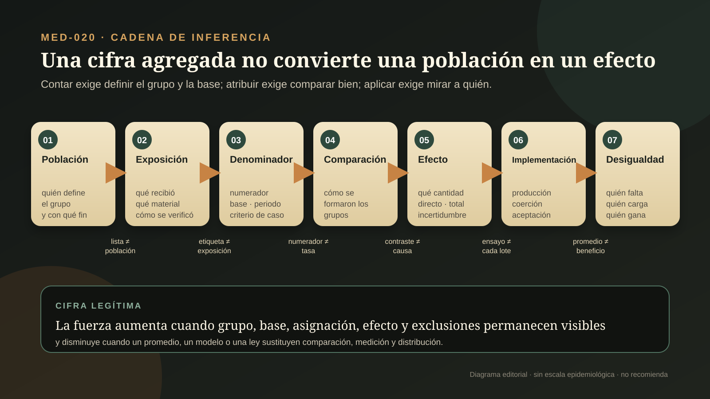
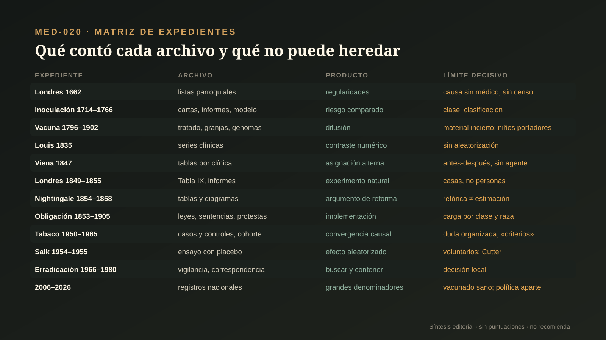

# MED-020 — Una cifra agregada no convierte una población en un efecto por sí sola

> **Alcance:** audita doce expedientes entre 1662 y 2026: las listas de mortalidad de Londres y Graunt; la inoculación de viruela y su contabilidad (Boston, Jurin, Scheuchzer, Bernoulli y d’Alembert); la vacuna de Jenner, su material incierto, la transmisión brazo a brazo y la expedición de Balmis; el «método numérico» de Louis; las clínicas de Viena y Semmelweis; el cólera de Londres con Snow, Farr y la Junta de Salud; Nightingale y sus diagramas; la vacunación obligatoria y sus resistencias en Inglaterra, Massachusetts y Río de Janeiro; tabaco y cáncer de pulmón, de Doll, Hill y Fisher a los «criterios» de Hill; el ensayo de campo de la vacuna Salk de 1954 y el incidente Cutter; la erradicación de la viruela; y, como cierre metodológico, debates observacionales y normativos hasta 2026. Es historia y epistemología de la evidencia: **no contiene recomendaciones clínicas, de vacunación ni de salud pública, ni calcula riesgos individuales** (`CLAIM-MED-COUNT-NO-ADVICE-001`).

## Pregunta central

¿Cómo se contaron poblaciones, riesgos y efectos —y con qué exclusiones— sin confundir lista con población, numerador con tasa, contraste con causa, ensayo con implementación ni promedio con beneficio para cada grupo?

## Respuesta breve

Contar fue siempre una operación con dueño. Las listas de mortalidad de Londres dependían de parroquias y de mujeres «searchers» sin formación médica que asignaban causas; Graunt pudo extraer regularidades de esas listas, pero no convertirlas en una población completa (`CLAIM-MED-COUNT-GRAUNT-1662-001`, `CLAIM-MED-COUNT-SEARCHERS-001`).

La inoculación de viruela introdujo la primera contabilidad pública de un riesgo elegido frente a uno sufrido. Jurin comparó en 1722–1727 la mortalidad de la viruela natural (alrededor de uno de cada cinco o seis enfermos) con la de la inoculación (uno de cada sesenta en Nueva Inglaterra; uno de cada noventa y uno en Inglaterra con selección cautelosa). Esa aritmética fue poderosa y defectuosa a la vez: los inoculados eran sobre todo de clase alta, la exposición era desconocida y el resultado cambiaba según cómo se clasificaran los casos dudosos (`CLAIM-MED-COUNT-JURIN-1722-001`, `CLAIM-MED-COUNT-INOCULATION-SELECTION-001`, `CLAIM-MED-COUNT-CLASSIFICATION-DENOMINATOR-001`). La práctica tampoco nació en Londres: se documenta en China desde el periodo Ming, en el Imperio otomano y en el norte de África, y llegó a Boston por el testimonio de Onesimus, un africano esclavizado (`CLAIM-MED-COUNT-VARIOLATION-PLURAL-001`, `CLAIM-MED-COUNT-ONESIMUS-001`).

Bernoulli convirtió en 1766 la pregunta en un modelo: eliminar la viruela habría elevado la esperanza de vida al nacer de 26 años y 7 meses a 29 años y 9 meses. D’Alembert objetó que una ganancia promedio diferida no responde a quien enfrenta un riesgo inmediato. Ambos tenían razón sobre preguntas distintas (`CLAIM-MED-COUNT-BERNOULLI-1766-001`, `CLAIM-MED-COUNT-DALEMBERT-001`).

En el siglo XIX, Louis, Semmelweis, Snow, Farr y Nightingale construyeron contrastes cada vez más explícitos. Semmelweis aprovechó una asignación por días alternos entre dos clínicas; Snow, casas intercaladas servidas por dos compañías de agua, con 315 muertes por 10 000 casas frente a 37. Sus tablas mostraron diferencias grandes, pero no el mecanismo, y su recepción dependió de teorías rivales, autoridad y retórica (`CLAIM-MED-COUNT-SEMMELWEIS-ALLOCATION-001`, `CLAIM-MED-COUNT-SNOW-TABLE-1855-001`, `CLAIM-MED-COUNT-CHOLERA-RIVALS-001`). Farr, con los mismos años de cólera, defendió una «ley de elevación» que un reanálisis de 2004 desplaza hacia el agua y la pobreza (`CLAIM-MED-COUNT-FARR-REANALYSIS-001`).

La vacunación obligatoria mostró que un efecto no se implementa solo: leyes, multas, Ley de Pobres, clase, religión, raza y ciudadanía moldearon quién era vacunado, quién resistía y por qué (`CLAIM-MED-COUNT-RESISTANCE-CLASS-001`, `CLAIM-MED-COUNT-RIO-1904-001`). En el siglo XX, tabaco y polio fijaron dos rutas de inferencia: la convergencia observacional (casos y controles, cohortes, patología, química) y el ensayo controlado con placebo. El ensayo de 1954 midió 16 casos paralíticos por 100 000 entre vacunados frente a 57 con placebo; su brazo observacional enseñó por qué los voluntarios no son un grupo de comparación neutral (`CLAIM-MED-COUNT-SALK-RESULTS-001`, `CLAIM-MED-COUNT-SALK-VOLUNTEER-001`). Hill propuso en 1965 nueve «puntos de vista», no una lista de verificación; convertirlos en criterios es uno de sus usos indebidos más persistentes (`CLAIM-MED-COUNT-HILL-1965-001`, `CLAIM-MED-COUNT-HILL-MISUSE-001`).

La cadena legítima es **población → exposición → denominador → comparación → efecto → implementación → desigualdad**. Una cifra gana fuerza cuando declara quién fue contado, qué recibió, sobre qué base se dividió, contra quién se comparó, qué efecto se estimó, cómo se llevó a la práctica y a quién dejó fuera o cargó con el costo. Ninguna cifra agregada convierte por sí sola una población en un efecto (`CLAIM-MED-COUNT-CHAIN-001`).

## UNA CIFRA AGREGADA NO CONVIERTE UNA POBLACIÓN EN UN EFECTO POR SÍ SOLA

### 1. Siete capas que deben conservarse

| Capa | Pregunta | Producto legítimo | Salto inválido |
|---|---|---|---|
| Población | ¿quién y qué constituye el grupo, y quién lo define? | población delimitada y relacional | tratar una lista, parroquia, clínica o registro como «la población» |
| Exposición | ¿qué recibió o vivió cada quien, cómo se midió y con qué material? | exposición definida y verificable | suponer que «vacuna», «agua» o «tabaco» designan algo homogéneo |
| Denominador | ¿sobre qué base se divide: personas, casas, nacimientos, enfermos, años-persona? | tasa con unidad, periodo y criterio de caso | comparar numeradores o tasas con bases distintas |
| Comparación | ¿contra quién y cómo se formaron los grupos? | contraste con asignación descrita | atribuir a la intervención lo que explica la selección |
| Efecto | ¿qué cantidad se estimó, con qué incertidumbre y qué modelo? | efecto delimitado: directo, indirecto, relativo, absoluto | convertir asociación o modelo en causa individual |
| Implementación | ¿cómo se produjo, distribuyó, impuso o rechazó la medida? | práctica documentada con daños y cobertura | heredar del ensayo seguridad, acceso o aceptación |
| Desigualdad | ¿quién fue excluido del conteo, quién soportó el riesgo y quién recibió el beneficio? | distribución explícita de cargas y beneficios | presentar un promedio como beneficio universal |

### 2. Tres cortafuegos previos

Una tasa tiene al menos cuatro partes: numerador, denominador, periodo y criterio de caso. Si cualquiera cambia, la cifra cambia aunque la realidad no cambie (`CLAIM-MED-COUNT-RATE-PARTS-001`). «Población» no es un dato natural: Krieger muestra que la idea estadística de población desciende del «hombre promedio» de Quetelet y que la utilidad de una media depende de cómo se definió el grupo (`CLAIM-MED-COUNT-POPULATION-CONSTRUCTED-001`). Y un contraste, por grande que sea, sólo se vuelve efecto cuando la forma en que se compusieron los grupos permite descartar selección, confusión y error de clasificación con un grado declarado (`CLAIM-MED-COUNT-COMPARISON-NOT-CAUSE-001`).

## DOCE EXPEDIENTES AUDITADOS

### 3. Londres, 1662: listas de mortalidad y mujeres que nombraban la muerte

Graunt publicó en 1662 sus *Natural and Political Observations* sobre los *Bills of Mortality* de Londres. La historiografía epidemiológica sitúa ahí un punto de arranque del pensamiento poblacional y de la comparación entre grupos (`CLAIM-MED-COUNT-GRAUNT-1662-001`). El numerador, sin embargo, venía de una cadena frágil: las parroquias designaban mujeres «searchers», a menudo parientes de empleados parroquiales, que reportaban la causa de muerte sin formación médica; su desplazamiento a mediados del siglo XIX se debió menos a su falta de pericia que al control funerario de los empresarios de pompas fúnebres (`CLAIM-MED-COUNT-SEARCHERS-001`).

Las listas parroquiales no cubrían a toda la ciudad ni ofrecían un denominador censado: Graunt estimó población y proporciones a partir de entierros y bautizos registrados. Sus regularidades describen un archivo administrativo, no una población completa ni causas verificadas (`CLAIM-MED-COUNT-BILLS-LIMIT-001`).

### 4. Inoculación, 1714–1766: contabilidad pública de un riesgo elegido

La variolación —inducir una viruela atenuada con material de pústulas— no fue un invento europeo. En China se documenta desde el periodo Ming (1465–1572) con insuflación nasal de costras y varios métodos; las afirmaciones de un origen Tang o Song carecen de corroboración independiente. Timonius (1713–1714) y Pylarinus (1716) describieron la práctica en Constantinopla, una carta del embajador de Trípoli la documenta en el norte de África antes de 1700 y se practicaba en Bengala. Lady Mary Wortley Montagu promovió en Inglaterra, en 1721, la inoculación de su hija (`CLAIM-MED-COUNT-VARIOLATION-PLURAL-001`).

En Boston, Cotton Mather conoció la práctica por Onesimus, un hombre africano esclavizado que le había sido entregado en 1707. El conocimiento de Onesimus antecede al informe de Timonius que Mather leyó después; su crédito quedó subordinado a la autoridad de quien escribía (`CLAIM-MED-COUNT-ONESIMUS-001`). Zabdiel Boylston inoculó durante 1721–1722 a 247 personas, de las cuales murieron seis (2.4 %) (`CLAIM-MED-COUNT-BOSTON-1721-001`).

James Jurin, secretario de la Royal Society, convirtió los informes en comparación pública. En 1722–1724 estimó que la viruela natural mataba a «uno de cada cinco o seis» enfermos y que uno de cada catorce nacidos moría de ella; frente a esto, la inoculación mataba a uno de cada sesenta en Nueva Inglaterra y a uno de cada noventa y uno en Inglaterra, con selección cautelosa y contando como muertes por inoculación dos casos dudosos. En 1726 registró 2848 muertes entre 17 151 enfermos de viruela natural y diez muertes sospechosas entre 481 inoculados (`CLAIM-MED-COUNT-JURIN-1722-001`).

La comparación tenía tres defectos que sus críticos señalaron. Los inoculados eran sobre todo de clase alta y recibían cuidado; la viruela natural golpeaba a todos, incluidos los más pobres. No había seguimiento ni medida de exposición. Y Massey objetó que los casos naturales no eran comparables por condición ni por atención (`CLAIM-MED-COUNT-INOCULATION-SELECTION-001`). La clasificación movía el resultado: Scheuchzer contó 17 muertes «supuestas» entre 897 inoculados entre 1721 y 1728, pero 17 entre 858 si se excluían 39 inoculaciones «sin efecto» (`CLAIM-MED-COUNT-CLASSIFICATION-DENOMINATOR-001`).

En 1766 Daniel Bernoulli publicó un modelo, no una medición: con una cohorte de 1300 nacidos y supuestos sobre la fuerza de infección y la letalidad, calculó que eliminar la viruela elevaría la esperanza de vida al nacer de 26 años y 7 meses a 29 años y 9 meses (`CLAIM-MED-COUNT-BERNOULLI-1766-001`). D’Alembert desarrolló en 1761 otro método para riesgos competitivos y objetó que la ganancia media no resuelve la decisión de quien asume un riesgo inmediato de morir por inocularse a cambio de años esperados más tarde. La disputa separa efecto poblacional de decisión individual (`CLAIM-MED-COUNT-DALEMBERT-001`).

### 5. La vacuna, 1796–1902: un nombre estable para materiales inestables

Jenner usó en 1796 material de lesiones vacunas y publicó en 1798 su *Inquiry*, con observaciones y pruebas de transmisión entre humanos (`CLAIM-MED-COUNT-JENNER-1798-001`). Qué contenía la «vacuna» no es una constante: la secuencia de una vacuna estadounidense de 1902 resultó muy cercana al virus de la viruela equina en su región central conservada, y análisis posteriores sugieren uso concurrente de virus relacionados con horsepox en el siglo XIX. Un comentario de 2016 sostiene incluso que Jenner trabajó con material de caballos; es una interpretación, no un dato cerrado (`CLAIM-MED-COUNT-VACCINE-MATERIAL-001`).

Durante 80 a 90 años la vacuna se mantuvo pasándola de brazo en brazo. La «vacuna animal», propagada en terneras desde la década de 1860 e introducida en Estados Unidos en 1870, evitaba transmitir sífilis y aseguraba suministro; las «granjas de vacuna» respondieron también a una oportunidad de lucro, y dos episodios de contaminación con tétanos en 1901 condujeron a la Biologics Control Act de 1902 (`CLAIM-MED-COUNT-ARM-TO-ARM-001`).

La expedición de Balmis (1803–1806) llevó la vacuna a las colonias españolas de América y Asia manteniéndola viva de brazo en brazo en niños huérfanos traídos expresamente para ello. Fue la primera vacunación masiva a gran escala y también una cadena de cuerpos infantiles sin capacidad de decidir. El éxito logístico no responde a la pregunta del consentimiento (`CLAIM-MED-COUNT-BALMIS-001`).

### 6. París, 1835: el «método numérico» de Louis

Pierre Louis comparó la sangría temprana y la tardía en pacientes con neumonía y concluyó que su beneficio era mucho menor del que se creía. Un reanálisis moderno confirma la conclusión general —la sangría temprana parece acortar la enfermedad en quienes sobreviven, pero puede aumentar la mortalidad a corto plazo— y encuentra errores aritméticos en algunas medias (`CLAIM-MED-COUNT-LOUIS-1835-001`). Su método no fue un ensayo aleatorizado: comparó series clínicas seleccionadas, y Tröhler documenta comparaciones numéricas anteriores en el siglo XVIII. La fama de Louis señala una institucionalización, no un origen absoluto (`CLAIM-MED-COUNT-LOUIS-NOT-TRIAL-001`).

### 7. Viena, 1847: lo que muestran y no muestran las tablas de Semmelweis

En la maternidad del Hospital General de Viena, las parturientas se asignaban a la Primera Clínica (médicos y estudiantes, que asistían a autopsias) o a la Segunda (parteras) en días alternos, sin selección clínica. Esa regla convirtió dos salas en una comparación casi experimental (`CLAIM-MED-COUNT-SEMMELWEIS-ALLOCATION-001`). Tras la introducción del lavado de manos con cloruro de cal en mayo de 1847, la mortalidad de la Primera Clínica bajó en 1848 a 12.7 por 1000 partos, cerca del 13.3 de la Segunda; antes había sido varias veces mayor (`CLAIM-MED-COUNT-SEMMELWEIS-1848-001`).

Las tablas muestran una diferencia persistente entre clínicas, una caída asociada temporalmente al lavado y, según un reanálisis de las series de 1784–1858, un aumento asociado a la introducción de la anatomía patológica en 1823 y otro tras el cese del lavado en 1850. No muestran el agente: Semmelweis hablaba de «materia orgánica animal en descomposición», no de bacterias, y su serie antes-después convive con otros cambios del hospital (`CLAIM-MED-COUNT-SEMMELWEIS-LIMIT-001`). La imagen del mártir ignorado tiene base —poca influencia en la obstetricia de su tiempo, un tratado tardío (fechado en 1861, publicado en 1860) y polémico— pero mezcla rechazo científico, conducta personal y ausencia de un mecanismo aceptado (`CLAIM-MED-COUNT-SEMMELWEIS-RECEPTION-001`).

### 8. Londres, 1849–1855: Snow, Farr y la Junta de Salud

En la epidemia de 1854, dos compañías abastecían casas intercaladas del sur de Londres: Southwark & Vauxhall tomaba agua del Támesis contaminado; Lambeth había trasladado su toma río arriba. En las primeras siete semanas, la Tabla IX de Snow registra 1263 muertes en 40 046 casas de Southwark & Vauxhall (315 por 10 000 casas) y 98 en 26 107 casas de Lambeth (37 por 10 000): una mortalidad entre ocho y nueve veces mayor (`CLAIM-MED-COUNT-SNOW-TABLE-1855-001`).

La fuerza del diseño estaba en la exposición: Snow identificaba la compañía por una prueba química de cloruros en el agua, corroborada con recibos y horarios de suministro, porque muchos inquilinos no sabían quién les vendía el agua (`CLAIM-MED-COUNT-SNOW-EXPOSURE-001`). Sus límites también son explícitos: el denominador eran casas, no personas; hubo 795 muertes sin proveedor determinado; algunas semanas se estimaron; los datos posteriores del Registro General no se recogieron con su método; y nadie había visto todavía al agente (`CLAIM-MED-COUNT-SNOW-LIMITS-001`).

La Junta General de Salud reunió una masa mayor de datos, interpretó la epidemia como atribuible sobre todo al aire y rechazó las conclusiones de Snow, aunque uno de sus investigadores había visto «vibriones» en heces de pacientes. Los contemporáneos tuvieron por definitivo el trabajo de Farr y por ingenioso pero defectuoso el de Snow, por su uso audaz de la analogía y su disposición a ignorar evidencia aparentemente contraria (`CLAIM-MED-COUNT-CHOLERA-RIVALS-001`). Farr formuló en 1852 una ley que relacionaba la mortalidad por cólera de 1849 con la elevación de cada distrito; una regresión logística de sus datos de 38 distritos encuentra efectos independientes de elevación, abastecimiento de agua y tasa de pobreza, con el agua como el efecto que más «invitaba» a investigarse (`CLAIM-MED-COUNT-FARR-REANALYSIS-001`).

### 9. Crimea y Londres, 1854–1858: Nightingale y la retórica de los datos

Nightingale usó conocimientos matemáticos y estadísticos para aconsejar al ejército y al gobierno británicos sobre cómo recoger y gestionar datos médicos, en colaboración con Farr, y combinó tablas y gráficos —no sólo el diagrama de área polar— para impulsar reformas sanitarias (`CLAIM-MED-COUNT-NIGHTINGALE-DATA-001`). Sus diagramas son argumentos: seleccionan periodos, causas y escalas para persuadir a un público político. Releerlos como series temporales exige reconocer los límites de los sistemas de datos del siglo XIX y no atribuir a un gráfico la demostración de qué intervención redujo cuántas muertes (`CLAIM-MED-COUNT-NIGHTINGALE-LIMIT-001`).

### 10. Obligación y resistencia, 1853–1905

La Ley de Vacunación Obligatoria de 1853 en Inglaterra, reforzada por las leyes de 1867 y 1871, se administró junto a la Ley de Pobres y recayó sobre lactantes de clase obrera con multas y otras penas; quienes se negaban se describieron como «objetores de conciencia» (`CLAIM-MED-COUNT-COMPULSION-1853-001`, `CLAIM-MED-COUNT-RESISTANCE-CLASS-001`). El movimiento fue plural: objeciones bíblicas, mesmerismo, swedenborgianismo, hidropatía, libertades individuales y una retórica anticatólica contra los «papas médicos» (`CLAIM-MED-COUNT-RESISTANCE-PLURAL-001`).

En Estados Unidos, *Jacobson v. Massachusetts* (1905) sostuvo el poder del Estado para exigir la vacunación; la jurisprudencia posterior amplió el peso de la libertad individual frente a ese poder (`CLAIM-MED-COUNT-JACOBSON-1905-001`). En Río de Janeiro, la Revolta da Vacina de 1904 fue un levantamiento de residentes pobres en la Primera República, atravesado por raza, clase y ciudadanía (`CLAIM-MED-COUNT-RIO-1904-001`). Estos expedientes no miden eficacia: muestran que implementación, coerción y legitimidad son capas propias.

### 11. Tabaco y cáncer de pulmón, 1950–1965: convergencia, duda y criterios

El cigarrillo se reconoció como causa de la epidemia de cáncer de pulmón en las décadas de 1940 y 1950 por la confluencia de epidemiología, experimentos animales, patología celular y análisis químico (`CLAIM-MED-COUNT-TOBACCO-CONVERGENCE-001`). En 1950 Wynder y Graham publicaron una serie de 684 casos comprobados, y Doll y Hill un informe preliminar de casos y controles. Desde 1951 Doll y Hill siguieron a 34 439 médicos británicos varones; a 50 años, los nacidos entre 1900 y 1930 que fumaron sólo cigarrillos y no dejaron de hacerlo murieron en promedio unos diez años antes que quienes nunca fumaron (`CLAIM-MED-COUNT-DOCTORS-COHORT-001`).

Fisher objetó en 1958 que la asociación podía deberse a factores constitucionales comunes. Su objeción era formalmente legítima —asociación no es causa—, pero Stolley muestra que no examinó el cuerpo completo de datos, sacó conclusiones prematuras y era consultor de la industria tabacalera, además de fumador (`CLAIM-MED-COUNT-FISHER-001`). La industria organizó la duda: todavía en 1960 sólo un tercio de los médicos estadounidenses creía establecido el caso contra el cigarrillo (`CLAIM-MED-COUNT-INDUSTRY-DOUBT-001`).

En 1965 Hill propuso nueve aspectos para pasar de asociación a causa —fuerza, consistencia, especificidad, temporalidad, gradiente biológico, plausibilidad, coherencia, experimento y analogía— y advirtió que ninguno aporta prueba indiscutible ni es condición indispensable. También pidió no sobrevalorar la significación estadística y sopesar costos y beneficios de actuar (`CLAIM-MED-COUNT-HILL-1965-001`). Convertir esos puntos de vista en una lista que se «cumple» o se «aprueba» contradice su texto; Rothman y Greenland proponen ver la inferencia causal como medición de un efecto, y la epidemiología molecular ha reinterpretado cada aspecto con nuevos tipos de datos (`CLAIM-MED-COUNT-HILL-MISUSE-001`).

### 12. Polio, 1954–1955: el ensayo y su después

El ensayo de campo de la vacuna inactivada de Salk incluyó a más de 1.8 millones de niños bajo dos diseños: áreas con placebo, aleatorizado y doble ciego, y áreas de «control observado» donde se vacunaba a segundo grado y se comparaba con primero y tercero. Un grupo diagnóstico clasificaba cada caso antes de romper el código (`CLAIM-MED-COUNT-SALK-DESIGN-001`). En las áreas con placebo, la poliomielitis paralítica fue de 16 por 100 000 entre 200 745 vacunados y de 57 por 100 000 entre 201 229 que recibieron placebo; en las áreas observadas, 17 frente a 46 (`CLAIM-MED-COUNT-SALK-RESULTS-001`).

Los niños no inoculados de las áreas con placebo —cuyos padres no aceptaron participar— tuvieron 36 por 100 000, menos que el grupo placebo. Quienes se ofrecen voluntarios suelen tener más educación e ingresos, y la polio paralítica golpeaba más a quienes tenían mejores condiciones higiénicas; además, los médicos sabían que sólo se vacunaba a segundo grado. Por eso el brazo con placebo era necesario: el «no vacunado» no es un control neutral (`CLAIM-MED-COUNT-SALK-VOLUNTEER-001`).

Un efecto en el ensayo no garantiza la seguridad de cada lote: en la primavera de 1955 se documentaron casos de poliomielitis tras la aplicación de vacuna inactivada con formaldehído en Estados Unidos, el llamado incidente Cutter (`CLAIM-MED-COUNT-CUTTER-1955-001`). Los estudios de campo de vacunas exigen además declarar qué efecto se estima —directo, indirecto, total o general— y bajo qué supuestos (`CLAIM-MED-COUNT-VACCINE-EFFECTS-001`).

### 13. Erradicación de la viruela, 1966–1980: contar casos, no sólo vacunas

La campaña de la OMS se reorientó hacia el «control epidemiológico selectivo»: buscar casos, contenerlos y vacunar alrededor, en lugar de perseguir sólo coberturas masivas (`CLAIM-MED-COUNT-ERADICATION-STRATEGY-001`). En India, correspondencia oficial inédita muestra gestores divididos, cuya división determinó el ritmo de la erradicación, y trabajadores y burócratas indios con más capacidad de reconfigurar políticas locales de la que la historiografía había reconocido (`CLAIM-MED-COUNT-ERADICATION-INDIA-001`). La erradicación se declaró en 1980 y dejó como legado el Programa Ampliado de Inmunización y la vigilancia activa de casos.

### 14. Quién entra al denominador

Las exclusiones no son un apéndice. Onesimus aportó conocimiento sin autoría; los huérfanos de Balmis fueron portadores sin decisión; la obligatoriedad inglesa recayó sobre la clase obrera; la Revolta da Vacina expresó raza, clase y ciudadanía (`CLAIM-MED-COUNT-INEQUALITY-DENOMINATOR-001`). En el siglo XX, los ensayos clínicos no siempre incluyeron adecuadamente a mujeres ni analizaron diferencias por sexo, y fueron necesarias políticas explícitas de inclusión (`CLAIM-MED-COUNT-TRIAL-INCLUSION-001`). Un promedio calculado sin esos grupos no describe su efecto.

### 15. Cierre metodológico, 2006–2026 (sin recomendaciones)

Los estudios observacionales de vacunas heredan el problema de Jurin y de Salk. En una cohorte de 72 527 personas de 65 años o más, la vacuna antigripal se asoció con un riesgo relativo de muerte de 0.39 *antes* de la temporada de influenza, cuando no podía haber efecto: el sesgo del «vacunado sano» bastaba para explicar la asociación observada durante la temporada (`CLAIM-MED-COUNT-HEALTHY-VACCINEE-001`). La emulación de un ensayo objetivo con datos observacionales y la defensa de un pluralismo causal —triangulación, inferencia a la mejor explicación— son dos respuestas contemporáneas a ese problema, con debate abierto entre ellas (`CLAIM-MED-COUNT-CAUSAL-PLURALISM-001`).

Las cohortes nacionales de registro son hoy la herramienta principal para preguntas de seguridad. En Dinamarca, 657 461 niños seguidos durante 5 025 754 años-persona dieron un cociente de riesgos ajustado de autismo de 0.93 (IC 95 %, 0.85–1.02) entre vacunados y no vacunados con triple viral; un metaanálisis de cinco cohortes con 1 256 407 niños no halló asociación entre vacunación y autismo; y una cohorte de 1 224 176 niños nacidos entre 1997 y 2018 no encontró asociación entre la cantidad acumulada de aluminio en vacunas y 50 trastornos crónicos (`CLAIM-MED-COUNT-SAFETY-COHORTS-001`). Estos estudios conservan sus propios límites: no revisaron expedientes individuales, dependen de la codificación de registros y no pueden aleatorizar.

En 2025 el comité asesor de inmunización de Estados Unidos (ACIP) votó retirar la recomendación universal de la dosis de hepatitis B al nacer, mientras la Academia Americana de Pediatría mantuvo su recomendación para todos los recién nacidos. Para este expediente, el caso es metodológico: un cambio normativo es una decisión institucional que debe declarar qué evidencia nueva, qué denominador y qué balance de daños lo sostienen; no es, por sí mismo, evidencia nueva sobre el efecto (`CLAIM-MED-COUNT-POLICY-NOT-EVIDENCE-001`). Este expediente no evalúa ni recomienda esa ni ninguna otra política (`CLAIM-MED-COUNT-NO-ADVICE-001`).

## LO OBSERVADO

- listas parroquiales, cartas, informes a sociedades científicas, tablas, tratados, mapas, diagramas, leyes, sentencias y protocolos de ensayo;
- conteos de muertes, enfermos, inoculados, vacunados, partos, casas y años-persona bajo reglas variables;
- prácticas de inoculación, vacunación brazo a brazo, propagación animal, lavado de manos, abastecimiento de agua y aplicación de placebo;
- resistencias, protestas, multas, objeciones y decisiones normativas;
- registros nacionales y metaanálisis contemporáneos con sus diseños declarados.

## LO MEDIDO

- mortalidad y letalidad dentro de series delimitadas (viruela natural frente a inoculación; Primera frente a Segunda Clínica; casas por compañía de agua; vacunados frente a placebo);
- tasas por casa, por parto, por enfermo, por 100 000 niños o por años-persona, con periodos declarados;
- asociaciones ajustadas en cohortes y casos y controles;
- no la necesidad poblacional total, la experiencia de quienes no fueron contados, el consentimiento ni la justicia de cada medida.

## LO INFERIDO

Una comparación numérica gana fuerza cuando declara población, exposición, denominador, forma de asignación, efecto estimado, implementación y distribución. La asignación alterna de Viena, las casas intercaladas de Snow y el placebo de 1954 hicieron más difícil atribuir la diferencia a la selección; la convergencia de casos y controles, cohortes, patología y química sostuvo la causalidad del tabaco. Ninguna de esas rutas hereda por sí sola mecanismo, seguridad de producción, aceptación social, equidad o beneficio para cada persona (`CLAIM-MED-COUNT-CHAIN-001`, `CLAIM-MED-COUNT-COMPARISON-NOT-CAUSE-001`, `CLAIM-MED-COUNT-EFFECT-NOT-IMPLEMENTATION-001`).

## LOS SUPUESTOS

- que los criterios de caso (causa de muerte, viruela, fiebre puerperal, cólera, polio paralítica, autismo) fueron suficientemente estables dentro de cada serie;
- que el denominador declarado corresponde a las personas realmente expuestas al riesgo;
- que la asignación descrita en la fuente se aplicó como se dice;
- que el material llamado «vacuna» era comparable dentro de cada serie, aunque no entre siglos;
- que los registros contemporáneos capturan diagnósticos y exposiciones con error no diferencial;
- que las categorías históricas no equivalen automáticamente a categorías actuales.

## LAS INCERTIDUMBRES

- cuántas muertes fueron mal clasificadas por «searchers», registradores o médicos;
- cuántos inoculados de Jurin enfermaron después, y cuántas infecciones secundarias provocó la inoculación;
- qué virus contenía cada lote de vacuna antes del siglo XX;
- cuánto de la caída de Viena se debe al lavado y cuánto a otros cambios;
- el tamaño de la población y de la exposición real en casas de Snow;
- la magnitud de los sesgos residuales en cohortes de registro;
- qué habrían dicho las personas excluidas de cada conteo.

## LAS ALTERNATIVAS

- una diferencia de mortalidad puede reflejar intervención, selección, clase social, atención, clasificación o azar;
- una caída temporal puede reflejar intervención, regresión a la media, estación o cambio de criterio;
- una asociación protectora en datos observacionales puede reflejar efecto o sesgo del vacunado sano;
- una ausencia de asociación puede reflejar ausencia de efecto, mala medición o poder insuficiente para subgrupos;
- una resistencia puede expresar ignorancia, pero también clase, religión, libertad, experiencia de daño o desconfianza fundada;
- una política puede cambiar por evidencia nueva, por gobierno o por valores, y cada causa exige rendición de cuentas distinta.

## QUÉ PODEMOS COMPARAR

| Expediente | Archivo dominante | Producto mejor resuelto | Límite decisivo |
|---|---|---|---|
| Londres 1662 | listas parroquiales y *Observations* | regularidades en un archivo de entierros | causa asignada por «searchers»; sin censo |
| Inoculación 1714–1766 | cartas, informes y modelos | comparación pública de riesgos y primer modelo | selección por clase; clasificación; sin seguimiento |
| Vacuna 1796–1902 | tratado, registros y genomas | difusión y cambio del material | material incierto; cuerpos infantiles como portadores |
| Louis 1835 | series clínicas | contraste numérico de una terapia | series seleccionadas; no aleatorización |
| Viena 1847 | tablas de clínicas | asignación alterna y caída tras el lavado | antes-después; sin agente |
| Londres 1849–1855 | tablas, encuestas, informes oficiales | experimento natural por compañía de agua | casas como denominador; teorías rivales |
| Nightingale 1854–1858 | tablas y diagramas | argumento visual para reforma | retórica; datos limitados |
| Obligación 1853–1905 | leyes, sentencias, protestas | implementación y legitimidad | no mide eficacia; desigualdad de cargas |
| Tabaco 1950–1965 | casos y controles, cohortes, patología | causalidad por convergencia | duda organizada; uso mecánico de «criterios» |
| Salk 1954–1955 | ensayo con placebo y brazo observado | efecto aleatorizado y doble ciego | voluntarios; producción (Cutter) |
| Erradicación 1966–1980 | vigilancia, correspondencia | estrategia de búsqueda y contención | decisiones locales; coerción a auditar |
| 2006–2026 | registros nacionales y metaanálisis | asociaciones con grandes denominadores | sesgos residuales; decisiones normativas aparte |

Comparar aquí significa declarar población, exposición, denominador, asignación, efecto, implementación y exclusión. No reparte puntos de modernidad (`CLAIM-MED-COUNT-NONRANKING-001`).

## QUÉ NO PODEMOS CONCLUIR

- que Graunt midió la población de Londres o las causas reales de muerte;
- que la inoculación fue un invento europeo o que Jurin demostró su beneficio para cada persona;
- que la «vacuna» de Jenner fue siempre el mismo material;
- que Louis o Semmelweis hicieron ensayos aleatorizados;
- que la Tabla IX identificó el agente del cólera;
- que un diagrama de Nightingale prueba qué intervención salvó cuántas vidas;
- que toda resistencia a la vacunación fue ignorancia;
- que cumplir los «criterios de Hill» demuestra causalidad;
- que el resultado de un ensayo garantiza seguridad de producción, aceptación o equidad;
- que una cifra agregada describe el efecto en cada grupo o persona;
- nada sobre qué debe hacer hoy una persona o un sistema de salud.

## LAS CONTROVERSIAS

| Pregunta | Alternativas | Qué discrimina |
|---|---|---|
| ¿dónde nació la inoculación? | origen único / prácticas plurales y circulación | textos fechados, rutas documentadas, testigos |
| ¿probó Jurin que inocular era mejor? | sí / comparación sesgada por clase y clasificación | denominadores comparables, seguimiento, exposición |
| ¿Bernoulli o d’Alembert? | ganancia poblacional / riesgo inmediato individual | separar pregunta poblacional y decisión personal |
| ¿qué virus era la vacuna? | cowpox / horsepox / mezcla y cambio | genomas de lotes datados |
| ¿fue Semmelweis ignorado por ceguera? | rechazo irracional / falta de mecanismo, conducta y publicación tardía | recepción documentada, circulación del tratado |
| ¿Snow demostró la transmisión por agua? | demostración / inferencia fuerte sin agente | denominadores, clasificación de exposición, convergencia posterior |
| ¿tenía razón Fisher? | confusión constitucional / causalidad | gradiente, cohortes, cese, mecanismos |
| ¿son criterios los puntos de Hill? | lista suficiente / guía de juicio | texto de 1965 y desempeño en casos |
| ¿qué mide un estudio observacional de vacuna? | efecto / sesgo del vacunado sano | periodos sin exposición, controles negativos |
| ¿una nueva política equivale a evidencia nueva? | sí / decisión institucional con otra justificación | qué datos, qué denominador, qué balance se declara |

## ERRORES QUE ESTA INVESTIGACIÓN BLOQUEA

1. **«Graunt contó a la población de Londres.»** Contó entierros y bautizos registrados con causas asignadas por personas sin formación médica.
2. **«La inoculación llegó de Europa al mundo.»** Llegó a Europa y Boston desde prácticas chinas, otomanas, africanas y bengalíes.
3. **«Jurin demostró que inocular salvaba a cada persona.»** Comparó grupos distintos por clase y cuidado.
4. **«Bernoulli midió años ganados.»** Calculó un modelo con supuestos.
5. **«La vacuna de Jenner es la vacuna que se erradicó.»** El material cambió y no siempre es identificable.
6. **«Semmelweis fue un genio ignorado sin razones.»** Hubo rechazo, pero también ausencia de mecanismo y publicación tardía.
7. **«Snow quitó la manija y terminó la epidemia.»** Su fuerza fue el contraste de exposición; su límite, el agente y el denominador.
8. **«Un diagrama prueba un efecto.»** Persuade; la estimación requiere series y comparadores.
9. **«Quien se negó a vacunarse era ignorante.»** Hubo clase, religión, libertad, coerción y desconfianza.
10. **«Cumplir los criterios de Hill demuestra causalidad.»** Hill escribió que ninguno es indispensable ni suficiente.
11. **«Un ensayo positivo garantiza cada lote y cada implementación.»** Cutter lo desmiente.
12. **«Un promedio poblacional es un beneficio universal.»** Exclusiones y distribución deben declararse.

## NIVEL DE CONFIANZA

- **A:** existencia, fecha y contenido general de publicaciones, leyes, sentencias, ensayos y estudios citados; cifras transcritas de fuentes que las publican.
- **B:** reconstrucción de selección, asignación, recepción y resistencia cuando convergen fuentes primarias e historiografía.
- **B-COND:** comparabilidad de cifras históricas entre series y periodos; atribución de causas en series antes-después.
- **C:** experiencia de personas excluidas o coaccionadas reconstruida desde archivos de quienes las contaron.
- **D/E:** origen único de la inoculación, genio solitario, criterios causales automáticos, beneficio universal heredado de un promedio o recomendaciones derivadas de este expediente.

## QUÉ PODRÍA FALSARLO

Este expediente deberá corregirse si nuevos registros muestran que:

- las cifras de Jurin, Scheuchzer, Boylston, Semmelweis, Snow o del ensayo de 1954 citadas aquí difieren de sus fuentes primarias;
- la asignación de Viena no fue alterna o se rompía con frecuencia;
- la Tabla IX mezcla periodos o clasificaciones de un modo que anula el contraste;
- la variolación china es anterior o posterior a lo aquí delimitado, o se documenta una ruta de transmisión hoy no probada;
- los genomas de lotes de vacuna del siglo XIX indican otro material dominante;
- la resistencia a la obligatoriedad tuvo una composición social distinta de la descrita;
- una cohorte contemporánea citada contiene errores de denominador o clasificación que cambian su resultado.

## QUÉ SABEMOS REALMENTE

Sabemos que la epidemiología nació muchas veces, cada vez que alguien declaró cómo contaba y contra quién comparaba. Sabemos que las comparaciones más fuertes —asignación alterna, experimento natural, placebo, convergencia de diseños— fueron aquellas que neutralizaron mejor la selección. Sabemos también que cada conteo tuvo exclusiones: mujeres que nombraban la muerte sin crédito, un africano esclavizado sin autoría, niños huérfanos como portadores, obreros multados, poblaciones coloniales y mujeres ausentes de ensayos (`CLAIM-MED-COUNT-CHAIN-001`, `CLAIM-MED-COUNT-INEQUALITY-DENOMINATOR-001`).

## QUÉ TODAVÍA NO SABEMOS

No podemos recuperar a quienes no entraron en las listas ni sus razones. No conocemos con precisión el material de muchas vacunas históricas ni la proporción de cada caída de mortalidad atribuible a una sola intervención. Persisten debates sobre cómo combinar emulación de ensayos y pluralismo causal, y sobre cómo se gobiernan decisiones normativas cuando cambian las instituciones que las toman. MED-021 auditará anestesia, analgesia y antisepsia, donde las series antes-después de Lister heredan varios de estos problemas.

## CONCLUSIÓN

Contar no fue un acto neutral ni un progreso lineal. Fue una cadena de decisiones: quién define la población, qué se llama exposición, sobre qué se divide, contra quién se compara, qué efecto se estima, cómo se impone o se ofrece la medida y quién carga con el costo. Esa cadena produjo algunas de las inferencias más sólidas de la medicina —la viruela erradicada, el tabaco como causa, la polio prevenible— y también exclusiones y coerciones que las cifras no muestran solas.

Por eso el expediente conserva siete capas. Población no es lista; exposición no es etiqueta; denominador no es numerador; comparación no es causa; efecto no es implementación; implementación no es justicia; promedio no es beneficio universal. Una cifra agregada no convierte una población en un efecto por sí sola (`CLAIM-MED-COUNT-SCOPE-001`, `CLAIM-MED-COUNT-RATE-PARTS-001`).

## NAVEGACIÓN

- [Historia de la ciencia de MED-020](../20_historia_ciencia/HISTORIA_MED_020_ESTADISTICA_VACUNACION_EPIDEMIOLOGIA.md)
- [Cronología especializada de MED-020](../21_cronologias/CRONOLOGIA_MED_020_ESTADISTICA_VACUNACION_EPIDEMIOLOGIA.md)
- [Mapa epistemológico de MED-020](../22_mapas_epistemologicos/MAPA_MED_020_ESTADISTICA_VACUNACION_EPIDEMIOLOGIA.md)
- [Programa cronológico de Medicina](PROGRAMA_CRONOLOGICO_HISTORIA_MEDICINA.md)
- [Explorador público de evidencia](../EVIDENCE_LEDGER.md)
