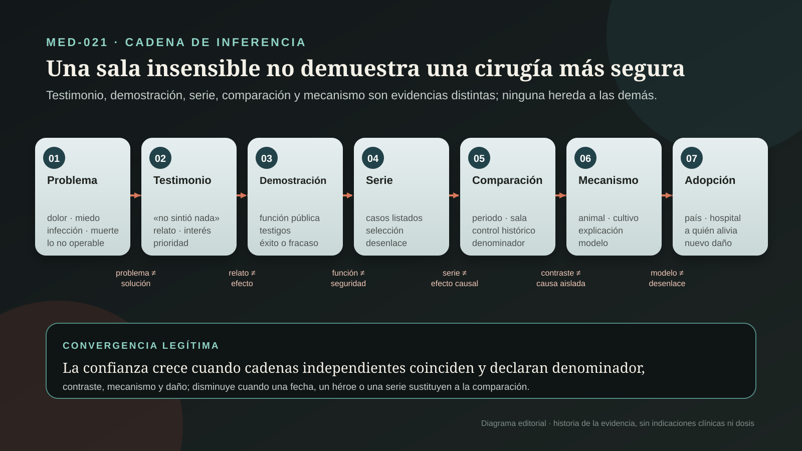
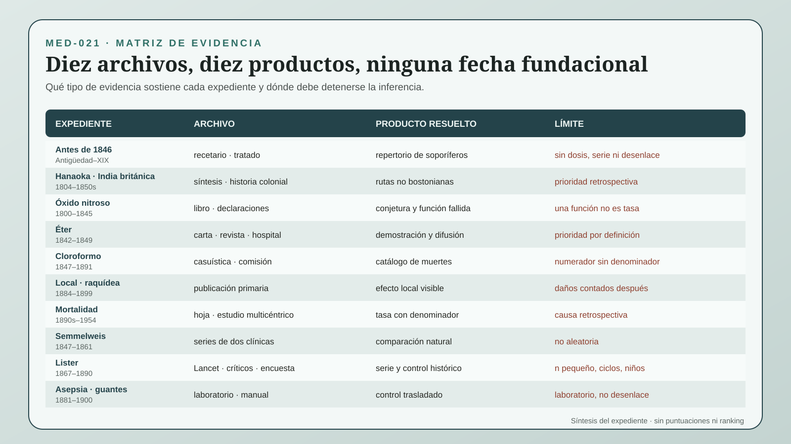

# MED-021 — Una sala insensible no demuestra una cirugía más segura por sí sola

> **Alcance:** audita diez expedientes entre los textos antiguos y medievales sobre soporíferos y 1954: plantas, alcohol y esponjas antes de 1846; Hanaoka Seishū en Japón y el mesmerismo en la India británica; el óxido nitroso de Davy y Wells; el éter de Long y Morton con su disputa de prioridad; el cloroformo de Simpson, la muerte de Hannah Greener, la casuística de John Snow y las comisiones de Hyderabad; la cocaína de Koller y la raquídea de Bier; los primeros registros anestésicos y la cuenta de mortalidad de Beecher y Todd; Semmelweis por separado; las series de Lister y sus críticos; y el paso de la antisepsia a la asepsia, con guantes y recepción desigual por país. Separa testimonio, demostración, serie de casos, comparación y mecanismo. Es historia y epistemología: no contiene recomendaciones clínicas, dosis ni técnicas de uso.

## Pregunta central

¿Qué cadenas de evidencia transformaron el dolor y la infección quirúrgicos y ampliaron lo que se consideraba operable, sin confundir un relato de insensibilidad con un efecto reproducible, una demostración con adopción, una serie con comparación, un mecanismo de laboratorio con un desenlace clínico, ni la prioridad de un nombre con la autoría de un cambio?

## Respuesta breve

La cirugía sin dolor y la herida que no supura no nacieron de un día ni de un héroe. Antes de 1846 hubo opio, alcohol y plantas solanáceas en textos que describen recetas, pero rara vez sujetos, series o desenlaces; su eficacia quirúrgica queda no demostrada, no refutada (`CLAIM-MED-ANES-PRE-SOPORIFICS-001`, `CLAIM-MED-ANES-PRE-SPONGE-LIMIT-001`). Hanaoka Seishū operó cánceres de mama bajo una anestesia general herbal desde 1804, y en la India británica el mesmerismo ofreció otra ruta que la ortodoxia colonial marginó (`CLAIM-MED-ANES-HANAOKA-1804-001`, `CLAIM-MED-ANES-MESMERISM-BENGAL-001`).

Davy sugirió en 1800 que el óxido nitroso podría servir en operaciones; Wells lo usó en odontología en 1844 y fracasó al demostrarlo en Boston a inicios de 1845. Long operó con éter en 1842 y publicó en 1849; Morton lo demostró en el Massachusetts General Hospital el 16 de octubre de 1846 y Bigelow lo publicó en noviembre. La cuarta paciente operada con éter en ese hospital sufrió hipoxia grave, y la adopción no fue inmediata ni universal (`CLAIM-MED-ANES-WELLS-DEMO-001`, `CLAIM-MED-ANES-MORTON-1846-001`, `CLAIM-MED-ANES-MAGOUN-001`).

El cloroformo llegó en 1847 y produjo en enero de 1848 la primera muerte que John Snow registró, la de Hannah Greener, de quince años. Snow reunió cincuenta muertes y vio paro cardiaco súbito al inicio de varias; las comisiones de Hyderabad (la segunda en 1889) concluyeron con 430 animales que la respiración se detenía antes que el corazón. Un numerador de muertes sin denominador de administraciones no es una tasa, y un modelo animal no zanja el mecanismo humano (`CLAIM-MED-ANES-SNOW-DEATHS-001`, `CLAIM-MED-ANES-NUMERATOR-ONLY-001`, `CLAIM-MED-ANES-HYDERABAD-MECHANISM-001`).

En la infección, Semmelweis comparó dos clínicas en Viena y redujo la mortalidad con lavado de manos clorado en 1847; Lister publicó en 1867 una serie de fracturas abiertas y en 1870 comparó amputaciones antes y después de su sistema (16 de 35 frente a 6 de 40 muertes). Esas cifras son reales pero frágiles: números pequeños, controles históricos, ciclos hospitalarios, selección y niños en la serie inicial. Críticos como Lawson Tait obtuvieron resultados comparables con limpieza y agua (`CLAIM-MED-ANES-LISTER-1870-SERIES-001`, `CLAIM-MED-ANES-LISTER-CONFOUNDING-001`, `CLAIM-MED-ANES-LISTER-CRITICS-001`).

La asepsia no fue la antisepsia perfeccionada: en los países de lengua alemana, el laboratorio bacteriológico (Koch, 1881) mostró que el ácido carbólico era menos eficaz de lo supuesto y que el vapor esterilizaba mejor; los cirujanos trasladaron ese control al quirófano, con apoyo sobre todo de laboratorio y no de comparaciones clínicas (`CLAIM-MED-ANES-KOCH-1881-001`, `CLAIM-MED-ANES-ASEPSIS-LAB-NOT-OUTCOME-001`).

La cadena legítima es **problema → testimonio → demostración → serie → comparación → mecanismo → adopción y nuevo daño**. Anestesia y asepsia ampliaron sin duda lo operable —operaciones más largas, complejas y estandarizadas— y trajeron daños nuevos: muertes anestésicas, toxicidad química, cirugías que antes no se intentaban y una distribución desigual del alivio (`CLAIM-MED-ANES-POSSIBLE-SURGERY-001`, `CLAIM-MED-ANES-NEW-HARMS-001`, `CLAIM-MED-ANES-PAIN-CALCULUS-001`).

## UNA SALA INSENSIBLE NO DEMUESTRA UNA CIRUGÍA MÁS SEGURA POR SÍ SOLA

### 1. Siete capas que deben conservarse

| Capa | Pregunta | Producto legítimo | Salto inválido |
|---|---|---|---|
| Problema | ¿qué dolor, infección o imposibilidad quirúrgica se quería resolver y para quién? | necesidad situada | suponer que el pasado aceptaba el dolor o ignoraba la infección |
| Testimonio | ¿quién dice que no hubo dolor o supuración, cuándo y con qué interés? | relato fechado | convertir un relato en efecto reproducible |
| Demostración | ¿qué se mostró en público, ante quién y con qué fallos? | evento verificable | convertir una función exitosa (o fallida) en tasa |
| Serie | ¿cuántos casos, seleccionados cómo, con qué desenlaces? | frecuencia delimitada | leer una serie sin grupo de contraste como efecto |
| Comparación | ¿contra qué periodo, sala, cirujano o grupo, y con qué diferencias? | contraste explícito | ignorar controles históricos, ciclos y selección |
| Mecanismo | ¿qué explica la insensibilidad o la infección y cómo se probó? | modelo comprobable | inferir beneficio clínico desde un mecanismo de laboratorio |
| Adopción y daño | ¿quién la adoptó, dónde, con qué variaciones y qué daños nuevos aparecieron? | práctica situada y revisable | llamar progreso universal a una difusión desigual |

### 2. Cinco tipos de evidencia que no se heredan

El expediente distingue cinco cosas que la historia celebratoria funde: **testimonio** (alguien dice que no sintió dolor), **demostración** (una operación pública ante testigos), **serie de casos** (una lista de pacientes con desenlaces), **comparación** (dos periodos, salas o grupos con un desenlace contado igual) y **mecanismo** (una explicación de por qué funciona, probada aparte). Un testimonio no estima frecuencia; una demostración no estima seguridad; una serie sin contraste no estima efecto; una comparación sin aleatorización no descarta confusión; un mecanismo no garantiza beneficio, y un beneficio puede existir sin mecanismo correcto (`CLAIM-MED-ANES-TESTIMONY-NOT-EFFECT-001`, `CLAIM-MED-ANES-DEMO-NOT-ADOPTION-001`, `CLAIM-MED-ANES-SERIES-NOT-COMPARISON-001`, `CLAIM-MED-ANES-MECHANISM-NOT-OUTCOME-001`).

## DIEZ EXPEDIENTES AUDITADOS

### 3. Antes de 1846: opio, alcohol, solanáceas y esponjas soporíferas

Textos antiguos y medievales describen extractos de adormidera y de plantas solanáceas —mandrágora, beleño y otras— para atenuar el dolor quirúrgico, administrados de varias maneras, entre ellas la llamada esponja soporífera (*spongia somnifera*) de los recetarios medievales (`CLAIM-MED-ANES-PRE-SOPORIFICS-001`). Lo que los textos dicen es una receta y una intención; lo que no dicen es cuántas personas, con qué preparación reproducible, qué profundidad de insensibilidad, cuántas muertes o despertares. La revisión de Carter (1996) explica además que esas técnicas cayeron en desuso durante la Edad Media; persistencia textual no equivale a práctica continua (`CLAIM-MED-ANES-PRE-SPONGE-LIMIT-001`).

Sin anestesia eficaz, la cirugía europea de inicios del XIX premiaba la rapidez: la «mística de la velocidad» definía al buen operador, y el corte de una amputación de brazo podía durar noventa segundos frente a los quince minutos de una resección de codo. Que se operara rápido no prueba indiferencia al dolor; prueba que el dolor ordenaba la técnica (`CLAIM-MED-ANES-PRE-SPEED-001`).

### 4. Rutas no bostonianas: Hanaoka (1804) y el mesmerismo en la India británica

Hanaoka Seishū perfeccionó durante casi veinte años una preparación herbal, *tsūsensan* (*mafutsu-san*), y la usó el 13 de octubre de 1804 para extirpar un cáncer de mama; la síntesis de Izuo le atribuye 156 operaciones de mama y muchas otras (`CLAIM-MED-ANES-HANAOKA-1804-001`). El caso refuta el relato de un único origen bostoniano, pero también exige cautela: la etiqueta «primera del mundo» es una lectura retrospectiva, las fuentes aquí auditadas no muestran que la fórmula circulara en el debate euroamericano de 1846, y la cifra de casos procede de una síntesis conmemorativa, no de una serie con desenlaces publicada (`CLAIM-MED-ANES-HANAOKA-PRIORITY-001`).

En la India británica de la década de 1840, el mesmerismo —también en usos médicos— fue popular entre la nobleza, las clases medias, pacientes y practicantes indios; su empleo quirúrgico, asociado con James Esdaile, no se verificó aquí en fuente primaria. La ortodoxia médica occidental emergente lo trató con la misma hostilidad que a los sistemas médicos indígenas y lo marginó, en parte por su asociación con prácticas religiosas locales (`CLAIM-MED-ANES-MESMERISM-BENGAL-001`). Su rechazo no se decidió por una comparación de desenlaces frente al éter: es evidencia de que la adopción tiene política.

### 5. Óxido nitroso: Davy (1800) y el fracaso público de Wells (1845)

En sus *Researches* de 1800, Humphry Davy escribió que el óxido nitroso, por su aparente capacidad de destruir el dolor físico, «podría probablemente usarse con ventaja» en operaciones sin gran pérdida de sangre (p. 556). Es una conjetura apoyada en autoexperimentación, no una prueba clínica: nadie la ensayó en cirugía durante más de cuatro décadas (`CLAIM-MED-ANES-DAVY-1800-001`).

Horace Wells, dentista de Hartford, usó el óxido nitroso en extracciones desde diciembre de 1844 (`CLAIM-MED-ANES-WELLS-1844-001`). Semanas después intentó demostrarlo en Boston durante una extracción dental, y la demostración se juzgó un fracaso. Haridas reconstruyó el episodio con 21 declaraciones y 5 avisos de prensa: la fecha y el lugar exactos no pueden determinarse, no hay evidencia primaria de que ocurriera en el anfiteatro del Massachusetts General Hospital, y lo probable es que fuera hacia finales de enero de 1845 en una sala pública de Washington Street (`CLAIM-MED-ANES-WELLS-DEMO-001`). Una función fallida no falsa un agente, igual que una exitosa no establece su seguridad: ninguna de las dos estima una tasa (`CLAIM-MED-ANES-SINGLE-DEMO-001`).

### 6. Éter: Long (1842), Morton (1846) y la disputa de prioridad

Crawford W. Long, médico rural de Georgia, extirpó un tumor del cuello a un paciente bajo éter en 1842, pero sólo publicó su experiencia en 1849 (`CLAIM-MED-ANES-LONG-1842-001`). William T. G. Morton, dentista, fue invitado por el cirujano residente Charles F. Heywood el 14 de octubre de 1846 a demostrar su preparación; el 16 de octubre, en el Massachusetts General Hospital, John Collins Warren operó con el paciente insensible por inhalación de éter (`CLAIM-MED-ANES-MORTON-1846-001`). Una revisión de 2025 del original de esa carta muestra que las transcripciones del siglo XIX habían sido editadas: incluso el documento fundacional tiene historia textual. Henry J. Bigelow publicó en noviembre de 1846 una relación de operaciones con insensibilidad por inhalación en el *Boston Medical and Surgical Journal* (`CLAIM-MED-ANES-BIGELOW-1846-001`).

La demostración no se tradujo en adopción inmediata. Betsey Magoun, la cuarta paciente operada con anestesia en el hospital, sufrió hipoxia grave y complicaciones respiratorias ante un público numeroso; el éter no se volvió de uso común hasta disponer de métodos más eficaces de inducción y mantenimiento (`CLAIM-MED-ANES-MAGOUN-001`).

Desde 1847 Wells, Charles T. Jackson y Morton disputaron la primacía, y el Congreso de los Estados Unidos llegó a ofrecerse como árbitro (`CLAIM-MED-ANES-PRIORITY-DISPUTE-001`). La disputa no se resuelve con más datos porque no es sólo empírica: «primero» puede significar primer uso, primera publicación, primera demostración pública o primera difusión. Con un criterio gana Long; con otro, Morton; con el de uso clínico documentado, Hanaoka precede a ambos. Revisiones recientes siguen llamando a uno u otro «verdadero pionero» (`CLAIM-MED-ANES-PRIORITY-DEFINITION-001`).

### 7. Cloroformo: Simpson, Hannah Greener, Snow y Hyderabad

James Young Simpson publicó en 1847 un nuevo agente anestésico, el cloroformo, que presentó como más eficiente que el éter (`CLAIM-MED-ANES-SIMPSON-1847-001`). El 28 de enero de 1848 murió en Winlaton, cerca de Newcastle, Hannah Greener, de quince años, a quien se iba a retirar la uña del dedo gordo del pie; en noviembre anterior la misma operación en el otro pie se había hecho con éter sin incidentes. El cloroformo se dio desde un pañuelo. Snow abrió con ella su lista: «la primera muerte por cloroformo» (`CLAIM-MED-ANES-GREENER-1848-001`).

John Snow, que además de epidemiólogo fue anestesista, publicó en 1858 *On Chloroform and Other Anaesthetics*. Allí reunió cincuenta casos de muerte por cloroformo, los ordenó por el momento de la inhalación y señaló que en seis la muerte ocurrió al inicio, antes de la inconsciencia, con «la evidencia más inequívoca» de detención súbita del corazón (`CLAIM-MED-ANES-SNOW-DEATHS-001`). Es una serie de casos de muerte, muy cuidadosa, pero sólo un numerador: sin el número de administraciones de cada agente no permite estimar una tasa ni comparar con el éter (`CLAIM-MED-ANES-NUMERATOR-ONLY-001`).

En Hyderabad, una primera comisión y una segunda, convocada en 1889 para poner a prueba a la primera, experimentaron con cloroformo en perros, monos y otros animales. La segunda, supervisada por Thomas Lauder Brunton por encargo de *The Lancet* —el Nizam pagó su viaje—, con unos 430 animales, concluyó que en todas las condiciones la respiración cesaba antes que el latido cardiaco (`CLAIM-MED-ANES-HYDERABAD-001`). Esa conclusión choca con la observación clínica de Snow de paros cardiacos súbitos al inicio de la inhalación: un modelo animal reproducible puede ser preciso y, aun así, no capturar el mecanismo que mata a personas (`CLAIM-MED-ANES-HYDERABAD-MECHANISM-001`). Que el experimento se hiciera en una ciudad colonial, financiado por un gobernante indio y arbitrado por una revista londinense, es parte del archivo, no un adorno.

### 8. Cocaína y anestesia local; anestesia raquídea

En 1884 Carl Koller, joven oftalmólogo de Viena, aplicó una solución de cocaína sobre la córnea y obtuvo insensibilidad. La noticia dio la vuelta al mundo en menos de un mes y desató, como el éter, una disputa de prioridad (`CLAIM-MED-ANES-KOLLER-1884-001`). Aquí el efecto local se observó directamente en el ojo, pero la velocidad de la difusión precedió a cualquier cuenta sistemática de daños: este expediente no audita la toxicidad ni la dependencia de la cocaína, que exigen sus propias fuentes (MED-024).

August Bier publicó en 1899 sus «experimentos sobre la cocainización de la médula espinal» y la historiografía lo trata como iniciador de la anestesia raquídea (`CLAIM-MED-ANES-BIER-1899-001`). Las historias secundarias relatan una autoexperimentación con su asistente y cefaleas posteriores; este expediente no inspeccionó el texto completo de Bier y no da esos detalles por verificados.

### 9. La cuenta de la mortalidad anestésica y los primeros registros

Los primeros registros anestésicos sistemáticos los hicieron dos estudiantes de Boston, Ernest Codman y Harvey Cushing, a fines del siglo XIX: hojas que anotaban el curso de cada anestesia y abrieron la puerta a revisar errores (`CLAIM-MED-ANES-RECORDS-1894-001`). Pasar de la lista de muertes de Snow a una tasa exigía un denominador.

Beecher y Todd lo construyeron en 1954: revisaron retrospectivamente 7 977 muertes entre 599 548 anestesias en diez instituciones universitarias de 1948 a 1952 y asignaron una causa principal a cada una; la síntesis de PSNet resume una muerte atribuible a la anestesia por cada 1 560 pacientes (`CLAIM-MED-ANES-BEECHER-TODD-1954-001`). Es la primera gran cuenta con denominador, pero la atribución causal retrospectiva depende del juicio de quienes revisan, la población es de hospitales universitarios de mediados del siglo XX y la cifra no es trasladable al siglo XIX ni al presente (`CLAIM-MED-ANES-BEECHER-TODD-LIMIT-001`).

### 10. ¿El alivio para quién? Cálculo del sufrimiento y cuerpos sin elección

En los Estados Unidos del XIX, los médicos sopesaron riesgos y beneficios de anestesiar sin métodos epidemiológicos y con creencias culturales sobre quién sentía más dolor: se suponía a las mujeres, a las clases altas y a las personas blancas más sensibles que a los hombres, los pobres, las personas negras y los indígenas americanos; registros del Massachusetts General Hospital y de otros hospitales muestran que esas creencias pasaron a la práctica (`CLAIM-MED-ANES-PAIN-CALCULUS-001`). La difusión de la anestesia fue también una distribución desigual del alivio.

Las operaciones experimentales de J. Marion Sims sobre fístulas vesicovaginales (1845–1849) en mujeres esclavizadas siguen en disputa: Ojanuga las juzga experimentación sobre personas sin poder; Wall sostiene, desde fuentes primarias, que las pacientes participaron voluntariamente y que los críticos ignoran las controversias de la época sobre la anestesia. El archivo disponible es en buena medida el del cirujano; consentimiento y dolor de personas esclavizadas no pueden darse por resueltos en ninguna de las dos direcciones (`CLAIM-MED-ANES-SIMS-CONTESTED-001`).

### 11. Semmelweis, aparte

En la Clínica 1 del Allgemeines Krankenhaus de Viena, atendida por obstetras y estudiantes que asistían a autopsias, la mortalidad materna era mayor que en la Clínica 2, atendida por parteras. En 1847 Ignaz Semmelweis introdujo el lavado de manos con cloro y la mortalidad bajó; tras su salida en 1850, el abandono del lavado se asoció con un nuevo aumento. Un reanálisis de 2008 de las series anuales (1784–1858) apoya su hipótesis de las «partículas cadavéricas» y encuentra además que la introducción de la anatomía patológica en 1823 se asoció con más mortalidad (`CLAIM-MED-ANES-SEMMELWEIS-1847-001`).

Es una comparación natural, no un experimento aleatorizado: dos clínicas asignadas por turno de ingreso, con personal distinto, en un periodo con otros cambios (`CLAIM-MED-ANES-SEMMELWEIS-COMPARISON-001`). Semmelweis publicó su *Ätiologie* en 1861 y su mecanismo no era el de un germen específico; no es un antecedente directo de Lister, y tratarlo como «Lister antes de Lister» borra que sus contemporáneos discutieron otra pregunta y otro mecanismo (`CLAIM-MED-ANES-SEMMELWEIS-SEPARATE-001`).

### 12. Lister, 1867–1870: qué mostraban sus series

Lister publicó en *The Lancet*, en la primavera de 1867, una serie sobre el tratamiento de fracturas abiertas y abscesos con ácido carbólico, que abría con el caso de James Greenlees, admitido el 12 de agosto de 1865; la serie inicial reunía once pacientes, cuatro de ellos niños de 7 a 13 años (`CLAIM-MED-ANES-LISTER-1867-001`). En 1870 comparó las amputaciones de sus salas de la Glasgow Royal Infirmary: 16 muertes en 35 casos antes del sistema antiséptico y 6 en 40 durante él, de alrededor de 45 % a alrededor de 15 % (`CLAIM-MED-ANES-LISTER-1870-SERIES-001`).

El propio Lister admitió que los números eran «demasiado pequeños» para una comparación estadística satisfactoria. La mortalidad por amputación de miembro superior en la enfermería oscilaba de un año a otro (23 %, 50 %, 12 % y 15 % entre 1861 y 1864), no dio datos de sus salas para 1865, cuando la mortalidad de toda la enfermería fue de 9 %, y la higiene, la técnica operatoria y las condiciones sociales cambiaban a la vez (`CLAIM-MED-ANES-LISTER-CONFOUNDING-001`). En 2024 Nakayama añadió otro sesgo: los niños sobreviven mejor a una misma lesión, y su presencia en la serie inicial pudo inflar el éxito atribuido al método (`CLAIM-MED-ANES-LISTER-PEDIATRIC-BIAS-001`).

Los críticos no eran oscurantistas. Lawson Tait informó 3 muertes en 100 ovariotomías «sin ninguno de los detalles listerianos», publicó series de cerca de mil cirugías abdominales y pidió comparaciones prospectivas en lugar de controles históricos; George Callender defendió la limpieza con 200 operaciones; William Savory acusó a Lister en 1879 de no haber producido estadísticas comparativas (`CLAIM-MED-ANES-LISTER-CRITICS-001`). Lister y sus defensores insistieron en el detalle del procedimiento; cuando cirujanos de Leeds dijeron que el método «no funcionaba», la réplica fue que lo habían aplicado mal. Esa defensa puede ser verdadera y, a la vez, vuelve al sistema difícil de falsar (`CLAIM-MED-ANES-LISTER-PERFORMANCE-001`).

### 13. Recepción desigual por país

La antisepsia se adoptó antes y con más facilidad en el continente europeo, donde la ciencia de laboratorio pesaba más; en Gran Bretaña la controversia duró más de una década. En Estados Unidos, una encuesta de Edmund Andrews de 1882 en Chicago, Filadelfia y Nueva York halló que la mayoría aprobaba los «principios principales» pero no el «listerismo estricto»: cada hospital y cada cirujano usaba su mezcla de lavados, apósitos y, rara vez, el aerosol (`CLAIM-MED-ANES-ANTISEPSIS-RECEPTION-001`). La adopción fue un mosaico de prácticas, no la difusión de un protocolo único.

### 14. De la antisepsia a la asepsia: vapor, laboratorio y guantes

En 1881 Koch y sus colaboradores probaron desinfectantes en el laboratorio: el ácido carbólico era mucho menos eficaz de lo supuesto, el aerosol de Lister no tenía efecto medible y el vapor caliente era el mejor método de esterilización por calor (`CLAIM-MED-ANES-KOCH-1881-001`). Cirujanos de lengua alemana —Bergmann en Berlín desde 1882, Neuber con su tratamiento aséptico de 1886, Schimmelbusch con su guía de 1892— trasladaron al quirófano el control del laboratorio: vapor, hervido, autoclave, tambores de esterilización. Hacia 1890 Bergmann decía haber sustituido la antisepsia por la asepsia en su hospital (`CLAIM-MED-ANES-ASEPSIS-REALIGNMENT-001`).

El apoyo de la asepsia fue ante todo de laboratorio —cultivos, inoculaciones, pruebas de esterilización—, no de comparaciones clínicas de desenlaces. Bergmann desconfiaba del éxito clínico como prueba de una hipótesis, y Mikulicz sostuvo que el paso a la asepsia no había mejorado claramente los resultados de las heridas (`CLAIM-MED-ANES-ASEPSIS-LAB-NOT-OUTCOME-001`).

Los guantes de goma entraron por otra puerta: en el invierno de 1889 Caroline Hampton, enfermera jefe de quirófano del Johns Hopkins, desarrolló una dermatitis grave por los desinfectantes, entre ellos un compuesto de cloruro de mercurio; Halsted encargó a la Goodyear guantes hechos a la medida de sus manos. Protegían primero al personal, no al paciente (`CLAIM-MED-ANES-GLOVES-001`). Después, según una pieza de divulgación del Science History Institute, el residente Joseph Bloodgood comparó hernias operadas sin y con guantes —cerca de 17 % frente a menos de 2 % de infección— y publicó en 1899; este expediente no inspeccionó la fuente primaria y trata esas cifras como no verificadas (`CLAIM-MED-ANES-GLOVES-SERIES-001`).

### 15. Cómo cambió el «posible quirúrgico» y qué daños trajo

Con anestesia, el cuerpo inmóvil e insensible permitió operaciones más largas y complejas; con antisepsia y asepsia, el ideal del cirujano pasó de la rapidez y la gracia a la minuciosidad, la reproducibilidad y la estandarización (`CLAIM-MED-ANES-POSSIBLE-SURGERY-001`, `CLAIM-MED-ANES-SKILL-SHIFT-001`). Ese ensanchamiento tuvo costos propios: muertes atribuibles a la anestesia, lesiones del personal por desinfectantes, complicaciones que una demostración no anticipaba, operaciones que antes no se intentaban y cuyo beneficio nadie había comparado, y un acceso desigual al alivio (`CLAIM-MED-ANES-NEW-HARMS-001`). Ordenar estos expedientes como escalera de progreso borra a Hanaoka, al mesmerismo en la India británica, a los críticos de Lister y a las pacientes de Sims (`CLAIM-MED-ANES-NONRANKING-001`).

## LO OBSERVADO

- recetarios antiguos y medievales, tratados, cartas, diarios de cirujanos y revistas médicas;
- relatos de insensibilidad de pacientes, operadores y testigos, mediados por intereses de prioridad y patente;
- demostraciones públicas, fallidas y exitosas, con sus asistentes y sus versiones posteriores;
- listas de muertes por cloroformo, series de fracturas y amputaciones, series de hernias y ovariotomías;
- experimentos animales y bacteriológicos, hojas de anestesia y estadísticas multicéntricas;
- encuestas sobre prácticas, protocolos, instrumentos de esterilización y guantes.

## LO MEDIDO

- número de casos, muertes y, cuando existe, denominador de administraciones u operaciones;
- mortalidad por periodo, sala o clínica en series concretas (Viena, Glasgow, hospitales universitarios de 1948–1952);
- tiempos relativos de paro respiratorio y cardiaco en animales bajo condiciones declaradas;
- eficacia de desinfectantes y del vapor sobre cultivos y esporas en el laboratorio;
- no el dolor subjetivo en escala comparable, ni el efecto causal aislado de un agente o de un sistema sobre la mortalidad.

## LO INFERIDO

La insensibilidad quirúrgica por inhalación quedó establecida como fenómeno reproducible por la convergencia de muchas demostraciones y series independientes, no por una fecha. Que la antisepsia y la asepsia redujeron la infección es la inferencia más probable, sostenida por convergencia de series, comparaciones naturales y mecanismo bacteriológico; pero el tamaño del efecto de cada componente no está identificado por esas series, y parte de la caída de la mortalidad pudo deberse a limpieza, selección, técnica, ciclos hospitalarios y condiciones sociales (`CLAIM-MED-ANES-CHAIN-001`, `CLAIM-MED-ANES-SERIES-NOT-COMPARISON-001`, `CLAIM-MED-ANES-LISTER-CONFOUNDING-001`).

## LOS SUPUESTOS

- que los relatos de insensibilidad describen ausencia de dolor y no sólo amnesia, sumisión o silencio;
- que los desenlaces se contaron igual en los periodos o salas comparados;
- que las causas de muerte asignadas retrospectivamente son razonablemente consistentes;
- que un modelo animal o de cultivo informa algo sobre el cuerpo humano operado;
- que la recepción documentada en revistas refleja parte de la práctica, no toda;
- que «primero» se define antes de asignar prioridad.

## LAS INCERTIDUMBRES

- cuántas personas fueron operadas con soporíferos antes de 1846 y con qué resultado;
- la representatividad de las series de Hanaoka, Esdaile, Long, Morton, Lister y Tait;
- el número real de administraciones de éter y cloroformo detrás de las listas de muertes;
- el mecanismo de las muertes súbitas por cloroformo en humanos durante el siglo XIX;
- qué parte de la caída de la infección se debe a antisepsia, asepsia, limpieza, arquitectura, nutrición o selección;
- cuánto dolor, miedo y desacuerdo de pacientes —sobre todo pobres, esclavizados o colonizados— no quedó registrado.

## LAS ALTERNATIVAS

- un relato de insensibilidad puede reflejar efecto, expectativa, amnesia, intoxicación, mesmerismo o interés de prioridad;
- una demostración fallida puede deberse al agente, a la dosis, al paciente o a la técnica de quien lo administra;
- una caída de la mortalidad tras un cambio puede deberse a otro cambio simultáneo, a regresión a la media o a selección de casos;
- una serie exitosa puede reflejar pacientes más jóvenes o menos graves;
- un mecanismo animal reproducible puede no ser el humano;
- la limpieza meticulosa sin desinfectante puede producir resultados similares a la antisepsia química.

## QUÉ PODEMOS COMPARAR

| Expediente | Archivo dominante | Producto mejor resuelto | Límite decisivo |
|---|---|---|---|
| Antes de 1846 | recetarios, tratados y revisiones | intención y repertorio de soporíferos | sin dosis reproducible, serie ni desenlace |
| Hanaoka e India británica | síntesis conmemorativa; historia colonial | rutas no bostonianas y su marginación | prioridad retrospectiva; rechazo sin comparación |
| Óxido nitroso | libro de Davy; 21 declaraciones y prensa | conjetura y demostración fallida datada | fecha y lugar inciertos; una función no es tasa |
| Éter | publicaciones, cartas, actas del hospital | demostración pública y difusión rápida | prioridad por definición; adopción no inmediata |
| Cloroformo | casuística de Snow; comisiones de Hyderabad | catálogo de muertes y experimento animal | numerador sin denominador; mecanismo en disputa |
| Local y raquídea | publicaciones de Koller y Bier | mecanismo local visible y nueva vía | daños contados después; detalles secundarios |
| Mortalidad y registros | hojas Codman–Cushing; Beecher y Todd | registro individual y tasa con denominador | causa retrospectiva; población universitaria |
| Semmelweis | series anuales de dos clínicas | comparación natural con reversión | no aleatoria; mecanismo distinto del germen |
| Lister | *Lancet* 1867 y 1870; críticas | serie y comparación con control histórico | n pequeño, ciclos, selección, niños |
| Asepsia | laboratorio, manuales, encuestas, guantes | control trasladado del laboratorio al quirófano | apoyo de laboratorio, no de desenlaces |

Comparar aquí significa declarar tipo de evidencia, población, contraste, mecanismo y daño. No reparte medallas de prioridad ni de progreso (`CLAIM-MED-ANES-NONRANKING-001`).

## QUÉ NO PODEMOS CONCLUIR

- que antes de 1846 nadie intentó aliviar el dolor quirúrgico;
- que la esponja soporífera funcionaba, o que no funcionaba;
- que el 16 de octubre de 1846 inventó la anestesia;
- que una demostración pública prueba seguridad;
- que una lista de muertes es una tasa;
- que la serie de Lister demuestra por sí sola el efecto del ácido carbólico;
- que la asepsia se adoptó porque una comparación clínica la probó superior;
- que la anestesia se distribuyó igual entre personas;
- que operar más significó operar mejor (`CLAIM-MED-ANES-NEW-HARMS-001`).

## LAS CONTROVERSIAS

| Pregunta | Alternativas | Qué discrimina |
|---|---|---|
| ¿quién descubrió la anestesia? | Long / Wells / Morton / Jackson / Hanaoka | definición de «primero»: uso, publicación, demostración o difusión |
| ¿funcionaban los soporíferos antiguos? | eficaces / inútiles / variables | preparación reproducible, dosis y desenlace, hoy no recuperables |
| ¿cómo mataba el cloroformo? | paro cardiaco súbito / paro respiratorio | observación clínica humana frente a modelo animal |
| ¿la antisepsia salvó vidas en Glasgow? | efecto del sistema / ciclos, selección y limpieza | controles concurrentes, denominadores y edades |
| ¿limpieza o desinfectante? | Lister / Tait y Callender | comparación prospectiva entre métodos |
| ¿la asepsia mejoró desenlaces? | sí / no claramente al principio | series clínicas comparadas, no sólo cultivos |
| ¿quién recibió alivio? | criterio clínico / prejuicio de clase, sexo y raza | registros de quién fue anestesiado y por qué |

## ERRORES QUE ESTA INVESTIGACIÓN BLOQUEA

1. **«Antes de 1846 se operaba sin hacer nada contra el dolor.»** Hubo opio, alcohol, solanáceas y técnicas de rapidez.
2. **«La anestesia nació el 16 de octubre de 1846 en Boston.»** Hubo Hanaoka, Long y Wells; el 16 de octubre es una demostración y un acto de difusión.
3. **«Wells fracasó, luego el óxido nitroso no servía.»** Una función no estima una tasa.
4. **«Hannah Greener murió porque el cloroformo es veneno.»** Sin denominador ni mecanismo, una muerte no compara agentes.
5. **«Las comisiones de Hyderabad zanjaron el mecanismo.»** Su modelo animal chocaba con la observación clínica de Snow.
6. **«Lister demostró con estadística que la antisepsia salvaba vidas.»** Mostró una serie pequeña con control histórico y confusión plausible.
7. **«Semmelweis fue un Lister incomprendido.»** Su pregunta, mecanismo y recepción fueron otros.
8. **«Los críticos de Lister negaban la evidencia.»** Varios pedían mejor comparación y obtenían buenos resultados con limpieza.
9. **«La asepsia es la antisepsia perfeccionada.»** Fue un realineamiento con el laboratorio que abandonó el desinfectante químico.
10. **«Los guantes se inventaron para proteger al paciente.»** Protegieron primero las manos de una enfermera.
11. **«La anestesia alivió por igual a todos.»** Su uso siguió creencias sobre quién sentía dolor.
12. **«Más operaciones posibles es más beneficio.»** Lo posible y lo beneficioso son cadenas distintas.

## NIVEL DE CONFIANZA

- **A:** existencia, fecha y contenido general de publicaciones primarias citadas (Davy 1800, Bigelow 1846, Simpson 1847, Snow 1858, Lister 1867 y 1870, Bier 1899, Beecher y Todd 1954).
- **B:** reconstrucción de demostraciones, prioridades, comisiones, recepción y transición a la asepsia cuando convergen fuentes primarias y estudios históricos.
- **B-COND:** cifras de series (Lister, Tait, Hanaoka, Bloodgood) como recuentos de época, con selección y control histórico.
- **C:** eficacia de soporíferos antiguos y del mesmerismo; experiencia de pacientes no registrada.
- **D/E:** fundador único, fecha única de invención, efecto causal de la antisepsia estimado desde la serie de Lister, mecanismo animal tomado como humano o progreso universal.

## QUÉ PODRÍA FALSARLO

Este expediente deberá corregirse si nuevos registros muestran que:

- la serie de amputaciones de Lister tuvo un control concurrente comparable o que los ciclos hospitalarios no explican la diferencia;
- Tait o Callender seleccionaron casos de forma que invalida su contraste;
- existen denominadores de administraciones de cloroformo del siglo XIX que permitan estimar tasas;
- la demostración de Wells tiene fecha, lugar o desenlace documentados distintos de los reconstruidos;
- la fórmula de Hanaoka circuló hacia Europa o América antes de 1846;
- comparaciones clínicas de época midieron un beneficio claro de la asepsia frente a la antisepsia;
- la cifra de Bloodgood no aparece, o aparece distinta, en su publicación primaria.

## QUÉ SABEMOS REALMENTE

Sabemos que la insensibilidad quirúrgica por inhalación se volvió reproducible y se difundió con rapidez desde 1846, que tuvo antecedentes en Japón, Georgia y Hartford, que trajo muertes desde 1848 y que contarlas bien exigió más de un siglo. Sabemos que Semmelweis y Lister produjeron comparaciones reales pero frágiles, que sus críticos señalaron confusiones legítimas y que la asepsia se apoyó sobre todo en el laboratorio. Sabemos también que el ensanchamiento de lo operable trajo daños y una distribución desigual del alivio (`CLAIM-MED-ANES-CHAIN-001`, `CLAIM-MED-ANES-POSSIBLE-SURGERY-001`, `CLAIM-MED-ANES-NEW-HARMS-001`).

## QUÉ TODAVÍA NO SABEMOS

No sabemos cuánto de la caída de la mortalidad quirúrgica del último tercio del siglo XIX se debe a cada componente: desinfectante, limpieza, técnica, arquitectura, selección o condiciones sociales. No sabemos cuántas personas fueron anestesiadas con éter o cloroformo en las primeras décadas, ni el mecanismo exacto de cada muerte. Tampoco recuperaremos la voz de la mayoría de quienes fueron operados, ni la de quienes no recibieron alivio. MED-022 auditará cómo se atribuyeron agentes microbianos sin reducir toda enfermedad a un microbio aislado.

## CONCLUSIÓN

La anestesia y la antisepsia no fueron dos descubrimientos con fecha, sino dos familias de cadenas: relatos, funciones públicas, listas, contrastes, laboratorios y adopciones desiguales. Lo que hoy damos por sentado —que operar no duele y que una herida limpia no se infecta— descansa en una convergencia lenta, no en una prueba única.

Por eso el expediente conserva siete capas. Problema no es solución; testimonio no es efecto; demostración no es seguridad; serie no es comparación; comparación no es causa aislada; mecanismo no es desenlace; adopción no es beneficio para todos. Una sala insensible no demuestra una cirugía más segura por sí sola (`CLAIM-MED-ANES-SCOPE-001`, `CLAIM-MED-ANES-NONRANKING-001`).

## NAVEGACIÓN

- [Historia de la ciencia de MED-021](../20_historia_ciencia/HISTORIA_MED_021_ANESTESIA_ANALGESIA_ANTISEPSIA.md)
- [Cronología especializada de MED-021](../21_cronologias/CRONOLOGIA_MED_021_ANESTESIA_ANALGESIA_ANTISEPSIA.md)
- [Mapa epistemológico de MED-021](../22_mapas_epistemologicos/MAPA_MED_021_ANESTESIA_ANALGESIA_ANTISEPSIA.md)
- [Programa cronológico de Medicina](PROGRAMA_CRONOLOGICO_HISTORIA_MEDICINA.md)
- [Explorador público de evidencia](../EVIDENCE_LEDGER.md)
