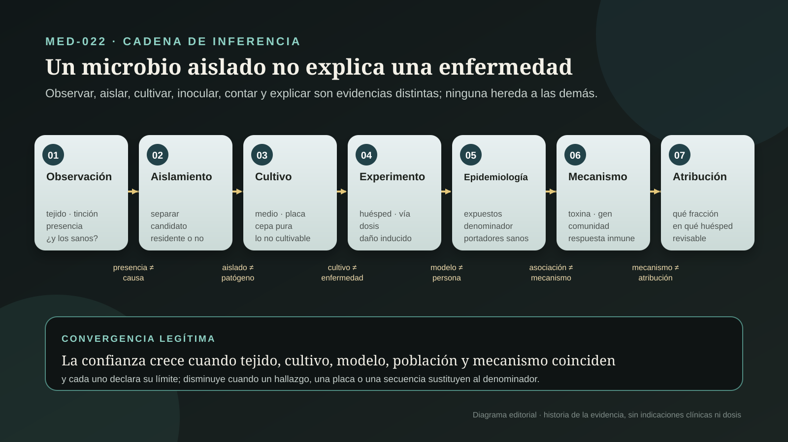
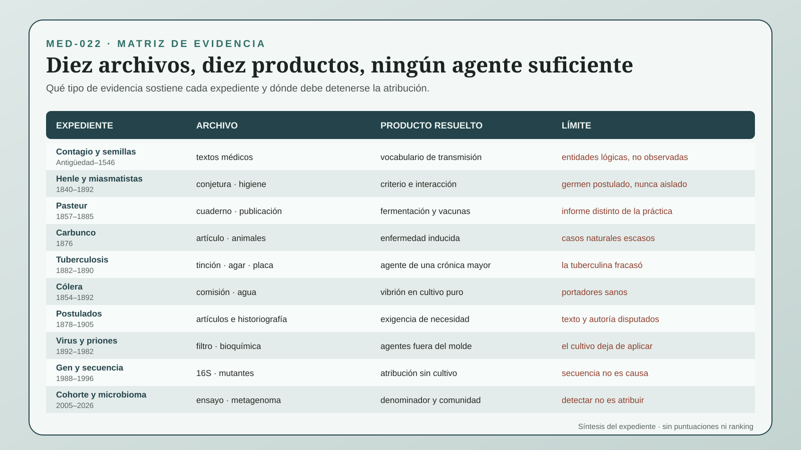

# MED-022 — Un microbio aislado no explica una enfermedad por sí solo

> **Alcance:** audita diez expedientes entre 1546 y 2026: contagio, semillas y miasmas antes de 1860 (Fracastoro, Henle, Pettenkofer); Pasteur, la fermentación, la generación espontánea y lo que Geison encontró en sus cuadernos; el carbunco de Koch en 1876; la tuberculosis de 1882, las tinciones, los medios sólidos, la placa y el fracaso de la tuberculina; el cólera entre Pacini (1854), la comisión de Koch (1883–1884), Klein, Pettenkofer y Hamburgo (1892); los «postulados» —qué escribió Koch, de dónde vienen, quién los numeró y dónde fallan—; virus y priones; los postulados moleculares de Falkow y la identificación por secuencia de Fredricks y Relman; *Helicobacter pylori* frente a *Chlamydia pneumoniae* como atribuciones tardías de destino opuesto; y, hasta 2026, epidemiología de cohortes, metagenómica clínica y microbioma como límites del modelo un-agente-una-enfermedad. Es historia y epistemología de la evidencia: **no contiene recomendaciones clínicas, dosis ni técnicas de uso** (`CLAIM-MED-GERM-NO-ADVICE-001`).
>
> **Compañeros de esta ola:** MED-020 (`INV-MED-STATISTICS-VACCINATION-EPIDEMIOLOGY-001`) audita las tablas de Snow, la Junta de Salud, Farr y Semmelweis; MED-021 (`INV-MED-ANESTHESIA-ANTISEPSIS-001`) audita Lister, la antisepsia y las pruebas de desinfectantes de Koch en 1881 (`CLAIM-MED-ANES-KOCH-1881-001`). Aquí no se repiten: se citan donde la cadena microbiana los necesita.

## Pregunta central

¿Cómo se atribuyó un agente a una enfermedad —por observación, aislamiento, cultivo, reproducción experimental, epidemiología y mecanismo— sin convertir presencia en causa, cultivo en enfermedad, animal en persona, criterio en dogma ni microbio en explicación completa?

## Respuesta breve

La teoría microbiana no fue un descubrimiento único sino un conjunto de teorías y prácticas que se volvieron convincentes cuando varias cadenas convergieron. Antes de 1860 ya había ideas de contagio, «semillas» de enfermedad y criterios experimentales; Henle, en 1840, conjeturó parásitos microscópicos y dijo qué haría falta para probarlos, pero también admitió otras causas (`CLAIM-MED-GERM-CONTAGION-ANCIENT-001`, `CLAIM-MED-GERM-HENLE-1840-001`). Los miasmatistas no eran ignorantes: el modelo de Pettenkofer, germen más suelo, explicaba observaciones que el contagio solo no explicaba (`CLAIM-MED-GERM-MIASMA-RATIONAL-001`).

Pasteur y Koch hicieron del laboratorio un productor de atribuciones. Pero sus publicaciones no son transcripciones de sus prácticas: Geison mostró en los cuadernos de Pasteur que la vacuna de Pouilly-le-Fort no se preparó como él dio a entender y que el método aplicado a Joseph Meister no se había probado en perros (`CLAIM-MED-GERM-POUILLY-1881-001`, `CLAIM-MED-GERM-RABIES-1885-001`). Koch, en 1876, apoyó la causa del carbunco casi sólo en enfermedad inducida en animales; en 1882 dio más peso a casos naturales; en 1890 su tuberculina fracasó como terapia (`CLAIM-MED-GERM-ANTHRAX-LIMIT-001`, `CLAIM-MED-GERM-TB-NATURAL-CASES-001`, `CLAIM-MED-GERM-TUBERCULIN-1890-001`).

Los «postulados de Koch» no son un texto fijo de Koch: sus formulaciones varían, aparecen sobre todo entre 1878 y 1884, tienen una fuente más clara en Klebs que en Henle y las listas numeradas que circulan son reformulaciones posteriores con autor y fecha discrepantes (`CLAIM-MED-GERM-POSTULATES-VARIANTS-001`, `CLAIM-MED-GERM-KLEBS-SOURCE-001`, `CLAIM-MED-GERM-POSTULATES-ATTRIBUTION-001`). Fallan con portadores sanos, con agentes que no se cultivan, con virus, con priones y con enfermedades donde el agente es necesario pero no suficiente (`CLAIM-MED-GERM-CARRIERS-001`, `CLAIM-MED-GERM-CHOLERA-HEALTHY-001`, `CLAIM-MED-GERM-PRION-1982-001`).

El siglo XX no abolió el criterio; lo desplazó. Falkow lo trasladó del microbio al gen de virulencia; Fredricks y Relman, a la secuencia; *H. pylori* lo cumplió tarde y con un autoexperimento, mientras *C. pneumoniae* acumuló asociación, tejido y animales y no superó un ensayo grande (`CLAIM-MED-GERM-FALKOW-1988-001`, `CLAIM-MED-GERM-SEQUENCE-GUIDELINES-1996-001`, `CLAIM-MED-GERM-HPYLORI-CONSENSUS-1994-001`, `CLAIM-MED-GERM-ACES-2005-001`). Hasta 2026, la cohorte del virus de Epstein-Barr y la esclerosis múltiple, la metagenómica clínica y el microbioma muestran atribuciones sin cultivo ni inoculación, y también el riesgo inverso: detectar no es causar, y transferir un fenotipo a ratones no es demostrar una causa humana (`CLAIM-MED-GERM-EBV-MS-2022-001`, `CLAIM-MED-GERM-DETECTION-NOT-CAUSE-001`, `CLAIM-MED-GERM-HMA-RODENTS-001`).

La cadena legítima es **observación → aislamiento → cultivo → reproducción experimental → epidemiología → mecanismo → atribución**. Ningún eslabón hereda al siguiente: un microbio aislado no explica una enfermedad por sí solo (`CLAIM-MED-GERM-CHAIN-001`).

## UN MICROBIO AISLADO NO EXPLICA UNA ENFERMEDAD POR SÍ SOLO

### 1. Siete capas que no se heredan

| Capa | Pregunta | Producto legítimo | Salto inválido |
|---|---|---|---|
| Observación | ¿qué se vio, en qué tejido, con qué tinción, aumento y comparación con sanos? | presencia o asociación morfológica | convertir presencia en causa |
| Aislamiento | ¿se separó el organismo de los demás y de qué muestra? | organismo distinguible | suponer que lo separado es lo que enferma |
| Cultivo | ¿crece puro, en qué medio, con qué contaminación posible? | cepa reproducible en laboratorio | creer que lo que no crece no existe o no causa |
| Reproducción experimental | ¿qué huésped, vía, dosis infecciosa y desenlace se registraron? | enfermedad inducida en un modelo | trasladar automáticamente del animal a la persona |
| Epidemiología | ¿quién se expone, quién enferma, quién porta sin enfermar y con qué denominador? | asociación poblacional y gradiente | confundir asociación con mecanismo o exposición con caso |
| Mecanismo | ¿por qué vía produce lesión: toxina, gen, respuesta del huésped, comunidad? | explicación causal parcial | tomar un mecanismo plausible como prueba de efecto |
| Atribución | ¿qué fracción de casos explica, en qué huésped y ambiente, con qué rivales descartados? | causa delimitada | declarar «la causa» única y suficiente |

### 2. Tres distinciones que el expediente conserva

Primero, **presencia no es causa** (`CLAIM-MED-GERM-PRESENCE-NOT-CAUSE-001`): encontrar bacilos en una lesión no distingue invasor, residente, oportunista o contaminante. Segundo, **cultivo no es enfermedad** (`CLAIM-MED-GERM-CULTURE-NOT-DISEASE-001`): un cultivo puro muestra un organismo reproducible, no su papel en un cuerpo. Tercero, **animal no es persona** (`CLAIM-MED-GERM-ANIMAL-NOT-HUMAN-001`): el carbunco inducido en ratones o la gastritis inducida en un voluntario son modelos con huésped, vía y dosis elegidos.

La cuarta distinción atraviesa todos los casos: un agente puede ser **necesario sin ser suficiente** (`CLAIM-MED-GERM-NECESSARY-NOT-SUFFICIENT-001`). El portador sano, quien ingirió un cultivo sin enfermar y la comunidad bacteriana que sólo es patógena en conjunto no refutan la teoría microbiana; refutan la versión que la reduce a un microbio aislado.

## DIEZ EXPEDIENTES AUDITADOS

### 3. Contagio, semillas y miasmas antes de 1860: sin caricatura

Nutton muestra que los médicos antiguos conocían el contagio como contagiosidad y que hablar de «semillas» de enfermedad es una de varias explicaciones de su mecánica: aire pútrido y predisposición competían con ella. Negar a la Antigüedad el contagio porque no tenía gérmenes confunde un fenómeno con una teoría (`CLAIM-MED-GERM-CONTAGION-ANCIENT-001`).

Fracastoro propuso en 1546 tres modos de contagio —contacto directo, fómites y a distancia— producidos por *seminaria*. La historiografía celebratoria lo convirtió en precursor de la teoría microbiana; Nutton lo lee dentro del marco clásico e hipocrático, con deudas antiguas silenciadas, y advierte que sus semillas eran entidades lógicas, no organismos observados (`CLAIM-MED-GERM-FRACASTORO-1546-001`).

Jacob Henle conjeturó en 1840 que muchas enfermedades podían deberse a parásitos microscópicos y escribió que sólo podría probarse si se aislaran los organismos de los fluidos contagiosos y se observaran sus poderes por separado; dudaba de que fuera factible y reconocía, además de miasmas y contagios, propiedades físicas y químicas del aire entre las causas (`CLAIM-MED-GERM-HENLE-1840-001`).

Max von Pettenkofer, el adversario más fuerte del expediente, no negaba un germen. Su teoría del suelo exigía un germen específico (X), condiciones locales del suelo (Y) y condiciones estacionales e individuales; el germen debía «madurar» en suelo poroso, con materia orgánica y nivel freático descendente. Esa interacción explicaba la estacionalidad y la susceptibilidad desigual de lugares mejor que el contagio solo, y por eso dio poca fe a la cuarentena, la desinfección y la filtración (`CLAIM-MED-GERM-MIASMA-RATIONAL-001`). Fundó en 1879 el primer instituto de higiene y llevó el análisis de laboratorio a la salud pública: el miasmatismo tardío también fue ciencia de laboratorio (`CLAIM-MED-GERM-HYGIENE-LAB-001`).

### 4. Pasteur: fermentación, generación espontánea y cuadernos

Geison, tras leer los cuadernos de laboratorio de Pasteur, muestra que su trabajo sobre fermentación y generación espontánea estuvo informado por la convicción de que los procesos vitales diferían cualitativamente de los químicos, y por la búsqueda de tecnologías médicas eficaces (`CLAIM-MED-GERM-PASTEUR-VITALISM-001`).

La controversia con Pouchet (1859–1864) admite dos lecturas. Farley y Geison (1974) sostuvieron que el triunfo de Pasteur debió mucho a apoyo político e ideológico y que los experimentos de Pouchet eran tan válidos como los suyos; Roll-Hansen (2018) responde que el núcleo del debate fue el resultado de experimentos específicos y que la Academia juzgó la conducción de esos experimentos. La controversia no se resuelve aquí; lo que se conserva es que el veredicto no fue una deducción desde una teoría general (`CLAIM-MED-GERM-POUCHET-001`).

Geison encontró que Pasteur publicaba sólo los resultados que apoyaban sus ideas y atribuía los contrarios a métodos defectuosos, algo que considera habitual en la retórica científica; y dos episodios que van más allá (`CLAIM-MED-GERM-NOTEBOOKS-001`). En Pouilly-le-Fort, junio de 1881, veinticinco ovejas vacunadas sobrevivieron y veinticinco no vacunadas murieron; los relatos publicados sugerían atenuación por oxígeno, pero los cuadernos muestran que la vacuna se preparó con bicromato de potasio, un método más cercano al de su rival Toussaint (`CLAIM-MED-GERM-POUILLY-1881-001`). En 1885 Pasteur dio a entender que había probado su método contra la rabia en «gran número» de perros; los cuadernos muestran resultados ambiguos y que el método aplicado a Joseph Meister no se había ensayado en animales (`CLAIM-MED-GERM-RABIES-1885-001`). Ninguno de estos hallazgos borra el programa de Pasteur; muestra que el informe público y la práctica de laboratorio son archivos distintos.

### 5. Koch y el carbunco, 1876: ciclo de vida y animal inducido

Koch publicó en 1876 el ciclo de vida de *Bacillus anthracis*, con innovaciones como la gota suspendida, y sostuvo que era la causa del carbunco. Partía del trabajo de Davaine, quien había argumentado que los bastoncillos eran necesarios: siempre estaban en la sangre de animales enfermos y la sangre sin ellos no transmitía la enfermedad (`CLAIM-MED-GERM-ANTHRAX-1876-001`).

Carter muestra que el artículo de 1876 no discute criterios de causalidad y aporta poca evidencia original sobre carbunco natural: descansa casi por completo en enfermedad inducida en animales de experimentación, informa sólo el hallazgo en el bazo de un caballo y cita a otros investigadores que no hallaron bacilos en casos naturales (`CLAIM-MED-GERM-ANTHRAX-LIMIT-001`). La atribución fue fuerte en el modelo y más delgada en la enfermedad del campo.

### 6. Tuberculosis, 1882–1890: tinción, medio sólido y tuberculina

Koch presentó el 24 de marzo de 1882 el bacilo de la tuberculosis, visible con nuevas técnicas de tinción. Ese mismo año escribió que hasta entonces sólo el carbunco tenía la prueba completa y que en otras enfermedades sólo se conocía la coincidencia de parásito y lesión (`CLAIM-MED-GERM-TB-1882-001`). En los trabajos de 1882 a 1884 dio por primera vez atención significativa a los casos naturales, aunque siguió considerando más decisivos el aislamiento en cultivo y la inoculación (`CLAIM-MED-GERM-TB-NATURAL-CASES-001`).

El laboratorio de Koch reunió lente de inmersión en aceite, microfotografía, tinciones con colorantes de anilina, la gelatina y, desde 1881 y por sugerencia de Walther y Fanny Hesse, el agar, que no se licuaba a temperatura corporal ni era degradado por la mayoría de las bacterias; con él se obtuvieron colonias puras en placa (`CLAIM-MED-GERM-TECHNIQUES-001`). La caja de Petri (1887) es, según Shama, una invención simultánea de media docena de bacteriólogos de mediados de la década de 1880 (`CLAIM-MED-GERM-PETRI-SIMULTANEOUS-001`).

En 1890 Koch anunció la tuberculina como remedio. Fracasó como terapia y dañó su reputación; Gradmann lo lee como el punto donde las cualidades que sostuvieron su teoría —paciencia técnica, control del modelo— le faltaron en la clínica, con prisa y endoso apresurado de datos (`CLAIM-MED-GERM-TUBERCULIN-1890-001`). Atribuir un agente no es tratar la enfermedad.

### 7. Cólera, 1854–1892: Pacini, Koch, Klein, Pettenkofer y Hamburgo

Filippo Pacini describió en 1854 el vibrión en Florencia, el mismo año de la investigación de Snow en Londres que audita MED-020 (`CLAIM-MED-COUNT-SNOW-TABLE-1855-001`); no estableció su papel causal ante sus contemporáneos (`CLAIM-MED-GERM-PACINI-1854-001`). La comisión alemana dirigida por Koch partió hacia Alejandría en agosto de 1883, continuó en Calcuta y comunicó a comienzos de 1884 el aislamiento del bacilo «coma» en cultivo puro, en intestinos de fallecidos y en agua de estanques (`CLAIM-MED-GERM-KOCH-CHOLERA-1884-001`). Gradmann muestra que viajar formó parte del método —la gelatina se licuaba con el calor egipcio, la disección dependía de la aceptación local— y que la investigación compleja se presentó en casa como un descubrimiento simple y heroico (`CLAIM-MED-GERM-HEROIC-LAB-001`).

El vibrión se aisló también de personas sanas, lo que rompía la especificidad que el propio criterio de Koch pedía (`CLAIM-MED-GERM-CHOLERA-HEALTHY-001`). Emanuel Edward Klein, empleado del gobierno británico, objetó en 1885 el enunciado de Koch; Atalic sostiene que sus objeciones deben leerse como científicas y no sólo como servicio político al gobierno británico (`CLAIM-MED-GERM-KLEIN-001`).

El 7 de octubre de 1892, a los 74 años, Pettenkofer bebió un cultivo de vibrión obtenido por Gaffky de un paciente moribundo, tras neutralizar la acidez gástrica. Tuvo sólo una diarrea leve con abundantes bacilos en las heces; dos discípulos que repitieron el experimento sufrieron una «colerina» intensa, sin muertes (`CLAIM-MED-GERM-PETTENKOFER-1892-001`). El experimento muestra que ingerir el vibrión no produjo inevitablemente cólera clínico; no demuestra que el vibrión sea inocuo: un caso no estima una tasa, la inmunidad previa es plausible —Evans recoge que pudo haber padecido cólera en 1830— y los discípulos sí enfermaron (`CLAIM-MED-GERM-PETTENKOFER-LIMIT-001`).

Ese mismo año, Hamburgo sufrió una gran epidemia mientras la vecina Altona, con planta de filtración de agua, quedó prácticamente libre; Hamburgo creó su junta de salud sólo después (`CLAIM-MED-GERM-HAMBURG-ALTONA-1892-001`). Morabia lee el episodio en dos sentidos: la falta de filtración tuvo consecuencias desastrosas y arruinó la reputación de Pettenkofer, pero su pensamiento de interacción germen-ambiente explica mejor la ocurrencia poblacional de epidemias que la bacteriología sola (`CLAIM-MED-GERM-MIASMA-RATIONAL-001`).

### 8. Los «postulados»: qué escribió Koch, qué se le atribuye y cuándo fallan

Carter, que leyó los trabajos de Koch, muestra que los postulados aparecen en pocos de sus más de cien artículos —entre 1878 y 1884 y, una última vez, en 1890—, que las formulaciones de Koch difieren entre sí y que muchos autores los enuncian a partir de diccionarios y obras secundarias (`CLAIM-MED-GERM-POSTULATES-VARIANTS-001`). La fuente más clara de los criterios de suficiencia de Koch fue Edwin Klebs, que desde 1872 pedía aislar sustancias del cuerpo y reproducir la infección, y a quien Koch reconoció; Henle quedó como antecedente conjetural (`CLAIM-MED-GERM-KLEBS-SOURCE-001`). Lo distintivo de Koch fue exigir que el organismo fuera **necesario** además de explicar la enfermedad; ni Henle, ni Virchow, ni Klebs pedían necesidad (`CLAIM-MED-GERM-NECESSITY-001`).

Las listas numeradas de tres o cuatro postulados son reformulaciones posteriores, y las síntesis discrepan en autor y fecha: una revisión de 2024 atribuye la formalización a Loeffler en 1883 y la cuarta condición a Erwin F. Smith en 1905; otra de 2005 presenta los cuatro como criterios de Koch de 1886 (`CLAIM-MED-GERM-POSTULATES-ATTRIBUTION-001`). Gradmann concluye que las referencias a «los postulados de Koch» funcionan como anécdotas sobre un acontecimiento que nunca ocurrió y recuerdan una tradición de medicina experimental atribuida a Koch (`CLAIM-MED-GERM-POSTULATES-ANECDOTE-001`).

Fallan por diseño en varios frentes. Portadores asintomáticos: Mary Mallon, cocinera en Nueva York, portaba *Salmonella* Typhi sin enfermar y fue aislada durante años contra su voluntad; la historia de la salud pública registra portadores en difteria, tifoidea y meningitis (`CLAIM-MED-GERM-CARRIERS-001`). Agentes no cultivables, como *Mycobacterium leprae*; bacterias residentes que se vuelven patógenas en un huésped inmunodeprimido; infecciones subclínicas (`CLAIM-MED-GERM-CHOLERA-HEALTHY-001`). Evans propuso en 1976 guías que incorporan el espectro de respuestas del huésped y las enfermedades crónicas (`CLAIM-MED-GERM-HOST-SPECTRUM-001`). El postulado de cultivo no se cumplió en virus ni en priones.

### 9. Virus y priones, 1892–1982: lo que pasa el filtro

Ivanovsky detectó en 1892 que el agente del mosaico del tabaco atravesaba filtros que retenían bacterias, pero siguió buscando un microbio y en 1903 afirmó haberlo multiplicado en un medio artificial (`CLAIM-MED-GERM-IVANOVSKY-1892-001`). Beijerinck propuso en 1898 un *contagium vivum fluidum* filtrable que se multiplicaba ligado al metabolismo del huésped; su idea no encajaba en la teoría bacteriológica dominante y no fue apreciada en vida (`CLAIM-MED-GERM-BEIJERINCK-1898-001`). Loeffler y Frosch mostraron en 1898 la filtrabilidad del agente de la fiebre aftosa, todavía dentro del dogma bacteriológico (`CLAIM-MED-GERM-LOEFFLER-FROSCH-1898-001`). La partícula del virus del mosaico no se aisló hasta 1935.

En 1982 Prusiner reunió seis líneas de evidencia de que el agente del scrapie requería una proteína y resistía procedimientos que modifican ácidos nucleicos, y propuso el término «prion» (`CLAIM-MED-GERM-PRION-1982-001`). Un agente infeccioso sin ácido nucleico detectable no se cultiva como una bacteria ni se tiñe como un bacilo.

### 10. Postulados moleculares y secuencia, 1988–1996

Falkow trasladó en 1988 el criterio del microbio al gen: el gen de virulencia debe asociarse con las cepas patógenas, su inactivación debe atenuar la virulencia en un modelo y su restitución debe restaurarla (`CLAIM-MED-GERM-FALKOW-1988-001`). Relman y colaboradores amplificaron en 1992 una secuencia de ARN ribosómico 16S del bacilo no cultivado de la enfermedad de Whipple, la hallaron en los 5 pacientes y en ninguno de 10 controles y nombraron *Tropheryma whippelii* (`CLAIM-MED-GERM-WHIPPLE-1992-001`). Fredricks y Relman propusieron en 1996 guías moleculares para atribuir causa por secuencia y subrayaron la concordancia de evidencias (`CLAIM-MED-GERM-SEQUENCE-GUIDELINES-1996-001`).

### 11. *Helicobacter pylori* y *Chlamydia pneumoniae*: dos atribuciones tardías

La hipótesis bacteriana de la úlcera se abandonó a mediados del siglo XX. Radomski y colaboradores, con análisis textual de la década previa, muestran que el abandono ya había ocurrido antes del estudio de Palmer (1954) que suele señalarse como su causa (`CLAIM-MED-GERM-HPYLORI-ABANDON-001`). Warren y Marshall describieron en 1983 bacilos curvos en el epitelio gástrico con gastritis activa; en 1984 los hallaron en biopsias de 58 de 100 pacientes consecutivos y cultivaron 11 (`CLAIM-MED-GERM-HPYLORI-1984-001`). En 1985 un voluntario con mucosa normal ingirió el organismo y desarrolló una gastritis comprobada histológicamente al décimo día, en buena parte resuelta al decimocuarto (`CLAIM-MED-GERM-HPYLORI-SELF-1985-001`). Un caso, una gastritis aguda y autolimitada, no una úlcera: el «cumplimiento» de los postulados fue parcial. La aceptación llegó por convergencia —histología, cultivo, epidemiología y respuesta a la erradicación— y se fijó en la conferencia de consenso de los NIH en 1994 (`CLAIM-MED-GERM-HPYLORI-CONSENSUS-1994-001`).

*C. pneumoniae* recorrió el camino inverso. Desde 1988 se asoció con el infarto; el organismo se detectó en ateromas con proporciones muy distintas según la técnica, y en modelos animales la inoculación aceleró lesiones (`CLAIM-MED-GERM-CPNEUMONIAE-001`). En el ensayo ACES, 4012 pacientes con enfermedad coronaria estable asignados al azar a un año de antibiótico o placebo tuvieron 446 frente a 449 eventos del desenlace principal, sin diferencia por serología basal (`CLAIM-MED-GERM-ACES-2005-001`). El ensayo no refuta toda participación del organismo; sí refuta que la cadena de asociación, tejido y animal bastara para atribuirle un papel modificable en ese huésped.

### 12. Hasta 2026: cohortes, metagenómica y microbioma

En una cohorte de más de 10 millones de militares estadounidenses con 955 casos de esclerosis múltiple, el riesgo aumentó 32 veces tras la infección por el virus de Epstein-Barr y no tras otros virus; un marcador de daño neuroaxonal subió sólo después de la seroconversión (`CLAIM-MED-GERM-EBV-MS-2022-001`). Es una atribución fuerte sin aislamiento específico ni reproducción experimental, y con un virus que porta la gran mayoría de los adultos sanos: necesidad probable, suficiencia no.

La metagenómica clínica secuencia el material genético de una muestra sin elegir antes el organismo. En un estudio prospectivo de 204 pacientes con meningitis o encefalitis, identificó 13 de 58 infecciones que la clínica no había detectado y no identificó 26 (`CLAIM-MED-GERM-METAGENOMICS-2019-001`). En siete años y 4828 muestras de un laboratorio clínico, su sensibilidad fue 63.1 % y su especificidad 99.6 % (`CLAIM-MED-GERM-METAGENOMICS-2024-001`). Detectar una secuencia no es atribuir una causa: contaminación, residentes y coinfecciones exigen la misma cadena que exigía un bacilo teñido (`CLAIM-MED-GERM-DETECTION-NOT-CAUSE-001`).

El Proyecto del Microbioma Humano mostró que incluso personas sanas difieren mucho en los microbios que ocupan cada hábitat, y que la carga metagenómica de rutas metabólicas es más estable que la composición de especies (`CLAIM-MED-GERM-MICROBIOME-VARIATION-001`). En la periodontitis, el modelo de sinergia polimicrobiana y disbiosis atribuye la enfermedad a una comunidad desequilibrada y a «patógenos clave» que alteran la respuesta del huésped, no a una especie que cumpla los postulados (`CLAIM-MED-GERM-POLYMICROBIAL-001`). Vonaesch, Anderson y Sansonetti proponen por eso unos «postulados ecológicos de Koch»: el enunciado clásico de un patógeno igual a una enfermedad no vale para todas las enfermedades llamadas infecciosas (`CLAIM-MED-GERM-ECOLOGICAL-POSTULATES-001`).

El riesgo inverso también está documentado. Walter y colaboradores revisaron de forma sistemática los estudios con roedores asociados a microbiota humana y hallaron que 36 de 38 (95 %) informaron transferencia del fenotipo patológico al animal receptor; sostienen que una tasa tan alta de patologías transferibles entre especies es inverosímil y exagera el papel del microbioma en la enfermedad humana (`CLAIM-MED-GERM-HMA-RODENTS-001`). Un consenso Delphi de 2025 sobre causalidad en investigación del microbioma responde al mismo problema desde dentro del campo: elegir el modelo preclínico adecuado es el paso donde se decide si una asociación puede volverse causa (`CLAIM-MED-GERM-CONSENSUS-2025-001`).

### 13. Una revolución menos limpia de lo que se cuenta

Worboys examinó la tesis de una «revolución bacteriológica» en la medicina británica de fines del siglo XIX —descubrimiento sucesivo de agentes y postulados, giro reduccionista y contagionista, autoridad del laboratorio experimental, productos inmunológicos— contra cuatro enfermedades poco estudiadas: sífilis, lepra, gonorrea y rabia. Concluye que el caso de esa revolución sigue sin probarse para Gran Bretaña, que los historiadores leyeron en la década de 1880 cambios ocurridos en un periodo mucho más largo y que el balance entre continuidades y cambios fue desigual según el área de la medicina (`CLAIM-MED-GERM-REVOLUTION-001`). Comparar aquí no reparte puntos de progreso entre países, escuelas ni teorías (`CLAIM-MED-GERM-NONRANKING-001`).

## LO OBSERVADO

- preparaciones teñidas, cortes de tejido, colonias en medio sólido, placas, filtrados y fotografías de laboratorio;
- cuadernos de laboratorio, informes de comisión, artículos, polémicas y reglamentos de higiene;
- animales inoculados, voluntarios, autoexperimentos y sus desenlaces registrados;
- portadores sanos, infecciones subclínicas y personas expuestas que no enfermaron;
- series, cohortes, ensayos aleatorizados, secuencias de ADN y ARN y comunidades microbianas completas.

## LO MEDIDO

- presencia o ausencia de un organismo en casos y en controles, cuando hubo controles;
- crecimiento en medios definidos, filtrabilidad y resistencia a procedimientos físicos y químicos;
- frecuencia de enfermedad inducida en modelos con vía y dosis declaradas;
- riesgos relativos, sensibilidad, especificidad y desenlaces de ensayos con denominador;
- abundancia y diversidad de taxones, y expresión o inactivación de genes de virulencia;
- no la experiencia de las personas enfermas, no la fracción de casos atribuible en cada población, no la suficiencia de ningún agente.

## LO INFERIDO

La atribución de un agente gana fuerza cuando cadenas independientes —observación en tejido, aislamiento, cultivo, modelo experimental, epidemiología con denominador y mecanismo— coinciden y cada una declara su límite. Una sola de ellas, por rigurosa que sea, deja abiertas alternativas: residente, oportunista, contaminante, marcador de otra exposición o causa componente entre varias (`CLAIM-MED-GERM-CHAIN-001`, `CLAIM-MED-GERM-NECESSARY-NOT-SUFFICIENT-001`).

## LOS SUPUESTOS

- que la muestra examinada representa el tejido o la población de interés y no sólo lo accesible;
- que el medio de cultivo no selecciona de antemano lo que podrá verse;
- que el modelo animal comparte con la persona la vía, la barrera y la respuesta relevantes;
- que las categorías históricas de enfermedad corresponden lo bastante a las actuales para comparar archivos;
- que una publicación refleja la práctica de laboratorio que dice describir, supuesto que los cuadernos de Pasteur muestran falible;
- que la ausencia de un agente en el archivo no prueba su ausencia en la enfermedad.

## LAS INCERTIDUMBRES

- cuántas personas portaban cada agente sin enfermar en los episodios históricos auditados;
- qué parte del éxito de una atribución se debió a evidencia y qué parte a autoridad, nación o retórica;
- la fracción de enfermedad atribuible a cada agente en poblaciones distintas de las estudiadas;
- el peso del huésped, la dosis, la coinfección y el ambiente en cada caso;
- hasta dónde los modelos de comunidad microbiana identifican causas o describen correlaciones estables;
- la reproducibilidad de los hallazgos metagenómicos fuera de los laboratorios que los publican.

## LAS ALTERNATIVAS

- un organismo presente puede ser causa, consecuencia, residente, contaminante o marcador de otra exposición;
- un cultivo negativo puede indicar ausencia, medio inadecuado, estado no cultivable o muestreo erróneo;
- una enfermedad inducida puede reflejar la enfermedad natural, otra entidad con lesión parecida o un artefacto de dosis y vía;
- una asociación epidemiológica puede reflejar causa, confusión, sesgo de detección o causalidad inversa;
- un mecanismo coherente puede operar o no en el cuerpo humano a las concentraciones reales;
- una disbiosis puede preceder, acompañar o seguir a la enfermedad.

## QUÉ PODEMOS COMPARAR

| Expediente | Archivo dominante | Producto mejor resuelto | Límite decisivo |
|---|---|---|---|
| Contagio y semillas (antiguo–1546) | textos médicos y filosóficos | vocabulario de contagio y transmisión | entidades lógicas, no organismos observados |
| Henle y los miasmatistas (1840–1892) | conjetura, higiene experimental, instituto | criterio experimental y modelo de interacción | germen postulado, nunca aislado por ellos |
| Pasteur (1857–1885) | publicaciones y cuadernos de laboratorio | fermentación, refutación de la generación espontánea, vacunas | informe público distinto de la práctica |
| Carbunco (1876) | artículo y animales inoculados | ciclo de vida y enfermedad inducida | casos naturales poco documentados |
| Tuberculosis (1882–1890) | tinción, cultivo sólido, casos naturales | agente de una enfermedad crónica mayor | atribuir no es tratar: la tuberculina fracasó |
| Cólera (1854–1892) | comisión viajera, agua, autoexperimento | vibrión aislado en cultivo puro y en agua | portadores sanos y adversario no refutado del todo |
| Postulados (1878–1905) | artículos de Koch e historiografía | exigencia de necesidad y de reproducción | texto variable, autoría y numeración disputadas |
| Virus y priones (1892–1982) | filtros, plantas, animales, bioquímica | agentes fuera del molde bacteriológico | el postulado del cultivo deja de aplicar |
| Molecular y secuencia (1988–1996) | genes, 16S, guías | atribución sin cultivo | la secuencia no distingue causa de presencia |
| Atribuciones tardías y 2026 | ensayos, cohortes, metagenómica, microbioma | convergencia o refutación con denominador | comunidad y huésped exceden el agente único |

## QUÉ NO PODEMOS CONCLUIR

- que la teoría microbiana se demostró con un experimento o en una fecha;
- que los miasmatistas ignoraban la evidencia;
- que Koch escribió una lista fija de postulados numerados;
- que cumplir los postulados demuestra que un agente es suficiente para enfermar;
- que no cumplirlos refuta la causalidad;
- que una secuencia detectada en una muestra identifica la causa de la enfermedad;
- que transferir un fenotipo a roedores demuestra una causa humana;
- que una disbiosis descrita en un grupo explica la enfermedad de una persona;
- que atribuir un agente implica disponer de un tratamiento eficaz.

## LAS CONTROVERSIAS

| Pregunta | Alternativas | Qué discrimina |
|---|---|---|
| ¿quién formuló los postulados? | Koch / Henle / Klebs / Loeffler y Smith | lectura de los textos originales y fechas de cada formulación |
| ¿era irracional el miasmatismo? | error ya refutado / modelo de interacción con poder explicativo | observaciones que cada modelo explicaba y las que no |
| ¿ganó Pasteur a Pouchet por mejor experimento? | sí, por conducción experimental / también por apoyo político e ideológico | actas de la Academia y replicación de los experimentos |
| ¿invalidan los cuadernos de Pasteur su ciencia? | fraude / retórica habitual con dos episodios graves | comparación entre cuaderno, publicación y norma de la época |
| ¿probó algo el autoexperimento de Pettenkofer? | que el vibrión no basta / que un caso no estima nada | inmunidad previa, dosis, discípulos enfermos, denominador ausente |
| ¿es *C. pneumoniae* causa de aterosclerosis? | sí, por asociación, tejido y animal / no demostrada en el huésped humano | ensayo aleatorizado con desenlaces duros |
| ¿hundió el estudio de Palmer la hipótesis bacteriana de la úlcera? | sí / ya estaba abandonada antes | análisis textual de la literatura previa |
| ¿causa el virus de Epstein-Barr la esclerosis múltiple? | causa necesaria probable / factor entre varios | prevalencia del virus frente a incidencia de la enfermedad |
| ¿hay causalidad demostrada en el microbioma? | sí, mostrada en modelos / tasa de transferencia inverosímil | elección del modelo preclínico y sus controles |
| ¿hubo una revolución bacteriológica? | sí, en la década de 1880 / cambio desigual y más largo | enfermedades poco estudiadas: sífilis, lepra, gonorrea, rabia |

## ERRORES QUE ESTA INVESTIGACIÓN BLOQUEA

1. **«Pasteur y Koch demostraron la teoría microbiana.»** Varias cadenas convergieron durante décadas, con continuidades y resistencias documentadas.
2. **«Los miasmatistas eran anticientíficos.»** Pettenkofer hacía higiene experimental y su modelo explicaba patrones que el contagio solo no explicaba.
3. **«Koch escribió tres (o cuatro) postulados.»** Sus formulaciones varían; las listas numeradas son posteriores y su autoría se disputa.
4. **«Cumplir los postulados prueba la causa.»** Prueba, como mucho, necesidad y reproducción en un modelo.
5. **«Si no se cultiva, no causa.»** Virus, priones y bacilos no cultivables exigieron otros criterios.
6. **«Quien porta el agente está enfermo.»** Los portadores asintomáticos existen y fueron tratados como amenaza antes que como evidencia.
7. **«Pettenkofer refutó la teoría microbiana al beber el cultivo.»** Un caso sin denominador, con inmunidad previa plausible y con discípulos que sí enfermaron.
8. **«Detectar una secuencia identifica la causa.»** La metagenómica detecta presencia; la atribución sigue exigiendo la cadena completa.
9. **«Un ratón con microbiota humana demuestra una causa humana.»** La tasa de transferencia publicada es inverosímilmente alta.
10. **«Una enfermedad, un microbio.»** Comunidades, huésped y ambiente participan en enfermedades llamadas infecciosas.
11. **«Atribuir el agente resuelve la enfermedad.»** La tuberculina y los ensayos con antibióticos en coronariopatía muestran lo contrario.
12. **«La historia de la bacteriología es una sucesión de aciertos.»** Incluye fracasos terapéuticos, atribuciones erróneas y abandonos prematuros.

## NIVEL DE CONFIANZA

- **A:** existencia, fecha y contenido de publicaciones, comisiones, ensayos y cohortes citados; cifras tomadas de sus resúmenes oficiales.
- **B:** reconstrucción de prácticas de laboratorio, recepción y motivaciones cuando convergen cuadernos, polémicas y estudios históricos.
- **B-COND:** atribuciones causales modernas que dependen del huésped, la población o el modelo (virus de Epstein-Barr y esclerosis múltiple, microbioma).
- **C:** intenciones individuales, y la interpretación de episodios sostenidos por una sola fuente secundaria.
- **D/E:** fundador único de la teoría microbiana, postulados como texto canónico de Koch, suficiencia de un agente aislado, causalidad del microbioma inferida de un modelo murino.

## QUÉ PODRÍA FALSARLO

Este expediente deberá corregirse si nuevos registros o análisis muestran que:

- una formulación numerada de los postulados aparece literalmente en un texto fechado de Koch;
- la lectura de los cuadernos de Pasteur sobre Pouilly-le-Fort o la rabia se refuta con los documentos originales;
- el autoexperimento de Pettenkofer se documenta con dosis, inmunidad y testigos distintos de los recogidos aquí;
- una cifra citada —58 de 100 biopsias, 4012 pacientes, 446 frente a 449 eventos, 63.1 % de sensibilidad, 36 de 38 estudios— difiere de su fuente primaria;
- un ensayo posterior muestra beneficio de erradicar *C. pneumoniae* en algún subgrupo definido de antemano;
- una intervención sobre el microbioma produce en humanos el efecto que los modelos murinos anticipan, con denominador y control;
- la historiografía documenta que la recepción de la bacteriología fue más rápida y uniforme de lo que sostiene Worboys.

## QUÉ SABEMOS REALMENTE

Sabemos que entre 1876 y 1898 se aislaron y cultivaron agentes de enfermedades mayores con técnicas nuevas —tinciones, medios sólidos, placas, filtros— y que esas atribuciones transformaron el agua, la cuarentena, el diagnóstico y la cirugía. Sabemos que el criterio que las ordenó no fue un texto fijo, que su exigencia distintiva fue la necesidad del agente y que sus límites se conocieron pronto: portadores sanos, agentes no cultivables, virus y priones. Sabemos que las atribuciones modernas se hacen con genes, secuencias, cohortes y ensayos, y que siguen teniendo que separar presencia de causa (`CLAIM-MED-GERM-CHAIN-001`, `CLAIM-MED-GERM-POSTULATES-VARIANTS-001`, `CLAIM-MED-GERM-DETECTION-NOT-CAUSE-001`).

## QUÉ TODAVÍA NO SABEMOS

No sabemos qué fracción de muchas enfermedades es atribuible a cada agente en cada población, ni por qué la mayoría de las personas infectadas por agentes comunes no enferma. No sabemos cuánta de la variación del microbioma es causa y cuánta consecuencia, ni qué modelos preclínicos permiten decidirlo. No podemos recuperar la experiencia de las personas convertidas en portadoras, casos o fuentes de cultivo. MED-023 auditará quién sostuvo el cuidado y cómo se regularon roles, instituciones y autoridad alrededor de este conocimiento.

## CONCLUSIÓN

La teoría microbiana se volvió convincente no porque un microscopio mostrara la causa, sino porque observación, aislamiento, cultivo, inoculación, epidemiología y mecanismo empezaron a poder contrastarse entre sí. Esa fuerza tiene un precio: cada eslabón puede fallar por separado, y la versión simplificada —un microbio, una enfermedad— fue limitada por los propios laboratorios que la hicieron famosa, desde el vibrión hallado en personas sanas hasta las comunidades de la boca y el intestino.

Por eso el expediente conserva siete capas. Observación no es aislamiento; aislamiento no es cultivo; cultivo no es enfermedad; modelo no es persona; asociación no es mecanismo; mecanismo no es atribución; y atribución no es tratamiento. Un microbio aislado no explica una enfermedad por sí solo (`CLAIM-MED-GERM-SCOPE-001`, `CLAIM-MED-GERM-NECESSARY-NOT-SUFFICIENT-001`).

## NAVEGACIÓN

- [Historia de la ciencia de MED-022](../20_historia_ciencia/HISTORIA_MED_022_TEORIA_MICROBIANA_LABORATORIO.md)
- [Cronología especializada de MED-022](../21_cronologias/CRONOLOGIA_MED_022_TEORIA_MICROBIANA_LABORATORIO.md)
- [Mapa epistemológico de MED-022](../22_mapas_epistemologicos/MAPA_MED_022_TEORIA_MICROBIANA_LABORATORIO.md)
- [Programa cronológico de Medicina](PROGRAMA_CRONOLOGICO_HISTORIA_MEDICINA.md)
- [Explorador público de evidencia](../EVIDENCE_LEDGER.md)

