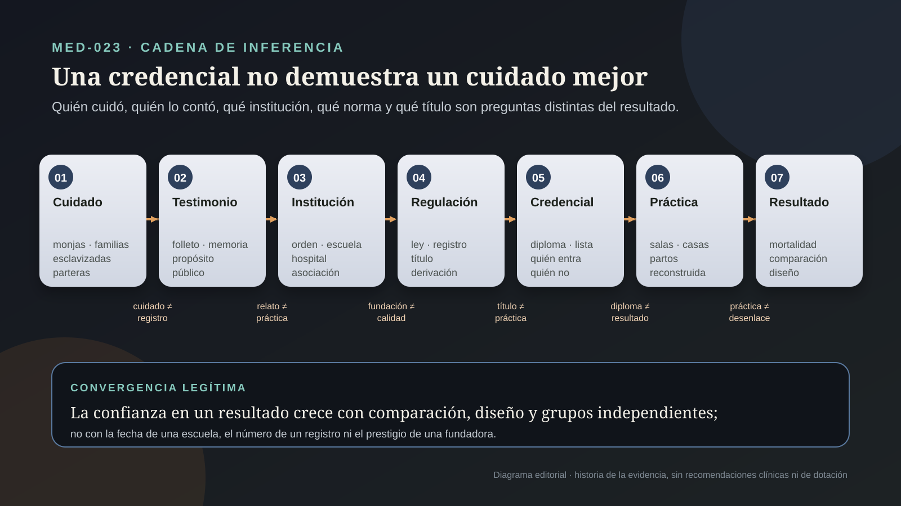
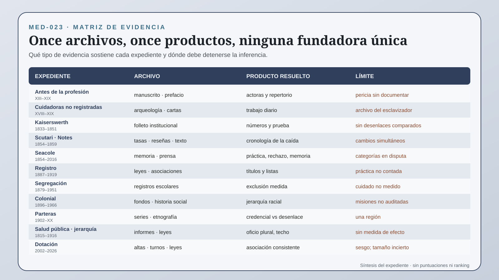

# MED-023 — Una credencial no demuestra un cuidado mejor por sí sola

> **Alcance:** audita once expedientes entre el cuidado religioso de la Baja Edad Media y 2026: monjas, beguinas, hogares y personas esclavizadas que cuidaron sin quedar registradas; el instituto de diaconisas de Kaiserswerth; Nightingale en Scutari y en *Notes on Nursing* (su estadística ya está en MED-020 y no se repite); Mary Seacole y la historiografía de su borrado y recuperación; el registro de enfermeras en el Reino Unido (1919) y en Carolina del Norte (1903); la segregación de la enfermería estadounidense; la enfermería colonial; las parteras y la medicalización del parto en Inglaterra y México; la salud pública como oficio (Chadwick, los *Medical Officers of Health*, las enfermeras visitadoras de Lillian Wald); farmacia, odontología y el techo de autoridad; y, hasta 2026, la evidencia moderna sobre dotación de enfermeras y resultados, con sus límites causales. Separa cuidado, testimonio, institución, regulación, credencial, práctica efectiva y resultado. Es historia y epistemología de la evidencia: **no contiene recomendaciones clínicas ni recomendaciones de política de dotación** (`CLAIM-MED-CARE-NO-ADVICE-001`).

## Pregunta central

¿Quién sostuvo el cuidado de los enfermos y cómo se regularon roles, instituciones y autoridad, sin confundir un relato institucional con lo que ocurría en las salas, una escuela o un registro con un cuidado mejor, una credencial con un resultado, ni el silencio del archivo con la ausencia de quienes cuidaron?

## Respuesta breve

El cuidado no empezó con la profesión. Monjas cistercienses y beguinas de los Países Bajos meridionales cuidaron con oraciones, bendiciones, imágenes y gestos que la historiografía pasó por alto, y su pericia no quedó documentada (`CLAIM-MED-CARE-RITCHEY-TOOLS-001`, `CLAIM-MED-CARE-BEGUINE-UNDOCUMENTED-001`). Mujeres con votos moldearon la enfermería moderna aunque la historia de la profesión las relegara (`CLAIM-MED-CARE-RELIGIOUS-COFOUNDERS-001`). Enfermeras esclavizadas daban el cuidado diario en hospitales de plantación y no aparecen en los documentos administrativos (`CLAIM-MED-CARE-ENSLAVED-SICK-NURSES-001`). En 1859 Nightingale escribió que «toda mujer es una enfermera» porque casi todas tenían a su cargo la salud de alguien (`CLAIM-MED-CARE-DOMESTIC-NURSE-1859-001`).

Kaiserswerth formó diaconisas con prueba de seis meses y, en palabras del propio folleto de 1851, obtuvo una lista de recuperaciones «menos brillante» por admitir a toda clase de enfermos (`CLAIM-MED-CARE-KAISERSWERTH-1851-001`, `CLAIM-MED-CARE-KAISERSWERTH-OUTCOME-001`). En Scutari, la mortalidad bajó tras las obras de la Comisión Sanitaria iniciadas el 17 de marzo de 1855, cuatro meses después de la llegada de Nightingale; ni sus cifras ni las de la comisión separan el aporte de las enfermeras del de las cloacas, la estación o la admisión (`CLAIM-MED-CARE-SCUTARI-SANITARY-1855-001`, `CLAIM-MED-CARE-SCUTARI-ATTRIBUTION-001`). Mary Seacole fue rechazada como enfermera, fue a Crimea por su cuenta y casi desapareció de la memoria pública durante un siglo, hasta su recuperación desde 1984 (`CLAIM-MED-CARE-SEACOLE-REFUSED-001`, `CLAIM-MED-CARE-SEACOLE-RECOVERY-001`).

El registro llegó tarde y protegió títulos más que prácticas: Carolina del Norte en 1903, el Reino Unido el 23 de diciembre de 1919, tras una campaña que Nightingale se negó a apoyar (`CLAIM-MED-CARE-NC-1903-001`, `CLAIM-MED-CARE-UK-REGISTRATION-1919-001`, `CLAIM-MED-CARE-NIGHTINGALE-AGAINST-REGISTER-001`). La credencial también excluyó: escuelas con cupo de una estudiante negra por clase, 18 enfermeras negras admitidas en el Ejército en 1918 entre más de 1 800 certificadas (`CLAIM-MED-CARE-MAHONEY-1879-001`, `CLAIM-MED-CARE-ARMY-QUOTA-1918-001`). Tras la ley inglesa de parteras de 1902, más partos fueron atendidos por parteras formadas sin que los indicadores nacionales mejoraran; en Derbyshire, las parteras calificadas tuvieron los mejores resultados y los médicos los peores (`CLAIM-MED-CARE-MIDWIVES-ACT-1902-001`, `CLAIM-MED-CARE-DERBYSHIRE-001`).

Entre 2002 y 2026, estudios en Estados Unidos, Europa, Australia, Inglaterra y Chile asocian más pacientes por enfermera con más muertes. Los diseños transversales no fijan la dirección causal; los longitudinales y una evaluación de política en Queensland la vuelven plausible, con riesgo de sesgo serio en la mayoría (`CLAIM-MED-CARE-AIKEN-2002-001`, `CLAIM-MED-CARE-LONGITUDINAL-001`, `CLAIM-MED-CARE-POLICY-QUEENSLAND-001`, `CLAIM-MED-CARE-DALLORA-2022-001`). Esa evidencia no se proyecta hacia atrás: no demuestra que la profesionalización del siglo XIX mejoró el cuidado (`CLAIM-MED-CARE-NO-BACKCAST-001`).

La cadena legítima es **cuidado → testimonio → institución → regulación → credencial → práctica efectiva → resultado** (`CLAIM-MED-CARE-CHAIN-001`).

## UNA CREDENCIAL NO DEMUESTRA UN CUIDADO MEJOR POR SÍ SOLA

### 1. Siete capas que deben conservarse

| Capa | Pregunta | Producto legítimo | Salto inválido |
|---|---|---|---|
| Cuidado | ¿quién atendía al enfermo, dónde y a cambio de qué? | trabajo situado, registrado o no | suponer que sin profesión no había cuidado |
| Testimonio | ¿quién relata el cuidado, con qué interés y para qué público? | relato fechado | convertir una memoria o un folleto en práctica observada |
| Institución | ¿qué orden, escuela, hospital o asociación organizó el trabajo? | estructura documentada | convertir una fundación en calidad |
| Regulación | ¿qué norma creó listas, títulos, monopolios o supervisión? | regla jurídica | leer una ley como cambio efectivo de práctica |
| Credencial | ¿quién obtuvo el título y quién quedó fuera? | acceso distribuido | leer un diploma como competencia o beneficio |
| Práctica efectiva | ¿qué se hizo realmente en salas, casas y partos? | práctica reconstruida | inferirla desde la norma o el manual |
| Resultado | ¿qué desenlace se midió, contra qué y con qué diseño? | asociación o efecto delimitado | atribuir un desenlace a una credencial o a una profesión entera |

### 2. Cuatro cortafuegos

Un **testimonio** no establece práctica: el folleto de Kaiserswerth, *Notes on Nursing*, la memoria de Seacole y los informes de asociaciones profesionales son argumentos con público y propósito (`CLAIM-MED-CARE-TESTIMONY-NOT-PRACTICE-001`). Una **institución** no establece calidad: fundar una escuela o un hospital cambia quién cuida y cómo se registra, no demuestra que se cuide mejor (`CLAIM-MED-CARE-INSTITUTION-NOT-QUALITY-001`). Una **regulación** no establece práctica: las leyes de registro protegieron títulos y crearon listas, sin contar a quienes siguieron cuidando sin credencial (`CLAIM-MED-CARE-REGULATION-NOT-PRACTICE-001`). Una **credencial** no establece resultado: el diploma distribuye acceso y autoridad; el desenlace exige su propia comparación (`CLAIM-MED-CARE-CREDENTIAL-NOT-OUTCOME-001`). Y bajo todo ello, el silencio del archivo no es ausencia de cuidado (`CLAIM-MED-CARE-UNRECORDED-CARE-001`).

## ONCE EXPEDIENTES AUDITADOS

### 3. Antes de la profesión: monjas, beguinas, hogares

En los Países Bajos meridionales de la Baja Edad Media, el cuidado de monjas cistercienses y beguinas incluía oraciones de sanación, indulgencias para el parto, bendiciones médicas, imágenes litúrgicas y prácticas penitenciales, herramientas de cuidado que los estudios habían pasado por alto porque no parecían «medicina»; Ritchey las reconstruye desde manuscritos devocionales, hagiografía, liturgia y tratados médicos (`CLAIM-MED-CARE-RITCHEY-TOOLS-001`). Simons, citado por Ritchey, registra las extensas instituciones de salud fundadas y atendidas por beguinas y advierte que la pericia de esas mujeres, que debió formarse de algún modo, quedó sin documentar (`CLAIM-MED-CARE-BEGUINE-UNDOCUMENTED-001`). MED-012 ya mostró que hogares y redes laicas cuidaron con un archivo menos denso que el de las instituciones letradas (`CLAIM-MED-MEDIEVAL-HOUSEHOLD-CARE-001`).

Para el siglo XIX, Nelson sostiene que mujeres con votos —hermanas católicas y diaconisas protestantes en Australia, Gran Bretaña y Norteamérica— moldearon la enfermería moderna, y que la historiografía de la profesión minimizó ese papel por su asociación con obediencia y sumisión, tratándolo como preludio de Nightingale (`CLAIM-MED-CARE-RELIGIOUS-COFOUNDERS-001`). Este expediente no inspeccionó fuentes propias sobre el Hôtel-Dieu de París ni sobre las Hijas de la Caridad; los deja como dato ausente en lugar de narrarlos de memoria.

El cuidado doméstico no fue un antecedente superado. El prefacio de *Notes on Nursing* (1859) se dirige a mujeres que tienen a su cargo la salud de otros y afirma que casi toda mujer en Inglaterra tiene, en algún momento, la salud de alguien a su cargo: «toda mujer es una enfermera». Nightingale aclara que no escribe un manual para enseñar a las enfermeras (`CLAIM-MED-CARE-DOMESTIC-NURSE-1859-001`). La profesión posterior se definió frente a ese cuidado, no en su lugar: en hogares y familias siguió ocurriendo la mayor parte del cuidado, y casi nunca entró en una estadística (`CLAIM-MED-CARE-DOMESTIC-CONTINUITY-001`).

### 4. Cuidadoras no registradas: esclavizadas, sirvientas, sanadores

En hospitales privados de plantación de las Indias Occidentales danesas, como el de Estate Cane Garden en Saint Croix, enfermeras esclavizadas daban el cuidado diario —medicinas, ropa de cama, limpieza, cocina— mientras médicos supervisaban de forma intermitente; esas mujeres están ausentes de los documentos administrativos coloniales y Reifschneider las reconstruye combinando arqueología e historia (`CLAIM-MED-CARE-ENSLAVED-SICK-NURSES-001`). En la Virginia del siglo XVIII, Nassaw, esclavizado, trabajó como enfermero, como sanador que administraba medicinas por orden de su esclavizador y como médico con juicio propio; otras personas esclavizadas lo veían, con razón, como agente de quien los esclavizaba (`CLAIM-MED-CARE-NASSAW-001`). MED-015 ya mostró que curadores africanos y afrodescendientes ejercieron agencia terapéutica bajo esclavitud y que las fuentes filtran su práctica (`CLAIM-MED-COL-ATL-HEALERS-001`); MED-019, que la firma médica oculta el trabajo de enfermeras, asistentes y familias (`CLAIM-MED-CLINIC-CARE-LABOR-001`).

El cuidado de sirvientas domésticas en casas de clase media y alta pertenece a la misma categoría de trabajo no firmado. Este expediente no reunió una serie propia sobre ellas; las nombra como dato ausente, no como hecho cuantificado.

### 5. Kaiserswerth: el instituto de diaconisas según su propio folleto

En 1851 Nightingale publicó, sin firma visible en la portada, un folleto sobre «la Institución de Kaiserswerth en el Rin, para la formación práctica de diaconisas, bajo la dirección del pastor Fliedner». Según el folleto, la obra comenzó en septiembre de 1833 en una pequeña casa de verano del jardín de Fliedner; había recibido 197 mujeres desde entonces; contaba 116 diaconisas, 94 consagradas (una bendición sin votos) y 22 a prueba; el hospital tenía más de cien camas en cuatro departamentos, los pabellones de hombres los atendían cinco enfermeros formados allí, bajo autoridad de las hermanas, y las candidatas pasaban una prueba de seis meses (`CLAIM-MED-CARE-KAISERSWERTH-1851-001`).

El folleto contiene un dato que el relato celebratorio omite: como el hospital se fundó sobre todo como escuela para formar diaconisas, admitía toda clase de enfermos, y la proporción de recuperaciones dio «una lista menos brillante» al final del año. La institución sabía que su mezcla de casos condicionaba su cifra, y no presentó una comparación de desenlaces (`CLAIM-MED-CARE-KAISERSWERTH-OUTCOME-001`). Su argumento central es moral: frente a hospitales donde enfermeras «de mal carácter» aceptaban dinero para conseguir alcohol a los pacientes, Kaiserswerth ofrecía mujeres de buena reputación instruidas por preguntas y respuestas (`CLAIM-MED-CARE-KAISERSWERTH-MORAL-001`). Es testimonio con propósito, no una serie.

El modelo de la casa madre tuvo destinos distintos. En la Alemania luterana, las diaconisas fueron «madres cristianas de la parroquia», con enfermería, servicio social y cuidado pastoral como unidad de cuerpo y alma; en Alemania occidental ese modelo resistió hasta las décadas de 1980 y 1990, mientras en Estados Unidos, hacia 1920–1930, se impuso una división del trabajo entre cuidado del cuerpo y del alma que desplazó a la diaconisa parroquial (`CLAIM-MED-CARE-DEACONESS-PARISH-001`).

### 6. Nightingale en Scutari: qué cambió y cuándo bajó la mortalidad

La estadística de Nightingale, su colaboración con Farr y el carácter retórico de sus diagramas están auditados en MED-020 (`CLAIM-MED-COUNT-NIGHTINGALE-DATA-001`, `CLAIM-MED-COUNT-NIGHTINGALE-LIMIT-001`) y no se repiten. Aquí la pregunta es otra: qué cambió en Scutari y cuándo.

Nightingale llegó a Scutari en noviembre de 1854. Entre noviembre de 1854 y marzo de 1855 murieron allí 4 077 soldados, unas diez veces más por enfermedad que por heridas, según la reseña de Epstein. La Comisión Sanitaria enviada por el gobierno —Sutherland, Gavin y Rawlinson— fue iniciativa de Palmerston, no de Nightingale (`CLAIM-MED-CARE-SCUTARI-TIMING-001`). Sutherland fechó en el 17 de marzo de 1855 el inicio de las obras: retirar animales muertos, abrir y limpiar cloacas, desinfectar y sellar letrinas, evacuar salas sobre establos; sólo de los hospitales de Barrack y General se sacaron 556 carretillas de inmundicia. Sutherland afirmó que en las tres primeras semanas la mortalidad de todos los hospitales cayó a la mitad y en seis semanas más a menos de un décimo (`CLAIM-MED-CARE-SCUTARI-SANITARY-1855-001`).

McDonald compara: la mortalidad británica pasó de alrededor de 23 % en el primer invierno a 2,5 % en el segundo, mientras la francesa, sin reformas equivalentes, subió de 11 % a 20 %; entre junio de 1854 y junio de 1856, Koulali (25,9 %, febrero–junio de 1855) superó a Scutari combinado (11,9 %), y los hospitales abiertos después de las reformas tuvieron las tasas más bajas. Los periodos difieren, las cifras son aproximadas y nunca se publicaron por separado las del Barrack Hospital de Nightingale (`CLAIM-MED-CARE-SCUTARI-RATES-001`).

Ninguna de esas cifras aísla el efecto de la enfermería. La caída coincide con obras sanitarias, cambio de estación, mejores suministros, otro flujo de evacuados y la propia reorganización de Nightingale; el diseño es una serie temporal con varios cambios simultáneos y testimonios interesados de ambos lados —Hall, el oficial médico principal, sostuvo que las mejoras precedieron a la comisión— (`CLAIM-MED-CARE-SCUTARI-ATTRIBUTION-001`). Small sostuvo que Scutari tuvo la mayor mortalidad de todos los hospitales de Crimea, que Nightingale no comprendió el papel del saneamiento hasta trabajar con Farr después de la guerra y que su colapso de 1857 expresó culpa; McDonald lo rebate con tasas comparativas, y Epstein coincide con Small en que Nightingale «casi con certeza» no era sanitarista antes de Crimea. Gill y Gill resumen que los historiadores siguen debatiendo su legado (`CLAIM-MED-CARE-SMALL-THESIS-001`).

### 7. *Notes on Nursing*: una teoría del cuidado, no una serie de desenlaces

*Notes on Nursing* define enfermería como el uso apropiado de aire fresco, luz, calor, limpieza, quietud y la selección y administración de la dieta, con el menor gasto de fuerza vital del paciente; sostiene que «la verdadera enfermería ignora la infección, salvo para prevenirla» y que la escarlatina de los dormitorios escolares dejaría de atribuirse al contagio para atribuirse a su «verdadera causa», el aire viciado. Epstein subraya que el libro trata del cuidado del enfermo en casa y aconseja evitar el hospital siempre que sea posible (`CLAIM-MED-CARE-NOTES-HOME-001`).

El texto es prescripción razonada y testimonio de experiencia; no presenta casos contados ni comparación. Su teoría ambiental del contagio compitió con la bacteriología que MED-022 audita, incluida la higiene experimental de Pettenkofer y los portadores sanos que desarmaron la idea de un agente suficiente (`CLAIM-MED-GERM-HYGIENE-LAB-001`, `CLAIM-MED-GERM-CARRIERS-001`). Que una práctica de limpieza y ventilación pudiera ser útil con un mecanismo equivocado es posible y no está medido aquí (`CLAIM-MED-CARE-NOTES-NOT-OUTCOME-001`).

### 8. Mary Seacole: testimonio, borrado y recuperación

En su autobiografía de 1857, Seacole se presenta como *doctress* criolla, formada por su madre en Kingston, con práctica en epidemias de cólera y fiebre amarilla en Jamaica y Panamá; Frederick lee la memoria desde la política de color y las categorías sociales jamaicanas, como una actuación retórica de identidad criolla, no sólo como relato de viajes o como manifiesto feminista (`CLAIM-MED-CARE-SEACOLE-DOCTRESS-001`). Relata que ofreció sus servicios como enfermera a la oficina del Secretario de Guerra y a una de las compañeras de Nightingale, que le dijeron que el contingente estaba completo, y que se preguntó si la rechazaban por su color; viajó entonces por su cuenta y abrió el British Hotel en Spring Hill, cerca de Balaclava, para oficiales y convalecientes (`CLAIM-MED-CARE-SEACOLE-REFUSED-001`).

Después de la guerra, nuevas fuentes muestran más alcance del que se suponía: traducciones holandesa (1857) y francesa (1858) de su libro, una carta manuscrita del 1 de octubre de 1857 a Sir Henry Storks y la noticia de que una exenfermera de Scutari y otras 39 mujeres se ofrecieron a acompañarla para cuidar soldados británicos en la India (`CLAIM-MED-CARE-SEACOLE-POSTWAR-001`). Luego desapareció de la memoria pública durante cerca de un siglo. Ziggi Alexander y Audrey Dewjee publicaron una biografía en 1982 y reeditaron la autobiografía en 1984, en el auge del movimiento radical negro británico; en 2004 fue votada «la más grande británica negra» en una encuesta organizada contra la ausencia de figuras negras en la lista de la BBC, y en 2016 se inauguró su estatua frente al hospital St Thomas' de Londres tras doce años de campaña (`CLAIM-MED-CARE-SEACOLE-RECOVERY-001`).

La recuperación generó su propio adversario. McDonald, editora de las obras completas de Nightingale, publicó en 2014 un libro que disputa la imagen de Seacole como «enfermera pionera» y heroína de campo de batalla, aunque apoya reconocerla por su vida y su obra (`CLAIM-MED-CARE-SEACOLE-CATEGORY-001`). La disputa es en buena parte de categorías: *doctress*, comerciante, enfermera, sanadora. Leer a Seacole y Nightingale como rivales por un título único borra que hicieron trabajos distintos, con archivos distintos y para públicos distintos; la pregunta auditable es qué hizo cada una, para quién y con qué fuente (`CLAIM-MED-CARE-SEACOLE-NONRIVAL-001`).

### 9. Registro y licencia: Reino Unido (1919) y Carolina del Norte (1903)

En Gran Bretaña, la idea de un registro estatal se discutió en la Escuela Nightingale desde 1860; Ethel Gordon Fenwick fundó la British Nurses' Association en 1887 y la Society for the State Registration of Trained Nurses en 1902; un comité parlamentario recomendó en 1904 un registro llevado por un organismo estatal; siguieron ocho proyectos de ley fallidos, la fundación del College of Nursing en 1916 y, el 23 de diciembre de 1919, la ley que creó tres General Nursing Councils —Inglaterra y Gales, Escocia, Irlanda—, cada uno con un registro de enfermeras calificadas (`CLAIM-MED-CARE-UK-REGISTRATION-1919-001`). Nightingale se opuso al registro estatal: veía la enfermería como vocación y temía que dificultara la entrada de mujeres de clase obrera (`CLAIM-MED-CARE-NIGHTINGALE-AGAINST-REGISTER-001`). Fenwick figura como la enfermera número uno del registro estatal, pero las fuentes consultadas discrepan en la fecha de apertura del registro y este expediente no la fija (`CLAIM-MED-CARE-FENWICK-NUMBER-ONE-001`).

En Estados Unidos, Carolina del Norte aprobó en 1903, por presión de su asociación estatal de enfermeras, la primera ley del país que permitía a las enfermeras obtener licencia: reservaba el título de enfermera registrada a quienes aprobaban el examen, sin volver obligatoria la licencia para ejercer; la obligatoriedad estatal llegó décadas después y su fecha exacta no se verificó aquí en fuente primaria (`CLAIM-MED-CARE-NC-1903-001`). Ambos casos protegen un título y crean una lista. Ninguno cuenta a las cuidadoras que siguieron trabajando sin credencial, ni mide si las registradas cuidaban mejor (`CLAIM-MED-CARE-TITLE-NOT-PRACTICE-001`). MED-012 ya advirtió que una licencia documenta una decisión jurisdiccional, no competencia garantizada (`CLAIM-MED-MEDIEVAL-LICENSING-LOCAL-001`).

### 10. Enfermería en Estados Unidos y la segregación

Mary Eliza Mahoney, hija de padres que habían sido esclavizados, se graduó en 1879 en el New England Hospital for Women and Children, la primera mujer afroamericana con diploma de enfermería; la escuela tenía un cupo de una estudiante negra por clase y graduó sólo a siete antes de cerrar en 1951 (`CLAIM-MED-CARE-MAHONEY-1879-001`). Excluidas en gran medida de las escuelas del modelo Nightingale, las comunidades negras abrieron entre 25 y 90 escuelas de enfermería y entre 100 y 200 hospitales entre las décadas de 1880 y 1920; Daniel Hale Williams fundó en 1891 el Provident Hospital and Training School de Chicago (`CLAIM-MED-CARE-BLACK-SCHOOLS-001`).

Martha Minerva Franklin ayudó a organizar en 1908 la National Association of Colored Graduate Nurses, con Mahoney entre sus impulsoras. La American Nurses Association dio en 1948 pasos formales para admitir a todas las enfermeras negras; en 1951, sólo 20 % de 1 170 escuelas de enfermería del país admitían estudiantes negras (`CLAIM-MED-CARE-NACGN-ANA-001`). Durante la Primera Guerra Mundial, más de 1 800 enfermeras negras fueron certificadas por la Cruz Roja para el Cuerpo de Enfermeras del Ejército, pero en 1918 el Departamento de Guerra admitió a dieciocho, en Camp Sherman y Camp Grant, durante la pandemia de influenza; ninguna recibió beneficios ni pensión (`CLAIM-MED-CARE-ARMY-QUOTA-1918-001`). La credencial y la asociación profesional no sólo certificaron: distribuyeron el acceso y lo negaron por raza (`CLAIM-MED-CARE-CREDENTIAL-EXCLUSION-001`).

### 11. Enfermería colonial y misionera

La Colonial Nursing Association, fundada en 1895–1896, envió su primera enfermera a Mauricio en 1896; en 1919 pasó a llamarse Overseas Nursing Association, en 1940 se creó un Colonial Nursing Service cuyo reclutamiento siguió a su cargo, y la asociación cerró en 1966, según el registro de sus archivos en la Bodleian (`CLAIM-MED-CARE-CNA-1896-001`). En Sudáfrica, Marks muestra que la enfermería se estableció como profesión de damas blancas angloparlantes, que las tensiones de clase y raza crecieron al entrar primero mujeres afrikáneres y luego negras, y que la profesionalización dividió aún más a las enfermeras (`CLAIM-MED-CARE-SOUTH-AFRICA-001`). El caso de Saint Croix (sección 4) es también colonial.

La enfermería misionera, con sus hospitales y escuelas en Asia y África, no se auditó aquí con fuentes propias suficientes; queda como dato ausente declarado, no como capítulo cerrado (`CLAIM-MED-CARE-MISSIONARY-GAP-001`).

### 12. Parteras y la medicalización del parto: Inglaterra y México

Tras la ley inglesa de parteras de 1902, una proporción creciente de partos fue atendida por parteras formadas y supervisadas, pero en las tres primeras décadas del siglo XX los indicadores nacionales —mortinatos, mortalidad neonatal temprana, muerte materna— no mejoraron (`CLAIM-MED-CARE-MIDWIVES-ACT-1902-001`). En Derbyshire, Reid encuentra que las parteras calificadas tuvieron los mejores resultados, luego las parteras *bona fide* sin formación admitidas por la ley, y al final los médicos, aun considerando que a los médicos se les llamaba en casos de necesidad; propone que la obligación de llamar al médico aumentó intervenciones innecesarias y peligrosas (`CLAIM-MED-CARE-DERBYSHIRE-001`). Loudon describe una meseta de mortalidad materna occidental desde mediados del siglo XIX hasta cerca de 1937 y una caída posterior; atribuye el nivel sobre todo al estándar de atención de quienes asistían el parto, y observa tasas más altas en clases altas que en bajas (`CLAIM-MED-CARE-LOUDON-PLATEAU-001`).

En México, Carrillo sostiene que la profesión médica creó en el siglo XIX la carrera de partera titulada para desplazar a las parteras tradicionales y acceder a embarazadas y puérperas; en el siglo XX los médicos restringieron cada vez más a las tituladas, capacitaron a las tradicionales y la profesión de partera titulada desapareció (`CLAIM-MED-CARE-MEXICO-TITLED-MIDWIVES-001`). En el sur de Oaxaca, Sesia documentó que los cursos gubernamentales para parteras tradicionales promovían el modelo biomédico sin cambiar sustancialmente su práctica, sostenida por un conocimiento autorizado compartido por sus comunidades (`CLAIM-MED-CARE-OAXACA-001`). El paso del parto de la partera al médico y al hospital no se decidió, en estos expedientes, por una comparación de desenlaces; donde hay comparación, como en Derbyshire, no favorece al médico (`CLAIM-MED-CARE-MEDICALIZATION-NOT-OUTCOME-001`).

### 13. Salud pública como oficio: Chadwick, los oficiales médicos, las enfermeras visitadoras

En julio de 1842 se presentaron al Parlamento los informes sobre la condición sanitaria de la población trabajadora de Escocia, encargados por los Comisionados de la Ley de Pobres; el volumen incluye las *Observations on the Generation of Fever* de W. P. Alison, que atribuía la fiebre a la miseria, y la réplica de Neil Arnott. La investigación sanitaria contenía su propio desacuerdo (`CLAIM-MED-CARE-POOR-LAW-1842-001`). Hamlin, según la reseña de Epstein, sostiene que el entusiasmo de Chadwick por las cloacas respondía a las críticas contra la economía industrial y su Ley de Pobres de 1834: fábricas seguras, salarios suficientes y pobreza como falla moral, mientras el miasma eclipsaba otras teorías (`CLAIM-MED-CARE-CHADWICK-HAMLIN-001`). MED-020 ya auditó cómo la Junta General de Salud rechazó a Snow en 1854 (`CLAIM-MED-COUNT-CHOLERA-RIVALS-001`).

William Henry Duncan fue nombrado el 1 de enero de 1847 oficial médico de salud de Liverpool, el primero de Gran Bretaña (`CLAIM-MED-CARE-DUNCAN-1847-001`). En Nueva York, Lillian Wald inventó en 1893 la enfermería de salud pública desde el Henry Street Settlement; Buhler-Wilkerson examina tres experimentos suyos: la propia enfermería de salud pública, un sistema nacional de pagos de seguros para el cuidado domiciliario y un servicio nacional de enfermería de salud pública (`CLAIM-MED-CARE-WALD-1893-001`). En 1916 abrió la Escuela de Higiene y Salud Pública de Johns Hopkins, cuyo origen Fee usa para estudiar las ideas en competencia sobre el objeto y el alcance de la salud pública (`CLAIM-MED-CARE-PUBLIC-HEALTH-SCHOOL-001`). La salud pública se volvió oficio con ingenieros, médicos, estadísticos, inspectores y enfermeras visitadoras; atribuir su autoridad a una sola profesión borra a las demás (`CLAIM-MED-CARE-SANITARY-PLURAL-001`).

### 14. Farmacia, odontología y el techo de autoridad

En Inglaterra, la ley de boticarios de 1815 reguló la preparación y dispensación de medicinas «bajo la dirección» de médicos legalmente autorizados; las leyes médicas de 1858 y 1862 crearon la licencia de médico con derecho a prescribir; la ley de venenos y farmacia de 1868 encargó a la Pharmaceutical Society examinar y registrar a químicos y droguistas (`CLAIM-MED-CARE-APOTHECARIES-PHARMACY-001`). En odontología, el Royal College of Surgeons estableció en 1859 su *Licence in Dental Surgery*: el oficio dental obtuvo credencial dentro de una corporación quirúrgica (`CLAIM-MED-CARE-DENTAL-LDS-1859-001`).

Witz propone leer los proyectos profesionales como estrategias de cierre ocupacional —excluyentes, demarcatorias, inclusivas y duales— y advierte que la noción genérica de profesión toma como paradigma los proyectos exitosos de hombres de clase privilegiada (`CLAIM-MED-CARE-WITZ-CLOSURE-001`). Abbott describe las profesiones como grupos que compiten por jurisdicción sobre problemas (`CLAIM-MED-CARE-ABBOTT-JURISDICTION-001`). Con esas lentes, la profesionalización femenina del cuidado obtuvo escuelas, registros y títulos, pero bajo un techo: el boticario bajo dirección médica, la licencia dental dentro del colegio de cirujanos, la partera obligada a llamar al médico, la enfermera registrada sin monopolio de práctica (`CLAIM-MED-CARE-AUTHORITY-CEILING-001`).

### 15. Hasta 2026: dotación de enfermeras y resultados

Aiken y colaboradores enlazaron en 2002 encuestas a 10 184 enfermeras con 232 342 pacientes quirúrgicos de 168 hospitales de Pensilvania: tras ajustar por características del paciente y del hospital, cada paciente adicional por enfermera se asoció con 7 % más probabilidad de morir a 30 días (OR 1,07; IC 95 % 1,03–1,12) y de fallo de rescate (`CLAIM-MED-CARE-AIKEN-2002-001`). Needleman y colaboradores, con datos administrativos de 799 hospitales de 11 estados, asociaron más horas de enfermeras registradas con menos complicaciones, pero no encontraron asociación con la muerte hospitalaria (`CLAIM-MED-CARE-NEEDLEMAN-2002-001`). Aiken asoció en 2003 cada 10 % más de enfermeras con licenciatura con 5 % menos mortalidad (OR 0,95), y en 2014, en 300 hospitales de nueve países europeos y 422 730 pacientes, un paciente más por enfermera con OR 1,068 y 10 % más de licenciadas con OR 0,929 (`CLAIM-MED-CARE-AIKEN-EDUCATION-001`).

Esos diseños son transversales. No pueden mostrar que la dotación precede al desenlace, y la calidad general del hospital puede producir a la vez buena dotación y buenos resultados: Kane y colaboradores escriben que el compromiso del hospital con la calidad probablemente está en la vía causal; Lankshear, Sheldon y Maynard concluyen que la asociación es consistente pero el tamaño del efecto no puede estimarse con fiabilidad y muestra rendimientos decrecientes (`CLAIM-MED-CARE-CROSS-SECTIONAL-LIMIT-001`).

Los diseños longitudinales usan la variación dentro de un mismo hospital: en 197 961 ingresos, cada turno con enfermeras registradas 8 horas o más por debajo de la meta se asoció con HR 1,02 (Needleman, 2011); en 138 133 pacientes de Inglaterra, cada día bajo la media de la sala con HR 1,03 (Griffiths); en tres hospitales del NHS, cada turno extra de 12 horas de una enfermera registrada con OR 0,904 (Zaranko) (`CLAIM-MED-CARE-LONGITUDINAL-001`). Los mismos estudios encuentran que asistentes y personal de agencia no sustituyen a las enfermeras registradas: más asistentes también se asociaron con más mortalidad en Griffiths, y no hubo asociación para ellos en Zaranko (`CLAIM-MED-CARE-SUBSTITUTION-001`).

Las leyes de proporciones ofrecen experimentos naturales. Tras la ley de California, la dotación subió más que en doce estados de comparación, con efectos mixtos en calidad (`CLAIM-MED-CARE-POLICY-CALIFORNIA-001`). En Queensland, con 27 hospitales sujetos a la política y 28 de comparación medidos antes y dos años después, la mortalidad bajó en los primeros (OR 0,89) y no en los segundos (OR 1,07), y cada paciente menos por enfermera se asoció con OR 0,93 (`CLAIM-MED-CARE-POLICY-QUEENSLAND-001`). En 2022, Dall'Ora y colaboradores revisaron 27 estudios longitudinales: 12 con riesgo de sesgo serio, 5 crítico y sólo 3 bajo; el conjunto es consistente con un efecto beneficioso de más enfermeras registradas sobre la muerte, la evidencia es menos clara para otros desenlaces y poco clara para otros grupos de personal (`CLAIM-MED-CARE-DALLORA-2022-001`).

La misma forma reaparece en 2026 en América Latina: en 43 de 45 hospitales públicos de alta complejidad de Chile, las enfermeras de unidades médico-quirúrgicas atendían en promedio 10,1 pacientes (6,9–13,6), y cada paciente adicional se asoció con OR 1,043 de muerte a 30 días, en un diseño transversal (`CLAIM-MED-CARE-CHILE-2026-001`). Algunas publicaciones traducen sus coeficientes en muertes evitables: en Illinois, más de 1 595 en un año si todos los hospitales hubieran tenido cuatro pacientes por enfermera. Es una proyección de un modelo transversal, no un conteo (`CLAIM-MED-CARE-ILLINOIS-PROJECTION-001`). Buena parte de la literatura proviene de unos pocos grupos que también participan en debates legislativos; la convergencia gana fuerza cuando grupos y diseños distintos —Southampton y Londres con datos de turnos, Queensland con comparación antes y después— apuntan en la misma dirección (`CLAIM-MED-CARE-STAFFING-INDEPENDENCE-001`).

Esta evidencia no se proyecta hacia atrás. Que hoy más enfermeras registradas se asocien con menos muertes no demuestra que la profesionalización del siglo XIX mejorara el cuidado frente a monjas, parteras o cuidadoras domésticas: las poblaciones, las tareas y las alternativas son otras (`CLAIM-MED-CARE-NO-BACKCAST-001`). Ordenar los once expedientes como ascenso de la vocación a la ciencia borra a beguinas, esclavizadas, Seacole, parteras tradicionales y enfermeras negras (`CLAIM-MED-CARE-NONRANKING-001`).

## LO OBSERVADO

- manuscritos devocionales, hagiografías y tratados de cuidado religioso medieval;
- restos arqueológicos y documentos de hospitales de plantación;
- folletos institucionales, manuales de cuidado, autobiografías, cartas y reseñas;
- informes de comisiones sanitarias e investigaciones de la Ley de Pobres;
- leyes de registro, de boticarios, de farmacia y de parteras; actas de asociaciones profesionales;
- registros de escuelas, cupos, admisiones y exclusiones;
- encuestas a enfermeras enlazadas con altas hospitalarias, turnos registrados y certificados de defunción.

## LO MEDIDO

- número de diaconisas, camas, candidatas y periodos de prueba que declara una institución;
- mortalidad por hospital y periodo en Crimea, con periodos no homogéneos;
- número de escuelas, hospitales, admitidas y excluidas por raza;
- mortinatos, mortalidad neonatal y materna por tipo de asistente en una región inglesa;
- pacientes por enfermera, horas de enfermera registrada, proporción con licenciatura, y mortalidad o fallo de rescate ajustados;
- no la calidad del cuidado de quienes no dejaron registro, ni el efecto causal de una credencial o de una profesión entera.

## LO INFERIDO

Lo más sólido es negativo y metodológico: en ningún expediente histórico una escuela, una ley de registro o una credencial se adoptó porque una comparación mostrara mejores desenlaces. Lo más sólido en positivo es contemporáneo y acotado: más enfermeras registradas por paciente se asocian de forma consistente con menos mortalidad hospitalaria, en diseños independientes y longitudinales que vuelven plausible la causalidad, con riesgo de sesgo frecuente y tamaño de efecto incierto (`CLAIM-MED-CARE-CHAIN-001`, `CLAIM-MED-CARE-CREDENTIAL-NOT-OUTCOME-001`, `CLAIM-MED-CARE-DALLORA-2022-001`).

## LOS SUPUESTOS

- que un folleto o una memoria describen al menos parte de la práctica que relatan;
- que la ausencia de una cuidadora en un archivo administrativo no prueba que no existiera;
- que las tasas de mortalidad de Crimea se contaron con criterios comparables entre hospitales;
- que «enfermera registrada» designa una formación y unas tareas similares en los estudios modernos comparados;
- que el ajuste por riesgo de los estudios de dotación captura lo suficiente de la gravedad de los pacientes.

## LAS INCERTIDUMBRES

- quién cuidaba a la mayoría de los enfermos antes de 1900 y con qué resultado;
- cuánto de la caída de la mortalidad en Scutari se debe a obras, estación, suministros, admisión o enfermería;
- la práctica efectiva de las registradas frente a las no registradas tras 1903 y 1919;
- el efecto de la medicalización del parto fuera de Derbyshire;
- el tamaño causal del efecto de la dotación y su variación por tipo de unidad y país.

## LAS ALTERNATIVAS

- un relato institucional puede reflejar práctica real, aspiración o propaganda;
- una caída de mortalidad tras una reforma puede deberse a otro cambio simultáneo;
- una credencial puede indicar competencia, selección social o cierre de mercado;
- una asociación entre dotación y mortalidad puede reflejar calidad general del hospital, gravedad no medida o causalidad inversa;
- el peor resultado de los médicos en Derbyshire puede reflejar casos más graves no capturados por el ajuste.

## QUÉ PODEMOS COMPARAR

| Expediente | Archivo dominante | Producto mejor resuelto | Límite decisivo |
|---|---|---|---|
| Antes de la profesión | manuscritos devocionales; historia religiosa | repertorio y actoras del cuidado | pericia no documentada |
| Cuidadoras no registradas | arqueología; cartas de esclavizadores | trabajo diario reconstruido | archivo del esclavizador |
| Kaiserswerth | folleto de 1851; historia de casas madre | estructura, números y prueba | testimonio con propósito; sin desenlaces |
| Scutari | cifras de época; reanálisis | cronología de la caída | varios cambios simultáneos |
| *Notes on Nursing* | texto de 1859 | teoría del cuidado | prescripción, no serie |
| Seacole | autobiografía; prensa; historiografía | práctica, rechazo y memoria | categorías en disputa |
| Registro | leyes y asociaciones | títulos y listas | práctica de no registradas sin contar |
| Segregación | registros escolares y militares | exclusión cuantificada | resultados del cuidado no medidos |
| Colonial | archivos de asociaciones; historia social | jerarquía racial de la profesión | misiones no auditadas |
| Parteras | series inglesas; historia mexicana; etnografía | credencial frente a desenlace | una región; confusión por gravedad |
| Salud pública y jerarquía | informes, leyes, biografías | pluralidad del oficio y techo de autoridad | sin medida de efecto |
| Dotación 2002–2026 | encuestas, altas, turnos, políticas | asociación consistente y causalidad plausible | sesgo frecuente; efecto incierto |

Comparar aquí significa declarar quién cuidó, quién relató, qué institución, qué norma, qué credencial, qué práctica y qué resultado. No reparte medallas de fundadora ni ordena épocas por progreso (`CLAIM-MED-CARE-NONRANKING-001`).

## QUÉ NO PODEMOS CONCLUIR

- que antes de Nightingale no hubiera enfermería organizada ni cuidado competente;
- que Nightingale redujo por sí sola la mortalidad de Scutari, o que la aumentó;
- que Seacole fue «la verdadera Nightingale» o que no fue nada;
- que una ley de registro mejoró el cuidado;
- que la credencial de partera o de médico garantizó mejores partos;
- que un estudio transversal de dotación demuestra un efecto causal de tamaño conocido;
- que la evidencia de 2002–2026 valida retroactivamente la profesionalización del siglo XIX;
- que este expediente recomiende proporciones de dotación o políticas.

## LAS CONTROVERSIAS

| Pregunta | Alternativas | Qué discrimina |
|---|---|---|
| ¿quién fundó la enfermería moderna? | Nightingale / órdenes religiosas y diaconisas / muchas manos | definir fundación: escuela, modelo, práctica o difusión |
| ¿qué bajó la mortalidad en Scutari? | enfermería / obras sanitarias / estación y admisión | series por hospital y semana con cambios fechados |
| ¿Nightingale entendió el saneamiento durante la guerra? | sí / sólo después, con Farr | correspondencia de 1854–1856 |
| ¿Seacole fue enfermera? | enfermera / *doctress* y comerciante / ambas | definición de la categoría y fuentes de su práctica |
| ¿el registro mejoró el cuidado? | sí / protegió títulos y cerró mercado | comparación de práctica y desenlace entre registradas y no registradas |
| ¿la medicalización del parto salvó vidas? | sí / no al principio; más intervención | desenlaces por asistente con ajuste por riesgo |
| ¿la dotación causa la mortalidad? | sí / confusión por calidad hospitalaria | diseños longitudinales, experimentos naturales, variación dentro del hospital |

## ERRORES QUE ESTA INVESTIGACIÓN BLOQUEA

1. **«La enfermería empezó con Nightingale.»** Monjas, beguinas, diaconisas, hogares y personas esclavizadas cuidaban antes.
2. **«Nightingale bajó la mortalidad de Scutari del 42 % al 2 %.»** La caída siguió a las obras de la Comisión Sanitaria y no se separa por causa.
3. **«*Notes on Nursing* demostró qué funciona.»** Es una teoría del cuidado, no una serie.
4. **«Seacole y Nightingale compitieron por el mismo título.»** Hicieron trabajos distintos con archivos distintos.
5. **«Una ley de registro garantiza buen cuidado.»** Protegió títulos y creó listas.
6. **«La credencial fue neutral.»** Distribuyó el acceso por raza, clase y sexo.
7. **«La partera titulada fue un paso hacia el parto seguro.»** En México fue un instrumento del desplazamiento; en Derbyshire, la credencial médica no dio mejores resultados.
8. **«Chadwick descubrió que la suciedad causa la enfermedad.»** Su programa sanitario fue también una respuesta política que relegó la pobreza.
9. **«La salud pública es una rama de la medicina.»** Fue un oficio plural de ingenieros, inspectores, estadísticos y enfermeras.
10. **«Profesionalizarse dio autoridad plena a las mujeres.»** Dio títulos bajo un techo de dirección médica.
11. **«Aiken 2002 demostró que una enfermera más salva 7 % de vidas.»** Es una asociación transversal ajustada.
12. **«La evidencia moderna prueba que la profesión siempre mejoró el cuidado.»** No se proyecta hacia atrás.

## NIVEL DE CONFIANZA

- **A:** existencia, fecha y contenido de las fuentes primarias leídas (folleto de Kaiserswerth de 1851, *Notes on Nursing* de 1859, autobiografía de Seacole de 1857, informes de 1842) y de los estudios cuantitativos citados con sus cifras.
- **B:** reconstrucción de Scutari, registro, segregación, parteras y salud pública cuando convergen fuentes de época e historiografía.
- **B-COND:** cifras institucionales (número de escuelas negras, cupos, fecha del registro de Fenwick) cuando proceden de síntesis institucionales o hay discrepancias.
- **C:** calidad del cuidado de quienes no dejaron registro; efecto del registro o de la medicalización sobre desenlaces.
- **D/E:** fundadora única, efecto causal de una profesión entera, cifras de Scutari atribuidas a una persona o efecto de dotación proyectado hacia el siglo XIX.

## QUÉ PODRÍA FALSARLO

Este expediente deberá corregirse si nuevos registros muestran que:

- existen series de Scutari por hospital y semana que separan el efecto de la enfermería del de las obras sanitarias;
- Kaiserswerth, St Thomas' o una escuela del XIX publicaron comparaciones de desenlaces con cuidado no profesional;
- las leyes de 1903 o 1919 cambiaron de forma medible la práctica o los desenlaces frente a las no registradas;
- otras regiones inglesas o mexicanas muestran que las parteras con credencial o los médicos tuvieron mejores desenlaces que las tradicionales, con ajuste por riesgo;
- un experimento aleatorizado o un experimento natural de gran escala no encuentra relación entre dotación de enfermeras registradas y mortalidad;
- la fuente primaria del registro estatal británico fija otra fecha para Fenwick como número uno.

## QUÉ SABEMOS REALMENTE

Sabemos que el cuidado lo sostuvieron, durante siglos, mujeres religiosas, familias, sirvientas y personas esclavizadas cuyo trabajo casi no quedó contado. Sabemos que las instituciones del XIX —Kaiserswerth, Scutari, las escuelas, los registros— se justificaron con argumentos morales, administrativos y profesionales más que con comparaciones de desenlaces, y que la credencial distribuyó el acceso por raza, clase y sexo. Sabemos que la caída de la mortalidad de Scutari siguió a obras sanitarias. Y sabemos que, hoy, más enfermeras registradas por paciente se asocian con menos muertes en muchos sistemas, con causalidad plausible y tamaño incierto (`CLAIM-MED-CARE-CHAIN-001`, `CLAIM-MED-CARE-UNRECORDED-CARE-001`, `CLAIM-MED-CARE-DALLORA-2022-001`).

## QUÉ TODAVÍA NO SABEMOS

No sabemos qué tan bien cuidaban, comparadas entre sí, una beguina, una diaconisa, una enfermera de hospital londinense y una cuidadora doméstica, porque nadie contó sus resultados con el mismo patrón. No sabemos cuánto de la caída de Scutari corresponde a cada cambio, ni si los registros de 1903 y 1919 cambiaron la práctica. No conocemos el tamaño causal de la dotación con precisión. MED-024 auditará farmacología, antibióticos y resistencia, donde la cadena pasa de sustancias a dosis, comparadores y vigilancia.

## CONCLUSIÓN

La historia de la enfermería y de la salud pública no es la de una vocación que se volvió ciencia. Es la de muchas cuidadoras, casi todas sin firma, a las que instituciones, leyes y títulos fueron ordenando, seleccionando y subordinando. Esas estructuras se adoptaron por razones morales, políticas y de mercado; sus efectos sobre los enfermos casi nunca se midieron.

Por eso el expediente conserva siete capas. Cuidado no es testimonio; testimonio no es práctica; institución no es calidad; regulación no es práctica; credencial no es resultado; práctica no es desenlace sin comparación. Una credencial no demuestra un cuidado mejor por sí sola (`CLAIM-MED-CARE-SCOPE-001`, `CLAIM-MED-CARE-NONRANKING-001`).

## NAVEGACIÓN

- [Historia de la ciencia de MED-023](../20_historia_ciencia/HISTORIA_MED_023_ENFERMERIA_SALUD_PUBLICA_PROFESIONES.md)
- [Cronología especializada de MED-023](../21_cronologias/CRONOLOGIA_MED_023_ENFERMERIA_SALUD_PUBLICA_PROFESIONES.md)
- [Mapa epistemológico de MED-023](../22_mapas_epistemologicos/MAPA_MED_023_ENFERMERIA_SALUD_PUBLICA_PROFESIONES.md)
- [Programa cronológico de Medicina](PROGRAMA_CRONOLOGICO_HISTORIA_MEDICINA.md)
- [Explorador público de evidencia](../EVIDENCE_LEDGER.md)
