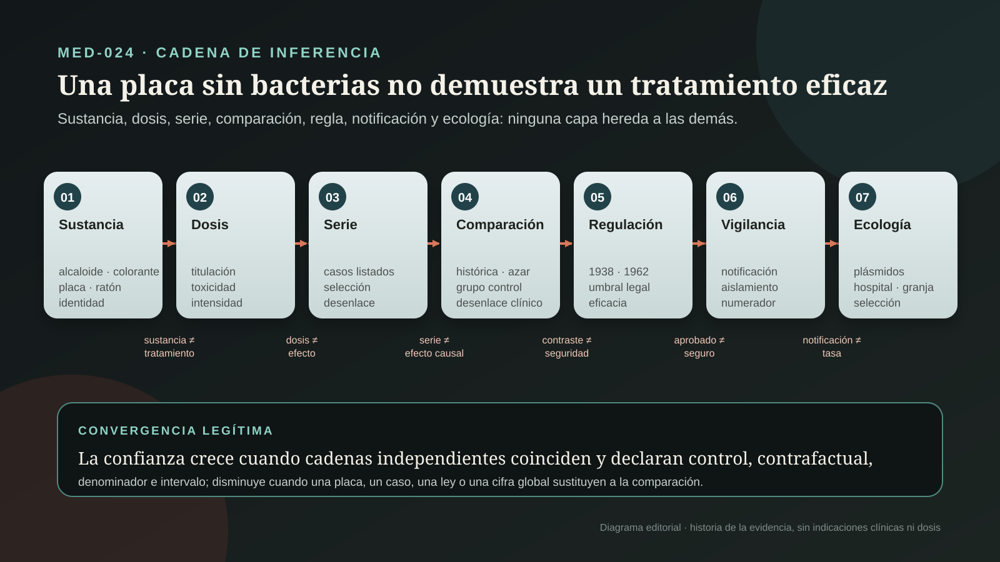
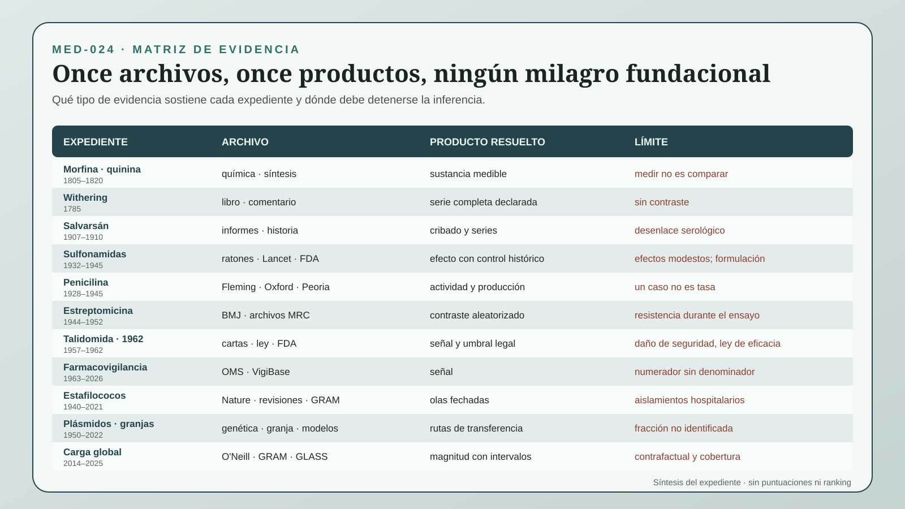

# MED-024 — Una placa sin bacterias no demuestra un tratamiento eficaz por sí sola

> **Alcance:** audita once expedientes entre 1785 y 2025: de la materia médica a la sustancia activa (morfina y quinina); la digital de Withering y su serie de 163 casos; la química industrial de Ehrlich y lo que mostraron las series del Salvarsán; las sulfonamidas (Domagk, el Instituto Pasteur, Colebrook y Kenny, los ensayos con control concurrente, el elixir de 1937 y la ley de 1938); la penicilina entre la placa de Fleming, Oxford, el caso de Albert Alexander y la producción en masa de la guerra; la estreptomicina y el ensayo del Medical Research Council de 1948; la talidomida y las enmiendas Kefauver-Harris de 1962; la farmacovigilancia; la resistencia de los estafilococos desde la penicilinasa de 1940 hasta el MRSA; plásmidos, uso agropecuario y Una Salud; y, como cierre metodológico, las cifras globales de carga de resistencia (O'Neill 2014, GRAM 2022 y 2024, GLASS 2025) con sus intervalos y modelos. Separa sustancia, dosis-respuesta, serie, comparación, regulación, vigilancia y ecología. Es historia y epistemología de la evidencia: **no contiene recomendaciones clínicas ni dosis prescriptivas**; las cantidades históricas se mencionan sólo cuando una fuente las da y sin pauta alguna (`CLAIM-MED-PHARM-NO-ADVICE-001`).

## Pregunta central

¿Cómo se pasó de cortezas, hojas y tintes a sustancias con dosis, comparadores, reglas y vigilancia, y de ahí a una ecología de la resistencia, sin confundir una sustancia activa en el laboratorio con un tratamiento eficaz, una titulación con una comparación, una serie con un efecto, una aprobación con seguridad, una notificación con una tasa ni una cifra global modelada con una observación?

## Respuesta breve

El fármaco moderno no nació con una molécula ni con un héroe. Sertürner aisló la morfina entre 1805 y 1817 y Pelletier y Caventou la quinina en 1820: el alcaloide puro permitió medir lo que se daba, pero medir no es comparar (`CLAIM-MED-PHARM-MORPHINE-1805-001`, `CLAIM-MED-PHARM-QUININE-1820-001`, `CLAIM-MED-PHARM-ALKALOID-STANDARD-001`). Withering publicó en 1785 una serie de 163 casos con la digital y declaró incluir los fracasos; ajustaba la cantidad contra el pulso. Fue una serie honesta, sin grupo de contraste (`CLAIM-MED-PHARM-WITHERING-1785-001`, `CLAIM-MED-PHARM-WITHERING-LIMIT-001`).

Ehrlich convirtió la búsqueda en cribado sistemático: el compuesto 606, el Salvarsán, se probó en decenas de pacientes por centro y se distribuyó en unas 65 000 dosis antes de que existiera una comparación; el desenlace intermedio era la reacción de Wassermann (`CLAIM-MED-PHARM-SALVARSAN-SERIES-001`, `CLAIM-MED-PHARM-SALVARSAN-SURROGATE-001`). Domagk protegió doce ratones de catorce controles muertos en 1932; Colebrook y Kenny compararon 64 puérperas tratadas con 76 previas (4.7 % frente a 25 % de muertes), con control histórico; los ensayos con control concurrente posteriores mostraron efectos mucho más modestos en otras infecciones (`CLAIM-MED-PHARM-DOMAGK-MICE-1932-001`, `CLAIM-MED-PHARM-COLEBROOK-1936-001`, `CLAIM-MED-PHARM-SULFA-CONCURRENT-001`). Un jarabe de sulfanilamida disuelta en dietilenglicol mató a 105 personas en 1937 y la ley estadounidense de 1938 exigió por primera vez prueba de seguridad antes de vender (`CLAIM-MED-PHARM-ELIXIR-1937-001`, `CLAIM-MED-PHARM-FDCA-1938-001`).

La penicilina tiene tres historias que el relato funde: una placa contaminada en 1928, ocho ratones y un policía en Oxford (1940–1941), y una industria de guerra que hacia septiembre de 1943 abastecía a las fuerzas aliadas. Albert Alexander mejoró y murió el 15 de marzo de 1941 porque se acabó el fármaco: un caso muestra actividad y escasez, no una tasa (`CLAIM-MED-PHARM-ALEXANDER-1941-001`, `CLAIM-MED-PHARM-MASS-PRODUCTION-001`). El ensayo del MRC de 1948 asignó la estreptomicina con números aleatorios en sobres cerrados porque no alcanzaba para todos: 4 muertes en 55 frente a 14 en 52 a seis meses, y resistencia emergente durante el tratamiento (`CLAIM-MED-PHARM-MRC-DESIGN-001`, `CLAIM-MED-PHARM-MRC-RESULT-001`, `CLAIM-MED-PHARM-MRC-RESISTANCE-001`).

La talidomida dañó a más de 10 000 niños; la respuesta estadounidense de 1962 exigió «evidencia sustancial» de eficacia por investigaciones adecuadas y bien controladas, una reforma que no corresponde uno a uno con el daño que la precipitó (`CLAIM-MED-PHARM-THALIDOMIDE-1957-001`, `CLAIM-MED-PHARM-KEFAUVER-1962-001`, `CLAIM-MED-PHARM-KEFAUVER-MISMATCH-001`). La farmacovigilancia acumuló más de 35 millones de notificaciones, pero la mediana de subnotificación estimada es de 94 %: una notificación es un numerador (`CLAIM-MED-PHARM-UNDERREPORTING-001`, `CLAIM-MED-PHARM-REPORT-NOT-RATE-001`).

La resistencia se describió antes del primer paciente: Abraham y Chain publicaron en 1940 una enzima bacteriana que destruía la penicilina. Fleming la advirtió en 1945 como un problema de dosis insuficiente del individuo; lo que siguió fue una ecología: estafilococos hospitalarios, MRSA desde 1961, plásmidos que transfieren varias resistencias, alimento animal con antibióticos y genes de 30 000 años (`CLAIM-MED-PHARM-PENICILLINASE-1940-001`, `CLAIM-MED-PHARM-FLEMING-WARNING-LIMIT-001`, `CLAIM-MED-PHARM-RESISTANCE-ECOLOGY-001`). Las cifras globales —10 millones de muertes al año en 2050 (O'Neill), 1.27 millones atribuibles en 2019 y 1.14 millones en 2021 (GRAM)— son modelos con contrafactuales e intervalos, no conteos (`CLAIM-MED-PHARM-DEKRAKER-2016-001`, `CLAIM-MED-PHARM-GRAM-COUNTERFACTUAL-001`).

La cadena legítima es **sustancia → dosis-respuesta → serie → comparación → regulación → vigilancia → ecología**. Ningún eslabón hereda la fuerza del siguiente.

## UNA PLACA SIN BACTERIAS NO DEMUESTRA UN TRATAMIENTO EFICAZ POR SÍ SOLA

### 1. Siete capas que deben conservarse

| Capa | Pregunta | Producto legítimo | Salto inválido |
|---|---|---|---|
| Sustancia | ¿qué se aisló, sintetizó o cultivó, y con qué pureza? | identidad química o biológica | convertir actividad en placa o en animal en tratamiento |
| Dosis-respuesta | ¿cómo cambian efecto y toxicidad con la cantidad? | intervalo exploratorio, titulación | leer intensidad o tolerancia como eficacia comparada |
| Serie | ¿cuántos pacientes, elegidos cómo, con qué desenlaces? | frecuencia delimitada | tomar una serie sin contraste como efecto |
| Comparación | ¿contra qué grupo, asignado cómo, con qué desenlace? | contraste explícito | ignorar controles históricos, selección y desenlaces intermedios |
| Regulación | ¿qué exigió la ley y qué dejó fuera? | umbral normativo | creer que aprobado equivale a seguro o eficaz para todos |
| Vigilancia | ¿qué se notifica, quién notifica y con qué denominador? | señal y numerador | convertir notificaciones en tasas o silencio en ausencia |
| Ecología | ¿qué presión selecciona, dónde y entre qué especies circulan los genes? | dinámica poblacional de microbios y genes | reducir la resistencia a un error individual |

### 2. Cuatro distinciones que el expediente no deja fundir

Una **sustancia** que inhibe bacterias en una placa o protege ratones no demuestra beneficio en personas (`CLAIM-MED-PHARM-SUBSTANCE-NOT-TREATMENT-001`); la misma advertencia que MED-022 hace sobre el agente aislado y el ensayo ACES, donde un antibiótico activo contra un organismo asociado no cambió los eventos coronarios (`CLAIM-MED-GERM-ACES-2005-001`). Una **dosis** ajustada a la respuesta de cada paciente describe tolerancia e intensidad, no cuánto mejor está el tratado que el no tratado (`CLAIM-MED-PHARM-DOSE-NOT-EFFECT-001`). Una **aprobación** fija un umbral legal en una fecha; la seguridad poblacional se descubre después, y mal, porque la vigilancia espontánea cuenta numeradores (`CLAIM-MED-PHARM-APPROVAL-NOT-SAFETY-001`, `CLAIM-MED-PHARM-REPORT-NOT-RATE-001`), la misma lección del numerador sin denominador de las muertes por cloroformo (`CLAIM-MED-ANES-NUMERATOR-ONLY-001`). La **resistencia** no es una propiedad de un frasco ni de un paciente descuidado: es una dinámica de poblaciones microbianas y de genes móviles entre hospitales, granjas y ambientes (`CLAIM-MED-PHARM-RESISTANCE-ECOLOGY-001`).

## ONCE EXPEDIENTES AUDITADOS

### 3. De la materia médica a la sustancia activa: morfina y quinina

Las farmacopeas y formularios que MED-006 y MED-011 auditaron organizaban plantas, pesos y sustituciones (`CLAIM-MED-EA-PHARMACOPOEIA-001`, `CLAIM-MED-ISLAMIC-PHARMACY-FORMULARY-001`); el remedio era una mezcla de sustancias activas e inertes en proporciones desconocidas. Friedrich Wilhelm Sertürner, aprendiz de boticario, aisló de la adormidera un principio cristalizable que llamó *morphium*; informó en cartas de 1805 y 1806 y en una tercera publicación de 1817, que obtuvo reconocimiento. Probó la sustancia en ratas y perros, en sí mismo y en tres voluntarios jóvenes con cantidades crecientes, y describió efectos graduados de euforia, somnolencia y confusión (`CLAIM-MED-PHARM-MORPHINE-1805-001`). Ese procedimiento es una exploración de dosis-respuesta con cuatro personas, no una serie clínica ni una comparación; la propia síntesis consultada recuerda que Sertürner murió dependiente de la morfina (`CLAIM-MED-PHARM-MORPHINE-DOSE-LIMIT-001`).

La corteza de *Cinchona* circulaba desde el siglo XVII, con la historia de crédito y saberes locales que MED-015 auditó (`CLAIM-MED-COL-BOT-CINCHONA-001`). En 1820 Pelletier y Caventou extrajeron, aislaron y nombraron la quinina, y la sustancia purificada reemplazó a la corteza como estándar (`CLAIM-MED-PHARM-QUININE-1820-001`). El alcaloide permitió algo que la corteza no permitía: dar la misma sustancia, medida, en lugares distintos. Ésa es la condición de cualquier comparación posterior, pero no es una comparación: estandarizar la sustancia no prueba que funcione mejor que la corteza ni que nada (`CLAIM-MED-PHARM-ALKALOID-STANDARD-001`).

### 4. Withering y la digital (1785): una serie honesta

William Withering publicó en 1785 *An Account of the Foxglove*. Según el comentario de Tröhler en la James Lind Library, había reunido 19 casos de hidropesía antes de 1779 y esperó a tener 156 de su práctica privada y 7 del hospital de Birmingham —163 en total— para publicar; declaró mencionar todos los casos, «apropiados o inapropiados, exitosos o no», porque seleccionar los éxitos lo habrían condenado «la verdad y la ciencia» (`CLAIM-MED-PHARM-WITHERING-1785-001`). La cantidad se determinaba por titulación contra el pulso (`CLAIM-MED-PHARM-WITHERING-TITRATION-001`).

Withering vio lo que hoy se llama sesgo de publicación y advirtió que sus pacientes probablemente estaban más graves que los de otros médicos. Su serie sirvió para distinguir qué pacientes se beneficiaban; pero no tenía grupo de contraste, la hidropesía era un síndrome con causas heterogéneas y el ajuste individual de la cantidad hace imposible separar efecto, selección y evolución espontánea (`CLAIM-MED-PHARM-WITHERING-LIMIT-001`). La historia de la anciana campesina que le señaló la planta se menciona en las fuentes consultadas; su forma popular no se audita aquí.

### 5. Química industrial y «balas mágicas»: Ehrlich y el Salvarsán

Paul Ehrlich organizó la síntesis de muchas estructuras químicas y su cribado en modelos animales, y difundió las ideas de quimiorreceptor, quimioterapia y «bala mágica» (`CLAIM-MED-PHARM-EHRLICH-SCREENING-001`). Alfred Bertheim sintetizó en 1907 la arsfenamina, el compuesto 606; los asistentes que la probaron primero contra espiroquetas la juzgaron inútil, y Sahachiro Hata, al repetir los experimentos, la encontró superior; se comercializó como Salvarsán en 1910 (`CLAIM-MED-PHARM-EHRLICH-606-001`).

Lo que mostraron las series es más modesto que el mito. Las pruebas en pacientes empezaron en la primavera de 1909 en Uchtspringe, Magdeburgo, Bonn, San Petersburgo y Pavía; Alt informó 31 pacientes con parálisis progresiva, 7 de los cuales perdieron por completo la reacción de Wassermann positiva, y llamó «prematuro» un juicio con números tan pequeños; Wechselmann informó 80 casos. Hacia fines de 1910 se habían distribuido unas 65 000 dosis a más de 20 000 pacientes, una escala sin precedente antes de la comercialización (`CLAIM-MED-PHARM-SALVARSAN-SERIES-001`). El desenlace que se contaba era serológico: una prueba de laboratorio que sustituía a la curación, la clase de marcador intermedio cuyo riesgo MED-001 documenta (`CLAIM-MED-PHARM-SALVARSAN-SURROGATE-001`, `CLAIM-MED-SURROGATE-CAST-001`). Hubo fiebre y escalofríos atribuidos a bacterias muertas en el agua destilada, toxicidad mayor en ciertos pacientes y un capítulo entero de «casos fatales» en la monografía británica de McDonagh; durante la guerra, la equivalencia del producto británico con el alemán se afirmó sin una comparación válida (`CLAIM-MED-PHARM-SALVARSAN-TOXICITY-001`).

### 6. Sulfonamidas: ratones, una molécula escondida, un control histórico y un jarabe

En diciembre de 1932, en Bayer, Gerhard Domagk inyectó estreptococos virulentos a 26 ratones; dio un colorante rojo a 12 y dejó 14 como controles. Los 14 controles murieron en cuatro días y los 12 tratados sobrevivieron (`CLAIM-MED-PHARM-DOMAGK-MICE-1932-001`). No publicó hasta 1935, y la explicación más probable del retraso es el secreto vinculado a patentes (`CLAIM-MED-PHARM-DOMAGK-DELAY-001`). En el Instituto Pasteur, Tréfouël y sus colegas, a quienes Bayer negó el producto, lo sintetizaron y propusieron que el Prontosil se escindía en una parte colorante sin valor terapéutico y en la sulfanilamida, probable agente activo; el tiempo les dio la razón (`CLAIM-MED-PHARM-TREFOUEL-1935-001`). La molécula patentada no era la sustancia activa: un caso limpio de sustancia distinta del producto.

En el Queen Charlotte's Hospital de Londres, Colebrook y Kenny trataron en 1936 a 38 mujeres con fiebre puerperal: 3 murieron (8 %), frente a 10 de las 38 inmediatamente anteriores (26.3 %) y 9 de las 38 previas (23.7 %); con su tercera serie, 8 muertes en 64 tratadas (4.7 %) frente a 19 en 76 (25 %) antes del fármaco (`CLAIM-MED-PHARM-COLEBROOK-1936-001`). El control era histórico, y Colebrook mismo temió que la virulencia del estreptococo estuviera bajando; las indagaciones encontraron algo de eso, aunque no bastante para explicar la caída. Loudon concluye que los controles históricos bastaron para efectos dramáticos como éste y el de la meningitis, y engañaban con efectos moderados (`CLAIM-MED-PHARM-COLEBROOK-LIMIT-001`). La caída de la mortalidad materna occidental hacia 1937, que MED-023 registra como el fin de una meseta, encaja con esa lectura sin aislar por sí sola el fármaco (`CLAIM-MED-CARE-LOUDON-PLATEAU-001`).

Entre 1936 y 1945 hubo ensayos con control concurrente, por alternancia: en erisipela (312 con Prontosil y 270 con sulfanilamida frente a luz ultravioleta) mejoraron la extensión de la lesión y la fiebre, sin conclusión sobre mortalidad; en neumonía, beneficios en fiebre y recuperación sin conclusión firme sobre muertes; en sarampión no se detectó efecto en la mortalidad; en escarlatina, ningún beneficio; en infecciones intestinales, resultados decepcionantes (`CLAIM-MED-PHARM-SULFA-CONCURRENT-001`). La misma familia de sustancias produjo efectos dramáticos, modestos y nulos según la enfermedad: «las sulfas funcionan» no es una afirmación delimitada.

En 1937 la empresa S. E. Massengill vendió en Estados Unidos un «Elixir Sulfanilamide» en el que el disolvente era dietilenglicol; 105 pacientes murieron por su uso terapéutico, y la ley vigente no exigía pruebas de toxicidad antes de vender (`CLAIM-MED-PHARM-ELIXIR-1937-001`). El Congreso aprobó en 1938 la Federal Food, Drug, and Cosmetic Act, que exigió prueba de seguridad antes de comercializar un medicamento nuevo y convirtió a la FDA de agencia que decomisaba productos adulterados en agencia que evaluaba fármacos nuevos (`CLAIM-MED-PHARM-FDCA-1938-001`). La sustancia activa no mató a nadie en ese desastre: lo hizo la formulación. Regulación y sustancia son capas distintas.

### 7. Penicilina: la placa de 1928, Oxford y la guerra

Fleming describió en su conferencia Nobel de 1945 el origen: un moho contaminó una placa de estafilococos y alrededor de su colonia las bacterias se volvieron translúcidas; aisló el hongo, determinó propiedades, lo encontró aparentemente no tóxico para animales y leucocitos, y fracasó al concentrar y estabilizar la sustancia. Insistió en que fue un azar y no el fruto de una búsqueda dirigida. Su artículo de 1929 se tituló, con precisión, sobre la acción antibacteriana de cultivos de un *Penicillium* «con especial referencia a su uso en el aislamiento de *B. influenzae*» (`CLAIM-MED-PHARM-FLEMING-1928-001`). La placa demostraba actividad de una sustancia en cultivo; no demostraba tratamiento.

Gaynes describe el «mito Fleming»: en agosto de 1942 *The Times* atribuyó la penicilina a Oxford sin nombrar a nadie; Almroth Wright, jefe de Fleming, reclamó para él la «corona de laurel»; Florey prohibió entrevistas a su equipo mientras Fleming hablaba con la prensa (`CLAIM-MED-PHARM-FLEMING-NARRATIVE-001`). En Oxford, Chain encontró el artículo de 1929, Norman Heatley cultivó el hongo en grandes cantidades y Chain purificó el compuesto. Ocho ratones recibieron un estreptococo virulento; los cuatro tratados vivían a la mañana siguiente y los cuatro controles habían muerto. El trabajo se publicó en *The Lancet* en agosto de 1940 (`CLAIM-MED-PHARM-OXFORD-MICE-001`). Gaynes imprime la fecha del experimento como 25 de mayo de 1939, en tensión con la cronología habitual que lo sitúa en 1940; este expediente no fijó la fecha contra los cuadernos de laboratorio.

El 12 de febrero de 1941 Charles Fletcher inyectó penicilina a Albert Alexander, policía con infección grave y abscesos múltiples. Mejoró de forma notable; el equipo recuperó penicilina de su orina para volver a dársela, pero hacia el quinto día no quedaba. Murió el 15 de marzo de 1941. La historia del rasguño de un rosal resultó falsa (`CLAIM-MED-PHARM-ALEXANDER-1941-001`). El caso abre la serie de Abraham y colaboradores publicada ese año en *The Lancet*; leído solo, muestra actividad clínica y escasez, no una tasa de curación, y su muerte no falsa el fármaco (`CLAIM-MED-PHARM-ALEXANDER-LIMIT-001`).

En junio de 1941 Florey y Heatley viajaron a Peoria, Illinois, al laboratorio del Departamento de Agricultura. Thom identificó el hongo de Fleming como *P. notatum*; para la producción se usó *P. chrysogenum* de un melón mohoso, que producía seis veces más; Moyer propuso el licor de maceración de maíz como medio; con la entrada de Estados Unidos en la guerra, el gobierno coordinó la producción y las empresas adoptaron la fermentación en tanques profundos. En 1941 no había bastante penicilina para tratar a un solo paciente en Estados Unidos; a fines de 1942, para menos de cien; hacia septiembre de 1943 cubría las demandas de las fuerzas armadas aliadas (`CLAIM-MED-PHARM-MASS-PRODUCTION-001`). La escala industrial y la prioridad militar decidieron quién recibía el fármaco antes de que hubiera comparaciones formales; la urgencia distribuye, no prueba (`CLAIM-MED-PHARM-PRODUCTION-NOT-EVIDENCE-001`). El Nobel de 1945 premió a Fleming, Chain y Florey; Heatley, sin quien no habría habido sustancia para ratones ni para Alexander, quedó fuera (`CLAIM-MED-PHARM-NOBEL-CREDIT-001`).

### 8. Estreptomicina y el ensayo del MRC de 1948

Schatz, Bugie y Waksman publicaron en 1944 la estreptomicina, activa contra bacterias grampositivas y gramnegativas (`CLAIM-MED-PHARM-STREPTOMYCIN-1944-001`). Albert Schatz, el estudiante que hizo la prueba decisiva, demandó a la universidad, obtuvo un acuerdo extrajudicial y reclamó parte del Nobel de 1952, que fue sólo para Waksman. Kingston sostiene que, en un cribado sistemático y rutinario de actinomicetos financiado por Merck, el crédito corresponde a quien dirige el programa; otros lo leen como un caso de crédito mal asignado. La disputa, como la del éter en MED-021, depende de qué se premie (`CLAIM-MED-PHARM-SCHATZ-CREDIT-001`, `CLAIM-MED-ANES-PRIORITY-DEFINITION-001`).

El Medical Research Council recibió 50 kilogramos de estreptomicina estadounidense, ofrecidos en noviembre de 1946 por 320 000 dólares; la demanda pública superaba con mucho la oferta (`CLAIM-MED-PHARM-MRC-SCARCITY-001`). Austin Bradford Hill preparó series de números aleatorios por sexo y centro, guardadas en sobres cerrados con sólo el nombre del hospital y un número; el sobre se abría en la oficina central después de que un comité aceptaba al paciente, y decía si sería caso S (estreptomicina y reposo) o C (sólo reposo). Ni los investigadores ni el coordinador conocían la serie, y los controles no supieron que lo eran (`CLAIM-MED-PHARM-MRC-DESIGN-001`). Se asignaron 55 pacientes a estreptomicina y 52 a reposo; a seis meses habían muerto 4 y 14 (7 % frente a 27 %), una razón de 3.70 y un chi cuadrado de 7.38 en el reanálisis de Armitage; Crofton, en su recuerdo de 2004, da 15 muertes entre los controles (`CLAIM-MED-PHARM-MRC-RESULT-001`).

Lo que cambió no fue sólo el resultado. Yoshioka muestra que la palabra «aleatorio» no aparece en los archivos del MRC sobre estreptomicina de 1946: la asignación por números resolvía la equidad de una admisión escasa y quitaba al clínico la responsabilidad de elegir, y la alternancia que Hill había usado antes dejaba adivinar el grupo siguiente. El ensayo «no fue tan novedoso» como suele contarse: Amberson había echado una moneda en 1931 para decidir qué grupo de 24 pacientes recibía sanocrisina, y Feldman y Hinshaw usaron monedas dentro de pares en 1944 (`CLAIM-MED-PHARM-MRC-NOT-FIRST-001`). MED-020 audita la genealogía de esos contrastes; MED-029 auditará la institucionalización de los ensayos.

Y apareció la ecología dentro del ensayo: a seis meses se cultivaban bacilos del esputo de 47 de 55 tratados y 50 de 52 controles; el deterioro del grupo tratado coincidió con la resistencia a la estreptomicina, sobre todo después del cuarto mes, y el MRC acortó el tratamiento a cuatro meses. La combinación con ácido paraaminosalicílico resultó más eficaz que cada uno y redujo la resistencia (Daniels y Hill, 1952). En los seis meses siguientes murieron 8 más entre los tratados y 9 más entre los controles (`CLAIM-MED-PHARM-MRC-RESISTANCE-001`). El primer gran ensayo aleatorizado de un antibiótico fue también una de las primeras mediciones controladas de resistencia adquirida.

### 9. Talidomida y Kefauver-Harris (1957–1962)

Chemie Grünenthal lanzó la talidomida a fines de los cincuenta como sedante no barbitúrico; se usó contra las náuseas del embarazo, se vendió en 46 países con distintos nombres, se anunció como completamente segura y se repartió en muestras médicas (`CLAIM-MED-PHARM-THALIDOMIDE-1957-001`). McBride en Australia, en una carta a *The Lancet* de diciembre de 1961, y Lenz en Alemania, en 1962, la señalaron de forma independiente como causa de malformaciones graves; se retiró del Reino Unido en noviembre de 1961 y de casi todo el mundo en 1962. Más de 10 000 niños nacieron con malformaciones, la mortalidad infantil de los casos graves llegó a 40 % y el número real nunca se conocerá (`CLAIM-MED-PHARM-MCBRIDE-LENZ-001`). Que dos clínicos llegaran por separado a la misma asociación es una convergencia de series, no un experimento; la evidencia de causalidad se completó después con modelos animales sensibles.

Esa sensibilidad es el punto: los ratones, usados de rutina en el cribado, son menos sensibles a la talidomida que primates no humanos o conejos; el desastre mostró que las diferencias entre especies existen en la respuesta a fármacos, y el cribado posterior incorporó varias especies y pruebas *in vitro* (`CLAIM-MED-PHARM-THALIDOMIDE-SPECIES-001`). Qué pruebas hizo Grünenthal y cuándo supo sigue en disputa. En Estados Unidos no se aprobó entre 1957 y 1962: Frances Kelsey, de la FDA, dudó por la neuropatía periférica notificada y por los efectos en el embarazo (`CLAIM-MED-PHARM-KELSEY-001`).

Kennedy firmó el 10 de octubre de 1962 las Drug Amendments (Pub. L. 87-781). La ley definió «evidencia sustancial» como evidencia de investigaciones adecuadas y bien controladas, incluidas las clínicas, por expertos calificados, sobre las cuales pudiera concluirse con justicia y responsabilidad que el fármaco tiene el efecto que pretende; exigió informar y obtener el consentimiento de los sujetos de investigación con excepciones cuando los investigadores lo juzgaran no factible o contrario a su interés; y añadió registros e informes sobre la experiencia con antibióticos (`CLAIM-MED-PHARM-KEFAUVER-1962-001`). La FDA encargó a la Academia Nacional de Ciencias revisar más de 3 400 medicamentos aprobados sólo por seguridad entre 1938 y 1962 (DESI); los que carecían de evidencia sustancial para alguna indicación podían perder la aprobación, y algunos procedimientos siguen abiertos (`CLAIM-MED-PHARM-DESI-001`).

La talidomida fue un daño de seguridad y de cribado preclínico; la ley que su escándalo hizo aprobable exigió sobre todo **eficacia**. Contar la ley de 1962 como «la respuesta a la talidomida» comprime dos cadenas: la del daño no detectado y la del beneficio no demostrado (`CLAIM-MED-PHARM-KEFAUVER-MISMATCH-001`). Y la aprobación, con o sin evidencia sustancial, sigue siendo un umbral en una fecha (`CLAIM-MED-PHARM-APPROVAL-NOT-SAFETY-001`).

### 10. Farmacovigilancia: notificaciones sin denominador

La 16.ª Asamblea Mundial de la Salud pidió en 1963 recoger sistemáticamente información sobre reacciones adversas graves; el Programa de la OMS para la Vigilancia Internacional de Medicamentos se formó en 1968, el centro de Uppsala asumió su trabajo técnico en 1978 y hoy declara 163 miembros plenos y 19 asociados; VigiBase superaba en julio de 2023 los 35 millones de notificaciones (`CLAIM-MED-PHARM-WHO-PIDM-1968-001`). La propia OMS describe esos datos como medio para detectar «riesgos potenciales». Una revisión sistemática de 37 estudios de 12 países estimó una mediana de subnotificación de 94 % (rango intercuartílico 82–98 %), todavía de 85 % para combinaciones graves específicas (`CLAIM-MED-PHARM-UNDERREPORTING-001`). Una base de notificaciones es un numerador seleccionado por quien sospecha y quien escribe: sirve para generar señales, no para estimar tasas ni comparar fármacos (`CLAIM-MED-PHARM-REPORT-NOT-RATE-001`).

### 11. Resistencia de los estafilococos: de la penicilinasa al MRSA

En 1940, antes del primer paciente de Oxford, Abraham y Chain describieron una enzima de una bacteria (*E. coli*) capaz de destruir la penicilina (`CLAIM-MED-PHARM-PENICILLINASE-1940-001`). En 1944 Kirby extrajo un inactivador potente de 7 cepas de *Staphylococcus aureus* naturalmente resistentes y no lo encontró en 7 sensibles (`CLAIM-MED-PHARM-KIRBY-1944-001`). La resistencia no fue una sorpresa posterior: era un dato de laboratorio desde el principio.

Fleming dijo en Estocolmo en 1945 que no era difícil hacer microbios resistentes en el laboratorio exponiéndolos a concentraciones insuficientes, que había ocurrido «ocasionalmente» en el cuerpo, e inventó a «Mr. X», que compra penicilina, se la da en cantidad insuficiente, «educa» a sus estreptococos y contagia a su esposa, que muere: la moraleja era usar bastante (`CLAIM-MED-PHARM-FLEMING-WARNING-1945-001`). La advertencia fue real y su modelo, limitado: atribuía la resistencia a la conducta de un individuo y a una adaptación de los microbios; lo que siguió fue selección de cepas resistentes en hospitales, enzimas codificadas en plásmidos y transferencia entre bacterias y entre especies huésped, procesos que no dependen de que cada paciente «use bastante» (`CLAIM-MED-PHARM-FLEMING-WARNING-LIMIT-001`).

Chambers y DeLeo describen olas: estafilococos resistentes a la penicilina en hospitales desde mediados de los cuarenta, con penicilinasa codificada en plásmidos, que en una década pasaron a la comunidad; el linaje de fago 80/81, pandémico en los cincuenta y sesenta y casi desaparecido a inicios de los sesenta; los primeros informes de resistencia a la meticilina en 1961 (la cepa COL se aisló en 1960 en Colindale), con el gen *mecA* identificado más de veinte años después dentro de un casete móvil; brotes hospitalarios de MRSA desde fines de los setenta, endémicos hacia mediados de los ochenta; y MRSA comunitario desde los noventa (`CLAIM-MED-PHARM-STAPH-WAVES-001`). Jevons publicó en el *BMJ* de 1961 los estafilococos resistentes al «Celbenin» (`CLAIM-MED-PHARM-JEVONS-1961-001`). En el modelo GRAM, las muertes atribuibles al MRSA pasaron de 57 200 (34 100–80 300) en 1990 a 130 000 (113 000–146 000) en 2021 (`CLAIM-MED-PHARM-MRSA-BURDEN-001`).

### 12. Plásmidos, granjas y Una Salud

A fines de los cincuenta, en Japón, se encontraron *Shigella* de disentería resistentes a la vez a sulfonamida, estreptomicina, cloranfenicol y tetraciclina, y se mostró que esa resistencia múltiple pasaba a otras bacterias por contacto celular; Watanabe la sintetizó en 1963 como «herencia infecciosa» llevada por un episoma (`CLAIM-MED-PHARM-WATANABE-1963-001`). Datta y Hughes examinaron en 1983 la colección Murray, aislada entre 1917 y 1954: había plásmidos conjugativos en más de 20 % de las cepas; de 84 establecidos en *E. coli*, ninguno llevaba determinantes de resistencia y 65 pertenecían a los mismos grupos de incompatibilidad que los plásmidos R modernos. La resistencia médica se adquirió sobre todo insertando genes nuevos en plásmidos que ya existían (`CLAIM-MED-PHARM-DATTA-1983-001`). D'Costa y colaboradores hallaron en sedimentos de permafrost de Beringia de 30 000 años, con ADN antiguo autenticado, genes de resistencia a betalactámicos, tetraciclinas y glucopéptidos, incluido un elemento VanA similar al moderno (`CLAIM-MED-PHARM-DCOSTA-2011-001`).

Las dos evidencias no se contradicen: los genes son antiguos y la carga clínica es moderna. El origen de un gen no es el origen de su frecuencia en patógenos humanos; ésta depende de la presión de selección y de los vehículos que lo mueven (`CLAIM-MED-PHARM-ANCIENT-VS-SELECTED-001`).

Los antibióticos entraron masivamente en la ganadería a inicios de los cincuenta para acelerar el crecimiento y ahorrar alimento. En Gran Bretaña, expertos que usaban la tipificación por fagos advirtieron que las granjas seleccionaban resistencia, y el informe Swann de 1969 respondió desde un sistema corporativista acostumbrado a regular poco (`CLAIM-MED-PHARM-SWANN-1969-001`). En 1976, Levy y colaboradores introdujeron alimento con tetraciclina en una granja: en una semana la flora de los pollos era casi toda resistente; en cinco a seis meses, 31.3 % de las muestras semanales de los habitantes de la granja tenían más de 80 % de bacterias resistentes, frente a 6.8 % en sus vecinos; 7 de 11 habitantes y 3 de 24 vecinos tuvieron dos o más muestras así, con plásmidos transferibles de resistencia múltiple (`CLAIM-MED-PHARM-LEVY-1976-001`). Es un estudio prospectivo pequeño en una granja, con un contraste concurrente: muestra que la presión de selección cruza de animales a personas en contacto, no cuánto de la carga humana viene de las granjas.

Van Boeckel y colaboradores estimaron con modelos bayesianos un consumo veterinario mundial de 63 151 ± 1 560 toneladas en 2010 y proyectaron 105 596 ± 3 605 en 2030 (+67 %), con los países de ingreso medio como motor; el modelo extrapola desde datos de países de ingresos altos (`CLAIM-MED-PHARM-VANBOECKEL-2015-001`). En 2015, una vigilancia de rutina en China encontró resistencia a la colistina transferible por plásmido (*mcr-1*) en *E. coli* de un cerdo; entre 2011 y 2014 el gen estaba en 15 % de 523 muestras de carne cruda, 21 % de 804 animales y 1 % de 1 322 pacientes hospitalizados con infección (`CLAIM-MED-PHARM-MCR1-2016-001`). FAO, PNUMA, OMS y la Organización Mundial de Sanidad Animal lanzaron el 17 de octubre de 2022 el Plan de Acción Conjunto Una Salud 2022–2026 (`CLAIM-MED-PHARM-ONE-HEALTH-2022-001`). Una Salud es un marco de coordinación, no una medición: que humanos, animales y ambiente compartan genes no fija qué fracción de la carga humana procede de cada compartimento.

### 13. Cuánto mata la resistencia: cifras globales como cierre metodológico

El informe O'Neill (2014), encargado por el gobierno británico, estimó que la resistencia podría causar 10 millones de muertes al año en 2050 (`CLAIM-MED-PHARM-ONEILL-2014-001`). De Kraker, Stewardson y Harbarth mostraron en 2016 por qué la cifra no era una estimación robusta: el número de infecciones se extrapoló desde EARS-Net, una red no poblacional sesgada hacia hospitales terciarios, y para países sin datos se multiplicaron tasas europeas por población; las infecciones en otros sitios se derivaron con razones tomadas de dos estudios con 12 y 4 bacteriemias; las razones de momios no se tradujeron en mortalidad atribuible; los escenarios de 2050 (aumento absoluto de 40 puntos o resistencia de 100 %, con infecciones estables o duplicadas) no tenían apoyo empírico; y nada se publicó con revisión por pares ni con intervalos (`CLAIM-MED-PHARM-DEKRAKER-2016-001`).

El estudio GRAM respondió con otro método. En 2019 estimó 4.95 millones (3.62–6.57) de muertes asociadas a la resistencia bacteriana y 1.27 millones (0.911–1.71) atribuibles, con 23 patógenos, 88 combinaciones patógeno-fármaco y 204 países, a partir de 471 millones de registros o aislamientos (`CLAIM-MED-PHARM-GRAM-2022-001`). «Atribuible» y «asociada» son dos contrafactuales: la primera compara con un mundo en que las infecciones resistentes fueran sensibles; la segunda, con uno en que esas infecciones no ocurrieran (`CLAIM-MED-PHARM-GRAM-COUNTERFACTUAL-001`). Las cifras se modelan en cinco componentes —muertes con infección, síndrome, patógeno, porcentaje resistente y exceso de riesgo— y se producen también para lugares sin datos, con intervalos de 1 000 extracciones posteriores; los autores declaran graves vacíos en países de bajos ingresos (`CLAIM-MED-PHARM-GRAM-MODEL-001`).

La actualización de 2024 estimó para 2021 4.71 millones (4.23–5.19) asociadas y 1.14 millones (1.00–1.28) atribuibles; entre 1990 y 2021 las muertes por resistencia bajaron más de 50 % en menores de cinco años y subieron más de 80 % en mayores de setenta; la previsión de referencia para 2050 es de 1.91 millones (1.56–2.26) atribuibles y 8.22 millones (6.85–9.65) asociadas (`CLAIM-MED-PHARM-GRAM-2024-001`). Que 2021 quede por debajo de 2019 no es una tendencia: las dos cifras vienen de rondas con distintos patógenos (22 frente a 23), combinaciones (84 frente a 88) y datos, y los intervalos se superponen; la previsión de 2050 es un escenario probabilístico condicionado al modelo, no una observación futura (`CLAIM-MED-PHARM-GRAM-FORECAST-LIMIT-001`). Hasta la fecha de corte de este expediente (25 de noviembre de 2026) no se localizó una nueva estimación global de GRAM con datos posteriores a 2021; las publicaciones de 2025 consultadas son regionales o de vigilancia.

La OMS publicó el 13 de octubre de 2025 su informe de vigilancia GLASS: en 2023, una de cada seis infecciones bacterianas comunes confirmadas en laboratorio fue resistente; 104 países notificaron; entre 2018 y 2023 la resistencia subió en más de 40 % de las combinaciones vigiladas, con aumentos medios anuales de 5 a 15 %; uno de cada tres en las regiones de Asia Sudoriental y Mediterráneo Oriental; y 48 % de los países no notificó, mientras cerca de la mitad de los que sí lo hicieron carecía de sistemas para datos fiables (`CLAIM-MED-PHARM-GLASS-2025-001`). Esa proporción es de aislamientos de laboratorio, no de infecciones en la población: depende de a quién se cultiva. Si sólo se cultiva a los más graves o a los que no respondieron al tratamiento empírico, la proporción resistente sube aunque la incidencia no cambie (`CLAIM-MED-PHARM-SURVEILLANCE-NOT-PREVALENCE-001`).

Las cifras globales cierran el expediente porque repiten, a otra escala, todas sus lecciones: una proporción no es una tasa, una asociación no es una atribución, un modelo no es un conteo, y un intervalo es parte de la afirmación, no un adorno (`CLAIM-MED-PHARM-CHAIN-001`, `CLAIM-MED-PHARM-NONRANKING-001`).

## LO OBSERVADO

- alcaloides cristalizados, compuestos numerados, colorantes y caldos de cultivo;
- autoexperimentos, series de casos declaradas completas y series seleccionadas;
- experimentos con ratones protegidos y controles muertos; placas con zonas de inhibición;
- comparaciones con control histórico y con asignación concurrente por alternancia o por números aleatorios;
- leyes, definiciones legales, revisiones administrativas y retiradas del mercado;
- notificaciones espontáneas de reacciones adversas y cartas que señalan una asociación;
- enzimas que destruyen antibióticos, cepas resistentes, plásmidos en colecciones antiguas y genes en permafrost;
- consumo de antibióticos en ganadería, flora de granjeros, genes de resistencia en carne y animales;
- informes de vigilancia y estimaciones modeladas de carga global.

## LO MEDIDO

- muertes y supervivientes en grupos de ratones y de pacientes (Domagk, Oxford, Colebrook y Kenny, MRC);
- reacciones de Wassermann, cultivos de esputo, resistencia en cultivo;
- proporción de muestras con flora resistente en personas expuestas y no expuestas (Levy);
- toneladas de antimicrobianos estimadas por modelo; prevalencia de *mcr-1* en muestras;
- notificaciones acumuladas y porcentaje de subnotificación estimado;
- muertes atribuibles y asociadas por modelo, con intervalos de incertidumbre;
- proporción de aislamientos resistentes notificados a GLASS;
- no el efecto causal aislado de cada fármaco histórico en cada enfermedad, ni la fracción de la carga humana debida a la ganadería.

## LO INFERIDO

Que varios antimicrobianos —sulfonamidas en la fiebre puerperal y la meningitis, penicilina, estreptomicina en la tuberculosis pulmonar— redujeron la mortalidad de infecciones concretas es la inferencia más probable, sostenida por la convergencia de efectos grandes en controles históricos, mecanismos de laboratorio y, en el caso de la estreptomicina, por un contraste aleatorizado. Que la resistencia es una consecuencia ecológica previsible del uso de antimicrobianos en personas y animales, montada sobre genes antiguos y vehículos móviles, se infiere de la convergencia de cultivo, genética de plásmidos, estudios de granja y vigilancia. La magnitud global de la carga es una inferencia de modelo con intervalos amplios (`CLAIM-MED-PHARM-CHAIN-001`, `CLAIM-MED-PHARM-RESISTANCE-ECOLOGY-001`, `CLAIM-MED-PHARM-GRAM-MODEL-001`).

## LOS SUPUESTOS

- que los controles históricos de Colebrook y Kenny no difieren en gravedad o virulencia de forma suficiente para explicar la caída;
- que los desenlaces se contaron igual en los grupos comparados;
- que un desenlace serológico o de cultivo informa algo sobre el desenlace clínico;
- que un modelo animal es sensible al daño humano que se busca;
- que la notificación espontánea, pese a su sesgo, capta señales graves;
- que los aislamientos de laboratorio representan algo de las infecciones de la población;
- que las razones de riesgo y los componentes del modelo GRAM son trasladables entre lugares con y sin datos.

## LAS INCERTIDUMBRES

- el tamaño del efecto de cada fármaco histórico fuera de los pocos contrastes controlados;
- la fecha exacta del experimento de Oxford con ocho ratones (1939 en Gaynes, 1940 en la cronología habitual);
- el número de muertes del grupo control del MRC a seis meses (14 en el informe y el reanálisis; 15 en el recuerdo de Crofton);
- qué pruebas hizo Grünenthal y cuándo supo;
- la proporción real de reacciones adversas que nunca se notifican, por país y por fármaco;
- la fracción de resistencia humana atribuible a la ganadería y al ambiente;
- la carga de resistencia en países sin laboratorios, que el modelo rellena.

## LAS ALTERNATIVAS

- una caída de la mortalidad tras un fármaco puede deberse a menor virulencia, mejor cuidado o selección de pacientes;
- un desenlace serológico puede mejorar sin que mejore la enfermedad;
- un modelo animal negativo puede deberse a la especie, no a la ausencia de daño;
- una disminución de notificaciones puede reflejar menos notificación, no menos daño;
- la resistencia en un hospital puede llegar por transmisión de cepas, no por selección local;
- una cifra global distinta puede deberse a un cambio de método, no del mundo.

## QUÉ PODEMOS COMPARAR

| Expediente | Archivo dominante | Producto mejor resuelto | Límite decisivo |
|---|---|---|---|
| Morfina y quinina | publicaciones químicas; síntesis históricas | sustancia aislada y medible | autoexperimento no es serie |
| Withering | libro de 1785; comentario de Tröhler | serie completa declarada | sin contraste; titulación individual |
| Salvarsán | informes clínicos de 1909–1910; historia | cribado químico y series multicéntricas | desenlace serológico; toxicidad |
| Sulfonamidas | ratones de Domagk; Colebrook y Kenny; Loudon; FDA | efecto dramático con control histórico | efectos modestos en otras infecciones; formulación letal |
| Penicilina | Fleming, *Lancet* 1940 y 1941, historia | actividad, protección animal, producción | un caso no es tasa; urgencia no es prueba |
| Estreptomicina | *BMJ* 1948; Yoshioka; Armitage; Crofton | contraste aleatorizado y resistencia medida | un ensayo, un desenlace temprano |
| Talidomida y 1962 | cartas de 1961–1962; ley; FDA | señal clínica y umbral legal de eficacia | daño de seguridad, ley de eficacia |
| Farmacovigilancia | OMS; revisión de subnotificación | señal | numerador sin denominador |
| Estafilococos | Abraham y Chain; Kirby; Chambers y DeLeo; GRAM | olas de resistencia fechadas | proporciones hospitalarias no poblacionales |
| Plásmidos y granjas | Watanabe; Datta; D'Costa; Levy; Van Boeckel; Liu | mecanismos y rutas de transferencia | fracción de la carga no identificada |
| Carga global | O'Neill; de Kraker; GRAM; GLASS | magnitud modelada con intervalos | contrafactual, modelo y cobertura |

Comparar aquí significa declarar tipo de evidencia, población, contraste, desenlace y daño. No reparte medallas de prioridad ni de progreso (`CLAIM-MED-PHARM-NONRANKING-001`).

## QUÉ NO PODEMOS CONCLUIR

- que aislar una sustancia demuestra su utilidad clínica;
- que la serie de Withering demuestra el efecto de la digital;
- que el Salvarsán curaba porque negativizaba la reacción de Wassermann;
- que «las sulfas» tuvieron un efecto uniforme en toda infección;
- que Fleming descubrió un tratamiento en 1928;
- que la muerte de Albert Alexander falsó la penicilina;
- que el ensayo del MRC fue el primer uso del azar en medicina;
- que la ley de 1962 fue sólo la respuesta a la talidomida, o que un fármaco aprobado es seguro;
- que una base de notificaciones mide riesgos;
- que la resistencia nace del mal uso individual o que es sólo moderna;
- que la carga global de 2021 es menor que la de 2019 porque las cifras lo sean;
- que la previsión de 2050 es un hecho (`CLAIM-MED-PHARM-GRAM-FORECAST-LIMIT-001`).

## LAS CONTROVERSIAS

| Pregunta | Alternativas | Qué discrimina |
|---|---|---|
| ¿quién descubrió la penicilina? | Fleming / el equipo de Oxford / la industria de guerra | definición: observación, sustancia terapéutica o producción |
| ¿de quién es la estreptomicina? | Waksman / Schatz | qué se premia: dirección del programa o prueba decisiva |
| ¿las sulfonamidas o la virulencia? | efecto del fármaco / caída espontánea | controles concurrentes y series de hospitales sin fármaco |
| ¿fue el MRC el primer ensayo aleatorizado? | primero / heredero de Amberson y otros | archivo de diseños previos y propósito de la asignación |
| ¿se pudo prevenir la talidomida? | sí, con pruebas de la época / no, por especie | registros de pruebas de Grünenthal |
| ¿la ley de 1962 respondió al daño? | sí / respondió a otra cadena (eficacia) | historia legislativa y contenido de la ley |
| ¿la resistencia es antigua o moderna? | genes antiguos / carga seleccionada | ADN antiguo, colecciones preantibióticas y vigilancia |
| ¿cuánto pesa la ganadería? | mucho / poco en la carga humana | genómica de transmisión entre compartimentos |
| ¿10 millones en 2050? | O'Neill / GRAM y de Kraker | modelo revisado por pares, contrafactual e intervalos |
| ¿la advertencia de Fleming acertó? | sí / su modelo individual no capta la ecología | selección hospitalaria, plásmidos y uso animal |

## ERRORES QUE ESTA INVESTIGACIÓN BLOQUEA

1. **«Aislar la sustancia activa es descubrir el tratamiento.»** Medir no es comparar.
2. **«Withering hizo un ensayo de la digital.»** Hizo una serie honesta sin grupo de contraste.
3. **«El Salvarsán fue la primera bala mágica probada.»** Se distribuyó a gran escala con series pequeñas y un desenlace serológico.
4. **«Las sulfas funcionaban contra todo.»** Los controles concurrentes mostraron efectos dramáticos, modestos o nulos según la enfermedad.
5. **«El elixir de 1937 mostró que la sulfanilamida era tóxica.»** Mató el disolvente; falló la regulación de la formulación.
6. **«Fleming descubrió el tratamiento de las infecciones en 1928.»** Observó actividad en una placa y no logró estabilizar la sustancia.
7. **«Alexander murió porque la penicilina no funcionaba.»** Mejoró y murió cuando se acabó.
8. **«El ensayo de 1948 inventó la aleatorización por razones científicas.»** La escasez y la equidad pesaron, y hubo antecedentes.
9. **«La ley Kefauver-Harris es la ley de la talidomida.»** Exigió eficacia; el daño de la talidomida era de seguridad.
10. **«Aprobado significa seguro.»** La aprobación es un umbral en una fecha; la vigilancia cuenta numeradores.
11. **«La resistencia aparece por tomar mal los antibióticos.»** Es una ecología de selección, plásmidos y huéspedes múltiples.
12. **«Morirán 10 millones al año en 2050.»** Es un escenario sin intervalos ni revisión; los modelos posteriores dan otras cifras con incertidumbre explícita.

## NIVEL DE CONFIANZA

- **A:** existencia, fecha y contenido general de las publicaciones y leyes citadas (Withering 1785, Domagk 1935, Chain 1940, MRC 1948, Pub. L. 87-781, GRAM 2022 y 2024).
- **B:** reconstrucción de series, contrastes y disputas cuando convergen fuente primaria e historia (Colebrook y Kenny, Salvarsán, MRC, talidomida).
- **B-COND:** cifras globales modeladas, siempre con su contrafactual e intervalo; proporciones de vigilancia con su cobertura.
- **C:** fracción de la resistencia humana atribuible a la ganadería; efecto de fármacos históricos sin contrastes.
- **D/E:** descubridor único, fecha fundacional, efecto causal desde una placa, un ratón o un caso, aprobación como seguridad, o previsión como hecho.

## QUÉ PODRÍA FALSARLO

Este expediente deberá corregirse si nuevos registros muestran que:

- los controles históricos de Colebrook y Kenny tenían gravedad o virulencia que explica la diferencia;
- las cifras de muertes a seis meses del MRC difieren de 4/55 y 14/52 en el informe original;
- el experimento de los ocho ratones tiene otra fecha o composición en los cuadernos de Oxford;
- Grünenthal contaba antes de 1961 con pruebas que señalaban teratogenia;
- estimaciones con genómica de transmisión atribuyen con precisión la fracción de resistencia humana a la ganadería;
- una nueva ronda global de GRAM cambia los contrafactuales o los intervalos de forma sustancial;
- la proporción de GLASS coincide con prevalencia poblacional medida de forma independiente.

## QUÉ SABEMOS REALMENTE

Sabemos que la farmacología moderna se construyó por capas: sustancias aisladas que permitieron medir, series que contaron resultados, contrastes —históricos primero, concurrentes después— que estimaron efectos, leyes que fijaron umbrales tras desastres, y una vigilancia que cuenta daños con numeradores incompletos. Sabemos que la resistencia se describió antes del primer paciente tratado con penicilina, que se seleccionó en hospitales y granjas sobre genes antiguos movidos por plásmidos, y que hoy su carga se estima con modelos explícitos de incertidumbre (`CLAIM-MED-PHARM-CHAIN-001`, `CLAIM-MED-PHARM-RESISTANCE-ECOLOGY-001`, `CLAIM-MED-PHARM-GRAM-2024-001`).

## QUÉ TODAVÍA NO SABEMOS

No sabemos cuánto efecto tuvo cada fármaco histórico en cada enfermedad fuera de los pocos contrastes controlados, ni cuántos daños nunca se notificaron. No sabemos qué fracción de la carga de resistencia humana procede de la ganadería, del ambiente o de la transmisión hospitalaria, ni cuál es la carga real en los países sin laboratorios. No sabemos si la previsión de 2050 se cumplirá: depende de decisiones que todavía no se toman. MED-025 auditará imagen, laboratorio y clasificación; MED-029 volverá sobre ensayos, regulación y medicina basada en evidencia.

## CONCLUSIÓN

La penicilina no empezó en una placa ni terminó en un frasco. Empezó en recetarios y cortezas, pasó por alcaloides medidos, series honestas, colorantes, ratones, controles históricos, sobres cerrados, leyes escritas después de los muertos y bases de notificaciones sin denominador, y desembocó en una ecología que el propio fármaco seleccionó.

Por eso el expediente conserva siete capas. Sustancia no es tratamiento; dosis no es efecto; serie no es comparación; comparación no es regulación; aprobación no es seguridad; notificación no es tasa; resistencia no es descuido individual. Una placa sin bacterias no demuestra un tratamiento eficaz por sí sola (`CLAIM-MED-PHARM-SCOPE-001`, `CLAIM-MED-PHARM-NONRANKING-001`).

## NAVEGACIÓN

- [Historia de la ciencia de MED-024](../20_historia_ciencia/HISTORIA_MED_024_FARMACOLOGIA_ANTIBIOTICOS_RESISTENCIA.md)
- [Cronología especializada de MED-024](../21_cronologias/CRONOLOGIA_MED_024_FARMACOLOGIA_ANTIBIOTICOS_RESISTENCIA.md)
- [Mapa epistemológico de MED-024](../22_mapas_epistemologicos/MAPA_MED_024_FARMACOLOGIA_ANTIBIOTICOS_RESISTENCIA.md)
- [Programa cronológico de Medicina](PROGRAMA_CRONOLOGICO_HISTORIA_MEDICINA.md)
- [Explorador público de evidencia](../EVIDENCE_LEDGER.md)
