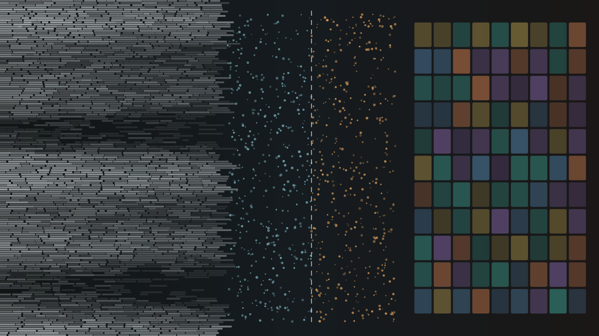
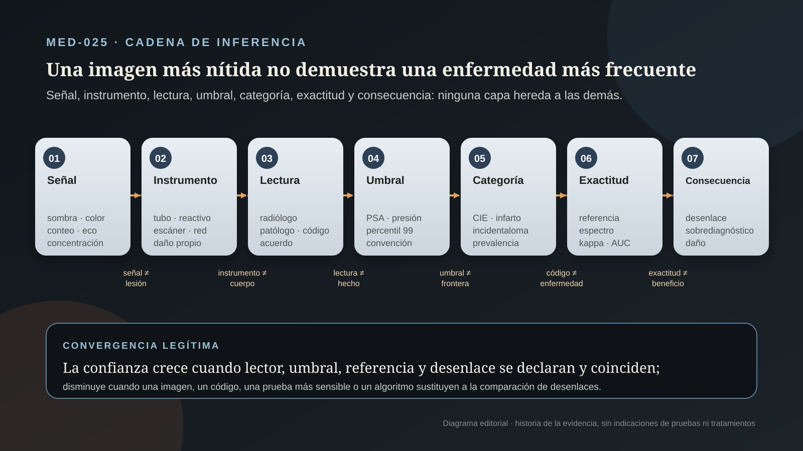
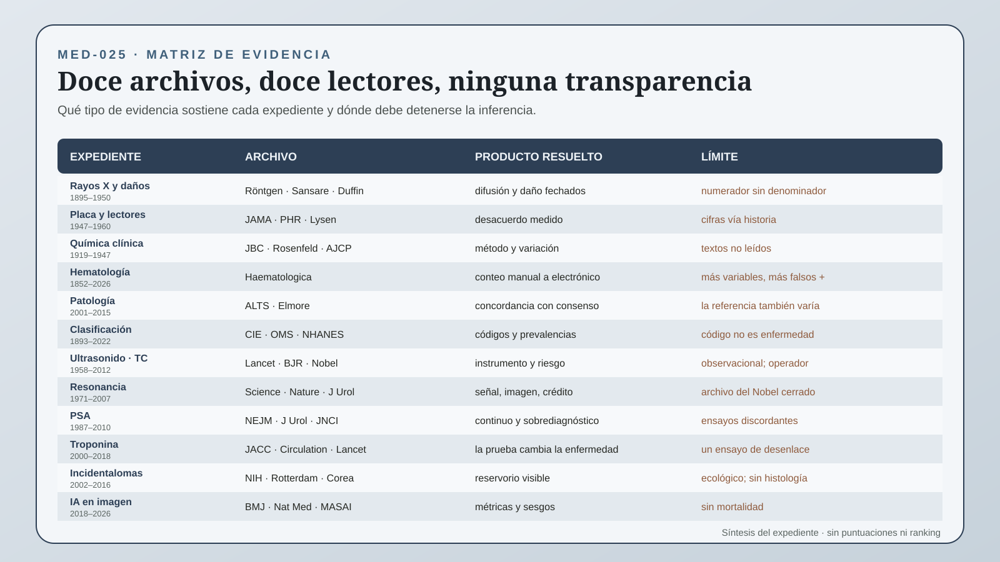

# MED-025 — Una imagen más nítida no demuestra una enfermedad más frecuente por sí sola

> **Alcance:** audita doce expedientes entre 1852 y 2026: los rayos X de Röntgen y su difusión, con sus daños (radiodermatitis, los «mártires» de la radiología y los fluoroscopios de zapatería); la lectura de la placa y el descubrimiento del desacuerdo entre observadores (Birkelo, Yerushalmy y Garland, 1947–1949); la química clínica (Folin y Wu) y la primera encuesta de exactitud entre laboratorios (1947); los conteos de sangre, de Vierordt al contador de Coulter; la concordancia entre patólogos; la clasificación de enfermedades, de Bertillon a la CIE-11, y cómo un umbral cambia la prevalencia; ultrasonido y tomografía computarizada (Donald, Cormack y Hounsfield) con el debate sobre la radiación; la resonancia magnética y la disputa de Damadian; el PSA y el sobrediagnóstico; la troponina y la redefinición del infarto; los incidentalomas; y, como cierre metodológico, la inteligencia artificial en la lectura de imágenes hasta el ensayo MASAI publicado en 2026. Separa señal, instrumento, lectura, umbral, categoría, exactitud y consecuencia. Usa como fundamento el método de MED-002 sin repetirlo. Es historia y epistemología de la evidencia: **no contiene recomendaciones clínicas ni indica pruebas, cribados o tratamientos** (`CLAIM-MED-IMG-NO-ADVICE-001`).

## Pregunta central

¿Cómo cambiaron la radiografía, la química, la patología, los biomarcadores y las clasificaciones lo que se podía ver y lo que se podía diagnosticar, sin confundir una señal con una lesión, una lectura con un hecho, un umbral con una frontera natural, un código con una enfermedad, una exactitud con un beneficio ni una detección mayor con un pronóstico mejor?

## Respuesta breve

Röntgen comunicó a fines de 1895 una radiación que atravesaba la carne y oscurecía placas; en semanas había radiografías dentales y en meses quemaduras: un cirujano contó en 1902 ochenta y ocho lesiones publicadas, cincuenta y cinco de ellas de 1896, y Clarence Dally, ayudante de Edison, murió en 1904 (`CLAIM-MED-IMG-XRAY-DIFFUSION-001`, `CLAIM-MED-IMG-CODMAN-1902-001`, `CLAIM-MED-IMG-DALLY-1904-001`). De los años veinte a los cincuenta, las zapaterías de Norteamérica y Europa usaron fluoroscopios para ver el pie dentro del zapato (`CLAIM-MED-IMG-SHOE-FLUOROSCOPE-001`). Una señal visible no era una lesión, y el instrumento que la producía tenía sus propios daños.

En 1947, un estudio de la Administración de Veteranos que buscaba el mejor formato de placa para detectar tuberculosis no encontró un formato ganador, sino lectores que discrepaban entre sí en cerca de 30 % de los casos y consigo mismos en cerca de 20 % (`CLAIM-MED-IMG-BIRKELO-1947-001`, `CLAIM-MED-IMG-OBSERVER-VARIABILITY-001`). La placa permitió releer, y releer permitió medir el desacuerdo (`CLAIM-MED-IMG-PLATE-REREAD-001`). Ese mismo año, una encuesta envió soluciones patrón a más de cincuenta laboratorios clínicos y obtuvo resultados distintos (`CLAIM-MED-IMG-BELK-SUNDERMAN-1947-001`). Los patólogos, referencia de casi todo, coinciden con un panel experto en 75.3 % de las biopsias de mama y en 48 % de las atipias (`CLAIM-MED-IMG-PATH-CONCORDANCE-2015-001`).

Las categorías también miden. La lista de causas de muerte de Bertillon (1893) se convirtió en la CIE, que pasó de unos 17 000 códigos a unos 155 000 en su versión clínica estadounidense y a una ontología digital con la CIE-11, vigente desde 2022 (`CLAIM-MED-IMG-BERTILLON-1893-001`, `CLAIM-MED-IMG-ICD10-CODES-001`, `CLAIM-MED-IMG-ICD11-2019-001`). Bajar en 2017 el umbral de hipertensión en Estados Unidos llevó la prevalencia estimada de 31.9 % a 45.6 % con las mismas mediciones (`CLAIM-MED-IMG-HYPERTENSION-2017-001`). Medir la troponina en lugar de la creatina cinasa aumentó en 74 % los infartos identificados en una comunidad y cambió quién los tenía (`CLAIM-MED-IMG-ROGER-2006-001`); un ensayo por conglomerados mostró que reclasificar con una troponina más sensible no redujo infartos ni muertes cardiovasculares al año (`CLAIM-MED-IMG-HIGHSTEACS-2018-001`). Una prueba más sensible cambia la enfermedad que cuenta (`CLAIM-MED-IMG-TEST-CHANGES-DISEASE-001`).

El PSA lo muestra en toda su extensión: Stamey lo propuso en 1987 como marcador más sensible que la fosfatasa ácida, pero elevado en 86 % de los hombres con hiperplasia benigna; 15.2 % de hombres con PSA por debajo del umbral habitual tenían cáncer en la biopsia; más de 1.3 millones de hombres adicionales fueron diagnosticados en Estados Unidos entre 1986 y 2005; y los ensayos de cribado dieron resultados discordantes (`CLAIM-MED-IMG-STAMEY-1987-001`, `CLAIM-MED-IMG-THOMPSON-2004-001`, `CLAIM-MED-IMG-WELCH-ALBERTSEN-2009-001`, `CLAIM-MED-IMG-ERSPC-2009-001`, `CLAIM-MED-IMG-PLCO-2009-001`). Tomografía, resonancia y ultrasonido llenaron los archivos de hallazgos no buscados (`CLAIM-MED-IMG-VERNOOIJ-2007-001`, `CLAIM-MED-IMG-INCIDENTAL-RESERVOIR-001`).

La inteligencia artificial hereda la pregunta de 1947: quién lee, contra qué referencia, en qué población. Los estudios retrospectivos prometían superar a los expertos; las revisiones sistemáticas encontraron sesgo, atajos y subdiagnóstico en grupos desatendidos; el ensayo MASAI publicó en 2026 una tasa de cánceres de intervalo no inferior con lectura apoyada por IA, con un intervalo que no excluye la igualdad (`CLAIM-MED-IMG-FREEMAN-2021-001`, `CLAIM-MED-IMG-SHORTCUT-2018-001`, `CLAIM-MED-IMG-MASAI-2026-001`, `CLAIM-MED-IMG-AI-METRICS-LIMIT-001`).

La cadena legítima es **señal → instrumento → lectura → umbral → categoría → exactitud → consecuencia**. Ningún eslabón hereda la fuerza del siguiente.

## UNA IMAGEN MÁS NÍTIDA NO DEMUESTRA UNA ENFERMEDAD MÁS FRECUENTE POR SÍ SOLA

### 1. Siete capas que deben conservarse

| Capa | Pregunta | Producto legítimo | Salto inválido |
|---|---|---|---|
| Señal | ¿qué propiedad física, química o celular se registra? | sombra, color, conteo, eco, relajación, concentración | leer la señal como lesión o enfermedad |
| Instrumento | ¿qué aparato, método o reactivo la produce, con qué daños y qué variación? | procedimiento descrito y reproducible | atribuir al cuerpo lo que produce el instrumento |
| Lectura | ¿quién interpreta, con qué entrenamiento y con qué acuerdo? | juicio con variación medida | tratar una lectura como un hecho sin lector |
| Umbral | ¿dónde se corta un continuo y por qué? | convención declarada | creer que el umbral está en la naturaleza |
| Categoría | ¿qué nombre, código o definición recibe lo leído? | clasificación con historia | contar una categoría nueva como enfermedad nueva o más frecuente |
| Exactitud | ¿contra qué referencia, en qué espectro y población? | sensibilidad, especificidad, acuerdo, intervalo | convertir exactitud en beneficio |
| Consecuencia | ¿qué cambia para la persona y la población tras saberlo? | desenlace comparado, daño, sobrediagnóstico | tomar detección como pronóstico mejor |

### 2. Cuatro distinciones que el expediente no deja fundir

Una **señal** registrada por un instrumento —una sombra en una placa, un color en un tubo, un tiempo de relajación, una concentración— no es una lesión: es una propiedad física o química que alguien decidió leer como indicio (`CLAIM-MED-IMG-SIGNAL-NOT-LESION-001`), la misma advertencia que MED-018 hace sobre la imagen del microscopio (`CLAIM-MED-PATH-IMAGE-NOT-DISEASE-001`) y MED-019 sobre el estetoscopio (`CLAIM-MED-CLINIC-INSTRUMENT-INTERPRETATION-001`). Una **lectura** es el juicio de un lector y varía entre lectores y en el mismo lector (`CLAIM-MED-IMG-READING-NOT-FACT-001`). Un **umbral** corta un continuo por convención; moverlo cambia cuántos enfermos hay sin cambiar a nadie (`CLAIM-MED-IMG-THRESHOLD-CONVENTION-001`, `CLAIM-MED-DX-THRESHOLD-001`), y una **categoría** crea la epidemiología que la cuenta (`CLAIM-MED-IMG-CATEGORY-MAKES-EPI-001`), como MED-020 vio con las listas de mortalidad (`CLAIM-MED-COUNT-CLASSIFICATION-DENOMINATOR-001`). Finalmente, la **exactitud** de una prueba no demuestra que conocer su resultado mejore algo (`CLAIM-MED-IMG-ACCURACY-NOT-BENEFIT-001`); ése es el núcleo de MED-002 (`CLAIM-MED-DX-UTILITY-001`, `CLAIM-MED-DX-METRICS-001`), que este expediente usa como método y no repite. Y detectar más no es lo mismo que mejorar el pronóstico: una detección mayor puede llenar los registros de enfermedad que nunca habría dañado (`CLAIM-MED-IMG-DETECTION-NOT-PROGNOSIS-001`).

## DOCE EXPEDIENTES AUDITADOS

### 3. Röntgen y la difusión explosiva de los rayos X, con sus daños

Wilhelm Conrad Röntgen estudiaba en 1895 la radiación catódica en un tubo de gas enrarecido y notó un brillo en pantallas sensibles cercanas aunque el aparato estaba cubierto; comunicó a fines de ese año una «nueva clase de rayos» que *Nature* publicó traducida a inicios de 1896, y recibió en 1901 el primer Nobel de Física (`CLAIM-MED-IMG-ROENTGEN-1895-001`). La difusión fue inmediata: según Sansare y colaboradores, Walkhoff tomó una radiografía dental unos catorce días después del anuncio, con una exposición de veinticinco minutos (`CLAIM-MED-IMG-XRAY-DIFFUSION-001`). El tubo, la placa y la pantalla eran baratos y portátiles; no hubo ensayo, licencia ni dosimetría antes del uso.

Los daños llegaron con la misma velocidad. En febrero de 1896, en Vanderbilt, el doctor Dudley se expuso una hora para una prueba y perdió el pelo de la zona veintiún días después; el 12 de agosto de 1896 se informó el caso del doctor Hawks, que su médico trató como dermatitis (`CLAIM-MED-IMG-DERMATITIS-1896-001`). Codman reunió en 1902 ochenta y ocho lesiones por rayos X publicadas: cincuenta y cinco de 1896, doce de 1897, seis de 1898, nueve de 1899, tres de 1900 y una de 1901 (`CLAIM-MED-IMG-CODMAN-1902-001`). Clarence Dally, soplador de vidrio de Edison, murió en 1904, a los 39 años, de un carcinoma metastásico, y se le considera el primero muerto por exposición; Emil Grubbe sufrió al menos ochenta y tres operaciones y murió en 1960 (`CLAIM-MED-IMG-DALLY-1904-001`).

Las cifras de Codman descienden, pero son lesiones *publicadas*: un numerador sin denominador de operadores ni de horas de exposición, como las muertes por cloroformo de MED-021 y las notificaciones de MED-024 (`CLAIM-MED-ANES-NUMERATOR-ONLY-001`, `CLAIM-MED-PHARM-REPORT-NOT-RATE-001`). El libro de Perry Brown de 1936, *American Martyrs to Science Through the Roentgen Rays*, y la conmemoración de los «mártires» convierten esas biografías en memoria profesional; no estiman un riesgo (`CLAIM-MED-IMG-MARTYRS-NUMERATOR-001`).

Desde mediados de los años veinte y hasta los cincuenta, los fluoroscopios para probar zapatos fueron un rasgo prominente de las zapaterías de Norteamérica y Europa; mostraban huesos y tejidos del pie dentro del zapato, prometían mejor ajuste y más ventas, y la respuesta pública pasó del entusiasmo y la confianza a la sospecha y el miedo según Duffin y Hayter (`CLAIM-MED-IMG-SHOE-FLUOROSCOPE-001`). Es el caso más limpio de un instrumento sin pregunta diagnóstica: una imagen sin lectura clínica, sin umbral y sin consecuencia demostrada, con exposición real.

### 4. La placa, la radioscopia y el descubrimiento del desacuerdo (1947–1960)

La radioscopia mostraba el cuerpo en movimiento sobre una pantalla y no dejaba registro; la placa y la fotofluorografía —fotografiar la pantalla en formato pequeño, base de los cribados masivos de tuberculosis— dejaban un objeto que podía releerse, por otro lector o por el mismo en otro día. Esa diferencia técnica es la condición de todo lo que sigue: sin registro no se puede medir el acuerdo (`CLAIM-MED-IMG-PLATE-REREAD-001`).

La Administración de Veteranos de Estados Unidos guardaba al menos dos placas por soldado y quiso saber qué formato detectaba mejor la tuberculosis: fotofluorograma pequeño, estereofotofluorogramas, negativo en papel o película de celuloide. El equipo de radiólogos, neumólogos y un bioestadístico publicó en 1947 en *JAMA* que ningún método, ni siquiera la película cara de los hospitales, superaba a los otros (`CLAIM-MED-IMG-BIRKELO-1947-001`). El resultado decisivo fue otro: al comparar cientos de lecturas de cinco lectores, los expertos discrepaban mucho. Según la síntesis de Lysen, el informe de 1947 y el seguimiento de Garland de 1949 mostraron variación entre lectores y del mismo lector en alrededor de 30 % y 20 % de los casos; un grupo de radiólogos muy experimentados que leyó y releyó las placas volvió a obtener la misma variación (`CLAIM-MED-IMG-OBSERVER-VARIABILITY-001`, `CLAIM-MED-IMG-GARLAND-1949-001`). Las cifras exactas por lector están en los textos de 1947 y 1949, que este expediente no leyó completos.

Jacob Yerushalmy, el bioestadístico, sostuvo en *Public Health Reports* (1947) que el problema estaba en la lectura más que en el formato, y trató la «ecuación personal» del lector como un factor de error (`CLAIM-MED-IMG-YERUSHALMY-1947-001`). Suele atribuírsele haber definido sensibilidad y especificidad; Binney, Hyde y Bossuyt muestran que esas nociones se usaban desde inicios del siglo XX en la serología, ligadas a las reacciones de fijación del complemento para la sífilis, y que se transformaron en conceptos diagnósticos (`CLAIM-MED-IMG-SENS-SPEC-ORIGIN-001`). La reacción de Wassermann que MED-024 vio como desenlace del Salvarsán es parte de esa genealogía (`CLAIM-MED-PHARM-SALVARSAN-SURROGATE-001`).

Las respuestas fueron humanas y técnicas. Yerushalmy examinó en 1950 la doble lectura independiente y concluyó que reducía errores; aun así, dos radiólogos británicos lamentaban en 1955 que la recomendación se ignorara, y la carga de trabajo y la demarcación de la pericia frenaron su adopción (`CLAIM-MED-IMG-DUAL-READING-001`). Jacob Cohen propuso en 1960 un coeficiente de acuerdo para escalas nominales corregido por el azar, la kappa, que se volvió el instrumento para medir lo que en 1947 sólo se contaba (`CLAIM-MED-IMG-KAPPA-1960-001`). Lee Lusted, que había sido lector voluntario en uno de los estudios de Garland y Yerushalmy, y Robert Ledley formalizaron en 1959 el razonamiento diagnóstico con lógica, probabilidad y teoría de la decisión; Lysen ve en ese giro, que convirtió al radiólogo en un decisor imperfecto que podía asistirse con máquinas, el origen de las promesas actuales de la IA (`CLAIM-MED-IMG-LUSTED-LEDLEY-1959-001`, `CLAIM-MED-IMG-AI-GENEALOGY-001`).

### 5. Química clínica: Folin y Wu, el laboratorio y la primera encuesta de exactitud

Otto Folin y Hsien Wu publicaron en 1919 «un sistema de análisis de sangre» en el *Journal of Biological Chemistry*: una serie coordinada de métodos colorimétricos para determinar en sangre los constituyentes de entonces —nitrógeno no proteico, urea, ácido úrico, creatinina y azúcar— a partir de un mismo filtrado (`CLAIM-MED-IMG-FOLIN-WU-1919-001`). Este expediente comprobó el artículo en Crossref y lo describe por su título y por la historia de Rosenfeld; no leyó su texto. Rosenfeld sostiene que el trabajo de Folin y de Van Slyke hacia fines de la segunda década del siglo XX sacó al químico clínico «del anexo de la morgue» y lo acercó a la cama del paciente, que la Primera Guerra Mundial empujó la difusión del laboratorio y que, en las últimas décadas del siglo, los aparatos automáticos produjeron una sobreabundancia de pruebas, con uso excesivo y mal uso (`CLAIM-MED-IMG-CLINCHEM-INSTITUTION-001`). El laboratorio hospitalario es una institución: con personal, rutinas, aparatos y presupuestos, no sólo una técnica.

En 1947, Belk y Sunderman enviaron las mismas soluciones patrón a más de cincuenta laboratorios clínicos y recibieron resultados distintos; Garland citó después ese estudio junto a sus placas como ejemplo de un mismo problema de variabilidad del observador (`CLAIM-MED-IMG-BELK-SUNDERMAN-1947-001`). Una concentración de laboratorio es el producto de un método, un reactivo, una calibración y un operador: la estandarización hace comparables los resultados entre laboratorios, pero no los vuelve verdaderos por sí sola, y un método puede medir de forma reproducible algo distinto de lo que se nombra (`CLAIM-MED-IMG-STANDARD-NOT-TRUTH-001`).

### 6. Hematología: de Vierordt al contador de Coulter

Karl von Vierordt introdujo en 1852 el conteo de glóbulos rojos; mejoras sucesivas de la precisión de la cámara de conteo produjeron el hemocitómetro, que permitió cuantificar desviaciones de lo normal (`CLAIM-MED-IMG-VIERORDT-1852-001`). Maxwell Wintrobe mejoró en 1929 el tubo de hematocrito y usó el volumen medio del glóbulo rojo para clasificar las anemias: una medición se volvió una categoría (`CLAIM-MED-IMG-WINTROBE-1929-001`). El conteo manual era tedioso, lento y propenso a error; Wallace Coulter, ingeniero, obtuvo el 20 de octubre de 1953 la patente estadounidense 2 656 508 para contar partículas suspendidas en un fluido, presentó el contador Model A —que la misma revisión fecha en 1954 en el resumen y en 1956 en el texto— y el Model S llegó en 1968 (`CLAIM-MED-IMG-COULTER-1953-001`).

Lichtman y Burack, en una perspectiva publicada en *Haematologica* (número de abril de 2026), cuentan entre 12 y 24 variables en la biometría hemática de los hospitales estudiados y argumentan que varias son redundantes y que más variables aumentan la probabilidad de falsos positivos (`CLAIM-MED-IMG-CBC-VARIABLES-001`). El argumento es metodológico y aquí se registra como tal: cada variable añadida con su intervalo de referencia es otra oportunidad de un resultado «fuera de rango» en una persona sana, la versión hematológica de la multiplicación de comparaciones. Este expediente no adopta su propuesta clínica.

### 7. Patología: la referencia también es una lectura

MED-018 auditó la cadena que llevó del espécimen a la citología y al frotis de Papanicolaou y Traut de 1941 (`CLAIM-MED-PATH-TRAUT-1941-001`, `CLAIM-MED-PATH-CYTOLOGY-SCREENING-LIMIT-001`). Aquí importa lo que sucedió cuando la patología, juez de casi todas las demás pruebas, se midió a sí misma. En el estudio ALTS, siete patólogos de centros clínicos y cuatro de control de calidad interpretaron 4 948 citologías en monocapa, 2 237 biopsias y 535 piezas de escisión: la reproducibilidad fue moderada, con kappa de 0.46 para citología y para biopsia y 0.49 para las piezas, y los centros clínicos dieron interpretaciones más graves que los revisores (`CLAIM-MED-IMG-CYTOLOGY-KAPPA-2001-001`).

Elmore y colaboradores pidieron a 115 patólogos de ocho estados que interpretaran 240 biopsias de mama, una laminilla por caso, sin conocer las lecturas de los demás. Frente a un diagnóstico de referencia de consenso, la concordancia global fue de 75.3 %; de 96 % en carcinoma invasor, 84 % en carcinoma ductal *in situ*, 48 % en hiperplasia atípica —17 % sobreinterpretada y 35 % subinterpretada— y 87 % en lesiones benignas sin atipia; los tres miembros del panel coincidieron por unanimidad en 75 % de sus diagnósticos independientes (`CLAIM-MED-IMG-PATH-CONCORDANCE-2015-001`). Cuando la referencia es una lectura, una prueba puede parecer inexacta por los errores de su juez: la exactitud de todo lo demás depende de un patrón que también varía (`CLAIM-MED-IMG-REFERENCE-IS-READING-001`, `CLAIM-MED-DX-REFERENCE-001`).

### 8. Clasificación: de Bertillon a la CIE-11, y cómo un umbral crea prevalencia

En 1893 el estadístico parisino Jacques Bertillon y su comité establecieron la primera Lista Internacional de Causas de Muerte (`CLAIM-MED-IMG-BERTILLON-1893-001`). Estados Unidos y otros países americanos la adoptaron en 1898; se actualizó hacia cada década (1900, 1910, 1920, 1929 y 1938); la OMS se hizo cargo en 1948 y la sexta revisión incorporó la morbilidad; la novena se publicó en 1977 (`CLAIM-MED-IMG-ICD-REVISIONS-001`). Según Hirsch y colaboradores, la versión clínica estadounidense pasó de unos 17 000 códigos a unos 155 000 con la CIE-10-MC, en uso desde el 1 de octubre de 2015 (`CLAIM-MED-IMG-ICD10-CODES-001`). La CIE-11 fue adoptada por la 72.ª Asamblea Mundial de la Salud en mayo de 2019 y entró en vigor el 1 de enero de 2022; su arquitectura es una base semántica («Fundación») de la que se derivan clasificaciones, con una herramienta de codificación en línea (`CLAIM-MED-IMG-ICD11-2019-001`).

Un código no es una enfermedad. Cuando una revisión separa, une o crea una rúbrica, el número de muertes o casos asignados a ella cambia sin que cambie la población: la clasificación es un instrumento de medida y su historia es parte de cada serie temporal (`CLAIM-MED-IMG-CODE-NOT-DISEASE-001`). Lo mismo hacen los umbrales. Con los datos de 9 623 adultos de la encuesta NHANES 2011–2014, medidos tres veces con un protocolo estandarizado, la prevalencia cruda de hipertensión en Estados Unidos era de 31.9 % con la definición del JNC7 y de 45.6 % con la guía ACC/AHA de 2017; el cambio de definición casi no movió la proporción a la que se proponía medicación (34.3 % frente a 36.2 %) (`CLAIM-MED-IMG-HYPERTENSION-2017-001`). Mismas presiones, mismas personas, catorce puntos más de prevalencia: la categoría creó su epidemiología (`CLAIM-MED-IMG-CATEGORY-MAKES-EPI-001`).

### 9. Ultrasonido y tomografía computarizada

Ian Donald, John MacVicar y Tom Brown publicaron en *The Lancet* en 1958 la investigación de masas abdominales con ultrasonido pulsado (`CLAIM-MED-IMG-DONALD-1958-001`). El ultrasonido no deja una placa que otro pueda leer después del mismo modo: la imagen se produce mientras alguien mueve el transductor, y su calidad y su interpretación dependen del operador. Este expediente registra esa dependencia como rasgo del instrumento y no audita su magnitud (`CLAIM-MED-IMG-ULTRASOUND-OPERATOR-001`).

Allan Cormack publicó en 1963 en el *Journal of Applied Physics* cómo representar una función por sus integrales de línea, con aplicaciones radiológicas (`CLAIM-MED-IMG-CORMACK-1963-001`). Godfrey Hounsfield, ingeniero de EMI, describió en el *British Journal of Radiology* de 1973 el sistema de exploración axial transversa computarizada, en un número en el que James Ambrose publicó su aplicación clínica (`CLAIM-MED-IMG-HOUNSFIELD-1973-001`). El Nobel de Fisiología o Medicina de 1979 se otorgó a Cormack y Hounsfield «por el desarrollo de la tomografía asistida por computadora» (`CLAIM-MED-IMG-NOBEL-1979-001`). La matemática de la reconstrucción y la máquina que la hizo práctica fueron trabajos separados.

La tomografía usa radiación ionizante. Una cohorte retrospectiva británica de 178 604 pacientes expuestos en la infancia encontró una asociación positiva entre la dosis acumulada de tomografías y la leucemia (74 casos) y los tumores cerebrales (135 casos); los autores estimaron un caso adicional de cada tipo por cada diez mil tomografías de cráneo en los diez años siguientes en menores de diez años (`CLAIM-MED-IMG-CT-RADIATION-2012-001`). Es una asociación observacional: los autores retrasaron el inicio del seguimiento para no contar exploraciones hechas por un cáncer ya presente, pero la indicación de la tomografía —por qué se pidió— puede asociarse con el riesgo de base; el riesgo absoluto es pequeño y la estimación es un modelo de dosis (`CLAIM-MED-IMG-CT-RADIATION-LIMIT-001`). La línea de Codman a Pearce es la misma pregunta con mejor denominador.

### 10. Resonancia magnética: Lauterbur, Mansfield y la disputa con Damadian

Raymond Damadian publicó en *Science* en 1971 que los tiempos de relajación T1 y T2 de dos tumores malignos de rata quedaban claramente fuera del intervalo de seis tejidos normales, y propuso usar la resonancia para discriminar tumores de tejido normal (`CLAIM-MED-IMG-DAMADIAN-1971-001`). No era una imagen: era una señal medida en muestras. Paul Lauterbur publicó en *Nature* en 1973 la formación de imágenes por interacciones locales inducidas —gradientes de campo que asignan posición a la señal— (`CLAIM-MED-IMG-LAUTERBUR-1973-001`), y Peter Mansfield y Grannell publicaron ese año un análisis de la «difracción» de la resonancia en sólidos, base del trabajo matemático que Mansfield llevó a la adquisición rápida (`CLAIM-MED-IMG-MANSFIELD-1973-001`). El Nobel de 2003 fue para Lauterbur y Mansfield «por sus descubrimientos sobre la resonancia magnética de imagen» (`CLAIM-MED-IMG-NOBEL-2003-001`).

Macchia, Termine y Buchen reconstruyen la disputa: Damadian propuso en 1969 el concepto de un escáner, publicó en 1971, solicitó en 1972 la patente de su método de exploración, concedida en 1974, y publicó en 1977 el primer estudio de resonancia de un cuerpo humano; Lauterbur no lo mencionó en 1973. Los autores juzgan su exclusión «seria y deliberada» y recuerdan que el premio admite hasta tres galardonados y que las deliberaciones permanecen cerradas cincuenta años (`CLAIM-MED-IMG-DAMADIAN-DISPUTE-001`). La disputa depende, como las del éter en MED-021 y la estreptomicina en MED-024, de qué se premia: la señal diferencial, la codificación espacial que hace una imagen o la máquina para cuerpos humanos (`CLAIM-MED-ANES-PRIORITY-DEFINITION-001`, `CLAIM-MED-PHARM-SCHATZ-CREDIT-001`).

### 11. PSA: un marcador sensible, un umbral convencional y el sobrediagnóstico

Stamey y colaboradores midieron en 1987 por radioinmunoanálisis el antígeno prostático específico y la fosfatasa ácida en 2 200 sueros de 699 pacientes: el PSA estaba elevado en 122 de 127 pacientes con cáncer no tratado y era proporcional al volumen estimado del tumor, pero también en 86 % de los pacientes con hiperplasia benigna; concluyeron que era más sensible que la fosfatasa y que ninguno de los dos marcadores era específico (`CLAIM-MED-IMG-STAMEY-1987-001`, `CLAIM-MED-IMG-PSA-NOT-SPECIFIC-001`). El artículo proponía el seguimiento después del tratamiento, no el cribado.

El umbral habitual de 4.0 ng por mililitro no era una frontera. En el grupo placebo del Prostate Cancer Prevention Trial, 2 950 hombres que nunca habían superado ese valor ni tenido un tacto anormal recibieron biopsia al final: 15.2 % tenía cáncer, y la prevalencia crecía de 6.6 % con PSA de hasta 0.5 a 26.9 % entre 3.1 y 4.0 (`CLAIM-MED-IMG-THOMPSON-2004-001`). Cualquier corte en un continuo intercambia falsos negativos por falsos positivos y biopsias (`CLAIM-MED-IMG-PSA-THRESHOLD-CONTINUUM-001`).

Welch y Albertsen estimaron con datos de SEER que entre 1986 y 2005 se diagnosticaron en Estados Unidos 1 305 600 hombres adicionales con cáncer de próstata, de los cuales 1 004 800 fueron tratados de forma definitiva; con el supuesto más optimista, por cada hombre con el beneficio presunto más de veinte fueron diagnosticados (`CLAIM-MED-IMG-WELCH-ALBERTSEN-2009-001`). En 2009 se publicaron dos ensayos aleatorizados: el europeo ERSPC informó una razón de tasas de muerte por cáncer de próstata de 0.80 (0.65–0.98) a una mediana de nueve años, con 1 410 hombres cribados y 48 casos adicionales tratados para prevenir una muerte y «un alto riesgo de sobrediagnóstico» (`CLAIM-MED-IMG-ERSPC-2009-001`); el estadounidense PLCO no encontró diferencia significativa a siete a diez años, con un grupo control en que el uso del PSA subió de 40 % a 52 % (`CLAIM-MED-IMG-PLCO-2009-001`). Las dos cifras miden poblaciones, contaminaciones y seguimientos distintos; este expediente no decide entre ellas.

El propio Stamey revisó en 2004 1 317 prostatectomías radicales consecutivas de Stanford entre 1983 y 2003: el PSA medio bajó de 25 a 8 ng por mililitro, el volumen del cáncer mayor se redujo a menos de la mitad y, en los últimos cinco años, el PSA sólo se relacionaba con el tamaño de la próstata, es decir, con la hiperplasia benigna (`CLAIM-MED-IMG-STAMEY-2004-001`). Welch y Black estimaron a partir de ensayos aleatorizados que alrededor de 60 % de los cánceres detectados por PSA eran sobrediagnóstico, definido como cáncer que no habría causado síntomas ni muerte, y lo explicaron por dos condiciones: un reservorio silencioso de enfermedad y actividades que lo detectan (`CLAIM-MED-IMG-OVERDIAGNOSIS-2010-001`).

### 12. Troponina: una prueba más sensible cambia la enfermedad

El comité conjunto de la Sociedad Europea de Cardiología y el American College of Cardiology redefinió en 2000 el infarto agudo con el ascenso y descenso típicos de un marcador bioquímico de necrosis —la troponina, o la fracción MB de la creatina cinasa con su curva más rápida— acompañado de síntomas isquémicos, ondas Q, cambios isquémicos del electrocardiograma o una intervención coronaria (`CLAIM-MED-IMG-MI-REDEFINED-2000-001`).

Roger y colaboradores aplicaron la nueva definición de forma prospectiva en el condado de Olmsted, Minnesota, entre 2002 y 2005: con cambios dinámicos de troponina identificaron 538 infartos frente a 327 con creatina cinasa y 427 con su fracción MB, un aumento de 74 % (69–79 %) y de 41 % (37–46 %). Los casos que sólo cumplían los criterios de troponina tenían menos elevación del segmento ST y mejor supervivencia, y los clínicos mencionaron infarto en 42 % de ellos frente a 74 % en los que cumplían los criterios previos; con valores únicos de troponina, el aumento variaba mucho según el umbral (`CLAIM-MED-IMG-ROGER-2006-001`). Más infartos, más leves, en una población que no cambió: si se comparan tasas de infarto antes y después de 2000 sin ajustar por la definición, la serie mide el cambio de la prueba (`CLAIM-MED-IMG-TEST-CHANGES-DISEASE-001`).

La cuarta definición universal (2018) conserva la troponina con el percentil 99 de una población de referencia como límite superior y separa la lesión miocárdica del infarto (`CLAIM-MED-IMG-FOURTH-DEFINITION-2018-001`). El ensayo High-STEACS probó si esa sensibilidad mejora desenlaces: en diez hospitales escoceses y 48 282 pacientes consecutivos, el análisis de alta sensibilidad con umbral del percentil 99 por sexo reclasificó a 1 771 (17 %) de los 10 360 con lesión o infarto que el análisis anterior no identificaba; en ellos, el infarto o la muerte cardiovascular al año ocurrió en 15 % antes y 12 % después de su implementación, con una razón de momios ajustada de 1.10 (0.75–1.61). Los autores cuestionan que el umbral deba basarse en el percentil 99 (`CLAIM-MED-IMG-HIGHSTEACS-2018-001`). Una prueba mejor detectó a más personas; no demostró que detectarlas cambiara su desenlace.

### 13. Incidentalomas: la resolución revela un reservorio

La conferencia de consenso de los NIH de 2002 sobre la masa suprarrenal clínicamente inaparente —el «incidentaloma»— registró que la mejora de la imagen abdominal había aumentado su detección y que su prevalencia crece con la edad (`CLAIM-MED-IMG-ADRENAL-2003-001`). El nombre mismo describe el instrumento, no la glándula: es un hallazgo definido por no haber sido buscado. En el estudio poblacional de Rotterdam, 2 000 personas de 45 a 97 años recibieron resonancia cerebral con un protocolo estándar: 7.2 % tenía infartos cerebrales asintomáticos, 1.8 % aneurismas y 1.6 % tumores primarios benignos, sobre todo meningiomas, todos diagnosticados por imagen sin confirmación histológica (`CLAIM-MED-IMG-VERNOOIJ-2007-001`).

Corea del Sur muestra la escala poblacional. Con datos de 226 873 encuestados, Ahn y colaboradores hallaron en 2016 una correlación de 0.77 entre la proporción de cribado regional de tiroides y la incidencia regional de cáncer de tiroides; el cribado se asoció sólo con el carcinoma papilar y no con la mortalidad por cáncer de tiroides (`CLAIM-MED-IMG-KOREA-THYROID-2016-001`). Es un estudio ecológico, sujeto a la falacia correspondiente; pero el patrón —incidencia que sigue al cribado, mortalidad que no se mueve— es el que Welch y Black describen como firma del reservorio silencioso. Cuanto mayor la resolución, más grande el reservorio visible; el número de hallazgos depende del instrumento tanto como de la población (`CLAIM-MED-IMG-INCIDENTAL-RESERVOIR-001`).

### 14. Inteligencia artificial en la lectura de imágenes: cierre metodológico (2018–2026)

MED-002 estableció que el desempeño retrospectivo de un modelo no demuestra estabilidad, equidad ni utilidad prospectiva (`CLAIM-MED-DX-AI-001`). Este cierre no evalúa productos: muestra qué métrica responde a qué pregunta.

McKinney y colaboradores (2020) informaron un sistema que, en conjuntos retrospectivos del Reino Unido y Estados Unidos, redujo falsos positivos y falsos negativos y superó el área bajo la curva del radiólogo promedio por 11.5 puntos absolutos en un estudio con seis radiólogos (`CLAIM-MED-IMG-MCKINNEY-2020-001`). La revisión sistemática de Freeman y colaboradores (2021) no encontró estudios prospectivos de exactitud en la práctica del cribado; en tres estudios retrospectivos con 79 910 mujeres, 34 de 36 sistemas (94 %) fueron menos exactos que un solo radiólogo y todos menos que el consenso de dos; los cinco estudios pequeños que favorecían a la IA tenían alto riesgo de sesgo (`CLAIM-MED-IMG-FREEMAN-2021-001`). Nagendran y colaboradores (2020) encontraron sólo diez registros de ensayos aleatorizados de aprendizaje profundo en imagen; de 81 estudios no aleatorizados, nueve eran prospectivos, el riesgo de sesgo era alto en 58 y 61 declaraban en el resumen un desempeño al menos comparable al de los clínicos (`CLAIM-MED-IMG-NAGENDRAN-2020-001`).

Los sesgos son concretos. Zech y colaboradores entrenaron redes para neumonía con 158 323 radiografías de tres sistemas hospitalarios: las redes identificaban el hospital de origen en 99.95 % y 99.98 % de las placas, y ordenar por hospital ya producía un área bajo la curva de 0.861 porque la prevalencia de neumonía difería (`CLAIM-MED-IMG-SHORTCUT-2018-001`). Seyyed-Kalantari y colaboradores hallaron que clasificadores de radiografía de tórax subdiagnosticaban de forma sistemática a pacientes mujeres, negros, hispanos o de bajo nivel socioeconómico, más aún en grupos interseccionales (`CLAIM-MED-IMG-UNDERDIAGNOSIS-2021-001`). Gichoya y colaboradores mostraron que modelos de aprendizaje profundo reconocían la identidad racial declarada en imágenes de varias modalidades, algo que los expertos humanos no pueden hacer a simple vista (`CLAIM-MED-IMG-RACE-2022-001`).

El ensayo MASAI aleatorizó en Suecia a 105 934 mujeres entre lectura apoyada por IA —el sistema asigna lectura simple o doble y señala hallazgos— y doble lectura estándar. En 2025 informó una tasa de detección de 6.4 frente a 5.0 por mil, sin aumento significativo de falsos positivos y con 44.2 % menos lecturas (`CLAIM-MED-IMG-MASAI-2025-001`). En enero de 2026 publicó el desenlace primario: cánceres de intervalo de 1.55 (1.23–1.92) y 1.76 (1.42–2.15) por mil, una razón de 0.88 (0.65–1.18) no inferior con un margen de 20 %; sensibilidad de 80.5 % frente a 73.8 % y especificidad de 98.5 % en ambos grupos (`CLAIM-MED-IMG-MASAI-2026-001`). El ensayo es simple ciego, en un programa con doble lectura y un solo producto; la razón de 0.88 no demuestra menos cánceres de intervalo, y más detección de tumores pequeños e *in situ* reabre la pregunta del sobrediagnóstico. Área bajo la curva, tasa de detección, cáncer de intervalo, carga de trabajo y mortalidad son productos distintos; ninguno hereda a los demás (`CLAIM-MED-IMG-AI-METRICS-LIMIT-001`).

## LO OBSERVADO

- placas, fotofluorogramas, ecos, cortes reconstruidos y tiempos de relajación;
- listas de lesiones publicadas por rayos X y biografías de operadores dañados;
- fluoroscopios comerciales fuera de la medicina;
- lecturas repetidas de las mismas placas y laminillas por varios lectores;
- resultados de laboratorios distintos con las mismas soluciones patrón;
- conteos manuales y electrónicos de células;
- listas internacionales de causas de muerte y sus revisiones;
- concentraciones de PSA y troponina, biopsias y diagnósticos de alta;
- hallazgos no buscados en estudios poblacionales;
- clasificaciones de algoritmos en conjuntos retrospectivos y en un ensayo aleatorizado.

## LO MEDIDO

- lesiones publicadas por año (Codman), sin denominador de operadores;
- desacuerdo entre lectores y del mismo lector, después kappa;
- concordancia de patólogos frente a un consenso;
- prevalencia de hipertensión con dos definiciones sobre las mismas mediciones;
- prevalencia de cáncer por estrato de PSA; diagnósticos adicionales por cohorte de edad;
- muertes por cáncer de próstata en dos ensayos aleatorizados;
- infartos identificados con dos marcadores; infarto o muerte cardiovascular tras implementar un análisis más sensible;
- prevalencia de hallazgos incidentales por resonancia;
- detección, cáncer de intervalo, sensibilidad, especificidad y carga de lectura en MASAI;
- no el beneficio individual de ninguna prueba para una persona concreta, ni el número real de dañados por los primeros rayos X.

## LO INFERIDO

Que la imagen y el laboratorio ampliaron lo diagnosticable es una inferencia firme, sostenida por la convergencia de instrumentos, lecturas repetidas y estudios de exactitud. Que una parte de ese aumento es sobrediagnóstico se infiere de la convergencia de ensayos aleatorizados de cribado, estudios ecológicos, cambios de definición y autopsias o biopsias de reservorio, con magnitudes que dependen del modelo. Que la lectura humana varía de forma sustancial se infiere de estudios repetidos desde 1947 en radiología, química y patología. La magnitud del beneficio de cada prueba en cada uso no se infiere de su exactitud (`CLAIM-MED-IMG-CHAIN-001`, `CLAIM-MED-IMG-ACCURACY-NOT-BENEFIT-001`, `CLAIM-MED-IMG-DETECTION-NOT-PROGNOSIS-001`).

## LOS SUPUESTOS

- que los informes de 1947–1949, conocidos aquí por una historia reciente, conservan bien sus cifras;
- que el consenso de expertos es una referencia razonable para medir a otros lectores;
- que las mediciones de NHANES son comparables entre definiciones;
- que el seguimiento retrasado de Pearce reduce suficientemente la causalidad inversa;
- que el diagnóstico de alta refleja la práctica clínica en Olmsted;
- que los ensayos de PSA y de IA representan a la población cribada;
- que los modelos de sobrediagnóstico estiman bien el reservorio.

## LAS INCERTIDUMBRES

- las cifras exactas del desacuerdo por lector en 1947 y 1949;
- el número real de dañados por los rayos X entre 1896 y 1910;
- el año del Model A de Coulter (1954 o 1956 en la misma revisión);
- la magnitud del riesgo de cáncer atribuible a la tomografía en la infancia;
- el balance de beneficio y sobrediagnóstico del cribado con PSA;
- si los infartos detectados sólo por troponina se benefician de ser detectados;
- el efecto de la IA sobre la mortalidad, la desigualdad y el sobrediagnóstico.

## LAS ALTERNATIVAS

- un aumento de incidencia puede reflejar más pruebas, un umbral más bajo o un código nuevo, no más enfermedad;
- un desacuerdo entre lectores puede reflejar una referencia mal definida, no lectores malos;
- una mejor supervivencia tras el diagnóstico puede deberse al adelanto del diagnóstico y al sobrediagnóstico;
- una asociación entre tomografía y cáncer puede deberse a la indicación;
- una mejor exactitud de un algoritmo puede deberse a atajos del conjunto de datos;
- una caída de cánceres de intervalo puede deberse al azar dentro del intervalo.

## QUÉ PODEMOS COMPARAR

| Expediente | Archivo dominante | Producto mejor resuelto | Límite decisivo |
|---|---|---|---|
| Rayos X y daños | Röntgen; Sansare; Codman vía Sansare; Duffin y Hayter | difusión y daños fechados | numerador sin denominador |
| Placa y lectores | *JAMA* 1947; Yerushalmy; Garland; Lysen; Binney | desacuerdo medido | cifras vía historia; referencia imperfecta |
| Química clínica | Folin y Wu; Rosenfeld; Belk y Sunderman | método coordinado; variación entre laboratorios | textos primarios no leídos |
| Hematología | Lichtman y Burack | del conteo manual al electrónico | una perspectiva con propuesta |
| Patología | ALTS; Elmore | concordancia con referencia de consenso | una laminilla; consenso también varía |
| Clasificación | Hirsch; Harrison; OMS; Muntner | códigos, revisiones y prevalencia por definición | historia de cada rúbrica no auditada |
| Ultrasonido y TC | Donald; Cormack; Hounsfield; Ambrose; Pearce | instrumento y riesgo asociado | observacional; operador |
| Resonancia | Damadian; Lauterbur; Mansfield; Macchia | señal, codificación espacial y crédito | archivo del Nobel cerrado |
| PSA | Stamey; Thompson; Welch; ERSPC; PLCO | sensibilidad, continuo y sobrediagnóstico | ensayos discordantes |
| Troponina | ESC/ACC; Roger; Thygesen; Shah | cambio de definición y su consecuencia | un ensayo por conglomerados |
| Incidentalomas | NIH; Vernooij; Ahn | reservorio visible | ecológico; sin histología |
| IA | McKinney; Freeman; Nagendran; Zech; MASAI | métricas y sesgos | un producto, un país, sin mortalidad |

Comparar aquí significa declarar señal, instrumento, lector, umbral, categoría, referencia y desenlace. No reparte medallas de progreso ni de prioridad (`CLAIM-MED-IMG-NONRANKING-001`).

## QUÉ NO PODEMOS CONCLUIR

- que una sombra en una placa es una lesión;
- que las lesiones publicadas por rayos X son la tasa de daño;
- que un experto lee siempre igual o igual que otro;
- que Yerushalmy inventó la sensibilidad y la especificidad;
- que una concentración estandarizada es verdadera;
- que más variables en un análisis significan más información útil;
- que la patología es una verdad sin lector;
- que una prevalencia que sube tras cambiar un umbral o un código significa más enfermos;
- que la tomografía causa cáncer en una persona concreta, o que no causa ninguno;
- que el Nobel de 2003 resuelve quién inventó la resonancia;
- que un PSA bajo excluye un cáncer, o uno alto lo demuestra;
- que más infartos detectados significan más infartos o mejores resultados;
- que la IA lee mejor que los radiólogos en general, o que reduce la mortalidad (`CLAIM-MED-IMG-AI-METRICS-LIMIT-001`).

## LAS CONTROVERSIAS

| Pregunta | Alternativas | Qué discrimina |
|---|---|---|
| ¿quién inventó la resonancia? | Damadian / Lauterbur y Mansfield | qué se premia: señal diferencial, imagen o máquina |
| ¿cuánto cáncer causa la tomografía en la infancia? | riesgo pequeño real / confusión por indicación | cohortes con indicación medida y dosis individual |
| ¿el cribado con PSA reduce la muerte? | ERSPC / PLCO | contaminación, seguimiento y población |
| ¿el percentil 99 es el umbral correcto del infarto? | sí / High-STEACS lo cuestiona | ensayos de desenlace por umbral |
| ¿la hipertensión de 2017 es más enfermedad? | redefinición basada en riesgo / inflación de la categoría | desenlaces por estrato, no prevalencia |
| ¿quién definió sensibilidad y especificidad? | Yerushalmy 1947 / serología de inicios del XX | archivo de la serología |
| ¿el desacuerdo entre lectores es error o ambigüedad? | lectores falibles / referencia mal definida | lecturas con referencia independiente |
| ¿la «epidemia» de tiroides en Corea es real? | sobrediagnóstico / aumento real | mortalidad, tamaño tumoral y cribado |
| ¿la IA supera a los radiólogos? | estudios retrospectivos / revisiones y ensayos | ensayos prospectivos con desenlaces |
| ¿un código nuevo crea una enfermedad? | registro de lo existente / construcción de la categoría | series con doble codificación |

## ERRORES QUE ESTA INVESTIGACIÓN BLOQUEA

1. **«La radiografía muestra la enfermedad.»** Muestra densidades que un lector interpreta.
2. **«Los primeros rayos X fueron inocuos hasta que se supo.»** Las quemaduras se publicaron en 1896.
3. **«Los mártires de la radiología miden el riesgo.»** Son biografías, no tasas.
4. **«Dos radiólogos expertos leen igual.»** Desde 1947 se mide lo contrario.
5. **«Yerushalmy inventó la sensibilidad y la especificidad.»** Venían de la serología.
6. **«Un resultado de laboratorio es un dato sin método.»** Depende del método, la calibración y el operador.
7. **«La patología es la verdad.»** También es una lectura con acuerdo medido.
8. **«Más hipertensos en 2017 significa más enfermedad.»** Cambió la definición.
9. **«La resonancia la inventó una sola persona.»** Señal, imagen y máquina tienen autores distintos.
10. **«Un PSA bajo es normal.»** El riesgo es un continuo sin frontera natural.
11. **«La troponina sensible reveló una epidemia de infartos.»** Cambió la enfermedad que se cuenta.
12. **«Un incidentaloma es una enfermedad que estaba esperando.»** Es un hallazgo definido por el instrumento.
13. **«La IA ya lee mejor que los radiólogos.»** Las métricas retrospectivas no son desenlaces.

## NIVEL DE CONFIANZA

- **A:** existencia, fecha y contenido general de las publicaciones, premios y clasificaciones citadas (Röntgen 1896, Folin y Wu 1919, Cormack 1963, Hounsfield 1973, Lauterbur 1973, Stamey 1987, CIE-11 2019, MASAI 2026).
- **B:** cifras de estudios cuyo resumen oficial se leyó (Elmore, Stoler, Muntner, Roger, Shah, Thompson, Welch y Albertsen, ERSPC, PLCO, Vernooij, Ahn, Freeman, Nagendran, Zech, MASAI) y reconstrucciones históricas de una fuente secundaria (Sansare, Lysen, Lichtman y Burack, Hirsch).
- **B-COND:** estimaciones de sobrediagnóstico y riesgo por radiación, siempre con su modelo.
- **C:** cifras exactas del desacuerdo de 1947–1949 por lector; balance de beneficio del PSA; efecto de la IA sobre la mortalidad.
- **D/E:** imagen como enfermedad, umbral como frontera natural, código como enfermedad, exactitud como beneficio, detección como pronóstico o inventor único.

## QUÉ PODRÍA FALSARLO

Este expediente deberá corregirse si nuevos registros muestran que:

- los textos de 1947 y 1949 dan cifras de desacuerdo sustancialmente distintas de las que resume Lysen;
- las lesiones de Codman tuvieron un denominador de operadores documentado;
- una cohorte con indicación medida no encuentra asociación entre tomografía en la infancia y cáncer;
- un análisis completo de ERSPC y PLCO con la misma definición de contaminación resuelve la discordancia;
- ensayos de desenlace muestran que los infartos detectados sólo por troponina de alta sensibilidad se benefician de ser detectados;
- la incidencia de cáncer de tiroides en Corea se acompaña de mortalidad creciente;
- el seguimiento de MASAI u otros ensayos muestra menos muertes por cáncer de mama, o más sobrediagnóstico, con lectura apoyada por IA.

## QUÉ SABEMOS REALMENTE

Sabemos que la imagen y el laboratorio ampliaron lo visible con instrumentos que tuvieron sus propios daños, que la lectura de una placa, una laminilla o un tubo varía entre lectores y fue medida como tal desde 1947, que umbrales y códigos son convenciones con historia que cambian cuántos enfermos se cuentan, y que pruebas más sensibles —PSA, troponina, tomografía, resonancia— detectaron más y cambiaron la enfermedad que se contaba sin demostrar por sí mismas que los detectados vivieran mejor. Sabemos que la IA en imagen repite la pregunta de 1947 con otras métricas (`CLAIM-MED-IMG-CHAIN-001`, `CLAIM-MED-IMG-OBSERVER-VARIABILITY-001`, `CLAIM-MED-IMG-TEST-CHANGES-DISEASE-001`).

## QUÉ TODAVÍA NO SABEMOS

No sabemos cuántos fueron dañados por los primeros rayos X ni cuántos cánceres causa hoy la radiación diagnóstica en cada grupo. No sabemos cuál es el balance de beneficio y sobrediagnóstico del cribado con PSA en cada población, si los infartos pequeños que detecta la troponina sensible se benefician de ser detectados, ni si la lectura apoyada por IA reduce la mortalidad o aumenta el sobrediagnóstico. MED-026 continuará la secuencia cronológica del programa; MED-029 volverá sobre ensayos, regulación y medicina basada en evidencia.

## CONCLUSIÓN

El cuerpo se volvió visible por capas: una radiación que oscurecía placas y quemaba manos, una placa que podía releerse, un tubo con un color, una cámara con células contadas, una laminilla, una lista de causas de muerte, un eco, una reconstrucción, una relajación de protones, un antígeno, una proteína del músculo cardíaco y un algoritmo. Cada capa amplió lo diagnosticable y cada una trajo su lector, su umbral y su categoría.

Por eso el expediente conserva siete capas. Señal no es lesión; instrumento no es cuerpo; lectura no es hecho; umbral no es frontera; código no es enfermedad; exactitud no es beneficio; detección no es pronóstico. Una imagen más nítida no demuestra una enfermedad más frecuente por sí sola (`CLAIM-MED-IMG-SCOPE-001`, `CLAIM-MED-IMG-NONRANKING-001`).

## NAVEGACIÓN

- [Historia de la ciencia de MED-025](../20_historia_ciencia/HISTORIA_MED_025_IMAGEN_LABORATORIO_CLASIFICACION.md)
- [Cronología especializada de MED-025](../21_cronologias/CRONOLOGIA_MED_025_IMAGEN_LABORATORIO_CLASIFICACION.md)
- [Mapa epistemológico de MED-025](../22_mapas_epistemologicos/MAPA_MED_025_IMAGEN_LABORATORIO_CLASIFICACION.md)
- [Pruebas diagnósticas (MED-002)](INVESTIGACION_MED_002_PRUEBAS_DIAGNOSTICAS_DECISIONES.md)
- [Programa cronológico de Medicina](PROGRAMA_CRONOLOGICO_HISTORIA_MEDICINA.md)
- [Explorador público de evidencia](../EVIDENCE_LEDGER.md)
