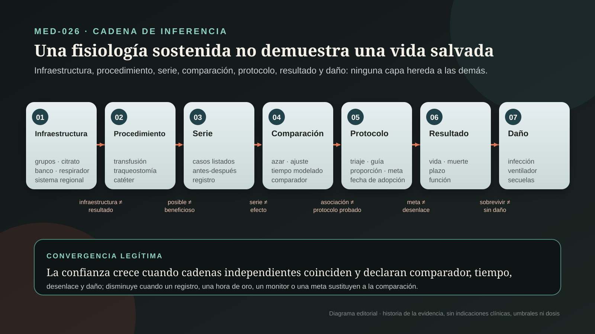
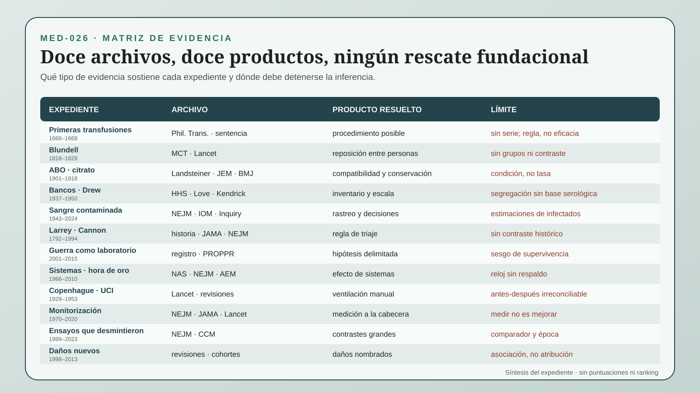

# MED-026 — Una fisiología sostenida no demuestra por sí sola una vida salvada

> **Alcance:** audita doce expedientes entre 1666 y 2024: las primeras transfusiones de animal a humano y su prohibición en París (1666–1668); Blundell y la transfusión de reemplazo (1818–1829); los grupos ABO, el citrato y la conservación (1901–1918); los bancos de sangre, Charles Drew, la segregación de la sangre y el plasma de la Segunda Guerra Mundial (1937–1950); la hepatitis y el VIH transmitidos por sangre y el escándalo de la sangre contaminada como caso de regulación (1943–2024); Larrey, el triaje y el choque traumático de Cannon (1792–1918); las guerras como laboratorio y sus límites como evidencia (2001–2015); los sistemas de trauma y la «hora de oro» (1966–2010); la epidemia de polio de Copenhague de 1952, los pulmones de acero y la primera unidad de cuidados intensivos (1929–1953); la monitorización (1970–2020); los ensayos que desmintieron supuestos —volumen corriente, control estrecho de la glucosa, reanimación dirigida por metas— (2000–2017); y los daños nuevos: lesión pulmonar por el ventilador, delirio y síndrome post-UCI (1998–2013). Lo posterior, hasta 2026, entra sólo como cierre metodológico. Separa infraestructura, procedimiento, serie, comparación, protocolo, resultado y daño. Es historia y epistemología de la evidencia: **no contiene recomendaciones clínicas, umbrales de tratamiento ni dosis**; las metas y cifras de los ensayos se nombran sólo como el contraste que cada estudio probó, nunca como pauta (`CLAIM-MED-CRIT-NO-ADVICE-001`).

## Pregunta central

¿Qué infraestructuras —venas conectadas, grupos sanguíneos, anticoagulantes, refrigeradores, donantes, ambulancias, sistemas regionales, respiradores, catéteres, oxímetros y protocolos— permitieron sostener la fisiología de personas que antes morían, qué nuevos daños produjeron, y cómo se distinguió en cada caso entre poder hacer algo, haberlo hecho en una lista de pacientes, compararlo con no hacerlo, convertirlo en regla y saber si cambió quién vivía y en qué condiciones?

## Respuesta breve

Sostener una variable fisiológica —volumen, hemoglobina, presión, gases, glucosa— no es lo mismo que salvar una vida, y la historia de la transfusión, el trauma y la terapia intensiva es en buena parte la historia de esa diferencia (`CLAIM-MED-CRIT-TARGET-NOT-OUTCOME-001`). Las primeras transfusiones de sangre de cordero a personas, en 1667, demostraron que el procedimiento era posible; la muerte de Antoine Mauroy terminó en una sentencia de 17 de abril de 1668 que prohibió transfundir sin permiso de la Facultad de Medicina de París, y la práctica se desvaneció (`CLAIM-MED-CRIT-DENIS-1667-001`, `CLAIM-MED-CRIT-MAUROY-1668-001`). Blundell volvió a la sangre humana en 1818 para reponer pérdidas; sólo los grupos ABO de Landsteiner (1901) y la anticoagulación práctica convirtieron un procedimiento ocasional en infraestructura (`CLAIM-MED-CRIT-BLUNDELL-1818-001`, `CLAIM-MED-CRIT-LANDSTEINER-1901-001`).

La infraestructura trajo su propia clase de daño. El banco de Fantus (1937), los programas de plasma de la guerra y la sangre segregada por raza a pesar de que la serología no distingue razas, organizaron donantes, refrigeración y distribución (`CLAIM-MED-CRIT-FANTUS-1937-001`, `CLAIM-MED-CRIT-DREW-SEGREGATION-001`, `CLAIM-MED-CRIT-SEGREGATION-NOT-SEROLOGY-001`). El mismo sistema que multiplicaba la sangre disponible multiplicaba las exposiciones: ictericia meses después del plasma (1943), sida asociado a transfusiones con una mediana de 14 donantes por receptor (1984), hepatitis C identificada en 1989 y, en el Reino Unido, más de 3 000 muertes atribuibles a sangre y productos infectados según la investigación pública de 2024, que concluyó que el desastre pudo evitarse en gran parte (`CLAIM-MED-CRIT-BEESON-1943-001`, `CLAIM-MED-CRIT-CURRAN-1984-001`, `CLAIM-MED-CRIT-IBI-2024-001`, `CLAIM-MED-CRIT-IBI-AVOIDABLE-001`).

En el trauma, Larrey organizó la evacuación rápida y el orden de atención por gravedad, no por rango (`CLAIM-MED-CRIT-LARREY-001`). Las guerras aceleraron técnicas, pero sus registros favorecen a quien sobrevive lo bastante para recibirlas: el plasma en proporción alta se asoció en 2007 a 19 % de mortalidad frente a 65 %, la asociación perdió significación al modelar el tiempo y el ensayo PROPPR de 2015 no halló diferencias significativas en mortalidad a 24 horas ni a 30 días (`CLAIM-MED-CRIT-BORGMAN-2007-001`, `CLAIM-MED-CRIT-SNYDER-2009-001`, `CLAIM-MED-CRIT-PROPPR-2015-001`). La «hora de oro» no tiene un origen empírico localizable y una cohorte de 3 656 pacientes no encontró asociación entre los tiempos prehospitalarios y la mortalidad; los centros de trauma, en cambio, se asociaron a menor mortalidad ajustada (`CLAIM-MED-CRIT-GOLDEN-HOUR-ORIGIN-001`, `CLAIM-MED-CRIT-NEWGARD-2010-001`, `CLAIM-MED-CRIT-MACKENZIE-2006-001`).

En Copenhague, en 1952, más de 300 pacientes con parálisis respiratoria saturaron los respiradores de un hospital de infecciosos y estudiantes de medicina los ventilaron a mano por traqueostomía; de 345 casos clasificados como polio con riesgo vital murieron 144 (41.6 %), y las cifras de «antes y después» que circulan no se reconcilian entre fuentes (`CLAIM-MED-CRIT-COPENHAGEN-1952-001`, `CLAIM-MED-CRIT-COPENHAGEN-MORTALITY-001`). La unidad de cuidados intensivos que nació de ahí produjo, a su vez, catéteres que no mejoraron la supervivencia, oxímetros que fallan más en pacientes negros, metas de glucosa y de reanimación que los ensayos grandes desmintieron, lesión pulmonar causada por el propio ventilador, delirio y secuelas que duran años (`CLAIM-MED-CRIT-PACMAN-2005-001`, `CLAIM-MED-CRIT-OXIMETRY-BIAS-2020-001`, `CLAIM-MED-CRIT-NICE-SUGAR-2009-001`, `CLAIM-MED-CRIT-PRISM-2017-001`, `CLAIM-MED-CRIT-SURVIVAL-NEW-HARM-001`).

La cadena legítima es **infraestructura → procedimiento → serie → comparación → protocolo → resultado → daño**. Ningún eslabón hereda la fuerza del siguiente.

## UNA FISIOLOGÍA SOSTENIDA NO DEMUESTRA POR SÍ SOLA UNA VIDA SALVADA

### 1. Siete capas que deben conservarse

| Capa | Pregunta | Producto legítimo | Salto inválido |
|---|---|---|---|
| Infraestructura | ¿qué personas, objetos, instituciones y reglas hacen posible el acto? | capacidad instalada | tomar la disponibilidad por resultado |
| Procedimiento | ¿qué se hizo, a quién, con qué técnica? | factibilidad documentada | convertir lo factible en beneficioso |
| Serie | ¿cuántos pacientes, elegidos cómo, con qué desenlaces? | frecuencia delimitada | tomar una serie sin contraste como efecto |
| Comparación | ¿contra qué grupo, asignado cómo, con qué desenlace y en qué momento? | contraste explícito | ignorar sesgo de supervivencia, controles históricos y comparadores atípicos |
| Protocolo | ¿qué regla se adoptó, con qué evidencia y cuándo? | práctica estandarizada | creer que adoptado equivale a probado |
| Resultado | ¿quién vivió, en qué condiciones, a qué plazo? | desenlace en personas | confundir una meta fisiológica alcanzada con un desenlace |
| Daño | ¿qué nuevas lesiones, infecciones, sesgos o secuelas produjo el sistema? | daño atribuido y medido | ignorar los daños que sólo existen porque el sistema funciona |

### 2. Cuatro distinciones que el expediente no deja fundir

Una **infraestructura** —un banco, un respirador, un sistema regional— crea la posibilidad de un acto; no demuestra que el acto mejore un desenlace (`CLAIM-MED-CRIT-INFRASTRUCTURE-NOT-OUTCOME-001`). Un **procedimiento** factible, como pasar sangre de un cordero a una vena humana, no demuestra beneficio (`CLAIM-MED-CRIT-PROCEDURE-NOT-BENEFIT-001`), la misma advertencia que MED-024 hace sobre la sustancia activa en la placa (`CLAIM-MED-PHARM-SUBSTANCE-NOT-TREATMENT-001`). Una **meta fisiológica** alcanzada —glucosa normal, saturación venosa central, presión arterial— es un desenlace intermedio cuyo riesgo MED-001 documenta (`CLAIM-MED-CRIT-TARGET-NOT-OUTCOME-001`, `CLAIM-MED-SURROGATE-CAST-001`). Un **protocolo** adoptado por guías es una decisión institucional en una fecha, no la prueba de que funciona (`CLAIM-MED-CRIT-PROTOCOL-NOT-EVIDENCE-001`). Y cada sistema que mantiene vivas a más personas crea **daños nuevos** que antes no existían porque esas personas morían (`CLAIM-MED-CRIT-SURVIVAL-NEW-HARM-001`).

## DOCE EXPEDIENTES AUDITADOS

### 3. Las primeras transfusiones y su prohibición (1666–1668)

Tras la circulación de Harvey, que MED-017 audita (`CLAIM-MED-PHYS-HARVEY-CIRCULATION-001`), y las infusiones de Wren y Boyle en perros que Learoyd sitúa como antecedente, Richard Lower publicó en las *Philosophical Transactions* de 1666 el método para transfundir sangre de un animal vivo a otro (`CLAIM-MED-CRIT-LOWER-1666-001`). Jean-Baptiste Denis transfundió el 15 de junio de 1667 sangre de cordero a un joven febril y somnoliento y lo comunicó por carta; la carta se imprimió ese año en las mismas *Transactions* (`CLAIM-MED-CRIT-DENIS-1667-001`). En Londres, Edmund King y Lower transfundieron sangre de oveja a Arthur Coga, y King publicó el relato de «el experimento de transfusión practicado en un hombre» (`CLAIM-MED-CRIT-KING-COGA-1667-001`).

Antoine Mauroy, el cuarto paciente de Denis, murió durante una tercera transfusión; su esposa acusó a Denis, y hay indicios de que ella pudo haberlo envenenado. La sentencia del 17 de abril de 1668 exculpó a Denis y prohibió la transfusión en personas sin permiso de la Facultad de Medicina de París; según la síntesis de Hoff, la práctica se desvaneció tan de repente como había empezado (`CLAIM-MED-CRIT-MAUROY-1668-001`). La versión popular de una prohibición universal del Parlamento inglés o del papa no se auditó contra documentos y no se usa aquí.

Lo que demostraron esas transfusiones es estrecho: un procedimiento posible y unos pocos casos narrados por sus autores, bajo una teoría del temperamento en la que la sangre del cordero podía calmar a un loco. Learoyd subraya que dejaron información sobre la incompatibilidad entre especies y la coagulación; no dejaron una serie ni un contraste (`CLAIM-MED-CRIT-EARLY-LIMIT-001`). La prohibición tampoco es una conclusión sobre eficacia: fue una decisión judicial y corporativa sobre quién autorizaba un acto peligroso.

### 4. Blundell y la transfusión de reemplazo (1818–1829)

James Blundell publicó en 1818 experimentos de transfusión con jeringa y, según Learoyd, fue el primero en usar la transfusión como reposición de sangre perdida, entre personas; en *The Lancet* de 1829 publicó observaciones sobre la transfusión (`CLAIM-MED-CRIT-BLUNDELL-1818-001`). Sus casos son una serie pequeña, reunida sin grupos sanguíneos ni anticoagulación, en la que se mezclan pacientes moribundos y recuperaciones espontáneas posibles; la reacción hemolítica de las incompatibilidades no tenía todavía nombre ni explicación (`CLAIM-MED-CRIT-BLUNDELL-LIMIT-001`). Learoyd resume que la transfusión no se volvió una posibilidad terapéutica aceptada hasta que llegaron la anticoagulación práctica y los grupos ABO a inicios del siglo XX.

### 5. Grupos ABO, citrato y conservación (1901–1918)

Karl Landsteiner notó la aglutinación entre sangres humanas en una nota de 1900 y en 1901 describió tres grupos, A, B y C (después O); un discípulo suyo identificó en 1902 el grupo AB. Recibió el Nobel en 1930 y su conferencia se publicó en *Science* en 1931 (`CLAIM-MED-CRIT-LANDSTEINER-1901-001`). Reuben Ottenberg hizo en 1907 la primera transfusión basada en esa teoría (`CLAIM-MED-CRIT-OTTENBERG-1907-001`). Que el sistema ABO «permitiera transfusiones seguras» es la formulación de la síntesis consultada; lo que la fuente documenta es la compatibilidad como condición, no una tasa de reacciones evitadas.

La segunda pieza fue impedir que la sangre coagulara fuera del cuerpo. En 1915 *JAMA* discutía «el método del citrato de sodio» de Lewisohn para la transfusión indirecta (`CLAIM-MED-CRIT-CITRATE-1915-001`). Rous y Turner mostraron en 1916 que los azúcares preservaban glóbulos rojos *in vitro* —los de oveja seguían intactos casi dos meses— y que las mezclas debían ajustarse a cada especie (`CLAIM-MED-CRIT-ROUS-TURNER-1916-001`). Oswald Hope Robertson publicó en el *BMJ* de 1918 transfusiones con glóbulos rojos conservados durante la guerra; Hess y Schmidt lo llamaron «el primer banquero de sangre» (`CLAIM-MED-CRIT-ROBERTSON-1918-001`). La guerra convirtió una conservación de laboratorio en logística; los detalles de los depósitos del frente y de su resultado no se fijaron aquí contra el informe de 1918.

### 6. Bancos de sangre, Drew y la segregación (1937–1950)

Bernard Fantus abrió en el Hospital del Condado de Cook, en Chicago, un banco de sangre el 16 de marzo de 1937; la sangre completa podía guardarse entonces sólo unos 10 días (`CLAIM-MED-CRIT-FANTUS-1937-001`). Si fue «el primero» depende de qué se cuente como banco: un depósito militar de glóbulos conservados en 1917–1918 o una institución civil con inventario, depósitos y retiros (`CLAIM-MED-CRIT-BANK-PRIORITY-001`).

Charles R. Drew defendió en 1940 en Columbia su tesis *Banked Blood: A Study in Blood Preservation*, la primera de un afroamericano en ciencias médicas en esa universidad; dirigió el programa Blood for Britain, que hasta enero de 1941 reunió más de 14 000 donaciones y envió unos 5 000 litros de plasma a Inglaterra, y sirvió de modelo para el programa piloto de la Cruz Roja estadounidense (`CLAIM-MED-CRIT-DREW-1940-001`). Ambos programas exigieron separar la sangre de donantes negros de la de blancos, y el piloto de la Cruz Roja al principio no aceptó donantes negros; Drew criticó abiertamente esas políticas (`CLAIM-MED-CRIT-DREW-SEGREGATION-001`). La serología de Landsteiner clasifica antígenos de grupo, no razas: segregar la sangre era una regla social impuesta sobre una infraestructura técnica, sin fundamento en la compatibilidad (`CLAIM-MED-CRIT-SEGREGATION-NOT-SEROLOGY-001`).

Drew murió en 1950 tras un accidente de automóvil en Carolina del Norte. La leyenda de que murió desangrado porque un hospital para blancos se negó a atenderlo fue examinada por Spencie Love en *One Blood* (1996), que documenta que recibió atención de urgencia y explica cómo la leyenda condensó una verdad más amplia sobre la segregación (`CLAIM-MED-CRIT-DREW-DEATH-MYTH-001`). Ese caso muestra que la falsedad de un relato concreto no borra el daño estructural que lo hizo verosímil.

### 7. Plasma, guerra y la primera señal de daño (1940–1943)

La historia oficial del programa de sangre del Ejército de Estados Unidos, escrita por Kendrick (1964), registra que la Cruz Roja extrajo durante la Segunda Guerra Mundial más de 13 millones de unidades de sangre completa para uso directo o para preparar plasma, no todas usadas por los militares (`CLAIM-MED-CRIT-WWII-BLOOD-001`). La escala era nueva y también su daño: Beeson describió en 1943 ictericia aparecida uno a cuatro meses después de transfundir sangre o plasma (`CLAIM-MED-CRIT-BEESON-1943-001`). El plasma mezclado de muchos donantes exponía a cada receptor a muchas personas a la vez; la infraestructura que multiplicaba el suministro multiplicaba la probabilidad de recibir un agente que nadie podía medir (`CLAIM-MED-CRIT-POOLING-HARM-001`).

### 8. La sangre contaminada como caso de regulación (1983–2024)

Curran y colaboradores informaron en enero de 1984 que, de 2 157 casos de sida notificados hasta agosto de 1983, 64 no tenían factor de riesgo reconocido y 18 de ellos habían recibido componentes sanguíneos; los receptores habían recibido sangre de 2 a 48 donantes (mediana, 14), y en los siete casos con investigación completa se halló al menos un donante de alto riesgo (`CLAIM-MED-CRIT-CURRAN-1984-001`). Es una serie de vigilancia con rastreo de donantes, no un ensayo; su fuerza está en que el rastreo encontró el eslabón en cada caso completo. La hepatitis «no A, no B» que transmitía la sangre recibió agente en 1989, cuando Choo y colaboradores clonaron un fragmento de su genoma (`CLAIM-MED-CRIT-HCV-1989-001`).

El Instituto de Medicina estadounidense revisó en 1995 las decisiones de 1982–1986: citó estimaciones de los CDC según las cuales más de la mitad de las 16 000 personas con hemofilia y más de 12 000 receptores de transfusiones se infectaron con VIH, y halló una toma de decisiones institucional inadecuada y una falta de liderazgo en 1983 y 1984 que llevaron a un tamizaje de donantes poco eficaz, una acción regulatoria débil y mala comunicación a los pacientes (`CLAIM-MED-CRIT-IOM-1995-001`). La Infected Blood Inquiry británica, publicada en mayo de 2024, estimó cerca de 1 250 personas con trastornos de la coagulación infectadas con VIH por productos sanguíneos, 380 de ellas niños; entre 80 y 100 infectadas con VIH por transfusión; unas 26 800 infectadas con hepatitis C por transfusión entre 1970 y 1991; y más de 3 000 muertes atribuibles a sangre, productos sanguíneos y tejidos infectados (`CLAIM-MED-CRIT-IBI-2024-001`).

La investigación británica concluyó que la catástrofe pudo evitarse «en gran parte, aunque no del todo»: fue un error autorizar desde 1973 concentrados comerciales hechos con plasma de donantes pagados, y otro no suspender las importaciones en julio de 1983; se fracasó en introducir pruebas sustitutas para la hepatitis C, en lograr la inactivación viral cuando era alcanzable y en la autosuficiencia (`CLAIM-MED-CRIT-IBI-AVOIDABLE-001`). El escándalo no es la historia de un virus desconocido sino de decisiones bajo incertidumbre: qué donantes aceptar, qué productos importar, qué prueba imperfecta usar mientras faltaba la perfecta, a quién avisar (`CLAIM-MED-CRIT-SCANDAL-REGULATION-001`). Otros países tuvieron crisis paralelas que este expediente no audita.

La respuesta técnica posterior redujo el riesgo sin eliminar la estructura del problema: en tres años de pruebas de ácidos nucleicos en Estados Unidos se hallaron 12 donaciones con VIH-1 entre 37 164 054 y 170 con hepatitis C entre 39 721 404 que los anticuerpos no detectaban, con un riesgo residual estimado de una por cada dos millones de unidades (`CLAIM-MED-CRIT-NAT-2004-001`). Y aparecieron daños sin agente infeccioso: en 1985 Popovsky y Moore describieron 36 casos de lesión pulmonar aguda asociada a transfusión, con anticuerpos contra granulocitos o linfocitos en 89 % de los productos implicados, y advirtieron que probablemente se diagnosticaba mal (`CLAIM-MED-CRIT-TRALI-1985-001`).

La pregunta de cuánta sangre dar se sometió a comparación tarde. El ensayo TRICC (1999) asignó a 838 pacientes críticos a una estrategia restrictiva o liberal de transfusión: la mortalidad a 30 días fue 18.7 % frente a 23.3 % (P = 0.11), similar (`CLAIM-MED-CRIT-TRICC-1999-001`). El ensayo MINT (2023), con 3 504 pacientes con infarto y anemia, encontró el desenlace compuesto en 16.9 % con la estrategia restrictiva y 14.5 % con la liberal (razón de riesgos 1.15; 0.99–1.34): la restricción que funcionó en una población no se traslada automáticamente a otra (`CLAIM-MED-CRIT-MINT-2023-001`).

### 9. Larrey, el triaje y el choque traumático (1792–1918)

Dominique Jean Larrey, cirujano de Napoleón durante casi 18 años, organizó *ambulances volantes* para evacuar heridos del campo durante el combate y estableció la regla de atender según la gravedad observada y la urgencia, sin importar rango ni nacionalidad (`CLAIM-MED-CRIT-LARREY-001`). Iserson y Moskop distinguen el triaje de conceptos vecinos y lo historian como una regla de asignación de recursos escasos con valores morales propios (`CLAIM-MED-CRIT-TRIAGE-001`). El triaje decide un orden; no prueba que ese orden salve más vidas que otro.

Walter B. Cannon estudió en el frente occidental, en 1917, el choque de las heridas de guerra; con Cowell y Fraser publicó en *JAMA* de 1918 «La naturaleza y el tratamiento del choque de las heridas y estados afines», que incluía la acidosis y su tratamiento alcalino (`CLAIM-MED-CRIT-CANNON-1918-001`). Benison, Barger y Wolfe reconstruyeron en 1991 esa colaboración angloamericana. Se repite a menudo que Cannon advirtió no elevar la presión antes de que el cirujano pudiera controlar la hemorragia; esa atribución no se verificó contra el texto de 1918 y este expediente no la usa (`CLAIM-MED-CRIT-CANNON-ATTRIBUTION-001`).

La idea de que reanimar con líquidos antes de cerrar la fuente de sangrado podía empeorar el desenlace recibió una comparación en 1994: en 598 adultos con heridas penetrantes de torso e hipotensión, sobrevivieron 203 de 289 (70 %) con reanimación diferida hasta el quirófano y 193 de 309 (62 %) con la inmediata (P = 0.04), en una sola ciudad con un solo centro receptor (`CLAIM-MED-CRIT-BICKELL-1994-001`).

### 10. La guerra como laboratorio y sus límites (2001–2015)

Eastridge y colaboradores revisaron 4 596 muertes en combate de Irak y Afganistán entre octubre de 2001 y junio de 2011: 87.3 % ocurrieron antes de llegar a una instalación médica; de ésas, 24.3 % se juzgaron potencialmente sobrevivibles, y 90.9 % de las potencialmente sobrevivibles se asociaron a hemorragia (`CLAIM-MED-CRIT-EASTRIDGE-2012-001`). El registro militar es una fuente poderosa y sesgada: heridos jóvenes, sanos y con lesiones penetrantes, juicios de sobrevivibilidad por paneles, y tratamientos que sólo reciben quienes viven lo suficiente (`CLAIM-MED-CRIT-WAR-LAB-LIMIT-001`).

Ese sesgo tiene un caso de libro. Borgman y colaboradores revisaron en 2007 a 246 soldados con transfusión masiva en un hospital de combate: con proporciones baja, media y alta de plasma por glóbulos rojos, la mortalidad fue 65 %, 34 % y 19 % (razón de momios 8.6) (`CLAIM-MED-CRIT-BORGMAN-2007-001`). Snyder y colaboradores mostraron en 2009, con 134 pacientes civiles, que 54 % de las muertes ocurría en las primeras seis horas, cuando la proporción todavía era baja: la reducción del riesgo (RR 0.37) dejó de ser significativa (RR 0.84; 0.47–1.50) al tratar la proporción como variable en el tiempo (`CLAIM-MED-CRIT-SNYDER-2009-001`). Quien muere pronto no alcanza a recibir la proporción alta. El ensayo PROPPR (2015) asignó a 680 pacientes a 1:1:1 o 1:1:2: la mortalidad no difirió de forma significativa a 24 horas (12.7 % frente a 17.0 %) ni a 30 días (22.4 % frente a 26.1 %), aunque las muertes por desangramiento en las primeras 24 horas fueron menos (9.2 % frente a 14.6 %) (`CLAIM-MED-CRIT-PROPPR-2015-001`). La guerra generó la hipótesis; la comparación aleatorizada la delimitó.

### 11. Sistemas de trauma y la «hora de oro» (1966–2010)

La Academia Nacional de Ciencias publicó en 1966 *Accidental Death and Disability: The Neglected Disease of Modern Society*, que convirtió la lesión en un problema de sistemas (`CLAIM-MED-CRIT-NAS-1966-001`). West, Trunkey y Lim compararon en 1979 las muertes de víctimas de accidentes de tránsito llegadas vivas a hospitales en el condado de Orange (90 casos, llevadas al hospital más cercano) y en San Francisco (92, llevadas a un solo centro de trauma): los autores juzgaron prevenibles cerca de dos tercios de las muertes no neurológicas y un tercio de las neurológicas en Orange, y sólo una en San Francisco (`CLAIM-MED-CRIT-WEST-TRUNKEY-1979-001`). Las víctimas de Orange eran más jóvenes y tenían lesiones menos graves; y «prevenible» era el juicio de los propios autores, no una medición ciega (`CLAIM-MED-CRIT-PREVENTABLE-PANEL-001`).

La «hora de oro» —la idea de que la morbilidad y la mortalidad dependen de recibir atención en la primera hora— sostiene buena parte de los sistemas de trauma. Lerner y Moscati buscaron en 2001 su respaldo en la literatura y en el registro histórico, y no lo encontraron (`CLAIM-MED-CRIT-GOLDEN-HOUR-ORIGIN-001`). Newgard y colaboradores analizaron 3 656 pacientes con alteración fisiológica en 51 hospitales de trauma de Norteamérica: ningún intervalo prehospitalario se asoció a mortalidad (razones de momios de 1.00), también con variables instrumentales (`CLAIM-MED-CRIT-NEWGARD-2010-001`). MacKenzie y colaboradores, en cambio, compararon 18 centros de trauma de nivel 1 con 51 hospitales sin centro: tras ajustar por propensión, la mortalidad hospitalaria fue 7.6 % frente a 9.5 % (RR 0.80; 0.66–0.98) y la de un año 10.4 % frente a 13.8 % (RR 0.75) (`CLAIM-MED-CRIT-MACKENZIE-2006-001`). Que un sistema regional se asocie a menos muertes no prueba que lo decisivo sea el reloj: el sistema puede funcionar por lo que concentra, no por la hora que ahorra (`CLAIM-MED-CRIT-SYSTEM-NOT-CLOCK-001`).

### 12. Pulmones de acero y Copenhague (1929–1953)

Drinker y Shaw describieron en 1929 un aparato para la respiración artificial prolongada de adultos y niños, el pulmón de acero (`CLAIM-MED-CRIT-DRINKER-1929-001`). En el verano de 1952, la epidemia de poliomielitis de Copenhague llevó a más de 300 pacientes a la parálisis respiratoria en pocas semanas y desbordó los respiradores del hospital de infecciosos; la solución fue llamar a estudiantes de medicina —West cuenta 200— para ventilar a mano, día y noche, con una bolsa conectada a una cánula de traqueostomía, a veces durante semanas (`CLAIM-MED-CRIT-COPENHAGEN-1952-001`). El anestesiólogo Bjørn Ibsen, sacado del quirófano por iniciativa del epidemiólogo Mogens Bjørneboe, ventiló a una niña de 12 años; el registro minuto a minuto se conserva, y la fecha corregida de ese día es el 27 de agosto de 1952 (`CLAIM-MED-CRIT-IBSEN-DAY-001`). Al principio la única medición disponible era el dióxido de carbono total de la sangre, cuyas cifras altas se interpretaron como una misteriosa «alcalosis»; la medición del pH mostró que la presión de CO2 estaba alta y la acidosis respiratoria se volvió visible (`CLAIM-MED-CRIT-COPENHAGEN-ACIDBASE-001`).

Las cifras de antes y después son el problema epistemológico central. Trubuhovich, revisando el libro de 1956 editado por Lassen, cuenta 345 pacientes clasificados como «polio con riesgo vital», 144 muertes (41.6 %) y una mortalidad de 11 % entre los últimos 18; advierte que varias fuentes son difíciles de reconciliar. Las caídas que circulan en síntesis secundarias —de cerca de 80–90 % a 20–40 %— no se verificaron contra el informe de Lassen de 1953 y no se adoptan aquí (`CLAIM-MED-CRIT-COPENHAGEN-MORTALITY-001`). La comparación es antes-después dentro de una epidemia que cambiaba de composición, con equipos que aprendían; 114 de 115 autopsias de los 144 muertos mostraron lesiones cerebrales graves, de modo que parte de las muertes no dependía de la ventilación (`CLAIM-MED-CRIT-COPENHAGEN-LIMIT-001`, `CLAIM-MED-CRIT-SERIES-NOT-COMPARISON-001`). Berthelsen volvió en 2014 sobre el episodio para «poner las cosas en claro»: el relato fundacional también se corrige.

De esa experiencia salió, en diciembre de 1953 y en el Kommunehospitalet de Copenhague, lo que Berthelsen y Cronqvist presentan como la primera unidad de cuidados intensivos del mundo, impulsada por Ibsen (`CLAIM-MED-CRIT-ICU-1953-001`). Como con el banco de sangre, «primera» depende de la definición.

### 13. Monitorización: medir no es mejorar (1970–2020)

Swan, Ganz y colaboradores publicaron en 1970 el cateterismo cardiaco con un catéter de balón dirigido por el flujo, que llevó la medición de presiones centrales a la cabecera (`CLAIM-MED-CRIT-SWAN-1970-001`). Su difusión precedió a cualquier ensayo. En 1996, Connors y colaboradores estudiaron 5 735 pacientes críticos de cinco hospitales con un índice de propensión: el cateterismo derecho se asoció a mayor mortalidad a 30 días (razón de momios 1.24; 1.03–1.49) en el análisis pareado, y pidieron un ensayo (`CLAIM-MED-CRIT-CONNORS-1996-001`). El ensayo PAC-Man (2005) asignó a 1 041 pacientes de 65 servicios británicos de cuidados intensivos: la mortalidad hospitalaria fue 68 % con catéter y 66 % sin él (cociente de riesgos 1.09; 0.94–1.27), con complicaciones de inserción en 46 de 486 (`CLAIM-MED-CRIT-PACMAN-2005-001`). Un monitor cambia la información disponible; sólo cambia el desenlace si alguien decide algo distinto y mejor con ella (`CLAIM-MED-CRIT-MONITOR-NOT-OUTCOME-001`).

El oxímetro de pulso añadió un daño de otro tipo. Sjoding y colaboradores compararon en 2020 lecturas del oxímetro con gases arteriales simultáneos en dos cohortes: la hipoxemia oculta —saturación arterial baja con lectura del oxímetro aparentemente normal— fue casi tres veces más frecuente en pacientes negros que en blancos (`CLAIM-MED-CRIT-OXIMETRY-BIAS-2020-001`). Un instrumento calibrado en una población traslada su error a otra; la infraestructura de medición también distribuye daño.

### 14. Ensayos que desmintieron supuestos (2000–2017)

Ashbaugh y colaboradores describieron en 1967 el síndrome de dificultad respiratoria aguda del adulto (`CLAIM-MED-CRIT-ASHBAUGH-1967-001`). Durante décadas se ventiló con volúmenes corrientes «tradicionales» que normalizaban gases. El ensayo de la ARDS Network (2000) se detuvo tras 861 pacientes porque la mortalidad fue menor con volumen corriente bajo que con el tradicional (31.0 % frente a 39.8 %, P = 0.007) (`CLAIM-MED-CRIT-ARDSNET-2000-001`). Es un ensayo grande y detenido temprano, cuyo brazo control usaba la práctica «tradicional» definida por los autores; la pregunta de si ese comparador era la práctica usual de la época forma parte de su lectura, no la anula (`CLAIM-MED-CRIT-ARDSNET-LIMIT-001`).

Van den Berghe y colaboradores asignaron en 2001 a 1 548 pacientes de una unidad quirúrgica de un solo centro a control estrecho o convencional de la glucosa con insulina: la mortalidad en cuidados intensivos fue 4.6 % frente a 8.0 % (`CLAIM-MED-CRIT-VDB-2001-001`). El ensayo NICE-SUGAR (2009), con 6 104 pacientes en muchos países, halló lo contrario: muerte a 90 días en 27.5 % con control estrecho y 24.9 % con el convencional (razón de momios 1.14; 1.02–1.28), con hipoglucemia grave en 6.8 % frente a 0.5 % (`CLAIM-MED-CRIT-NICE-SUGAR-2009-001`).

Rivers y colaboradores asignaron en 2001 a 263 pacientes con sepsis grave o choque séptico en un servicio de urgencias a seis horas de reanimación dirigida por metas o a tratamiento estándar: la mortalidad hospitalaria fue 30.5 % frente a 46.5 % (`CLAIM-MED-CRIT-RIVERS-2001-001`). La Surviving Sepsis Campaign incluyó en 2004 la reanimación dirigida por metas en las primeras seis horas entre sus recomendaciones clave (`CLAIM-MED-CRIT-SSC-2004-001`). Tres ensayos multicéntricos la pusieron a prueba: ProCESS (1 341 pacientes; 21.0 %, 18.2 % y 18.9 % de muertes a 60 días), ARISE (1 600; 18.6 % frente a 18.8 % a 90 días) y ProMISe (1 260; 29.5 % frente a 29.2 %) (`CLAIM-MED-CRIT-EGDT-TRIALS-001`). El metaanálisis de datos individuales PRISM (2017), con 3 723 pacientes, encontró 24.9 % frente a 25.4 % (razón de momios 0.97; 0.82–1.14) y costos mayores con el protocolo (`CLAIM-MED-CRIT-PRISM-2017-001`).

Las dos reversiones comparten forma: un ensayo de un solo centro con efecto grande sobre una meta fisiológica, adopción por guías o práctica antes de la réplica, y ensayos posteriores más grandes, en otros sistemas y con atención usual mejorada, sin beneficio o con daño (`CLAIM-MED-CRIT-REVERSAL-PATTERN-001`, `CLAIM-MED-CRIT-PROTOCOL-NOT-EVIDENCE-001`). La explicación no es única: el control usual también cambió entre 2001 y 2014, en parte por el propio protocolo.

### 15. Daños nuevos: el ventilador, el delirio y la vida después (1998–2013)

La lesión pulmonar inducida por el ventilador se estableció primero en estudios experimentales, que Dreyfuss y Saumon revisaron en 1998, y Slutsky y Ranieri la sintetizaron en 2013 como consecuencia iatrogénica de la ventilación; Slutsky atribuye a las estrategias de protección pulmonar basadas en ese conocimiento una mejora marcada de los desenlaces (`CLAIM-MED-CRIT-VILI-001`). El instrumento que sostuvo la vida en Copenhague puede lesionar el órgano que sostiene.

Ely y colaboradores siguieron en 2004 a 275 pacientes ventilados: de 224 que no murieron en coma persistente, 183 (81.7 %) tuvieron delirio, y el delirio se asoció de forma independiente a mayor mortalidad a seis meses (cociente de riesgos ajustado 3.2; 1.4–7.7) (`CLAIM-MED-CRIT-ELY-2004-001`). En la cohorte BRAIN-ICU de 821 pacientes, a los 12 meses 34 % tenía puntuaciones de cognición global similares a las de un traumatismo craneal moderado y 24 % similares a una enfermedad de Alzheimer leve; más días de delirio se asociaron a peor cognición (`CLAIM-MED-CRIT-PANDHARIPANDE-2013-001`). Herridge y colaboradores siguieron a 109 sobrevivientes de síndrome de dificultad respiratoria aguda: al salir de la unidad habían perdido 18 % de su peso basal, y a cinco años ningún grupo recuperaba la función física prevista, con secuelas psicológicas en pacientes y familiares (`CLAIM-MED-CRIT-HERRIDGE-001`). Una conferencia de la Society of Critical Care Medicine acordó en 2012 el término «síndrome post-cuidados intensivos» para problemas nuevos o agravados físicos, cognitivos o mentales que persisten después de la hospitalización, aplicable también a la familia (`CLAIM-MED-CRIT-PICS-2012-001`).

Estas cohortes muestran asociaciones fuertes y repetidas; no aíslan cuánto de la secuela causa el delirio, la sedación, la enfermedad o la propia gravedad (`CLAIM-MED-CRIT-ASSOCIATION-LIMIT-001`). Pero el daño no es dudoso en su existencia: sólo hay sobrevivientes con secuelas porque el sistema hace sobrevivir a quienes antes morían (`CLAIM-MED-CRIT-SURVIVAL-NEW-HARM-001`).

### 16. Hasta 2026: cierre metodológico

Las piezas más recientes repiten la estructura. MINT (2023) mostró que la transfusión restrictiva validada en una población no se hereda a otra; la Infected Blood Inquiry (2024) mostró que el daño de una infraestructura puede tardar medio siglo en recibir un recuento oficial, y que ese recuento es también una estimación. Hasta el corte de este expediente (25 de noviembre de 2026) no se localizó un ensayo o informe posterior que cambie las cifras centrales aquí auditadas; este expediente no buscó exhaustivamente los ensayos de terapia intensiva de 2025–2026 y no afirma nada sobre ellos.

## LO OBSERVADO

- cartas, relatos de casos y sentencias sobre las primeras transfusiones;
- reacciones de aglutinación, procedimientos de conservación y bancos con inventario;
- reglas de segregación de donantes y programas nacionales de recolección;
- casos de ictericia, sida y hepatitis rastreados hasta donantes y lotes;
- informes públicos de investigación sobre decisiones regulatorias;
- registros militares de muertes, transfusiones y tiempos;
- traqueostomías, ventilación manual, pulmones de acero, catéteres y oxímetros;
- ensayos aleatorizados de transfusión, reanimación, ventilación y glucosa;
- delirio, debilidad, deterioro cognitivo y secuelas familiares tras la unidad de cuidados intensivos.

## LO MEDIDO

- muertes por grupo en ensayos de transfusión, reanimación, ventilación y glucosa;
- proporción de muertes prehospitalarias y potencialmente sobrevivibles en combate;
- mortalidad ajustada en centros de trauma y asociación entre tiempos y mortalidad;
- muertes en la epidemia de Copenhague, con denominadores que difieren entre fuentes;
- donaciones positivas por prueba de ácidos nucleicos y riesgo residual estimado;
- infecciones y muertes atribuibles estimadas por la investigación británica;
- frecuencia de hipoxemia oculta por grupo;
- delirio, cognición y función física meses y años después;
- no el efecto causal aislado de la transfusión histórica, del triaje napoleónico ni de la ventilación manual en 1952.

## LO INFERIDO

Que la transfusión compatible, la ventilación con presión positiva y la organización regional del trauma permitieron sobrevivir a personas que de otro modo morían es la inferencia más probable, sostenida por la convergencia de mecanismo, magnitud de los cambios y algunas comparaciones. Que muchas metas fisiológicas que parecían obvias —más hemoglobina, glucosa normal, metas hemodinámicas tempranas, gases normales con volúmenes grandes— no mejoran o empeoran los desenlaces se infiere de ensayos aleatorizados grandes. Que los sistemas que sostienen fisiología producen sus propios daños —infecciones transmitidas, lesión pulmonar, sesgo de medición, secuelas— se infiere de vigilancia, cohortes e investigaciones públicas (`CLAIM-MED-CRIT-CHAIN-001`, `CLAIM-MED-CRIT-TARGET-NOT-OUTCOME-001`, `CLAIM-MED-CRIT-SURVIVAL-NEW-HARM-001`).

## LOS SUPUESTOS

- que las series históricas narradas por sus autores no seleccionaron sólo los éxitos;
- que los controles antes-después de Copenhague eran comparables en gravedad;
- que los juicios de muerte «prevenible» o «sobrevivible» de paneles miden algo estable;
- que el brazo control de cada ensayo representa la práctica usual de su tiempo;
- que una meta fisiológica alcanzada informa algo sobre el desenlace clínico;
- que las estimaciones de infecciones de la investigación británica capturan casos no diagnosticados.

## LAS INCERTIDUMBRES

- las cifras de mortalidad de Copenhague antes y después de la ventilación manual;
- el número de estudiantes y de horas de ventilación (200 en West; otras cifras circulan sin verificación aquí);
- el contenido exacto del texto de Cannon de 1918 sobre presión y hemorragia;
- el detalle de los depósitos de sangre de Robertson y su resultado;
- las cifras de infectados en Estados Unidos fuera de las estimaciones de los CDC citadas en 1995;
- la parte de las secuelas post-UCI atribuible al delirio, la sedación o la enfermedad.

## LAS ALTERNATIVAS

- una caída de la mortalidad tras una innovación puede deberse a cambio de casos, aprendizaje o selección;
- una asociación entre tratamiento y supervivencia puede invertirse: sobrevivir permite recibir el tratamiento;
- un sistema de trauma puede funcionar por concentración de experiencia, no por velocidad;
- un monitor sin efecto puede reflejar malas decisiones con buena información, no información inútil;
- una reversión puede deberse a que la atención usual mejoró, no a que el protocolo nunca funcionó;
- un escándalo de sangre puede leerse como desconocimiento inevitable o como decisiones evitables; los documentos discriminan.

## QUÉ PODEMOS COMPARAR

| Expediente | Archivo dominante | Producto mejor resuelto | Límite decisivo |
|---|---|---|---|
| Primeras transfusiones | *Philosophical Transactions*; síntesis históricas | procedimiento posible y prohibición | casos narrados, sin serie |
| Blundell | publicaciones de 1818 y 1829; Learoyd | reposición entre personas | sin grupos ni anticoagulación |
| ABO y citrato | Landsteiner; Rous y Turner; *JAMA*; *BMJ* | compatibilidad y conservación | condición, no tasa de reacciones evitadas |
| Bancos y segregación | HHS; Science History Institute; Love; Kendrick | inventario, escala y regla racial | segregación sin base serológica |
| Sangre contaminada | Curran; Choo; IOM; Infected Blood Inquiry; Stramer | rastreo, agente, decisiones y riesgo residual | estimaciones de infectados |
| Larrey y Cannon | historia quirúrgica; *JAMA* 1918; Bickell | regla de triaje y teoría del choque | sin contraste histórico |
| Guerra como laboratorio | Eastridge; Borgman; Snyder; PROPPR | hipótesis generada y delimitada | sesgo de supervivencia |
| Sistemas y hora de oro | NAS; West; Lerner; Newgard; MacKenzie | efecto de sistemas | el reloj sin respaldo |
| Copenhague y la UCI | Lassen; Ibsen; West; Trubuhovich; Berthelsen | ventilación manual y nueva unidad | antes-después irreconciliable |
| Monitorización | Swan; Connors; PAC-Man; Sjoding | medición a la cabecera | medir no es mejorar; sesgo |
| Ensayos que desmintieron | ARDSNet; NICE-SUGAR; ProCESS; ARISE; ProMISe; PRISM | contrastes aleatorizados grandes | brazo control y época |
| Daños nuevos | Dreyfuss; Slutsky; Ely; BRAIN-ICU; Herridge; SCCM | daños descritos y nombrados | asociación, no atribución fina |

Comparar aquí significa declarar infraestructura, procedimiento, población, contraste, desenlace y daño. No reparte medallas de prioridad ni de progreso (`CLAIM-MED-CRIT-NONRANKING-001`).

## QUÉ NO PODEMOS CONCLUIR

- que las transfusiones de 1667 demostraron algún beneficio o que la sentencia de 1668 juzgó su eficacia;
- que la serie de Blundell estima el efecto de la transfusión;
- que el sistema ABO hizo seguras todas las transfusiones;
- que Fantus o Robertson fue «el primero» sin definir qué es un banco;
- que la segregación de la sangre tenía alguna base técnica;
- que Drew murió por negación de atención;
- que el escándalo de la sangre fue inevitable por desconocimiento;
- que la proporción alta de plasma salvó soldados por la asociación de 2007;
- que la «hora de oro» es un hallazgo empírico;
- que la ventilación manual de Copenhague bajó la mortalidad en una cifra precisa;
- que un catéter, un oxímetro o un protocolo mejoran desenlaces porque miden o normalizan algo;
- que el delirio causa por sí solo el deterioro cognitivo posterior (`CLAIM-MED-CRIT-ASSOCIATION-LIMIT-001`).

## LAS CONTROVERSIAS

| Pregunta | Alternativas | Qué discrimina |
|---|---|---|
| ¿quién hizo la primera transfusión a una persona? | Denis / Lower y King | definición: primera, primera publicada, primera con éxito |
| ¿cuál fue el primer banco de sangre? | Robertson 1917–1918 / Fantus 1937 | definición de banco: depósito militar o institución con inventario |
| ¿murió Drew por la segregación? | leyenda / atención documentada | testimonios y registros del hospital |
| ¿fue evitable el escándalo de la sangre? | desconocimiento inevitable / decisiones evitables | documentos de importación, pruebas sustitutas e inactivación |
| ¿salva vidas el plasma en proporción alta? | asociación militar / ensayo sin diferencia significativa | análisis dependiente del tiempo y aleatorización |
| ¿existe la hora de oro? | reloj decisivo / sistema decisivo | cohortes con tiempos medidos y ajuste |
| ¿cuánto bajó la mortalidad en Copenhague? | caídas grandes / 41.6 % global con fuentes irreconciliables | registros clínicos y denominadores |
| ¿cuál fue la primera UCI? | Copenhague 1953 / otras unidades | definición de unidad de cuidados intensivos |
| ¿desmintieron los ensayos la reanimación dirigida? | protocolo inútil / atención usual mejorada | ensayos con atención usual de época y análisis de componentes |
| ¿el volumen corriente bajo salva o el alto daña? | beneficio del protocolo / daño del comparador | ensayos contra la práctica usual medida |
| ¿el delirio causa el deterioro posterior? | causa / marcador de gravedad | ensayos que reduzcan delirio con seguimiento cognitivo |

## ERRORES QUE ESTA INVESTIGACIÓN BLOQUEA

1. **«Las primeras transfusiones fracasaron porque la sangre animal es inútil y se prohibieron por eso.»** Hubo pocos casos narrados y una sentencia sobre autorización, no un juicio de eficacia.
2. **«Landsteiner hizo segura la transfusión de un día para otro.»** La compatibilidad fue condición; la anticoagulación, la conservación y la organización llegaron después.
3. **«Fantus abrió el primer banco de sangre del mundo.»** Depende de qué se cuente como banco.
4. **«Drew murió porque un hospital para blancos lo rechazó.»** Recibió atención; la leyenda condensa otra verdad.
5. **«La sangre segregada tenía razones médicas.»** La serología clasifica grupos, no razas.
6. **«El sida por transfusión fue una tragedia imposible de prever.»** Las investigaciones públicas documentan decisiones evitables.
7. **«El plasma 1:1 salvó vidas en Irak, lo demostraron los datos.»** La asociación estaba sesgada por la supervivencia; el ensayo no halló diferencia significativa en mortalidad.
8. **«La hora de oro es un hecho científico.»** No se halló su respaldo empírico.
9. **«La ventilación manual redujo la mortalidad de 90 % a 20 %.»** Las cifras no se reconcilian entre fuentes.
10. **«Medir más a la cabecera mejora la supervivencia.»** El catéter de arteria pulmonar no la mejoró en un ensayo.
11. **«Normalizar la fisiología es tratar.»** Glucosa estrecha y metas hemodinámicas tempranas no mejoraron o empeoraron desenlaces.
12. **«Sobrevivir a la UCI es el desenlace final.»** El delirio y el síndrome post-UCI muestran daños que empiezan al sobrevivir.

## NIVEL DE CONFIANZA

- **A:** existencia, fecha y contenido general de las publicaciones, ensayos e informes citados (Lower 1666, Denis 1667, Landsteiner, Curran 1984, Choo 1989, TRICC, ARDSNet, NICE-SUGAR, ProCESS, ARISE, ProMISe, PRISM, PROPPR, Infected Blood Inquiry 2024).
- **B:** reconstrucción histórica cuando convergen fuente primaria e historia (Denis y Mauroy, Blundell, Fantus, Drew y la segregación, Larrey, Cannon, Copenhague).
- **B-COND:** estimaciones de infectados y muertes, juicios de muerte prevenible o sobrevivible, asociaciones de cohortes.
- **C:** cifras de mortalidad de Copenhague antes y después; efecto causal de la transfusión histórica y del triaje; parte de las secuelas atribuible al delirio.
- **D/E:** primer banco o primera UCI sin definición, hora de oro como hallazgo, meta fisiológica como resultado, protocolo adoptado como prueba.

## QUÉ PODRÍA FALSARLO

Este expediente deberá corregirse si nuevos registros muestran que:

- la sentencia de 1668 o documentos de la época juzgaron la eficacia de la transfusión;
- el informe de Lassen de 1953 o los registros de Blegdam fijan cifras de antes y después reconciliables y comparables;
- el texto de Cannon de 1918 contiene la advertencia sobre presión y hemorragia que se le atribuye;
- un análisis dependiente del tiempo de los datos militares conserva el beneficio del plasma en proporción alta;
- una cohorte bien ajustada encuentra una relación robusta entre minutos prehospitalarios y mortalidad;
- un ensayo grande con atención usual de época recupera el beneficio de la reanimación dirigida por metas;
- los documentos británicos o estadounidenses muestran que las decisiones de 1973–1985 no tenían alternativas disponibles.

## QUÉ SABEMOS REALMENTE

Sabemos que la medicina aprendió a sostener la fisiología con infraestructuras —sangre compatible y conservada, donantes organizados, evacuación y centros de trauma, ventilación con presión positiva, unidades especializadas— y que cada una produjo daños propios: infecciones que viajaron por la red de sangre, segregación impuesta sobre una técnica que no la justificaba, asociaciones engañosas por supervivencia, metas que empeoraron desenlaces, pulmones lesionados por el ventilador y vidas posteriores con secuelas. Sabemos también que las comparaciones aleatorizadas llegaron tarde, a veces décadas después de la adopción, y que varias desmintieron lo que parecía obvio (`CLAIM-MED-CRIT-CHAIN-001`, `CLAIM-MED-CRIT-REVERSAL-PATTERN-001`, `CLAIM-MED-CRIT-SURVIVAL-NEW-HARM-001`).

## QUÉ TODAVÍA NO SABEMOS

No sabemos cuánto bajó exactamente la mortalidad en Copenhague, ni cuántas vidas salvaron la transfusión de guerra o el triaje de Larrey. No sabemos qué parte del beneficio de los sistemas de trauma depende del tiempo y qué parte de la concentración de experiencia, ni cuánto de las secuelas post-UCI es evitable. No sabemos cuántas infecciones por sangre siguen sin diagnosticar. MED-027 auditará inmunología y trasplante, donde la compatibilidad vuelve a ser infraestructura; MED-029 volverá sobre ensayos, regulación y medicina basada en evidencia.

## CONCLUSIÓN

La transfusión no empezó en un banco ni la terapia intensiva en un respirador. Empezaron en una vena de cordero y una sentencia, en jeringas de reposición, en aglutinaciones de laboratorio, en botellas con citrato y en inventarios con reglas raciales; en ambulancias que ordenaban heridos, registros de guerra que confundían supervivencia con efecto y relojes sin datos; en estudiantes que apretaban bolsas en Copenhague, catéteres que medían sin mejorar y protocolos que los ensayos desmintieron.

Por eso el expediente conserva siete capas. Infraestructura no es resultado; procedimiento no es beneficio; serie no es comparación; protocolo no es prueba; meta no es desenlace; y sobrevivir no es el final del daño. Una fisiología sostenida no demuestra por sí sola una vida salvada (`CLAIM-MED-CRIT-SCOPE-001`, `CLAIM-MED-CRIT-NONRANKING-001`).

## NAVEGACIÓN

- [Historia de la ciencia de MED-026](../20_historia_ciencia/HISTORIA_MED_026_TRANSFUSION_TRAUMA_CUIDADOS_CRITICOS.md)
- [Cronología especializada de MED-026](../21_cronologias/CRONOLOGIA_MED_026_TRANSFUSION_TRAUMA_CUIDADOS_CRITICOS.md)
- [Mapa epistemológico de MED-026](../22_mapas_epistemologicos/MAPA_MED_026_TRANSFUSION_TRAUMA_CUIDADOS_CRITICOS.md)
- [Programa cronológico de Medicina](PROGRAMA_CRONOLOGICO_HISTORIA_MEDICINA.md)
- [Explorador público de evidencia](../EVIDENCE_LEDGER.md)
