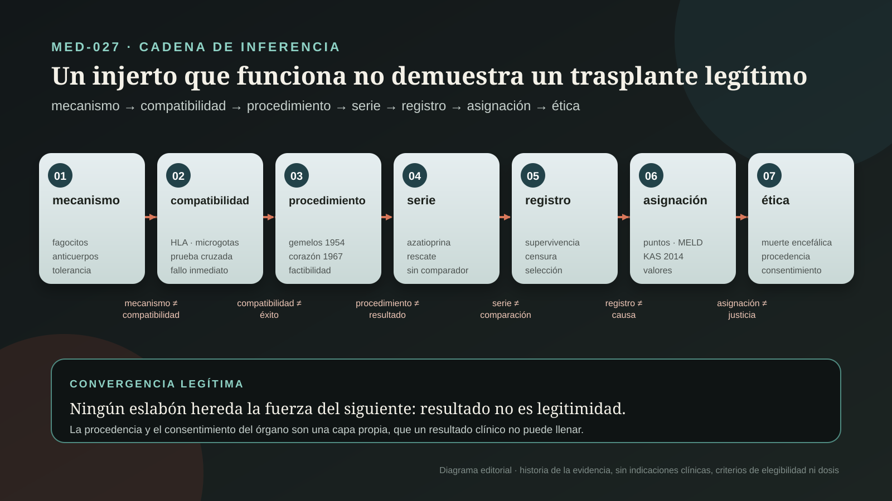
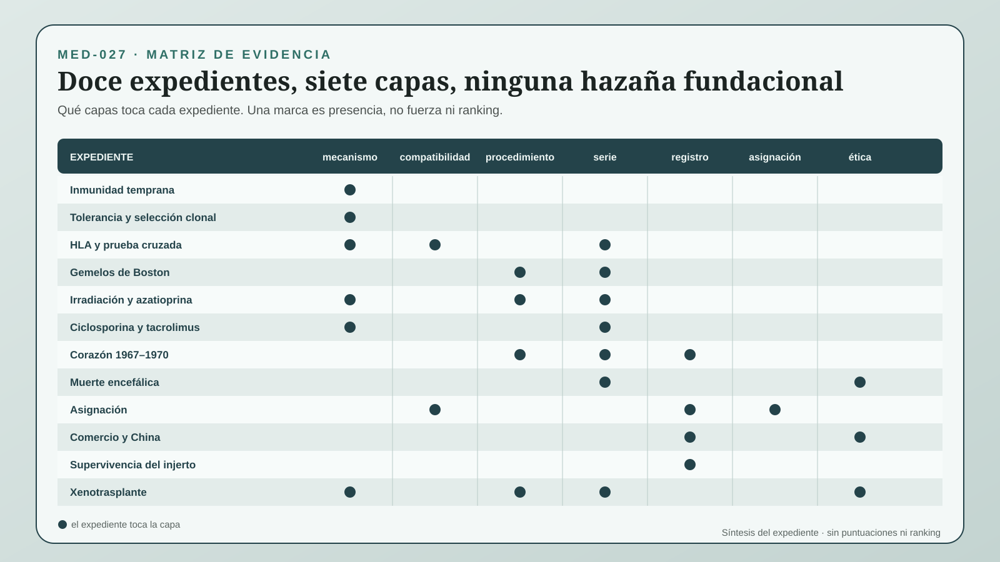

# MED-027 — Un injerto que funciona no demuestra un trasplante legítimo por sí solo

> **Alcance:** audita doce expedientes entre 1890 y 2026: la disputa entre inmunidad celular y humoral (Metchnikoff y Ehrlich); el suero antitóxico y la anafilaxia; los injertos de piel de Gibson y Medawar, las quimeras bovinas de Owen y la tolerancia adquirida; la selección clonal de Jerne y Burnet; el HLA de Dausset, la microcitotoxicidad de Terasaki y la prueba cruzada; los primeros trasplantes renales fallidos y el de los gemelos de Boston en 1954; la irradiación, la 6-mercaptopurina y la azatioprina; la ciclosporina (con su disputa de crédito) y el tacrolimus; el corazón de Barnard en 1967 y la ola de 1968; la muerte encefálica del comité de Harvard y sus críticas; listas y algoritmos de asignación; comercio de órganos, la Declaración de Estambul y el caso de China; la supervivencia del injerto como métrica; y, como cierre metodológico, el xenotrasplante de cerdo modificado en receptores humanos entre 2022 y 2026. Separa mecanismo, compatibilidad, procedimiento, serie, registro, asignación y ética. Es historia y epistemología de la evidencia: **no contiene recomendaciones clínicas, criterios de elegibilidad ni dosis**; las pautas históricas se nombran sin cantidades ni indicación alguna (`CLAIM-MED-GRAFT-NO-ADVICE-001`).

## Pregunta central

¿Cómo se enlazaron la explicación del rechazo, la medición de la compatibilidad, la técnica quirúrgica, la inmunosupresión, la definición de la muerte, la distribución de órganos escasos y el juicio ético, sin confundir un mecanismo con una prueba de compatibilidad, una prueba negativa con un éxito, una operación lograda con un resultado, una serie con una comparación, un registro con una causa, un algoritmo con justicia ni un órgano obtenido con un órgano legítimo?

## Respuesta breve

La inmunología del trasplante no nació en el quirófano. La disputa entre fagocitos y anticuerpos (Metchnikoff y Ehrlich, Nobel compartido en 1908) se cerró como complementariedad, no como victoria; el suero antitóxico de Behring y Kitasato protegió antes de que nadie supiera qué era un anticuerpo, y la anafilaxia de Portier y Richet mostró que la misma maquinaria que protege puede matar (`CLAIM-MED-GRAFT-METCHNIKOFF-EHRLICH-1908-001`, `CLAIM-MED-GRAFT-SERUM-BEFORE-MECHANISM-001`, `CLAIM-MED-GRAFT-ANAPHYLAXIS-MECHANISM-001`). Los injertos de piel en quemados de guerra, las quimeras de terneros gemelos y los ratones tolerantes de Billingham, Brent y Medawar (1953) convirtieron el rechazo en un fenómeno inmunitario específico y modificable; la selección clonal le dio una teoría (`CLAIM-MED-GRAFT-BILLINGHAM-1953-001`, `CLAIM-MED-GRAFT-BURNET-1957-001`).

La compatibilidad se volvió medible con el primer antígeno leucocitario (1958) y la microcitotoxicidad (1964). La prueba cruzada separó un desenlace: 24 de 30 injertos con prueba positiva fracasaron de inmediato frente a 8 de 195 con prueba negativa (`CLAIM-MED-GRAFT-PATEL-TERASAKI-1969-001`). Predecir el fracaso inmediato no es predecir el éxito duradero (`CLAIM-MED-GRAFT-CROSSMATCH-SCOPE-001`).

El trasplante renal entre gemelos idénticos de Boston (23 de diciembre de 1954) funcionó porque no había barrera inmunitaria que vencer: demostró técnica y función, no control del rechazo (`CLAIM-MED-GRAFT-TWINS-SPECIAL-001`). El control vino de la irradiación, de la 6-mercaptopurina y la azatioprina, y después de la ciclosporina, cuyos dos ensayos aleatorizados de 1983 subieron la supervivencia del injerto a un año (80.4 % frente a 64.0 %; 72 % frente a 52 %) con peor función renal (`CLAIM-MED-GRAFT-CYCLOSPORIN-TRIALS-1983-001`, `CLAIM-MED-GRAFT-CYCLOSPORIN-TRIAL-LIMIT-001`). El corazón de Barnard (1967) desató 102 trasplantes en 1968 y una supervivencia a dos años de 11 %: un procedimiento posible no era un resultado (`CLAIM-MED-GRAFT-HEART-WAVE-1968-001`).

La muerte encefálica del comité de Harvard (1968) definió un estado en el que se podían obtener órganos; sus críticos, desde la historia y desde casos de supervivencia corporal prolongada, discuten qué se definió y para quién (`CLAIM-MED-GRAFT-HARVARD-CRITICS-001`, `CLAIM-MED-GRAFT-SHEWMON-1998-001`). Los algoritmos de asignación —puntos de Pittsburgh (1987), MELD (2001–2003), el sistema renal de 2014— codifican valores: urgencia, utilidad, espera y equidad no se maximizan a la vez (`CLAIM-MED-GRAFT-ALGORITHM-VALUES-001`). El comercio de órganos dejó a vendedores endeudados (`CLAIM-MED-GRAFT-GOYAL-2002-001`); en China, la obtención de órganos de presos ejecutados, admitida por funcionarios, terminó en revisiones, retractaciones y análisis forenses de datos que discuten la credibilidad de la reforma (`CLAIM-MED-GRAFT-ROGERS-2019-001`, `CLAIM-MED-GRAFT-ROBERTSON-2019-001`). La supervivencia del injerto, la métrica central, mejoró sobre todo en el primer año y depende de quién entra a la lista (`CLAIM-MED-GRAFT-LAMB-2011-001`, `CLAIM-MED-GRAFT-WOLFE-1999-001`).

La cadena legítima es **mecanismo → compatibilidad → procedimiento → serie → registro → asignación → ética**. Ningún eslabón hereda la fuerza del siguiente.

## UN INJERTO QUE FUNCIONA NO DEMUESTRA UN TRASPLANTE LEGÍTIMO POR SÍ SOLO

### 1. Siete capas que deben conservarse

| Capa | Pregunta | Producto legítimo | Salto inválido |
|---|---|---|---|
| Mecanismo | ¿qué explica el rechazo, la tolerancia o la protección, y en qué modelo? | teoría con experimentos | tomar una teoría o un ratón como predicción clínica |
| Compatibilidad | ¿qué antígeno o anticuerpo se mide, con qué prueba y qué predice? | riesgo de un desenlace concreto | convertir una prueba negativa en éxito |
| Procedimiento | ¿se puede hacer la operación, con qué técnica y qué cuidado? | factibilidad técnica | leer un injerto que funciona días como tratamiento |
| Serie | ¿cuántos pacientes, elegidos cómo, seguidos cuánto? | frecuencia delimitada | tomar una serie de rescate o pionera como efecto |
| Registro | ¿qué población, qué métrica, qué censura y qué comparador? | tendencia y asociación | leer supervivencia como causa o proyección como observación |
| Asignación | ¿quién recibe el órgano escaso y con qué regla? | regla explícita con consecuencias simuladas o medidas | creer que un algoritmo es neutral |
| Ética | ¿de dónde viene el órgano, con qué consentimiento y bajo qué definición de muerte? | juicio sobre legitimidad | creer que un buen resultado legitima la obtención |

### 2. Cuatro distinciones que el expediente no deja fundir

Un **mecanismo** demostrado en ratones o conejos no es una prueba de compatibilidad para personas (`CLAIM-MED-GRAFT-MECHANISM-NOT-MATCH-001`). Una **compatibilidad** medida predice el desenlace para el que se validó, no el éxito global de un trasplante (`CLAIM-MED-GRAFT-MATCH-NOT-SUCCESS-001`). Un **procedimiento** logrado y una serie con algunos supervivientes no estiman cuánto mejor está el trasplantado que quien no lo recibe, la misma advertencia que MED-024 hace con la serie de Withering (`CLAIM-MED-GRAFT-SERIES-NOT-COMPARISON-001`, `CLAIM-MED-PHARM-SERIES-NOT-COMPARISON-001`). Y una **obtención** exitosa no es una obtención legítima: la procedencia y el consentimiento del órgano son una capa propia, que un resultado clínico no puede llenar (`CLAIM-MED-GRAFT-CHAIN-001`, `CLAIM-MED-GRAFT-ALLOCATION-NOT-JUSTICE-001`).

## DOCE EXPEDIENTES AUDITADOS

### 3. Fagocitos contra anticuerpos: Metchnikoff y Ehrlich

El Nobel de 1908 se repartió entre Élie Metchnikoff, que había descrito la fagocitosis por macrófagos y micrófagos como mecanismo de defensa, y Paul Ehrlich, que propuso la teoría de las cadenas laterales para la formación de anticuerpos y explicó cómo neutralizan toxinas y lisan bacterias con ayuda del complemento (`CLAIM-MED-GRAFT-METCHNIKOFF-EHRLICH-1908-001`). Kaufmann describe la fase inicial como de «discusiones discordantes» entre escuelas; hoy la inmunidad innata y la adaptativa se entienden como compañeras complementarias. La disputa no terminó con un vencedor sino con una redefinición del objeto: «celular o humoral» era una dicotomía mal planteada (`CLAIM-MED-GRAFT-HUMORAL-CELLULAR-001`). El mismo Ehrlich reaparece en MED-024 como químico del cribado; su teoría de receptores conecta las dos historias sin fundirlas (`CLAIM-MED-PHARM-EHRLICH-SCREENING-001`).

### 4. Suero antitóxico y anafilaxia: proteger antes de explicar

Behring y Kitasato publicaron en 1890 que el suero de animales inmunizados contra la toxina del tétanos protegía a otros; Behring firmó solo el trabajo sobre la difteria y recibió solo el primer Nobel de medicina, en 1901 (`CLAIM-MED-GRAFT-BEHRING-KITASATO-1890-001`). Kantha propone como razones la lectura literal del testamento de Nobel —premiar a «la persona»— y el peso de la difteria, y recuerda que el valor de la antitoxina tetánica en personas sólo se hizo evidente en la Primera Guerra Mundial (`CLAIM-MED-GRAFT-KITASATO-CREDIT-001`). La transferencia pasiva de protección se demostró y se usó antes de que existiera una teoría del anticuerpo: el suero era un producto con efecto, no un mecanismo conocido (`CLAIM-MED-GRAFT-SERUM-BEFORE-MECHANISM-001`).

A inicios del siglo XX —1902 en la cronología habitual— Charles Richet y Paul Portier, que buscaban una antitoxina contra el veneno de *Physalia* en perros, con experimentos iniciados en el yate del príncipe de Mónaco, obtuvieron en lugar de protección una reacción sistémica, a veces mortal, ante una segunda exposición; la llamaron anafilaxia (`CLAIM-MED-GRAFT-ANAPHYLAXIS-1902-001`). Richet la interpretó como «falta de protección»; hoy se entiende como una respuesta inmunitaria exagerada, sobre todo mediada por IgE, junto a reacciones no inmunitarias de aspecto similar (`CLAIM-MED-GRAFT-ANAPHYLAXIS-MECHANISM-001`). La lección para el trasplante es directa: la especificidad inmunitaria protege y daña, y un mismo fenómeno puede recibir interpretaciones opuestas antes de que se conozca su mecanismo.

### 5. Injertos de piel, terneros gemelos y tolerancia adquirida

Durante la Segunda Guerra Mundial, Thomas Gibson y Peter Medawar estudiaron homoinjertos de piel en quemados; publicaron en 1943 «The fate of skin homografts in man». La lectura habitual, que este expediente no verificó contra el texto completo, es que una segunda tanda de injertos del mismo donante se destruyó más rápido que la primera, un patrón de «segunda serie» que apuntaba a inmunidad adquirida (`CLAIM-MED-GRAFT-GIBSON-MEDAWAR-1943-001`). Un caso clínico con una respuesta acelerada sugiere un mecanismo; no lo aísla, y la confirmación experimental vino después en conejos y ratones (`CLAIM-MED-GRAFT-SECOND-SET-LIMIT-001`).

Ray Owen publicó en 1945 que terneros gemelos dicigóticos, que comparten circulación placentaria, portan de por vida células sanguíneas de ambos genotipos sin rechazarlas (`CLAIM-MED-GRAFT-OWEN-1945-001`). Billingham, Brent y Medawar mostraron en 1953 que ratones expuestos a células de otra cepa durante la vida fetal o neonatal aceptaban después injertos de piel de esa cepa: llamaron al fenómeno «tolerancia activamente adquirida» (`CLAIM-MED-GRAFT-BILLINGHAM-1953-001`). La tolerancia neonatal en ratones endogámicos es un mecanismo, no un procedimiento clínico: no ofrecía un modo de volver tolerante a un adulto enfermo, y la tolerancia clínica estable siguió siendo una meta más que un logro (`CLAIM-MED-GRAFT-TOLERANCE-LIMIT-001`).

### 6. Selección clonal: una teoría que organizó el campo

Niels Jerne propuso en 1955 una teoría de «selección natural» de la formación de anticuerpos: el antígeno seleccionaría anticuerpos preexistentes en lugar de moldearlos (`CLAIM-MED-GRAFT-JERNE-1955-001`). Macfarlane Burnet publicó en 1957, en el *Australian Journal of Science*, la modificación que la hizo celular: cada linfocito portaría un receptor único y el antígeno seleccionaría y expandiría su clon (`CLAIM-MED-GRAFT-BURNET-1957-001`). La teoría explicaba memoria, especificidad y tolerancia a lo propio, y por eso encajaba con Owen y Medawar. Silverstein defiende en 2002 que su núcleo —una célula, un receptor, selección por el antígeno— sobrevive a los «desafíos» posteriores, que atacan versiones caricaturizadas (`CLAIM-MED-GRAFT-CLONAL-STATUS-001`). Una teoría que organiza datos no predice por sí sola qué paciente rechazará un riñón.

### 7. HLA y prueba cruzada: medir la compatibilidad

En 1958 Jean Dausset describió un aloantígeno de leucocitos humanos detectado con sueros de pacientes politransfundidos, el que llegaría a llamarse HLA-A2 (`CLAIM-MED-GRAFT-DAUSSET-1958-001`). Thorsby subraya que el campo creció sobre todo por los talleres internacionales de histocompatibilidad, que intercambiaron sueros y nomenclatura, y propone que el complejo debió llamarse «complejo mayor de respuesta inmunitaria»: su función no es frustrar trasplantes (`CLAIM-MED-GRAFT-HLA-WORKSHOPS-001`). Terasaki y McClelland publicaron en 1964 una prueba de microgotas de citotoxicidad sérica que permitía tipificar con cantidades mínimas de suero (`CLAIM-MED-GRAFT-TERASAKI-1964-001`).

Kissmeyer-Nielsen y colaboradores describieron en 1966 el rechazo hiperagudo de aloinjertos renales asociado a anticuerpos humorales preformados contra células del donante (`CLAIM-MED-GRAFT-KISSMEYER-1966-001`). Patel y Terasaki reunieron en 1969 una serie de 225 trasplantes: fracasó de inmediato el injerto en 24 de 30 receptores con prueba cruzada positiva frente a 8 de 195 con prueba negativa, con más fracasos inmediatos en mujeres multíparas y retrasplantes (`CLAIM-MED-GRAFT-PATEL-TERASAKI-1969-001`). La prueba cruzada positiva se volvió una contraindicación práctica. Pero el desenlace que discrimina es el fracaso inmediato: una prueba negativa no asegura un injerto duradero, y las revisiones posteriores dan totales distintos para la misma serie (`CLAIM-MED-GRAFT-CROSSMATCH-SCOPE-001`).

### 8. Primeros intentos y los gemelos de Boston (1933–1956)

Yurii Voronoy realizó el 3 de abril de 1933, en Jersón (Ucrania), el primer alotrasplante renal humano conocido, desde un donante fallecido, a una mujer con insuficiencia renal por intoxicación con cloruro de mercurio; produjo poca orina y la paciente murió unas 48 horas después (`CLAIM-MED-GRAFT-VORONOY-1933-001`). Hume, Merrill, Miller y Thorn informaron en 1955 nueve casos de homotrasplante renal en Boston en receptores sin inmunosupresión eficaz; este expediente no leyó el texto completo y no fija cuánto duró la función de cada injerto (`CLAIM-MED-GRAFT-HUME-1955-001`).

El 23 de diciembre de 1954, en el Peter Bent Brigham Hospital, el equipo dirigido por Joseph Murray trasplantó un riñón de Ronald Herrick a su gemelo idéntico Richard; la publicación de Merrill y colaboradores en *JAMA* (1956) se tituló «Successful homotransplantation of the human kidney between identical twins», y Richard vivió unos ocho años más según la crónica institucional (`CLAIM-MED-GRAFT-TWINS-1954-001`). Murray resume la genealogía en tres hilos: la enfermedad renal, los injertos de piel entre gemelos y la técnica quirúrgica. El caso fue especial porque entre gemelos idénticos no hay rechazo que vencer, lo que la experiencia previa con injertos de piel entre gemelos permitía anticipar. Demostró que la operación era factible y que un riñón trasplantado sostenía la vida; no demostró nada sobre cómo controlar el rechazo, que era el problema de casi todos los demás pacientes (`CLAIM-MED-GRAFT-TWINS-SPECIAL-001`, `CLAIM-MED-GRAFT-PROCEDURE-NOT-RESULT-001`).

### 9. Irradiación, 6-mercaptopurina y azatioprina (1959–1963)

El equipo de Boston intentó después «modificar» al receptor con irradiación corporal total; la serie se publicó en 1962 en *Annals of Surgery*, con un trasplante de 1959 entre gemelos no idénticos en un receptor irradiado de forma subletal como éxito excepcional; este expediente no extrajo del texto el número de receptores irradiados ni de supervivientes (`CLAIM-MED-GRAFT-IRRADIATION-1959-001`). Schwartz y Dameshek describieron en 1959 una «tolerancia inmunológica inducida por fármacos» con 6-mercaptopurina en conejos (`CLAIM-MED-GRAFT-SCHWARTZ-DAMESHEK-1959-001`). Roy Calne publicó en 1960 la inhibición del rechazo de homoinjertos renales en perros con 6-mercaptopurina (`CLAIM-MED-GRAFT-CALNE-1960-001`), y en 1963 Murray y colaboradores informaron en el *NEJM* supervivencia prolongada de homoinjertos renales humanos con inmunosupresión farmacológica, la época de la azatioprina (`CLAIM-MED-GRAFT-AZATHIOPRINE-1963-001`).

El orden es instructivo: un mecanismo de tolerancia en ratones, un fármaco antileucémico probado en conejos y perros, y luego series humanas pequeñas sin grupo de comparación. La inmunosupresión se adoptó por series, porque la alternativa —el fracaso casi seguro sin ella— no dejaba un comparador aceptable; eso no la volvió comparada (`CLAIM-MED-GRAFT-SERIES-NOT-COMPARISON-001`).

### 10. Ciclosporina y tacrolimus: ensayos, crédito y series de rescate

Borel, Feurer, Gubler y Stähelin publicaron en 1976 los efectos biológicos de la ciclosporina A, un metabolito fúngico que deprimía respuestas de anticuerpos y retrasaba el rechazo de injertos de piel en ratones con poca toxicidad medular (`CLAIM-MED-GRAFT-BOREL-1976-001`). Calne y colaboradores la dieron en 1978 a siete receptores de riñones de donante fallecido no compatibles: inhibió el rechazo, con nefrotoxicidad y hepatotoxicidad claras; cinco salieron del hospital con injerto funcionante, uno perdió el injerto y otro murió por infección fúngica; los autores pidieron más estudio antes de recomendarla (`CLAIM-MED-GRAFT-CALNE-1978-001`).

En 1983 dos ensayos aleatorizados compararon ciclosporina con azatioprina y esteroides: el canadiense, con 209 receptores, estimó una supervivencia del injerto a un año de 80.4 % frente a 64.0 %; el europeo, con 232 receptores en ocho centros, de 72 % frente a 52 % (`CLAIM-MED-GRAFT-CYCLOSPORIN-TRIALS-1983-001`). Los mismos ensayos registraron el costo: peor función renal a un año con ciclosporina; en el europeo, 24 de 84 pacientes con injerto funcionante habían pasado ya a azatioprina y esteroides; la supervivencia de los pacientes no difirió (94 % frente a 92 %) (`CLAIM-MED-GRAFT-CYCLOSPORIN-TRIAL-LIMIT-001`).

El crédito del descubrimiento se disputó. Stähelin sostuvo en 1996 que la mayoría de los relatos anteriores eran, en aspectos importantes, incorrectos; Heusler y Pletscher concluyeron en 2001, a partir de los registros de Sandoz, que la actividad se descubrió en un cribado general con muchos científicos, que Borel y Stähelin contribuyeron ambos de forma notable y que Borel lideró la explotación posterior (`CLAIM-MED-GRAFT-CYCLOSPORIN-CREDIT-001`). Como con la estreptomicina en MED-024, la disputa depende de qué se premia: la observación en el cribado, la caracterización o el desarrollo (`CLAIM-MED-PHARM-SCHATZ-CREDIT-001`).

Kino y colaboradores aislaron en 1987 el FK-506 (tacrolimus) de un *Streptomyces* (`CLAIM-MED-GRAFT-FK506-1987-001`). Starzl y colaboradores lo usaron en 1989 en 14 receptores hepáticos, primero como rescate en 10 con rechazo o nefrotoxicidad, con éxito en 7 (`CLAIM-MED-GRAFT-FK506-1989-001`). Una serie de rescate selecciona a quienes fallaron con el tratamiento previo y no tiene grupo concurrente; su comparación vino después con ensayos (`CLAIM-MED-GRAFT-FK506-LIMIT-001`).

### 11. Barnard (1967) y la ola de trasplantes cardíacos

El 3 de diciembre de 1967 Christiaan Barnard trasplantó en el Groote Schuur Hospital de Ciudad del Cabo un corazón a Louis Washkansky, que murió de neumonía y septicemia el día 18; el segundo receptor, Philip Blaiberg, vivió diecinueve meses (`CLAIM-MED-GRAFT-BARNARD-1967-001`). Brink y Hassoulas tabulan la ola mundial: 102 trasplantes en 1968, 48 en 1969 y 16 en 1970; de 166 trasplantes entre 1968 y 1970, la supervivencia fue de 55 % al mes, 18 % al año y 11 % a los dos años (`CLAIM-MED-GRAFT-HEART-WAVE-1968-001`). La técnica era reproducible; el rechazo no estaba controlado, y casi todos los programas se detuvieron. La operación se volvió viable como programa clínico con la ciclosporina: el procedimiento no era el resultado (`CLAIM-MED-GRAFT-HEART-WAVE-LIMIT-001`).

### 12. Muerte encefálica: el comité de Harvard y sus críticos

En 1968 el Comité Ad Hoc de la Facultad de Medicina de Harvard publicó en *JAMA* «A definition of irreversible coma», con criterios de coma irreversible que se volvieron referencia para la llamada muerte encefálica (`CLAIM-MED-GRAFT-HARVARD-1968-001`). Sus críticos sostuvieron que el comité ignoró consideraciones morales centrales y sirvió al propósito de ampliar el trasplante; Belkin argumenta que las historias del comité han repetido esa lectura desde una agenda de la bioética que se presenta como antídoto moral, y propone otras motivaciones posibles (`CLAIM-MED-GRAFT-HARVARD-CRITICS-001`).

La crítica también es empírica. Shewmon reunió en 1998 unos 175 casos de muerte encefálica diagnosticada con supervivencia corporal de una semana o más, 56 con datos suficientes, algunos de años; concluyó que la tendencia a la asistolia es transitoria y depende de factores sistémicos, lo que debilita el argumento de la pérdida de unidad integradora del organismo (`CLAIM-MED-GRAFT-SHEWMON-1998-001`). Wijdicks encontró en 2002 guías en 70 de 80 países, acuerdo en el examen neurológico pero diferencias en la prueba de apnea (recomendada en 59 % de los países), en los tiempos de observación y en las pruebas confirmatorias, obligatorias en 40 % de las guías (`CLAIM-MED-GRAFT-WIJDICKS-2002-001`). El World Brain Death Project de 2020 propuso estándares mínimos por consenso porque no había ensayos ni estudios observacionales de alta calidad que los fundaran (`CLAIM-MED-GRAFT-GREER-2020-001`). Truog y Miller argumentaron en 2008 que la «regla del donante muerto» —no obtener órganos de quien no ha muerto ni causar su muerte al obtenerlos— no se cumple con la claridad que se supone (`CLAIM-MED-GRAFT-DEAD-DONOR-RULE-001`).

Una definición de muerte es una regla social y médica con consecuencias para la obtención de órganos. Su cambio histórico y su variación entre países no prueban que sea arbitraria ni que sea correcta: muestran que es una capa ética y normativa, no un dato de laboratorio.

### 13. Listas y algoritmos: asignar un bien escaso

Starzl y colaboradores describieron en 1987 el sistema de Pittsburgh: en 270 trasplantes renales de donante fallecido de 1986, el riñón fue al paciente con más puntos en 98 % de los casos, con puntos por tiempo de espera, compatibilidad antigénica, anticuerpos, urgencia médica y logística (`CLAIM-MED-GRAFT-STARZL-POINTS-1987-001`). El MELD, construido con bilirrubina, creatinina, INR y la causa de la hepatopatía, discriminó la muerte a tres meses con estadísticos c de 0.78 a 0.87 en cuatro conjuntos de validación (`CLAIM-MED-GRAFT-MELD-2001-001`); aplicado a 3 437 candidatos de la lista estadounidense, discriminó mejor que la escala de Child-Turcotte-Pugh (0.83 frente a 0.76) y fundó la asignación hepática por gravedad, no por espera (`CLAIM-MED-GRAFT-MELD-2003-001`). La política renal estadounidense aprobada en 2013 introdujo el índice de perfil del donante (KDPI); su simulación proyectó una mediana de años de vida del injerto de 9.07 frente a 8.82, más acceso para candidatos sensibilizados y descensos de 4.1 % y 2.7 % en los grupos de 50–64 y 65 años o más (`CLAIM-MED-GRAFT-KAS-2014-001`).

Cada regla elige: urgencia (quien morirá antes), utilidad (quien aprovechará más años), espera (quien llegó antes) y acceso de grupos desfavorecidos no se maximizan juntos, y las ganancias se compran con pérdidas medibles para otros (`CLAIM-MED-GRAFT-ALGORITHM-VALUES-001`). Un algoritmo bien calibrado sigue siendo una decisión de valores, y su calibración se mide contra la mortalidad en lista, no contra la justicia (`CLAIM-MED-GRAFT-ALLOCATION-NOT-JUSTICE-001`).

### 14. Comercio, Estambul y China

Goyal y colaboradores encuestaron en 2001 a 305 personas que habían vendido un riñón en Chennai, en promedio seis años antes: 96 % lo vendió para pagar deudas, recibió en promedio 1 070 dólares y el ingreso familiar cayó un tercio después de la nefrectomía; la mayoría informó peor salud (`CLAIM-MED-GRAFT-GOYAL-2002-001`). Irán adoptó en 1988 un programa de donación renal de vivos no emparentados, compensada y regulada; sus defensores informan 19 609 trasplantes renales hasta fines de 2005 (15 356 de vivos no emparentados) y la eliminación de la lista de espera en 1999 (`CLAIM-MED-GRAFT-IRAN-1988-001`). La Declaración de Estambul, acordada en una cumbre convocada por la Transplantation Society y la International Society of Nephrology (30 de abril–2 de mayo de 2008), definió el comercialismo como tratar el órgano como mercancía y distinguió el viaje para trasplante del turismo de trasplantes; la edición de 2018 conserva esas definiciones (`CLAIM-MED-GRAFT-ISTANBUL-2008-001`). Las dos evidencias sobre pago miden cosas distintas —el daño a vendedores de un mercado no regulado y la oferta en un programa regulado descrito por sus promotores—; ninguna resuelve sola la pregunta ética (`CLAIM-MED-GRAFT-COMMERCE-EVIDENCE-001`).

En China, Huang Jiefu y colaboradores, funcionarios sanitarios, escribieron en *The Lancet* en 2008 sobre la política de trasplantes; el comunicado de la revista atribuye al texto que más de 90 % de los órganos trasplantados procedía de presos ejecutados, cifra que este expediente no leyó en el original (`CLAIM-MED-GRAFT-HUANG-2008-001`). Las autoridades anunciaron que desde el 1 de enero de 2015 los donantes voluntarios hospitalarios serían la única fuente (`CLAIM-MED-GRAFT-CHINA-REFORM-2015-001`).

La evidencia posterior es de tres clases. Primero, la de publicaciones: Rogers y colaboradores revisaron 445 artículos en inglés sobre 85 477 trasplantes en China continental (2000–2017); 92.5 % no informó si los órganos procedían de presos ejecutados, 99 % no informó consentimiento de los donantes y 73 % sí declaró aprobación ética; 19 artículos que negaban el uso de presos describían 2 688 trasplantes anteriores a 2010, cuando no existía un programa voluntario; pidieron retractar esa literatura (`CLAIM-MED-GRAFT-ROGERS-2019-001`). En agosto de 2019 *PLOS ONE* (8) y *Transplantation* (7) retractaron quince artículos de 2008–2014, citando esa revisión; al menos un grupo de autores declaró su desacuerdo (`CLAIM-MED-GRAFT-RETRACTIONS-2019-001`). Segundo, la de datos oficiales: Robertson, Hinde y Lavee encontraron que la serie nacional de donación de 2010–2018 se ajusta casi exactamente a una fórmula cuadrática de un parámetro, con artefactos en cinco provincias, y lo interpretan como fabricación y manipulación dirigidas, junto a donación voluntaria real (`CLAIM-MED-GRAFT-ROBERTSON-2019-001`). Tercero, la de textos clínicos: Robertson y Lavee analizaron 2 838 artículos de un corpus de 124 770 publicaciones en chino y hallaron 71 en los que la muerte encefálica no pudo declararse correctamente antes de extraer el corazón, lo que, sostienen, implica ejecuciones por obtención de órganos (`CLAIM-MED-GRAFT-ROBERTSON-LAVEE-2022-001`). Un tribunal no gubernamental con sede en Londres, presidido por Geoffrey Nice, concluyó en 2019 que la extracción forzada de órganos se había cometido durante años a escala significativa; no tiene poder legal y el gobierno chino rechaza esas acusaciones (`CLAIM-MED-GRAFT-CHINA-TRIBUNAL-2019-001`).

El estado de la evidencia es asimétrico: el uso masivo de órganos de presos ejecutados antes de 2015 está admitido por funcionarios; lo que ocurre después de 2015 descansa en inferencias forenses sobre datos y textos, convergentes pero indirectas, frente a una versión oficial sin datos auditables de forma independiente (`CLAIM-MED-GRAFT-CHINA-EVIDENCE-STATUS-001`).

### 15. La supervivencia del injerto como métrica

Hariharan y colaboradores analizaron en 2000 los 93 934 trasplantes renales estadounidenses de 1988–1996: la supervivencia a un año del injerto de donante fallecido subió de 75.7 % a 87.7 % y la vida media proyectada de 7.9 a 13.8 años (`CLAIM-MED-GRAFT-HARIHARAN-2000-001`). Lamb, Lodhi y Meier-Kriesche, con 252 910 trasplantes de 1989–2009, estimaron una vida media del injerto de donante fallecido de 6.6 años en 1989 y 8.8 en 2005; la mejora vino sobre todo del primer año, y la pérdida posterior mejoró poco (`CLAIM-MED-GRAFT-LAMB-2011-001`). La distancia entre 13.8 y 8.8 años no es contradicción del mundo: una vida media proyectada desde seguimientos cortos supone que el riesgo temprano predice el tardío (`CLAIM-MED-GRAFT-HALF-LIFE-PROJECTION-001`). Meier-Kriesche y Schold mostraron en 2004 que entre 1995 y 2000 bajó el rechazo agudo sin mejorar la supervivencia global del injerto: un desenlace intermedio mejorado no arrastró al final (`CLAIM-MED-GRAFT-MEIER-KRIESCHE-2004-001`).

El sesgo de selección es la otra trampa. Wolfe y colaboradores siguieron a 228 552 pacientes en diálisis: los 46 164 puestos en lista ya tenían una mortalidad 38–58 % menor que el total en diálisis; comparados con quienes seguían en lista, los 23 275 trasplantados tuvieron 2.8 veces más riesgo de morir en las dos primeras semanas y un riesgo relativo de 0.32 a los dieciocho meses (`CLAIM-MED-GRAFT-WOLFE-1999-001`). Comparar trasplantados con todos los pacientes en diálisis atribuye al trasplante la salud de quien fue elegido. La supervivencia del injerto depende de la censura por muerte, del donante, del centro y de la población que llega a la lista; un registro describe tendencias de una población seleccionada, no el efecto causal del trasplante ni de un fármaco (`CLAIM-MED-GRAFT-METRIC-BIAS-001`, `CLAIM-MED-GRAFT-REGISTRY-NOT-CAUSE-001`).

### 16. Cierre metodológico: el xenotrasplante de cerdo modificado (2022–2026)

El xenotrasplante repite todas las capas con un donante nuevo. Montgomery y colaboradores trasplantaron en 2022 riñones de cerdo con el gen de la alfa-1,3-galactosiltransferasa eliminado a dos receptores humanos en muerte encefálica, mantenidos con ventilación: los injertos produjeron orina y no mostraron rechazo hiperagudo durante 54 horas (`CLAIM-MED-GRAFT-XENO-DECEDENT-2022-001`). Es un modelo de horas en un cuerpo sin vida, que depende a su vez de la definición de muerte de la sección 12.

En receptores vivos, todos bajo uso compasivo o acceso expandido:

- **Corazón, 2022:** un hombre de 57 años en oxigenación por membrana extracorpórea, no candidato a un aloinjerto, recibió un corazón de cerdo con diez ediciones genéticas el 7 de enero de 2022; el injerto funcionó hasta un deterioro diastólico súbito hacia el día 47–49 y se retiró el soporte el día 60 (`CLAIM-MED-GRAFT-XENO-HEART-2022-001`). El análisis posterior identificó lesión endotelial compatible con rechazo mediado por anticuerpos y reactivación de un citomegalovirus porcino latente.
- **Corazón, 2023:** un segundo hombre recibió un corazón de cerdo el 20 de septiembre de 2023 en la misma universidad y murió el 30 de octubre, unas seis semanas después, según el comunicado institucional (`CLAIM-MED-GRAFT-XENO-HEART-2023-001`).
- **Riñón, 2024:** un hombre de 62 años recibió en marzo de 2024 un riñón con 69 ediciones genómicas; funcionó de inmediato, tuvo un rechazo celular revertido el día 8 y el paciente murió de causa cardíaca súbita el día 52 sin rechazo evidente del xenoinjerto en la autopsia (`CLAIM-MED-GRAFT-XENO-KIDNEY-2024-001`).
- **Riñones en Nueva York, 2024–2025:** una mujer recibió en abril de 2024 un riñón junto con una bomba cardíaca mecánica y otra el 25 de noviembre de 2024; a la segunda se le retiró el riñón el 4 de abril de 2025, tras 130 días, por rechazo, y volvió a diálisis; según la misma crónica, los cuatro receptores estadounidenses anteriores (dos corazones y dos riñones) habían muerto sin que ningún órgano durara más de dos meses (`CLAIM-MED-GRAFT-XENO-NYU-2024-001`).
- **Riñón como puente, 2025–2026:** un receptor trasplantado el 25 de enero de 2025 permaneció sin diálisis 271 días; tras rechazo con microangiopatía trombótica se extirpó el injerto y, 82 días después, recibió un riñón humano sin sensibilización detectada en 231 días de seguimiento; no se detectó transmisión de patógenos porcinos (`CLAIM-MED-GRAFT-XENO-BRIDGE-2026-001`).
- **Hígado auxiliar, 2025:** un grupo chino informó en el *Journal of Hepatology* el primer trasplante hepático auxiliar de un cerdo con diez ediciones a un receptor vivo, que sobrevivió 171 días; el injerto se explantó por rechazo y microangiopatía trombótica (`CLAIM-MED-GRAFT-XENO-LIVER-2025-001`).
- **Riñón, 2025–2026:** una mujer trasplantada el 22 de noviembre de 2025 seguía sin diálisis más de un año después según un comunicado de eGenesis y Mass General Brigham del 23 de noviembre de 2026, que eleva a seis los receptores de ese riñón por acceso expandido; no hay todavía publicación revisada por pares de ese caso (`CLAIM-MED-GRAFT-XENO-FALCO-2026-001`).

Las fuentes leídas documentan al menos ocho receptores vivos con órganos de cerdo modificado entre 2022 y noviembre de 2026 (dos corazones, cinco riñones y un hígado auxiliar), más otros anunciados sin detalle; la revisión de *American Journal of Transplantation* de 2026 sólo resume los casos con publicación revisada. Son series de casos únicos, elegidos por no tener otra opción, con pautas cambiantes y sin comparador; sus duraciones —60 días, seis semanas, 52 días, 130 días, 171 días, 271 días, más de un año— describen factibilidad y aprendizaje, no un efecto ni una supervivencia esperable (`CLAIM-MED-GRAFT-XENO-COUNT-LIMIT-001`). La empresa anuncia un ensayo registrable con 33 pacientes; ése sería el primer contraste formal.

## LO OBSERVADO

- fagocitos al microscopio, sueros que protegen o sensibilizan, perros con anafilaxia;
- injertos de piel destruidos, terneros quiméricos, ratones tolerantes;
- sueros de politransfundidos, pruebas de microgotas, pruebas cruzadas positivas y negativas;
- riñones que funcionan entre gemelos, injertos rechazados, receptores irradiados;
- fármacos que retrasan el rechazo en animales y en series humanas; dos ensayos aleatorizados;
- corazones trasplantados y receptores que murieron en días o meses;
- definiciones legales y clínicas de muerte y sus variaciones entre países;
- reglas de puntos, puntuaciones de gravedad, simulaciones de políticas;
- encuestas a vendedores de riñones, declaraciones profesionales, admisiones oficiales, artículos retractados, series de datos oficiales y textos clínicos analizados por algoritmo;
- registros nacionales de supervivencia del injerto y del paciente;
- órganos de cerdo modificado en personas en muerte encefálica y en receptores vivos.

## LO MEDIDO

- frecuencias de fracaso inmediato por resultado de la prueba cruzada (Patel y Terasaki);
- supervivencia del injerto y del paciente a un año en ensayos aleatorizados (1983);
- supervivencia de receptores cardíacos de 1968–1970;
- discriminación de la mortalidad a tres meses por MELD;
- ingresos y salud declarada de vendedores de riñón;
- proporciones de artículos sin declaración de procedencia o consentimiento;
- ajuste de series oficiales a fórmulas;
- vida media del injerto proyectada y observada; mortalidad en diálisis, en lista y tras el trasplante;
- duración de función de xenoinjertos en casos únicos;
- no el número real de órganos obtenidos de presos en China después de 2015, ni el efecto causal de cada inmunosupresor sobre la supervivencia a largo plazo.

## LO INFERIDO

Que el rechazo es una respuesta inmunitaria específica, modulable por fármacos y anticipable en parte por pruebas de compatibilidad, es la inferencia más sólida del expediente: convergen experimentos de injertos, teoría clonal, serología y ensayos aleatorizados de inmunosupresión. Que el trasplante prolonga la vida de pacientes con insuficiencia renal frente a seguir en lista se infiere de registros con comparador elegido para reducir el sesgo de selección. Que hubo obtención sistemática de órganos de presos ejecutados en China se infiere con firmeza para antes de 2015 y con inferencia forense indirecta para después (`CLAIM-MED-GRAFT-CHAIN-001`, `CLAIM-MED-GRAFT-WOLFE-1999-001`, `CLAIM-MED-GRAFT-CHINA-EVIDENCE-STATUS-001`).

## LOS SUPUESTOS

- que los modelos de ratón, conejo y perro capturan algo del rechazo humano;
- que una prueba de laboratorio de compatibilidad mide lo mismo entre centros y épocas;
- que la supervivencia del injerto a un año informa sobre la supervivencia a largo plazo;
- que los receptores en lista son un comparador razonable para los trasplantados;
- que los registros cuentan de forma completa y homogénea;
- que los patrones estadísticos o textuales en datos chinos indican manipulación o ejecución y no errores de redacción;
- que un comunicado de empresa describe con fidelidad un caso aún no publicado.

## LAS INCERTIDUMBRES

- el detalle de la serie de Gibson y Medawar y de la serie de Hume de 1955, no leídas completas;
- el número de receptores irradiados y supervivientes de la serie de Boston de 1962;
- el tamaño de la serie de Patel y Terasaki según distintas revisiones;
- qué parte de la mejora de la supervivencia del injerto se debe a fármacos, selección o cuidados;
- el origen de los órganos trasplantados en China después de 2015;
- el número total de receptores vivos de xenoinjertos hasta noviembre de 2026.

## LAS ALTERNATIVAS

- un injerto que sobrevive puede deberse a compatibilidad, selección del receptor o del donante, no al fármaco;
- una caída del rechazo agudo puede no mejorar la supervivencia final;
- una vida media proyectada larga puede reflejar un seguimiento corto;
- una mejor supervivencia en trasplantados puede reflejar quién fue puesto en lista;
- un patrón cuadrático en datos oficiales puede tener otra explicación administrativa que sus autores no aceptan;
- una duración récord de un xenoinjerto puede deberse a un receptor particular y no a la técnica.

## QUÉ PODEMOS COMPARAR

| Expediente | Archivo dominante | Producto mejor resuelto | Límite decisivo |
|---|---|---|---|
| Inmunidad temprana | Nobel de 1908; Behring y Kitasato; Portier y Richet | mecanismos rivales y su complementariedad | proteger no es explicar |
| Tolerancia y selección clonal | Gibson y Medawar; Owen; Billingham; Jerne; Burnet | rechazo como inmunidad específica y modulable | ratones no son pacientes |
| HLA y prueba cruzada | Dausset; Terasaki; Kissmeyer-Nielsen; Patel | predicción del fracaso inmediato | no predice el éxito duradero |
| Gemelos de Boston | *JAMA* 1956; Murray | factibilidad técnica | sin barrera inmunitaria |
| Irradiación y azatioprina | *Ann Surg* 1962; Schwartz; Calne; *NEJM* 1963 | inmunosupresión farmacológica | series sin comparador |
| Ciclosporina y tacrolimus | Borel; Calne; ensayos de 1983; Starzl | efecto a un año aleatorizado | nefrotoxicidad; series de rescate |
| Corazón 1967–1970 | Barnard; Brink y Hassoulas | factibilidad y mortalidad fechadas | procedimiento no es resultado |
| Muerte encefálica | Harvard 1968; Belkin; Shewmon; Wijdicks; Greer | regla de muerte y su variación | definición no es medición |
| Asignación | Starzl 1987; MELD; KAS | reglas explícitas y simuladas | calibración no es justicia |
| Comercio y China | Goyal; Ghods; Estambul; Rogers; Robertson | daño y procedencia documentados | evidencia posterior a 2015 indirecta |
| Supervivencia del injerto | Hariharan; Lamb; Meier-Kriesche; Wolfe | tendencias y sesgo de selección | registro no es causa |
| Xenotrasplante | NEJM; Lancet; AJT; comunicados | factibilidad en casos únicos | sin comparador; comunicados |

Comparar aquí significa declarar mecanismo, prueba, población, comparador, desenlace, procedencia y regla. No reparte medallas de prioridad ni de progreso (`CLAIM-MED-GRAFT-NONRANKING-001`).

## QUÉ NO PODEMOS CONCLUIR

- que la disputa entre Metchnikoff y Ehrlich tuvo un ganador;
- que la tolerancia neonatal en ratones ofrecía un tratamiento humano;
- que una prueba cruzada negativa asegura un injerto duradero;
- que el trasplante entre gemelos de 1954 resolvió el rechazo;
- que la azatioprina se adoptó por un ensayo comparado;
- que la ciclosporina no tuvo costos, o que tiene un solo descubridor;
- que el trasplante cardíaco de 1968 fue un éxito clínico;
- que la muerte encefálica es un dato de laboratorio sin dimensión normativa;
- que un algoritmo de asignación es neutral;
- que un programa de pago regulado demuestra que la venta de órganos es ética, o que la encuesta de Chennai lo refuta para todo programa;
- que la reforma china de 2015 está verificada, o que su incumplimiento está probado con la misma firmeza que el uso previo;
- que la vida media proyectada de 2000 se cumplió;
- que el xenotrasplante ya tiene una supervivencia esperable (`CLAIM-MED-GRAFT-XENO-COUNT-LIMIT-001`).

## LAS CONTROVERSIAS

| Pregunta | Alternativas | Qué discrimina |
|---|---|---|
| ¿inmunidad celular o humoral? | Metchnikoff / Ehrlich | redefinición en innata y adaptativa |
| ¿por qué el Nobel de 1901 fue sólo para Behring? | mérito / lectura del testamento y peso de la difteria | archivos del comité Nobel |
| ¿qué mostró el caso de Gibson y Medawar? | inmunidad adquirida / respuesta inespecífica | texto de 1943 y experimentos animales |
| ¿qué predice la prueba cruzada? | fracaso inmediato / éxito duradero | seguimiento por resultado de la prueba |
| ¿qué demostró el trasplante de 1954? | control del rechazo / factibilidad técnica | ausencia de barrera inmunitaria entre gemelos |
| ¿quién descubrió la ciclosporina? | Borel / Stähelin / el cribado de Sandoz | registros de laboratorio de Sandoz |
| ¿fue prematura la ola cardíaca de 1968? | sí / era necesaria para aprender | supervivencia de 1968–1970 y suspensión de programas |
| ¿la muerte encefálica es muerte? | sí, por pérdida integradora / no, por supervivencia corporal | casos de Shewmon y fundamentos conceptuales |
| ¿es justo el algoritmo? | utilidad / urgencia / equidad | simulaciones con pérdidas por grupo |
| ¿pago regulado o prohibición? | Irán / Estambul | resultados de donantes en programas regulados, medidos de forma independiente |
| ¿qué pasa en China después de 2015? | reforma real / manipulación y obtención de presos | auditoría independiente de datos y procedencia |
| ¿mejoró la supervivencia a largo plazo? | sí (proyección) / poco (observación) | seguimiento real frente a proyecciones |

## ERRORES QUE ESTA INVESTIGACIÓN BLOQUEA

1. **«Metchnikoff o Ehrlich tenía razón.»** Las dos ramas son complementarias.
2. **«La tolerancia de Medawar resolvió el trasplante.»** Era un mecanismo neonatal en ratones.
3. **«Compatible significa éxito.»** La prueba cruzada predice el fracaso inmediato, no el éxito duradero.
4. **«El trasplante de gemelos de 1954 venció al rechazo.»** No había rechazo que vencer.
5. **«La azatioprina se probó en un ensayo.»** Se adoptó por series sin comparador.
6. **«La ciclosporina fue un triunfo sin costo de un descubridor.»** Su ensayo midió nefrotoxicidad y su crédito se disputa.
7. **«Barnard abrió la era del trasplante cardíaco.»** Abrió una ola con 11 % de supervivencia a dos años.
8. **«La muerte encefálica es un hecho biológico sin debate.»** Es una regla con variación y críticas.
9. **«El algoritmo asigna con neutralidad.»** Codifica valores que se compensan entre grupos.
10. **«Si el trasplante funciona, el órgano es legítimo.»** La procedencia es una capa propia.
11. **«La vida media del injerto se duplicó.»** La proyección de 2000 no se observó después.
12. **«Los xenoinjertos ya funcionan.»** Son casos únicos sin comparador.

## NIVEL DE CONFIANZA

- **A:** existencia, fecha y contenido general de las publicaciones citadas con resumen leído (Billingham 1953, Patel y Terasaki 1969, ensayos de 1983, MELD, Wolfe 1999, Lamb 2011, Rogers 2019, xenoinjertos publicados).
- **B:** reconstrucciones históricas que dependen de una síntesis (Behring y Kitasato, anafilaxia, Voronoy, la ola cardíaca, gemelos de 1954) y crónicas institucionales.
- **B-COND:** vida media proyectada, supervivencia de registros, análisis forenses de datos chinos, comunicados de casos no publicados.
- **C:** detalle de las series de Gibson y Medawar, Hume y la irradiación de Boston; procedencia de órganos en China después de 2015.
- **D/E:** fundador único, victoria de una escuela, compatibilidad como éxito, procedimiento como resultado, algoritmo neutral, legitimidad por resultado, xenoinjerto como tratamiento establecido.

## QUÉ PODRÍA FALSARLO

Este expediente deberá corregirse si nuevos registros muestran que:

- el artículo de Gibson y Medawar no describe una aceleración de la segunda serie;
- la serie de Patel y Terasaki no corresponde a 24/30 y 8/195 en el texto original;
- la serie irradiada de Boston tuvo más supervivientes de los que la historia habitual sugiere;
- los registros de Sandoz atribuyen la actividad inmunosupresora a una sola persona;
- auditorías independientes de los datos chinos posteriores a 2015 hallan series coherentes y procedencia voluntaria verificable;
- el seguimiento real de cohortes recientes alcanza las vidas medias proyectadas en 2000;
- un ensayo de xenotrasplante con comparador muestra una supervivencia distinta de la que sugieren los casos únicos.

## QUÉ SABEMOS REALMENTE

Sabemos que el trasplante se construyó por capas: teorías del rechazo probadas en animales, pruebas que predicen el fracaso inmediato, operaciones factibles que no bastaban, fármacos adoptados por series y después comparados en ensayos, definiciones de muerte que hicieron posible la obtención, reglas de asignación que eligen entre valores, y una ética de la procedencia que el resultado no sustituye. Sabemos que la métrica central, la supervivencia del injerto, mejoró sobre todo al inicio y depende de quién entra a la lista, y que el xenotrasplante está en la fase de casos únicos (`CLAIM-MED-GRAFT-CHAIN-001`, `CLAIM-MED-GRAFT-LAMB-2011-001`, `CLAIM-MED-GRAFT-XENO-COUNT-LIMIT-001`).

## QUÉ TODAVÍA NO SABEMOS

No sabemos cuánto de la mejora a largo plazo se debe a cada fármaco, a la selección o a los cuidados, ni cuántos órganos procedieron de presos en China después de 2015. No sabemos si la tolerancia clínica estable llegará a ser rutina, ni qué supervivencia tendrá el xenotrasplante cuando haya comparación. MED-028 auditará cirugía especializada y mínimamente invasiva; MED-029 volverá sobre ensayos, regulación y medicina basada en evidencia.

## CONCLUSIÓN

El riñón de 1954 no empezó en el quirófano ni terminó en el alta. Empezó en fagocitos, sueros, perros anafilácticos, quemados de guerra y ratones tolerantes; pasó por sueros de politransfundidos, pruebas cruzadas, irradiación, fármacos antileucémicos, un metabolito fúngico y un *Streptomyces*; y desembocó en una definición de muerte, una lista de espera, un algoritmo y una pregunta que ningún resultado responde: de dónde viene el órgano.

Por eso el expediente conserva siete capas. Mecanismo no es compatibilidad; compatibilidad no es éxito; procedimiento no es resultado; serie no es comparación; registro no es causa; asignación no es justicia; resultado no es legitimidad. Un injerto que funciona no demuestra un trasplante legítimo por sí solo (`CLAIM-MED-GRAFT-SCOPE-001`, `CLAIM-MED-GRAFT-NONRANKING-001`).

## NAVEGACIÓN

- [Historia de la ciencia de MED-027](../20_historia_ciencia/HISTORIA_MED_027_INMUNOLOGIA_TRASPLANTE.md)
- [Cronología especializada de MED-027](../21_cronologias/CRONOLOGIA_MED_027_INMUNOLOGIA_TRASPLANTE.md)
- [Mapa epistemológico de MED-027](../22_mapas_epistemologicos/MAPA_MED_027_INMUNOLOGIA_TRASPLANTE.md)
- [Programa cronológico de Medicina](PROGRAMA_CRONOLOGICO_HISTORIA_MEDICINA.md)
- [Explorador público de evidencia](../EVIDENCE_LEDGER.md)
