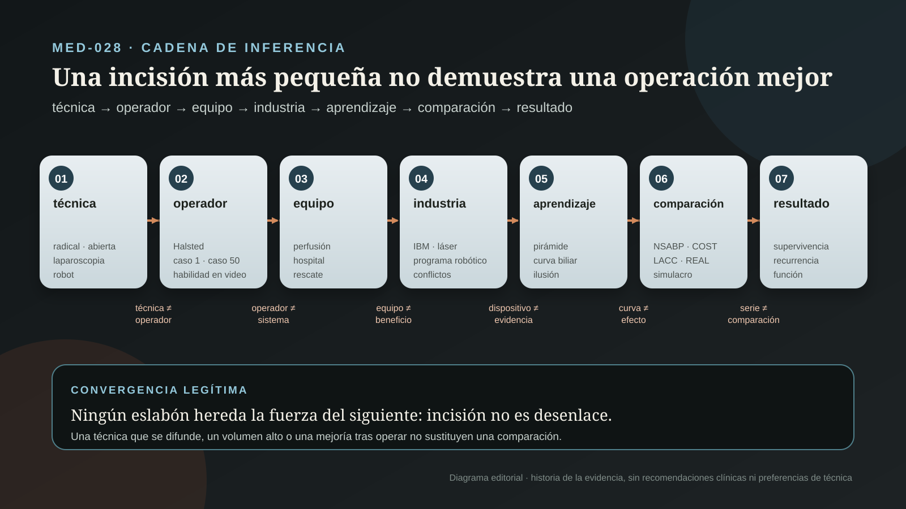
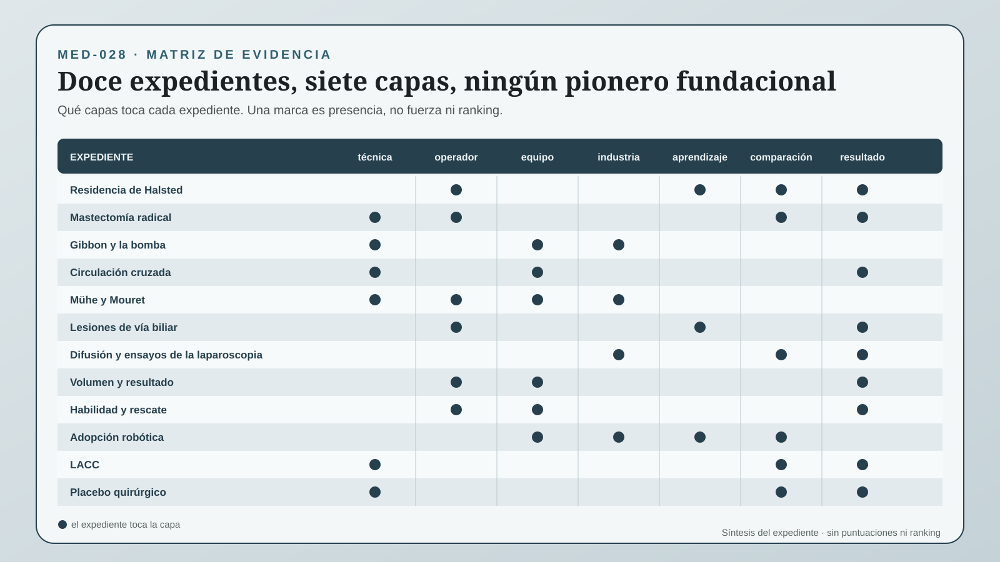

# MED-028 — Una incisión más pequeña no demuestra una operación mejor por sí sola

> **Alcance:** audita doce expedientes entre 1884 y 2026: la residencia de Halsted y su adicción; la mastectomía radical y su refutación por ensayo; la máquina corazón-pulmón de Gibbon; la circulación cruzada de Lillehei; Mühe, Mouret y el reparto del crédito de la colecistectomía laparoscópica; la ola de lesiones de la vía biliar y la curva de aprendizaje; la difusión sin ensayos y los ensayos que llegaron después; la relación entre volumen y resultado; la habilidad medida y el rescate de complicaciones; la adopción de la cirugía robótica y sus ensayos; el ensayo LACC, donde la mínima invasión salió peor; y el placebo quirúrgico, de la ligadura de la mamaria interna a ORBITA. Cierra con el marco IDEAL de evaluación de la innovación quirúrgica hasta 2026. Separa técnica, operador, equipo, industria, aprendizaje, comparación y resultado. Lo escribe un cirujano que audita su propia disciplina, y es historia y epistemología de la evidencia: **no contiene recomendaciones clínicas, indicaciones ni preferencias de técnica** (`CLAIM-MED-SURG-NO-ADVICE-001`).

## Pregunta central

¿Cómo interactúan técnica, operador, equipo, industria, aprendizaje y resultados en la cirugía especializada y mínimamente invasiva, sin confundir una técnica descrita con la operación que hace cada cirujano, un dispositivo comprado con un beneficio, una curva de aprendizaje con un efecto, una serie con una comparación, un volumen alto con una causa, una incisión más pequeña con un desenlace mejor ni una mejoría tras operar con un efecto específico de la operación?

## Respuesta breve

La cirugía moderna se especializó con un modelo de formación —la residencia escalonada de Halsted— que sus egresados celebraron como su mayor legado y que, según Wright y Schachar, también permitió a su creador delegar el servicio y ocultar una adicción a la cocaína y la morfina (`CLAIM-MED-SURG-HALSTED-RESIDENCY-001`, `CLAIM-MED-SURG-HALSTED-PYRAMID-SHADOW-001`). Su operación emblemática, la mastectomía radical, se sostuvo con series del cirujano y cayó con un ensayo aleatorizado: 25 años de NSABP B-04 sin ventaja de la extirpación radical (`CLAIM-MED-SURG-NSABP-B04-2002-001`).

La cirugía cardíaca abierta nació de un equipo y de una máquina construida con ingenieros de IBM (Gibbon, 6 de mayo de 1953), y de una solución que ponía en riesgo a un segundo cuerpo: la circulación cruzada de Lillehei, con 45 niños operados y un progenitor sano conectado a cada uno (`CLAIM-MED-SURG-GIBBON-1953-001`, `CLAIM-MED-SURG-LILLEHEI-CROSS-1954-001`). La colecistectomía laparoscópica, hecha por primera vez por Mühe en 1985 y rechazada por su sociedad, se difundió desde 1987–1988 por series, cursos, demanda y equipo antes de cualquier ensayo; la acompañó una ola de lesiones de la vía biliar concentrada en los primeros casos de cada cirujano y explicada sobre todo por ilusiones perceptuales (`CLAIM-MED-SURG-MUHE-1985-001`, `CLAIM-MED-SURG-LEARNING-CURVE-1995-001`, `CLAIM-MED-SURG-WAY-2003-001`). Cuando llegó un ensayo cegado frente a la incisión pequeña, no halló la ventaja que había impulsado la adopción (`CLAIM-MED-SURG-MAJEED-1996-001`).

El volumen alto se asocia con menos muertes, pero el volumen es un sustituto que mezcla práctica, derivación, mezcla de casos, rescate de complicaciones y habilidad (`CLAIM-MED-SURG-VOLUME-CAUSAL-LIMIT-001`). La cirugía robótica creció de 1.8 % a 15.1 % en Michigan entre 2012 y 2018 en operaciones donde la laparoscopia ya era segura (`CLAIM-MED-SURG-ROBOT-DIFFUSION-2020-001`); sus ensayos dan resultados que dependen del operador, del centro y del desenlace (`CLAIM-MED-SURG-ROBOT-OPERATOR-CONTEXT-001`). En el ensayo LACC la histerectomía radical mínimamente invasiva, adoptada antes de que hubiera evidencia de supervivencia, dio peor supervivencia que la abierta (`CLAIM-MED-SURG-LACC-2018-001`, `CLAIM-MED-SURG-LACC-2024-001`). Y desde 1959 los controles simulados muestran que la mejoría tras operar no prueba el efecto de la operación, aunque no la refutan por sí solos (`CLAIM-MED-SURG-COBB-DIMOND-001`, `CLAIM-MED-SURG-SHAM-NOT-NULL-001`).

La cadena legítima es **técnica → operador → equipo → industria → aprendizaje → comparación → resultado**. Ningún eslabón hereda la fuerza del siguiente.

## UNA INCISIÓN MÁS PEQUEÑA NO DEMUESTRA UNA OPERACIÓN MEJOR POR SÍ SOLA

### 1. Siete capas que deben conservarse

| Capa | Pregunta | Producto legítimo | Salto inválido |
|---|---|---|---|
| Técnica | ¿qué se hace, en qué pasos, con qué extensión y por qué vía? | descripción reproducible | tomar la descripción por la operación real |
| Operador | ¿quién opera, con qué formación, experiencia y habilidad? | efecto del operador medido | suponer que la técnica es igual en toda mano |
| Equipo | ¿qué personal, hospital, máquina y capacidad de rescate rodean la operación? | condiciones del resultado | atribuir al cirujano lo que hizo el sistema |
| Industria | ¿quién fabrica, vende, financia, enseña y autoriza el dispositivo? | intereses y rutas de difusión declarados | confundir adopción o autorización con beneficio |
| Aprendizaje | ¿cómo cambian los resultados con el número de casos? | curva delimitada | leer los primeros casos o los últimos como el efecto de la técnica |
| Comparación | ¿contra qué alternativa concurrente, con qué asignación y cegamiento? | efecto comparado | tomar una serie o un volumen como comparación |
| Resultado | ¿qué desenlace importa al paciente, a qué plazo? | supervivencia, recurrencia, función, daño | tomar incisión, dolor o estancia como desenlace principal |

### 2. Cinco distinciones que el expediente no deja fundir

Una **técnica** descrita no es la misma intervención en manos distintas: el efecto quirúrgico incluye a quien opera, una dependencia que el laboratorio metodológico de Medicina ya exige medir o modelar (`CLAIM-MED-SURG-TECHNIQUE-NOT-OPERATOR-001`, `CLAIM-MED-SURGERY-OPERATOR-001`). La habilidad del **operador** tampoco explica sola el resultado: equipo, hospital y rescate de complicaciones lo modifican (`CLAIM-MED-SURG-OPERATOR-NOT-SYSTEM-001`). Un **dispositivo** autorizado, comprado o difundido no es evidencia de beneficio comparativo (`CLAIM-MED-SURG-DEVICE-NOT-EVIDENCE-001`). Una **curva de aprendizaje** mezcla técnica y experiencia, de modo que los primeros casos y los últimos no estiman el mismo efecto (`CLAIM-MED-SURG-LEARNING-NOT-EFFECT-001`). Y una **serie** favorable, por grande que sea, no compara (`CLAIM-MED-SURG-SERIES-NOT-COMPARISON-001`). Sobre todas, una regla de desenlace: menos incisión, dolor o estancia no son por sí solos el resultado principal, y la supervivencia o la recurrencia pueden ir en sentido contrario (`CLAIM-MED-SURG-INCISION-NOT-OUTCOME-001`).

## DOCE EXPEDIENTES AUDITADOS

### 3. Halsted y la residencia: luces y sombras de la especialización

MED-021 mostró que la anestesia y la asepsia cambiaron el ideal quirúrgico de la rapidez a la minuciosidad y la estandarización (`CLAIM-MED-ANES-SKILL-SHIFT-001`). William Stewart Halsted llevó esa minuciosidad a una institución. En Johns Hopkins organizó una residencia escalonada, inspirada en lo que había visto en Alemania: varias plazas de entrada e intermedias, una sola plaza superior, duración indefinida y competencia intensa por ascender; los residentes jóvenes aprendían bajo un residente mayor, no bajo el profesor, y se esperaba de ellos investigación (`CLAIM-MED-SURG-HALSTED-RESIDENCY-001`). Según el recuento de Carter de 1952, que citan Wright y Schachar, Halsted dirigió la residencia 33 años y nombró 17 residentes y 55 asistentes (`CLAIM-MED-SURG-HALSTED-RESIDENCY-COUNT-001`).

La sombra es documental. A fines de 1884, al experimentar en sí mismos con la cocaína como anestésico local, Halsted y varios colegas se volvieron adictos; Halsted pasó después a la morfina, que había usado para tratar la cocaína, y la adicción se ocultó (`CLAIM-MED-SURG-HALSTED-ADDICTION-001`). Wright y Schachar sostienen que la pirámide le servía: delegaba el servicio clínico y docente en un residente superior, reducía su contacto diario con colegas y pacientes y descansaba en residentes que invertían 12 a 14 años, en buena parte sin paga (`CLAIM-MED-SURG-HALSTED-PYRAMID-SHADOW-001`). Es una interpretación sobre la función de una estructura, no una prueba de intención, y este expediente la marca así. El modelo, adaptado por Heuer en Cincinnati para hospitales sin la riqueza de Hopkins, se volvió el estándar norteamericano; la pirámide rígida no fue necesaria para trasplantarlo (`CLAIM-MED-SURG-HALSTED-MODEL-SPREAD-001`).

Un modelo de formación celebrado por sus propios egresados —que al llamarlo el mayor legado de Halsted se legitimaban a sí mismos— no demuestra por sí solo mejores resultados para los pacientes (`CLAIM-MED-SURG-RESIDENCY-NOT-OUTCOME-001`). Las reglas de formación sí pueden compararse: el ensayo FIRST asignó al azar 117 programas a horarios flexibles o estándar y encontró en 138 691 pacientes una tasa de muerte o complicación grave no inferior (9.1 % frente a 9.0 %) (`CLAIM-MED-SURG-FIRST-2016-001`). Un siglo después de Halsted, una regla de residencia se evaluó por su resultado, no por la reputación de quien la defendía.

### 4. La mastectomía radical: una operación más extensa no era un resultado

Halsted publicó en 1894 los resultados de sus operaciones por cáncer de mama en Johns Hopkins entre junio de 1889 y enero de 1894; este expediente verificó la ficha de la publicación, no su contenido (`CLAIM-MED-SURG-HALSTED-MASTECTOMY-1894-001`). La operación —mama, ganglios y músculos pectorales— dominó casi un siglo. Bland sostuvo en 1981 que se institucionalizó por fuerzas económicas, nacionalistas y de la naciente especialidad, que colocaban al cirujano estadounidense por encima de los generalistas y de los cirujanos alemanes, más que por principios científicos (`CLAIM-MED-SURG-RADICAL-INSTITUTION-001`). Wright añadió en 2018 que Halsted se volvió más agresivo aunque sus propios datos no mostraban supervivencia más larga, y que Bloodgood, su residente y analista de resultados, compartía y reforzaba esa creencia (`CLAIM-MED-SURG-BLOODGOOD-2018-001`). Las cartas de sus pacientes, analizadas en 2026, hablan de brazos limitados, hinchazón, dolor y dudas: lo que el cirujano llamaba curación no era lo que ellas vivían (`CLAIM-MED-SURG-MARQUEZ-2026-001`).

El ensayo NSABP B-04, iniciado en 1971, asignó al azar a 1 079 mujeres sin ganglios palpables y a 586 con ganglios a mastectomía radical o a operaciones menos extensas; a los 25 años no hubo diferencias significativas en supervivencia libre de enfermedad ni global, con razones de riesgo de muerte de 1.08 y 1.03 en el primer grupo y 1.06 en el segundo (`CLAIM-MED-SURG-NSABP-B04-2002-001`). La lección no es que Halsted fuera mal cirujano: es que la extensión de una operación es técnica, y su resultado sólo se mide contra una alternativa (`CLAIM-MED-SURG-RADICAL-LESSON-001`).

### 5. Gibbon y la máquina corazón-pulmón: un caso, un equipo, un abandono

John Gibbon trabajó desde los años treinta, con su esposa Mary y, desde 1950, con apoyo de ingenieros de IBM, en una máquina que oxigenara y bombeara la sangre fuera del cuerpo (`CLAIM-MED-SURG-GIBBON-TEAM-001`). El 6 de mayo de 1953 cerró con ella una comunicación interauricular en una paciente de 18 años: el primer uso exitoso de la circulación extracorpórea completa (`CLAIM-MED-SURG-GIBBON-1953-001`). Kurusz documenta que en ese mismo caso hubo complicaciones en la conducción de la perfusión que casi terminaron en catástrofe, y que la acción rápida del personal salvó a la paciente (`CLAIM-MED-SURG-GIBBON-NEAR-CATASTROPHE-001`). El éxito fue del equipo tanto como del cirujano.

Tras resultados insatisfactorios en sus intentos siguientes, Gibbon dejó de desarrollar la técnica (`CLAIM-MED-SURG-GIBBON-ABANDON-001`). El primer caso exitoso demostraba que la circulación extracorpórea era posible, no que fuera reproducible: la diferencia entre caso y serie la puso el propio inventor al detenerse.

### 6. Lillehei y la circulación cruzada: ética en el límite

Mientras las máquinas maduraban, C. Walton Lillehei usó en Minneapolis otro oxigenador: un ser humano. Entre el 26 de marzo de 1954 y el 19 de julio de 1955 operó a 45 niños con cardiopatías hasta entonces no corregibles conectando su circulación a la de un donante, sin muertes de donantes informadas (`CLAIM-MED-SURG-LILLEHEI-CROSS-1954-001`). De los 45 salieron del hospital 28; en el seguimiento de 2009 vivían 20, ninguno limitado por causa cardíaca (`CLAIM-MED-SURG-LILLEHEI-OUTCOME-001`).

La técnica expuso a un donante sano, casi siempre un progenitor, al riesgo de una operación que no lo beneficiaba, con un consentimiento que hoy se juzgaría muy básico y sin comités de ética, en un paternalismo terapéutico que la revisión de 2025 describe sin eufemismos (`CLAIM-MED-SURG-CROSS-CIRCULATION-ETHICS-001`). Fue un puente: los oxigenadores mecánicos hicieron innecesario el segundo cuerpo (`CLAIM-MED-SURG-CROSS-CIRCULATION-BRIDGE-001`). Supervivientes de cinco décadas no responden si era aceptable el riesgo impuesto a un tercero; resultado y legitimidad son capas distintas (`CLAIM-MED-SURG-CARDIAC-SURVIVORS-NOT-ETHICS-001`). Este expediente no pudo verificar el detalle de los daños en donantes, y lo deja como incertidumbre.

### 7. Mühe, Mouret y el crédito de la colecistectomía laparoscópica

A comienzos de los años ochenta Kurt Semm practicaba en Alemania la apendicectomía laparoscópica. Erich Mühe, cirujano de Böblingen, diseñó en 1984 un laparoscopio operatorio y el 12 de septiembre de 1985 hizo la primera colecistectomía laparoscópica (`CLAIM-MED-SURG-MUHE-1985-001`). Las fuentes no coinciden en cuántas hizo antes de 1987: 97 hasta marzo de 1987 según Litynski, 94 antes de la primera de Mouret según Reynolds (`CLAIM-MED-SURG-MUHE-COUNT-001`). Presentó la técnica en el Congreso de la Sociedad Alemana de Cirugía de abril de 1986; fue ignorado, su ponencia no apareció en las actas y recibió honores oficiales hasta abril de 1992 (`CLAIM-MED-SURG-MUHE-REJECTION-001`).

Litynski atribuye el rechazo a cinco fuerzas: la idea de que «gran cirujano, gran incisión», la esperanza puesta en la disolución química y la litotricia de los cálculos, un sistema hospitalario alemán que cobraba por días de estancia, una jerarquía universitaria que desconfiaba de lo inventado fuera de ella, y la condición de forastero de un autor que publicaba en alemán (`CLAIM-MED-SURG-MUHE-REJECTION-REASONS-001`). Philippe Mouret hizo en Lyon en 1987 la primera de Francia; François Dubois la suya en mayo de 1988; en Estados Unidos las primeras fueron en junio y septiembre de 1988 (`CLAIM-MED-SURG-MOURET-1987-001`). En 1990 la SAGES reconoció a Perissat, Berci, Cuschieri, Dubois y Mouret sin nombrar a Mühe, a quien reconoció en 1999 (`CLAIM-MED-SURG-SAGES-CREDIT-001`). El crédito siguió a la difusión, no a la fecha (`CLAIM-MED-SURG-CREDIT-FOLLOWS-DIFFUSION-001`).

### 8. La ola de lesiones de la vía biliar y la curva de aprendizaje

Las primeras series se publicaron sin comparador. Dubois informó en 1990 36 colecistectomías «celioscópicas» con complicaciones pocas y benignas, y les atribuyó ventajas estéticas, menos dolor, estancia corta y recuperación rápida (`CLAIM-MED-SURG-DUBOIS-1990-001`). Reddick y Olsen organizaron cursos, introdujeron el láser y llevaron la técnica fuera de los centros universitarios (`CLAIM-MED-SURG-REDDICK-COURSES-001`). El Southern Surgeons Club reunió en 1991 1 518 operaciones: 4.7 % de conversiones, 5.1 % de pacientes con complicaciones y siete lesiones de la vía biliar, 0.5 % (`CLAIM-MED-SURG-SSC-1991-001`). La lesión fue de 2.2 % en los primeros 13 pacientes de cada grupo y de 0.1 % después (`CLAIM-MED-SURG-SSC-1991-LEARNING-001`). La comparación con la cirugía abierta se hizo contra tasas publicadas de 6–21 %, no contra un grupo concurrente (`CLAIM-MED-SURG-SSC-1991-COMPARATOR-001`).

Moore y Bennett modelaron en 1995 la curva con 8 839 procedimientos de 55 cirujanos: 90 % de las 15 lesiones ocurrió en los primeros 30 casos de cada cirujano, con un riesgo predicho de 1.7 % en el primer caso y 0.17 % en el quincuagésimo (`CLAIM-MED-SURG-LEARNING-CURVE-1995-001`). La curva no es toda la historia. Way y colaboradores analizaron 252 lesiones con herramientas de la psicología cognitiva: la causa primaria fue una ilusión perceptual visual en 97 % y una falla de habilidad técnica en 3 %; en muchas el cirujano no advirtió nada y el informe operatorio decía «rutinaria» (`CLAIM-MED-SURG-WAY-2003-001`). La experiencia reduce el riesgo, pero la técnica —una visión bidimensional de una anatomía que engaña— lo crea. Y la lesión pesa: entre 1 570 361 colecistectomías de Medicare, 0.5 % tuvo lesión del colédoco, con un riesgo ajustado de muerte 2.79 veces mayor, y 11 % mayor si la reparaba el mismo cirujano que la había causado (`CLAIM-MED-SURG-FLUM-2003-001`).

### 9. Difundir antes de comparar: la laparoscopia y sus ensayos tardíos

La técnica cambió también la indicación. En una organización de atención administrada, la tasa de colecistectomía subió de 1.35 a 2.15 por mil afiliados entre 1988 y 1992, y el gasto total en enfermedad vesicular creció 11.4 % aunque el costo de cada operación bajó 25.1 %; hernia y apéndice no cambiaron (`CLAIM-MED-SURG-LEGORRETA-1993-001`). Una técnica menos temida se ofrece a más personas: la industria del equipo, la demanda de los pacientes y la disposición del cirujano se mueven juntas.

El ensayo llegó cuando la adopción ya era un hecho. Majeed y colaboradores asignaron al azar a 200 pacientes a laparoscopia o a colecistectomía por incisión pequeña, con apósitos idénticos para cegar a quienes los cuidaban: la laparoscopia duró más (65 frente a 40 minutos) y no hubo diferencias en estancia, regreso al trabajo ni actividad plena (`CLAIM-MED-SURG-MAJEED-1996-001`). La colecistectomía laparoscópica se difundió en pocos años por series, cursos, demanda y equipo; el contraste formal con una alternativa razonable no encontró la ventaja que había impulsado su adopción (`CLAIM-MED-SURG-LC-DIFFUSION-WITHOUT-TRIAL-001`). No todo se difundió así. La colectomía laparoscópica por cáncer de colon, frenada por informes de recurrencias en las heridas, esperó un ensayo: en 872 pacientes de 48 instituciones la recurrencia a tres años fue de 16 % frente a 18 % y la supervivencia de 86 % frente a 85 % (`CLAIM-MED-SURG-COST-2004-001`). El mismo acceso mínimamente invasivo recibió dos historias epistémicas distintas según lo que estaba en juego.

### 10. Volumen y resultado: una asociación sólida con un mecanismo abierto

Luft, Bunker y Enthoven estudiaron en 1979 doce procedimientos en 1 498 hospitales: donde se hacían 200 o más operaciones al año, la mortalidad ajustada fue 25–41 % menor para cirugía cardíaca, vascular, resección transuretral de próstata y derivación coronaria; la colecistectomía no mostró relación (`CLAIM-MED-SURG-LUFT-1979-001`). Los propios autores nombraron las alternativas: experiencia, derivación a instituciones con mejores resultados o selección de pacientes (`CLAIM-MED-SURG-LUFT-1979-ALTERNATIVES-001`). Birkmeyer y colaboradores midieron en 2002, con 2.5 millones de procedimientos de Medicare, que la mortalidad bajaba con el volumen hospitalario en los 14 tipos estudiados, con diferencias absolutas que iban de 12.5 puntos en la pancreatectomía (16.3 % frente a 3.8 %) a 0.2 en la endarterectomía carotídea (`CLAIM-MED-SURG-BIRKMEYER-2002-001`). En 2003 mostraron que el volumen del cirujano explicaba entre 24 % y 100 % del efecto aparente del volumen hospitalario, según la operación (`CLAIM-MED-SURG-BIRKMEYER-2003-001`).

La revisión metodológica de Halm, Lee y Chassin encontró asociación significativa en 71 % de los estudios de volumen hospitalario y 69 % de los de volumen del médico, pero los que ajustaron el riesgo con datos clínicos la hallaron con menos frecuencia, y diferencias de mezcla de casos y de procesos de cuidado podían explicar parte de la relación (`CLAIM-MED-SURG-HALM-2002-001`). El volumen es un sustituto que mezcla práctica, derivación selectiva, mezcla de casos, procesos, rescate y habilidad; su asociación no identifica cuál actúa ni garantiza que concentrar operaciones produzca el resultado de los centros que ya lo tienen (`CLAIM-MED-SURG-VOLUME-CAUSAL-LIMIT-001`).

### 11. Habilidad y rescate: el operador medido y el sistema que lo rodea

Birkmeyer y colaboradores midieron en 2013 la habilidad en lugar de inferirla del volumen: 20 cirujanos bariátricos enviaron un video de una derivación gástrica laparoscópica, calificado por al menos diez pares sin conocer su identidad. El cuartil de menor habilidad tuvo 14.5 % de complicaciones frente a 5.2 % y una mortalidad de 0.26 % frente a 0.05 % (`CLAIM-MED-SURG-BIRKMEYER-SKILL-2013-001`). Es la evidencia más directa de que el operador forma parte de la intervención, aunque descansa en 20 cirujanos y un video por cabeza.

El operador no lo es todo. Ghaferi, Birkmeyer y Dimick compararon 84 730 pacientes: la mortalidad varió de 3.5 % a 6.9 % entre quintiles de hospitales con tasas de complicaciones parecidas, y la muerte tras una complicación mayor fue de 21.4 % frente a 12.5 % (`CLAIM-MED-SURG-GHAFERI-2009-001`). Lo que separa a los hospitales no es tanto cuántas complicaciones tienen como cuántas rescatan: la habilidad de quien opera y la del sistema que responde son capas distintas (`CLAIM-MED-SURG-OPERATOR-NOT-SYSTEM-001`).

### 12. Cirugía robótica: adopción por programa, ensayos por contexto

Sheetz, Claflin y Dimick siguieron a 169 404 pacientes en 73 hospitales de Michigan: la cirugía robótica pasó de 1.8 % en 2012 a 15.1 % en 2018, y en la hernia inguinal de 0.7 % a 28.8 % (`CLAIM-MED-SURG-ROBOT-DIFFUSION-2020-001`). Los hospitales que lanzaban un programa aumentaban su uso 8.8 puntos en cuatro años y reducían la laparoscopia, en operaciones donde ésta ya se consideraba segura y eficaz (`CLAIM-MED-SURG-ROBOT-PROGRAM-EFFECT-001`). Una máquina comprada tiende a usarse; su uso no es evidencia de beneficio (`CLAIM-MED-SURG-DEVICE-NOT-EVIDENCE-001`). El rastro de daño es incompleto: entre 10 624 notificaciones a la base MAUDE de la FDA entre 2000 y 2013 hubo 144 muertes, 1 391 lesiones y 8 061 fallas del dispositivo, en un sistema de notificación pasiva que no da tasas completas (`CLAIM-MED-SURG-ROBOT-MAUDE-2016-001`).

Los ensayos dicen cosas distintas. En prostatectomía, 326 hombres en un centro no difirieron en función urinaria ni sexual a las 12 semanas entre la vía robótica y la abierta (`CLAIM-MED-SURG-YAXLEY-2016-001`). En cáncer de recto, ROLARR —471 pacientes y 40 cirujanos con experiencia robótica variable— no halló diferencia significativa en conversión a cirugía abierta (8.1 % frente a 12.2 %) (`CLAIM-MED-SURG-ROLARR-2017-001`), y varios de sus autores declararon haber sido instructores o consultores del fabricante (`CLAIM-MED-SURG-ROLARR-INDUSTRY-001`). El ensayo REAL, con 1 240 pacientes aleatorizados en 11 centros chinos, halló en 2025 una recurrencia locorregional a tres años de 1.6 % con robot frente a 4.0 % con laparoscopia, mejor supervivencia libre de enfermedad (87.2 % frente a 83.4 %) y ninguna diferencia en supervivencia global (`CLAIM-MED-SURG-REAL-2025-001`). Una revisión de 2026 advierte que REAL se hizo sólo en centros de alto volumen, que no mostró beneficio en supervivencia global y que costo y acceso condicionan su alcance (`CLAIM-MED-SURG-REAL-2026-CAVEATS-001`). ROLARR y REAL difieren en operador, centro, momento y desenlace: el «efecto del robot» no se separa de quien lo usa ni del lugar donde se midió (`CLAIM-MED-SURG-ROBOT-OPERATOR-CONTEXT-001`).

### 13. LACC: donde la mínima invasión salió peor

La histerectomía radical mínimamente invasiva para el cáncer cervicouterino temprano se adoptó antes de que hubiera evidencia de alta calidad sobre su efecto en la supervivencia (`CLAIM-MED-SURG-LACC-ADOPTION-001`). El ensayo LACC asignó al azar a 631 pacientes; en el grupo mínimamente invasivo, 84.4 % fue por laparoscopia y 15.6 % con robot. La supervivencia libre de enfermedad a 4.5 años fue de 86.0 % frente a 96.5 % con cirugía abierta (`CLAIM-MED-SURG-LACC-2018-001`), y la supervivencia global a tres años de 93.8 % frente a 99.0 % (`CLAIM-MED-SURG-LACC-2018-OS-001`). El análisis final de 2024 confirmó una supervivencia global a 4.5 años de 90.6 % frente a 96.2 % (`CLAIM-MED-SURG-LACC-2024-001`). El ensayo fue financiado por el centro oncológico de Texas que lo dirigió y por un fabricante de dispositivos quirúrgicos, y su resultado fue desfavorable para la vía mínimamente invasiva (`CLAIM-MED-SURG-LACC-FUNDING-001`).

La observación independiente convergió. Melamed y colaboradores encontraron en 2 461 mujeres operadas en 2010–2013 una mortalidad a cuatro años de 9.1 % con mínima invasión frente a 5.3 % con cirugía abierta (`CLAIM-MED-SURG-MELAMED-2018-001`), y en una serie temporal la supervivencia relativa tras histerectomía radical, estable en 2000–2006, empezó a bajar 0.8 % por año cuando se adoptó la vía mínimamente invasiva (`CLAIM-MED-SURG-MELAMED-2018-TREND-001`). Una revisión de 2025 registra que las guías volvieron a la vía abierta y que siguen ensayos que comparan vías de acceso (`CLAIM-MED-SURG-LACC-AFTERMATH-001`). LACC es el caso límite de la cadena: una incisión más pequeña, una recuperación más rápida y un dispositivo moderno coexistieron con un peor desenlace principal (`CLAIM-MED-SURG-INCISION-NOT-OUTCOME-001`). Que COST y LACC den resultados opuestos con la misma idea de acceso confirma que la pregunta se responde por procedimiento.

### 14. Placebo quirúrgico: de la mamaria interna a ORBITA

En 1959 y 1960 dos ensayos aleatorizados compararon la ligadura bilateral de las arterias mamarias internas para la angina con una intervención simulada —incisión y exposición de las arterias sin ligarlas— y no hallaron diferencia; fueron los primeros controles simulados cegados de un procedimiento invasivo, y la operación se abandonó (`CLAIM-MED-SURG-COBB-DIMOND-001`). Beecher citó en 1961 a un paciente del grupo simulado de Cobb que pasó de 4 a 10 minutos de tolerancia al ejercicio y revirtió sus signos electrocardiográficos de isquemia: «de ese material convincente se hacen las operaciones nuevas», resumió (`CLAIM-MED-SURG-BEECHER-ANECDOTE-001`). La mejoría tras operar no distingue efecto específico, expectativa, historia natural ni regresión a la media (`CLAIM-MED-SURG-IMPROVEMENT-NOT-EFFECT-001`).

Moseley y colaboradores asignaron en 2002 a 180 pacientes con artrosis de rodilla a desbridamiento artroscópico, lavado o un procedimiento simulado; en 24 meses ninguno de los grupos operados tuvo menos dolor ni mejor función que el simulado (`CLAIM-MED-SURG-MOSELEY-2002-001`). El laboratorio metodológico ya registra el ensayo de meniscectomía de 2013, en la misma dirección (`CLAIM-MED-FIDELITY-001`). CSAW asignó a 313 pacientes con dolor subacromial a descompresión, artroscopia sola o ningún tratamiento: la descompresión no superó a la artroscopia (−1.3 puntos) y ambas superaron a no operar por un margen que los autores juzgaron no clínicamente importante (`CLAIM-MED-SURG-CSAW-2018-001`), con 23 %, 42 % y 12 % de pacientes que no recibieron lo asignado a los seis meses (`CLAIM-MED-SURG-CSAW-ADHERENCE-001`). ORBITA comparó en 200 pacientes con angina estable y estenosis grave la angioplastia con un procedimiento simulado: la diferencia en tiempo de ejercicio fue de 16.6 segundos, no significativa (`CLAIM-MED-SURG-ORBITA-2017-001`).

El control simulado no es un veredicto de inutilidad. ORBITA-2, con 301 pacientes sin antianginosos, encontró que la angioplastia reducía la puntuación de síntomas de angina frente al simulacro (2.9 frente a 5.6) (`CLAIM-MED-SURG-ORBITA2-2023-001`). La revisión de Wartolowska y colaboradores reunió 53 ensayos de cirugía contra placebo: hubo mejoría en el grupo simulado en 74 %, sin diferencia con la cirugía en 51 %, y eventos adversos graves en el brazo simulado en 34 %; todos eran procedimientos poco invasivos (`CLAIM-MED-SURG-WARTOLOWSKA-2014-001`). El simulacro aísla el componente específico y, en la mitad de los casos, la cirugía lo supera (`CLAIM-MED-SURG-SHAM-NOT-NULL-001`). Su ética sigue condicionada a que sea necesario, proporcionado, de riesgo mínimo y consentido explícitamente (`CLAIM-MED-SHAM-001`).

### 15. Cierre metodológico: IDEAL y la evaluación de la innovación quirúrgica (2009–2026)

En 2009 la colaboración de Balliol propuso describir la innovación quirúrgica en cinco etapas —idea, desarrollo, exploración, evaluación y estudio a largo plazo— y recomendó registrar las técnicas nuevas como deber profesional, sustituir las series de casos por estudios prospectivos de desarrollo y bases de datos, y usar ensayos aleatorizados siempre que fueran posibles, con datos previos sobre curvas de aprendizaje y definiciones de calidad (`CLAIM-MED-SURG-IDEAL-2009-001`). Es la respuesta institucional a todo lo anterior: Mühe sin registro, la colecistectomía sin ensayo, la curva sin medir, el robot sin comparación. La actualización de 2019 añadió una etapa preclínica, la variante IDEAL-D para dispositivos, registros en todas las etapas y los problemas éticos de cada una (`CLAIM-MED-SURG-IDEAL-2019-001`). En 2024 el coloquio IDEAL de robótica —con el investigador principal de LACC entre sus autores— pidió atender contexto, curvas de aprendizaje y desenlaces estandarizados en la comparación de robots quirúrgicos, y consorcios transparentes para su seguimiento (`CLAIM-MED-SURG-IDEAL-ROBOTICS-2024-001`).

IDEAL es un marco de consenso, no una escala validada: estar en una etapa no prueba beneficio, y no se ha mostrado que su adopción mejore los resultados (`CLAIM-MED-SURG-IDEAL-NOT-VALIDATED-001`). Su valor es el de esta auditoría: obliga a decir en qué capa está la evidencia. Los ensayos basados en la experiencia del operador, que el laboratorio metodológico ya registra, son una de sus herramientas para no confundir técnica y operador (`SRC-MED-EXPERTISE-RCT-2005`).

## LO OBSERVADO

- residentes en una pirámide, recuentos de nombramientos, testimonios y archivos sobre la adicción de un cirujano;
- series de mastectomía radical, cartas de pacientes y un ensayo de 25 años;
- una máquina corazón-pulmón en una paciente, un incidente de perfusión y un inventor que se detiene;
- 45 niños conectados a donantes y sus supervivientes décadas después;
- una ponencia ignorada, recuentos discrepantes de operaciones y premios repartidos tarde;
- series laparoscópicas, lesiones de la vía biliar por número de caso, videos de lesiones y registros de Medicare;
- tasas de cirugía antes y después de una técnica nueva;
- registros de volumen y mortalidad, videos calificados por pares y muertes tras complicaciones;
- curvas de adopción robótica, notificaciones de fallas a la FDA y ensayos discordantes;
- un ensayo y una cohorte con peor supervivencia tras la vía mínimamente invasiva;
- grupos simulados que mejoran y grupos operados que no los superan, o sí;
- marcos de consenso para evaluar la innovación.

## LO MEDIDO

- mortalidad o complicación grave por política de horarios de residencia (FIRST);
- supervivencia tras mastectomía radical frente a operaciones menos extensas (NSABP B-04);
- supervivencia a largo plazo de los operados con circulación cruzada;
- conversiones, complicaciones y lesiones biliares por orden de caso; riesgo de lesión por número de caso; causas de 252 lesiones; mortalidad tras lesión del colédoco;
- tasas y gasto de colecistectomía antes y después de la laparoscopia;
- duración, estancia y recuperación en un ensayo cegado frente a incisión pequeña;
- mortalidad por volumen hospitalario y del cirujano; complicaciones por habilidad calificada; mortalidad tras complicación por hospital;
- proporción de cirugía robótica por año; muertes, lesiones y fallas notificadas;
- función, conversión, recurrencia y supervivencia en ensayos de robot frente a alternativa;
- supervivencia libre de enfermedad y global en LACC y en registros;
- dolor, función, tiempo de ejercicio y síntomas frente a procedimientos simulados;
- no el efecto causal del volumen, ni el beneficio general de la cirugía robótica, ni los daños sufridos por los donantes de la circulación cruzada.

## LO INFERIDO

Que el resultado de una operación depende de quien opera, del equipo que lo rodea y del momento de su aprendizaje se infiere con firmeza: convergen curvas de aprendizaje, habilidad medida en video, mediación del volumen por el cirujano y diferencias de rescate entre hospitales. Que una técnica nueva puede difundirse por equipo, industria, demanda y prestigio antes de tener comparación se infiere de la colecistectomía laparoscópica, la histerectomía radical mínimamente invasiva y la adopción robótica. Que la mejoría tras operar no prueba el efecto específico de la operación se infiere de seis décadas de controles simulados (`CLAIM-MED-SURG-CHAIN-001`, `CLAIM-MED-SURG-LEARNING-NOT-EFFECT-001`, `CLAIM-MED-SURG-LC-DIFFUSION-WITHOUT-TRIAL-001`, `CLAIM-MED-SURG-IMPROVEMENT-NOT-EFFECT-001`).

## LOS SUPUESTOS

- que la reconstrucción de Wright y Schachar sobre la función de la pirámide refleja los archivos y no sólo una lectura retrospectiva;
- que los recuentos de lesiones biliares por códigos o casos referidos representan las lesiones reales;
- que los ajustes de riesgo administrativos capturan la gravedad de los pacientes;
- que un video por cirujano representa su habilidad habitual;
- que la notificación pasiva a la FDA describe tipos de falla aunque no su frecuencia;
- que los centros y operadores de un ensayo se parecen a aquellos donde se usará la técnica;
- que el procedimiento simulado reproduce todo menos el componente específico.

## LAS INCERTIDUMBRES

- el contenido de la serie de Halsted de 1894 y de los ensayos de 1959–1960, no leídos completos;
- los resultados de los casos de Gibbon posteriores a 1953;
- los daños, si los hubo, en los donantes de la circulación cruzada;
- cuántas colecistectomías hizo Mühe antes de 1987 (94 o 97);
- qué parte de la asociación entre volumen y resultado es práctica y qué parte es derivación o selección;
- si el beneficio de REAL se reproduce fuera de centros de alto volumen;
- el número real de eventos adversos en cirugía robótica.

## LAS ALTERNATIVAS

- un resultado bueno de un cirujano pionero puede deberse a la selección de pacientes y no a la técnica;
- una caída de lesiones con la experiencia puede reflejar casos más fáciles y no aprendizaje;
- una asociación entre volumen y mortalidad puede reflejar derivación de pacientes de menor riesgo o mejores sistemas de rescate;
- un beneficio robótico en un ensayo puede reflejar operadores y centros excepcionales;
- un peor resultado de la mínima invasión puede deberse a un paso técnico concreto y no al acceso en sí;
- la mejoría tras una operación puede ser expectativa, historia natural o regresión a la media.

## QUÉ PODEMOS COMPARAR

| Expediente | Archivo dominante | Producto mejor resuelto | Límite decisivo |
|---|---|---|---|
| Residencia de Halsted | Wright y Schachar; FIRST | estructura y función de un modelo de formación | prestigio del modelo no es resultado |
| Mastectomía radical | Halsted 1894; Bland; Wright; Marquez; NSABP B-04 | extensión refutada por ensayo | técnica no es resultado |
| Gibbon y la bomba | Hill; Kurusz; Leivaditis | primer caso con equipo e industria | caso no es serie |
| Circulación cruzada | Lillehei 1986; Moller 2009 | serie con seguimiento largo | supervivencia no es legitimidad |
| Mühe y Mouret | Litynski; Reynolds | prioridad y crédito fechados | crédito sigue a la difusión |
| Lesiones de vía biliar | SSC 1991; Moore; Way; Flum | curva, percepción y consecuencia | experiencia no elimina la ilusión |
| Difusión y ensayos de la laparoscopia | Legorreta; Majeed; COST | adopción antes de comparación | serie no es comparación |
| Volumen y resultado | Luft; Birkmeyer; Halm | asociación graduada por procedimiento | volumen no es mecanismo |
| Habilidad y rescate | Birkmeyer 2013; Ghaferi | operador y sistema medidos | 20 cirujanos; observacional |
| Adopción robótica | Sheetz; Alemzadeh; Yaxley; ROLARR; REAL | difusión y ensayos discordantes | dispositivo no es evidencia |
| LACC | Ramirez 2018 y 2024; Melamed | daño de la mínima invasión | incisión no es desenlace |
| Placebo quirúrgico | Cobb; Moseley; CSAW; ORBITA; Wartolowska | efecto específico aislado | simulacro no es veredicto general |

Comparar aquí significa declarar técnica, operador, equipo, industria, aprendizaje, comparador y desenlace. No reparte medallas de prioridad ni de progreso entre cirugía abierta, laparoscópica y robótica (`CLAIM-MED-SURG-NONRANKING-001`).

## QUÉ NO PODEMOS CONCLUIR

- que la residencia de Halsted produjo mejores resultados para los pacientes por ser la de Halsted;
- que la mastectomía radical curaba más por quitar más;
- que el caso de Gibbon de 1953 demostró una técnica reproducible;
- que la supervivencia de los niños de Lillehei responde a la pregunta por el riesgo de los donantes;
- que la colecistectomía laparoscópica se adoptó porque un ensayo mostró su superioridad;
- que las lesiones biliares fueron sólo inexperiencia de los cirujanos;
- que concentrar operaciones en hospitales de alto volumen producirá por sí solo sus resultados;
- que la cirugía robótica es mejor en general, o que no lo es en ningún procedimiento;
- que la vía mínimamente invasiva es siempre equivalente en cirugía oncológica;
- que un ensayo simulado negativo demuestra que toda cirugía funciona por placebo;
- que una etapa IDEAL certifica la calidad de una innovación (`CLAIM-MED-SURG-IDEAL-NOT-VALIDATED-001`).

## LAS CONTROVERSIAS

| Pregunta | Alternativas | Qué discrimina |
|---|---|---|
| ¿qué fue la residencia de Halsted? | modelo pedagógico / también estructura de ocultamiento y trabajo no pagado | archivos y resultados comparados de modelos de formación |
| ¿por qué duró tanto la mastectomía radical? | resultados / creencia, prestigio y falta de comparador | NSABP B-04 y archivos de Hopkins |
| ¿era aceptable la circulación cruzada? | falta de alternativa / riesgo sin beneficio para un tercero | daños en donantes y normas de consentimiento |
| ¿quién inventó la colecistectomía laparoscópica? | Mouret y los difusores / Mühe | fechas documentadas |
| ¿por qué hubo una ola de lesiones biliares? | inexperiencia / ilusión perceptual propia de la técnica | curvas y análisis de factores humanos |
| ¿es mejor la laparoscopia que la incisión pequeña? | sí / sin diferencia relevante | ensayos cegados |
| ¿causa el volumen mejores resultados? | práctica / derivación, casos, rescate, habilidad | ajuste clínico y medición de habilidad |
| ¿mejora el robot los resultados? | sí / no más que la laparoscopia experta | ensayos con operadores comparables |
| ¿es equivalente la mínima invasión en oncología? | sí (COST) / no siempre (LACC) | ensayos por procedimiento |
| ¿es ético el simulacro quirúrgico? | sí bajo condiciones / no | eventos adversos y alternativas de diseño |
| ¿qué mostraron ORBITA y ORBITA-2? | inutilidad / dependencia de población y desenlace | los dos ensayos |
| ¿ha cambiado IDEAL la evaluación? | sí / se cita más que se aplica | auditorías de uso |

## ERRORES QUE ESTA INVESTIGACIÓN BLOQUEA

1. **«Halsted fundó un modelo de formación sin sombras.»** La pirámide delegaba, ocultaba y dependía de trabajo no pagado.
2. **«Más radical es más curativo.»** NSABP B-04 no mostró ventaja en 25 años.
3. **«El primer caso exitoso demuestra la técnica.»** Gibbon se detuvo tras los siguientes.
4. **«Los supervivientes justifican el riesgo a un donante sano.»** Resultado no es legitimidad.
5. **«El crédito va a quien operó primero.»** Mühe operó primero y fue reconocido después.
6. **«Una incisión más pequeña es una operación mejor.»** LACC mostró peor supervivencia.
7. **«Las lesiones biliares eran sólo inexperiencia.»** La causa primaria fue casi siempre una ilusión perceptual.
8. **«Más volumen causa mejores resultados.»** El volumen es un sustituto con varios mecanismos.
9. **«El robot es progreso por ser más nuevo.»** Su adopción precedió a la comparación.
10. **«Un ensayo simulado negativo prueba que toda cirugía es placebo.»** La mitad de los ensayos y ORBITA-2 favorecen la intervención.
11. **«La técnica es independiente de quien opera.»** La habilidad medida se asocia con complicaciones.
12. **«Una etapa IDEAL es un sello de calidad.»** Es un marco de consenso, no una escala validada.

## NIVEL DE CONFIANZA

- **A:** contenido de los ensayos y registros con resumen leído (FIRST, NSABP B-04, Southern Surgeons Club, Moore, Way, Flum, Legorreta, Majeed, COST, Luft, Birkmeyer, Halm, Ghaferi, Sheetz, Yaxley, ROLARR, REAL, LACC, Melamed, Moseley, CSAW, ORBITA, ORBITA-2, Wartolowska, IDEAL).
- **B:** reconstrucciones históricas que dependen de una síntesis o de testimonios (residencia y adicción de Halsted, Gibbon, circulación cruzada, Mühe y Mouret, ensayos de 1959–1960 vía Miller).
- **B-COND:** la función de la pirámide como ocultamiento; las tasas de eventos robóticos por notificación pasiva; la serie temporal de Melamed.
- **C:** contenido de la serie de Halsted de 1894; daños en donantes de la circulación cruzada.
- **D/E:** progreso por novedad, técnica independiente del operador, volumen como causa única, incisión como desenlace, simulacro como veredicto general.

## EL ADVERSARIO MÁS FUERTE

La mejor objeción a este expediente la haría un cirujano innovador: la cirugía no avanza por ensayos sino por operadores hábiles que intentan algo nuevo; casi nada de lo que hoy se da por sentado —la circulación extracorpórea, la colecistectomía laparoscópica— pasó por un ensayo antes de difundirse, y nadie quiere volver atrás; exigir comparación desde el principio habría frenado a Gibbon, a Lillehei y a Mühe; REAL muestra que el robot sí puede mejorar un desenlace oncológico, ORBITA-2 que el simulacro no tumba toda intervención, y COST que la mínima invasión puede ser equivalente. Es una objeción seria y en parte correcta: varias técnicas adoptadas sin ensayo resultaron valiosas, y la evaluación por etapas que propone IDEAL reconoce que la exploración temprana no puede ser aleatorizada.

La respuesta del expediente no es que toda innovación deba esperar un ensayo, sino que cada capa diga lo que demuestra. Gibbon y Lillehei demostraron factibilidad, no superioridad, y uno de ellos se detuvo. La colecistectomía laparoscópica sobrevivió a su ensayo tardío sin mostrar ventaja frente a la incisión pequeña, y dejó una ola de lesiones que una evaluación prospectiva habría medido antes. La mastectomía radical y la histerectomía radical mínimamente invasiva son los contraejemplos: técnicas adoptadas por convicción que el ensayo encontró inferiores o sin ventaja. REAL y ROLARR, juntos, muestran que el resultado del robot depende del operador y del centro. El adversario tiene razón en que la innovación necesita libertad temprana; no la tiene en que la difusión sea evidencia (`CLAIM-MED-SURG-SERIES-NOT-COMPARISON-001`, `CLAIM-MED-SURG-RADICAL-LESSON-001`).

## QUÉ PODRÍA FALSARLO

Este expediente deberá corregirse si nuevos registros muestran que:

- los archivos de Hopkins desmienten que la residencia de Halsted dependiera de delegar el servicio en un residente superior;
- la serie de Halsted de 1894 o sus seguimientos muestran una supervivencia mayor que la de alternativas comparables de su tiempo;
- hubo muertes o daños graves de donantes de circulación cruzada no informados, o, al contrario, un seguimiento de donantes sin daños;
- la curva de lesiones biliares desaparece al ajustar por dificultad de los casos;
- estudios con ajuste clínico y medición de habilidad hacen desaparecer la asociación entre volumen y mortalidad, o experimentos de concentración la reproducen;
- ensayos fuera de centros de alto volumen reproducen el beneficio robótico de REAL, o lo anulan;
- un ensayo de histerectomía radical robótica con operadores seleccionados no reproduce el daño de LACC;
- ensayos simulados de procedimientos más invasivos muestran un patrón distinto del de los poco invasivos.

## QUÉ SABEMOS REALMENTE

Sabemos que la cirugía especializada se construyó con un modelo de formación que tuvo luces y sombras, que su operación emblemática cayó ante un ensayo, que la cirugía cardíaca abierta nació de equipos, máquinas y un riesgo impuesto a terceros, y que la cirugía mínimamente invasiva se difundió por equipo, industria, demanda y prestigio antes de compararse. Sabemos que el operador, su aprendizaje y el sistema que lo rodea forman parte de la intervención, que el volumen es un sustituto, que el robot se adopta por programa y que en LACC la incisión más pequeña coexistió con peor supervivencia. Sabemos que la mejoría tras operar no prueba el efecto específico, y que el simulacro a veces refuta y a veces confirma (`CLAIM-MED-SURG-CHAIN-001`, `CLAIM-MED-SURG-NSABP-B04-2002-001`, `CLAIM-MED-SURG-LACC-2024-001`, `CLAIM-MED-SURG-SHAM-NOT-NULL-001`).

## QUÉ TODAVÍA NO SABEMOS

No sabemos qué parte de la asociación entre volumen y resultado es práctica y qué parte es selección y sistema, ni si el beneficio robótico de un ensayo de alto volumen se trasladará a otros hospitales. No sabemos si IDEAL mejora los resultados de las innovaciones que lo siguen, ni cómo se evaluarán la robótica autónoma y la asistencia por inteligencia artificial en el quirófano, que MED-033 retomará. MED-029 volverá sobre ensayos, regulación y medicina basada en evidencia.

## CONCLUSIÓN

La cicatriz pequeña no empezó en 1985 ni terminó en el robot. Empezó en una residencia que formó a una especialidad y escondió a su maestro; pasó por una operación que quitaba más y no curaba más, por una máquina que funcionó una vez y un padre conectado a su hijo, por un cirujano alemán ignorado y una técnica que se difundió antes de compararse, por lesiones que nacían de la percepción, por hospitales que rescatan y otros que no, por robots comprados antes de ser comparados y por un ensayo en que la vía menos invasiva fue la más letal; y siguió por arterias expuestas y no ligadas que enseñaron, desde 1959, que sentirse mejor no basta.

Por eso el expediente conserva siete capas. Técnica no es operador; operador no es sistema; dispositivo no es evidencia; curva no es efecto; serie no es comparación; volumen no es causa; incisión no es desenlace. Una incisión más pequeña no demuestra una operación mejor por sí sola (`CLAIM-MED-SURG-SCOPE-001`, `CLAIM-MED-SURG-NONRANKING-001`).

## NAVEGACIÓN

- [Historia de la ciencia de MED-028](../20_historia_ciencia/HISTORIA_MED_028_CIRUGIA_ESPECIALIZADA_MINIMA_INVASION.md)
- [Cronología especializada de MED-028](../21_cronologias/CRONOLOGIA_MED_028_CIRUGIA_ESPECIALIZADA_MINIMA_INVASION.md)
- [Mapa epistemológico de MED-028](../22_mapas_epistemologicos/MAPA_MED_028_CIRUGIA_ESPECIALIZADA_MINIMA_INVASION.md)
- [Programa cronológico de Medicina](PROGRAMA_CRONOLOGICO_HISTORIA_MEDICINA.md)
- [Explorador público de evidencia](../EVIDENCE_LEDGER.md)
