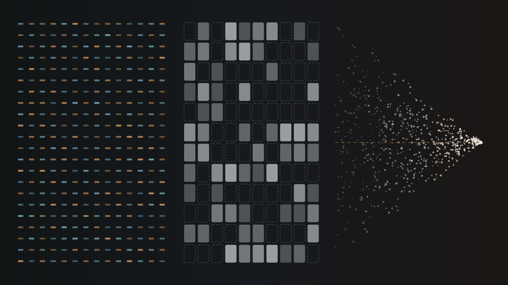
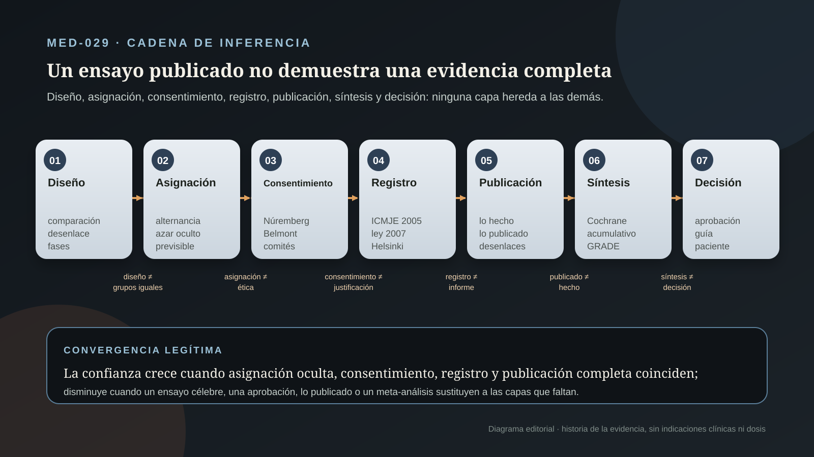
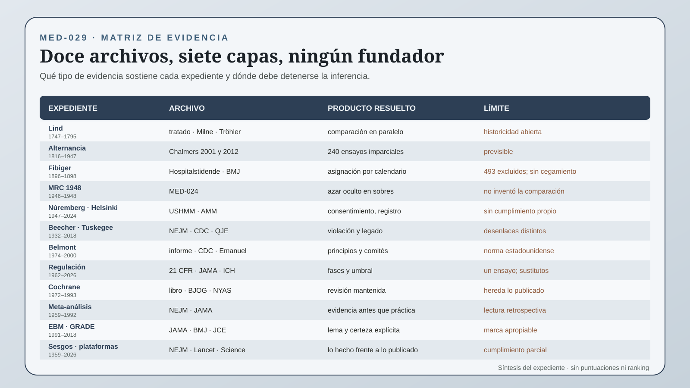

# MED-029 — Un ensayo publicado no demuestra una evidencia completa por sí solo

> **Alcance:** audita doce expedientes entre 1747 y 2026: el escorbuto de Lind (lo que el texto muestra y lo que no, con la historiografía de Tröhler y Milne); la asignación alterna desde 1816; el suero antidiftérico de Fibiger (1896–1898); el ensayo del MRC de 1948, citado desde MED-024 sin repetirlo; Núremberg (1947) y Helsinki (1964–2024); Beecher (1966); Tuskegee como violación documentada y su legado medido; el Informe Belmont y la revisión institucional; Kefauver-Harris, citada desde MED-024, y la regulación por fases; Cochrane (1972), la revisión de 1990 y la Colaboración de 1993; el meta-análisis acumulativo de la estreptoquinasa (Lau, 1992); la medicina basada en evidencia como lema (Guyatt, Sackett) y sus críticas (Greenhalgh 2014, Ioannidis 2016, el paracaídas, Deaton y Cartwright); GRADE; el sesgo de publicación (Simes, Chan, Turner 2008), el registro de ensayos (ICMJE 2005, la ley estadounidense, AllTrials), los conflictos de interés (Lundh, el Estudio 329) y la crisis de replicación; y, como cierre metodológico, los ensayos adaptativos y de plataforma (RECOVERY 2020) con la guía ICH E6(R3) de 2025–2026. Separa diseño, asignación, consentimiento, registro, publicación, síntesis y decisión. Es historia y epistemología de la evidencia: **no contiene recomendaciones clínicas, indicaciones ni dosis**; los tratamientos se nombran sólo como objeto de los ensayos históricos (`CLAIM-MED-EBM-NO-ADVICE-001`).

## Pregunta central

¿Cómo se institucionalizaron comparadores, consentimiento, síntesis y decisiones, sin confundir un diseño comparativo con grupos comparables, una asignación imparcial con un estudio ético, un consentimiento con un estudio justificado, un registro con una publicación, lo publicado con lo hecho, una síntesis con una decisión ni un lema con un método?

## Respuesta breve

El ensayo clínico no tiene inventor. Lind comparó en 1747 seis tratamientos en doce marineros y el par de cítricos mejoró antes; pero su informe ocupa unas cuatro páginas de un tratado de unas 450, no dice cómo asignó los pares, su teoría del escorbuto era otra y nunca afirmó con claridad que los cítricos lo curaran; el Almirantazgo actuó en 1795 por la defensa de Blane y por un viaje a Madrás (`CLAIM-MED-EBM-LIND-1747-001`, `CLAIM-MED-EBM-LIND-THEORY-001`, `CLAIM-MED-EBM-LIND-1795-001`). Entre 1816 y 1947 hubo al menos 240 ensayos con asignación alterna u otro esquema imparcial; Fibiger asignó suero antidiftérico por día de ingreso en 1896–1897 (8 muertes en 239 tratados frente a 30 en 245) y el MRC adoptó en 1948 números aleatorios, sobre todo, para que nadie pudiera prever la asignación siguiente (`CLAIM-MED-EBM-ALTERNATION-COUNT-001`, `CLAIM-MED-EBM-FIBIGER-1898-001`, `CLAIM-MED-EBM-ALTERNATION-CONCEALMENT-001`).

La comparación imparcial no trajo la ética consigo. El Código de Núremberg (1947) declaró esencial el consentimiento voluntario; Helsinki (1964) lo hizo norma profesional; y aun así Beecher publicó en 1966 veintidós ejemplos de investigación cuestionable tomados de revistas prestigiosas, y el Servicio de Salud Pública observó hasta 1972 a 399 hombres negros con sífilis sin consentimiento y sin ofrecerles penicilina (`CLAIM-MED-EBM-NUREMBERG-CODE-001`, `CLAIM-MED-EBM-BEECHER-1966-001`, `CLAIM-MED-EBM-TUSKEGEE-DESIGN-001`, `CLAIM-MED-EBM-TUSKEGEE-PENICILLIN-001`). La respuesta fue institucional —ley de 1974, Informe Belmont, revisión por comités— y el consentimiento quedó como uno de varios requisitos, no como garantía (`CLAIM-MED-EBM-BELMONT-1979-001`, `CLAIM-MED-EBM-EMANUEL-2000-001`).

La regulación convirtió el ensayo en umbral: «evidencia sustancial» desde 1962 (MED-024) y fases con preguntas sucesivas; pero entre 2005 y 2012 más de un tercio de las indicaciones nuevas se aprobó con un solo ensayo pivotal y casi la mitad sólo con desenlaces sustitutos (`CLAIM-MED-EBM-KEFAUVER-REFERENCE-001`, `CLAIM-MED-EBM-PHASES-001`, `CLAIM-MED-EBM-DOWNING-2014-001`). La síntesis nació de un retraso: la estreptoquinasa era significativa en 1973 con 8 ensayos y 2432 pacientes y siguieron 25 ensayos con 34 542 más, mientras libros y revisiones tardaban en recomendarla (`CLAIM-MED-EBM-LAU-1992-001`, `CLAIM-MED-EBM-ANTMAN-1992-001`).

Y la síntesis hereda lo que se publica. De 74 ensayos de antidepresivos registrados en la FDA, la literatura mostraba 94 % positivos frente a 51 % en la agencia (`CLAIM-MED-EBM-TURNER-2008-001`). El registro previo, exigido por las revistas desde 2005, permitió medir el problema sin resolverlo: en 2019, 40.9 % de los ensayos obligados por la ley estadounidense había informado a tiempo (`CLAIM-MED-EBM-ICMJE-2005-001`, `CLAIM-MED-EBM-DEVITO-2020-001`). La «medicina basada en evidencia» fue lema, método y marca; sus propios autores denunciaron su apropiación (`CLAIM-MED-EBM-GREENHALGH-2014-001`, `CLAIM-MED-EBM-IOANNIDIS-2016-001`).

La cadena legítima es **diseño → asignación → consentimiento → registro → publicación → síntesis → decisión**. Ningún eslabón hereda la fuerza del siguiente.

## UN ENSAYO PUBLICADO NO DEMUESTRA UNA EVIDENCIA COMPLETA POR SÍ SOLO

### 1. Siete capas que deben conservarse

| Capa | Pregunta | Producto legítimo | Salto inválido |
|---|---|---|---|
| Diseño | ¿qué se compara, contra qué, con qué desenlace y cuántos? | contraste planeado | creer que comparar ya asegura grupos comparables |
| Asignación | ¿quién decidió el grupo de cada persona y pudo preverlo? | grupos formados sin selección | confundir alternancia previsible o elección clínica con azar oculto |
| Consentimiento | ¿quién aceptó qué, sabiendo qué, y quién revisó el estudio? | participación voluntaria e informada, revisión independiente | creer que un estudio bien diseñado o consentido es por eso ético |
| Registro | ¿se declararon el ensayo y sus desenlaces antes de empezar? | denominador público de ensayos hechos | creer que registrar es informar |
| Publicación | ¿qué se publicó, cuándo y con qué desenlaces? | informe accesible y completo | tomar lo publicado por lo hecho |
| Síntesis | ¿qué estiman todos los ensayos juntos y con qué certeza? | efecto acumulado con intervalo y juicio de certeza | creer que un meta-análisis corrige lo que no se publicó |
| Decisión | ¿qué hace una persona, un panel o un regulador con esa síntesis? | recomendación o umbral con valores explícitos | convertir un estimador en una orden o una aprobación en verdad |

### 2. Cuatro distinciones que el expediente no deja fundir

Un **diseño comparativo** no asegura grupos comparables: la historia de la alternancia muestra que la regla imparcial falla cuando quien recluta puede prever el grupo siguiente, la misma lección que MED-001 formaliza como ocultamiento de la asignación (`CLAIM-MED-EBM-DESIGN-NOT-FAIR-001`, `CLAIM-MED-RANDOMIZATION-001`). Una **asignación imparcial** no hace ético un estudio: Tuskegee tenía un grupo de comparación y fue una violación documentada (`CLAIM-MED-EBM-ALLOCATION-NOT-ETHICS-001`). Un **registro** fija un denominador, pero no obliga por sí solo a informar (`CLAIM-MED-EBM-REGISTRATION-NOT-PUBLICATION-001`), y lo **publicado** no es lo hecho (`CLAIM-MED-EBM-PUBLICATION-NOT-EVIDENCE-001`). Una **síntesis** estima un efecto y su certeza; decidir exige además valores, daños, costos y contexto, como ya establece MED-001 (`CLAIM-MED-EBM-SYNTHESIS-NOT-DECISION-001`, `CLAIM-MED-DECISION-001`).

## DOCE EXPEDIENTES AUDITADOS

### 3. Lind y el escorbuto (1747): lo que el texto muestra y lo que no

James Lind, cirujano naval, informó que desde el 20 de mayo de 1747, en el *Salisbury*, durante el bloqueo del Canal, tomó doce marineros con escorbuto «tan parecidos como pudo», en el mismo alojamiento y con la misma dieta base, y los repartió en seis pares con seis tratamientos durante catorce días: sidra, elixir de vitriolo, vinagre, agua de mar, naranjas con limón y una pasta de ajo, mostaza, rábano y mirra. El par de los cítricos mejoró más rápido: uno volvió al servicio a los seis días y el otro pasó a cuidar a los demás (`CLAIM-MED-EBM-LIND-1747-001`). Es una comparación en paralelo, con grupos contemporáneos y un intento explícito de igualar condiciones: algo más que una serie como la de Withering que audita MED-024 (`CLAIM-MED-PHARM-WITHERING-1785-001`).

Lo que el texto no muestra es igual de importante. El informe ocupa unas cuatro páginas de un tratado de unas 450 y no lleva subtítulo; no dice cómo se asignó cada par; los cítricos se dieron sólo seis días, hasta que se acabaron; cada brazo tiene dos personas (`CLAIM-MED-EBM-LIND-TEXT-LIMIT-001`). Lind veía el escorbuto como un trastorno de digestión y excreción con varias causas —dieta, aire viciado, falta de ejercicio— y llegó a pensar que el confinamiento y el aire eran la principal; nunca afirmó con claridad que los cítricos lo curaran, siguió promoviendo otros remedios, y el concentrado de jugo que preparó por evaporación lenta perdía con el calor casi toda la vitamina C (`CLAIM-MED-EBM-LIND-THEORY-001`).

Tröhler sitúa el experimento en su contexto: la tercera edición (1772) resumió cuatro volúmenes de observaciones del hospital de Haslar —1146 casos de escorbuto entre 5743 pacientes en sus dos primeros años— sin publicar listas de casos ni resultados numéricos de ensayos. La decisión del Almirantazgo de 1795 de distribuir jugo de limón a gran escala se apoyó sobre todo en la defensa de Gilbert Blane y en una flota que en 1793 llegó a Madrás sin escorbuto tras diecinueve semanas sin tocar puerto; antes, la política oficial favorecía el mosto de malta, el chucrut y la sopa deshidratada (`CLAIM-MED-EBM-LIND-1795-001`). Milne rastrea el mito del héroe ignorado hasta una entrada biográfica de 1893 y lo considera construido por escritores posteriores; Tröhler concluye que el escorbuto se venció por la combinación de observación cuidadosa y registros numéricos simples de varios cirujanos, y que el cambio oficial fue más persuasión que razonamiento deliberado (`CLAIM-MED-EBM-LIND-HISTORIOGRAPHY-001`). Milne añade, citando a Baron (2009), que los pacientes no aparecen en la lista de enfermos del barco: la historicidad misma del relato queda abierta, aunque ilustre una manera de pensar la comparación (`CLAIM-MED-EBM-LIND-HISTORICITY-001`).

### 4. La asignación alterna (1816–1947): imparcial pero previsible

Chalmers, Dukan, Podolsky y Davey Smith reunieron más de doscientos informes anteriores a 1948. Alexander Hamilton alternó en 1816, en la guerra peninsular, soldados entre tres tratamientos, dos sin sangría; Thomas Graham Balfour alternó niños a mediados del siglo XIX en un ensayo de belladona para evitar «la imputación de selección» (`CLAIM-MED-EBM-ALTERNATION-HAMILTON-1816-001`). Su tabla cuenta al menos 240 ensayos con esquemas imparciales antes de 1948: 26 antes de 1900, 55 entre 1900 y 1929, 82 en la década de 1930 y 77 entre 1940 y 1947 (`CLAIM-MED-EBM-ALTERNATION-COUNT-001`). La genealogía conecta con la que MED-020 audita: el método numérico de Louis comparó series seleccionadas y la maternidad de Viena asignaba por días alternos (`CLAIM-MED-COUNT-LOUIS-NOT-TRIAL-001`, `CLAIM-MED-COUNT-SEMMELWEIS-ALLOCATION-001`).

La debilidad de la alternancia no es la regla, sino su previsibilidad: quien recluta puede saber qué grupo toca y decidir a quién admitir. Austin Bradford Hill comprobó en 1933 cómo ocurría en un ensayo de suero del MRC para la neumonía (`CLAIM-MED-EBM-ALTERNATION-FOREKNOWLEDGE-001`). Chalmers sostiene que la alternancia estricta, si nadie la subvierte, elimina el sesgo de selección tanto como el azar estricto, y que los números aleatorios se adoptaron sobre todo para ocultar la secuencia; *The Design of Experiments* de Fisher (1935) llegó cuando la alternancia ya llevaba décadas en uso (`CLAIM-MED-EBM-ALTERNATION-CONCEALMENT-001`). Diseñar una comparación y formar grupos imparciales son dos capas distintas (`CLAIM-MED-EBM-DESIGN-NOT-FAIR-001`).

### 5. Fibiger y el suero antidiftérico (1896–1898)

Johannes Fibiger trató en el Blegdamshospital de Copenhague, del 13 de mayo de 1896 al 13 de mayo de 1897, a los ingresados en días alternos con el tratamiento habitual o con el habitual más suero antidiftérico. Murieron 8 de 239 tratados con suero y 30 de 245 controles; no hizo prueba estadística formal, y Hróbjartsson, Gøtzsche y Gluud calculan que una prueba de chi cuadrado habría dado P = 0.0003 (`CLAIM-MED-EBM-FIBIGER-1898-001`). Fibiger razonó como pocos antes: pidió muchos pacientes, un año completo por la variación estacional de la mortalidad, suficientes eventos y una asignación que quitara el juicio subjetivo, y rechazó los controles históricos (`CLAIM-MED-EBM-FIBIGER-REASONING-001`).

El ensayo tiene límites que su elogio suele omitir: de 1004 ingresos con presunta difteria se excluyeron 493 de la estadística (sin bacilo, con otras infecciones, muertos en las primeras 24 horas, o que rechazaron o recibieron suero contra la asignación); no fue ciego; hubo enfermedad del suero en 60 % de los tratados; y la asignación por día de ingreso pudo favorecer casos leves en días de suero, aunque los grupos resultaron parecidos en edad y gravedad (`CLAIM-MED-EBM-FIBIGER-EXCLUSIONS-001`). Tuvo poco impacto inmediato; un reanálisis de 1951 lo juzgó no significativo, crítica que los autores del centenario rechazan al llamarlo el primer ensayo controlado bien hecho (`CLAIM-MED-EBM-FIBIGER-RECEPTION-001`). Es cuasialeatorio: imparcial por regla, previsible por calendario.

### 6. El MRC de 1948, citado sin repetir

El diseño del ensayo de estreptomicina —números aleatorios por sexo y centro en sobres cerrados—, sus cifras (4 muertes en 55 frente a 14 en 52 a seis meses), la escasez que lo hizo aceptable y sus antecedentes con monedas están auditados en MED-024 (`CLAIM-MED-EBM-MRC-REFERENCE-001`, `CLAIM-MED-PHARM-MRC-DESIGN-001`, `CLAIM-MED-PHARM-MRC-RESULT-001`, `CLAIM-MED-PHARM-MRC-SCARCITY-001`, `CLAIM-MED-PHARM-MRC-NOT-FIRST-001`). Lo que este expediente añade es la lectura de fondo: tras medio siglo de alternancia, lo nuevo de 1948 fue sobre todo el ocultamiento de la secuencia, no la idea de comparar grupos imparciales (`CLAIM-MED-EBM-MRC-CONCEALMENT-001`). El ensayo de campo de la vacuna de Salk de 1954, con áreas aleatorizadas y áreas observadas, que MED-020 audita, muestra la misma tensión entre imparcialidad y práctica a otra escala (`CLAIM-MED-COUNT-SALK-DESIGN-001`).

### 7. Núremberg (1947) y Helsinki (1964–2024): el consentimiento escrito

Un tribunal militar estadounidense juzgó en Núremberg, del 9 de diciembre de 1946 al 20 de agosto de 1947, a 23 médicos y administradores alemanes: 16 fueron condenados y 7 sentenciados a muerte (`CLAIM-MED-EBM-NUREMBERG-1947-001`). El veredicto incluyó diez puntos sobre experimentación permisible, revisión de seis que Leo Alexander había propuesto en abril de 1947; el primero declara absolutamente esencial el consentimiento voluntario de una persona capaz, libre de coerción e informada; su fuerza legal no quedó bien establecida (`CLAIM-MED-EBM-NUREMBERG-CODE-001`). Haber nacido para juzgar crímenes de guerra permitió leer el código como ajeno a la investigación ordinaria de las democracias: lo que mostraron Beecher y Tuskegee (`CLAIM-MED-EBM-NUREMBERG-DISTANCE-001`).

La Asociación Médica Mundial adoptó la Declaración de Helsinki en su 18.ª Asamblea, en junio de 1964, y la revisó en Tokio (1975), Venecia (1983), Hong Kong (1989), Somerset West (1996), Edimburgo (2000), Seúl (2008), Fortaleza (2013) y de nuevo en Helsinki en octubre de 2024, con notas aclaratorias en 2002 y 2004 (`CLAIM-MED-EBM-HELSINKI-1964-001`). La versión de 2024 habla de «participantes», no de «sujetos»; acepta placebo o ausencia de intervención cuando no hay intervención probada, con advertencia contra el abuso; y exige registrar la investigación en una base pública antes del primer participante y publicar los resultados negativos e inconclusos además de los positivos (`CLAIM-MED-EBM-HELSINKI-2024-001`). Registro y publicación entraron así en la ética, no sólo en la metodología. Pero una declaración profesional no tiene mecanismo propio de cumplimiento (`CLAIM-MED-EBM-HELSINKI-NORM-NOT-PRACTICE-001`).

### 8. Beecher (1966) y Tuskegee (1932–1972): la violación documentada

Henry Beecher —el mismo anestesiólogo que en 1954 contó muertes asociadas a la anestesia, como audita MED-021 (`CLAIM-MED-ANES-BEECHER-TODD-1954-001`)— publicó el 16 de junio de 1966 en el *New England Journal of Medicine* veintidós ejemplos de investigación que exponía a personas a riesgos sin beneficio para ellas y, a menudo, sin consentimiento real: retener penicilina a soldados con fiebre reumática, trasplantar un melanoma entre pacientes o infectar con hepatitis a niños con discapacidad. Los ejemplos venían de estudios publicados en revistas prestigiosas, muchos con fondos federales, y Beecher no nombró a sus autores; *JAMA* había rechazado una versión anterior (`CLAIM-MED-EBM-BEECHER-1966-001`). Tras el artículo, el Cirujano General pidió revisión institucional de los proyectos con humanos; las regulaciones federales llegaron después de Tuskegee (`CLAIM-MED-EBM-BEECHER-REVIEW-001`). Un estudio del propio Beecher con LSD, de 1956, no mencionaba consentimiento: el denunciante compartía la cultura que denunció (`CLAIM-MED-EBM-BEECHER-OWN-STUDY-001`). Que esos estudios se publicaran muestra que la revisión editorial no filtraba la ética.

El Servicio de Salud Pública de Estados Unidos, con el Instituto Tuskegee, empezó en 1932 un estudio para registrar la historia natural de la sífilis no tratada en 600 hombres negros, 399 con sífilis y 201 sin ella. Se les dijo que se les trataba por «mala sangre»; no se pidió consentimiento informado; recibían exámenes, comidas y seguro funerario (`CLAIM-MED-EBM-TUSKEGEE-DESIGN-001`). Hacia 1943 la penicilina era el tratamiento de elección de la sífilis y no se les ofreció (`CLAIM-MED-EBM-TUSKEGEE-PENICILLIN-001`). Una nota de Associated Press lo expuso en 1972; un panel lo declaró éticamente injustificado en octubre; terminó en noviembre; una demanda colectiva acabó en 1974 con un acuerdo de 10 millones de dólares; la disculpa presidencial llegó el 16 de mayo de 1997 y el último participante murió en enero de 2004 (`CLAIM-MED-EBM-TUSKEGEE-END-1972-001`).

Dos precisiones bloquean errores frecuentes. En Tuskegee no se inyectó sífilis a nadie: el daño fue observar sin tratar y engañar; las inoculaciones deliberadas las hizo el mismo servicio en Guatemala en 1946–1948, y las documentó Susan Reverby al revisar los papeles de uno de sus médicos (`CLAIM-MED-EBM-TUSKEGEE-NOT-INOCULATION-001`). Y Tuskegee tenía grupo de comparación: la imparcialidad de los grupos no dice nada de la legitimidad de usarlos (`CLAIM-MED-EBM-ALLOCATION-NOT-ETHICS-001`).

El legado se ha medido con desenlaces distintos. Alsan y Wanamaker, con un modelo de triple diferencia que compara hombres negros mayores con otros grupos antes y después de la revelación y según la cercanía a las víctimas, asocian 1972 con más desconfianza médica, menos consultas y más mortalidad, y estiman una caída de hasta 1.5 años en la esperanza de vida a los 45 años, cerca de 35 % de la brecha con los hombres blancos en 1980 (`CLAIM-MED-EBM-TUSKEGEE-ALSAN-2018-001`). Katz y colaboradores, en una encuesta aleatoria a 826 adultos de tres ciudades, no hallaron asociación entre conocer Tuskegee y la disposición declarada a participar en investigación (`CLAIM-MED-EBM-TUSKEGEE-KATZ-2008-001`). No se contradicen por necesidad: una estimación es poblacional y cuasiexperimental sobre la salud; la otra, individual y declarativa sobre la investigación (`CLAIM-MED-EBM-TUSKEGEE-IMPACT-LIMIT-001`).

### 9. El Informe Belmont y la revisión institucional

La Ley Nacional de Investigación de 1974 creó la Comisión Nacional para la Protección de Sujetos Humanos; su informe, publicado en el *Federal Register* el 18 de abril de 1979 como Informe Belmont, fijó tres principios —respeto por las personas, beneficencia y justicia— aplicados a consentimiento informado, valoración de riesgos y beneficios y selección de sujetos (`CLAIM-MED-EBM-BELMONT-1979-001`). Desde 1974 los estudios del departamento federal de salud exigen consentimiento informado voluntario y revisión por comités institucionales; en 1991 dieciséis departamentos y agencias adoptaron la política federal común (`CLAIM-MED-EBM-BELMONT-IRB-001`). La justicia en la selección es la respuesta directa a Tuskegee: quién carga con el riesgo y quién recibe el beneficio.

Emanuel, Wendler y Grady sostuvieron en 2000 que el consentimiento informado no es necesario ni suficiente para una investigación ética, y propusieron siete requisitos: valor, validez científica, selección justa, balance favorable de riesgos y beneficios, revisión independiente, consentimiento informado y respeto por los inscritos (`CLAIM-MED-EBM-EMANUEL-2000-001`). Un estudio inválido no se vuelve ético porque alguien lo consienta (`CLAIM-MED-EBM-CONSENT-NOT-SUFFICIENT-001`). MED-001 recuerda que el control simulado sólo es aceptable con consentimiento explícito y riesgo proporcionado (`CLAIM-MED-SHAM-001`), y MED-020 que la inclusión de mujeres en los ensayos exigió políticas explícitas (`CLAIM-MED-COUNT-TRIAL-INCLUSION-001`).

### 10. Regulación: de Kefauver-Harris a las fases

Las enmiendas Kefauver-Harris de 1962, con su «evidencia sustancial» de investigaciones adecuadas y bien controladas, su exigencia de consentimiento con excepciones y la revisión DESI, están auditadas en MED-024, que también muestra el desajuste entre el daño de la talidomida y la eficacia que exigió la ley (`CLAIM-MED-EBM-KEFAUVER-REFERENCE-001`, `CLAIM-MED-PHARM-KEFAUVER-1962-001`, `CLAIM-MED-PHARM-KEFAUVER-MISMATCH-001`, `CLAIM-MED-PHARM-DESI-001`). La regulación por fases convirtió la investigación en preguntas sucesivas: la norma estadounidense vigente describe la fase 1 como primera administración en personas, con unas 20 a 80; la fase 2 como estudios controlados de eficacia en una condición, con hasta varios cientos; y la fase 3 como ensayos ampliados con varios cientos a varios miles; y admite que las fases se superpongan (`CLAIM-MED-EBM-PHASES-001`). Las fases ordenan preguntas, no certezas: una fase 3 positiva responde lo que se le preguntó en la población que reclutó (`CLAIM-MED-EBM-PHASES-NOT-LADDER-001`).

Downing y colaboradores revisaron los documentos públicos de la FDA para los 188 fármacos nuevos aprobados entre 2005 y 2012 para 206 indicaciones: hubo 448 ensayos pivotales; la mediana fue de dos por indicación, pero 36.8 % se aprobó con uno solo; 89.3 % de los ensayos era aleatorizado y 79.5 % doble ciego; y 45.3 % de las indicaciones se apoyó exclusivamente en desenlaces sustitutos (`CLAIM-MED-EBM-DOWNING-2014-001`). El riesgo de los sustitutos lo documenta MED-001 con CAST (`CLAIM-MED-SURROGATE-CAST-001`). Aprobar fija un umbral en una fecha, no completa la evidencia (`CLAIM-MED-EBM-APPROVAL-THRESHOLD-001`, `CLAIM-MED-PHARM-APPROVAL-NOT-SAFETY-001`). La guía internacional ICH E6(R3) de buena práctica clínica alcanzó el paso 4 el 6 de enero de 2025 con un enfoque proporcionado y basado en riesgos, y su anexo 2 para ensayos pragmáticos y descentralizados se adoptó en junio de 2026, con entrada en vigor europea prevista para enero de 2027 (`CLAIM-MED-EBM-ICH-E6-R3-2025-001`).

### 11. Cochrane: de la crítica a la Colaboración (1972–1993)

Archie Cochrane publicó en 1972 *Effectiveness and Efficiency*, que destacó la importancia de los ensayos aleatorizados para saber qué intervenciones de los servicios de salud hacen más bien que daño (`CLAIM-MED-EBM-COCHRANE-1972-001`). En 1979 escribió que era una gran crítica a su profesión no haber organizado resúmenes críticos, por especialidad, actualizados periódicamente, de todos los ensayos aleatorizados relevantes (`CLAIM-MED-EBM-COCHRANE-1979-001`).

La respuesta tomó forma en obstetricia. Crowley, Chalmers y Keirse publicaron en 1990 una revisión sistemática de doce ensayos controlados con más de 3000 participantes, motivada por «diferencias persistentes de opinión» entre obstetras y neonatólogos: los corticoides antes del parto prematuro reducían el síndrome de dificultad respiratoria, la hemorragia intraventricular, la enterocolitis necrosante y la muerte neonatal (`CLAIM-MED-EBM-CROWLEY-1990-001`). Chalmers describió en 1993 la Colaboración Cochrane como red internacional para preparar, mantener y difundir revisiones sistemáticas en una base de datos electrónica (`CLAIM-MED-EBM-COLLABORATION-1993-001`). La revisión sistemática nació como respuesta a un retraso, no a una falta de ensayos (`CLAIM-MED-EBM-SYNTHESIS-LAG-001`). Sus manuales de reporte actuales —PRISMA 2020, CONSORT 2025— están auditados en MED-001, donde se advierte que describir bien no certifica un diseño válido (`CLAIM-MED-REPORTING-VALIDITY-001`).

### 12. Meta-análisis acumulativo: la estreptoquinasa (Lau, 1992)

Glass propuso en 1976, desde la investigación educativa, el término meta-análisis para el análisis de los resultados de muchos estudios (`CLAIM-MED-EBM-GLASS-1976-001`). Lau, Antman, Jimenez-Silva, Kupelnick, Mosteller y Chalmers rehicieron en 1992 un meta-análisis cada vez que se publicaba un nuevo ensayo de quince tratamientos del infarto. Para la estreptoquinasa intravenosa hubo 33 ensayos entre 1959 y 1988; la reducción de la mortalidad total fue consistente y significativa (razón de momios 0.74; IC 95 % 0.59–0.92) ya en 1973, tras 8 ensayos con 2432 pacientes (`CLAIM-MED-EBM-LAU-1992-001`). Los 25 ensayos posteriores, con 34 542 pacientes más —entre ellos GISSI (11 712) en 1986 e ISIS-2 (17 187) en 1988—, apenas movieron la razón de momios y sólo estrecharon el intervalo (`CLAIM-MED-EBM-LAU-LATER-TRIALS-001`). Antman y colaboradores compararon en el mismo año esa acumulación con lo que escribían revisiones y libros de texto: omitían avances, recomendaban tarde medidas eficaces y seguían recomendando tratamientos sin efecto en la mortalidad o potencialmente dañinos (`CLAIM-MED-EBM-ANTMAN-1992-001`).

La lección tiene un límite que el relato triunfal olvida. Que la significación «aparezca» en 1973 es una lectura retrospectiva: el meta-análisis acumulativo repite pruebas sobre datos que crecen, depende de los ensayos que llegaron a publicarse y no sustituye lo que los grandes ensayos aportaron sobre daños, subgrupos y aplicabilidad (`CLAIM-MED-EBM-CUMULATIVE-LIMIT-001`). Es un argumento contra el desperdicio de ensayos, no una prueba de que ISIS-2 sobrara.

### 13. La medicina basada en evidencia como lema y sus críticas

Gordon Guyatt usó la expresión *evidence-based medicine* en *ACP Journal Club* en 1991, y el Evidence-Based Medicine Working Group la presentó en *JAMA* en 1992 como un nuevo enfoque para enseñar la práctica de la medicina (`CLAIM-MED-EBM-GUYATT-1991-001`). Sackett y colaboradores publicaron en 1996 «qué es y qué no es»; la lectura habitual —integrar la mejor evidencia externa con la pericia clínica y los valores del paciente, sin recetario— se registra aquí sin haberse verificado contra el texto completo (`CLAIM-MED-EBM-SACKETT-1996-001`). El término funcionó también como lema y como marca de calidad (`CLAIM-MED-EBM-EBM-BRAND-001`).

Las críticas más fuertes vinieron de dentro. Greenhalgh, Howick y Maskrey, con un grupo que incluía a miembros del Centro Cochrane británico y de AllTrials, señalaron en 2014 cinco problemas: la «marca de calidad» basada en evidencia apropiada por intereses creados —la industria fija agendas, define enfermedades y elige desenlaces sustitutos—, un volumen de guías inmanejable, beneficios estadísticamente significativos pero marginales, reglas rígidas que producen atención gestionada en lugar de centrada en el paciente, y guías que no se ajustan a la multimorbilidad (`CLAIM-MED-EBM-GREENHALGH-2014-001`). Ioannidis escribió en 2016 que el movimiento había sido «secuestrado»: los ensayos influyentes se hacen por y para la industria, y meta-análisis y guías se volvieron una fábrica (`CLAIM-MED-EBM-IOANNIDIS-2016-001`).

El adversario metodológico apunta a la jerarquía. Smith y Pell no encontraron en 2003 ningún ensayo aleatorizado del paracaídas y propusieron, en sátira, que los más radicales participaran en uno (`CLAIM-MED-EBM-PARACHUTE-2003-001`). En 2018, Yeh y colaboradores aleatorizaron a 23 voluntarios a saltar con paracaídas o mochila vacía desde aeronaves en tierra —altitud media 0.6 metros frente a 9146 de los no inscritos— y no hallaron diferencias: un ensayo internamente válido puede no aplicarse a nadie que importe (`CLAIM-MED-EBM-PARACHUTE-2018-001`). Glasziou, Chalmers, Rawlins y McCulloch aceptan que efectos dramáticos y rápidos frente al pronóstico, con razones de tasas que a menudo superan 10, pueden inferirse sin ensayos (`CLAIM-MED-EBM-GLASZIOU-2007-001`); la misma lógica que MED-024 reconoce en los controles históricos de las sulfonamidas. Concato, Shah y Horwitz hallaron en 2000, en 99 informes de cinco temas, resultados promedio de estudios observacionales bien diseñados muy parecidos a los de ensayos —por ejemplo, 0.49 frente a 0.50 para la vacuna BCG— (`CLAIM-MED-EBM-CONCATO-2000-001`). Deaton y Cartwright sostienen que la aleatorización no iguala todo salvo el tratamiento en un ensayo concreto y que extender su estimación exige justificación aparte (`CLAIM-MED-EBM-DEATON-CARTWRIGHT-2018-001`). Una jerarquía ordena riesgos típicos de sesgo, no la verdad de cada estudio (`CLAIM-MED-EBM-HIERARCHY-NOT-AUTOMATIC-001`, `CLAIM-MED-TARGET-TRIAL-001`, `CLAIM-MED-COUNT-CAUSAL-PLURALISM-001`).

### 14. GRADE: la certeza como juicio explícito

El grupo GRADE presentó en 2004 un sistema para graduar la calidad de la evidencia y la fuerza de las recomendaciones: la fuerza exige ponderar beneficios y daños, calidad, traslado a circunstancias concretas, certeza del riesgo basal y costos (`CLAIM-MED-EBM-GRADE-2004-001`). En 2008 se presentó como consenso emergente ante guías que graduaban de forma inconsistente; sus autores declararon que el éxito de GRADE favorecía sus carreras académicas (`CLAIM-MED-EBM-GRADE-2008-001`). GRADE separa síntesis y decisión: la certeza es un juicio estructurado sobre riesgo de sesgo, inconsistencia, evidencia indirecta, imprecisión y sesgo de publicación, no un número que salga de una fórmula, y dos paneles honestos pueden graduar distinto (`CLAIM-MED-EBM-GRADE-JUDGMENT-001`, `CLAIM-MED-EBM-SYNTHESIS-NOT-DECISION-001`).

### 15. Sesgo de publicación: lo publicado no es lo hecho

Sterling planteó en 1959 que si se publica según las pruebas de significación, las inferencias de lo publicado quedan sesgadas (`CLAIM-MED-EBM-STERLING-1959-001`). Simes lo midió en 1986: en cáncer de ovario avanzado, los ensayos publicados daban una ventaja significativa en supervivencia a la quimioterapia combinada (razón de medianas 1.16; P = .02) y los registrados de antemano en un registro oncológico no (1.05; P = .25) (`CLAIM-MED-EBM-SIMES-1986-001`). Chan y colaboradores compararon en 2004 protocolos aprobados con artículos de 102 ensayos y 3736 desenlaces: los significativos tenían más probabilidad de informarse completos (OR 2.4 en eficacia, 4.7 en daños), 62 % de los ensayos cambió, añadió u omitió al menos un desenlace primario y 86 % de los autores encuestados negó desenlaces no informados que existían (`CLAIM-MED-EBM-CHAN-2004-001`).

Turner, Matthews, Linardatos, Tell y Rosenthal obtuvieron las revisiones de la FDA de 74 ensayos de doce antidepresivos con 12 564 pacientes. 31 %, con 3449 participantes, no se había publicado. De los 38 positivos para la FDA se publicaron 37; de los negativos o dudosos, 3 se publicaron como tales, 22 no se publicaron y 11 se publicaron de un modo que transmitía un resultado positivo. La literatura parecía 94 % positiva; la FDA, 51 % (`CLAIM-MED-EBM-TURNER-2008-001`). El tamaño del efecto aumentó 32 % en conjunto, de 11 % a 69 % según el fármaco (`CLAIM-MED-EBM-TURNER-EFFECT-001`). Los autores no pudieron determinar si el sesgo vino de quienes no enviaron o de quienes no publicaron (`CLAIM-MED-EBM-TURNER-LIMIT-001`). La enseñanza no es que los antidepresivos «no funcionen»: es que el meta-análisis de lo publicado estimaba otra cosa que el de lo hecho (`CLAIM-MED-EBM-PUBLICATION-NOT-EVIDENCE-001`).

### 16. Registro de ensayos, AllTrials y conflictos de interés

El Comité Internacional de Editores de Revistas Médicas anunció en 2004 que sólo consideraría ensayos que empezaran a reclutar desde el 1 de julio de 2005 si estaban registrados antes del primer paciente, y fijó el 13 de septiembre de 2005 para registrar los ya en curso (`CLAIM-MED-EBM-ICMJE-2005-001`). La ley estadounidense de 2007 exigió además informar resultados en el registro dentro del año. DeVito, Bacon y Goldacre hallaron en 2019 que de 4209 ensayos obligados, 40.9 % había informado dentro del plazo y 63.8 % en algún momento, con una mediana de retraso de 424 días (`CLAIM-MED-EBM-DEVITO-2020-001`); en el registro europeo, 49.5 % de 7274 ensayos con resultados exigibles los había publicado, 68.1 % de los comerciales y 11.0 % de los no comerciales (`CLAIM-MED-EBM-GOLDACRE-2018-001`). En 67 ensayos de cinco grandes revistas que respaldan CONSORT, sólo 76 % de los desenlaces primarios preespecificados se informó correctamente (`CLAIM-MED-EBM-COMPARE-2019-001`). Registrar es necesario y no basta (`CLAIM-MED-EBM-REGISTRATION-NOT-PUBLICATION-001`).

El registro sí cambió algo medible. Kaplan e Irvin hallaron que 17 de 30 grandes ensayos del NHLBI publicados antes de 2000 (57 %) mostraron beneficio en el desenlace primario, frente a 2 de 25 (8 %) después; el registro previo en ClinicalTrials.gov se asoció fuertemente con la tendencia a resultados nulos, sin cambio en la proporción de comparadores con placebo ni asociación con el copatrocinio industrial (`CLAIM-MED-EBM-KAPLAN-IRVIN-2015-001`). Es una asociación temporal, no un experimento. La campaña AllTrials se lanzó en el Reino Unido el 9 de enero de 2013, con el *BMJ*, el Centro de Medicina Basada en Evidencia de Oxford, Bad Science, Sense About Science, la James Lind Initiative y la Colaboración Cochrane, para pedir que todos los ensayos pasados y presentes se registraran y publicaran métodos y resultados (`CLAIM-MED-EBM-ALLTRIALS-2013-001`).

Los conflictos de interés son una capa propia. La revisión Cochrane de Lundh y colaboradores (75 artículos) halló que los estudios patrocinados por la industria tuvieron más resultados de eficacia favorables (RR 1.27; 1.17–1.37) y más conclusiones favorables (RR 1.34; 1.19–1.51), menos acuerdo entre resultados y conclusiones, y un sesgo que las evaluaciones habituales de riesgo de sesgo no explican (`CLAIM-MED-EBM-LUNDH-2017-001`). El reanálisis RIAT del Estudio 329 —275 adolescentes con depresión en doce centros entre 1994 y 1998, publicado en 2001 por Keller y colaboradores— no halló diferencias significativas frente a placebo en ningún desenlace preespecificado y sí aumentos clínicamente significativos de daños, incluidos ideación y conducta suicidas; sus autores concluyen que las conclusiones publicadas sobre eficacia y seguridad no deben leerse como autorizadas (`CLAIM-MED-EBM-STUDY-329-2015-001`). Un caso muestra el mecanismo; la revisión, la asociación; ninguno prueba fraude en cada estudio patrocinado (`CLAIM-MED-EBM-COI-NOT-FRAUD-001`).

### 17. Crisis de replicación: cuánto de lo publicado se sostiene

Ioannidis argumentó en 2005, con un modelo, que un hallazgo es menos probable que sea cierto cuanto menores son los estudios y los efectos, mayor el número de relaciones probadas, mayor la flexibilidad de diseños y análisis, mayores los intereses y más equipos persiguen la significación (`CLAIM-MED-EBM-IOANNIDIS-2005-PLOS-001`). En el mismo año, en 45 estudios clínicos muy citados que afirmaban un efecto, 7 (16 %) fueron contradichos, 7 (16 %) tuvieron efectos más fuertes que los posteriores, 20 (44 %) se replicaron y 11 (24 %) no fueron puestos a prueba; 5 de 6 estudios no aleatorizados frente a 9 de 39 ensayos fueron contradichos o exagerados (`CLAIM-MED-EBM-IOANNIDIS-2005-JAMA-001`).

El adversario es cuantitativo. Jager y Leek estimaron, con 5322 valores P de los resúmenes de 77 430 artículos de cinco revistas médicas entre 2000 y 2010, una tasa de falsos descubrimientos de 14 % (`CLAIM-MED-EBM-JAGER-LEEK-2014-001`). En psicología, la Open Science Collaboration replicó 100 estudios: 97 % de los originales y 36 % de las réplicas fueron significativos y los efectos replicados tuvieron la mitad de magnitud (`CLAIM-MED-EBM-OSC-2015-001`); Gilbert, King, Pettigrew y Wilson respondieron que el estudio tenía tres errores estadísticos y que sus datos eran compatibles con una reproducibilidad alta (`CLAIM-MED-EBM-GILBERT-2016-001`). En biología preclínica, Begley y Ellis informaron que un equipo industrial confirmó 6 de 53 estudios considerados hitos, sin publicar cuáles (`CLAIM-MED-EBM-BEGLEY-ELLIS-2012-001`); el proyecto de reproducibilidad en biología del cáncer repitió 50 experimentos de 23 artículos: la mediana de los efectos positivos replicados fue 85 % menor y 40 % (39 de 97) de esas réplicas tuvo éxito por al menos tres de cinco criterios (`CLAIM-MED-EBM-ERRINGTON-2021-001`). La «crisis» es heterogénea: los ensayos clínicos registrados tienen otros sesgos y otros controles que la psicología experimental o el laboratorio preclínico (`CLAIM-MED-EBM-REPLICATION-SCOPE-001`).

### 18. Ensayos adaptativos y de plataforma: cierre metodológico (2020–2026)

Un diseño adaptativo usa los datos acumulados para modificar el curso del ensayo según reglas preespecificadas; Pallmann y colaboradores advierten que la etiqueta se ha usado de forma engañosa para métodos discutibles o mal aplicados (`CLAIM-MED-EBM-ADAPTIVE-2018-001`). RECOVERY fue un ensayo de plataforma abierto que aleatorizó a pacientes hospitalizados con COVID-19 en el Reino Unido entre varios tratamientos posibles y la atención habitual, con mortalidad a 28 días como desenlace primario (`CLAIM-MED-EBM-RECOVERY-DESIGN-001`). El brazo de hidroxicloroquina, propuesta por actividad *in vitro*, estudios sin control y ensayos pequeños, se cerró el 5 de junio de 2020 tras un análisis intermedio por falta de eficacia: murieron 27.0 % de 1561 frente a 25.0 % de 3155 (razón 1.09; 0.97–1.23) (`CLAIM-MED-EBM-RECOVERY-HCQ-2020-001`). En el brazo de dexametasona murieron 22.9 % de 2104 frente a 25.7 % de 4321 (razón ajustada por edad 0.83; 0.75–0.93) (`CLAIM-MED-EBM-RECOVERY-DEXA-2020-001`), pero el efecto no se repartió igual: 0.64 (0.51–0.81) con ventilación mecánica invasiva y 1.19 (0.92–1.55) sin soporte respiratorio (`CLAIM-MED-EBM-RECOVERY-DEXA-SUBGROUP-001`).

RECOVERY reúne en un solo dispositivo casi todo lo que este expediente separa: asignación aleatoria, consentimiento en condiciones de urgencia, registro, desenlaces preespecificados, publicación rápida y síntesis inmediata con otros ensayos. Pero es abierto, compara con atención habitual en un sistema concreto y en un momento de la pandemia; una plataforma acelera comparaciones sin eliminar ocultamiento, registro, cegamiento ni transporte (`CLAIM-MED-EBM-PLATFORM-LIMIT-001`). Las cifras se citan como historia de la evidencia, no como indicación de tratamiento alguno (`CLAIM-MED-EBM-NO-ADVICE-001`).

## LO OBSERVADO

- informes de comparaciones en paralelo, tratados, listas de casos y decisiones navales;
- esquemas de asignación alterna, por día de ingreso y por números aleatorios;
- sentencias, códigos, declaraciones profesionales, leyes, informes de comisiones y normas regulatorias;
- artículos publicados con prácticas cuestionables y cronologías institucionales de un estudio sin tratamiento;
- protocolos, registros de ensayos, revisiones de agencias y artículos publicados de los mismos ensayos;
- revisiones sistemáticas, meta-análisis acumulativos y marcos de graduación de la certeza;
- réplicas a gran escala y reanálisis con datos individuales;
- ensayos de plataforma con brazos que se abren y se cierran.

## LO MEDIDO

- muertes por grupo en ensayos históricos y modernos (Fibiger, RECOVERY) y razones de momios acumuladas (Lau);
- número de ensayos con asignación imparcial por periodo (Chalmers y colaboradores);
- proporción de ensayos publicados, positivos o informados a tiempo (Turner, DeVito, Goldacre, Kaplan e Irvin);
- desenlaces cambiados entre protocolo y artículo (Chan, COMPare);
- asociación entre patrocinio y resultados (Lundh);
- proporción de réplicas exitosas y tamaño relativo de los efectos (Open Science Collaboration, Errington);
- características de los ensayos pivotales de aprobación (Downing);
- cambios de mortalidad y desconfianza tras la revelación de Tuskegee (Alsan y Wanamaker) y disposición declarada (Katz);
- no la frecuencia de violaciones éticas en la investigación, ni la proporción de verdad de la literatura médica en su conjunto.

## LO INFERIDO

Que la comparación imparcial se institucionalizó por capas —alternancia, ocultamiento con números aleatorios, consentimiento, revisión independiente, registro, publicación obligatoria, síntesis y juicio de certeza— es la inferencia mejor sostenida por la convergencia de historia de métodos, documentos normativos y metainvestigación. Que la literatura publicada sobrestimó efectos de forma sistemática en varios campos se infiere de comparaciones entre lo registrado y lo publicado. Que cada capa nació, en buena parte, como respuesta a un fallo de la anterior es una lectura historiográfica plausible, no una ley (`CLAIM-MED-EBM-CHAIN-001`, `CLAIM-MED-EBM-PUBLICATION-NOT-EVIDENCE-001`).

## LOS SUPUESTOS

- que el informe de Lind describe un experimento ocurrido como lo cuenta;
- que los grupos de Fibiger, pese a la asignación previsible, eran comparables;
- que las cronologías institucionales de Tuskegee son completas;
- que las revisiones de la FDA representan los ensayos hechos de los antidepresivos;
- que los registros capturan los ensayos que existen;
- que el modelo de triple diferencia aísla el efecto de la revelación de Tuskegee;
- que una réplica fiel prueba el mismo efecto que el original.

## LAS INCERTIDUMBRES

- la historicidad y la asignación del experimento de Lind;
- cuántos ensayos con esquemas imparciales hubo antes de 1948 fuera de las fuentes en inglés y otras lenguas revisadas;
- el contenido completo del artículo de Beecher y de los estudios que citó, aquí leídos vía historia secundaria;
- el efecto del legado de Tuskegee en la participación real en ensayos;
- qué parte del sesgo de publicación corresponde a autores, patrocinadores o editores;
- si la caída de resultados positivos tras el registro se debe al registro o a cambios de pregunta y comparador;
- la tasa real de hallazgos falsos en la medicina clínica.

## LAS ALTERNATIVAS

- una comparación con pocos casos puede mostrar efectos grandes aunque esté mal asignada;
- una caída de resultados positivos puede reflejar preguntas más difíciles, no menos sesgo;
- una réplica fallida puede deberse a diferencias de población o procedimiento, no a un original falso;
- una asociación entre patrocinio y resultado puede reflejar qué ensayos financia la industria, no cómo los analiza;
- un efecto global en un ensayo de plataforma puede esconder heterogeneidad entre subgrupos;
- un cambio de regulación puede seguir a un escándalo sin responder a su causa.

## QUÉ PODEMOS COMPARAR

| Expediente | Archivo dominante | Producto mejor resuelto | Límite decisivo |
|---|---|---|---|
| Lind | tratado de 1753; Milne; Tröhler | comparación en paralelo | historicidad y asignación no descritas |
| Alternancia | Chalmers y colaboradores | recuento de esquemas imparciales | previsibilidad de la secuencia |
| Fibiger | *Hospitalstidende*; *BMJ* 1998 | asignación por día y cifras | exclusiones; sin cegamiento |
| MRC 1948 | MED-024 | ocultamiento por números aleatorios | un ensayo; escasez |
| Núremberg y Helsinki | veredicto; declaración de 2024 | consentimiento, registro y publicación como norma | sin mecanismo de cumplimiento |
| Beecher y Tuskegee | *NEJM* 1966; CDC; Reverby; Alsan; Katz | violación documentada y legado medido | desenlaces distintos del legado |
| Belmont | informe; CDC; Emanuel | principios y revisión institucional | norma estadounidense |
| Regulación | MED-024; 21 CFR 312.21; Downing; ICH | fases y umbrales | un ensayo y sustitutos bastan |
| Cochrane | libro de 1972; Crowley; Chalmers | revisión sistemática mantenida | depende de lo publicado |
| Meta-análisis | Lau; Antman | evidencia acumulada y retraso de la práctica | lectura retrospectiva |
| EBM y GRADE | Guyatt; Greenhalgh; Ioannidis; GRADE | lema, críticas y certeza explícita | marca apropiable; juicio |
| Sesgos sistémicos | Simes; Chan; Turner; DeVito; Lundh; OSC; Errington; RECOVERY | denominador de lo hecho y réplica | cumplimiento parcial; campos distintos |

Comparar aquí significa declarar diseño, asignación, consentimiento, registro, publicación, síntesis y decisión. No reparte medallas de prioridad ni de progreso (`CLAIM-MED-EBM-NONRANKING-001`).

## QUÉ NO PODEMOS CONCLUIR

- que Lind hizo el primer ensayo aleatorizado o descubrió la cura del escorbuto;
- que antes de 1948 no hubo comparaciones imparciales;
- que la alternancia es inválida por definición;
- que el consentimiento basta para que un estudio sea ético;
- que en Tuskegee se infectó deliberadamente a los participantes;
- que una aprobación regulatoria certifica una evidencia completa;
- que la literatura publicada representa lo investigado;
- que registrar un ensayo asegura que se informe;
- que un meta-análisis o una guía GRADE deciden por el paciente;
- que la mayoría de la medicina publicada es falsa, o que la crisis de replicación de la psicología se traslada sin más a los ensayos;
- que los resultados de RECOVERY indican tratamientos fuera del contexto en que se obtuvieron (`CLAIM-MED-EBM-NO-ADVICE-001`).

## LAS CONTROVERSIAS

| Pregunta | Alternativas | Qué discrimina |
|---|---|---|
| ¿fue Lind el primer ensayo? | sí / hubo comparaciones antes y su historicidad se discute | archivos navales y genealogía de comparaciones |
| ¿descubrió Lind la cura y fue ignorado? | sí / no recomendó con claridad los cítricos | texto del tratado y decisión de 1795 |
| ¿Fibiger aleatorizó? | cuasialeatorio / alternancia previsible | posibilidad de prever la asignación |
| ¿qué aportó el azar? | ocultamiento / fundamento probabilístico | razones declaradas por quienes lo adoptaron |
| ¿es vinculante el Código de Núremberg? | autoridad moral / dictum sin fuerza legal clara | uso posterior en leyes y tribunales |
| ¿qué legado dejó Tuskegee? | más desconfianza y mortalidad / sin efecto en disposición declarada | desenlaces conductuales con diseños comparables |
| ¿es el consentimiento el núcleo? | sí / uno de siete requisitos | casos consentidos con daño injustificado |
| ¿son los ensayos siempre superiores? | jerarquía / efectos dramáticos y transporte | comparaciones empíricas de diseños por tema |
| ¿está la medicina basada en evidencia en crisis? | sí / problemas de aplicación | efecto medido de guías y revisiones |
| ¿la mayoría de lo publicado es falso? | Ioannidis / Jager y Leek | réplicas por campo y diseño |
| ¿mostró la Open Science Collaboration baja reproducibilidad? | sí / errores y réplicas infieles | réplicas aprobadas por los autores originales |
| ¿causó el registro la caída de positivos? | sí / cambios de pregunta o comparador | series con y sin registro en el mismo periodo |

## ERRORES QUE ESTA INVESTIGACIÓN BLOQUEA

1. **«Lind hizo el primer ensayo controlado aleatorizado.»** Comparó en paralelo doce enfermos sin azar ni asignación descrita.
2. **«Lind descubrió que los cítricos curan el escorbuto y fue ignorado.»** Nunca lo afirmó con claridad; el Almirantazgo actuó por Blane y por Madrás.
3. **«El MRC de 1948 inventó la comparación imparcial.»** Hubo al menos 240 ensayos con esquemas imparciales antes; 1948 consolidó el ocultamiento.
4. **«La alternancia no sirve.»** Falla por previsible, no por su regla.
5. **«Después de Núremberg ya no hubo abusos.»** Beecher publicó 22 ejemplos en 1966 y Tuskegee siguió hasta 1972.
6. **«En Tuskegee se inyectó sífilis a los hombres.»** Se les negó tratamiento; las inoculaciones fueron en Guatemala.
7. **«Con consentimiento informado, un estudio es ético.»** No es necesario ni suficiente.
8. **«Aprobado significa evidencia completa.»** Más de un tercio de las indicaciones de 2005–2012 se aprobó con un solo ensayo.
9. **«Lo publicado representa lo investigado.»** En antidepresivos, 94 % de positivos publicados frente a 51 % en la FDA.
10. **«Registrado es informado.»** 40.9 % cumplió el plazo legal estadounidense.
11. **«El meta-análisis da la respuesta definitiva.»** Hereda lo publicado y necesita un juicio de certeza.
12. **«La medicina basada en evidencia sólo acepta ensayos.»** Sus autores aceptan efectos dramáticos y otros diseños.
13. **«La mayoría de la medicina publicada es falsa.»** Es un modelo bajo supuestos; otras estimaciones dan 14 %.
14. **«Un ensayo adaptativo cambia a conveniencia.»** Las adaptaciones deben preespecificarse.

## NIVEL DE CONFIANZA

- **A:** existencia, fecha y contenido general de las publicaciones, normas y leyes citadas (Lau 1992, Turner 2008, Helsinki 2024, ICMJE, 21 CFR 312.21, RECOVERY, cronología del CDC sobre Tuskegee).
- **B:** reconstrucciones historiográficas cuando convergen fuente primaria e historia (Lind en Milne y Tröhler, alternancia, Fibiger, Beecher).
- **B-COND:** estimaciones de modelo (legado de Tuskegee, tasa de falsos descubrimientos) con sus supuestos.
- **C:** contenido de textos no leídos completos (Sackett 1996, Sterling 1959, Begley y Ellis) y la historicidad del experimento de Lind.
- **D/E:** inventor único del ensayo, consentimiento como garantía, aprobación como evidencia completa, literatura publicada como censo, o «la mayoría de lo publicado es falso» como hecho.

## QUÉ PODRÍA FALSARLO

Este expediente deberá corregirse si nuevos registros muestran que:

- los pacientes de Lind aparecen en los registros del *Salisbury* con la asignación descrita, o no existieron;
- hubo uso sistemático de números aleatorios para asignar pacientes antes de 1933 con el propósito explícito de ocultar la secuencia;
- los datos originales de Fibiger dan cifras distintas de 8/239 y 30/245;
- el registro prospectivo no se asocia con menos resultados positivos en series comparables del mismo periodo y campo;
- las revisiones regulatorias de otros grupos de fármacos no muestran diferencias entre lo registrado y lo publicado;
- estudios con participación real medida contradicen ambos extremos del legado de Tuskegee;
- réplicas aprobadas por los autores originales alcanzan tasas de éxito similares a las de los originales.

## QUÉ SABEMOS REALMENTE

Sabemos que la comparación de tratamientos tiene una larga genealogía —Lind, la alternancia, Fibiger, los números aleatorios— y que lo que cambió en el siglo XX fue sobre todo el ocultamiento de la asignación. Sabemos que la ética de la investigación se escribió después de crímenes y abusos documentados, que el consentimiento es necesario pero no basta, y que la revisión independiente y la justicia en la selección son respuestas a Tuskegee. Sabemos que lo publicado sobrestimó efectos en campos medidos, que el registro permitió verlo y que el cumplimiento sigue siendo parcial; que la síntesis acumulada pudo adelantarse a la práctica; y que la medicina basada en evidencia es a la vez un método valioso y una marca disputada (`CLAIM-MED-EBM-CHAIN-001`, `CLAIM-MED-EBM-TURNER-2008-001`, `CLAIM-MED-EBM-DEVITO-2020-001`).

## QUÉ TODAVÍA NO SABEMOS

No sabemos si Lind hizo exactamente lo que escribió, ni cuántos ensayos imparciales quedan por encontrar en archivos no ingleses. No sabemos cuánto de la desconfianza actual se debe a Tuskegee y cuánto a otras experiencias. No sabemos qué fracción de la literatura clínica es falsa, ni cuánto sesgo de publicación queda con registros incompletos. No sabemos si los ensayos de plataforma y la guía ICH E6(R3) cambiarán la proporción de preguntas clínicas que se responden con comparaciones imparciales. MED-030 continuará el programa cronológico de Medicina.

## CONCLUSIÓN

El ensayo clínico no nació en un barco ni en un sobre cerrado. Se armó por capas: doce marineros y un tratado ambiguo, días alternos, sueros contados, números escondidos, sentencias, declaraciones, comités, registros, leyes que piden publicar, revisiones que suman y juicios que gradúan. Cada capa respondió a un fallo de otra y ninguna la reemplazó.

Por eso el expediente conserva siete capas. Diseño no es asignación; asignación no es ética; consentimiento no es justificación; registro no es publicación; publicación no es evidencia completa; síntesis no es decisión. Un ensayo publicado no demuestra una evidencia completa por sí solo (`CLAIM-MED-EBM-SCOPE-001`, `CLAIM-MED-EBM-NONRANKING-001`).

## NAVEGACIÓN

- [Historia de la ciencia de MED-029](../20_historia_ciencia/HISTORIA_MED_029_ENSAYOS_REGULACION_EVIDENCIA.md)
- [Cronología especializada de MED-029](../21_cronologias/CRONOLOGIA_MED_029_ENSAYOS_REGULACION_EVIDENCIA.md)
- [Mapa epistemológico de MED-029](../22_mapas_epistemologicos/MAPA_MED_029_ENSAYOS_REGULACION_EVIDENCIA.md)
- [Programa cronológico de Medicina](PROGRAMA_CRONOLOGICO_HISTORIA_MEDICINA.md)
- [Explorador público de evidencia](../EVIDENCE_LEDGER.md)
