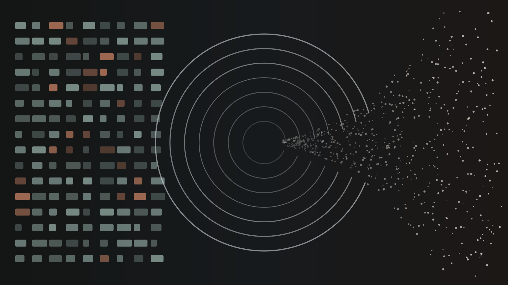
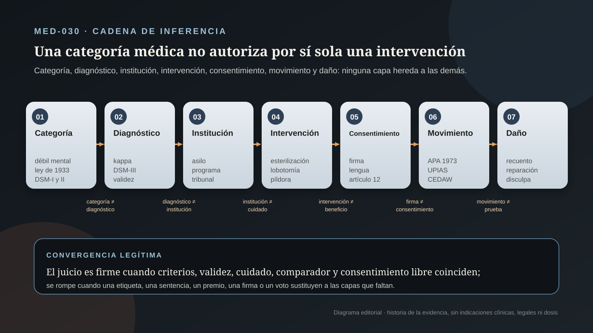
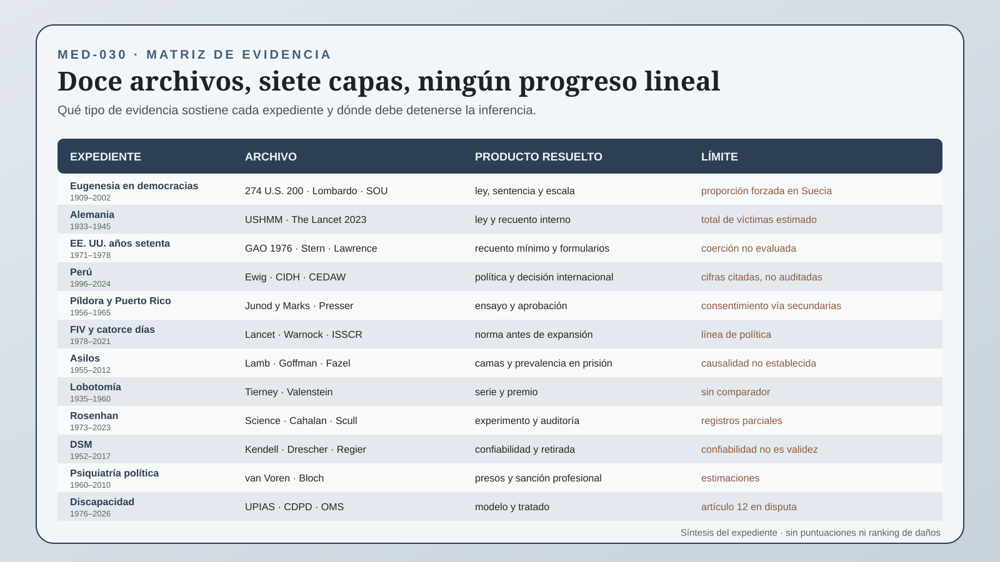

# MED-030 — Una categoría médica no autoriza por sí sola una intervención

> **Alcance:** audita doce expedientes entre 1907 y 2026: la eugenesia legal en democracias (Buck v. Bell, 1927; California; Suecia, 1935–1975); la ley nazi de esterilización (1933) y la Aktion T4; las esterilizaciones de mujeres indígenas y de origen mexicano en Estados Unidos en los años setenta (el informe de la GAO de 1976 y *Madrigal v. Quilligan*); el programa peruano de 1996–2000 y la decisión del Comité CEDAW de 2024; los ensayos de la píldora en Puerto Rico (1956) y la esterilización masiva de la isla; la fecundación in vitro (1978) y la regla de los catorce días (Warnock, 1984; ISSCR, 2021); los asilos y la desinstitucionalización con sus cifras y consecuencias; la lobotomía de Moniz y Freeman; Rosenhan (1973) y la investigación de Cahalan (2019); el DSM entre la confiabilidad, la homosexualidad fuera del manual en 1973 y las alternativas dimensionales; la psiquiatría política soviética; y el modelo social de la discapacidad hasta la Convención de 2006 y la guía de la OMS y el ACNUDH de 2023. Separa categoría, diagnóstico, institución, intervención, consentimiento, movimiento y daño. Trata las esterilizaciones forzadas y los asesinatos como evidencia documentada, con cifras y fuentes, sin adjetivos que las sustituyan. Es historia y epistemología de la evidencia: **no contiene recomendaciones clínicas, indicaciones ni dosis**; las intervenciones se nombran sólo como objeto histórico (`CLAIM-MED-RIGHTS-NO-ADVICE-001`).

## Pregunta central

¿Cómo cambiaron categorías, autonomía, movimientos sociales y daños institucionales en la reproducción, la discapacidad y la salud mental, sin confundir una categoría con un diagnóstico válido, un diagnóstico con la necesidad de una institución, una institución con un cuidado, una intervención con un beneficio, una firma con un consentimiento libre, un movimiento con una prueba ni un daño documentado con una intención demostrada?

## Respuesta breve

La categoría llegó primero y la evidencia después, o nunca. La Corte Suprema de Estados Unidos avaló en 1927, por ocho votos contra uno, la esterilización de Carrie Buck como «débil mental» de tercera generación; Lombardo mostró que el expediente se construyó para el litigio y que la categoría no describía a la persona (`CLAIM-MED-RIGHTS-BUCK-1927-001`, `CLAIM-MED-RIGHTS-BUCK-RECORD-001`). California esterilizó a unas 20 000 personas internadas entre 1909 y 1979, cerca de un tercio de las más de 60 000 del país; Suecia registró unas 63 000 esterilizaciones entre 1935 y 1975 (`CLAIM-MED-RIGHTS-US-SCALE-001`, `CLAIM-MED-RIGHTS-SWEDEN-1935-001`). La ley alemana de julio de 1933 llevó a unas 400 000 esterilizaciones forzadas, y la Aktion T4 asesinó con gas a 70 273 pacientes en seis centros hasta agosto de 1941, según el propio recuento del programa (`CLAIM-MED-RIGHTS-NAZI-LAW-1933-001`, `CLAIM-MED-RIGHTS-T4-1939-001`).

El consentimiento escrito no cerró el problema. En los años setenta, la GAO contó 3406 esterilizaciones en cuatro de las doce áreas del Servicio de Salud Indígena, con formularios que no cumplían las propias reglas del servicio; diez mujeres de origen mexicano perdieron en 1978 su demanda contra el hospital del condado de Los Ángeles, aunque el caso dejó formularios bilingües (`CLAIM-MED-RIGHTS-IHS-GAO-1976-001`, `CLAIM-MED-RIGHTS-MADRIGAL-1978-001`). En Perú, un programa estatal de 1996–2000 esterilizó a cientos de miles de personas, sobre todo mujeres rurales e indígenas; el Comité CEDAW lo calificó en 2024 de violencia por razón de sexo y discriminación interseccional (`CLAIM-MED-RIGHTS-PERU-NUMBERS-001`, `CLAIM-MED-RIGHTS-PERU-CEDAW-2024-001`).

En salud mental, la institución creció y luego se vació: unas 559 000 personas en hospitales estatales estadounidenses en 1955 y 57 151 camas ocupadas en 1998 (`CLAIM-MED-RIGHTS-ASYLUM-1955-001`, `CLAIM-MED-RIGHTS-ASYLUM-1998-001`). La lobotomía se difundió con series sin comparador y seguimientos de días, y ganó un Nobel (`CLAIM-MED-RIGHTS-MONIZ-FOLLOWUP-001`, `CLAIM-MED-RIGHTS-MONIZ-NOBEL-1949-001`). Rosenhan publicó en 1973 que ocho personas sanas fueron internadas con diagnóstico psiquiátrico; Cahalan sólo pudo identificar a dos y Scull concluyó en 2023 que fue un fraude (`CLAIM-MED-RIGHTS-ROSENHAN-1973-001`, `CLAIM-MED-RIGHTS-CAHALAN-2019-001`, `CLAIM-MED-RIGHTS-SCULL-2023-001`). La homosexualidad salió del DSM por decisión de 1973, ratificada por 58 % de unos 10 000 votantes; la confiabilidad diagnóstica se volvió criterio explícito en 1980 y se midió de nuevo en 2013 (`CLAIM-MED-RIGHTS-HOMOSEX-1973-001`, `CLAIM-MED-RIGHTS-DSM5-FIELD-2013-001`).

El movimiento de la discapacidad desplazó la pregunta: no «qué tiene esta persona», sino «qué la excluye». De la declaración de UPIAS en 1976 a la Convención de la ONU de 2006, con unos 192 Estados parte en 2025, la autonomía pasó a ser derecho, y su alcance en la capacidad jurídica sigue en disputa (`CLAIM-MED-RIGHTS-UPIAS-1976-001`, `CLAIM-MED-RIGHTS-CRPD-2006-001`, `CLAIM-MED-RIGHTS-FREEMAN-2015-001`).

La cadena legítima es **categoría → diagnóstico → institución → intervención → consentimiento → movimiento → daño**. Ningún eslabón hereda la fuerza del siguiente.

## UNA CATEGORÍA MÉDICA NO AUTORIZA POR SÍ SOLA UNA INTERVENCIÓN

### 1. Siete capas que deben conservarse

| Capa | Pregunta | Producto legítimo | Salto inválido |
|---|---|---|---|
| Categoría | ¿qué nombre se dio a un grupo de personas o conductas, quién lo definió y con qué fin? | etiqueta delimitada con criterios públicos | creer que nombrar una diferencia demuestra una enfermedad |
| Diagnóstico | ¿con qué criterios, qué confiabilidad y qué validez se asignó la categoría a una persona? | juicio reproducible sobre una persona concreta | tomar un acuerdo entre evaluadores por una entidad natural |
| Institución | ¿qué asilo, programa, tribunal o registro recibió a la persona y con qué poder? | lugar o norma con funciones declaradas | confundir custodia con cuidado o un programa con una política de salud |
| Intervención | ¿qué se hizo al cuerpo o a la vida de la persona y con qué comparador? | procedimiento descrito con resultados medidos | creer que una intervención difundida o premiada funciona |
| Consentimiento | ¿quién decidió, con qué información, en qué lengua y bajo qué presión? | decisión libre, informada y revocable | confundir una firma, una cuota o una orden judicial con libertad |
| Movimiento | ¿quién se organizó, qué pidió y qué cambió? | demanda pública, norma o reforma | tomar la victoria política como prueba científica, o al revés |
| Daño | ¿qué perjuicio se documentó, a cuántos, con qué fuente y qué reparación hubo? | daño contado con su archivo y sus límites | inferir intención de un daño o negar un daño por falta de intención |

### 2. Cuatro distinciones que el expediente no deja fundir

Una **categoría** no es un **diagnóstico**: «débil mental», «homosexualidad» o «esquizofrenia lenta» funcionaron como etiquetas con consecuencias antes de tener criterios confiables y validez demostrada (`CLAIM-MED-RIGHTS-CATEGORY-NOT-DIAGNOSIS-001`). Un **diagnóstico** no justifica por sí solo una **institución**, y una institución no es un **cuidado**: el asilo podía custodiar sin tratar y la desinstitucionalización podía liberar sin atender (`CLAIM-MED-RIGHTS-DIAGNOSIS-NOT-INSTITUTION-001`, `CLAIM-MED-RIGHTS-INSTITUTION-NOT-CARE-001`). Una **intervención** difundida, aprobada o premiada no demuestra beneficio (`CLAIM-MED-RIGHTS-INTERVENTION-NOT-BENEFIT-001`). Una **firma** no es un **consentimiento** libre cuando falta la lengua, la información, la ausencia de coerción o la posibilidad de negarse; es la misma lección que MED-029 extrae de Núremberg y Belmont (`CLAIM-MED-RIGHTS-CONSENT-NOT-SIGNATURE-001`, `CLAIM-MED-EBM-NUREMBERG-CODE-001`, `CLAIM-MED-EBM-CONSENT-NOT-SUFFICIENT-001`). Un **movimiento** cambia normas y preguntas, pero su éxito no prueba ni refuta una tesis científica (`CLAIM-MED-RIGHTS-MOVEMENT-NOT-PROOF-001`). Y un **daño** documentado no exige demostrar intención para ser daño, ni demuestra por sí solo la intención de quien lo causó (`CLAIM-MED-RIGHTS-HARM-NOT-INTENT-001`).

Juzgar con normas de hoy no explica una época, pero tampoco hace falta: en casi todos estos casos hubo contemporáneos que objetaron, normas que ya existían o víctimas que denunciaron en su momento (`CLAIM-MED-RIGHTS-PRESENTISM-001`).

## DOCE EXPEDIENTES AUDITADOS

### 3. Eugenesia legal en democracias: Buck v. Bell (1927), California y Suecia (1935–1975)

El 2 de mayo de 1927 la Corte Suprema de Estados Unidos avaló, por ocho votos contra uno, la ley de Virginia que permitía esterilizar a personas internadas consideradas portadoras de «debilidad mental» hereditaria. El juez Holmes escribió que «tres generaciones de imbéciles son suficientes»; Carrie Buck fue esterilizada ese año (`CLAIM-MED-RIGHTS-BUCK-1927-001`). Lombardo reconstruyó el caso con los archivos: el litigio se preparó como caso de prueba con la defensa coordinada con quienes promovían la ley; Carrie había quedado embarazada a los diecisiete años tras una violación atribuida a un pariente de su familia de acogida; la «tercera generación», su hija Vivian, fue declarada deficiente cuando era una bebé y después tuvo un desempeño escolar normal (`CLAIM-MED-RIGHTS-BUCK-RECORD-001`). Virginia derogó la ley en 1974 y pidió perdón en 2002; la sentencia nunca se revocó expresamente, aunque *Skinner v. Oklahoma* (1942) la debilitó (`CLAIM-MED-RIGHTS-BUCK-LEGACY-001`).

La escala fue mayor en otro estado. Stern estima unas 20 000 esterilizaciones en instituciones de California entre 1909 y 1979, cerca de un tercio de las más de 60 000 del país en el siglo XX, y enlaza esa historia con las del condado de Los Ángeles en los años setenta (`CLAIM-MED-RIGHTS-US-SCALE-001`). Suecia, con leyes de 1934 y 1941, registró unas 63 000 esterilizaciones entre 1935 y 1975, según la comisión oficial de 1997–2000 (`CLAIM-MED-RIGHTS-SWEDEN-1935-001`). Cuántas fueron forzadas es otra pregunta: el total incluye operaciones con distintos grados de presión y las estimaciones de las involuntarias van de unas 20 000 a más de 30 000 según la definición y la fuente; aquí no se resuelve (`CLAIM-MED-RIGHTS-SWEDEN-RANGE-001`). La ley sueca de 1999 fijó una indemnización de 175 000 coronas por persona para quienes demostraran haber sido esterilizados sin consentimiento real (`CLAIM-MED-RIGHTS-SWEDEN-COMP-1999-001`). La eugenesia no fue un rasgo exclusivo de un régimen: fue política de salud pública en democracias antes, durante y después del nazismo (`CLAIM-MED-RIGHTS-EUGENICS-NOT-NAZI-ONLY-001`).

### 4. La ley alemana de 1933 y la Aktion T4 (1939–1945)

La ley para la prevención de la descendencia con enfermedades hereditarias, del 14 de julio de 1933, ordenó esterilizar a personas con nueve condiciones que se suponían hereditarias, entre ellas la esquizofrenia, la corea de Huntington y el alcoholismo crónico; las operaciones empezaron en enero de 1934 y el Museo del Holocausto de Estados Unidos estima unas 400 000 personas esterilizadas bajo esa ley (`CLAIM-MED-RIGHTS-NAZI-LAW-1933-001`). En otoño de 1939 Hitler firmó una autorización, fechada retroactivamente el 1 de septiembre, para el asesinato de pacientes; en seis centros —Brandenburg, Grafeneck, Bernburg, Sonnenstein, Hartheim y Hadamar— se mató con gas a 70 273 personas entre enero de 1940 y agosto de 1941, según los cálculos internos del programa (`CLAIM-MED-RIGHTS-T4-1939-001`). Los historiadores estiman en conjunto unas 250 000 víctimas de todas las fases, incluidas al menos 10 000 niños con discapacidad y unos 30 000 pacientes asesinados por unidades de las SS y la policía en Pomerania, Prusia Occidental y la Polonia ocupada; la Comisión de *The Lancet* de 2023 se cita en la prensa con al menos 230 000 muertes (`CLAIM-MED-RIGHTS-T4-TOTAL-001`).

La Comisión de *The Lancet* sobre medicina, nazismo y Holocausto, de veinte autores de varios países, publicada en noviembre de 2023, sostiene que los profesionales de la salud tuvieron un papel central y no fueron unas pocas «manzanas podridas», y que los métodos de T4 pasaron después a los campos de exterminio (`CLAIM-MED-RIGHTS-LANCET-2023-001`). Que T4 empezara con una categoría médica —«vida indigna de ser vivida»— y siguiera con formularios, peritos e instituciones hospitalarias es el caso límite de esta cadena. El juicio de los médicos de Núremberg y su código están auditados en MED-029 (`CLAIM-MED-EBM-NUREMBERG-1947-001`).

### 5. Estados Unidos en los años setenta: el Servicio de Salud Indígena y *Madrigal v. Quilligan*

La Oficina General de Contabilidad informó el 4 de noviembre de 1976 que cuatro de las doce áreas del Servicio de Salud Indígena —Albuquerque, Aberdeen, Oklahoma City y Phoenix— esterilizaron a 3406 mujeres entre 1973 y 1976, 36 de ellas menores de 21 años pese a una moratoria declarada, y que la mayoría de los formularios de consentimiento no cumplía los requisitos del propio servicio (`CLAIM-MED-RIGHTS-IHS-GAO-1976-001`). La GAO no evaluó si hubo coerción; Lawrence reconstruye testimonios y estimaciones independientes mucho mayores, que se citan aquí como estimaciones, no como recuentos (`CLAIM-MED-RIGHTS-IHS-ESTIMATES-001`).

En Los Ángeles, diez mujeres de origen mexicano, de bajos ingresos y que hablaban sólo español, demandaron por esterilizaciones hechas entre 1971 y 1974 en el hospital de mujeres del condado y la Universidad del Sur de California. El juez Jesse Curtis falló en 1978 a favor de los médicos: no halló acción concertada y atribuyó lo ocurrido a una «ruptura de la comunicación» (`CLAIM-MED-RIGHTS-MADRIGAL-1978-001`). Las reglas federales de 1974 ya exigían un plazo de 72 horas entre consentimiento y operación, una casi moratoria para menores de 21 años y una declaración de que negarse no costaba la asistencia social; el caso dejó además formularios bilingües (`CLAIM-MED-RIGHTS-MADRIGAL-RULES-001`). Una firma obtenida en una lengua que la paciente no lee, durante el parto, no es el consentimiento que la norma describe (`CLAIM-MED-RIGHTS-CONSENT-NOT-SIGNATURE-001`).

### 6. Perú (1996–2000): un programa con metas y la decisión del Comité CEDAW (2024)

El Programa Nacional de Salud Reproductiva y Planificación Familiar del gobierno de Fujimori promovió desde 1996 la ligadura de trompas y la vasectomía con campañas y metas numéricas; Ewig documenta cómo un discurso de derechos reproductivos, apoyado por parte del feminismo y por donantes, convivió con cuotas y presión sobre mujeres pobres y rurales (`CLAIM-MED-RIGHTS-PERU-PROGRAM-001`). Las cifras que citan el Comité y la prensa hablan de más de 300 000 mujeres y unos 25 000 hombres esterilizados, sobre todo rurales e indígenas; cuántas operaciones fueron forzadas no está contado con un denominador único, y aquí se registra el orden de magnitud citado, no un recuento verificado (`CLAIM-MED-RIGHTS-PERU-NUMBERS-001`).

María Mamérita Mestanza murió en 1998 tras una esterilización obtenida con presión; la Comisión Interamericana aprobó en 2003 un acuerdo de solución amistosa en el que el Estado reconoció su responsabilidad (`CLAIM-MED-RIGHTS-PERU-MESTANZA-2003-001`). El 30 de octubre de 2024, en el caso de cinco mujeres esterilizadas en 1996–1997 (CEDAW/C/89/D/170/2021), el Comité CEDAW concluyó que la política constituyó violencia por razón de sexo y discriminación interseccional, que no investigar ni reparar fue también discriminación, y advirtió que esterilizaciones forzadas generalizadas o sistemáticas pueden constituir crímenes de lesa humanidad (`CLAIM-MED-RIGHTS-PERU-CEDAW-2024-001`). El Comité expresó preocupación por una ley de 2024 que impide perseguir crímenes de lesa humanidad anteriores a 2002; a la fecha de corte, la reparación y la persecución penal siguen abiertas (`CLAIM-MED-RIGHTS-PERU-JUSTICE-LIMIT-001`).

### 7. La píldora y Puerto Rico (1956–1965)

En abril de 1956 empezaron en Río Piedras, con Edris Rice-Wray, directora médica de la Asociación de Planificación Familiar de Puerto Rico, y con pastillas de Searle, los ensayos de campo del anticonceptivo de Pincus y Rock; las participantes eran sobre todo mujeres pobres y, según las fuentes secundarias, se les dijo que tomaban un medicamento que evitaba el embarazo, no que participaban en un experimento (`CLAIM-MED-RIGHTS-PILL-PR-1956-001`). Rice-Wray advirtió que había demasiadas reacciones adversas para un uso general; las quejas se descartaron como poco fiables y las muertes de participantes no se investigaron como posibles efectos del fármaco (`CLAIM-MED-RIGHTS-PILL-HARMS-001`). Junod y Marks muestran que la FDA aprobó el producto en 1957 para trastornos menstruales y en 1960 como anticonceptivo, y comparan ese proceso con el británico (`CLAIM-MED-RIGHTS-PILL-APPROVAL-001`). Las dosis hormonales de aquella primera píldora eran varias veces mayores que las de las formulaciones posteriores; se registra sólo como dato histórico de la evidencia (`CLAIM-MED-RIGHTS-PILL-DOSE-001`).

La isla era también el lugar de «la operación»: la esterilización femenina alcanzó una prevalencia excepcional, y en la encuesta de 1965 que analiza Presser cerca de un tercio de las mujeres de 20 a 49 años estaba esterilizada; la cifra exacta se cita vía literatura secundaria (`CLAIM-MED-RIGHTS-PR-STERILIZATION-001`). En 1956 el Código de Núremberg ya existía (MED-029): la distancia entre la norma escrita y la práctica no es un anacronismo del historiador (`CLAIM-MED-RIGHTS-PILL-CONSENT-ERA-001`).

### 8. Fecundación in vitro (1978) y la regla de los catorce días

Steptoe y Edwards informaron en *The Lancet* en agosto de 1978 el nacimiento, el 25 de julio en Oldham, de una niña tras la reimplantación de un embrión humano: Louise Brown (`CLAIM-MED-RIGHTS-IVF-1978-001`). Edwards recibió el Nobel de Medicina en 2010 (`CLAIM-MED-RIGHTS-IVF-NOBEL-2010-001`). El comité presidido por Mary Warnock recomendó en 1984 (Cmnd 9314) que fuera delito usar en investigación un embrión humano vivo obtenido in vitro más allá de catorce días tras la fecundación (`CLAIM-MED-RIGHTS-WARNOCK-1984-001`), y la ley británica de 1990 llevó ese límite a la norma y creó la autoridad que licencia tratamientos e investigación (`CLAIM-MED-RIGHTS-HFE-1990-001`).

Hyun, Wilkerson y Johnston pidieron en 2016 revisar la regla, porque los laboratorios ya cultivaban embriones hasta cerca de ese límite (`CLAIM-MED-RIGHTS-FOURTEEN-DAY-2016-001`). La guía de la Sociedad Internacional para la Investigación con Células Madre de 2021 dejó de incluir el cultivo más allá de catorce días entre las investigaciones prohibidas y lo sometió a revisión especializada, sin fijar un nuevo límite (`CLAIM-MED-RIGHTS-ISSCR-2021-001`). Catorce días es una línea de política pública anclada en un hito del desarrollo, no un hecho biológico que zanje el estatus moral del embrión (`CLAIM-MED-RIGHTS-FOURTEEN-DAY-POLICY-001`). La regulación de la reproducción asistida muestra una ruta distinta a la de la eugenesia: comité, norma, autoridad y licencia antes de la expansión.

### 9. Asilos y desinstitucionalización: cifras y consecuencias

En 1955 había en Estados Unidos unas 559 000 personas en hospitales psiquiátricos estatales, 339 por cada 100 000 habitantes (`CLAIM-MED-RIGHTS-ASYLUM-1955-001`); en diciembre de 1998 las camas estatales ocupadas eran 57 151, unas 21 por cada 100 000 (`CLAIM-MED-RIGHTS-ASYLUM-1998-001`). Lamb y Bachrach atribuyen el cambio a varias fuerzas que convergen: los antipsicóticos desde los años cincuenta, el financiamiento federal que trasladó costos fuera de los estados, la crítica a las condiciones de los asilos y las reformas legales sobre internamiento; y describen la desinstitucionalización como algo más que vaciar camas (`CLAIM-MED-RIGHTS-DEINST-DRIVERS-001`). Goffman había descrito en 1961 el hospital psiquiátrico como «institución total», donde la rutina de la institución modela al internado tanto como su enfermedad (`CLAIM-MED-RIGHTS-GOFFMAN-1961-001`).

Las consecuencias se miden con otros denominadores. Fazel y Seewald reunieron 109 muestras con 33 588 personas presas en 24 países: prevalencia de psicosis de 3.6 % en hombres y 3.9 % en mujeres, y de depresión mayor de 10.2 % y 14.1 %, sin tendencia al alza en el tiempo salvo la depresión en Estados Unidos (`CLAIM-MED-RIGHTS-PRISON-FAZEL-2012-001`). Una prevalencia alta en prisión no prueba que la desinstitucionalización haya trasladado a los pacientes a la cárcel: la hipótesis de la «transinstitucionalización» exige series del mismo lugar y periodo, con pobreza, vivienda, drogas y política penal como alternativas (`CLAIM-MED-RIGHTS-TRANSINST-LIMIT-001`).

### 10. Lobotomía: Moniz (1935) y Freeman (1946)

Egas Moniz, neurólogo en Lisboa, dirigió desde el 12 de noviembre de 1935 las primeras leucotomías prefrontales, operadas por Pedro Almeida Lima; en una monografía de 1936 informó de veinte pacientes, siete «curados», siete mejorados y seis sin cambio (`CLAIM-MED-RIGHTS-MONIZ-1935-001`). La serie no tuvo comparador y la mayoría de las observaciones se hicieron a los pocos días de la operación; la historiografía señala que Moniz sobrestimó la mejoría, subestimó las secuelas y no hizo seguimiento adecuado (`CLAIM-MED-RIGHTS-MONIZ-FOLLOWUP-001`). Recibió el Nobel de Fisiología o Medicina de 1949 (`CLAIM-MED-RIGHTS-MONIZ-NOBEL-1949-001`).

Walter Freeman, con James Watts, difundió la técnica en Estados Unidos y el 17 de enero de 1946 hizo en su consultorio la primera lobotomía transorbitaria; su personalidad, sus demostraciones y la prensa la popularizaron (`CLAIM-MED-RIGHTS-FREEMAN-1946-001`). Las estimaciones del total estadounidense no coinciden —de unas 40 000 a unas 50 000 operaciones— y aquí se registran como rango no verificado contra un censo (`CLAIM-MED-RIGHTS-LOBOTOMY-SCALE-001`). Su declive se explica por malos resultados, críticas en la literatura y el cine, más vigilancia regulatoria y la llegada de los antipsicóticos (`CLAIM-MED-RIGHTS-LOBOTOMY-DECLINE-001`). La lección epistemológica es la de MED-001 y MED-029: una intervención difundida con series sin control, desenlaces de días y prestigio institucional no demuestra beneficio (`CLAIM-MED-RIGHTS-LOBOTOMY-NO-COMPARATOR-001`, `CLAIM-MED-EBM-DESIGN-NOT-FAIR-001`).

### 11. Rosenhan (1973) y Cahalan (2019): el experimento que no fue lo que dijo

Rosenhan publicó en *Science* en enero de 1973 que ocho personas sanas se presentaron en doce hospitales de cinco estados diciendo oír voces; todas fueron internadas, todas menos una con diagnóstico de esquizofrenia, y salieron con «esquizofrenia en remisión» tras estancias de 7 a 52 días, con media de 19 (`CLAIM-MED-RIGHTS-ROSENHAN-1973-001`). En un segundo estudio, advertido un hospital de que llegarían seudopacientes, el personal señaló a 41 de 193 ingresos como sospechosos con alta confianza, sin que Rosenhan hubiera enviado ninguno (`CLAIM-MED-RIGHTS-ROSENHAN-FOLLOWUP-001`). Spitzer respondió en 1975 que mentir sobre un síntoma para obtener un ingreso no prueba que el diagnóstico sea inútil, y que «en remisión» era una etiqueta poco común que mostraba que los psiquiatras sí distinguían (`CLAIM-MED-RIGHTS-SPITZER-1975-001`).

Cahalan buscó durante años a los seudopacientes con los archivos personales de Rosenhan y sólo pudo identificar a dos además de él; uno, cuya experiencia hospitalaria había sido positiva, quedó fuera del artículo; y las notas de Rosenhan describen al ingreso síntomas más graves que los que el artículo declaró (`CLAIM-MED-RIGHTS-CAHALAN-2019-001`). Scull, con los registros que Cahalan le compartió, concluyó en 2023 que el estudio fue «un caso espectacularmente exitoso de fraude científico» (`CLAIM-MED-RIGHTS-SCULL-2023-001`). El artículo ayudó a convencer a la Asociación Psiquiátrica Estadounidense de revisar su manual y se sigue citando cientos de veces al año (`CLAIM-MED-RIGHTS-ROSENHAN-INFLUENCE-001`). Rosenhan murió en 2012 y no pudo responder: la acusación de fraude es una inferencia sobre registros incompletos, fuerte pero no un fallo. La pregunta que planteó —cuánto pesa la etiqueta y el contexto en lo que se observa— sobrevive al experimento, pero ya no puede apoyarse en él (`CLAIM-MED-RIGHTS-ROSENHAN-QUESTION-SURVIVES-001`).

### 12. El DSM: confiabilidad, homosexualidad y alternativas (1952–2017)

Antes de Rosenhan, el proyecto diagnóstico Estados Unidos–Reino Unido había mostrado con entrevistas grabadas que los psiquiatras estadounidenses diagnosticaban esquizofrenia con mucha más frecuencia que los británicos ante los mismos pacientes (`CLAIM-MED-RIGHTS-KENDELL-1971-001`). Spitzer y Fleiss reanalizaron en 1974 los estudios de confiabilidad con el estadístico kappa y concluyeron que el acuerdo entre evaluadores era satisfactorio sólo en pocas categorías amplias (`CLAIM-MED-RIGHTS-SPITZER-FLEISS-1974-001`). El DSM-III de 1980 respondió con criterios explícitos para cada trastorno; su prioridad fue la confiabilidad (`CLAIM-MED-RIGHTS-DSM-III-1980-001`).

La homosexualidad figuraba en el DSM-I (1952) y el DSM-II (1968). Tras protestas de activistas en las reuniones anuales de 1970 y 1971, el consejo de la Asociación votó en diciembre de 1973 retirarla, y la decisión se sostuvo con 58 % de unos 10 000 miembros votantes (`CLAIM-MED-RIGHTS-HOMOSEX-1973-001`). En su lugar quedó la «perturbación de la orientación sexual» y, en el DSM-III, la «homosexualidad egodistónica», retirada en el DSM-III-R de 1987; la OMS la sacó de la CIE-10 en 1990 (`CLAIM-MED-RIGHTS-HOMOSEX-AFTER-001`). La evidencia empírica precedió al voto: Hooker comparó en 1957 a 30 hombres homosexuales con 30 heterosexuales, ninguno paciente psiquiátrico, y los evaluadores no distinguieron más perturbación en un grupo que en otro (`CLAIM-MED-RIGHTS-HOOKER-1957-001`). Ni el voto fue la prueba ni la prueba bastó sin el movimiento: la categoría cayó cuando coincidieron datos, activismo y un criterio explícito de trastorno (`CLAIM-MED-RIGHTS-HOMOSEX-NOT-VOTE-ONLY-001`, `CLAIM-MED-RIGHTS-MOVEMENT-NOT-PROOF-001`).

La confiabilidad se volvió a medir para el DSM-5. En once centros de Estados Unidos y Canadá, con pacientes asignados al azar a dos clínicos ciegos al diagnóstico previo, de 23 diagnósticos con muestra suficiente, cinco tuvieron kappa muy bueno (0.60–0.79), nueve bueno, seis cuestionable (0.20–0.39) y tres inaceptable (`CLAIM-MED-RIGHTS-DSM5-FIELD-2013-001`). El estrés postraumático alcanzó cerca de 0.67, mientras la depresión mayor y la ansiedad generalizada quedaron alrededor de 0.3 y 0.2; los autores advierten que el diseño era más exigente que el de ensayos anteriores (`CLAIM-MED-RIGHTS-DSM5-KAPPA-001`). Confiabilidad no es validez: dos clínicos pueden coincidir en una categoría que no corresponde a una entidad natural (`CLAIM-MED-RIGHTS-RELIABILITY-NOT-VALIDITY-001`). Las alternativas lo dicen en voz alta: el marco RDoC del Instituto Nacional de Salud Mental propuso en 2010 clasificar para la investigación por dominios funcionales (`CLAIM-MED-RIGHTS-RDOC-2010-001`), y HiTOP propuso en 2017 una taxonomía dimensional construida desde la covariación de síntomas, contra las fronteras arbitrarias, la comorbilidad y la heterogeneidad de las categorías tradicionales (`CLAIM-MED-RIGHTS-HITOP-2017-001`).

### 13. Psiquiatría política (1960–1989 y después)

En la Unión Soviética, según van Voren, cerca de un tercio de los presos políticos estuvo encerrado en hospitales psiquiátricos; diagnósticos amplios como la «esquizofrenia lenta» permitían tratar la disidencia como síntoma (`CLAIM-MED-RIGHTS-SOVIET-001`). Bloch y Reddaway documentaron en 1977 casos con nombres y lugares (`CLAIM-MED-RIGHTS-SOVIET-001`). La sociedad psiquiátrica soviética se retiró de la Asociación Mundial de Psiquiatría en 1983 ante una expulsión inminente y volvió condicionalmente en 1989 (`CLAIM-MED-RIGHTS-WPA-1983-001`). Hubo abusos semejantes en otros países socialistas, de forma sistemática en Rumania, y en la primera década del siglo XXI se documentaron en China (`CLAIM-MED-RIGHTS-POLITICAL-OTHER-001`). La psiquiatría política no prueba que toda categoría psiquiátrica sea política; prueba que una categoría con fronteras difusas puede capturarse cuando la institución que diagnostica no es independiente del poder que encierra (`CLAIM-MED-RIGHTS-POLITICAL-CATEGORY-001`).

### 14. Discapacidad: del modelo médico al social y a la Convención de 2006

La Unión de Impedidos Físicos contra la Segregación (UPIAS) escribió en 1976, en *Fundamental Principles of Disability*, que es la sociedad la que discapacita a las personas con deficiencias físicas: la deficiencia es del cuerpo; la discapacidad, de la exclusión (`CLAIM-MED-RIGHTS-UPIAS-1976-001`). Mike Oliver acuñó en los años ochenta la expresión «modelo social de la discapacidad» y en 2013 recordó que lo propuso como herramienta práctica, no como teoría completa (`CLAIM-MED-RIGHTS-OLIVER-001`). El adversario vino de dentro: Shakespeare y Watson sostuvieron en 2001 que la separación estricta entre deficiencia y discapacidad era insostenible, porque el dolor, la fatiga o la limitación no desaparecen al quitar las barreras, y Shakespeare desarrolló en 2006 un enfoque interactivo (`CLAIM-MED-RIGHTS-SHAKESPEARE-001`). Modelo médico y modelo social responden preguntas distintas —qué tiene el cuerpo y qué hace la sociedad con él— y ninguno agota la discapacidad (`CLAIM-MED-RIGHTS-MODELS-NOT-EXCLUSIVE-001`).

«Nada sobre nosotros sin nosotros» circuló como lema del movimiento internacional y dio título en 1998 al libro de Charlton sobre opresión y empoderamiento (`CLAIM-MED-RIGHTS-CHARLTON-1998-001`). La Asamblea General de la ONU adoptó el 13 de diciembre de 2006 la Convención sobre los Derechos de las Personas con Discapacidad, que entró en vigor el 3 de mayo de 2008 (`CLAIM-MED-RIGHTS-CRPD-2006-001`); en 2025 tenía unos 192 Estados parte, más la Unión Europea (`CLAIM-MED-RIGHTS-CRPD-PARTIES-001`). En su Observación general n.º 1 (2014), el Comité de la Convención interpretó el artículo 12 como reconocimiento de la capacidad jurídica de todas las personas en todo momento y como rechazo de la sustitución en la toma de decisiones (`CLAIM-MED-RIGHTS-CRPD-GC1-2014-001`). Freeman y colaboradores —con psiquiatras de salud pública y defensores de la reforma— respondieron en 2015 que esa lectura, al declarar indefendibles el internamiento y el tratamiento involuntarios, amenaza otros derechos de las personas con trastornos mentales graves, como la salud, la libertad y la vida (`CLAIM-MED-RIGHTS-FREEMAN-2015-001`).

### 15. Cierre metodológico (2022–2026)

La OMS y el ACNUDH publicaron el 9 de octubre de 2023 una guía conjunta sobre salud mental, derechos humanos y legislación que propone reformar las leyes para acabar con las prácticas coercitivas y alinearlas con la Convención (`CLAIM-MED-RIGHTS-WHO-OHCHR-2023-001`). La OMS estimó en diciembre de 2022 que 1300 millones de personas, 16 % de la población mundial, viven con una discapacidad significativa, y que algunas mueren hasta veinte años antes que quienes no la tienen, por inequidades que incluyen al propio sistema de salud (`CLAIM-MED-RIGHTS-WHO-2022-001`). En 2023 la Comisión de *The Lancet* propuso enseñar la medicina nazi como parte de la formación médica (`CLAIM-MED-RIGHTS-LANCET-2023-001`); en 2023 Scull cerró el caso Rosenhan como fraude (`CLAIM-MED-RIGHTS-SCULL-2023-001`); en 2024 el Comité CEDAW calificó el programa peruano (`CLAIM-MED-RIGHTS-PERU-CEDAW-2024-001`). A la fecha de corte, el debate abierto no es si hubo daños —están documentados— sino cómo se separan protección y coerción cuando una persona no puede decidir en un momento dado, y quién cuenta los daños de hoy. Las cifras se citan como historia de la evidencia, no como orientación clínica, legal ni de política (`CLAIM-MED-RIGHTS-NO-ADVICE-001`).

## LO OBSERVADO

- sentencias, leyes de esterilización, decretos y acuerdos de solución amistosa;
- recuentos internos de un programa de asesinato y estimaciones historiográficas de sus víctimas;
- informes de auditoría gubernamental con formularios de consentimiento revisados;
- decisiones de órganos de tratados de derechos humanos;
- ensayos de campo de un anticonceptivo y su proceso de aprobación;
- informes de nacimiento tras fecundación in vitro, informes de comités y leyes de embriología;
- censos de camas psiquiátricas y estudios de prevalencia en prisiones;
- series quirúrgicas sin comparador y premios científicos;
- un experimento publicado, su crítica y los archivos de su autor;
- manuales diagnósticos, votos de una asociación profesional y ensayos de confiabilidad;
- declaraciones de movimientos sociales, una convención internacional y sus interpretaciones.

## LO MEDIDO

- personas esterilizadas por ley, programa o área (Virginia, California, Alemania, Suecia, Servicio de Salud Indígena, Perú, Puerto Rico);
- víctimas de la Aktion T4 por recuento interno y por estimación;
- población de hospitales psiquiátricos estatales y prevalencia de psicosis y depresión en prisión;
- resultados declarados en series de lobotomía, sin comparador;
- estancias e ingresos de seudopacientes (con la duda de Cahalan);
- acuerdo entre evaluadores (kappa) en diagnósticos psiquiátricos;
- proporción de votantes que sostuvo la retirada de la homosexualidad del DSM;
- Estados parte de la Convención y prevalencia mundial estimada de discapacidad;
- no la proporción de esterilizaciones que fueron forzadas en cada lugar, ni la validez de las categorías psiquiátricas en su conjunto.

## LO INFERIDO

Que las categorías precedieron a la evidencia de validez y se usaron para justificar instituciones e intervenciones es la inferencia mejor sostenida por la convergencia de sentencias, leyes, archivos institucionales e historiografía. Que el consentimiento escrito no protegió a quienes carecían de lengua, información o poder se infiere de auditorías y litigios. Que los movimientos de personas afectadas cambiaron categorías y normas se infiere de la cronología de protestas, votos y tratados, sin que eso demuestre por sí solo la validez de lo que pedían (`CLAIM-MED-RIGHTS-CHAIN-001`, `CLAIM-MED-RIGHTS-MOVEMENT-NOT-PROOF-001`).

## LOS SUPUESTOS

- que los recuentos oficiales de esterilizaciones son un mínimo y no una sobreestimación;
- que el recuento interno de T4 refleja las muertes en los seis centros;
- que la comisión sueca contó operaciones y no personas duplicadas;
- que las cifras peruanas citadas por el Comité proceden de registros del Ministerio de Salud;
- que los registros que Cahalan compartió con Scull son los de Rosenhan y están completos en lo esencial;
- que el kappa de los ensayos del DSM-5 mide confiabilidad en condiciones clínicas habituales;
- que la prevalencia de enfermedad mental en prisión estimada en 24 países es comparable entre sistemas.

## LAS INCERTIDUMBRES

- cuántas esterilizaciones fueron forzadas en Suecia, en el Servicio de Salud Indígena y en Perú;
- el total de víctimas de todas las fases del programa nazi de «eutanasia»;
- cuántas lobotomías se hicieron en Estados Unidos y con qué resultados a largo plazo;
- si el segundo estudio de Rosenhan existió como se describió;
- cuánto de la retirada de la homosexualidad del DSM respondió a evidencia y cuánto a presión;
- si la desinstitucionalización aumentó la población con enfermedad mental en prisiones;
- cómo se aplicará el artículo 12 de la Convención en leyes de salud mental concretas.

## LAS ALTERNATIVAS

- una esterilización registrada como voluntaria pudo ser forzada, y una registrada como forzada pudo tener otros motivos;
- la caída de camas psiquiátricas pudo deberse más a costos y financiamiento que a fármacos o derechos;
- el abandono de la lobotomía pudo deberse a la llegada de alternativas, no a la evidencia de daño;
- Rosenhan pudo exagerar sin inventar, y su tesis pudo ser cierta aunque su estudio no lo fuera;
- una confiabilidad baja puede reflejar un diseño de prueba más estricto, no peor diagnóstico;
- el modelo social puede proteger derechos y a la vez ocultar necesidades médicas reales;
- la capacidad jurídica universal puede ampliar la autonomía o dejar sin protección a quien no puede decidir.

## QUÉ PODEMOS COMPARAR

| Expediente | Archivo dominante | Producto mejor resuelto | Límite decisivo |
|---|---|---|---|
| Eugenesia en democracias | 274 U.S. 200; Lombardo; Stern; SOU 2000:20 | ley, sentencia y escala | proporción forzada en Suecia |
| Alemania 1933–1945 | USHMM; Comisión de *The Lancet* | ley, recuento interno y estimación | total de víctimas de todas las fases |
| EE. UU. años setenta | GAO 1976; Stern; Lawrence | recuento mínimo y formularios | coerción no evaluada por la GAO |
| Perú 1996–2000 | Ewig; CIDH 2003; CEDAW 2024 | política, caso y decisión internacional | cifras citadas, no recuento auditado |
| Píldora y Puerto Rico | Junod y Marks; Marks; Presser | ensayo, aprobación y prevalencia | consentimiento leído vía fuentes secundarias |
| FIV y catorce días | *Lancet* 1978; Warnock; HFE 1990; Hyun; ISSCR | norma antes de la expansión | línea de política, no hecho biológico |
| Asilos | Lamb y Bachrach; Goffman; Fazel | camas y prevalencia en prisión | causalidad de la transinstitucionalización |
| Lobotomía | Tierney; Valenstein; Caruso | serie, premio y difusión | sin comparador; totales inciertos |
| Rosenhan | *Science* 1973; Spitzer; Cahalan; Scull | experimento y su auditoría | autor muerto; registros parciales |
| DSM | Kendell; Spitzer y Fleiss; Drescher; Hooker; Regier | confiabilidad y retirada de una categoría | confiabilidad no es validez |
| Psiquiatría política | van Voren; Bloch y Reddaway | proporción de presos y sanción profesional | estimaciones de disidentes |
| Discapacidad y derechos | UPIAS; Oliver; Shakespeare; CDPD; Freeman; OMS | modelo, tratado y disputa | aplicación del artículo 12 |

Comparar aquí significa declarar categoría, diagnóstico, institución, intervención, consentimiento, movimiento y daño. No reparte culpas ni ordena los daños de mayor a menor (`CLAIM-MED-RIGHTS-NONRANKING-001`).

## QUÉ NO PODEMOS CONCLUIR

- que la eugenesia fue un fenómeno exclusivamente nazi;
- que Carrie Buck tenía la condición que la sentencia le atribuyó;
- que un formulario firmado demuestra un consentimiento libre;
- que el número exacto de esterilizaciones forzadas en Perú, Suecia o el Servicio de Salud Indígena está establecido;
- que los ensayos de Puerto Rico fueron éticos por las normas de su época;
- que la regla de los catorce días es un hecho biológico;
- que la desinstitucionalización llevó por sí sola a los pacientes a la cárcel;
- que la lobotomía funcionó porque ganó un Nobel;
- que Rosenhan demostró que los psiquiatras no distinguen a los sanos de los enfermos;
- que la homosexualidad salió del DSM sólo por un voto, o sólo por la evidencia;
- que un diagnóstico confiable es por eso válido;
- que toda psiquiatría es política o que todo internamiento involuntario es ilegítimo;
- que estas cifras orientan decisiones clínicas, legales o de política (`CLAIM-MED-RIGHTS-NO-ADVICE-001`).

## LAS CONTROVERSIAS

| Pregunta | Alternativas | Qué discrimina |
|---|---|---|
| ¿fue la eugenesia un rasgo del nazismo? | sí / política de democracias antes y después | leyes y recuentos por país y periodo |
| ¿cuántas esterilizaciones suecas fueron forzadas? | casi todas / una fracción del total | definición de coerción y expedientes individuales |
| ¿hubo coerción en el Servicio de Salud Indígena? | sí / papeleo descuidado | testimonios y expedientes completos |
| ¿qué pesa más en Perú, las metas o la elección? | política coercitiva / errores de ejecución | órdenes, metas y testimonios por región |
| ¿fueron aceptables los ensayos de Puerto Rico en 1956? | norma de la época / Núremberg ya existía | qué se dijo a las participantes |
| ¿debe extenderse la regla de los catorce días? | sí, con revisión / no, es límite moral | utilidad científica y acuerdo social |
| ¿causó la desinstitucionalización más presos con enfermedad mental? | transinstitucionalización / pobreza y política penal | series del mismo lugar y periodo |
| ¿fue Rosenhan un fraude? | fraude / exageración / estudio válido | registros completos de los seudopacientes |
| ¿salió la homosexualidad del DSM por evidencia o por presión? | evidencia / activismo / ambas | cronología de datos, protestas y criterios |
| ¿es el DSM-5 suficientemente confiable? | sí, con diseño exigente / no en diagnósticos comunes | kappa por diagnóstico y diseño |
| ¿es el modelo social suficiente? | sí / necesita la deficiencia | experiencia de dolor y limitación con barreras quitadas |
| ¿prohíbe la Convención todo tratamiento involuntario? | Observación general n.º 1 / Freeman y colaboradores | aplicación en leyes y desenlaces medidos |

## ERRORES QUE ESTA INVESTIGACIÓN BLOQUEA

1. **«La eugenesia fue cosa de los nazis.»** Estados Unidos y Suecia esterilizaron por ley a decenas de miles antes, durante y después.
2. **«Carrie Buck era débil mental, como dijo la Corte.»** El expediente se construyó para el litigio.
3. **«Un formulario firmado prueba consentimiento.»** La GAO halló formularios que no cumplían las reglas; Madrigal muestra firmas en otra lengua.
4. **«En Perú hubo 300 000 esterilizaciones forzadas exactas.»** Es el orden de magnitud citado de las esterilizaciones; cuántas fueron forzadas no está contado.
5. **«La píldora se probó con consentimiento informado moderno.»** Las participantes no fueron informadas de que era un experimento.
6. **«La regla de los catorce días es un dato biológico.»** Es una línea de política pública.
7. **«La desinstitucionalización mandó a los enfermos a la cárcel.»** La prevalencia en prisión no prueba la causa.
8. **«La lobotomía funcionaba: le dieron el Nobel.»** La serie no tenía comparador y el seguimiento era de días.
9. **«Rosenhan demostró que la psiquiatría no distingue cuerdos de locos.»** Su estudio está bajo acusación documentada de fraude.
10. **«La homosexualidad dejó de ser trastorno por un voto.»** Hubo evidencia previa, activismo y un criterio explícito de trastorno.
11. **«Un diagnóstico confiable es real.»** La confiabilidad no es validez.
12. **«Toda psiquiatría es represión política.»** La psiquiatría política prueba captura institucional, no la invalidez de toda categoría.
13. **«El modelo social niega la deficiencia.»** Separa deficiencia y discapacidad; sus críticos discuten dónde trazar la línea.
14. **«La Convención resolvió el internamiento involuntario.»** Su interpretación está en disputa.

## NIVEL DE CONFIANZA

- **A:** existencia, fecha y contenido general de sentencias, leyes, informes y publicaciones citadas (Buck v. Bell, ley de 1933, GAO 1976, CEDAW 2024, Steptoe y Edwards, Warnock, CDPD, Rosenhan 1973, Regier 2013, Fazel y Seewald).
- **B:** reconstrucciones historiográficas cuando convergen fuente primaria e historia (Lombardo, Stern, Tierney, Drescher, van Voren, Junod y Marks).
- **B-COND:** estimaciones totales con supuestos (víctimas de T4, esterilizaciones forzadas en Suecia, cifras peruanas, total de lobotomías).
- **C:** contenido de textos no leídos completos (Bloch y Reddaway, Valenstein, Ewig, Lawrence, Presser) y la acusación de fraude a Rosenhan como fallo definitivo.
- **D/E:** eugenesia como fenómeno sólo nazi, consentimiento por firma, Nobel como prueba de beneficio, voto como prueba científica, confiabilidad como validez.

## QUÉ PODRÍA FALSARLO

Este expediente deberá corregirse si nuevos registros muestran que:

- el expediente de Carrie Buck contenía evaluaciones independientes y previas al litigio que sostenían la categoría;
- los registros internos de T4 o de la ley de 1933 dan cifras distintas en un orden de magnitud;
- la mayoría de las esterilizaciones suecas tuvo consentimiento libre documentado;
- los expedientes completos del Servicio de Salud Indígena o del programa peruano muestran consentimiento informado en la gran mayoría;
- aparecen los seis seudopacientes no identificados de Rosenhan con registros coherentes con el artículo;
- series del mismo lugar y periodo muestran que la población con enfermedad mental en prisión creció en proporción al cierre de camas;
- nuevos ensayos de confiabilidad con el mismo diseño dan kappas muy distintos para los mismos diagnósticos;
- la aplicación de leyes alineadas con el artículo 12 mide aumentos o disminuciones claras de muertes, coerción o atención.

## QUÉ SABEMOS REALMENTE

Sabemos que categorías médicas sin validez demostrada justificaron esterilizaciones y asesinatos en dictaduras y en democracias, y que el derecho las avaló. Sabemos que el consentimiento escrito no protegió a quienes no tenían lengua, información o poder, y que auditorías, litigios y órganos de derechos humanos documentaron esos daños décadas después. Sabemos que el asilo y su cierre cambiaron el lugar del sufrimiento sin resolverlo, que la lobotomía se difundió sin comparador, que el experimento más citado contra el diagnóstico psiquiátrico está bajo acusación de fraude, que la confiabilidad del DSM mejoró en parte y sigue desigual, y que los movimientos de las personas afectadas cambiaron categorías y tratados (`CLAIM-MED-RIGHTS-CHAIN-001`, `CLAIM-MED-RIGHTS-CONSENT-NOT-SIGNATURE-001`, `CLAIM-MED-RIGHTS-RELIABILITY-NOT-VALIDITY-001`).

## QUÉ TODAVÍA NO SABEMOS

No sabemos cuántas esterilizaciones fueron forzadas en Suecia, Perú o el Servicio de Salud Indígena, ni el total de víctimas de todas las fases del programa nazi. No sabemos si Rosenhan inventó todo su estudio o parte. No sabemos si la desinstitucionalización aumentó la presencia de enfermedad mental en las prisiones ni qué modelo de clasificación psiquiátrica tendrá validez. No sabemos cómo se resolverá la tensión entre capacidad jurídica universal y protección en crisis. El programa cronológico de Medicina continúa con MED-032 (salud global, determinantes y pandemias); MED-031 (genética, genómica y medicina de precisión) queda pendiente de replanteo.

## CONCLUSIÓN

La historia de la reproducción, la discapacidad y la salud mental no es una marcha del abuso a los derechos. Es una cadena que se rompe en lugares distintos: una categoría que nadie validó, un diagnóstico que dos clínicos no compartían, una institución que custodiaba, una intervención sin comparador, una firma sin lengua, un movimiento que cambió una norma, un daño contado tarde. Cada capa se corrigió por separado y ninguna corrigió a las demás.

Por eso el expediente conserva siete capas. Categoría no es diagnóstico; diagnóstico no es institución; institución no es cuidado; intervención no es beneficio; firma no es consentimiento; movimiento no es prueba; daño no es intención. Una categoría médica no autoriza por sí sola una intervención (`CLAIM-MED-RIGHTS-SCOPE-001`, `CLAIM-MED-RIGHTS-NONRANKING-001`).

## NAVEGACIÓN

- [Historia de la ciencia de MED-030](../20_historia_ciencia/HISTORIA_MED_030_REPRODUCCION_DISCAPACIDAD_SALUD_MENTAL_DERECHOS.md)
- [Cronología especializada de MED-030](../21_cronologias/CRONOLOGIA_MED_030_REPRODUCCION_DISCAPACIDAD_SALUD_MENTAL_DERECHOS.md)
- [Mapa epistemológico de MED-030](../22_mapas_epistemologicos/MAPA_MED_030_REPRODUCCION_DISCAPACIDAD_SALUD_MENTAL_DERECHOS.md)
- [Programa cronológico de Medicina](PROGRAMA_CRONOLOGICO_HISTORIA_MEDICINA.md)
- [Explorador público de evidencia](../EVIDENCE_LEDGER.md)
