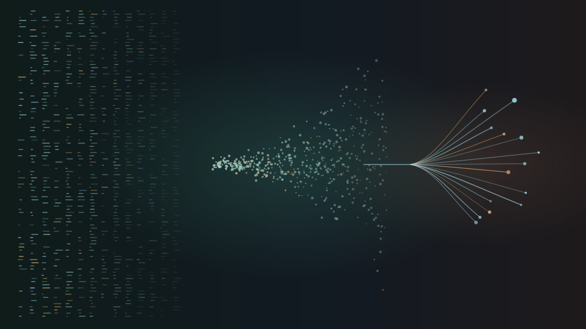
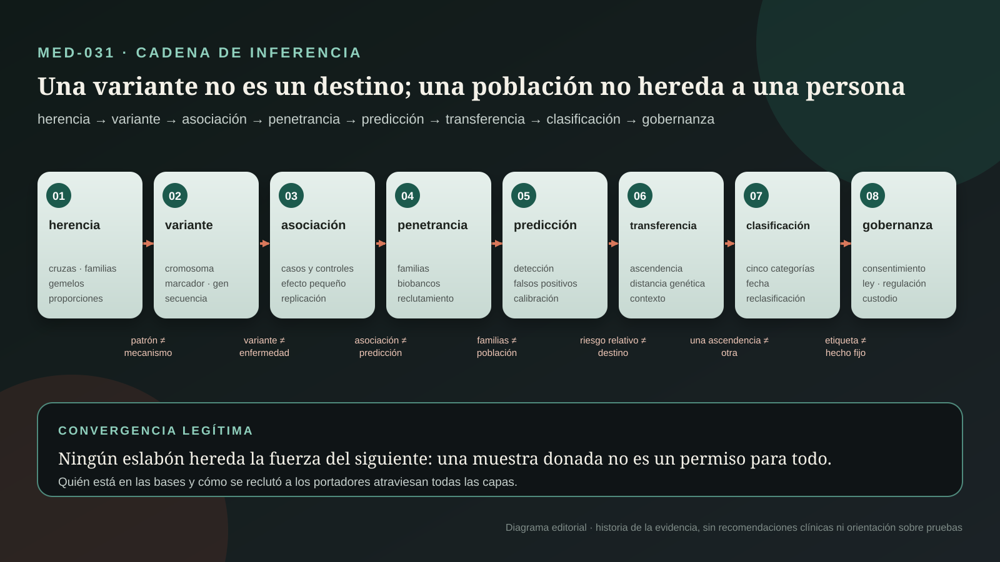
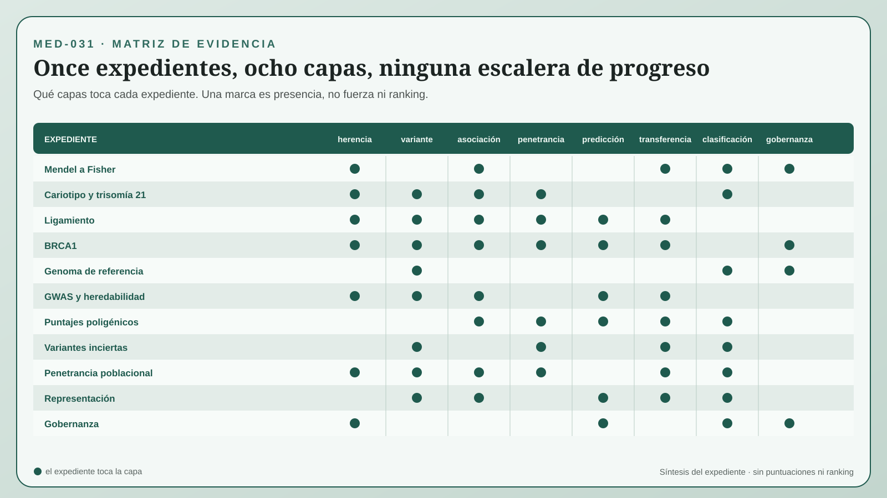

# MED-031 — Una variante no es un destino y una población no hereda a una persona

> **Alcance:** audita once expedientes entre 1866 y 2025: la herencia mendeliana de Mendel a Garrod y Fisher, con la disputa sobre los datos de Mendel; el cariotipo humano de 46 cromosomas y la trisomía 21, con la disputa por el crédito; el mapeo de ligamiento que localizó los genes de Huntington y de la fibrosis quística; BRCA1, su patente y sus penetrancias; el Proyecto Genoma Humano, del borrador de 2001 al genoma completo de 2022 y la iniciativa de medicina de precisión; los estudios de asociación del genoma completo (GWAS) y la «heredabilidad perdida»; los puntajes poligénicos y su pérdida de exactitud fuera de la ascendencia europea; las variantes de significado incierto y su reclasificación; la penetrancia medida en poblaciones no seleccionadas; las bases de datos y quién está representado, con México como caso; y la gobernanza de muestras y perfiles, de los havasupai a la quiebra de 23andMe. La eugenesia ya está auditada en MED-030 (`CLAIM-MED-RIGHTS-EUGENICS-NOT-NAZI-ONLY-001`) y aquí sólo se cita como antecedente. Separa herencia observada, variante, asociación, penetrancia, predicción individual, transferencia entre poblaciones, clasificación y gobernanza. Es historia y epistemología de la evidencia: **no contiene recomendaciones clínicas ni orientación sobre pruebas genéticas, y deja fuera por completo la edición génica, la terapia génica, la intervención en la línea germinal y las técnicas de laboratorio** (`CLAIM-MED-GEN-NO-ADVICE-001`).

## Pregunta central

¿Qué puede predecir una variante y qué no hereda una persona desde una población, sin confundir un patrón familiar con un mecanismo, una variante con una enfermedad, una asociación significativa con una predicción útil, una heredabilidad con una fracción del destino de alguien, un puntaje entrenado en una ascendencia con uno válido en otra, una clasificación con un hecho permanente, ni una muestra donada con un permiso para todo?

## Respuesta breve

La genética médica nació contando: proporciones de guisantes en Brno (`CLAIM-MED-GEN-MENDEL-1866-001`), una orina que se oscurecía en hijos de primos (`CLAIM-MED-GEN-GARROD-1902-001`), 46 cromosomas en un cultivo de Lund (`CLAIM-MED-GEN-TJIO-LEVAN-1956-001`). El ligamiento llevó del pedigrí al gen: Huntington quedó en el cromosoma 4 en 1983 y su repetición expandida apareció en 1993; la fibrosis quística, en el 7 en 1989 (`CLAIM-MED-GEN-GUSELLA-1983-001`, `CLAIM-MED-GEN-HD-1993-001`, `CLAIM-MED-GEN-CFTR-1989-001`). Un mismo gen mostró muchas variantes y fenotipos (`CLAIM-MED-GEN-CFTR-HETEROGENEITY-001`).

El riesgo de una variante cambió según quién se midiera. En portadoras de BRCA1 reclutadas sobre todo en clínicas familiares, el riesgo acumulado de cáncer de mama a los 80 años fue 72 % (`CLAIM-MED-GEN-KUCHENBAECKER-2017-001`); en dos biobancos no seleccionados, la penetrancia media de variantes patógenas fue 6.9 % y la de BRCA1 y BRCA2, 38 % en promedio (`CLAIM-MED-GEN-FORREST-2022-001`). La penetrancia depende de cómo se reclutó a los portadores (`CLAIM-MED-GEN-PENETRANCE-ASCERTAINMENT-001`).

El genoma se leyó en 2001 y se completó en 2022 (`CLAIM-MED-GEN-HGP-2001-001`, `CLAIM-MED-GEN-T2T-2022-001`), pero leer no fue entender (`CLAIM-MED-GEN-SEQUENCE-NOT-MEANING-001`). Los GWAS hallaron miles de asociaciones de efecto pequeño y una «heredabilidad perdida» (`CLAIM-MED-GEN-MANOLIO-2009-001`); para la estatura, 12 111 variantes explicaron 40 % de la varianza en ascendencia europea y alrededor de 10–20 % en otras (`CLAIM-MED-GEN-YENGO-2022-001`). La heredabilidad describe una población en un ambiente, no la fracción genética de una persona (`CLAIM-MED-GEN-HERITABILITY-POPULATION-001`).

Los puntajes poligénicos identifican colas de riesgo relativo (`CLAIM-MED-GEN-KHERA-2018-001`), pero en 926 puntajes la tasa de detección mediana con 5 % de falsos positivos fue 11 % (`CLAIM-MED-GEN-HINGORANI-2023-001`), y su exactitud cae con la distancia genética a los datos de entrenamiento (`CLAIM-MED-GEN-DING-2023-001`). Variantes que se informaron como patógenas a pacientes de ascendencia africana resultaron benignas cuando se miró a más personas negras (`CLAIM-MED-GEN-MANRAI-2016-001`), y una de cada cuatro variantes de significado incierto informadas cambió de categoría (`CLAIM-MED-GEN-MERSCH-2018-001`).

Quién está en las bases decide qué se puede clasificar y predecir. En 2016, cerca de 81 % de las muestras de los GWAS catalogados seguía siendo de ascendencia europea, y las de ascendencia africana o latinoamericana, las hispanas y las indígenas sumaban menos de 4 % (`CLAIM-MED-GEN-POPEJOY-2016-001`); en México, un biobanco nacional predijo mejor varios rasgos con sus propios GWAS que con los del UK Biobank (`CLAIM-MED-GEN-SOHAIL-2023-001`). Donar una muestra o comprar un perfil tampoco fijó sus usos futuros: las muestras havasupai se usaron en estudios que la tribu no había aceptado, y los datos de los clientes de 23andMe entraron en una quiebra en 2025 (`CLAIM-MED-GEN-HAVASUPAI-2010-001`, `CLAIM-MED-GEN-23ANDME-2025-001`).

La cadena legítima es **herencia observada → variante → asociación → penetrancia → predicción individual → transferencia entre poblaciones → clasificación → gobernanza**. Ningún eslabón hereda la fuerza del siguiente (`CLAIM-MED-GEN-CHAIN-001`).

## UNA VARIANTE NO ES UN DESTINO Y UNA POBLACIÓN NO HEREDA A UNA PERSONA

### 1. Ocho capas que deben conservarse

| Capa | Pregunta | Producto legítimo | Salto inválido |
|---|---|---|---|
| Herencia observada | ¿qué patrón se ve en familias, gemelos o poblaciones? | proporciones y correlaciones con su muestra | creer que un patrón revela el mecanismo |
| Variante | ¿qué cambio de secuencia o de cromosoma se localizó y en quién? | variante descrita y localizada | creer que una variante es la enfermedad |
| Asociación | ¿con qué fuerza se asocia la variante a un rasgo en una población? | efecto con intervalo y replicación | leer una asociación significativa como predicción |
| Penetrancia | ¿qué fracción de portadores desarrolla el rasgo, a qué edad y según cómo se reclutaron? | riesgo por edad con su vía de reclutamiento | tomar la cifra de familias seleccionadas como la de todos |
| Predicción individual | ¿cuánto discrimina y calibra para una persona? | detección, falsos positivos y calibración | tomar un riesgo relativo de la cola como probabilidad alta |
| Transferencia | ¿se conserva en otra ascendencia, edad, sexo o contexto? | desempeño medido fuera del origen | suponer que lo hallado en una población vale para otra |
| Clasificación | ¿qué categoría se asignó, con qué datos de referencia y en qué fecha? | clasificación con fecha y evidencia | tratar una etiqueta como un hecho permanente |
| Gobernanza | ¿quién consintió qué uso, quién guarda los datos y qué ley protege? | consentimiento, custodia y protección declarados | creer que donar o comprar traslada todos los usos |

### 2. Cuatro distinciones que el expediente no deja fundir

Un **patrón** familiar no es un **mecanismo**: Mendel y Garrod vieron proporciones sin saber qué las producía (`CLAIM-MED-GEN-PATTERN-NOT-MECHANISM-001`). Una **variante** localizada no es una **enfermedad**: la penetrancia y la expresividad se miden aparte, y casi siempre después (`CLAIM-MED-GEN-VARIANT-NOT-DISEASE-001`). Una **asociación** significativa en una población no es una **predicción** útil para una persona (`CLAIM-MED-GEN-ASSOCIATION-NOT-PREDICTION-001`). Y lo que se aprendió en una **población** no se **transfiere** sin medirlo a otra ascendencia ni a otro contexto (`CLAIM-MED-GEN-TRANSFER-001`).

MED-002 ya estableció que un modelo predictivo necesita calibración y validación externa además de discriminación (`CLAIM-MED-DX-PREDICTION-001`) y que el valor de un resultado cambia con la prevalencia (`CLAIM-MED-DX-PREVALENCE-001`). MED-033 mostró que retirar la raza de una ecuación desplazó el error sin abolirlo (`CLAIM-MED-AI-RACE-REMOVAL-NOT-EQUITY-001`) y que la etiqueta elegida es una decisión (`CLAIM-MED-AI-LABEL-IS-CHOICE-001`). En la línea de evolución humana, la genealogía de un locus no es una persona ni una población fundadora (`CLAIM-MTDNA-EVE-LIMIT-001`). MED-031 usa ese método y lo lleva a la pregunta genética: qué predice una variante y qué no se hereda desde una población. La ascendencia genética es un continuo medido; las categorías raciales o étnicas son etiquetas sociales que no la sustituyen (`CLAIM-MED-GEN-ANCESTRY-NOT-RACE-001`).

## ONCE EXPEDIENTES AUDITADOS

### 3. De Mendel a Fisher: proporciones, individualidad química y varianza (1866–2007)

Mendel publicó en 1866, en las actas de la Sociedad de Naturalistas de Brno, experimentos de hibridación de guisantes en los que caracteres alternativos reaparecían en proporciones constantes (`CLAIM-MED-GEN-MENDEL-1866-001`). En 1902, ya redescubierto, Garrod describió la alcaptonuria como un rasgo frecuente en hijos de matrimonios entre primos, la interpretó como herencia mendeliana recesiva y habló de «individualidad química» (`CLAIM-MED-GEN-GARROD-1902-001`). Era un patrón con una hipótesis bioquímica, no un gen identificado.

La herencia de los rasgos continuos parecía contradecir a Mendel. Fisher mostró en 1918 que las correlaciones entre parientes para rasgos continuos eran compatibles con muchos factores mendelianos sumados, y para ello introdujo la descomposición de la varianza (`CLAIM-MED-GEN-FISHER-1918-001`). Ese mismo instrumento es el que más tarde se leería mal como reparto de causas en cada persona.

El propio Fisher sostuvo en 1936 que los datos de Mendel se ajustaban a lo esperado más de lo que el azar permitiría (`CLAIM-MED-GEN-FISHER-1936-001`). Hartl y Fairbanks argumentaron en 2007 que la evidencia no sostiene una falsificación deliberada (`CLAIM-MED-GEN-HARTL-2007-001`). La disputa no afecta a la ley de segregación, replicada miles de veces, sino a qué se puede inferir de un cuaderno sobre la conducta de quien lo llenó.

La eugenesia trasladó la herencia de rasgos en familias a juicios sobre el valor de poblaciones y personas, y la convirtió en leyes de esterilización en democracias y dictaduras; MED-030 audita ese salto desde *Buck v. Bell* (`CLAIM-MED-RIGHTS-BUCK-1927-001`, `CLAIM-MED-RIGHTS-EUGENICS-NOT-NAZI-ONLY-001`). Aquí se registra sólo su forma lógica: de una proporción en una cruza se pasó a una política sobre personas que nunca se habían medido (`CLAIM-MED-GEN-EUGENICS-MISREAD-001`).

### 4. El cariotipo y la trisomía 21 (1956–2009)

Tjio y Levan contaron en 1956, en cultivos de tejido embrionario, 46 cromosomas humanos, frente al número de 48 aceptado durante décadas (`CLAIM-MED-GEN-TJIO-LEVAN-1956-001`). En enero de 1959, Lejeune, Gautier y Turpin comunicaron a la Academia de Ciencias de París un cromosoma pequeño supernumerario en niños con síndrome de Down (`CLAIM-MED-GEN-TRISOMY21-1959-001`).

Cincuenta años después, Marthe Gautier publicó su testimonio: ella montó los cultivos y vio el cromosoma de más en 1958, y el crédito se atribuyó a Lejeune (`CLAIM-MED-GEN-GAUTIER-CREDIT-001`). Es una fuente de parte; aquí no se cotejó con cuadernos de laboratorio y la versión contraria se conoce sólo por síntesis secundarias. La disputa muestra que la firma de una nota no reparte el trabajo que la hizo posible.

Ver un cromosoma de más estableció una asociación constante con un fenotipo; no explicó cómo se produce cada rasgo ni predijo su intensidad en un niño concreto (`CLAIM-MED-GEN-KARYOTYPE-NOT-MECHANISM-001`).

### 5. El ligamiento: Huntington y fibrosis quística (1980–1993)

Botstein y colaboradores propusieron en 1980 un mapa de ligamiento del genoma humano basado en polimorfismos del ADN, que permitiría localizar el gen de una enfermedad heredada sin acceso directo a él, y anticiparon que los marcadores ligados podrían usarse de forma predictiva en el consejo genético (`CLAIM-MED-GEN-BOTSTEIN-1980-001`). En 1983, estudios familiares ligaron la enfermedad de Huntington a un marcador polimórfico del cromosoma 4 (`CLAIM-MED-GEN-GUSELLA-1983-001`). En 1993 el grupo colaborativo halló, en el gen IT15, una repetición CAG expandida e inestable en los cromosomas con Huntington de las 75 familias examinadas (`CLAIM-MED-GEN-HD-1993-001`).

En 1989 se identificó el gen de la fibrosis quística en el cromosoma 7, con una deleción de tres pares de bases que correspondía a cerca de 70 % de las mutaciones de los pacientes estudiados (`CLAIM-MED-GEN-CFTR-1989-001`). El resto del acervo resultó formado por muchas mutaciones distintas, y algunas permitían una función pancreática residual (`CLAIM-MED-GEN-CFTR-HETEROGENEITY-001`). Un gen no es una variante, ni una variante un único fenotipo.

El ligamiento predice dentro de una familia en la que el marcador es informativo; fuera de ella, sin la variante causal, el marcador no dice nada de nadie (`CLAIM-MED-GEN-LINKAGE-FAMILY-001`).

### 6. BRCA1: ligamiento, patente y penetrancias (1990–2017)

King y colaboradores ligaron en 1990 el cáncer de mama familiar de inicio temprano a la región 17q21, con un lod de 5.98 en familias de inicio temprano y puntuaciones negativas en las de inicio tardío (`CLAIM-MED-GEN-HALL-1990-001`). En 1994, Miki y colaboradores presentaron un candidato fuerte para BRCA1, con mutaciones probables en cinco de ocho familias (`CLAIM-MED-GEN-MIKI-1994-001`). El hallazgo se volvió negocio: la Corte Suprema de Estados Unidos resolvió el 13 de junio de 2013, en *Association for Molecular Pathology v. Myriad Genetics*, que un segmento de ADN natural aislado no es patentable, mientras el ADN complementario sintético sí puede serlo (`CLAIM-MED-GEN-MYRIAD-2013-001`).

La pregunta científica era otra: ¿qué riesgo lleva una portadora? Kuchenbaecker y colaboradores siguieron de forma prospectiva a 6036 portadoras de BRCA1 y 3820 de BRCA2, reclutadas en 94 % por clínicas familiares: el riesgo acumulado de cáncer de mama a los 80 años fue 72 % (65–79) con BRCA1 y 69 % (61–77) con BRCA2, y aumentaba con el número de familiares afectados y según la posición de la variante (`CLAIM-MED-GEN-KUCHENBAECKER-2017-001`). Esa cifra es real para quien se parece a esa cohorte; no es «el» riesgo de BRCA, que depende de la vía de reclutamiento, la historia familiar y la variante (`CLAIM-MED-GEN-BRCA-RANGE-001`).

### 7. El Proyecto Genoma Humano y la medicina de precisión (2001–2022)

En febrero de 2001 el consorcio público y Celera publicaron borradores de la secuencia del genoma humano; Celera, con ADN de cinco personas, informó 26 588 transcritos codificantes con evidencia fuerte y que dos genomas haploides tomados al azar diferían en promedio en un par de bases de cada 1250 (`CLAIM-MED-GEN-HGP-2001-001`). En 2004 el consorcio público informó una secuencia eucromática con 341 huecos, cerca de 99 % de cobertura y sólo 20 000–25 000 genes codificantes de proteína (`CLAIM-MED-GEN-HGP-2004-001`). En 2022 el consorcio T2T publicó una secuencia de 3055 millones de pares de bases sin huecos salvo en el cromosoma Y, que añadía el 8 % faltante (`CLAIM-MED-GEN-T2T-2022-001`).

Celera advertía ya en 2001 que determinar qué polimorfismos tienen consecuencias funcionales seguía siendo un desafío abierto (`CLAIM-MED-GEN-SEQUENCE-NOT-MEANING-001`). Un genoma de referencia es una coordenada para ubicar variantes, no una persona normal ni el promedio de la especie (`CLAIM-MED-GEN-REFERENCE-NOT-PERSON-001`). En 2015, Collins y Varmus anunciaron una iniciativa de medicina de precisión con foco inmediato en el cáncer y la meta de largo plazo de abarcar toda la salud (`CLAIM-MED-GEN-PMI-2015-001`): una promesa de investigación, no una evaluación de resultados.

### 8. GWAS y la «heredabilidad perdida» (2005–2022)

Klein y colaboradores hallaron en 2005, con 96 casos y 50 controles, una variante común de CFH asociada a la degeneración macular; los homocigotos para el alelo de riesgo tenían 7.4 veces más probabilidad (`CLAIM-MED-GEN-KLEIN-2005-001`). En 2007, el Wellcome Trust Case Control Consortium examinó unos 2000 casos de siete enfermedades y 3000 controles británicos: 24 señales independientes, efectos modestos en la mayoría y exclusión de las personas de ascendencia no europea para controlar la estratificación (`CLAIM-MED-GEN-WTCCC-2007-001`).

En 2009 Manolio y colaboradores notaron que la mayoría de las variantes halladas confería incrementos pequeños de riesgo y explicaba una fracción pequeña de la agregación familiar: la «heredabilidad perdida» (`CLAIM-MED-GEN-MANOLIO-2009-001`). Yang y colaboradores respondieron en 2010 que 294 831 SNP considerados juntos explicaban 45 % de la varianza de la estatura en 3925 personas no emparentadas: buena parte no estaba perdida, sino repartida en efectos demasiado pequeños para pasar umbrales estrictos (`CLAIM-MED-GEN-YANG-2010-001`). En 2022, con 5.4 millones de personas, 12 111 SNP explicaron casi toda la heredabilidad atribuible a SNP comunes de la estatura: 40 % de la varianza en ascendencia europea y alrededor de 10–20 % en otras ascendencias (`CLAIM-MED-GEN-YENGO-2022-001`). Visscher y colaboradores resumieron en 2017 una década de GWAS como fuente de biología y de dianas, más que de predicción individual (`CLAIM-MED-GEN-VISSCHER-2017-001`).

La heredabilidad es un parámetro estimable de una población (`CLAIM-MED-GEN-VISSCHER-2008-001`). Lewontin argumentó en 1974 que el análisis de varianza no es un análisis de causas: la partición depende de la población y del rango de ambientes y no se aplica a un individuo (`CLAIM-MED-GEN-LEWONTIN-1974-001`). Una heredabilidad de 80 % para la estatura no dice que 80 % de la estatura de alguien venga de sus genes (`CLAIM-MED-GEN-HERITABILITY-POPULATION-001`).

### 9. Puntajes poligénicos y su pérdida fuera de la ascendencia europea (2018–2023)

El adversario más fuerte de este expediente está aquí. Khera y colaboradores informaron en 2018 que puntajes poligénicos identificaban 8.0 % de la población con más del triple de riesgo de enfermedad coronaria, veinte veces la frecuencia de portadores de mutaciones monogénicas de riesgo comparable, y propusieron contemplar su inclusión en la atención (`CLAIM-MED-GEN-KHERA-2018-001`). Wald y Old respondieron que una razón de momios importante para la etiología no hace útil un puntaje para predecir ni para cribar (`CLAIM-MED-GEN-WALD-OLD-2019-001`). Hingorani y colaboradores analizaron 926 puntajes de 310 enfermedades del Polygenic Score Catalog: con 5 % de falsos positivos, la tasa de detección mediana fue 11 % (8–18 %); el 2.5 % superior del puntaje para enfermedad coronaria aportaba 7 % de los casos, y los autores concluyeron que el desempeño era pobre para cribado, predicción individual y estratificación (`CLAIM-MED-GEN-HINGORANI-2023-001`). Un riesgo relativo alto en la cola no es una probabilidad individual alta, y la mayoría de los casos ocurre fuera de esa cola (`CLAIM-MED-GEN-PRS-RELATIVE-NOT-ABSOLUTE-001`).

La transferencia es el otro límite. Martin y colaboradores advirtieron en 2019 que los puntajes disponibles eran varias veces más exactos en ascendencia europea que en otras, consecuencia del sesgo eurocéntrico de los GWAS (`CLAIM-MED-GEN-MARTIN-2019-001`). Ding y colaboradores mostraron en 2023, con 36 778 personas de Los Ángeles y 487 409 del UK Biobank, que la exactitud disminuye persona a persona con la distancia genética a los datos de entrenamiento —correlación de −0.95 promediada en 84 rasgos—, incluso dentro de grupos rotulados como homogéneos (`CLAIM-MED-GEN-DING-2023-001`). Mostafavi y colaboradores hallaron que, dentro de una misma ascendencia, la exactitud varía con el nivel socioeconómico, la edad o el sexo (`CLAIM-MED-GEN-MOSTAFAVI-2020-001`).

### 10. Variantes de significado incierto y reclasificación (2015–2018)

La guía ACMG-AMP de 2015 fijó cinco categorías —patógena, probablemente patógena, de significado incierto, probablemente benigna y benigna— y criterios con datos poblacionales, computacionales, funcionales y de segregación (`CLAIM-MED-GEN-ACMG-2015-001`). ClinVar archiva interpretaciones enviadas por laboratorios y otros, las agrega por variante y condición y marca consenso o conflicto; la significación clínica la declaran los remitentes, no la base (`CLAIM-MED-GEN-CLINVAR-2016-001`).

Manrai y colaboradores revisaron variantes antes consideradas causales de miocardiopatía hipertrófica: varios pacientes, todos de ascendencia africana o no especificada, habían recibido informes positivos con variantes luego reclasificadas como benignas, y esas variantes eran más comunes en estadounidenses negros que en blancos (`CLAIM-MED-GEN-MANRAI-2016-001`). Sus simulaciones indicaron que incluir incluso pocas personas negras en los controles probablemente habría evitado el error (`CLAIM-MED-GEN-MANRAI-SIMULATION-001`). En 1.45 millones de personas analizadas por un laboratorio comercial entre 2006 y 2018, 7.7 % de las variantes de significado incierto únicas se reclasificaron, 91.2 % de ellas hacia benigna, y 24.9 % de las VUS informadas cambiaron de categoría (`CLAIM-MED-GEN-MERSCH-2018-001`); las patógenas cambiaron en 0.7 % y las benignas en 0.2 % (`CLAIM-MED-GEN-MERSCH-STABLE-001`). Una clasificación es un juicio con fecha que cambia con los datos de referencia (`CLAIM-MED-GEN-CLASSIFICATION-DATED-001`).

### 11. La penetrancia medida en poblaciones no seleccionadas (2013–2022)

El ACMG propuso en 2013 que los laboratorios informaran hallazgos incidentales en una lista de genes, y reconoció a la vez que no había datos suficientes de penetrancia ni de utilidad para sostener del todo esa propuesta (`CLAIM-MED-GEN-GREEN-2013-001`). Las bases poblacionales permitieron medir lo que faltaba. ExAC reunió exomas de 60 706 personas y halló 3230 genes casi sin variantes que truncan la proteína, 72 % sin fenotipo de enfermedad establecido (`CLAIM-MED-GEN-LEK-2016-001`); gnomAD agregó 125 748 exomas y 15 708 genomas e identificó 443 769 variantes de pérdida de función de alta confianza (`CLAIM-MED-GEN-GNOMAD-2020-001`).

Wright y colaboradores examinaron 379 768 participantes de UK Biobank de ascendencia europea: sólo 27 variantes raras clínicamente relevantes se asociaron con un rasgo, y una variante de HNF4A asociada a diabetes tenía menos de 10 % de penetrancia a los 40 años (`CLAIM-MED-GEN-WRIGHT-2019-001`). Forrest y colaboradores, con 72 434 participantes de dos biobancos, hallaron una penetrancia media de 6.9 % (6.0–7.8) para variantes patógenas frente a 0.85 % para las benignas, una mediana de 0 % en ambas y una media de 38 % para BRCA1 y BRCA2 con rango de 0 a 100 % (`CLAIM-MED-GEN-FORREST-2022-001`). Las cifras de familias con muchos casos y las de poblaciones no seleccionadas miden cosas distintas (`CLAIM-MED-GEN-PENETRANCE-ASCERTAINMENT-001`, `CLAIM-MED-GEN-VARIANT-NOT-DISEASE-001`).

### 12. Bases de datos y quién está representado, con México como caso (2009–2024)

Popejoy y Fullerton actualizaron en 2016 un análisis de 2009 según el cual 96 % de los participantes de los GWAS eran de ascendencia europea. Con 2511 estudios y cerca de 35 millones de muestras del GWAS Catalog, la proporción no europea había subido a casi 20 %, pero sobre todo por estudios hechos en Asia; las personas de ascendencia africana o latinoamericana, las hispanas y las indígenas sumaban menos de 4 % de las muestras, y la representación indígena había bajado un poco desde 2009 (`CLAIM-MED-GEN-POPEJOY-2016-001`). Encontraron además 26 términos distintos para describir a personas de ascendencia africana: la categoría con la que se cuenta también es una elección. Sirugo, Williams y Tishkoff argumentaron en 2019 que el sesgo europeo tiene consecuencias directas para predecir riesgos en otras poblaciones (`CLAIM-MED-GEN-SIRUGO-2019-001`). El GWAS Catalog, que en 2023 reunía más de 45 000 GWAS publicados sobre más de 5000 rasgos, declara como parte de su tarea dar a conocer esa falta de diversidad (`CLAIM-MED-GEN-GWAS-CATALOG-2023-001`).

Hubo respuestas institucionales. El consorcio H3Africa presentó en 2014 su programa para construir capacidad de investigación genómica en instituciones africanas (`CLAIM-MED-GEN-H3AFRICA-2014-001`). Fatumo y colaboradores describieron en 2022 los factores que produjeron el desequilibrio y propusieron una hoja de ruta para la inclusión (`CLAIM-MED-GEN-FATUMO-2022-001`). All of Us publicó en 2024 245 388 genomas, con 77 % de participantes de comunidades históricamente subrepresentadas en la investigación biomédica y 46 % de minorías raciales y étnicas subrepresentadas, y halló altas tasas de replicación de 3724 variantes asociadas a 117 enfermedades tanto en participantes de ascendencia europea como africana (`CLAIM-MED-GEN-ALLOFUS-2024-001`).

México es un caso propio. En 2009, el Instituto Nacional de Medicina Genómica analizó la diversidad de mestizos mexicanos de regiones con historias de mezcla distintas, junto con un grupo amerindio, y concluyó que las diferencias entre subpoblaciones debían considerarse al diseñar estudios de asociación (`CLAIM-MED-GEN-INMEGEN-2009-001`). En 2014, el consorcio SIGMA analizó a 8214 personas mexicanas y latinoamericanas y halló un locus de diabetes tipo 2 en SLC16A11 (razón de momios 1.29) que no había aparecido en los GWAS de otras poblaciones: el haplotipo de riesgo tenía una frecuencia cercana a 50 % en muestras indígenas americanas y era raro en muestras europeas y africanas (`CLAIM-MED-GEN-SIGMA-2014-001`). En 2023, el Biobanco Mexicano genotipó a 6057 personas de 898 localidades de los 32 estados y encontró que varios rasgos se predecían mejor con sus propios GWAS que con los del UK Biobank (`CLAIM-MED-GEN-SOHAIL-2023-001`). La ausencia de una población en las bases no sólo deja huecos de conocimiento: cambia qué se clasifica como patógeno, qué se predice y para quién (`CLAIM-MED-GEN-REPRESENTATION-001`). Sumar personas a una base es una condición de la transferencia, no una garantía de beneficio, de acceso ni de control sobre los datos (`CLAIM-MED-GEN-DIVERSITY-NOT-EQUITY-001`).

### 13. Gobernanza: muestras, perfiles y protección (2008–2025)

A partir de 1990, investigadores de la Universidad Estatal de Arizona tomaron muestras de sangre de miembros de la tribu havasupai para estudiar la diabetes; después se usaron en estudios sobre esquizofrenia, endogamia y migración que la tribu consideró no autorizados. La tribu demandó y en 2010 la universidad aceptó un acuerdo que incluía una compensación y la devolución de las muestras (`CLAIM-MED-GEN-HAVASUPAI-2010-001`). Aquí se registra el caso a partir de la ficha del análisis de Mello y Wolf y de síntesis secundarias; su texto completo no se verificó. La lección epistemológica es que un consentimiento tiene un objeto: aceptar un uso no es aceptar todos los usos posibles de la misma muestra (`CLAIM-MED-GEN-GOVERNANCE-NOT-CONSENT-001`).

En Estados Unidos, la Ley de No Discriminación por Información Genética (GINA, 2008) prohibió usar información genética en el seguro de salud y en el empleo, y dejó fuera otros seguros como los de vida, invalidez o cuidados de largo plazo (`CLAIM-MED-GEN-GINA-2008-001`). La venta directa al consumidor abrió otro frente: en noviembre de 2013 la FDA ordenó a 23andMe dejar de comercializar sus informes de salud sin autorización, un episodio que Annas y Elias analizaron en 2014; aquí se leyó la ficha de su análisis, no el texto completo (`CLAIM-MED-GEN-FDA-23ANDME-2013-001`). En marzo de 2025, 23andMe se acogió a la protección por quiebra y dejó incierto el destino de sus datos genéticos (`CLAIM-MED-GEN-23ANDME-2025-001`). Un defensor de la privacidad del consumidor designado por el tribunal en junio de 2025 examinó sus prácticas de privacidad, la filtración de 2023 y las leyes aplicables a la venta de datos genéticos. Según síntesis secundarias, los activos se vendieron en julio de 2025 a una organización sin fines de lucro encabezada por una de las fundadoras; esa venta y su monto quedan sin verificar en texto completo en esta auditoría. Las protecciones existentes son parciales y por sectores: cubren algunos usos, en algunos países, y no siguen a los datos cuando cambia su custodio (`CLAIM-MED-GEN-PROTECTION-PARTIAL-001`).

## LO OBSERVADO

- proporciones de caracteres en cruzas y agrupamiento de un rasgo en familias consanguíneas;
- números y formas de cromosomas en cultivos;
- cosegregación de marcadores y rasgos en pedigríes;
- secuencias, variantes y huecos en genomas de referencia;
- frecuencias de variantes en casos, controles y bases poblacionales;
- diagnósticos y edades de inicio en portadores seguidos o registrados en biobancos;
- clasificaciones de variantes con su fecha y sus cambios;
- descripciones de ascendencia de los participantes, tal como las escribieron los autores;
- consentimientos, demandas, leyes, órdenes regulatorias y expedientes de quiebra.

## LO MEDIDO

- el ajuste de los datos de Mendel a lo esperado y su disputa;
- la fracción de la varianza de la estatura atribuible a SNP comunes en distintas ascendencias;
- el riesgo acumulado por edad de portadoras de BRCA1 y BRCA2 en cohortes reclutadas por familias;
- la penetrancia media de variantes patógenas en biobancos no seleccionados;
- la tasa de detección y de falsos positivos de 926 puntajes poligénicos;
- la caída de la exactitud de los puntajes con la distancia genética al entrenamiento;
- la tasa de reclasificación de variantes de significado incierto en un laboratorio;
- la proporción de muestras no europeas en los GWAS catalogados;
- no cuánto de un rasgo de una persona concreta se debe a sus genes, ni el desempeño de los puntajes en la mayoría de las poblaciones del mundo, ni cuántas muestras donadas se usaron fuera de lo consentido.

## LO INFERIDO

Que la penetrancia depende de cómo se reclutó a los portadores es la inferencia más sólida del expediente: convergen las cohortes de familias de alto riesgo, la baja penetrancia de variantes raras en UK Biobank y la penetrancia media de dos biobancos no seleccionados. Que la exactitud de un puntaje poligénico depende de la cercanía a la población de entrenamiento se infiere de estudios que la miden persona a persona y de un biobanco fuera de Europa que predice mejor con sus propios datos. Que una clasificación depende de quién está en las bases de referencia se infiere de las variantes reclasificadas como benignas cuando se miró a personas de ascendencia africana (`CLAIM-MED-GEN-CHAIN-001`, `CLAIM-MED-GEN-PENETRANCE-ASCERTAINMENT-001`, `CLAIM-MED-GEN-TRANSFER-001`).

## LOS SUPUESTOS

- que las cifras publicadas por Mendel reflejan sus recuentos;
- que los controles de un estudio representan a la población de la que salen los casos;
- que la ascendencia descrita por los autores corresponde a la ascendencia genética de los participantes;
- que los diagnósticos registrados en un biobanco miden la enfermedad;
- que los participantes de un biobanco se parecen a la población de la que proceden;
- que la heredabilidad estimada en un ambiente se conserva en otro;
- que los criterios de clasificación se aplican igual en todos los laboratorios.

## LAS INCERTIDUMBRES

- la penetrancia de la mayoría de las variantes patógenas fuera de Europa;
- cuánta heredabilidad estimada por gemelos y familias falta aún por explicar con variantes raras y estructurales;
- el desempeño de los puntajes poligénicos en poblaciones africanas, indígenas y latinoamericanas;
- cuántas variantes de significado incierto se reclasificarán con bases más diversas;
- cuántas muestras guardadas se han usado fuera del consentimiento original;
- qué protección real tendrán los datos de consumidores cuando cambie la empresa que los guarda.

## LAS ALTERNATIVAS

- el exceso de ajuste de los datos de Mendel pudo deberse a la selección de experimentos o a la forma de contar, no a una falsificación;
- parte de la «heredabilidad perdida» puede deberse a estimaciones familiares infladas por ambientes compartidos y no a variantes no halladas;
- la menor penetrancia en biobancos puede reflejar diagnósticos incompletos en los registros, no menor riesgo;
- la caída de exactitud fuera de Europa puede deberse en parte a diferencias de ambiente y de medición, y no sólo de ascendencia;
- la reclasificación hacia benigna puede reflejar mejores criterios además de bases más diversas.

## QUÉ PODEMOS COMPARAR

| Expediente | Archivo dominante | Producto mejor resuelto | Límite decisivo |
|---|---|---|---|
| Mendel a Fisher | Mendel; Garrod; Fisher; Hartl y Fairbanks | proporciones y descomposición de la varianza | patrón sin mecanismo |
| Cariotipo y trisomía 21 | Tjio y Levan; Lejeune, Gautier y Turpin; Gautier y Harper | número y asociación cromosómica | crédito en disputa; fenotipo sin mecanismo |
| Ligamiento | Botstein; Gusella; grupo de Huntington; Riordan y Kerem | localización de genes en familias | predicción sólo dentro de la familia |
| BRCA1 | Hall; Miki; *Myriad*; Kuchenbaecker | riesgo por edad en cohortes de familias | el reclutamiento selecciona el riesgo |
| Genoma de referencia | Lander; Venter; IHGSC; Nurk; Collins y Varmus | secuencia completa | leer no es entender |
| GWAS y heredabilidad | Klein; WTCCC; Manolio; Yang; Yengo; Lewontin; Visscher | asociaciones replicadas y varianza explicada | población, no persona |
| Puntajes poligénicos | Khera; Wald y Old; Hingorani; Martin; Ding; Mostafavi | discriminación y transferencia medidas | detección baja; pérdida fuera del origen |
| Variantes inciertas | Richards; Landrum; Manrai; Mersch | reclasificación medida | un laboratorio; bases sesgadas |
| Penetrancia poblacional | Green; Lek; Karczewski; Wright; Forrest | penetrancia en no seleccionados | biobancos de ascendencia europea |
| Representación | Popejoy; Sirugo; H3Africa; Fatumo; Sollis; INMEGEN; SIGMA; Sohail; All of Us | quién está en las bases | inclusión no es beneficio |
| Gobernanza | Mello y Wolf; GINA; Annas y Elias; *Science*; Richards | usos, leyes y custodios | textos completos no verificados |

Comparar aquí significa declarar herencia observada, variante, asociación, penetrancia, predicción, transferencia, clasificación y gobernanza de cada expediente. No ordena poblaciones, laboratorios, empresas ni países por mérito, valor ni culpa (`CLAIM-MED-GEN-NONRANKING-001`).

## QUÉ NO PODEMOS CONCLUIR

- que Mendel falsificó sus datos, o que su ajuste prueba que no lo hizo;
- que un cromosoma de más explica cada rasgo de una persona con trisomía 21;
- que un marcador ligado predice algo fuera de la familia donde se estudió;
- que «el» riesgo de BRCA1 es una sola cifra;
- que leer el genoma completo dijo qué hace cada variante;
- que una heredabilidad alta significa que un rasgo es inmodificable o que está fijado en cada persona;
- que un puntaje poligénico predice con utilidad el futuro de una persona;
- que un puntaje validado en una ascendencia vale en otra;
- que una variante clasificada hoy como patógena o benigna lo será siempre;
- que la ascendencia genética equivale a una categoría racial (`CLAIM-MED-GEN-ANCESTRY-NOT-RACE-001`);
- que incluir más personas en una base resuelve por sí solo la desigualdad;
- que una ley o una política de privacidad protege todos los usos de los datos genéticos.

## LAS CONTROVERSIAS

| Pregunta | Alternativas | Qué discrimina |
|---|---|---|
| ¿falsificó Mendel sus datos? | sí, demasiado buenos / no, selección y forma de contar | reanálisis de su procedimiento y de los experimentos descartados |
| ¿quién descubrió la trisomía 21? | Lejeune / Gautier con Lejeune y Turpin | cuadernos de laboratorio y testimonios independientes |
| ¿cuál es el riesgo de una portadora de BRCA? | cifras de familias / cifras de biobancos | cohortes no seleccionadas con seguimiento largo |
| ¿dónde está la heredabilidad perdida? | variantes de efecto pequeño / variantes raras / estimaciones infladas | genomas completos en muestras muy grandes |
| ¿sirven los puntajes poligénicos para predecir? | identifican colas de riesgo / detección baja | tasas de detección y calibración en cohortes prospectivas |
| ¿por qué pierden exactitud fuera de Europa? | ascendencia / ambiente y medición | puntajes medidos persona a persona en muchas poblaciones |
| ¿cuánto cambian las clasificaciones? | pocas patógenas / muchas inciertas | reclasificación en varios laboratorios y con bases diversas |
| ¿basta con diversificar las bases? | sí / sólo con beneficio y control locales | quién accede, quién decide y quién se beneficia |
| ¿protegen las leyes los datos genéticos? | GINA y leyes estatales / cobertura parcial | qué pasó con los datos tras la venta de 23andMe |

## ERRORES QUE ESTA INVESTIGACIÓN BLOQUEA

1. **«Mendel descubrió los genes.»** Vio proporciones; el gen como objeto material llegó después.
2. **«La heredabilidad es el porcentaje genético de una persona.»** Es un parámetro de una población en un ambiente.
3. **«Tener la variante es tener la enfermedad.»** La penetrancia media en dos biobancos fue 6.9 %.
4. **«El riesgo de BRCA1 es 72 %.»** Esa cifra viene de cohortes reclutadas por familias.
5. **«Leer el genoma es entenderlo.»** La función de la mayoría de las variantes sigue sin establecerse.
6. **«Una asociación significativa predice.»** La mayoría de los efectos de los GWAS son pequeños.
7. **«Un puntaje poligénico alto es un destino.»** Con 5 % de falsos positivos detecta una mediana de 11 % de los casos.
8. **«Un puntaje funciona igual en todas las ascendencias.»** Su exactitud cae con la distancia genética.
9. **«Una variante patógena lo es para siempre.»** Las clasificaciones cambian con los datos de referencia.
10. **«La ascendencia genética es la raza.»** Es un continuo medido; la raza es una categoría social.
11. **«Donar una muestra autoriza cualquier estudio.»** El caso havasupai lo contradice.

## NIVEL DE CONFIANZA

- **A:** existencia, fecha y contenido de publicaciones con resumen leído (Gusella, el grupo de Huntington, Riordan, Kerem, Hall, Miki, Kuchenbaecker, Lander, Venter, el IHGSC, Nurk, Collins y Varmus, Klein, WTCCC, Manolio, Yang, Yengo, Visscher, Khera, Martin, Ding, Hingorani, Mostafavi, Richards, Landrum, Manrai, Mersch, Lek, Karczewski, Wright, Forrest, Green, Sirugo, Fatumo, Sollis, Silva-Zolezzi, SIGMA, Sohail, All of Us, Botstein), texto completo leído (Popejoy y Fullerton, en el manuscrito de autor) y textos jurídicos (*Myriad*, GINA).
- **A/B:** fuentes primarias antiguas leídas vía ficha (Mendel, Garrod, Fisher, Tjio y Levan, Lejeune) y argumentos (Lewontin, Wald y Old, Hartl y Fairbanks).
- **B-COND:** fuentes leídas sólo en su ficha y en síntesis secundarias, sin verificar en texto completo: Gautier y Harper (2009), Mello y Wolf (2010), Annas y Elias (2014), el consorcio H3Africa (2014), la nota de *Science* de 2025 y la venta de los activos de 23andMe.
- **C:** penetrancia y desempeño de puntajes fuera de Europa; destino de los datos tras la venta de 23andMe.
- **D/E:** heredabilidad como fracción individual, variante como destino, puntaje como predicción individual, raza como ascendencia.

## QUÉ PODRÍA FALSARLO

Este expediente deberá corregirse si nuevos datos muestran que:

- la penetrancia de variantes patógenas medida en poblaciones no seleccionadas coincide con la de familias de alto riesgo;
- puntajes poligénicos alcanzan en cohortes prospectivas tasas de detección altas con pocos falsos positivos;
- la exactitud de los puntajes no disminuye con la distancia genética en poblaciones africanas, indígenas o latinoamericanas;
- las tasas de reclasificación no cambian al incluir bases de referencia más diversas;
- los cuadernos de laboratorio de 1958 contradicen el testimonio de Gautier;
- documentos del caso havasupai muestran que los usos posteriores estaban dentro del consentimiento original.

## QUÉ SABEMOS REALMENTE

Sabemos que la genética médica se construyó por capas: proporciones en cruzas y familias, cromosomas contados, genes localizados por ligamiento, riesgos medidos en familias seleccionadas, un genoma de referencia completo, miles de asociaciones de efecto pequeño, puntajes que identifican colas de riesgo relativo con baja detección, clasificaciones que cambian, bases en las que casi todos son de ascendencia europea y muestras cuyos usos y custodios no siempre quedaron fijados. Una variante informa; su penetrancia, su transferencia y su clasificación se miden aparte, y casi siempre después (`CLAIM-MED-GEN-CHAIN-001`, `CLAIM-MED-GEN-VARIANT-NOT-DISEASE-001`, `CLAIM-MED-GEN-HERITABILITY-POPULATION-001`).

## QUÉ TODAVÍA NO SABEMOS

No sabemos la penetrancia de la mayoría de las variantes patógenas fuera de Europa, cuánto de la heredabilidad estimada se explicará con variantes raras, si los puntajes poligénicos llegarán a una utilidad individual en alguna población, cuántas clasificaciones cambiarán cuando las bases sean diversas, ni qué pasará con los datos genéticos que cambian de custodio. MED-031 completa el programa cronológico de Medicina con una pregunta abierta: qué parte de lo que se aprendió de unas poblaciones podrá decir algo verdadero de una persona de otra.

## CONCLUSIÓN

La genética médica empezó con guisantes en Brno, una orina oscura en hijos de primos y 46 cromosomas en Lund; siguió con familias que ligaron un gen a un marcador, una patente anulada sobre ADN natural, un genoma que tardó dos décadas en completarse, asociaciones de efecto pequeño, puntajes que prometían colas de riesgo, variantes «patógenas» que eran comunes en estadounidenses negros sin la enfermedad, un biobanco mexicano que predijo mejor con sus propios datos y muestras que viajaron a estudios no aceptados.

Por eso el expediente conserva ocho capas. Patrón no es mecanismo; variante no es enfermedad; asociación no es predicción; penetrancia de familias no es penetrancia de todos; heredabilidad no es fracción de una persona; lo aprendido en una población no se transfiere sin medirlo; una clasificación tiene fecha; una muestra donada no es un permiso para todo. Una variante no es un destino y una población no hereda a una persona (`CLAIM-MED-GEN-SCOPE-001`, `CLAIM-MED-GEN-NONRANKING-001`).

## NAVEGACIÓN

- [Historia de la ciencia de MED-031](../20_historia_ciencia/HISTORIA_MED_031_GENETICA_GENOMICA_MEDICINA_PRECISION.md)
- [Cronología especializada de MED-031](../21_cronologias/CRONOLOGIA_MED_031_GENETICA_GENOMICA_MEDICINA_PRECISION.md)
- [Mapa epistemológico de MED-031](../22_mapas_epistemologicos/MAPA_MED_031_GENETICA_GENOMICA_MEDICINA_PRECISION.md)
- [Programa cronológico de Medicina](PROGRAMA_CRONOLOGICO_HISTORIA_MEDICINA.md)
- [Explorador público de evidencia](../EVIDENCE_LEDGER.md)
