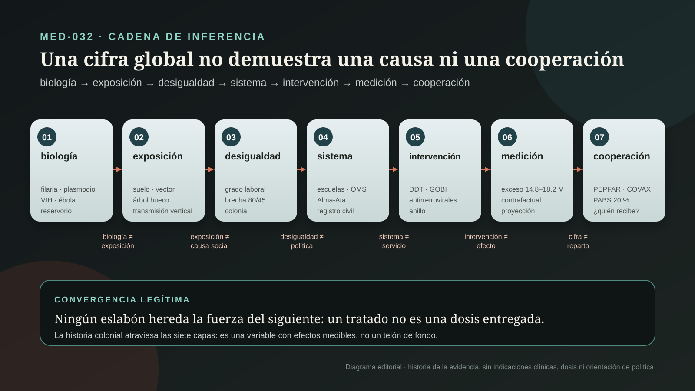
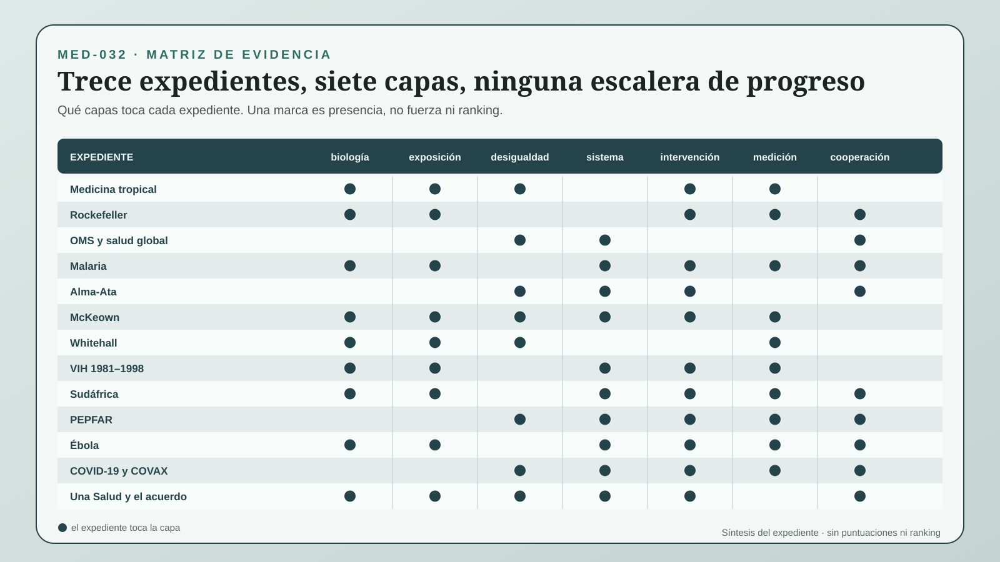

# MED-032 — Una cifra global no demuestra una causa ni una cooperación por sí sola

> **Alcance:** audita trece expedientes entre 1877 y 2026: la medicina tropical de Manson, Ross y las escuelas de Liverpool y Londres, con el legado medible de las campañas coloniales contra la enfermedad del sueño; la Fundación Rockefeller y la anquilostomiasis; la OMS de 1948 y el paso de la salud internacional a la global; la erradicación de la malaria con DDT entre 1955 y 1969 y su fracaso; Alma-Ata en 1978 frente a la atención primaria selectiva; la tesis de McKeown y sus críticas; Whitehall, las causas fundamentales y la Comisión de la OMS de 2008; el VIH desde el primer informe de 1981 y ACT UP hasta la terapia combinada; Sudáfrica, el negacionismo de Mbeki, la Treatment Action Campaign y las estimaciones de muertes evitables; PEPFAR y los recortes de 2025; el ébola de 2013–2016; la COVID-19 sólo como caso metodológico —cómo se midió el exceso de mortalidad y por qué difieren las cifras, y COVAX con la inequidad vacunal—; Una Salud; y, como cierre, el Acuerdo de la OMS sobre Pandemias de 2025 y su estado en noviembre de 2026. La viruela ya está contada en MED-020 y aquí sólo se compara (`CLAIM-MED-COUNT-ERADICATION-STRATEGY-001`). Separa biología, exposición, desigualdad, sistema, intervención, medición y cooperación. Es historia y epistemología de la evidencia: **no contiene recomendaciones clínicas, indicaciones, dosis ni orientación de política sanitaria** (`CLAIM-MED-GLOBAL-NO-ADVICE-001`).

## Pregunta central

¿Cómo conectamos biología, desigualdad, sistemas, ambiente y cooperación sin borrar la historia colonial, y sin confundir un agente conocido con una exposición explicada, un gradiente con una política, una declaración con un servicio, una intervención con un efecto, una cifra modelada con un recuento ni un tratado con una dosis entregada?

## Respuesta breve

La salud global no empezó en 1948 ni en 2009. Empezó como medicina tropical: Manson siguió la filaria dentro del mosquito en Amoy, Ross encontró en 1897 el parásito de la malaria en mosquitos, y las escuelas de Liverpool (1898) y Londres (1899) formaron médicos para las colonias (`CLAIM-MED-GLOBAL-MANSON-1878-001`, `CLAIM-MED-GLOBAL-ROSS-1897-001`, `CLAIM-MED-GLOBAL-SCHOOLS-1898-001`). Esa medicina produjo hallazgos sólidos y también campañas coercitivas cuyo legado hoy se mide: en África central, la exposición a las campañas francesas contra la enfermedad del sueño de 1921–1956 se asocia con menos vacunación y menos confianza en la medicina (`CLAIM-MED-GLOBAL-LOWES-MONTERO-TRUST-001`). La historia colonial es una capa con efectos, no un telón de fondo (`CLAIM-MED-GLOBAL-COLONIAL-LAYER-001`).

Las campañas verticales tuvieron éxitos medibles —la anquilostomiasis del sur estadounidense, con efectos en escolaridad e ingresos (`CLAIM-MED-GLOBAL-BLEAKLEY-2007-001`)— y fracasos instructivos: la erradicación de la malaria con DDT (1955–1969) eliminó la enfermedad de muchas regiones, pero Sri Lanka pasó de 17 casos en 1963 a más de medio millón en 1969 (`CLAIM-MED-GLOBAL-SRI-LANKA-1963-001`, `CLAIM-MED-GLOBAL-SRI-LANKA-1969-001`). La viruela y la malaria no fallaron o triunfaron por voluntad política solamente: sus biologías y exposiciones son distintas (`CLAIM-MED-GLOBAL-ERADICATION-CONTRAST-001`).

Alma-Ata (1978) propuso salud para todos con atención primaria integral; un año después, la atención primaria selectiva propuso unas pocas intervenciones costo-efectivas, y la disputa no se resolvió con datos sino con prioridades (`CLAIM-MED-GLOBAL-ALMA-ATA-1978-001`, `CLAIM-MED-GLOBAL-WALSH-WARREN-1979-001`). Whitehall mostró un gradiente social de mortalidad que los factores de riesgo no explican del todo (`CLAIM-MED-GLOBAL-WHITEHALL-1978-001`); McKeown atribuyó el descenso de la mortalidad al nivel de vida y su tesis fue en gran parte desacreditada, aunque su pregunta sigue viva (`CLAIM-MED-GLOBAL-COLGROVE-2002-001`). Las estimaciones del efecto del agua limpia van de casi la mitad del descenso urbano a un 11–12 % de la mortalidad infantil según el estudio (`CLAIM-MED-GLOBAL-WATER-ESTIMATE-DISPUTE-001`).

El VIH reunió todas las capas: activistas que cambiaron el diseño de los ensayos, una terapia que bajó la mortalidad en cohortes, un gobierno que la negó y un tribunal que ordenó ampliarla, y dos modelos que estiman en más de 330 000 y en 343 000 las muertes evitables en Sudáfrica con comparadores distintos (`CLAIM-MED-GLOBAL-CHIGWEDERE-2008-001`, `CLAIM-MED-GLOBAL-NATTRASS-2008-001`, `CLAIM-MED-GLOBAL-COUNTERFACTUAL-NOT-COUNT-001`). PEPFAR se asoció con menos mortalidad en sus países foco (`CLAIM-MED-GLOBAL-BENDAVID-2012-001`); los recortes de 2025 sólo tienen, por ahora, proyecciones (`CLAIM-MED-GLOBAL-PROJECTION-NOT-OBSERVATION-001`).

El ébola de 2014 mostró la distancia entre una proyección condicionada (hasta 1.4 millones de casos) y un recuento final (28 652 casos y 11 325 muertes) (`CLAIM-MED-GLOBAL-EBOLA-PROJECTION-2014-001`, `CLAIM-MED-GLOBAL-EBOLA-FINAL-2016-001`). La COVID-19 mostró que una misma pregunta —¿cuántos murieron?— recibe 14.83, 15.9, 18.0 y 18.2 millones según el método (`CLAIM-MED-GLOBAL-EXCESS-WHY-DIFFER-001`), y COVAX entregó en 2021 menos de la mitad de lo prometido (`CLAIM-MED-GLOBAL-COVAX-2021-001`). El Acuerdo sobre Pandemias de 2025 promete un 20 % de la producción para la OMS en la próxima pandemia; en noviembre de 2026 aún no estaba abierto a la firma (`CLAIM-MED-GLOBAL-AGREEMENT-PABS-001`, `CLAIM-MED-GLOBAL-AGREEMENT-STATUS-2026-001`).

La cadena legítima es **biología → exposición → desigualdad → sistema → intervención → medición → cooperación**. Ningún eslabón hereda la fuerza del siguiente.

## UNA CIFRA GLOBAL NO DEMUESTRA UNA CAUSA NI UNA COOPERACIÓN POR SÍ SOLA

### 1. Siete capas que deben conservarse

| Capa | Pregunta | Producto legítimo | Salto inválido |
|---|---|---|---|
| Biología | ¿qué agente, vector, reservorio o mecanismo? | ciclo y transmisión demostrados | creer que conocer el agente explica la epidemia |
| Exposición | ¿quién se expone, dónde, con qué trabajo, vivienda o contacto? | distribución del riesgo | leer una exposición desigual como causa social ya identificada |
| Desigualdad | ¿qué gradiente o brecha y con qué indicador social? | gradiente replicado | convertir un gradiente en un mecanismo o en una política |
| Sistema | ¿qué servicios, personal, financiación y gobierno existen? | capacidad y acceso descritos | confundir una declaración o una meta con un servicio |
| Intervención | ¿qué se entregó, a quién y con qué coerción o consentimiento? | cobertura documentada | leer una campaña como efecto |
| Medición | ¿qué comparador, denominador, modelo y supuestos? | efecto o carga con incertidumbre | tratar una proyección o un contrafactual como recuento |
| Cooperación | ¿quién paga, quién decide, quién recibe y quién rinde cuentas? | acuerdo con entrega verificable | creer que un tratado o una cifra producen reparto |

### 2. Cuatro distinciones que el expediente no deja fundir

Una **biología** conocida no explica quién se expone: el mismo *Anopheles* mata en una aldea y no en otra (`CLAIM-MED-GLOBAL-BIOLOGY-NOT-EXPOSURE-001`). Una **desigualdad** medida no indica qué la reduce: el gradiente de Whitehall es compatible con varias rutas y con la selección por salud (`CLAIM-MED-GLOBAL-INEQUALITY-NOT-SYSTEM-001`, `CLAIM-MED-GLOBAL-GRADIENT-NOT-MECHANISM-001`). Una **intervención** entregada no es un efecto estimado, la misma advertencia que MED-014 hace con las cuarentenas (`CLAIM-MED-GLOBAL-INTERVENTION-NOT-MEASUREMENT-001`, `CLAIM-MED-EPID-QUARANTINE-EFFICACY-001`). Y una **medición** global no produce **cooperación**: la cifra del exceso de mortalidad no repartió vacunas, y un tratado no las repartirá por sí solo (`CLAIM-MED-GLOBAL-MEASUREMENT-NOT-COOPERATION-001`).

La historia colonial atraviesa las siete capas. MED-015 ya mostró que la medicina colonial convirtió categorías raciales en supuestas naturalezas corporales (`CLAIM-MED-COL-ATL-RACEMED-001`) y que una atribución defendible separa exposición, violencia, trabajo y supervivencia (`CLAIM-MED-COL-MODEL-001`). Aquí esa historia reaparece en la exposición (quién trabajaba en plantaciones y minas), en el sistema (servicios pensados para colonos y tropas), en la intervención (campañas forzadas) y en la cooperación (quién define las prioridades) (`CLAIM-MED-GLOBAL-COLONIAL-LAYER-001`, `CLAIM-MED-GLOBAL-PACKARD-2016-001`).

## TRECE EXPEDIENTES AUDITADOS

### 3. Medicina tropical: Manson, Ross, Liverpool y Londres (1877–1913)

Patrick Manson, médico de aduanas en Amoy (Xiamen), informó en 1878 que la filaria se desarrollaba dentro de mosquitos que habían picado a un portador; la historiografía lo trata como una pieza del modelo de transmisión por vector (`CLAIM-MED-GLOBAL-MANSON-1878-001`). Ronald Ross, oficial del Servicio Médico de la India alentado por Manson, publicó en el *BMJ* de diciembre de 1897 células pigmentadas en dos mosquitos alimentados con sangre de un enfermo de malaria (`CLAIM-MED-GLOBAL-ROSS-1897-001`). La Escuela de Medicina Tropical de Liverpool se fundó en 1898 y la de Londres abrió en 1899, con Manson como figura central (`CLAIM-MED-GLOBAL-SCHOOLS-1898-001`).

Haynes y Packard leen la nueva especialidad como un saber formado al servicio de la administración, el comercio y los ejércitos imperiales; eso no anula sus hallazgos parasitológicos, pero explica qué enfermedades se estudiaron, en quién y para qué (`CLAIM-MED-GLOBAL-TROPICAL-IMPERIAL-001`). El adjetivo «tropical» definía las enfermedades por clima y geografía, no por pobreza, trabajo forzado o vivienda, lo que desplazaba la exposición hacia la naturaleza.

El legado de esas campañas es medible. Lowes y Montero digitalizaron treinta años de registros de las campañas francesas contra la enfermedad del sueño en cinco países de África central (1921–1956), en las que se examinó e inyectó por la fuerza a aldeanos con fármacos de efectos adversos graves, a veces mortales (`CLAIM-MED-GLOBAL-LOWES-MONTERO-2021-001`). Una mayor exposición a esas visitas se asocia hoy con menos vacunación, menos disposición a aceptar un análisis de sangre y menos éxito de los proyectos sanitarios del Banco Mundial (`CLAIM-MED-GLOBAL-LOWES-MONTERO-TRUST-001`). Es una asociación con exposición archivada, no un mecanismo completo ni una medida de toda la medicina colonial (`CLAIM-MED-GLOBAL-COLONIAL-LEGACY-LIMIT-001`). Basta para impedir que la desconfianza se lea como ignorancia: tiene historia.

### 4. La Fundación Rockefeller y la anquilostomiasis (1909–1951)

La Comisión Sanitaria Rockefeller encuestó once estados del sur estadounidense y encontró que en promedio cerca de 40 % de los niños en edad escolar tenían anquilostomiasis; desde 1910 financió tratamiento y educación (`CLAIM-MED-GLOBAL-RSC-1909-001`). Ettling describe la campaña como lucha contra un «germen de la pereza»: la enfermedad se volvió explicación de la baja productividad del Sur, y la historiografía discute desde entonces cuánto pesaron la filantropía, la economía regional y el modelo exportable (`CLAIM-MED-GLOBAL-ROCKEFELLER-MOTIVES-001`).

Bleakley evaluó la campaña un siglo después: las zonas con más infección previa ganaron más matrícula, asistencia y alfabetización tras la intervención, sin efecto contemporáneo en adultos, y las cohortes expuestas tuvieron mayores ingresos (`CLAIM-MED-GLOBAL-BLEAKLEY-2007-001`). El diseño compara zonas según la infección previa; no es un ensayo y descansa en que ninguna otra tendencia coincida con esa infección (`CLAIM-MED-GLOBAL-BLEAKLEY-LIMIT-001`).

Desde 1913 la Fundación exportó el modelo con su división internacional de salud, que operó en decenas de países hasta 1951 (`CLAIM-MED-GLOBAL-IHB-1913-001`). Palmer sostiene que en el Caribe y Centroamérica las campañas fueron coproducidas por médicos y gobiernos locales (`CLAIM-MED-GLOBAL-PALMER-2010-001`): la cooperación no fue sólo imposición, ni sólo intercambio entre iguales.

### 5. La OMS y la salud global (1946–2009)

La Constitución de la OMS se firmó el 22 de julio de 1946 y entró en vigor el 7 de abril de 1948; definió la salud como un estado de completo bienestar físico, mental y social, no sólo la ausencia de enfermedad (`CLAIM-MED-GLOBAL-WHO-CONSTITUTION-1946-001`). Es una definición normativa: amplía el objeto, no lo mide.

Brown, Cueto y Fee muestran que «salud global» reemplazó a «salud internacional» cuando la OMS, entre 1948 y 1998, pasó de líder indiscutido a organización en crisis presupuestaria frente a actores nuevos, y se reinventó como coordinadora (`CLAIM-MED-GLOBAL-WHO-INTERNATIONAL-GLOBAL-001`). Su historia de 2019 trata a la OMS como organización política atravesada por la Guerra Fría y las prioridades de sus financiadores (`CLAIM-MED-GLOBAL-WHO-POLITICAL-001`). Koplan y colaboradores propusieron en 2009 definir la salud global como un área de estudio, investigación y práctica que prioriza la equidad de todas las personas del mundo (`CLAIM-MED-GLOBAL-KOPLAN-2009-001`). El cambio de nombre no borra la genealogía tropical: la reubica.

### 6. La erradicación de la malaria con DDT (1955–1969)

La Octava Asamblea Mundial de la Salud aprobó en México, en 1955, el Programa Mundial de Erradicación de la Malaria, con la OMS en un papel técnico y coordinador (`CLAIM-MED-GLOBAL-GMEP-1955-001`). La resistencia de vectores al DDT ya había aparecido en Grecia en 1951 (`CLAIM-MED-GLOBAL-GMEP-DDT-RESISTANCE-1951-001`). Las aportaciones de Estados Unidos, más de 85 % de la cuenta especial de la OMS para la malaria, se detuvieron en 1963 (`CLAIM-MED-GLOBAL-GMEP-US-FUNDING-1963-001`). En 1969 la 22.ª Asamblea reconoció que la erradicación no era alcanzable a corto plazo en algunas zonas y volvió a promover el control, conservando la meta final (`CLAIM-MED-GLOBAL-GMEP-1969-001`).

El balance no es binario. La malaria se eliminó de forma permanente de muchas regiones; en otras los logros se perdieron en resurgimientos, y desde 1955 nadie sabía cómo abordar el África tropical (`CLAIM-MED-GLOBAL-GMEP-ELIMINATED-001`). Nájera, González-Silva y Alonso —el primero, veterano del programa— atribuyen el fracaso a una estrategia rígida, vertical y con plazo fijo, al optimismo extrapolado de unos pocos éxitos, al abandono de medidas no insecticidas y de las barreras sociales, a la vigilancia débil, a la pérdida de fondos y a la resistencia (`CLAIM-MED-GLOBAL-GMEP-FAILURE-REASONS-001`).

Sri Lanka es el caso de control. En 1963 registró sólo 17 casos, seis autóctonos, y en abril de ese año suspendió la fumigación salvo en barreras junto a la selva (`CLAIM-MED-GLOBAL-SRI-LANKA-1963-001`). Para 1969 había notificado más de medio millón de casos, y ese año se detectó por primera vez allí resistencia al DDT (`CLAIM-MED-GLOBAL-SRI-LANKA-1969-001`). La causa exacta no está establecida: migración, portadores asintomáticos, reintroducción del vector y resistencias son explicaciones posibles con poca documentación (`CLAIM-MED-GLOBAL-SRI-LANKA-CAUSE-OPEN-001`). Cueto muestra en México que la campaña se enlazó con la Guerra Fría y que su relato técnico ocultó la experiencia de las comunidades rociadas (`CLAIM-MED-GLOBAL-CUETO-MEXICO-2007-001`).

La viruela, erradicada con vigilancia activa y control selectivo (`CLAIM-MED-COUNT-ERADICATION-STRATEGY-001`) y con trabajadores locales que reconfiguraron la política más de lo reconocido (`CLAIM-MED-COUNT-ERADICATION-INDIA-001`), no es el contraejemplo moral de la malaria: no tiene reservorio animal y sus casos son visibles, mientras la malaria tiene vector, parásito con fases latentes y portadores asintomáticos (`CLAIM-MED-GLOBAL-ERADICATION-CONTRAST-001`, `CLAIM-MED-GLOBAL-BIOLOGY-NOT-EXPOSURE-001`).

### 7. Alma-Ata frente a la atención primaria selectiva (1978–2018)

La Conferencia Internacional sobre Atención Primaria de Salud reunió en Alma-Ata, del 6 al 12 de septiembre de 1978, a unos 3000 delegados de 134 gobiernos y 67 organizaciones bajo la meta «Salud para todos en el año 2000», propuesta por el director general Halfdan Mahler (`CLAIM-MED-GLOBAL-ALMA-ATA-1978-001`). China propuso la conferencia, la Unión Soviética la albergó y financió buena parte, y China no asistió (`CLAIM-MED-GLOBAL-ALMA-ATA-ORIGINS-001`).

Walsh y Warren publicaron en 1979 una propuesta «interina»: atención primaria selectiva, centrada en unas pocas intervenciones contra las enfermedades de mayor carga, elegidas por costo-efectividad (`CLAIM-MED-GLOBAL-WALSH-WARREN-1979-001`). Tras la reunión de Bellagio de 1979, patrocinada por la Fundación Rockefeller, la propuesta se redujo al paquete GOBI —monitoreo del crecimiento, rehidratación oral, lactancia materna e inmunización— que UNICEF promovió desde su informe de 1982–1983 (`CLAIM-MED-GLOBAL-BELLAGIO-GOBI-001`). Los defensores de la atención integral la llamaron tecnocéntrica y vertical; los de la selectiva llamaron idealista a Alma-Ata (`CLAIM-MED-GLOBAL-SELECTIVE-CRITIQUE-001`). La Declaración de Astana renovó en 2018 el compromiso con la atención primaria (`CLAIM-MED-GLOBAL-ASTANA-2018-001`).

Las dos posiciones discuten capas distintas: Alma-Ata habla de sistema y desigualdad; la selectiva, de intervención y medición. Una declaración no es un servicio (`CLAIM-MED-GLOBAL-SYSTEM-NOT-INTERVENTION-001`), y un paquete costo-efectivo no construye por sí solo el sistema que lo sostiene.

### 8. McKeown y el descenso de la mortalidad (1962–2022)

McKeown y Record atribuyeron en 1962 el descenso de la mortalidad del siglo XIX en Inglaterra y Gales sobre todo a la caída de las enfermedades infecciosas y a la mejora del nivel de vida, con poco papel para la medicina (`CLAIM-MED-GLOBAL-MCKEOWN-1962-001`); en 1976 extendió la tesis al crecimiento de la población, con la nutrición como motor (`CLAIM-MED-GLOBAL-MCKEOWN-1976-001`). Szreter devolvió peso en 1988 a la intervención social y a la salud pública municipal (`CLAIM-MED-GLOBAL-SZRETER-1988-001`), en continuidad con lo que MED-023 llama una salud pública plural de ingenieros, médicos e inspectores (`CLAIM-MED-CARE-SANITARY-PLURAL-001`). Colgrove resume que las conclusiones de McKeown fueron en gran parte desacreditadas, pero que su pregunta —intervención dirigida o redistribución amplia— sigue viva (`CLAIM-MED-GLOBAL-COLGROVE-2002-001`).

La economía histórica intentó medir una parte. Cutler y Miller estimaron que el agua limpia explicó casi la mitad del descenso total de la mortalidad en grandes ciudades estadounidenses de inicios del siglo XX (`CLAIM-MED-GLOBAL-CUTLER-MILLER-2005-001`). Anderson, Charles y Rees, con 25 ciudades entre 1900 y 1940, asociaron la filtración con un descenso de 11–12 % de la mortalidad infantil y no hallaron contribución de las demás intervenciones (`CLAIM-MED-GLOBAL-ANDERSON-2022-001`). La misma pregunta da magnitudes muy distintas según ciudades, años y especificación (`CLAIM-MED-GLOBAL-WATER-ESTIMATE-DISPUTE-001`).

### 9. Whitehall, causas fundamentales y la Comisión de 2008

En 17 530 funcionarios londinenses seguidos siete años y medio, los mensajeros tuvieron 3.6 veces la mortalidad coronaria de los administradores, y los factores de riesgo conocidos sólo explicaron parte de la diferencia (`CLAIM-MED-GLOBAL-WHITEHALL-1978-001`). A diez años, el grado más bajo tuvo unas tres veces la mortalidad del más alto por todas las causas, con un gradiente parecido entre enfermedades distintas (`CLAIM-MED-GLOBAL-WHITEHALL-1984-001`). Whitehall II (10 314 funcionarios, 1985–1988) no encontró que el gradiente se hubiera reducido en veinte años y lo asoció con conductas, ingresos, entorno temprano y control sobre el trabajo (`CLAIM-MED-GLOBAL-WHITEHALL-II-1991-001`).

West sostuvo en 1991 que la selección por salud —enfermar y luego descender— se había descartado con demasiada facilidad (`CLAIM-MED-GLOBAL-WEST-SELECTION-1991-001`). Un gradiente robusto no dice si opera por recursos, estrés, conductas, entorno temprano o selección (`CLAIM-MED-GLOBAL-GRADIENT-NOT-MECHANISM-001`), ni qué medida lo reduciría (`CLAIM-MED-GLOBAL-EXPOSURE-NOT-INEQUALITY-001`). Link y Phelan respondieron en 1995 con la teoría de las «causas fundamentales»: la posición social mantiene su asociación con la enfermedad aunque cambien los mecanismos intermedios, porque da acceso a recursos (`CLAIM-MED-GLOBAL-LINK-PHELAN-1995-001`).

La Comisión sobre Determinantes Sociales de la Salud, creada por la OMS en 2005 y presidida por Marmot, presentó su informe el 28 de agosto de 2008: una niña puede esperar vivir más de 80 años en unos países y menos de 45 en otros (`CLAIM-MED-GLOBAL-CSDH-2008-001`). El informe es una síntesis con un programa, no una estimación causal del efecto de cada política que propone (`CLAIM-MED-GLOBAL-CSDH-LIMIT-001`).

### 10. VIH: del primer informe a la terapia combinada (1981–1998)

El *MMWR* del 5 de junio de 1981 informó neumonía por *Pneumocystis* en cinco hombres jóvenes de Los Ángeles (`CLAIM-MED-GLOBAL-MMWR-1981-001`). ACT UP se fundó en Nueva York en 1987 y presionó a la FDA y a los diseñadores de ensayos para acelerar el acceso (`CLAIM-MED-GLOBAL-ACTUP-1987-001`). Epstein describe cómo esos activistas adquirieron credibilidad técnica y cambiaron la forma de los ensayos: una «pericia lega» que no reemplazó la evidencia, pero modificó quién definía sus preguntas (`CLAIM-MED-GLOBAL-EPSTEIN-LAY-EXPERTISE-001`).

En 1255 pacientes con VIH avanzado de nueve clínicas estadounidenses, la mortalidad bajó de 29.4 por 100 personas-año a inicios de 1995 a 8.8 a mediados de 1997 (`CLAIM-MED-GLOBAL-PALELLA-1998-001`). Es una cohorte observacional asociada en el tiempo con la terapia combinada; su comparador es el pasado reciente (`CLAIM-MED-GLOBAL-PALELLA-LIMIT-001`). Los ensayos que establecieron cada combinación son otra capa, y el ensayo como institución lo audita MED-029.

### 11. Sudáfrica: negacionismo, tribunal y muertes evitables (1999–2008)

*Nature* publicó en julio de 2000 la Declaración de Durban, que reafirmó que el VIH causa el sida frente a las dudas promovidas desde la presidencia sudafricana (`CLAIM-MED-GLOBAL-DURBAN-2000-001`). El gobierno, contra el consenso científico, sostuvo que el VIH no causaba el sida, consideró inútiles los antirretrovirales y rechazó nevirapina donada y fondos del Fondo Mundial (`CLAIM-MED-GLOBAL-MBEKI-POLICY-001`). La Treatment Action Campaign litigó: en 2002 la Corte Constitucional declaró irrazonable limitar la nevirapina a sitios de investigación y ordenó ampliar prueba, consejería y acceso en el sector público (`CLAIM-MED-GLOBAL-TAC-2002-001`).

Dos estimaciones independientes miden el costo. Chigwedere y colaboradores calcularon que entre 2000 y 2005 se perdieron más de 330 000 vidas, unos 2.2 millones de años-persona, y que nacieron 35 000 bebés con VIH por no prevenir la transmisión vertical (`CLAIM-MED-GLOBAL-CHIGWEDERE-2008-001`). Sus supuestos son explícitos: una cobertura factible que sube de 5 % en 2000 a 50 % en 2005, frente a la real de 23 %, con Botsuana (85 %) y Namibia (71 %) como referencia, y una prevención vertical de 55 % con la eficacia de 47 % del ensayo HIVNET 012 (`CLAIM-MED-GLOBAL-CHIGWEDERE-ASSUMPTIONS-001`). Nattrass, con el ritmo del Cabo Occidental —la provincia que desafió la política nacional— como comparador, estimó unas 171 000 infecciones y 343 000 muertes evitables entre 1999 y 2007, y documentó interferencia política en los consejos de medicamentos y de investigación (`CLAIM-MED-GLOBAL-NATTRASS-2008-001`).

Las dos cifras convergen en orden de magnitud con comparadores y periodos distintos. Ninguna es un recuento de certificados de defunción: son contrafactuales modelados, y su fuerza está en declarar el comparador (`CLAIM-MED-GLOBAL-COUNTERFACTUAL-NOT-COUNT-001`).

### 12. PEPFAR y los recortes de 2025 (2003–2026)

PEPFAR comenzó a fines de 2003 como programa quinquenal de 15 000 millones de dólares (`CLAIM-MED-GLOBAL-PEPFAR-2003-001`). Bendavid y Bhattacharya hallaron que entre 2004 y 2007 el cambio anual de muertes por VIH fue 10.5 % menor en los doce países foco que en 29 de control, sin diferencia en la prevalencia adulta; la selección de países no fue aleatoria (`CLAIM-MED-GLOBAL-BENDAVID-2009-001`). Con 1 538 612 adultos de 41 encuestas, la mortalidad adulta de 2004–2008 fue menor en los países foco (razón de momios 0.84) y en los distritos de Tanzania y Ruanda con más actividad (`CLAIM-MED-GLOBAL-BENDAVID-2012-001`). Son diferencias en diferencias: no separan el programa de otros fondos ni de cambios simultáneos (`CLAIM-MED-GLOBAL-PEPFAR-ATTRIBUTION-LIMIT-001`).

Deaton, el adversario más fuerte de la ayuda externa, sostiene que puede debilitar la rendición de cuentas de los gobiernos receptores, aunque reconoce los logros de algunos programas sanitarios (`CLAIM-MED-GLOBAL-DEATON-2013-001`). PEPFAR es el caso que mejor resiste esa crítica en mortalidad, y no la responde en gobernanza.

Tras la pausa de la ayuda estadounidense del 20 de enero de 2025, un modelo de 26 países extrapolado a los de ingresos bajos y medios proyectó entre 4.43 y 10.75 millones de infecciones y entre 0.77 y 2.93 millones de muertes adicionales por VIH en 2025–2030 (`CLAIM-MED-GLOBAL-FUNDING-CUT-2025-001`). Cavalcanti y colaboradores asociaron la financiación de USAID con 91.8 millones de muertes evitadas entre 2001 y 2021 y proyectaron más de 14 millones de muertes adicionales hasta 2030 si los recortes no se revierten (`CLAIM-MED-GLOBAL-USAID-2025-001`). Son escenarios con supuestos de mitigación y absorción, no observaciones (`CLAIM-MED-GLOBAL-PROJECTION-NOT-OBSERVATION-001`).

### 13. El ébola de África occidental (2013–2016)

El virus de Guinea formó un clado propio, y la investigación enlazó los casos confirmados con una primera muerte presunta de diciembre de 2013 (`CLAIM-MED-GLOBAL-EBOLA-INDEX-2013-001`). Marí Saéz y colaboradores atribuyen la epidemia a una sola transmisión zoonótica a un niño de dos años de Meliandou, quizá por murciélagos insectívoros de un árbol hueco; no encontraron brote simultáneo en fauna mayor y el reservorio no quedó confirmado (`CLAIM-MED-GLOBAL-EBOLA-ZOONOTIC-001`).

La OMS fue notificada el 23 de marzo de 2014 y declaró la emergencia internacional el 8 de agosto (`CLAIM-MED-GLOBAL-EBOLA-PHEIC-2014-001`). Al 14 de septiembre se habían notificado 4507 casos y 2296 muertes, con una letalidad estimada de 70.8 % entre casos con desenlace conocido (`CLAIM-MED-GLOBAL-EBOLA-NINE-MONTHS-001`). Un modelo de los CDC proyectó unos 550 000 casos en Liberia y Sierra Leona para el 20 de enero de 2015, 1.4 millones con un factor de subregistro de 2.5, si no se añadían intervenciones (`CLAIM-MED-GLOBAL-EBOLA-PROJECTION-2014-001`). Al 31 de marzo de 2016 la OMS había notificado 28 652 casos y 11 325 muertes (`CLAIM-MED-GLOBAL-EBOLA-FINAL-2016-001`). La distancia no prueba que la proyección fallara: era condicional a no cambiar la respuesta, y la respuesta cambió (`CLAIM-MED-GLOBAL-PROJECTION-NOT-OBSERVATION-001`).

El daño no se agotó en el virus: con una reducción de 50 % del acceso a servicios, Parpia y colaboradores modelaron unas 10 600 muertes adicionales por malaria, VIH y tuberculosis en los tres países (`CLAIM-MED-GLOBAL-EBOLA-INDIRECT-001`). El ensayo de vacunación en anillo de Guinea no registró casos desde el día 10 entre los vacunados de inmediato frente a 16 en los anillos diferidos, con eficacia estimada de 100 % e intervalo de 68.9 a 100 (`CLAIM-MED-GLOBAL-EBOLA-RING-VACCINE-001`). Richards sostiene que comunidades de Sierra Leona adaptaron entierros y cuidados con una «ciencia del pueblo»; es una tesis etnográfica, no un contraste cuantitativo (`CLAIM-MED-GLOBAL-EBOLA-COMMUNITY-001`).

### 14. COVID-19 como caso metodológico: el exceso de mortalidad (2020–2024)

Este expediente no evalúa tratamientos —RECOVERY ya se audita en MED-029 (`CLAIM-MED-EBM-RECOVERY-DESIGN-001`)— sino una medición. El exceso de mortalidad compara las muertes observadas con las esperadas sin pandemia. Cuatro cifras para 2020–2021:

- **OMS:** 14.83 millones, 2.74 veces los 5.42 millones notificados (`CLAIM-MED-GLOBAL-WHO-EXCESS-2022-001`).
- **IHME, 2022:** 18.2 millones (17.1–19.6), frente a 5.94 millones notificados, con un modelo de 15 covariables para los lugares sin datos (`CLAIM-MED-GLOBAL-IHME-2022-001`).
- **IHME, GBD 2021 (2024):** 15.9 millones (14.7–17.2), con exceso negativo en 20 países (`CLAIM-MED-GLOBAL-IHME-GBD-2024-001`).
- **The Economist:** un modelo de aprendizaje automático sin revisión por pares, que según la comparación del propio artículo del IHME daba unos 18.0 millones entre el 1 de enero de 2020 y el 27 de diciembre de 2021, con un intervalo amplio (`CLAIM-MED-GLOBAL-ECONOMIST-001`).

La World Mortality Dataset reunió mortalidad por todas las causas de 103 países y mostró subregistro de muertes por COVID-19 de hasta dos órdenes de magnitud en algunos (`CLAIM-MED-GLOBAL-KARLINSKY-2021-001`). Nepomuceno y colaboradores mostraron con 26 países de buenos registros que el exceso cambia sustancialmente según el índice, el método, el periodo de referencia y la unidad de tiempo, y que cambian los rankings (`CLAIM-MED-GLOBAL-NEPOMUCENO-2022-001`).

Las cifras difieren porque cambian la línea base, el modelo para los países sin registro, el periodo y el tratamiento de datos tardíos (`CLAIM-MED-GLOBAL-EXCESS-WHY-DIFFER-001`). El propio IHME bajó su estimación de 18.2 a 15.9 millones al revisar datos y métodos. Y el exceso suma muertes directas e indirectas y resta las evitadas: no dice cuántas causó el virus ni cuántas la respuesta (`CLAIM-MED-GLOBAL-EXCESS-NOT-CAUSE-001`).

### 15. COVAX y la inequidad vacunal (2020–2022)

COVAX entregó en 2021 unos 910 millones de dosis, 60 % donadas, menos de la mitad de los 2000 millones proyectados, frente a 9250 millones administradas en el mundo (`CLAIM-MED-GLOBAL-COVAX-2021-001`). De Bengy Puyvallée y Storeng documentan donaciones tardías, menores a lo prometido y dirigidas a receptores elegidos, que debilitaron la asignación equitativa (`CLAIM-MED-GLOBAL-COVAX-DONATION-POLITICS-001`). Watson y colaboradores modelaron 14.4 millones de muertes evitadas por la vacunación en su primer año (19.8 millones si se usa el exceso) y estimaron que en países de ingresos bajos se habrían evitado 45 % más si se hubiera alcanzado la meta de 20 % de COVAX (`CLAIM-MED-GLOBAL-WATSON-2022-001`). Es un contrafactual modelado; la entrega, en cambio, es un recuento. Una meta global sin contratos ni entrega no es cooperación (`CLAIM-MED-GLOBAL-MEASUREMENT-NOT-COOPERATION-001`).

### 16. Una Salud (siglo XX–2022)

Zinsstag y colaboradores trazan la línea de «una medicina» de Calvin Schwabe a «una salud» y a los enfoques ecosistémicos, y advierten en 2011 que la evidencia de su valor añadido apenas crecía (`CLAIM-MED-GLOBAL-ONE-MEDICINE-001`). Jones y colaboradores analizaron 335 eventos de enfermedades emergentes entre 1940 y 2004: 60.3 % zoonosis, 71.8 % de ellas de fauna silvestre, con la vigilancia concentrada donde menos probable era el siguiente brote (`CLAIM-MED-GLOBAL-JONES-2008-001`). La base corrige pero no elimina el sesgo de notificación, y sus «puntos calientes» son probabilidades (`CLAIM-MED-GLOBAL-JONES-LIMIT-001`).

FAO, OMSA, PNUMA y OMS crearon en mayo de 2021 un panel que definió Una Salud como un enfoque integrado y unificador para equilibrar y optimizar la salud de personas, animales y ecosistemas (`CLAIM-MED-GLOBAL-OHHLEP-2022-001`); el plan de acción conjunto de 2022 ya se audita en MED-024 como marco de coordinación, no como medición (`CLAIM-MED-PHARM-ONE-HEALTH-2022-001`). Craddock y Hinchliffe reunieron en 2015 críticas de las ciencias sociales: la agenda tiende a dejar fuera la economía política, la desigualdad y el conocimiento local (`CLAIM-MED-GLOBAL-ONE-HEALTH-CRITIQUE-001`). Una Salud conecta biología y ambiente; no conecta por sí sola exposición y desigualdad.

### 17. Cierre: el Acuerdo de la OMS sobre Pandemias (2024–2026)

Las enmiendas de 2024 al Reglamento Sanitario Internacional, con un nuevo nivel de «emergencia pandémica», entraron en vigor el 19 de septiembre de 2025; once Estados Partes las rechazaron (`CLAIM-MED-GLOBAL-IHR-2024-001`). Estados Unidos anunció en enero de 2025 su retiro de la OMS, no participó en las últimas rondas del acuerdo y rechazó en julio de 2025 las enmiendas (`CLAIM-MED-GLOBAL-US-WITHDRAWAL-001`).

La 78.ª Asamblea adoptó el Acuerdo de la OMS sobre Pandemias el 20 de mayo de 2025, tras una votación en comisión de 124 a favor, ninguno en contra y 11 abstenciones (`CLAIM-MED-GLOBAL-AGREEMENT-2025-001`). Su artículo 12 prevé que cada fabricante participante ponga a disposición de la OMS, en una emergencia pandémica, un objetivo de 20 % de su producción en tiempo real, con un mínimo de 10 % donado (`CLAIM-MED-GLOBAL-AGREEMENT-PABS-001`). Define el enfoque Una Salud (`CLAIM-MED-GLOBAL-AGREEMENT-ONE-HEALTH-001`) y niega a la Secretaría de la OMS toda autoridad para ordenar cierres, mandatos de vacunación o restricciones de viaje (`CLAIM-MED-GLOBAL-AGREEMENT-SOVEREIGNTY-001`). Sólo se abre a la firma tras adoptarse el anexo de acceso a patógenos y reparto de beneficios, y entra en vigor treinta días después del sexagésimo instrumento de ratificación (`CLAIM-MED-GLOBAL-AGREEMENT-SIGNATURE-001`).

La 79.ª Asamblea no adoptó el anexo en mayo de 2026; la novena reunión del grupo negociador, del 2 al 13 de noviembre de 2026, reiteró la meta de mayo de 2027. Al 25 de noviembre de 2026 el acuerdo no estaba abierto a la firma (`CLAIM-MED-GLOBAL-AGREEMENT-STATUS-2026-001`). Un tratado adoptado no es una dosis entregada: su efecto dependerá de un anexo, de ratificaciones, de contratos y de cumplimiento (`CLAIM-MED-GLOBAL-AGREEMENT-NOT-DELIVERY-001`).

## LO OBSERVADO

- filarias y parásitos en mosquitos; escuelas fundadas; registros de visitas de campañas coloniales;
- encuestas escolares de infección; matrícula, alfabetización e ingresos por zona;
- tratados, resoluciones y declaraciones con fecha;
- casos de malaria por año en Sri Lanka; resistencia al DDT;
- mortalidad por grado laboral en funcionarios;
- casos de neumonía en 1981; mortalidad de cohortes con VIH avanzado;
- sentencias, declaraciones científicas y coberturas de antirretrovirales;
- casos y muertes notificados de ébola; casos en anillos vacunados y diferidos;
- muertes por todas las causas en los países con registro; dosis entregadas por COVAX;
- eventos de enfermedades emergentes notificados; textos de acuerdos internacionales.

## LO MEDIDO

- el gradiente de mortalidad por grado laboral (3.6 y unas 3 veces);
- la asociación entre exposición a campañas coloniales y confianza actual;
- el efecto de la campaña contra la anquilostomiasis sobre escolaridad e ingresos;
- el efecto del agua limpia sobre la mortalidad urbana, con magnitudes discrepantes;
- la mortalidad antes y después de la terapia combinada en una cohorte;
- la diferencia de muertes por VIH y de mortalidad adulta entre países foco y de control de PEPFAR;
- la letalidad del ébola y la eficacia de la vacunación en anillo;
- el exceso de mortalidad por país donde hay registro;
- no el número real de muertes por COVID-19 en los países sin registro, ni las muertes que causarán los recortes de 2025, ni el efecto futuro del Acuerdo sobre Pandemias.

## LO INFERIDO

Que la posición social se asocia con la mortalidad de forma robusta, en muchas causas y épocas, es la inferencia más sólida del expediente: convergen Whitehall, la teoría de causas fundamentales y la brecha mundial de esperanza de vida. Que la negación oficial del tratamiento costó cientos de miles de vidas en Sudáfrica se infiere de dos contrafactuales independientes que convergen en orden de magnitud. Que la medicina colonial dejó desconfianza medible se infiere de una asociación espacial con archivos detallados. Que la COVID-19 mató a muchas más personas de las notificadas se infiere de todos los métodos, aunque difieren en cuántas (`CLAIM-MED-GLOBAL-CHAIN-001`, `CLAIM-MED-GLOBAL-COUNTERFACTUAL-NOT-COUNT-001`, `CLAIM-MED-GLOBAL-EXCESS-WHY-DIFFER-001`).

## LOS SUPUESTOS

- que un grado laboral resume la posición social;
- que las zonas con más infección previa o más actividad de un programa no difieren en otra cosa relevante;
- que Botsuana, Namibia o el Cabo Occidental son comparadores razonables para Sudáfrica;
- que la mortalidad esperada sin pandemia puede proyectarse desde los años anteriores;
- que los países sin registro se parecen, en las covariables usadas, a los que sí tienen datos;
- que los registros coloniales de visitas reflejan la exposición real;
- que un tratado adoptado será ratificado y cumplido.

## LAS INCERTIDUMBRES

- la causa exacta del resurgimiento de la malaria en Sri Lanka;
- el reservorio del ébola de África occidental;
- el mecanismo del gradiente social;
- cuánto del descenso histórico de la mortalidad se debe al agua, a la nutrición o a la medicina;
- el número de muertes por COVID-19 en los países sin registro;
- el efecto real de los recortes de 2025;
- si el anexo PABS se adoptará y si el acuerdo llegará a sesenta ratificaciones.

## LAS ALTERNATIVAS

- un gradiente social puede deberse en parte a la selección por salud;
- un efecto de la desparasitación puede reflejar otras tendencias regionales;
- una caída de la mortalidad tras la terapia combinada puede incluir cambios en la población atendida;
- la diferencia entre la proyección y el recuento del ébola puede deberse a la respuesta, al subregistro o a supuestos del modelo;
- un exceso de mortalidad puede incluir muertes por la respuesta y no por el virus;
- la desconfianza actual puede tener causas posteriores a las campañas coloniales.

## QUÉ PODEMOS COMPARAR

| Expediente | Archivo dominante | Producto mejor resuelto | Límite decisivo |
|---|---|---|---|
| Medicina tropical | Ross 1897; Haynes; Lowes y Montero | vector y legado colonial medido | asociación, no mecanismo |
| Rockefeller | Bleakley; Ettling; Farley; Palmer | efecto en escolaridad e ingresos | diseño no aleatorio |
| OMS y salud global | Constitución; Brown, Cueto y Fee; Koplan | genealogía del término | definición no es medición |
| Malaria | Nájera; Karunaweera; Cueto | razones del fracaso y resurgimiento | causa del resurgimiento abierta |
| Alma-Ata | Declaración; Walsh y Warren; Cueto | disputa de prioridades documentada | sin medición del efecto de cada enfoque |
| McKeown | McKeown; Szreter; Cutler y Miller; Anderson | magnitudes discrepantes del agua | efecto no constante |
| Whitehall | Marmot; West; Link y Phelan; CSDH | gradiente replicado | mecanismo no identificado |
| VIH 1981–1998 | MMWR; Epstein; Palella | descenso de mortalidad en cohorte | observacional |
| Sudáfrica | Durban; TAC; Chigwedere; Nattrass | muertes evitables con comparador | contrafactual |
| PEPFAR | Bendavid; ten Brink; Cavalcanti | asociación con menor mortalidad | atribución y proyección |
| Ébola | Baize; OMS; CDC; Henao-Restrepo | recuento final y vacuna en anillo | reservorio y proyecciones |
| COVID-19 y COVAX | OMS; IHME; The Economist; Watson | rango de exceso y brecha de entrega | modelos sin registro |
| Una Salud y el acuerdo | Jones; OHHLEP; WHA78.1 | texto del tratado | efecto futuro desconocido |

Comparar aquí significa declarar biología, exposición, indicador de desigualdad, sistema, intervención, comparador y responsable de entregar. No reparte medallas de progreso ni de culpa (`CLAIM-MED-GLOBAL-NONRANKING-001`).

## QUÉ NO PODEMOS CONCLUIR

- que la medicina tropical fue sólo ciencia o sólo dominación;
- que la desconfianza actual hacia campañas sanitarias es ignorancia;
- que la erradicación de la malaria fracasó sólo por falta de voluntad;
- que la viruela demuestra que toda enfermedad es erradicable;
- que Alma-Ata o la atención selectiva fue la correcta por sus propios textos;
- que McKeown tenía razón, o que la medicina explica el descenso histórico de la mortalidad;
- que el gradiente de Whitehall identifica su mecanismo;
- que 330 000 o 343 000 son recuentos de muertes;
- que PEPFAR es la única causa del descenso de la mortalidad en sus países foco;
- que la proyección del ébola de 2014 fue un error;
- que una de las cifras de exceso de mortalidad es la verdadera;
- que un tratado adoptado reparte vacunas (`CLAIM-MED-GLOBAL-AGREEMENT-NOT-DELIVERY-001`).

## LAS CONTROVERSIAS

| Pregunta | Alternativas | Qué discrimina |
|---|---|---|
| ¿fue la medicina tropical ciencia o imperio? | hallazgos parasitológicos / servicio imperial | qué se estudió, en quién y para qué |
| ¿la desconfianza tiene historia colonial? | legado de campañas / causas posteriores | exposición archivada y diseño espacial |
| ¿por qué fracasó la erradicación de la malaria? | biología y resistencia / estrategia vertical y fondos | casos de éxito y fracaso por región |
| ¿atención primaria integral o selectiva? | Alma-Ata / Walsh y Warren | resultados comparables de ambos enfoques |
| ¿por qué bajó la mortalidad? | nivel de vida / salud pública / medicina | series por causa e intervenciones fechadas |
| ¿cuánto aportó el agua limpia? | casi la mitad / 11–12 % de la infantil | réplicas con las mismas ciudades y años |
| ¿qué produce el gradiente social? | recursos y estrés / selección por salud | cohortes con trayectorias laborales |
| ¿cuántas muertes costó el negacionismo? | 330 000 / 343 000 / otro | elección del comparador |
| ¿salvó vidas PEPFAR? | sí / otros fondos y tendencias | contrafactual creíble |
| ¿falló la proyección del ébola? | error / escenario condicional | supuestos frente a respuesta real |
| ¿cuántos murieron por COVID-19? | 14.83 / 15.9 / 18.0 / 18.2 millones | registros completos donde hoy no hay |
| ¿cambiará algo el Acuerdo sobre Pandemias? | sí / no sin anexo ni ratificación | entregas en la próxima emergencia |

## ERRORES QUE ESTA INVESTIGACIÓN BLOQUEA

1. **«La medicina tropical fue pura ciencia.»** Se formó al servicio de un imperio y dejó desconfianza medible.
2. **«La desconfianza en las campañas es ignorancia.»** Tiene una historia documentada.
3. **«Si se erradicó la viruela, se puede erradicar todo.»** La biología y la exposición difieren.
4. **«La malaria fracasó por falta de voluntad.»** Hubo resistencia, estrategia rígida y pérdida de fondos.
5. **«Alma-Ata fracasó porque era idealista.»** La disputa fue de prioridades, no un experimento.
6. **«La medicina explica el aumento de la esperanza de vida.»** El descenso histórico tuvo varias causas en disputa.
7. **«El agua limpia explicó la mitad del descenso.»** Otra réplica da una magnitud mucho menor.
8. **«El gradiente social es estrés.»** El mecanismo no está identificado.
9. **«330 000 muertes es un recuento.»** Es un contrafactual con supuestos explícitos.
10. **«La proyección del ébola fue alarmista.»** Era condicional a no cambiar la respuesta.
11. **«La cifra de muertos por COVID-19 es X.»** Hay un rango según el método.
12. **«El Acuerdo sobre Pandemias ya garantiza vacunas.»** No está abierto a la firma.

## NIVEL DE CONFIANZA

- **A:** existencia, fecha y contenido de documentos oficiales y publicaciones con resumen leído (Constitución de la OMS, Ross 1897, Whitehall, Palella, Bendavid, ensayo de vacuna en anillo, textos del acuerdo y del Reglamento).
- **B:** reconstrucciones historiográficas (Manson, escuelas, Rockefeller, Alma-Ata, ACT UP) y estudios cuasi-experimentales (Bleakley, Cutler y Miller, Anderson, PEPFAR).
- **B-COND:** contrafactuales y modelos (Chigwedere, Nattrass, Parpia, ten Brink, Cavalcanti, Watson) y estimaciones del exceso de mortalidad.
- **C:** causa del resurgimiento en Sri Lanka, reservorio del ébola, efecto de los recortes de 2025.
- **D/E:** medicina tropical sin imperio, desconfianza sin historia, erradicación universal, gradiente con mecanismo único, contrafactual como recuento, cifra única de COVID-19, tratado como entrega.

## QUÉ PODRÍA FALSARLO

Este expediente deberá corregirse si nuevos registros muestran que:

- la asociación de Lowes y Montero desaparece con otras medidas de exposición o de confianza;
- el efecto de la campaña contra la anquilostomiasis se explica por otra tendencia regional;
- la caída de casos de Sri Lanka en 1963 o el resurgimiento de 1969 tienen otras cifras en los registros nacionales;
- cohortes con trayectorias laborales completas muestran que la selección por salud explica la mayor parte del gradiente;
- un comparador mejor que Botsuana, Namibia o el Cabo Occidental reduce de forma drástica las muertes evitables estimadas en Sudáfrica;
- registros completos de mortalidad en países hoy sin datos dan un exceso fuera del rango de 14.83–18.2 millones;
- las muertes por VIH observadas en 2025–2030 quedan fuera del rango proyectado tras los recortes;
- el anexo PABS se adopta y el acuerdo entra en vigor con entregas verificables en una emergencia pandémica.

## QUÉ SABEMOS REALMENTE

Sabemos que la salud global se construyó por capas: una biología de vectores y parásitos estudiada desde las colonias, campañas verticales con éxitos y fracasos medibles, una disputa sin resolver entre sistemas integrales e intervenciones selectivas, un gradiente social robusto cuyo mecanismo no está identificado, contrafactuales que ponen precio a decisiones políticas, mediciones de mortalidad que dependen del método y acuerdos de cooperación cuyo efecto empieza cuando se entregan cosas, no cuando se firman (`CLAIM-MED-GLOBAL-CHAIN-001`, `CLAIM-MED-GLOBAL-COLONIAL-LAYER-001`, `CLAIM-MED-GLOBAL-MEASUREMENT-NOT-COOPERATION-001`).

## QUÉ TODAVÍA NO SABEMOS

No sabemos cuánto del gradiente social se reduciría con cada política, cuántas personas murieron por COVID-19 en los países sin registro, cuántas morirán por los recortes de 2025, ni si el Acuerdo sobre Pandemias entrará en vigor y cambiará el reparto en la próxima emergencia. MED-033 auditará medicina digital e inteligencia artificial: datos, deriva, automatización, equidad y responsabilidad.

## CONCLUSIÓN

La salud global empezó en un mosquito de Amoy y en una escuela de Liverpool, pasó por un gusano de la «pereza», una constitución de 1948, casas rociadas con DDT, una conferencia en Alma-Ata, mensajeros londinenses que morían antes que sus jefes, activistas frente a la FDA, un tribunal sudafricano, un niño de Meliandou, una cifra de muertos que cambia con el método y un tratado sin firmar.

Por eso el expediente conserva siete capas. Biología no es exposición; exposición no es desigualdad explicada; desigualdad no es política; sistema no es intervención; intervención no es efecto; medición no es causa; cifra no es cooperación. Una cifra global no demuestra una causa ni una cooperación por sí sola (`CLAIM-MED-GLOBAL-SCOPE-001`, `CLAIM-MED-GLOBAL-NONRANKING-001`).

## NAVEGACIÓN

- [Historia de la ciencia de MED-032](../20_historia_ciencia/HISTORIA_MED_032_SALUD_GLOBAL_DETERMINANTES_PANDEMIAS.md)
- [Cronología especializada de MED-032](../21_cronologias/CRONOLOGIA_MED_032_SALUD_GLOBAL_DETERMINANTES_PANDEMIAS.md)
- [Mapa epistemológico de MED-032](../22_mapas_epistemologicos/MAPA_MED_032_SALUD_GLOBAL_DETERMINANTES_PANDEMIAS.md)
- [Programa cronológico de Medicina](PROGRAMA_CRONOLOGICO_HISTORIA_MEDICINA.md)
- [Explorador público de evidencia](../EVIDENCE_LEDGER.md)
