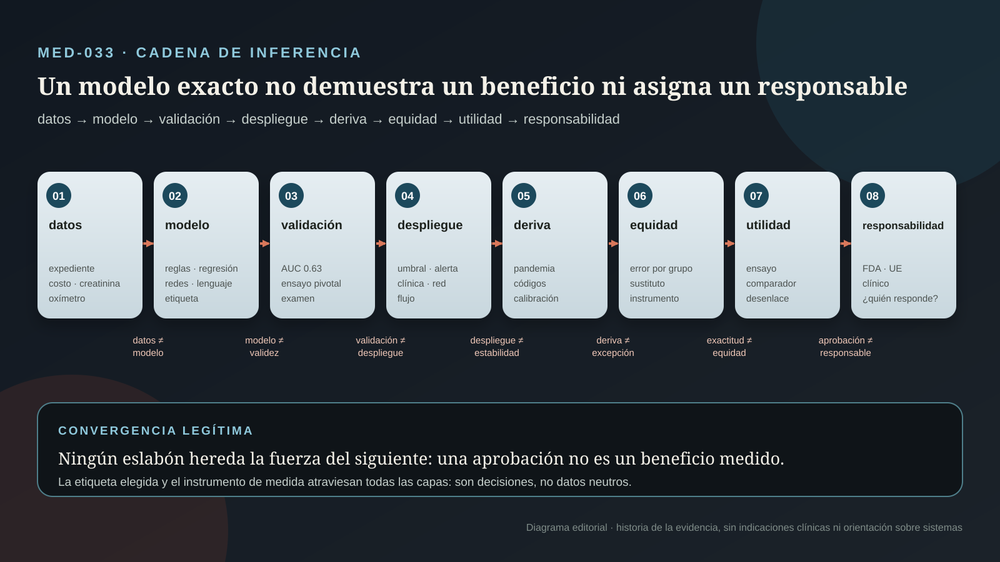
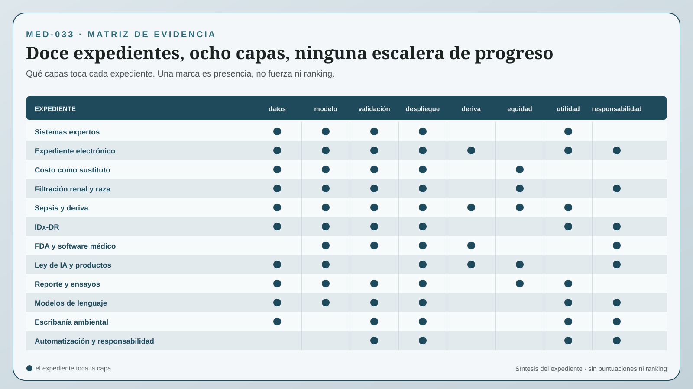

# MED-033 — Un modelo exacto no demuestra un beneficio ni asigna una responsabilidad por sí solo

> **Alcance:** audita doce expedientes entre 1972 y 2026: los sistemas expertos —el diagnóstico asistido del dolor abdominal de Leeds, MYCIN e INTERNIST-I— y por qué no se adoptaron; el expediente electrónico, de la prescripción computarizada a la ley HITECH de 2009, con sus clics, su agotamiento y su evidencia de beneficio; el algoritmo que usaba el costo como sustituto de la necesidad (Obermeyer, 2019); la fórmula de la tasa de filtración glomerular estimada con raza y su retiro en 2021; el modelo Epic de sepsis, su validación externa y su deriva durante la COVID-19; IDx-DR, la primera aprobación de un sistema diagnóstico autónomo por la FDA (2018), y su contraparte desplegada en clínicas de Tailandia; la regulación del software como dispositivo médico en Estados Unidos; la Ley de IA de la Unión Europea de 2024, su calendario hasta 2026 y la responsabilidad por productos defectuosos; los marcos de reporte CONSORT-AI, SPIRIT-AI, DECIDE-AI y TRIPOD+AI con los ensayos aleatorizados de IA; los grandes modelos de lenguaje, de los exámenes a los ensayos de 2024–2026; la escribanía ambiental; y el sesgo de automatización con la responsabilidad clínica. La IA en imagen ya está contada en MED-025 y aquí sólo se cita como antecedente (`CLAIM-MED-IMG-AI-GENEALOGY-001`); los oxímetros, en MED-026 (`CLAIM-MED-CRIT-OXIMETRY-BIAS-2020-001`). Separa datos, modelo, validación, despliegue, deriva, equidad, utilidad y responsabilidad. Es historia y epistemología de la evidencia: **no contiene recomendaciones clínicas, indicaciones, dosis ni orientación sobre qué sistema usar, comprar o aprobar** (`CLAIM-MED-AI-NO-ADVICE-001`).

## Pregunta central

¿Cómo se auditan datos, deriva, automatización, equidad, utilidad y responsabilidad en la medicina digital, sin confundir un registro con un dato válido, una etiqueta con la necesidad que dice medir, una exactitud retrospectiva con una validación externa, una aprobación con un beneficio, un examen aprobado con una consulta resuelta, ni una ley con un responsable?

## Respuesta breve

La IA clínica no empezó con el aprendizaje profundo. En 1972 un sistema de Leeds acertó 91.8 % de los diagnósticos de dolor abdominal agudo frente a 79.6 % del clínico de mayor rango (`CLAIM-MED-AI-DE-DOMBAL-1972-001`); en 1979 MYCIN recibió una calificación de aceptabilidad de 65 % frente a 42.5–62.5 % de los especialistas (`CLAIM-MED-AI-MYCIN-1979-001`). Ninguno se volvió práctica habitual: INTERNIST-I no era fiable para uso clínico y, en 1994, ningún sistema diagnóstico grande estaba en uso amplio (`CLAIM-MED-AI-INTERNIST-1982-001`, `CLAIM-MED-AI-MILLER-1994-001`). Un buen desempeño en casos de prueba nunca fue lo mismo que un sistema usado (`CLAIM-MED-AI-EXPERT-ADOPTION-LIMIT-001`).

El expediente electrónico sí se adoptó, por ley y con dinero: HITECH (2009) multiplicó la adopción hospitalaria (`CLAIM-MED-AI-HITECH-2009-001`, `CLAIM-MED-AI-ADLER-MILSTEIN-2017-001`). Trajo menos errores de medicación graves en un hospital (`CLAIM-MED-AI-BATES-1998-001`), más mortalidad en otro tras una implantación apresurada (`CLAIM-MED-AI-HAN-2005-001`), cerca de 4000 clics por turno, dos horas de pantalla por cada hora con el paciente y más agotamiento (`CLAIM-MED-AI-HILL-2013-001`, `CLAIM-MED-AI-SINSKY-2016-001`, `CLAIM-MED-AI-SHANAFELT-2016-001`). Adoptar no es beneficiar (`CLAIM-MED-AI-EHR-ADOPTION-NOT-BENEFIT-001`).

Los datos del expediente alimentaron los algoritmos, y con ellos sus sesgos. Un algoritmo que predecía el costo como sustituto de la necesidad subestimaba a los pacientes negros; corregirlo subía su proporción en el programa de 17.7 % a 46.5 % (`CLAIM-MED-AI-OBERMEYER-2019-001`, `CLAIM-MED-AI-OBERMEYER-REMEDY-001`). La fórmula renal con coeficiente racial se retiró en 2021 a cambio de un error distinto, no de ningún error (`CLAIM-MED-AI-DELGADO-2021-001`, `CLAIM-MED-AI-INKER-TRADEOFF-001`). Elegir la etiqueta es una decisión, no un dato (`CLAIM-MED-AI-LABEL-IS-CHOICE-001`).

El modelo Epic de sepsis, en uso en cientos de hospitales, tuvo un área bajo la curva de 0.63 en la validación externa de Michigan (`CLAIM-MED-AI-EPIC-WONG-2021-001`), y durante la COVID-19 sus alertas diarias subieron 43 % con menos pacientes (`CLAIM-MED-AI-WONG-COVID-2021-001`). IDx-DR fue en 2018 el primer sistema autónomo autorizado por la FDA, con sensibilidad de 87.2 % y especificidad de 90.7 % en un ensayo prospectivo (`CLAIM-MED-AI-ABRAMOFF-2018-001`, `CLAIM-MED-AI-IDX-DENOVO-2018-001`); un sistema parecido tropezó en clínicas de Tailandia con luz, conexión y flujo de trabajo (`CLAIM-MED-AI-BEEDE-2020-001`). En 2026 la FDA lista más de 1600 dispositivos con IA (`CLAIM-MED-AI-FDA-LIST-2026-001`), y la Unión Europea aplazó a diciembre de 2027 y agosto de 2028 las obligaciones de alto riesgo de su Ley de IA (`CLAIM-MED-AI-OMNIBUS-2026-001`).

Los grandes modelos de lenguaje aprueban exámenes (`CLAIM-MED-AI-SINGHAL-2023-001`), pero en un ensayo con 1298 personas el modelo solo identificaba la condición en 94.9 % de los casos y sus usuarios en menos de 34.5 %, no mejor que el control (`CLAIM-MED-AI-BEAN-2026-001`). Los escribas ambientales redujeron el agotamiento en ensayos aleatorizados de 2025, con ahorros de tiempo modestos o nulos según el producto (`CLAIM-MED-AI-LUKAC-2025-001`, `CLAIM-MED-AI-AFSHAR-2025-001`).

La cadena legítima es **datos → modelo → validación → despliegue → deriva → equidad → utilidad → responsabilidad**. Ningún eslabón hereda la fuerza del siguiente (`CLAIM-MED-AI-CHAIN-001`).

## UN MODELO EXACTO NO DEMUESTRA UN BENEFICIO NI ASIGNA UNA RESPONSABILIDAD POR SÍ SOLO

### 1. Ocho capas que deben conservarse

| Capa | Pregunta | Producto legítimo | Salto inválido |
|---|---|---|---|
| Datos | ¿quién quedó registrado, con qué instrumento, qué etiqueta y qué faltantes? | procedencia y población declaradas | creer que un registro abundante es una muestra representativa |
| Modelo | ¿qué predice, con qué variables y qué sustituto de la necesidad? | objetivo y arquitectura declarados | confundir lo que el modelo predice con lo que se quería saber |
| Validación | ¿en qué población externa, con qué discriminación y calibración? | desempeño con intervalo fuera del sitio de origen | leer un área bajo la curva interna como validez general |
| Despliegue | ¿dónde, con qué flujo, umbral, alerta y personal? | uso real descrito | creer que un modelo validado funciona igual en otro hospital |
| Deriva | ¿qué cambió en pacientes, códigos, equipos o conductas desde la validación? | vigilancia y revalidación local | tratar una validación como certificado permanente |
| Equidad | ¿cómo varía el error entre grupos y qué sustitutos lo producen? | errores por grupo con su causa | creer que una exactitud global es justa para todos |
| Utilidad | ¿cambian decisiones, desenlaces, tiempos o daños frente a un comparador? | efecto medido, idealmente aleatorizado | tomar una métrica de desempeño como beneficio |
| Responsabilidad | ¿quién responde si falla: desarrollador, hospital, clínico o regulador? | reparto declarado y vías de reclamo | creer que una aprobación o una ley asignan la culpa |

### 2. Cuatro distinciones que el expediente no deja fundir

Unos **datos** abundantes no son un modelo válido: el expediente registra lo que se facturó, se midió y se escribió, no lo que el paciente necesitaba (`CLAIM-MED-AI-DATA-NOT-MODEL-001`). La **etiqueta** que el modelo aprende es una elección humana con consecuencias, como el costo en Obermeyer (`CLAIM-MED-AI-LABEL-IS-CHOICE-001`). Una **validación** retrospectiva no es un despliegue, y un despliegue no garantiza estabilidad: la población, los códigos y las conductas cambian (`CLAIM-MED-AI-MODEL-NOT-VALIDATION-001`, `CLAIM-MED-AI-VALIDATION-NOT-DEPLOYMENT-001`, `CLAIM-MED-AI-DEPLOYMENT-NOT-STABILITY-001`, `CLAIM-MED-AI-DRIFT-LOCAL-VALIDATION-001`). Y la **utilidad** no se deduce de la exactitud, ni la **responsabilidad** de una aprobación (`CLAIM-MED-AI-UTILITY-NOT-PERFORMANCE-001`, `CLAIM-MED-AI-RESPONSIBILITY-NOT-APPROVAL-001`).

MED-002 ya estableció que un modelo predictivo necesita calibración y validación externa además de discriminación (`CLAIM-MED-DX-PREDICTION-001`) y que, en IA, el desempeño retrospectivo no demuestra estabilidad, equidad ni utilidad (`CLAIM-MED-DX-AI-001`). MED-025 mostró que la IA en imagen hereda la pregunta del observador falible de 1947–1960 (`CLAIM-MED-IMG-AI-GENEALOGY-001`, `CLAIM-MED-IMG-LUSTED-LEDLEY-1959-001`) y que sus métricas no se heredan unas a otras (`CLAIM-MED-IMG-AI-METRICS-LIMIT-001`). MED-033 usa ese método sin repetirlo y lo extiende a la equidad y a la responsabilidad (`CLAIM-MED-AI-EQUITY-NOT-ACCURACY-001`).

## DOCE EXPEDIENTES AUDITADOS

### 3. Sistemas expertos: Leeds, MYCIN e INTERNIST-I (1972–1994)

De Dombal y colaboradores compararon en Leeds, en tiempo real y de forma prospectiva, el diagnóstico humano y el asistido por computadora en 304 pacientes con dolor abdominal agudo: el sistema acertó 91.8 % frente a 79.6 % del clínico de mayor rango que vio cada caso (`CLAIM-MED-AI-DE-DOMBAL-1972-001`). Era un modelo probabilístico alimentado con datos locales; los propios autores anticiparon un valor práctico «en un pequeño porcentaje de casos».

MYCIN, desarrollado en Stanford, aconsejaba tratamiento antimicrobiano con reglas de producción y podía explicar su razonamiento y adquirir reglas nuevas (`CLAIM-MED-AI-MYCIN-1975-001`). En una evaluación ciega publicada en 1979, ocho expertos en meningitis compararon sus elecciones con las de nueve prescriptores humanos en diez casos: MYCIN obtuvo 65 % de aceptabilidad, los cinco especialistas de la facultad entre 42.5 % y 62.5 %, y el programa nunca dejó sin cubrir un patógeno tratable (`CLAIM-MED-AI-MYCIN-1979-001`). Aun así, MYCIN nunca se usó en la atención habitual; la historia del proyecto la cuentan sus autores como un experimento de investigación (`CLAIM-MED-AI-MYCIN-NOT-ADOPTED-001`).

INTERNIST-I intentó la medicina interna completa. En 19 casos clinicopatológicos del *NEJM* su desempeño fue cualitativamente parecido al de los clínicos del hospital e inferior al de los discutidores; los autores concluyeron que no era suficientemente fiable para uso clínico porque no razonaba en el tiempo ni en la anatomía y no explicaba su «pensamiento» (`CLAIM-MED-AI-INTERNIST-1982-001`). En 1994, Berner y colaboradores probaron cuatro sistemas comerciales en 105 casos difíciles: acertaron el diagnóstico entre 52 % y 71 % de las veces, sugirieron menos de la mitad de los diagnósticos razonables de los expertos y, a la vez, unos dos diagnósticos relevantes por caso que los expertos no habían considerado (`CLAIM-MED-AI-BERNER-1994-001`). Miller resumía ese año que ningún sistema diagnóstico grande estaba en uso amplio, aunque los simples ya eran ubicuos (`CLAIM-MED-AI-MILLER-1994-001`).

Por qué no se adoptaron no se midió con un diseño: la literatura señala la carga de introducir datos a mano, la falta de integración con un registro electrónico que aún no existía, el mantenimiento de las bases de conocimiento y la ausencia de pruebas de que cambiaran desenlaces. Son razones documentadas como interpretación, no como efecto estimado (`CLAIM-MED-AI-EXPERT-ADOPTION-LIMIT-001`).

### 4. El expediente electrónico y HITECH (1998–2017)

Bates y colaboradores informaron en 1998 que, en un hospital de Boston, los errores de medicación graves no interceptados bajaron 55 % —de 10.7 a 4.86 por 1000 días-paciente— tras la prescripción computarizada, en una comparación antes-después con un componente aleatorizado entre servicios (`CLAIM-MED-AI-BATES-1998-001`). En 2005, Han y colaboradores observaron en un hospital pediátrico de Pittsburgh que la mortalidad de niños trasladados subió de 2.80 % a 6.57 % en los cinco meses posteriores a implantar en seis días un sistema comercial de prescripción (razón de momios ajustada 3.28) (`CLAIM-MED-AI-HAN-2005-001`). Es un antes-después en un solo centro, con una implantación apresurada y discutida en cartas; no prueba que la prescripción computarizada mate, pero sí que el mismo tipo de sistema puede producir efectos opuestos según cómo se despliega (`CLAIM-MED-AI-HAN-LIMIT-001`).

Chaudhry y colaboradores revisaron en 2006 257 estudios: hallaron más apego a guías, mejor vigilancia y menos errores de medicación, pero cerca de un cuarto venía de cuatro instituciones con sistemas propios y sólo nueve evaluaban sistemas comerciales (`CLAIM-MED-AI-CHAUDHRY-2006-001`). Con esa base, la ley HITECH, parte de la Ley de Recuperación de 2009, creó incentivos de Medicare y Medicaid para el «uso significativo» del expediente electrónico (`CLAIM-MED-AI-HITECH-2009-001`). Adler-Milstein y Jha estimaron que la adopción anual en los hospitales elegibles pasó de 3.2 % a 14.2 % y en los no elegibles de 0.1 % a 3.3 %, una diferencia en diferencias de 7.9 puntos atribuible a la ley (`CLAIM-MED-AI-ADLER-MILSTEIN-2017-001`).

El costo apareció en el tiempo de los clínicos. En un servicio de urgencias comunitario, los médicos dedicaron 44 % de su tiempo a introducir datos y 28 % al contacto directo, con cerca de 4000 clics en un turno de diez horas (`CLAIM-MED-AI-HILL-2013-001`). En cuatro especialidades ambulatorias, por cada hora frente al paciente hubo casi dos de expediente y trabajo de escritorio (`CLAIM-MED-AI-SINSKY-2016-001`); en atención primaria, 5.9 horas de una jornada de 11.4 se pasaron en el expediente (`CLAIM-MED-AI-ARNDT-2017-001`). Shanafelt y colaboradores hallaron en 6375 médicos que usar el expediente y la prescripción computarizada se asociaba con menos satisfacción y más agotamiento (`CLAIM-MED-AI-SHANAFELT-2016-001`). Adopción, beneficio y costo son tres mediciones distintas; HITECH logró la primera, y las otras dos siguen en disputa (`CLAIM-MED-AI-EHR-ADOPTION-NOT-BENEFIT-001`).

### 5. El costo como sustituto de la necesidad (Obermeyer, 2019)

Obermeyer y colaboradores analizaron un algoritmo comercial de gestión poblacional, representativo de una práctica de la industria, que decidía quién entraba a programas de atención intensiva: con la misma puntuación de riesgo, los pacientes negros estaban considerablemente más enfermos que los blancos (`CLAIM-MED-AI-OBERMEYER-2019-001`). El sesgo no venía de usar la raza, sino de predecir el gasto futuro: como el acceso desigual hace que se gaste menos en atender a pacientes negros, el costo subestimaba su necesidad. Remediar la disparidad habría subido su proporción entre los que recibían ayuda adicional de 17.7 % a 46.5 % (`CLAIM-MED-AI-OBERMEYER-REMEDY-001`).

El hallazgo es un caso: un algoritmo, un sistema de salud académico y una medida de enfermedad basada en descompensaciones registradas; sirve como demostración de mecanismo, no como prevalencia del sesgo en todos los algoritmos (`CLAIM-MED-AI-OBERMEYER-LIMIT-001`). Su lección es de la capa de datos y modelo: la etiqueta elegida —costo— era exacta para lo que medía y equivocada para lo que se quería (`CLAIM-MED-AI-LABEL-IS-CHOICE-001`).

### 6. La filtración renal con raza y su retiro (2009–2022)

La ecuación CKD-EPI de 2009, desarrollada en 8254 participantes de diez estudios, estimaba la filtración glomerular con creatinina, sexo, edad y raza (`CLAIM-MED-AI-LEVEY-2009-001`). La creatinina sale del músculo, y el término racial se justificaba por una supuesta mayor masa muscular de las personas negras; Eneanya, Yang y Reese advirtieron en 2019 que los problemas de esa clasificación racial y sus consecuencias en la estimación de la función renal no se habían examinado de cerca (`CLAIM-MED-AI-ENEANYA-2019-001`). Vyas, Eisenstein y Jones documentaron en 2020 correcciones por raza en algoritmos de varias especialidades (`CLAIM-MED-AI-VYAS-2020-001`).

En 2021 el grupo de trabajo de la National Kidney Foundation y la American Society of Nephrology, tras evaluar 26 enfoques, propuso adoptar de inmediato en los laboratorios estadounidenses la ecuación CKD-EPI reajustada sin raza y ampliar el uso de la cistatina C (`CLAIM-MED-AI-DELGADO-2021-001`). Inker y colaboradores publicaron las ecuaciones nuevas: la de creatinina sin raza subestimaba la filtración medida en personas negras y la sobrestimaba en las no negras, mientras la que combina creatinina y cistatina C era más exacta y con menor diferencia entre grupos (`CLAIM-MED-AI-INKER-2021-001`, `CLAIM-MED-AI-INKER-TRADEOFF-001`). Retirar la raza cambió quién recibe el error, no eliminó el error; si el cambio mejora la equidad depende de desenlaces que la ecuación no mide (`CLAIM-MED-AI-RACE-REMOVAL-NOT-EQUITY-001`).

El oxímetro de pulso es el caso paralelo de instrumento: en MED-026 la hipoxemia oculta fue casi tres veces más frecuente en pacientes negros (`CLAIM-MED-CRIT-OXIMETRY-BIAS-2020-001`). Cuando esas lecturas entran a un modelo, el sesgo del instrumento se vuelve sesgo del dato, y ningún algoritmo lo corrige si no sabe que existe (`CLAIM-MED-AI-INSTRUMENT-BIAS-INPUT-001`). MED-025 documentó lo mismo en imagen: clasificadores que subdiagnostican a grupos desatendidos (`CLAIM-MED-IMG-UNDERDIAGNOSIS-2021-001`).

### 7. El modelo Epic de sepsis, su validación y su deriva (2018–2022)

El Epic Sepsis Model es un modelo propietario implantado en cientos de hospitales estadounidenses sin una evaluación adecuada publicada, y su funcionamiento interno no era público (`CLAIM-MED-AI-EPIC-PROPRIETARY-001`). Wong y colaboradores lo validaron de forma retrospectiva en Michigan Medicine con 27 697 pacientes y 38 455 hospitalizaciones: área bajo la curva de 0.63 (0.62–0.64) a nivel de hospitalización (`CLAIM-MED-AI-EPIC-WONG-2021-001`). Con el umbral de 6, generó alertas en 18 % de los hospitalizados, no identificó a 67 % de los pacientes con sepsis y sólo detectó a 7 % de los que no habían recibido antibióticos a tiempo (`CLAIM-MED-AI-EPIC-ALERTS-2021-001`).

La deriva llegó con la pandemia. En 24 hospitales, las alertas diarias pasaron de unas 953 a 1363 —43 % más— mientras el censo bajaba 35 %, y la proporción de pacientes con alerta subió de 9 % a 21 % (`CLAIM-MED-AI-WONG-COVID-2021-001`). Michigan desactivó el modelo en abril de 2020 por alertas espurias asociadas al cambio en los pacientes (`CLAIM-MED-AI-MICHIGAN-DEACTIVATION-2020-001`). Finlayson y colaboradores clasificaron las causas de esa «deriva de datos» en tecnología —códigos, equipos, versiones del expediente—, población y entorno, y conducta clínica (`CLAIM-MED-AI-FINLAYSON-2021-001`). Davis y colaboradores mostraron en hospitales de veteranos, con nueve años de seguimiento, que la discriminación de modelos de lesión renal aguda se mantenía mientras la calibración se degradaba hacia la sobrepredicción (`CLAIM-MED-AI-DAVIS-2017-001`). MED-025 ya contó el atajo de las radiografías que aprendían el hospital de origen (`CLAIM-MED-IMG-SHORTCUT-2018-001`). Un modelo no se valida una vez: se vigila en el sitio donde se usa (`CLAIM-MED-AI-DRIFT-LOCAL-VALIDATION-001`).

El adversario más fuerte de este expediente está aquí. Adams y colaboradores siguieron de forma prospectiva en cinco hospitales el sistema TREWS: entre 6877 pacientes con sepsis alertados antes de los antibióticos, aquellos cuya alerta confirmó un clínico en tres horas tuvieron una mortalidad hospitalaria 3.3 puntos menor en términos absolutos (18.7 % relativa), ajustada por gravedad (`CLAIM-MED-AI-ADAMS-2022-001`). Es un estudio observacional que compara alertas confirmadas con no confirmadas: quién confirma a tiempo puede diferir de quién no lo hace, y el diseño no es un ensayo del sistema frente a su ausencia (`CLAIM-MED-AI-ADAMS-LIMIT-001`). Muestra que la utilidad es posible; no muestra que la del ESM la tuviera.

### 8. IDx-DR y la primera aprobación autónoma (2018–2020)

El ensayo pivotal de IDx-DR reclutó 900 personas con diabetes en diez consultorios de atención primaria y comparó el sistema con la lectura del centro de referencia de Wisconsin: sensibilidad de 87.2 % (81.8–91.2) y especificidad de 90.7 % (88.3–92.7), por encima de los umbrales preespecificados, con 96.1 % de imágenes interpretables (`CLAIM-MED-AI-ABRAMOFF-2018-001`). La FDA lo autorizó el 11 de abril de 2018 por la vía De Novo como el primer dispositivo de IA que entrega un resultado de cribado sin que un clínico interprete la imagen (`CLAIM-MED-AI-IDX-DENOVO-2018-001`). La aprobación descansó en exactitud frente a una referencia, no en desenlaces visuales; si el cribado autónomo reduce la ceguera depende de derivaciones y tratamientos que el ensayo no midió (`CLAIM-MED-AI-AUTONOMOUS-NOT-OUTCOME-001`).

Beede y colaboradores observaron un sistema de Google para retinopatía en once clínicas de Tailandia: imágenes rechazadas por luz y desenfoque, conexiones lentas para subirlas a la nube y pacientes que debían viajar a otra cita (`CLAIM-MED-AI-BEEDE-2020-001`). El mismo tipo de modelo, validado en el laboratorio, cambió de desempeño al cambiar la sala, la red y el flujo: es la distancia entre validación y despliegue (`CLAIM-MED-AI-VALIDATION-NOT-DEPLOYMENT-001`).

### 9. El software como dispositivo médico en Estados Unidos (2013–2026)

El Foro Internacional de Reguladores de Dispositivos Médicos definió en 2013 el «software como dispositivo médico»: software con finalidad médica que la cumple sin formar parte de un equipo físico (`CLAIM-MED-AI-IMDRF-2013-001`). La FDA lo regula por las vías de siempre —510(k), De Novo, aprobación previa—, pensadas para productos que no cambian solos. Wu y colaboradores revisaron 130 dispositivos de IA autorizados entre 2015 y 2020: 126 se habían evaluado sólo con datos retrospectivos y ninguno de los 54 de alto riesgo con un estudio prospectivo (`CLAIM-MED-AI-WU-2021-001`). Muehlematter y colaboradores contaron 222 dispositivos en Estados Unidos y 240 en Europa entre 2015 y 2020; de 124 aprobados en ambos, 80 se aprobaron antes en Europa (`CLAIM-MED-AI-MUEHLEMATTER-2021-001`).

Para los modelos que se actualizan, la FDA publicó el 4 de diciembre de 2024 su guía final sobre planes predeterminados de control de cambios: el fabricante describe de antemano qué modificará y cómo lo validará, y esas modificaciones no exigen una solicitud nueva cada vez (`CLAIM-MED-AI-PCCP-2024-001`). En septiembre de 2026, la lista pública de la agencia sumaba más de 1600 dispositivos con IA autorizados (`CLAIM-MED-AI-FDA-LIST-2026-001`). Como ya advirtió MED-029, una aprobación fija un umbral de evidencia en una fecha (`CLAIM-MED-EBM-APPROVAL-THRESHOLD-001`): contar dispositivos autorizados no mide cuántos se usan ni qué cambian.

### 10. La Ley de IA de la Unión Europea y la responsabilidad por productos (2024–2026)

El Reglamento (UE) 2024/1689, la Ley de IA, se publicó el 12 de julio de 2024 y entró en vigor el 1 de agosto de 2024 (`CLAIM-MED-AI-AI-ACT-2024-001`). Su calendario original escalonaba la aplicación: prohibiciones y alfabetización en IA desde el 2 de febrero de 2025, obligaciones de los modelos de propósito general desde el 2 de agosto de 2025, la mayor parte desde el 2 de agosto de 2026 y los sistemas de alto riesgo integrados en productos regulados desde el 2 de agosto de 2027 (`CLAIM-MED-AI-AI-ACT-CALENDAR-001`). Un sistema de IA que es un dispositivo médico, o su componente de seguridad, sujeto a evaluación de conformidad por un organismo notificado, se clasifica como de alto riesgo por el artículo 6.1 y el anexo I (`CLAIM-MED-AI-AI-ACT-MEDICAL-HIGH-RISK-001`).

El calendario cambió antes de cumplirse. El Reglamento (UE) 2026/1744, el «ómnibus digital» sobre IA, publicado el 24 de julio de 2026 y en vigor desde el 27 de julio, aplazó las obligaciones de alto riesgo del anexo III al 2 de diciembre de 2027 y las del anexo I —incluidos los dispositivos médicos— al 2 de agosto de 2028 (`CLAIM-MED-AI-OMNIBUS-2026-001`). Al 25 de noviembre de 2026, ninguna obligación de alto riesgo de la Ley de IA se aplicaba aún a un dispositivo médico.

La responsabilidad civil tomó otro camino. La Directiva (UE) 2024/2853 sobre productos defectuosos incluye el software y los sistemas de IA como productos y se aplica a los que se comercialicen desde el 9 de diciembre de 2026 (`CLAIM-MED-AI-PLD-2024-001`). La propuesta de directiva específica sobre responsabilidad por IA, en cambio, fue retirada por la Comisión en 2025 por falta de acuerdo previsible (`CLAIM-MED-AI-AILD-WITHDRAWN-2025-001`). Una ley publicada define obligaciones y plazos; no audita un modelo, no mide su deriva y no dice quién respondió por un daño concreto (`CLAIM-MED-AI-LAW-NOT-AUDIT-001`).

### 11. Marcos de reporte y ensayos aleatorizados de IA (2020–2024)

En 2020 se publicaron CONSORT-AI, con 14 elementos nuevos para informar ensayos con intervenciones de IA —versión, entrada, salida, interacción humano-máquina y análisis de errores—, y SPIRIT-AI, su equivalente para protocolos (`CLAIM-MED-AI-CONSORT-AI-2020-001`, `CLAIM-MED-AI-SPIRIT-AI-2020-001`). DECIDE-AI (2022) cubrió la evaluación clínica temprana, la etapa entre el desarrollo y el ensayo grande (`CLAIM-MED-AI-DECIDE-AI-2022-001`). TRIPOD+AI (2024), ya auditado en MED-002, reemplazó a TRIPOD para informar modelos predictivos con regresión o aprendizaje automático (`CLAIM-MED-AI-TRIPOD-AI-2024-001`). Como advierte MED-001, una descripción completa no certifica un diseño válido (`CLAIM-MED-REPORTING-VALIDITY-001`).

Los ensayos existen, pero son pocos y estrechos. Plana y colaboradores hallaron hasta octubre de 2021 sólo 41 ensayos aleatorizados de intervenciones de aprendizaje automático; ninguno cumplía todo CONSORT-AI y 93 % no analizaba los errores de desempeño (`CLAIM-MED-AI-PLANA-2022-001`). Han y colaboradores revisaron 86 ensayos hasta 2023: 81 % informó un desenlace primario positivo, sobre todo de rendimiento diagnóstico, en estudios mayormente de un solo centro y con poca descripción demográfica (`CLAIM-MED-AI-HAN-2024-001`). MASAI, el ensayo de mamografía con IA auditado en MED-025, es la excepción grande y publicó en 2026 cánceres de intervalo no inferiores (`CLAIM-MED-IMG-MASAI-2026-001`).

### 12. Grandes modelos de lenguaje: del examen al ensayo (2023–2026)

ChatGPT rindió en 2023 en o cerca del umbral de aprobación de los tres exámenes de licencia médica estadounidense (`CLAIM-MED-AI-KUNG-2023-001`), y Flan-PaLM llegó a 67.6 % en preguntas de estilo USMLE; la evaluación humana de sus respuestas largas encontró brechas, y Med-PaLM seguía por debajo de los clínicos (`CLAIM-MED-AI-SINGHAL-2023-001`). Hager y colaboradores llevaron los modelos a 2400 casos reales de dolor abdominal: diagnosticaron peor que los médicos, no siguieron guías y fueron sensibles al orden y la cantidad de información (`CLAIM-MED-AI-HAGER-2024-001`). Un examen mide conocimiento recuperable en preguntas cerradas; una consulta exige recoger información, priorizar y actuar (`CLAIM-MED-AI-EXAM-NOT-CLINIC-001`).

Los ensayos aleatorizados llegaron en 2024. Goh y colaboradores asignaron a 50 médicos a usar GPT-4 o recursos convencionales en viñetas: puntuación de razonamiento diagnóstico de 76 % frente a 74 %, sin diferencia significativa, mientras el modelo solo puntuaba más alto que ambos grupos (`CLAIM-MED-AI-GOH-2024-001`). En razonamiento de manejo, con 92 médicos, el acceso al modelo sí mejoró 6.5 puntos la calificación, a costa de dos minutos más por caso (`CLAIM-MED-AI-GOH-2025-001`). Bean y colaboradores asignaron a 1298 personas del público a tres modelos o a la fuente que quisieran: los modelos solos identificaban la condición en 94.9 % de los escenarios, pero sus usuarios en menos de 34.5 %, no mejor que el control; los participantes daban información incompleta y los modelos a veces respondían mal (`CLAIM-MED-AI-BEAN-2026-001`). Al 25 de noviembre de 2026, los ensayos publicados de modelos de lenguaje para decidir sobre pacientes usaban viñetas o escenarios simulados, no pacientes con desenlaces clínicos medidos (`CLAIM-MED-AI-LLM-RCT-SCOPE-001`).

### 13. La escribanía ambiental (2023–2025)

Los escribas ambientales graban la consulta y redactan la nota. The Permanente Medical Group los habilitó en octubre de 2023; en diez semanas 3442 médicos los usaron en hasta 303 266 encuentros, con notas de buena calidad para editar y un pequeño porcentaje con «alucinaciones» (`CLAIM-MED-AI-TIERNEY-2024-001`). Es un informe de implementación sin grupo de comparación.

En 2025 aparecieron los ensayos. Lukac y colaboradores asignaron a 238 médicos de UCLA a dos productos o a la práctica habitual entre noviembre de 2024 y enero de 2025: uno redujo 9.5 % el tiempo de redacción y el otro no cambió de forma significativa, aunque ambos mejoraron escalas de agotamiento y carga (`CLAIM-MED-AI-LUKAC-2025-001`). Afshar y colaboradores, con 66 profesionales en un diseño escalonado de 24 semanas, hallaron menos agotamiento laboral (−0.44 puntos en una escala de cinco) (`CLAIM-MED-AI-AFSHAR-2025-001`). Los médicos informaron que las notas contenían «ocasionalmente» imprecisiones clínicamente relevantes, sobre todo omisiones (`CLAIM-MED-AI-SCRIBE-ERRORS-001`). Son ensayos cortos, de pocos centros y con desenlaces del clínico, no del paciente; el ahorro de tiempo depende del producto y el riesgo de una nota errónea se traslada al que la firma (`CLAIM-MED-AI-SCRIBE-LIMIT-001`).

### 14. Automatización y responsabilidad (2012–2026)

Goddard, Roudsari y Wyatt revisaron 74 estudios sobre sesgo de automatización: la tendencia a seguir el consejo de la máquina aumenta con la carga de trabajo, la complejidad y la confianza, y disminuye con entrenamiento y con responsabilidad explícita del usuario (`CLAIM-MED-AI-GODDARD-2012-001`). Dratsch y colaboradores pidieron a 27 radiólogos leer mamografías con un supuesto sistema de IA que proponía una categoría incorrecta en doce de cuarenta: la proporción de lecturas correctas de los inexpertos bajó de 79.7 % a 19.8 % cuando la sugerencia era errónea (`CLAIM-MED-AI-DRATSCH-2023-001`). La automatización no sólo añade un lector: cambia al lector.

Price, Gerke y Cohen analizaron en 2019 cuándo podría responder un médico, bajo el derecho estadounidense vigente, por usar una IA que entrega recomendaciones sin poder comunicar sus razones; la referencia del análisis es el estándar de cuidado, no la exactitud del sistema (`CLAIM-MED-AI-PRICE-2019-001`). Aquí se leyó el planteamiento y su recepción secundaria —que los médicos pueden resistirse a sistemas opacos que los exponen a responder—, no el texto completo; la tesis más citada, que el derecho vigente empuja a usar la IA sólo para confirmar, queda sin verificar en esta auditoría. Desarrollador, hospital que la configura, clínico que la usa y regulador que la autoriza se reparten la responsabilidad de una forma que ningún texto vigente cierra (`CLAIM-MED-AI-RESPONSIBILITY-DIFFUSE-001`).

Topol, el adversario optimista, anticipaba en 2019 mejoras marcadas de exactitud, productividad y flujo, sin dejar de nombrar el sesgo, la privacidad y la opacidad (`CLAIM-MED-AI-TOPOL-2019-001`). Siete años después, parte de esa promesa se cumplió en métricas y en algunos ensayos; la otra parte —beneficio para el paciente y reparto de la responsabilidad— sigue sin medirse.

## LO OBSERVADO

- diagnósticos de dolor abdominal acertados por el sistema y por los clínicos; calificaciones ciegas de prescripciones;
- errores de medicación por días-paciente; mortalidad antes y después de una implantación;
- tasas de adopción hospitalaria; minutos y clics registrados en el expediente;
- puntuaciones de riesgo y marcadores de enfermedad por raza; filtración medida frente a estimada;
- alertas, sepsis y antibióticos por hospitalización; alertas diarias antes y durante la pandemia;
- sensibilidad y especificidad frente a una lectura de referencia; observaciones de campo en clínicas;
- autorizaciones, guías, reglamentos y fechas de aplicación;
- respuestas de modelos y de personas en exámenes, viñetas y escenarios;
- tiempo de redacción y escalas de agotamiento con y sin escriba;
- lecturas de radiólogos con sugerencias correctas e incorrectas.

## LO MEDIDO

- la exactitud de sistemas expertos en casos de prueba;
- el efecto de HITECH sobre la adopción, en diferencias en diferencias;
- el tiempo de pantalla y su asociación con el agotamiento;
- el sesgo de una etiqueta de costo y el efecto de corregirla;
- el error de las ecuaciones renales con y sin raza;
- la discriminación externa y la carga de alertas del ESM, y su cambio durante la COVID-19;
- la degradación de la calibración con los años;
- la sensibilidad y especificidad de un sistema autónomo en un ensayo prospectivo;
- el efecto de modelos de lenguaje y escribas en ensayos aleatorizados con desenlaces del clínico o de viñetas;
- no el efecto de la mayoría de los dispositivos autorizados sobre los desenlaces de los pacientes, ni cuántos daños causó un modelo desplegado, ni quién respondió por ellos.

## LO INFERIDO

Que el desempeño de un modelo depende del sitio, del tiempo y de la población es la inferencia más sólida del expediente: convergen la validación externa del ESM, su deriva pandémica, la calibración que se degrada en nueve años, el atajo del hospital de origen y la distancia entre el ensayo de IDx-DR y las clínicas de Tailandia. Que la etiqueta elegida puede producir sesgo sin usar la raza se infiere de un caso con mecanismo demostrado. Que el acceso a un modelo de lenguaje no transfiere su exactitud a quien lo usa se infiere de tres ensayos aleatorizados con resultados concordantes en lo diagnóstico (`CLAIM-MED-AI-CHAIN-001`, `CLAIM-MED-AI-DRIFT-LOCAL-VALIDATION-001`, `CLAIM-MED-AI-UTILITY-NOT-PERFORMANCE-001`).

## LOS SUPUESTOS

- que la lectura de un centro de referencia es la verdad contra la que se mide un sistema;
- que la sepsis definida por códigos y criterios de vigilancia es la sepsis clínica;
- que las descompensaciones registradas miden la necesidad;
- que las viñetas representan las decisiones reales;
- que los hospitales elegibles y no elegibles para HITECH habrían seguido tendencias paralelas;
- que las escalas de agotamiento captan el efecto relevante de un escriba;
- que una alerta confirmada a tiempo marca una diferencia causal y no un tipo de paciente o de clínico.

## LAS INCERTIDUMBRES

- el balance de beneficio y daño del expediente electrónico en conjunto;
- cuántos algoritmos desplegados tienen sesgos de etiqueta como el de Obermeyer;
- el efecto de las ecuaciones renales sin raza sobre derivaciones, trasplantes y desenlaces;
- la frecuencia con que los modelos desplegados se revalidan localmente;
- si los modelos de lenguaje mejoran desenlaces de pacientes reales;
- el efecto de los escribas sobre la calidad de la atención y los errores;
- cómo se aplicarán la Ley de IA y la directiva de productos defectuosos a casos concretos.

## LAS ALTERNATIVAS

- la mortalidad pediátrica de Pittsburgh pudo reflejar la forma de implantar, no el sistema;
- el gradiente de agotamiento puede deberse a la carga de trabajo total, no sólo a la pantalla;
- el bajo desempeño del ESM en Michigan puede depender de la definición de sepsis usada;
- la menor mortalidad con alertas confirmadas de TREWS puede reflejar selección;
- el fracaso de los usuarios con modelos de lenguaje puede deberse al diseño del escenario y no a la interacción;
- la mejora del agotamiento con escribas puede incluir efecto de novedad y de expectativa.

## QUÉ PODEMOS COMPARAR

| Expediente | Archivo dominante | Producto mejor resuelto | Límite decisivo |
|---|---|---|---|
| Sistemas expertos | de Dombal; Yu; Miller; Berner | exactitud en casos de prueba | sin uso ni desenlaces |
| Expediente electrónico | Bates; Han; Adler-Milstein; Sinsky; Shanafelt | adopción atribuible y tiempo de pantalla | beneficio global en disputa |
| Costo como sustituto | Obermeyer | mecanismo de sesgo por etiqueta | un algoritmo, un sistema |
| Filtración renal y raza | Levey; Delgado; Inker | error por grupo con y sin raza | desenlaces no medidos |
| Sepsis y deriva | Wong; Finlayson; Davis; Adams | validación externa y deriva medida | utilidad observacional |
| IDx-DR | Abràmoff; FDA; Beede | exactitud prospectiva y obstáculos de campo | sin desenlaces visuales |
| FDA y software médico | IMDRF; Wu; Muehlematter; FDA | cómo se autoriza | autorización no es uso ni efecto |
| Ley de IA y productos | Reglamentos 2024/1689 y 2026/1744; Directiva 2024/2853 | obligaciones y plazos | aplicación futura |
| Reporte y ensayos | CONSORT-AI; Plana; Han | cuántos ensayos y cómo se informan | reporte no es validez |
| Modelos de lenguaje | Singhal; Hager; Goh; Bean | ensayos con viñetas | sin pacientes reales |
| Escribanía ambiental | Tierney; Lukac; Afshar | ensayos con desenlaces del clínico | cortos y con errores de nota |
| Automatización y responsabilidad | Goddard; Dratsch; Price | sesgo de automatización medido | responsabilidad sin cerrar |

Comparar aquí significa declarar datos, modelo, validación, despliegue, deriva, equidad, utilidad y responsable de cada expediente. No ordena sistemas, empresas ni países por mérito o culpa (`CLAIM-MED-AI-NONRANKING-001`).

## QUÉ NO PODEMOS CONCLUIR

- que los sistemas expertos fracasaron por ser inexactos;
- que el expediente electrónico mejoró o empeoró la medicina en conjunto;
- que todos los algoritmos de riesgo son racistas, o que ninguno lo es si no usa la raza;
- que retirar la raza de una fórmula resolvió la inequidad renal;
- que el ESM no sirve en ningún hospital, o que TREWS salva vidas por sí solo;
- que una autorización de la FDA demuestra beneficio clínico;
- que la Ley de IA ya protege a los pacientes europeos de un dispositivo concreto;
- que un modelo que aprueba un examen puede atender pacientes;
- que los escribas ahorran tiempo en general;
- que el clínico, la empresa o el regulador es el único responsable de un daño (`CLAIM-MED-AI-RESPONSIBILITY-DIFFUSE-001`).

## LAS CONTROVERSIAS

| Pregunta | Alternativas | Qué discrimina |
|---|---|---|
| ¿por qué no se adoptaron los sistemas expertos? | exactitud insuficiente / integración, carga y mantenimiento | sistemas exactos adoptados o no según su integración |
| ¿mejoró la atención el expediente electrónico? | sí, con menos errores / no, con más carga y daños | ensayos o cuasi-experimentos con desenlaces |
| ¿cuánto sesgo de etiqueta hay en los algoritmos? | caso aislado / práctica extendida | auditorías de muchos algoritmos con datos de necesidad |
| ¿mejora la equidad la ecuación renal sin raza? | sí / desplaza el error | desenlaces por grupo tras el cambio |
| ¿sirven los modelos de alerta de sepsis? | ESM deficiente / TREWS útil | ensayos aleatorizados del sistema frente a su ausencia |
| ¿basta la validación previa a la autorización? | sí / hace falta vigilancia | desempeño después de la autorización |
| ¿llegará a tiempo la Ley de IA? | sí / aplazada y diluida | aplicación y sanciones tras 2027–2028 |
| ¿ayudan los modelos de lenguaje a decidir? | sí en manejo / no en diagnóstico ni para el público | ensayos con pacientes reales |
| ¿ahorran tiempo los escribas? | sí / depende del producto | ensayos más largos y multicéntricos |
| ¿quién responde por un error de IA? | clínico / desarrollador / hospital | casos judiciales y aplicación de la directiva |

## ERRORES QUE ESTA INVESTIGACIÓN BLOQUEA

1. **«Los sistemas expertos fracasaron porque eran inexactos.»** En casos de prueba igualaban o superaban a clínicos.
2. **«Más expediente electrónico es mejor medicina.»** Adopción, beneficio y costo se miden por separado.
3. **«Si un algoritmo no usa la raza, no puede ser racista.»** La etiqueta de costo lo fue sin usarla.
4. **«Quitar la raza de la fórmula eliminó el sesgo.»** Desplazó el error entre grupos.
5. **«Un modelo usado en cientos de hospitales está validado.»** El ESM tuvo 0.63 en la validación externa.
6. **«Un modelo validado sigue funcionando.»** La deriva lo cambió en meses.
7. **«Aprobado por la FDA significa que mejora la salud.»** La mayoría se evaluó con datos retrospectivos.
8. **«La Ley de IA ya rige para los dispositivos médicos.»** Sus obligaciones de alto riesgo se aplazaron a 2028.
9. **«Si aprueba el examen, puede ser médico.»** Los ensayos con usuarios no transfieren la exactitud.
10. **«Los escribas eliminan el trabajo de documentar.»** El ahorro es modesto o nulo según el producto y la nota exige revisión.
11. **«El clínico siempre decide; la máquina sólo sugiere.»** El sesgo de automatización cambia la decisión.

## NIVEL DE CONFIANZA

- **A:** existencia, fecha y contenido de publicaciones con resumen leído y de textos jurídicos (de Dombal, Yu, Miller, Berner, Bates, Han, Obermeyer, Inker, Wong, Abràmoff, Plana, Goh, Bean, Lukac, Afshar, Reglamentos 2024/1689 y 2026/1744).
- **B:** estudios cuasi-experimentales y observacionales (Adler-Milstein, Shanafelt, Davis, Adams), informes de implementación (Tierney, Beede) e interpretaciones historiográficas o jurídicas (no adopción de los sistemas expertos, Price).
- **B-COND:** extrapolación de ensayos con viñetas o con desenlaces del clínico a la atención de pacientes.
- **C:** balance global del expediente electrónico; efecto de las ecuaciones sin raza en desenlaces; aplicación futura de la Ley de IA.
- **D/E:** exactitud como beneficio, aprobación como validación permanente, ley como responsable, examen como consulta.

## QUÉ PODRÍA FALSARLO

Este expediente deberá corregirse si nuevos datos muestran que:

- otras validaciones externas del ESM con la misma definición de sepsis dan una discriminación muy superior a 0.63;
- ensayos aleatorizados de alertas de sepsis muestran menor mortalidad atribuible al sistema;
- las ecuaciones renales sin raza mejoran los desenlaces de todos los grupos sin desplazar el error;
- ensayos con pacientes reales muestran que el acceso a modelos de lenguaje mejora desenlaces clínicos;
- ensayos largos y multicéntricos de escribas muestran ahorro de tiempo consistente sin más errores de nota;
- un registro posautorización muestra que los dispositivos con IA autorizados mantienen su desempeño sin revalidación local;
- el ómnibus digital se revierte o se adelanta la aplicación de la Ley de IA a los dispositivos médicos.

## QUÉ SABEMOS REALMENTE

Sabemos que la medicina digital se construyó por capas: sistemas expertos exactos en casos de prueba y no usados, un expediente electrónico adoptado por ley con costos medibles en tiempo y agotamiento, algoritmos cuyo sesgo nace de la etiqueta y del instrumento, modelos cuyo desempeño cambia con el sitio y el tiempo, autorizaciones basadas sobre todo en datos retrospectivos, leyes con calendarios que se mueven, modelos de lenguaje que aprueban exámenes sin que sus usuarios acierten más y escribas con ensayos cortos. La exactitud se mide; la utilidad, la equidad y la responsabilidad se miden aparte, y casi siempre después (`CLAIM-MED-AI-CHAIN-001`, `CLAIM-MED-AI-EQUITY-NOT-ACCURACY-001`, `CLAIM-MED-AI-RESPONSIBILITY-NOT-APPROVAL-001`).

## QUÉ TODAVÍA NO SABEMOS

No sabemos cuántos modelos desplegados se vigilan, cuántos daños causaron ni quién respondió por ellos; si los modelos de lenguaje mejorarán desenlaces de pacientes reales; si los escribas cambian la calidad de la atención; ni cómo se aplicarán la Ley de IA y la directiva de productos defectuosos a un dispositivo médico concreto. MED-033 cierra la línea temática MED: la historia de la evidencia médica termina aquí en una pregunta abierta sobre quién audita a la máquina que ayuda a decidir.

## CONCLUSIÓN

La medicina digital empezó con un dolor abdominal en Leeds y un antibiótico elegido por reglas en Stanford, pasó por una ley que pagó por adoptar el expediente, cuatro mil clics por turno, un algoritmo que confundía gasto con necesidad, una fórmula renal que cambió de error, una alerta de sepsis que se disparó con la pandemia, una cámara de retina sin sala oscura, una ley europea aplazada, un modelo que aprobaba exámenes con usuarios que no acertaban y un escriba que a veces olvida.

Por eso el expediente conserva ocho capas. Datos no es modelo; modelo no es validación; validación no es despliegue; despliegue no es estabilidad; exactitud no es equidad; desempeño no es utilidad; aprobación no es responsabilidad. Un modelo exacto no demuestra un beneficio ni asigna una responsabilidad por sí solo (`CLAIM-MED-AI-SCOPE-001`, `CLAIM-MED-AI-NONRANKING-001`).

## NAVEGACIÓN

- [Historia de la ciencia de MED-033](../20_historia_ciencia/HISTORIA_MED_033_MEDICINA_DIGITAL_INTELIGENCIA_ARTIFICIAL.md)
- [Cronología especializada de MED-033](../21_cronologias/CRONOLOGIA_MED_033_MEDICINA_DIGITAL_INTELIGENCIA_ARTIFICIAL.md)
- [Mapa epistemológico de MED-033](../22_mapas_epistemologicos/MAPA_MED_033_MEDICINA_DIGITAL_INTELIGENCIA_ARTIFICIAL.md)
- [Programa cronológico de Medicina](PROGRAMA_CRONOLOGICO_HISTORIA_MEDICINA.md)
- [Explorador público de evidencia](../EVIDENCE_LEDGER.md)
