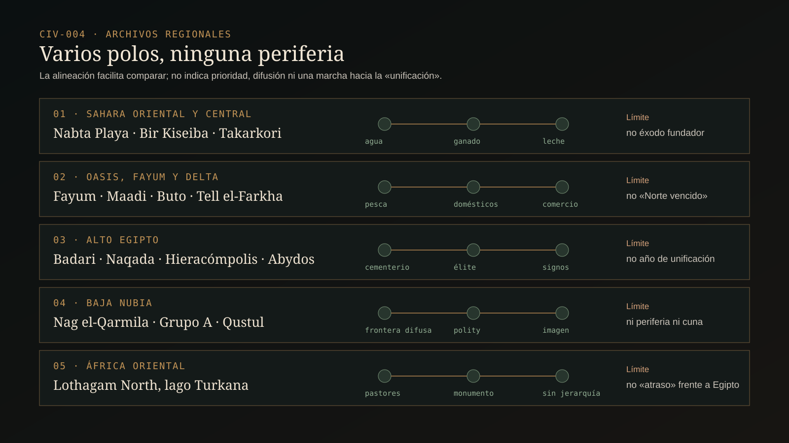
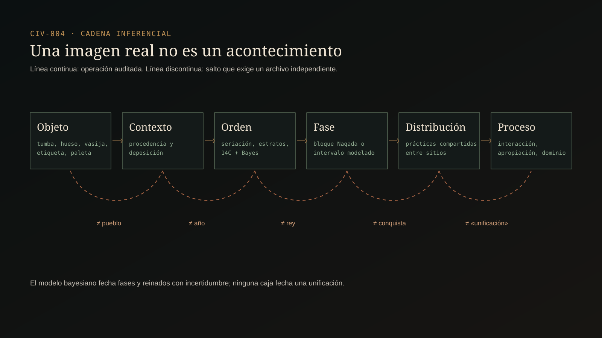

# Mapa epistemológico CIV-004 — Del objeto a la «unificación»

| Campo | Valor |
|---|---|
| ID | `MAP-CIV-NILE-001` |
| Investigación | `INV-CIV-NILE-001` |
| Estado | `AUDITADO` |
| Versión | `0.4.8` |





## 1. Grafo principal

```text
objeto / tumba / hueso / sedimento / genoma
                 │ procedencia + fecha (CIV-002)
                 ▼
            contexto local
                 │ seriación, estratigrafía o modelo
                 ▼
         fase o bloque cerámico
                 │ comparación entre sitios
                 ▼
     distribución regional de prácticas
                 │ mecanismo demostrado
                 ▼
   interacción, apropiación o dominio

Nunca por herencia:
fase → pueblo → reino → conquista → «unificación» en un año
imagen real → acontecimiento
tumba grande → rey → Estado
```

## 2. Seis archivos paralelos

| Archivo | Observación | Inferencia permitida | No heredado |
|---|---|---|---|
| agua y ocupación | fechas, playas, sedimentos lacustres | ocupación condicionada por fases húmedas | éxodo fundador, causa de la civilización |
| animales y leche | fauna, lípidos, genomas de bovinos | manejo, ordeña, domesticación por prueba | domesticación local temprana demostrada |
| cementerios | tumbas, ajuares, número de individuos | agregación, desigualdad funeraria | clase hereditaria, realeza |
| orden y tiempo | seriación, estratigrafía, `14C` + Bayes | bloques y límites de fase condicionados | fecha de unificación |
| polos de élite | Hieracómpolis, Abydos, Delta, Qustul | concentración y redes | un centro único que irradia |
| imágenes y signos | paletas, mazas, grabados, etiquetas | ideología, marcado, apropiación | crónica, burocracia territorial |

## 3. Cadena del Sahara al valle

```text
fechas sumadas + hidrología → ocupación por fases húmedas [B-REG]
fin del periodo húmedo por latitud → abandono escalonado [B-REG]
            ⇢ éxodo fundador hacia el Nilo [C, abierta]
            ⇢ «origen africano» o «origen climático» de la civilización: no operacional
```

## 4. Cadena del ganado

```text
Bos del IX–VIII milenio a. C. + ecología de Nabta
        ├─ lectura de la expedición: ganado doméstico local
        └─ reanálisis de 2018: uro cazado; domésticos desde mediados del VI milenio
genética de bovinos africanos → introgresión de uro posible, no fechada
                         ↓
           domesticación local temprana [C / disputada]
caprinos del VI milenio + leche en el V → pastoreo sin cereal [B-COND]
```

## 5. Cadena de Nabta Playa

```text
megalitos + túmulos + alineamientos         → arquitectura ritual de pastores [B]
orientación de piedras en posición original → hipótesis astronómica [C]
            ⇢ calendario, sacerdocio, Estado: no
            ⇢ origen del faraonismo: sin archivo intermedio [D]
```

## 6. Cadena del orden cerámico

```text
Petrie (tumbas, semejanza) ─┐
Kaiser / Hendrickx (Stufen) ─┼→ orden relativo
estratigrafía de Nekhen ─────┘        │
                                      ▼
            radiocarbono de vida corta + Bayes
                                      ▼
        bloques confirmados [B] · fases individuales [C]
                                      ▼
        Predinástico de 600–700 años; Aha 3218–3035 a. C. (95 %)
                 ⇢ soberanía o año de unificación: no
```

## 7. Cadena de la tumba al rey

```text
tumba grande + animales + ajuar exótico
                ↓
       élite funeraria local [B]
          ┌─────┼─────────┐
   líder ritual  grupo familiar  gobernante
          └─────┼─────────┘
  tumbas múltiples + trauma + sucesión + control regional
                ↓
      realeza mejor restringida
```

Sacrificio humano, dinastía y territorio quedan fuera sin restos y archivos que los prueben.

## 8. Cadena de la imagen al acontecimiento

```text
paleta / maza / grabado
      ↓ forma + contexto + repertorio visual
objeto ceremonial con ideología real [A-SEM/B]
      ⇢ batalla, conquista, fecha: no
etiquetas de U-j
      ↓ signos + tumba excepcional
marcado escrito temprano [A objeto]
      ⇢ burocracia territorial, alfabetización: no
```

## 9. Cadena de la Baja Nubia

```text
Nag el-Qarmila → frontera cultural difusa [B-LOCAL]
Grupo A        → polity con autoridad distribuida [B-COND]
Qustul L       → tumbas ricas con imágenes faraónicas [B archivo]
                 ⇢ prioridad nubia en la realeza [C, disputada]
                 ⇢ periferia pasiva de Egipto [rechazado]
```

## 10. Cadena de genomas

```text
Takarkori (2 genomas, ~7000 BP) → linaje norteafricano; pastoralismo por difusión cultural
Nuwayrat (1 genoma, 2855–2570 cal a. C.) → ~20 % Creciente Fértil oriental
              ↓
       contacto con personas [B-LOCAL-COND]
              ⇢ «los egipcios», etnia, raza, origen de la civilización: no
```

## 11. Estados del módulo público

| Estado | Significado |
|---|---|
| archivo | material o medición publicados |
| inferencia | conclusión máxima del caso |
| límite | salto no autorizado |
| tensión | evidencia o modelos favorecen alternativas distintas |
| faltante | el archivo necesario no está disponible |

«Faltante» no se renderiza como cero y «límite» no se confunde con evidencia contraria.

## 12. Reconciliación de claims

CIV-004 audita sus 22 claims propios. No promueve ningún claim de CIV-001, que permanece `TRAZADO`. Usa `CLAIM-CIV-EGYPT-CHRONOLOGY-002` y `CLAIM-CIV-DATING-CONTEXT-001` (CIV-002) como dependencias y reutiliza `EVID-SAHARA-PASTORAL-DAIRY-001` sin cambiar su estado.
