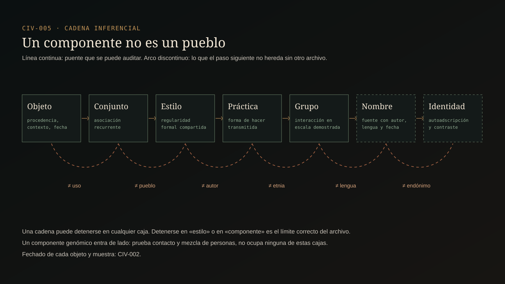
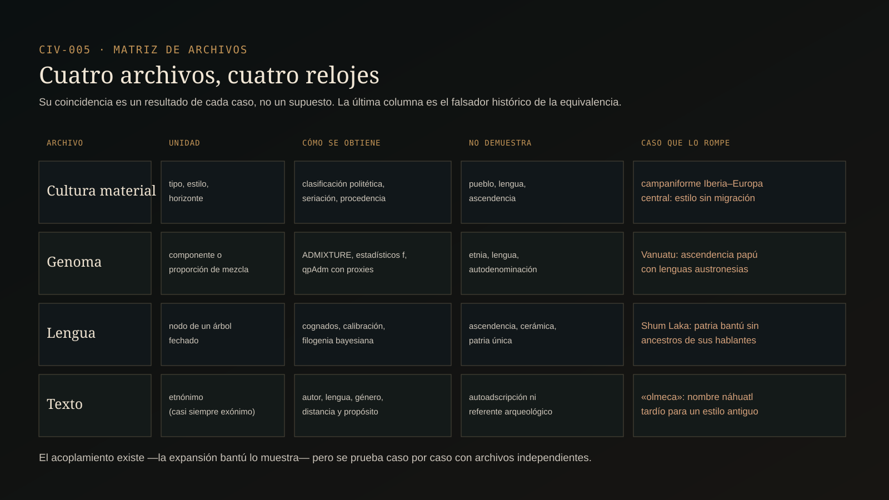

# Mapa epistemológico CIV-005 — Del objeto a la identidad

| Campo | Valor |
|---|---|
| ID | `MAP-CIV-IDENTITIES-001` |
| Investigación | `INV-CIV-IDENTITIES-001` |
| Estado | `AUDITADO` |
| Versión | `0.4.10` |





## 1. Ontología de siete niveles

```text
OBJETO ── procedencia + fecha (CIV-002) ──► CONJUNTO
                                              │ criterio de clasificación
                                              ▼
                                            ESTILO
                                              │ cadena operativa + contexto
                                              ▼
                                           PRÁCTICA
                                              │ escala de interacción
                                              ▼
                                            GRUPO
                                              │ fuente lingüística/textual/oral
                                              ▼
                                            NOMBRE
                                              │ autoadscripción + contraste
                                              ▼
                                          IDENTIDAD
```

Cada nodo tiene su falsador. La identidad no hereda la solidez de la clasificación ni la precisión del genoma.

## 2. Cuatro archivos, cuatro relojes

```text
cultura material ── tipos, pastas, prácticas ──► estilo / horizonte
genoma          ── genotipos + modelo + proxies ──► componente / mezcla
lengua          ── cognados + calibración ──► nodo de árbol fechado
texto           ── autor + lengua + propósito ──► etnónimo (casi siempre exónimo)
                         │
             covariación demostrada caso por caso
                         ▼
          desplazamiento conjunto o desacoplamiento
```

La flecha final nunca es automática (`EVID-CIV-IDENTITY-LAPITA-001`, `EVID-CIV-IDENTITY-BANTU-001`).

## 3. Qué es un componente de ancestría

```text
genotipos de individuos fechados
        + K elegido / fuentes y referencias declaradas
        ↓
ADMIXTURE: fracciones de K grupos hipotéticos
qpAdm: modelo de mezcla no rechazado + proporciones
        ↓
«afín a Yamnaya» = parecido a proxies excavados en sitios Yamnaya
        ⇢ lengua, etnia o nombre [NO]
```

Las pruebas de ajuste y las simulaciones (`EVID-CIV-IDENTITY-ADMIXTURE-METHODS-001`) delimitan cuándo el modelo es fiable; no cambian lo que mide.

## 4. Matriz de saltos prohibidos

| De | A | Puente necesario | Caso que lo rompe |
|---|---|---|---|
| tipo cerámico | pueblo | covariación con lengua/texto y escala social | campaniforme Iberia–Europa central |
| componente genómico | etnia | autoadscripción documentada | ninguno disponible en prehistoria |
| componente genómico | lengua | archivo lingüístico independiente fechado | Vanuatu |
| árbol lingüístico | migración masiva | genomas y cerámica con fechas compatibles | hogar indoeuropeo abierto |
| exónimo | endónimo | fuente del propio grupo | «olmeca», «celta» |
| exportación de estilo | dominio político | instituciones, tributo, control | «cultura madre» olmeca |
| patria lingüística | ascendencia de hablantes | ADN antiguo local ancestral | Shum Laka |

## 5. Caso campaniforme

```text
400 genomas (226 campaniformes)
   ├── Iberia ↔ Europa central: afinidad limitada → difusión sin migración entre ellas
   └── Gran Bretaña: ~90 % de reemplazo en pocos siglos → llegada de gente
                    ↓
   «campaniforme» = conjunto de prácticas [B-COND]
                    ⇢ «pueblo campaniforme» [NO]
```

## 6. Caso indoeuropeo

```text
genomas: sustitución esteparia en el III milenio a. C. [B]
filogenias: Anatolia (2012) / estepa (2015) / híbrido (2023)
ADN 2025: clina CLV, protoindoanatolio 4400–4000 a. C. (propuesta)
                    ↓
hogar y fecha de la familia [C / abierto]
```

Críticas: escala de la unidad que migra, vocabulario de pueblos y usos públicos (`EVID-CIV-IDENTITY-MIGRATION-CRITIQUE-001`). Adversario: hibridación cordada con lengua nueva (`EVID-CIV-IDENTITY-CORDED-HYBRID-001`).

## 7. Caso Lapita y austronesios

```text
lenguas austronesias desde Taiwán ~5230 años
Lapita temprano: ascendencia asiática oriental casi pura
Vanuatu ≥2300 BP: ascendencia papú 80–90 %
lenguas: siguen siendo austronesias
                    ↓
ascendencia y lengua desacopladas [B-COND]
```

## 8. Caso bantú

```text
lenguas (≈400, filogenia fechada) ─┐
cerámica (1149 fechas, 115 estilos) ┼─► convergencia fuerte, con colapso 400–600 d. C.
genomas (fundadores en serie + mezcla local) ─┘
Shum Laka: patria sin ancestros de los hablantes posteriores
                    ↓
desplazamiento conjunto en gran parte [B-COND]; estilo ≠ lengua
```

## 9. Caso olmeca

```text
química de pastas (725 muestras) → exportación desde San Lorenzo
petrografía (5 sitios)           → intercambio recíproco
             ↓
estilo compartido y circulante [B]
             ⇢ «cultura madre» / dominio [C / disputado]
             ⇢ «los olmecas» como endónimo [D]
```

## 10. Ética como parte de la cadena

```text
restos humanos ── muestreo destructivo ──► datos
     │                                   │
     └── comunidades descendientes, normas locales, plan de datos
                     ↓
pregunta, nombre del grupo y publicación condicionados
```

(`EVID-CIV-IDENTITY-ETHICS-001`)

## 11. Estados epistémicos del módulo público

| Estado | Significado |
|---|---|
| sostenido | el archivo del paso lo respalda con fuentes auditadas |
| condicionado | se sostiene bajo un modelo, muestreo o puente declarado |
| no demostrado | la cadena no llega; existe la pregunta |
| dato ausente | el archivo necesario no existe o no se ha recuperado |

«Dato ausente» nunca se representa como ausencia histórica del grupo ni como prueba contraria.

## 12. Reconciliación

CIV-005 audita sólo sus 20 claims. No cambia el estado de `CLAIM-CIV-SWASIA-NAMES-001` ni de `CLAIM-CIV-SWASIA-ANCESTRY-NOT-IDENTITY-001`, que CIV-003 ya auditó; los generaliza como protocolo para los expedientes regionales siguientes.
