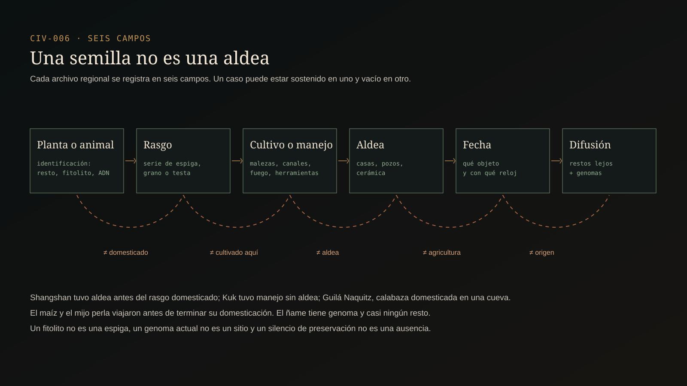
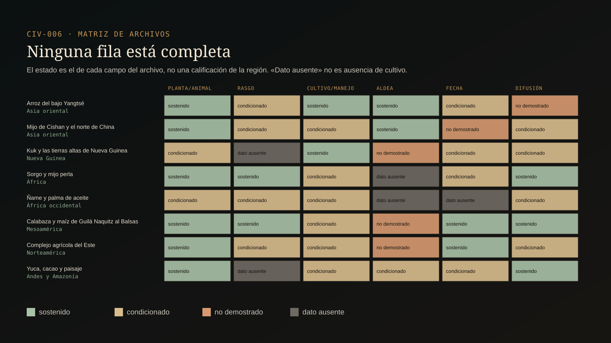

# Mapa epistemológico CIV-006 — Una semilla no es una aldea

| Campo | Valor |
|---|---|
| ID | `MAP-CIV-DOMESTICATIONS-001` |
| Investigación | `INV-CIV-DOMESTICATIONS-001` |
| Estado | `AUDITADO` |
| Versión | `0.4.18` |





## 1. Seis campos paralelos, no una escalera

```text
ORGANISMO ─── identificación (macrorresto, fitolito, almidón, ADN)
RASGO ─────── serie morfológica o genómica (espiguilla, grano, testa)
MANEJO ────── malezas, canales, fuego, herramientas, residuos
ALDEA ─────── casas, pozos, cerámica, cementerios
FECHA ─────── objeto fechado + método (CIV-002)
DIFUSIÓN ──── restos fechados lejos del origen + genomas
        ⇢ «origen de la agricultura», «centro», «pueblo agricultor» [NO se heredan]
```

Cada campo tiene su archivo y su falsador. Un caso puede estar sostenido en un campo y vacío en otro (`EVID-CIV-DOMREG-SIX-FIELDS-001`).

## 2. Qué fecha cada reloj

| Objeto fechado | Qué fecha | Error típico |
|---|---|---|
| semilla o mazorca (AMS) | muerte de esa pieza | inicio del cultivo regional |
| fitolito | carbono ocluido, con posible carbono del suelo | edad de la planta sin control |
| carbón de la capa | combustión asociada | edad del grano vecino |
| restos de grano descompuestos | material mezclado del pozo | fecha de la domesticación |
| sedimento con polen y microcarbón | depósito | intensidad de cultivo |
| modelo genómico actual | coalescencia o expansión de linajes supervivientes | fecha de un sitio |
| genoma humano fechado | individuo | difusión de la planta |

## 3. Arroz del bajo Yangtsé

```text
fitolitos 100 000 → 24 000 → 13 000 → 11 000 años   [C: proxy bulliforme + reloj disputado]
Shangshan 10–9 ka: aldea + arroz en vasijas          [B-LOCAL-COND]
Huxi 9000–8400 BP: espiguillas mezcladas             ┐
Kuahuqiao 8000–7700 BP: humedal manejado             ├─► selección lenta del no desprendimiento [B]
Tianluoshan 6.9–6.6 ka: 27 % → 39 %                  ┘
genomas actuales: japonica en el Perla               [C / abierto]
```

(`EVID-CIV-DOMREG-SHANGSHAN-001`, `EVID-CIV-DOMREG-PHYTOLITH-DATING-001`, `EVID-CIV-DOMREG-RICE-RACHIS-001`, `EVID-CIV-DOMREG-KUAHUQIAO-001`, `EVID-CIV-DOMREG-RICE-GENOMES-001`)

## 4. Mijo del norte de China

```text
Cishan: fitolito de cascarilla → especie (mijo común)   [B]
        restos de grano 10.3–8.7 ka vs carbón ~7.3 ka 14C   [C fecha]
        cascarilla ≠ rasgo domesticado                      [C estado]
serie de 43 sitios: ventana 7000–3300 a. C.               [B-COND]
Donghulin 11 000–7300 años: continuidad de personas       [B-COND] ⇢ fecha del rasgo [NO]
```

(`EVID-CIV-DOMREG-CISHAN-001`, `EVID-CIV-DOMREG-MILLET-SERIES-001`)

## 5. Kuk y Nueva Guinea

```text
fase 1 ~10 ka: manejo del humedal [B-COND] ── cultivo [C, reevaluado 2026]
almidones: taro + kudzu ── taro ≈ ñame (indistinguibles) → identificación por contexto
fase 2 6.95–6.44 ka: montículos
banano: geodomesticación por etapas hacia el oeste
Waim 5050–4200 años: objetos [B]; «Neolítico» [rótulo]
```

(`EVID-CIV-DOMREG-KUK-001`, `EVID-CIV-DOMREG-NG-BANANA-WAIM-001`)

## 6. África

```text
ganado de Nabta ──────────────► CIV-004 (no se repite)
sorgo: KG23 mezcla + archaeogenomas sin cuello de botella   [B-LOCAL]
mijo perla: Tilemsi + genomas (Sahara occidental) + Indo ~2500 a. C.   [B-COND]
ñame: genoma sí ── depósito casi mudo     [D fecha arqueológica]
palma: uso en abrigos Kintampo ── rasgo no medido
        silencio de preservación ≠ ausencia de cultivo
```

(`EVID-CIV-DOMREG-AFRICA-CEREALS-001`, `EVID-CIV-DOMREG-TUBER-PALM-001`)

## 7. Mesoamérica

```text
Guilá Naquitz: calabaza ~10–8 ka ─┐
               maíz ~6250 años     ├─► dos relojes en una cueva; ninguna aldea
Xihuatoxtla: maíz ≥8.7 ka (microrrestos) ┘
maíz: domesticación única (2002) → mezcla con mexicana ~4000 años después (2023)
      → domesticado parcial en Sudamérica → retornos (El Gigante)
cultivo (Tehuacán) ≠ intensificación (siglos después)
```

(`EVID-CIV-DOMREG-GUILA-BALSAS-001`, `EVID-CIV-DOMREG-MAIZE-GENOMES-001`)

## 8. Este de Norteamérica

```text
cuatro especies independientes (2006) + Riverton 3800 BP (2009)   [B]
testa delgada: 1–3 % supuesto → 15–34 % y 50 % medido (2023)        → diagnóstico [C]
mosca del tupinambo 6850–2700 años: expansión modelada            [C indirecto]
```

(`EVID-CIV-DOMREG-EAC-001`, `EVID-CIV-DOMREG-GOOSEFOOT-PLASTICITY-001`)

## 9. Andes y Amazonía

```text
yuca: genoma (borde sur) + Moxos + Teotonio          [B-COND]
cacao SALF ~5300 años: almidón + teobromina + ADN    [B-COND] ⇢ rasgo [dato ausente]
paisaje domesticado: Levis/Clement local [B] ── McMichael interfluvios [adversario]
        ⇢ toda la cuenca [C]
```

(`EVID-CIV-DOMREG-CACAO-MANIOC-001`, `EVID-CIV-DOMREG-AMAZON-LANDSCAPE-001`)

## 10. Matriz de saltos prohibidos

| De | A | Puente necesario | Caso que lo rompe |
|---|---|---|---|
| fitolito bulliforme | población domesticada | serie de espiguillas en el mismo contexto | Shangshan frente a Huxi y Tianluoshan |
| fecha de fitolito | edad de la planta | pareado con semilla de vida corta | crítica del carbono del suelo |
| especie identificada | especie domesticada | rasgo medido | Cishan |
| aldea | agricultura | rasgo y dieta | Shangshan |
| cultivo | aldea | arquitectura y residencia | Kuk, Xihuatoxtla |
| genoma actual | lugar del primer cultivo | genomas antiguos fechados | arroz del Perla |
| ausencia de restos | ausencia de cultivo | probabilidad de preservación | ñame |
| rasgo morfológico | rasgo genético | control de plasticidad | testa del quenopodio |
| paisaje de un sitio | paisaje de la cuenca | muestreo aleatorio | interfluvios amazónicos |
| fecha más antigua | centro | archivo de difusión | Kuk, Cishan y Shangshan casi coetáneos |

## 11. Estados epistémicos del módulo público

| Estado | Significado |
|---|---|
| sostenido | el archivo del campo lo respalda con fuentes auditadas |
| condicionado | se sostiene bajo un proxy, modelo o muestreo declarado |
| no demostrado | la pregunta existe y el archivo no llega |
| dato ausente | el archivo necesario no existe o no se ha recuperado |

«Dato ausente» nunca se representa como ausencia de cultivo ni como prueba contraria.

## 12. Reconciliación

CIV-006 audita sus 24 claims y promueve a `AUDITADO` tres claims exactos de CIV-001: `CLAIM-CIV-DOMESTICATION-MULTIREGIONAL-001`, `CLAIM-CIV-GUILA-CUCURBITA-001` y `CLAIM-CIV-RICE-TRAJECTORY-001`. Deja `CLAIM-CIV-KUK-CULTIVATION-001` en `TRAZADO` porque la fase 1 de Kuk está en reevaluación (`SRC-DENHAM-KUK-REASSESS-2026`). No cambia el estado de ningún claim de 050, CIV-003, CIV-004 ni CIV-005; cita `CLAIM-CIV-NILE-CATTLE-DEBATE-001` sin repetirlo. CIV-001 sigue `TRAZADO`.
