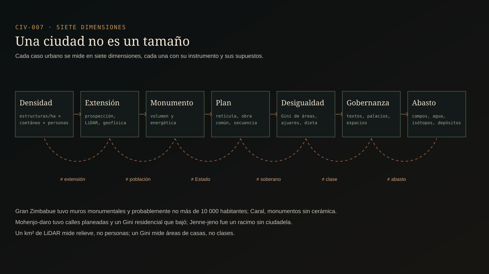
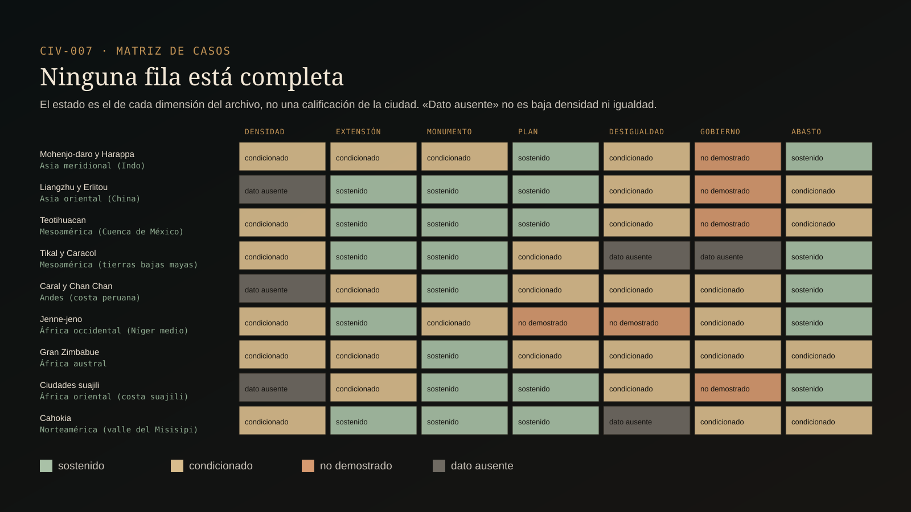

# Mapa epistemológico CIV-007 — Una ciudad no es un tamaño

| Campo | Valor |
|---|---|
| ID | `MAP-CIV-URBANISMS-001` |
| Investigación | `INV-CIV-URBANISMS-001` |
| Estado | `AUDITADO` |
| Versión | `0.4.21` |





## 1. Siete dimensiones paralelas, no una lista de requisitos

```text
DENSIDAD ──────── estructuras/ha × residencial × coetáneo × personas
EXTENSIÓN ─────── prospección, LiDAR, geofísica, muros (por fase)
MONUMENTALIDAD ── volumen y energética (personas × días)
PLANIFICACIÓN ─── retícula, orientación, infraestructura común, secuencia
DESIGUALDAD ───── Gini de áreas, ajuares, dieta, acceso
GOBERNANZA ────── textos, iconografía, palacios, espacios de reunión
ABASTECIMIENTO ── campos, agua, fauna, isótopos, depósitos
        ⇢ «ciudad», «Estado», «clase dirigente», «colapso» [NO se heredan]
```

(`EVID-CIV-URBCOMP-METHOD-001`, `EVID-CIV-URBCOMP-SYNTHESIS-001`)

## 2. Qué mide cada instrumento

| Instrumento | Mide | Error típico |
|---|---|---|
| prospección de superficie | material visible por área | superficie = ocupación simultánea |
| LiDAR | relieve bajo el dosel | estructura = casa habitada al mismo tiempo |
| geofísica | anomalías enterradas | forma de casa = fecha exacta |
| química del suelo | uso de espacios abiertos | espacio público = control político |
| estimación demográfica | producto de supuestos | cifra = conteo |
| Gini residencial | concentración de áreas | área = riqueza total o clase |
| estroncio | lugar de infancia | migrante = etnia |
| energética | trabajo bajo tasa supuesta | volumen = coerción |
| estanoles fecales | tendencia relativa de población | tendencia = número |

## 3. Indo

```text
>700 pozos + drenajes (Mohenjo-daro) ─── planificación e infraestructura   [B]
oficios 3300–1700 a. C. (Harappa)    ─── especialización                   [B]
Gini 0.44; 0.39 → 0.23 (2026)         ─── desigualdad moderada, decreciente [B-COND / C]
sin palacios ni tumbas reales         ─── ¿igualdad o archivo incompleto?   [C]
```

(`EVID-CIV-URBCOMP-INDUS-001`, `EVID-CIV-URBCOMP-MOHENJO-GINI-001`)

## 4. China

```text
Liangzhu ~300 ha + presas 5200–4800 cal BP + 2.88 M m³   [B]
         palacio «probable» → Estado «posible»            [C]
         megasequías/inundaciones 4300–4000               [B-COND correlación]
Erlitou: secuencia ⇢ Xia/Shang textuales                  [NO se heredan]
```

(`EVID-CIV-URBCOMP-LIANGZHU-001`, `EVID-CIV-URBCOMP-ERLITOU-001`)

## 5. Mesoamérica

```text
Teotihuacan: >2000 conjuntos; ~100 000; trabajo estatal + comunal   [B-COND]
             estroncio: nacidos fuera; barrios oaxaqueños y del Golfo [B-COND]
             gobierno colectivo: modelo de viabilidad + comparación   [C]
Tikal/Caracol: LiDAR 200 km²; terrazas 5–30 cm; baja densidad        [B]
             7–11 M (2018) → 9.5–16 M (2025): cambia el muestreo      [C]
```

(`EVID-CIV-URBCOMP-TEOTIHUACAN-001`, `EVID-CIV-URBCOMP-TEOTIHUACAN-GOV-001`, `EVID-CIV-URBCOMP-MAYA-LIDAR-001`, `EVID-CIV-URBCOMP-POPULATION-001`)

## 6. Andes

```text
Caral 2627–1977 cal a. C.: monumentos sin cerámica; núcleo 65 ha     [B]
Supe: pesca + huertos irrigados + algodón                           [B]
radar 2026: candidatos                                              [C, sin campo]
Chan Chan: depósitos medidos tras audiencias                        [B-LOCAL]
```

(`EVID-CIV-URBCOMP-ANDES-001`)

## 7. África

```text
Jenne-jeno: >33 ha + ~70 montículos; sin ciudadela      [B archivo; C heterarquía]
Gran Zimbabue: 20 000 → ≤10 000; Khami coexistente      [B-COND]
suajili: maritimidad tardía; espacios públicos; ADN      [B-COND] ⇢ identidad [NO]
```

(`EVID-CIV-URBCOMP-JENNE-001`, `EVID-CIV-URBCOMP-ZIMBABWE-SWAHILI-001`)

## 8. Norteamérica

```text
Cahokia 1050–1100: planificación súbita; 1/3 no locales      [B-COND]
        1150: empalizada; crecida; menos lluvia de verano     [B-COND correlación]
        1200: −50 %; 1350: abandono                          [B-COND tendencia]
        ecocidio por tala                                     [refutado en un montículo]
        escala: ciudad grande o centro moderado               [C]
```

(`EVID-CIV-URBCOMP-CAHOKIA-001`)

## 9. Adversario

```text
Childe/Smith: definir antes de comparar  ──► aceptado como exigencia de medida
Escalamiento: área ∝ población^β, ley común ──► aceptado donde se probó;
              baja densidad y monumentalidad modesta lo ponen a prueba;
              si la población se estimó desde el área, la ley se confirma por construcción
```

(`EVID-CIV-URBCOMP-SCALING-001`)

## 10. Matriz de saltos prohibidos

| De | A | Puente necesario | Caso que lo rompe |
|---|---|---|---|
| tamaño del sitio | ciudad | dimensiones medidas por separado | Gran Zimbabue |
| superficie | población | coetaneidad y fracción residencial | Gran Zimbabue, mayas |
| estructuras LiDAR | casas coetáneas | excavación de muestra | Caracol |
| monumento | megaciudad o Estado | población y archivo político independientes | Caral, Gran Zimbabue |
| retícula | soberano | secuencia constructiva y trabajo | Teotihuacan (trabajo mixto) |
| ausencia de palacio | igualdad | archivo de riqueza y decisión | Indo |
| Gini bajo | gobierno igualador | fases fechadas por contexto | Mohenjo-daro |
| estroncio no local | etnia | práctica, lengua y autodenominación | Teotihuacan, Cahokia |
| ADN mezclado | identidad suajili | historia cultural y lingüística | costa suajili |
| baja densidad | ciudad fallida | criterios de forma, no de compacidad | tierras bajas mayas |
| crecida o sequía | colapso | mecanismo y casos control | Cahokia, Liangzhu |

## 11. Estados epistémicos del módulo público

| Estado | Significado |
|---|---|
| sostenido | el archivo de la dimensión lo respalda con fuentes auditadas |
| condicionado | se sostiene bajo un proxy, modelo o muestreo declarado |
| no demostrado | la pregunta existe y el archivo no llega |
| dato ausente | el archivo necesario no existe, no se preservó o no se auditó aquí |

«Dato ausente» nunca se lee como «baja densidad», «igualdad» o «sin gobierno».

## 12. Reconciliación

CIV-007 audita sus 25 claims. Cita sin cambiar su estado `CLAIM-CIV-SWASIA-SOUTH-LANDSCAPE-001`, `CLAIM-CIV-SWASIA-URBAN-HINTERLAND-001` (CIV-003), `CLAIM-URBANISM-STATE-SEPARATE-001` y `CLAIM-AFRICA-URBANISM-POLYCENTRIC-001` (051). Corrige a `63` los sitios de `CLAIM-CIV-INEQUALITY-PROXY-001` (CIV-001, `TRAZADO`), que decía «64» frente al texto de Kohler et al.; no lo promueve. CIV-001 sigue `TRAZADO`.
