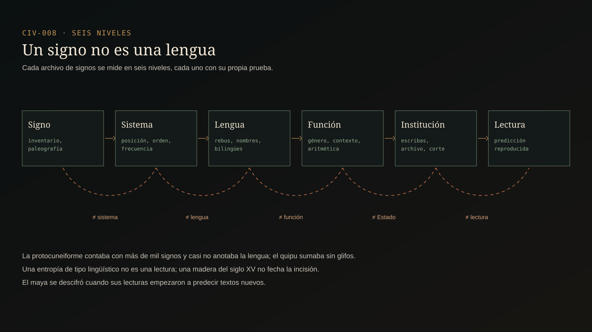
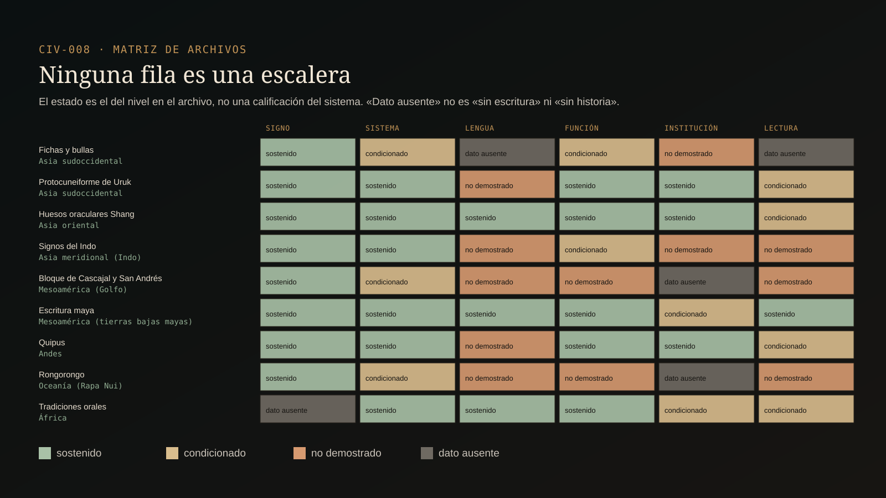

# Mapa epistemológico CIV-008 — Un signo no es una lengua

| Campo | Valor |
|---|---|
| ID | `MAP-CIV-SCRIPTS-001` |
| Investigación | `INV-CIV-SCRIPTS-001` |
| Estado | `AUDITADO` |
| Versión | `0.4.23` |





## 1. Seis niveles paralelos, no una escalera

```text
SIGNO ────────── marcas convencionales repetidas (inventario, paleografía)
SISTEMA ──────── reglas de combinación (posición, frecuencia, orden)
LENGUA ───────── rebus, complementos, nombres propios, bilingües, predicción
FUNCIÓN ──────── género, contexto, aritmética interna
INSTITUCIÓN ──── escribas, archivos, cortes, administración
DESCIFRAMIENTO ─ lecturas reproducidas por equipos independientes
        ⇢ «alfabetización», «civilización letrada», «mente letrada» [NO se heredan]
```

(`EVID-CIV-SCRIPTS-METHOD-001`, `EVID-CIV-SCRIPTS-SYNTHESIS-001`)

## 2. Qué prueba cada instrumento

| Instrumento | Prueba | Error típico |
|---|---|---|
| inventario de signos | que hay signos | signo = texto |
| concordancia y frecuencia | que hay sistema | sistema = lengua |
| entropía y repetición | parecido estadístico con clases calibradas | clasificación = lectura |
| valores fonéticos y nombres | lengua codificada | lengua candidata = lengua de los usuarios |
| aritmética interna | función contable | contable = sin otros usos |
| `14C` del soporte | edad de la madera o el hueso | soporte = inscripción |
| crítica de variantes orales | estructura y secuencia relativa | tradición = grabación fija |
| prueba cognitiva comparada | efecto de una práctica | escritura = otra mente |

## 3. Asia sudoccidental

```text
fichas X milenio cal a. C.; ~3000 objetos, 56 sitios   ─── multifuncionales      [B]
ficha → bulla → tablilla impresa                     ─── numerales sí          [C para el resto]
protocuneiforme ~6000 textos; 1617 signos (≈600 sin variantes) ─── contabilidad [B]
                 fonetismo escaso; sumerio probable              ─── lengua   [C]
elamita lineal 2022                                  ─── desciframiento propuesto [C]
```

(`EVID-CIV-SCRIPTS-TOKENS-001`, `EVID-CIV-SCRIPTS-PROTOCUNEIFORM-001`, `EVID-CIV-SCRIPTS-ELAMITE-001`)

## 4. China e Indo

```text
huesos oraculares: adivinación regia; glotográficos; hasta ~1041 cal a. C.   [B]
marcas neolíticas → escritura Shang                                          [C]
Indo: 2905 objetos; media 4.6; máx. 17                                        [B]
      entropía de tipo lingüístico (2009) ⇄ reclasificado no lingüístico (2014) [clasifica, no lee]
      lengua                                                                  [D]
```

(`EVID-CIV-SCRIPTS-SHANG-001`, `EVID-CIV-SCRIPTS-INDUS-001`, `EVID-CIV-SCRIPTS-STATISTICS-001`)

## 5. Mesoamérica

```text
Cascajal: 62 signos (28 distintos); fecha estilística; sin estratigrafía      [C]
San Andrés ~650 a. C.: calendario de 260 días                                [B-COND; C habla]
San Bartolo 300–200 a. C.: «7 Venado»; varias manos                          [B]
Knorozov + Proskouriakoff → lecturas que predicen textos nuevos              [A-MET]
```

(`EVID-CIV-SCRIPTS-OLMEC-001`, `EVID-CIV-SCRIPTS-MAYA-001`)

## 6. Andes y Oceanía

```text
quipus: ≥74 % de 650 con sumas                       [B]
        1670: 132 tributarios ⇄ 133 grupos           [B-COND; C nombres]
        Collata: 95 combinaciones                    ─► ¿logosilabario? [D]
rongorongo: madera del siglo XV en una tablilla      [B-COND] ⇢ invención antes del contacto [C]
            nombres propios en un texto (2025)       [C]; contenido [D]
```

(`EVID-CIV-SCRIPTS-KHIPU-001`, `EVID-CIV-SCRIPTS-RONGORONGO-001`)

## 7. Oralidad

```text
Vansina: variantes, género, cadena, cronología   ─── método            [B-MET]
Henige 1974: cronologías comprimidas             ─── límite            [B]
Nunn y Reid: 21 lugares, >7000 años               ⇄ Henige 2009: sin cadena verificable  [C]
```

(`EVID-CIV-SCRIPTS-ORAL-001`)

## 8. Adversario

```text
definición estrecha (DeFrancis, Farmer et al.) ──► aceptada como clasificación, no como escala
Gran División (Goody y Watt, Ong) ──► predicción: letrados no escolarizados = escolarizados
                                      vai (Scribner y Cole): no ──► refutada en forma fuerte
```

(`EVID-CIV-SCRIPTS-DIVIDE-001`)

## 9. Matriz de saltos prohibidos

| De | A | Puente necesario | Caso que lo rompe |
|---|---|---|---|
| signo | texto | sistema con reglas | marcas neolíticas chinas |
| sistema | lengua | prueba fonética o predictiva | Indo, quipus |
| estadística | lengua | calibración y lectura | Indo, pictos |
| ficha | signo cuneiforme | serie fechada de derivación | signos no numéricos |
| fecha del soporte | fecha de la inscripción | fecha de la incisión | rongorongo |
| pieza única | sistema de escritura | segundo texto en contexto | Cascajal |
| propuesta | desciframiento | lecturas reproducidas | elamita lineal |
| sin escritura | sin historia ni archivo | crítica de fuentes orales y notaciones | quipus, tradición oral |
| escritura | mente distinta | prueba que separe escolarización | vai |

## 10. Estados epistémicos del módulo público

| Estado | Significado |
|---|---|
| sostenido | el archivo del nivel lo respalda con fuentes auditadas |
| condicionado | se sostiene bajo un contexto, una muestra o una lectura declarados |
| no demostrado | la pregunta existe y el archivo no llega |
| dato ausente | el archivo necesario no existe, no se preservó, no aplica o no se auditó aquí |

«Dato ausente» nunca se lee como «sin escritura», «sin lengua» ni «sin historia».

## 11. Reconciliación

CIV-008 audita sus 26 claims. Cita sin cambiar su estado `CLAIM-CIV-WRITING-ADMIN-001` (CIV-001), `CLAIM-CIV-NILE-UJ-WRITING-001` (CIV-004), `CLAIM-WRITING-NOT-STATE-REQUIREMENT-001` (051), `CLAIM-CIVILIZATIONS-INDUS-UNDECIPHERED-001`, `CLAIM-CIVILIZATIONS-CHINA-NAME-LIMIT-001` y `CLAIM-CIVILIZATIONS-ANDES-ORALITY-001` (052). CIV-001 sigue `TRAZADO`.
