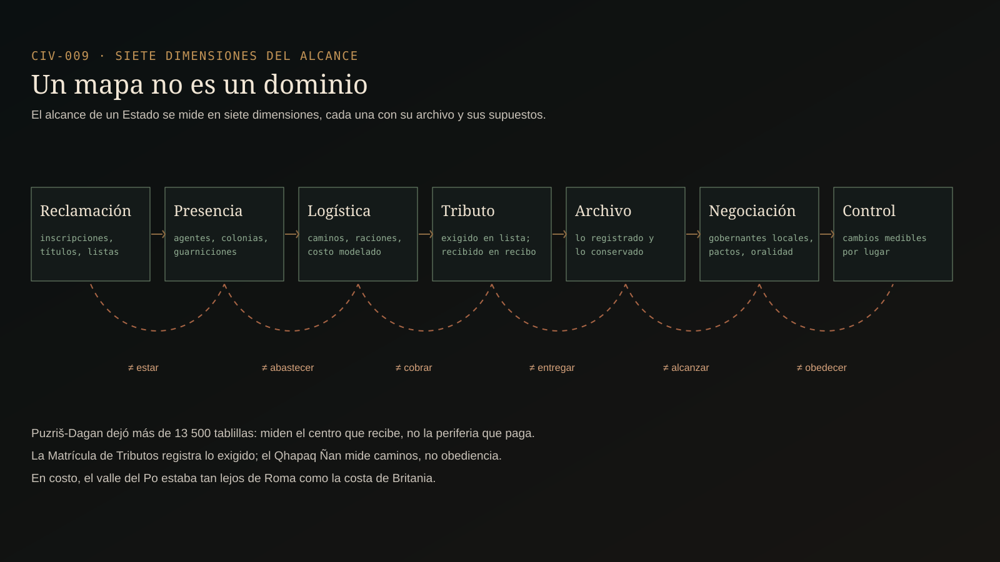
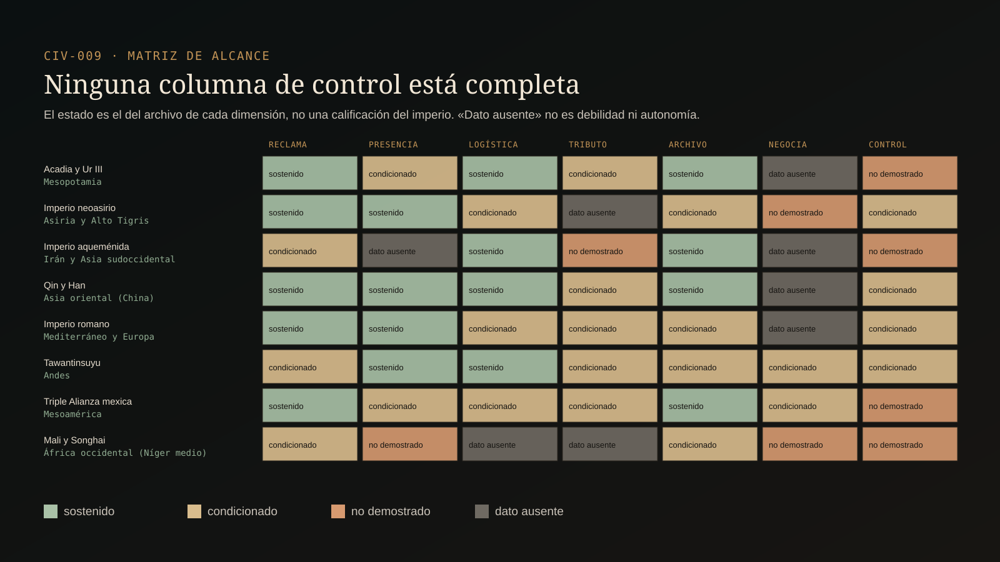

# Mapa epistemológico CIV-009 — Un mapa no es un dominio

| Campo | Valor |
|---|---|
| ID | `MAP-CIV-EMPIRES-001` |
| Investigación | `INV-CIV-EMPIRES-001` |
| Estado | `AUDITADO` |
| Versión | `0.4.24` |





## 1. Siete dimensiones paralelas, no una escalera de poder

```text
RECLAMACIÓN ──── inscripciones, títulos, listas, crónicas
PRESENCIA ────── agentes, colonias, guarniciones, asentamientos nuevos
LOGÍSTICA ────── caminos, depósitos, raciones, costo modelado
TRIBUTO ──────── lo exigido (lista) / lo recibido (recibo)
ARCHIVO ──────── lo registrado y lo que sobrevivió
NEGOCIACIÓN ──── gobernantes locales, pactos, tradición oral
CONTROL ──────── cambios medibles que responden al centro, por lugar
        ⇢ «el imperio dominaba todo su mapa» [NO se hereda]
```

(`EVID-CIV-EMPREACH-METHOD-001`, `EVID-CIV-EMPREACH-SYNTHESIS-001`)

## 2. Qué mide cada instrumento

| Instrumento | Mide | Error típico |
|---|---|---|
| inscripción real | reclamación del centro | proclama = conteo o dominio |
| lista de tributo | exigencia | exigido = entregado |
| archivo administrativo | registro conservado | densidad de archivo = intensidad de control |
| prospección provincial | cambios de poblamiento | colonia = obediencia de la región |
| red vial | capacidad de movimiento | camino = control |
| modelo de costo (ORBIS) | costo promedio estructural | modelo = viaje real |
| isótopos | lugar de infancia | no local = deportado |
| khipu leído contra padrón | número de tributarios | número = categoría social |
| tradición oral y crónica tardía | memoria y composición posterior | crónica = acta contemporánea |

## 3. Mesopotamia

```text
Acadia: gobernadores acadios en tierras conquistadas    [B-COND] ⇢ «primer imperio» [C]
Ur III: >13 500 tablillas de Puzriš-Dagan                [B]
        gun mada (periferia) ≠ bala (núcleo)               [B, vía Tsouparopoulou]
Asiria: colonias + amortiguamiento + discontinuidad        [B-COND]
        millones de deportados                             [NO auditado]
```

(`EVID-CIV-EMPREACH-MESOPOTAMIA-001`, `EVID-CIV-EMPREACH-ASSYRIA-001`)

## 4. Persia y China

```text
Persépolis: 2087 textos; raciones a viajeros con sello   [B]
            red de caminos + pirradaziš                   [B-COND potencial] ⇢ control [C]
Liye: archivo de un condado; logística, convictos, multas [B]; >36 000 piezas [no verificado]
Qin–Han: migración inducida; Guanzhong                    [B-COND]
```

(`EVID-CIV-EMPREACH-PERSIA-001`, `EVID-CIV-EMPREACH-QINHAN-001`)

## 5. Roma

```text
ORBIS: ~750 sitios; ~85 000 km caminos; 900 rutas; 1:5/10:52      [B-COND]
       Po ≈ Britania en costo a Roma (verano)                     [B-COND]
       Germania, Mesopotamia, Danubio medio: remotos; Dacia abandonada [B-COND]
Egipto: ~300 declaraciones censales, 12–259 d. C.                 [B, una provincia]
limes: ¿gran estrategia o ejército de ocupación?                  [C]
```

(`EVID-CIV-EMPREACH-ORBIS-001`, `EVID-CIV-EMPREACH-ROME-001`)

## 6. Andes

```text
Qhapaq Ñan >30 000 km; 273 componentes (2014)          [B] ⇢ control [NO]
khipus: 133 grupos ↔ 132 tributarios (1670)            [B-COND, claim de CIV-008]
KH0631: autor de dieta común                            [B-LOCAL]
Machu Picchu: orígenes diversos; Acarí: reubicación     [B-COND]
```

(`EVID-CIV-EMPREACH-KHIPU-001`, `EVID-CIV-EMPREACH-INKA-001`)

## 7. Mesoamérica

```text
Matrícula (≥6 pintores) → Códice Mendoza c. 1542 (1 pintor)   [B]
38 provincias tributarias + provincias estratégicas            [B-COND]
lo exigido ⇢ lo entregado                                       [NO se hereda]
cargadores: límite de radio sí; distancia depende de supuestos  [B-COND / C]
```

(`EVID-CIV-EMPREACH-MEXICA-001`, `EVID-CIV-EMPREACH-TRANSPORT-001`)

## 8. África occidental

```text
fuentes árabes externas; tradición de Sunjata; sedes móviles  [B-COND]
Niani ≠ capital del siglo XIV                                  [B]
Tārīkh al-fattāsh = XVII + XIX                                 [B]
Gao: residencia real del siglo X; ciudades gemelas             [B]
control efectivo                                               [no demostrado]
```

(`EVID-CIV-EMPREACH-WESTAFRICA-001`)

## 9. Adversarios

```text
Mann: despótico alto, infraestructural bajo ──► aceptado como hipótesis contrastable
Colburn / Liye / khipus: más infraestructura ──► aceptado como capacidad; capacidad ≠ control
Luttwak: gran estrategia y fronteras ──► rechazado con Isaac y la discontinuidad asiria
Scott: huida deliberada ──► aceptado como hipótesis; rechazado como regla (Lieberman, Acarí, Guanzhong)
ORBIS: costo modelado ──► aceptado con sus límites declarados
```

(`EVID-CIV-EMPREACH-UNGOVERNED-001`, `EVID-CIV-EMPREACH-ORBIS-001`)

## 10. Matriz de saltos prohibidos

| De | A | Puente necesario | Caso que lo rompe |
|---|---|---|---|
| frontera máxima | control | presencia y efectos por lugar | Asiria (discontinuo) |
| inscripción | conteo | archivo independiente | deportaciones neoasirias |
| archivo denso | Estado fuerte en todo el territorio | archivos provinciales | Drehem, Persépolis, Liye |
| lista de tributo | tributo entregado | recibos | Matrícula |
| camino | control | efectos en poblamiento | Qhapaq Ñan |
| distancia en línea recta | costo | modelo de transporte | ORBIS (Po y Britania) |
| limes | borde del control | funciones internas del ejército | Oriente romano |
| gobernante local | autonomía | condiciones del pacto | provincias mexicas |
| incorporación pacífica | poca interferencia | arqueología del poblamiento | Acarí |
| crónica | acta contemporánea | crítica de manuscritos | *Tārīkh al-fattāsh* |

## 11. Estados epistémicos del módulo público

| Estado | Significado |
|---|---|
| sostenido | el archivo de la dimensión lo respalda con fuentes auditadas |
| condicionado | se sostiene bajo un modelo, una muestra o un caso regional declarado |
| no demostrado | la pregunta existe y el archivo no llega |
| dato ausente | el archivo necesario no existe, no se preservó o no se auditó aquí |

«Dato ausente» nunca se lee como «Estado débil», «autonomía local» o «huida».

## 12. Reconciliación

CIV-009 audita sus 27 claims. Cita sin cambiar su estado `CLAIM-CITIES-STATES-SCOPE-001`, `CLAIM-URBANISM-STATE-SEPARATE-001`, `CLAIM-WRITING-NOT-STATE-REQUIREMENT-001`, `CLAIM-COLLAPSE-TRANSFORMATION-001` (051), `CLAIM-CIVILIZATIONS-ANDES-ORALITY-001` (052) `CLAIM-CIV-URBCOMP-SEVEN-DIMENSIONS-001` (CIV-007) y `CLAIM-CIV-SCRIPTS-KHIPU-ACCOUNTING-001` y `CLAIM-CIV-SCRIPTS-KHIPU-CENSUS-001` (CIV-008). Usa los archivos como instrumentos de medida del alcance y deja su estudio como notaciones a CIV-008 (`INV-CIV-SCRIPTS-001`). CIV-001 sigue `TRAZADO`.
