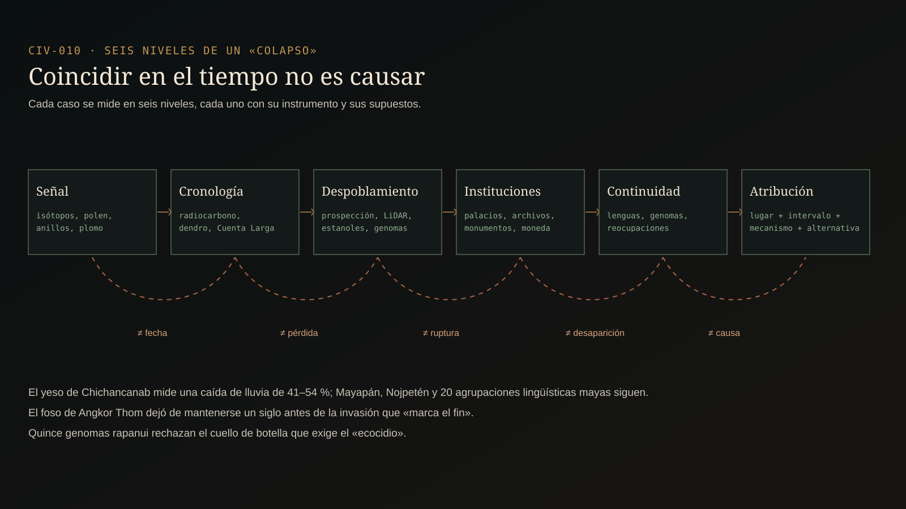
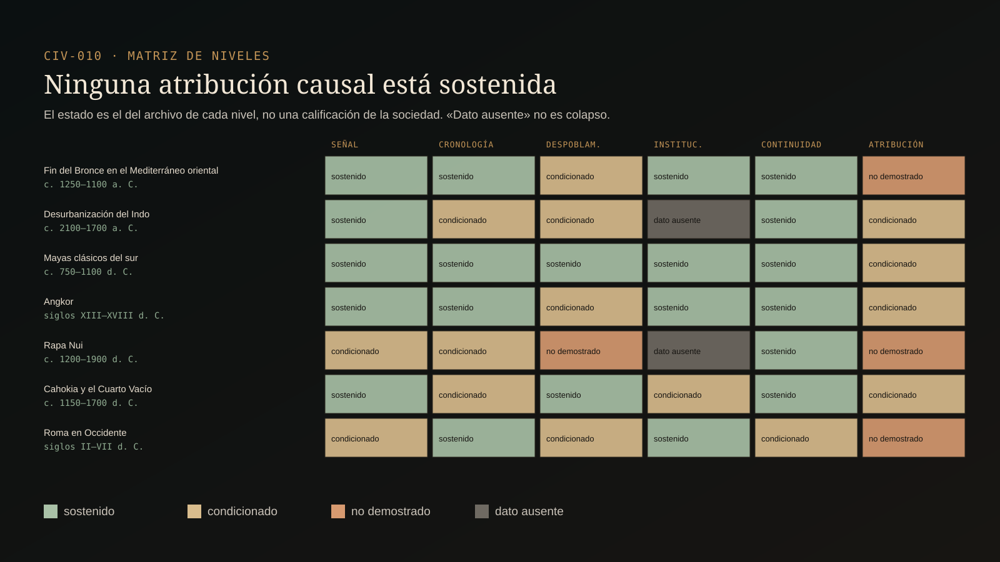

# Mapa epistemológico CIV-010 — Lo que se rompe y lo que sigue

| Campo | Valor |
|---|---|
| ID | `MAP-CIV-TRANSFORMATIONS-001` |
| Investigación | `INV-CIV-TRANSFORMATIONS-001` |
| Estado | `AUDITADO` |
| Versión | `0.4.25` |





## 1. Seis niveles paralelos, no una secuencia causal

```text
SEÑAL ─────────── isótopos, polen, titanio, anillos, estanoles, plomo en hielo
CRONOLOGÍA ────── radiocarbono calibrado y modelado, dendrocronología, Cuenta Larga
DESPOBLAMIENTO ── prospección, LiDAR, SPD, estanoles, genomas
INSTITUCIONES ─── palacios, archivos, monumentos fechados, moneda, redes
CONTINUIDAD ───── genomas, lenguas, reocupaciones, crónicas posteriores
ATRIBUCIÓN ────── lugar + intervalo + mecanismo + alternativa descartada
        ⇢ «la civilización colapsó por X» [NO se hereda]
```

(`EVID-CIV-TRANSFORM-METHOD-001`, `EVID-CIV-TRANSFORM-SYNTHESIS-001`)

## 2. Qué mide cada instrumento

| Instrumento | Mide | Error típico |
|---|---|---|
| núcleo lacustre o marino | clima de su cuenca | proxy lejano = clima del sitio |
| anillos de árbol | lluvia o temperatura anual de su bosque | año seco = año del colapso |
| radiocarbono | edad de una muestra | solapamiento = simultaneidad |
| fecha de Cuenta Larga | acto de una corte | fin de monumentos = fin de la gente |
| prospección y LiDAR | estructuras visibles | estructuras = habitantes coetáneos |
| estanoles fecales | tendencia relativa de población | tendencia = cifra |
| genoma antiguo | linajes y tamaño efectivo | tamaño efectivo = censo |
| plomo en hielo | emisiones de minería y fundición | plomo = PIB |
| cerámica, tejas, moneda | cultura material cotidiana | menos objetos = menos gente |
| crónica, inscripción real | relato de la élite | relato = mecanismo |

## 3. Fin del Bronce

```text
Galilea 1250–1100 a. C. seco; Gibala más seco; enebros 1198–1196 (±3)   [B-COND señal]
Gibala 1192–1190 a. C.; Ugarit 1194–1175                                  [B]
1177 a. C. = invasión de Egipto                                           [acontecimiento, no colapso]
Ascalón: mezcla europea sin firma duradera                                [B-LOCAL]
tormenta sísmica 1225–1175                                                [C]
tormenta perfecta como mecanismo                                          [C]
```

(`EVID-CIV-TRANSFORM-LBA-001`)

## 4. Indo

```text
mar Arábigo 4.2 ka (lejos) ─► Kotla Dahar 4.1 ka, +4‰ (junto a los sitios)   [B señal]
desurbanización = desnucleación (051)                                        [B-COND]
monzón ⇢ causa                                                               [C]
```

(`EVID-CIV-TRANSFORM-INDUS-001`)

## 5. Mayas

```text
Chichancanab 800–1000; yeso −41 a −54 %; Cariaco 810/860/910            [B señal]
sur más seco que norte (ceras vegetales)                                 [B-COND lugar]
440–660 húmedo; 660–1000 seco + guerra; 1020–1100 colapso de población   [B-COND]
«la civilización maya no colapsó en su conjunto»                         [B]
Mayapán → contacto; Nojpetén 1697; 20 agrupaciones lingüísticas          [B continuidad]
sequía ⇢ causa única                                                     [C]
```

(`EVID-CIV-TRANSFORM-MAYA-001`, `EVID-CIV-TRANSFORM-MAYA-AFTER-001`)

## 6. Angkor

```text
~3000 km²; red de agua >1000 km²; 700 000–900 000 hab. (modelo)   [B / B-COND]
sequías y monzones XIV–XV; daño en cascada modelado               [B-COND mecanismo]
Angkor Thom: declive desde inicios del XIV; foso sin mantener      [B]
Angkor Wat: reocupado hasta XVII–XVIII                             [B]
fin = traslado de la capital                                       [B-COND]
```

(`EVID-CIV-TRANSFORM-ANGKOR-001`)

## 7. Rapa Nui

```text
colonización ~1200                                   [B-COND]
deforestación gradual, heterogénea, con clima         [B]
15 genomas: sin cuello de botella en el XVII          [B] ⇢ ecocidio [NO]
huertos menores que lo supuesto                       [B-COND] ⇢ cifra de población [C]
pérdida tras el contacto                              [B-COND]
```

(`EVID-CIV-TRANSFORM-RAPANUI-001`)

## 8. Cahokia

```text
−50 % hacia 1200; abandono (CIV-007)                  [B-COND]
mínimo ~1400 → repunte ~1500 → máximo ~1650 (Illinois) → descenso ~1700   [B-COND]
Cuarto Vacío: extremo temprano de 1450–1550           [B]
```

(`EVID-CIV-TRANSFORM-CAHOKIA-001`)

## 9. Roma en Occidente

```text
plomo: máximo imperial; cae con pestes II–III; bajo >500 años   [B]
cerámica, tejas, moneda, ganado (Occidente, V–VII)              [B-COND]
Brown (transformación) ≠ Ward-Perkins (declive): objetos distintos  [B síntesis]
LALIA 536–~660                                                  [B-COND señal; C causa]
plata de Melle c. 660                                           [B-LOCAL]
```

(`EVID-CIV-TRANSFORM-ROME-001`, `EVID-CIV-TRANSFORM-ICE-001`)

## 10. Adversarios

```text
Weiss: clima abrupto como motor ──► aceptado por caso; rechazado como ley (Lawrence, Degroot)
Ward-Perkins: caída real ──► aceptado en lo que mide; rechazado como «fin de la civilización»
Tainter: rendimientos decrecientes ──► hipótesis general no medida en todos los casos
Diamond: ecocidio ──► rechazado en Rapa Nui (Rull, genomas, huertos)
Cline: tormenta perfecta ──► aceptado como síntesis; rechazado como mecanismo (Knapp y Manning)
```

(`EVID-CIV-TRANSFORM-THEORY-001`)

## 11. Matriz de saltos prohibidos

| De | A | Puente necesario | Caso que lo rompe |
|---|---|---|---|
| sequía en el mismo siglo | causa | lugar, intervalo, mecanismo, alternativa | Indo (fechas solapadas) |
| proxy lejano | clima del sitio | proxy junto a los sitios | Cariaco, mar Arábigo |
| fecha de un acontecimiento | fecha de un colapso regional | cronologías por sitio | `1177 a. C.` |
| fin de monumentos | fin de la gente | prospección y continuidad | mayas del sur |
| capital abandonada | sociedad desaparecida | sedes posteriores | Angkor |
| deforestación | ecocidio | demografía independiente | Rapa Nui |
| abandono de un centro | fin de la presencia regional | ocupación posterior | Cahokia |
| caída de la producción | fin de la civilización | continuidad institucional y cultural | Roma en Occidente |
| mezcla genética nueva | reemplazo | persistencia de la señal | Ascalón |
| coincidencia de factores | sistema que colapsa | prueba discriminatoria | tormenta perfecta |

## 12. Estados epistémicos del módulo público

| Estado | Significado |
|---|---|
| sostenido | el nivel lo respaldan fuentes auditadas con su instrumento |
| condicionado | se sostiene bajo un modelo, un proxy, una muestra o un caso regional declarado |
| no demostrado | la pregunta existe y el archivo no la responde, o la evidencia la contradice |
| dato ausente | el archivo necesario no existe, no se preservó o no se auditó aquí |

«Dato ausente» nunca se lee como «no hubo cambio» ni como «colapso».

## 13. Reconciliación

CIV-010 audita sus 35 claims. Cita sin cambiar su estado `CLAIM-COLLAPSE-TRANSFORMATION-001` y `CLAIM-INDUS-DEURBANIZATION-TRANSFORMATION-001` (051), `CLAIM-CIV-DATING-LAYERS-001` y `CLAIM-CIV-DATING-CONTEXT-001` (CIV-002), `CLAIM-CIV-SWASIA-CLIMATE-NONDETERMINISM-001` (CIV-003), `CLAIM-CIV-IDENTITY-PROTOCOL-001` (CIV-005), `CLAIM-CIV-URBCOMP-CAHOKIA-SCALE-001`, `CLAIM-CIV-URBCOMP-CAHOKIA-DECLINE-001`, `CLAIM-CIV-URBCOMP-MAYA-POPULATION-001`, `CLAIM-CIV-URBCOMP-LOW-DENSITY-001` y `CLAIM-CIV-URBCOMP-SEVEN-DIMENSIONS-001` (CIV-007) y `CLAIM-CIV-EMPREACH-NO-UNIFORM-CONTROL-001` (CIV-009). Con CIV-010, el programa CIV queda completo (1–10). CIV-001 sigue `TRAZADO`.
