# CON-001 — ¿Nuestra percepción refleja la realidad?




> **Alcance:** este expediente audita una tesis sobre la percepción: que la selección natural no favorece percibir el mundo como es. No decide si la conciencia es lo fundamental ni si el espacio-tiempo es emergente; esas preguntas tienen sus propios expedientes (CON-002 y CON-003) y no heredan nada de éste por adelantado (`CLAIM-CON-PERC-SCOPE-001`).

## Pregunta central

¿Tenemos razones para creer que lo que percibimos refleja la realidad, o la evolución nos dio una interfaz útil que oculta cómo es el mundo?

## Respuesta breve

Dentro de modelos formales está demostrado que la selección natural **no necesita** favorecer percepciones verídicas y que, bajo supuestos concretos, estrategias ajustadas a la aptitud desplazan a estrategias que estiman el estado del mundo. Eso es un resultado sólido, pero más estrecho de lo que suele contarse. El teorema central compara dos reglas de decisión que comparten el mismo canal sensorial, y su ventaja principal se sigue casi de la definición de la regla ganadora (`CLAIM-CON-PERC-FBT-DEFINITION-001`). No compara órganos de mayor y menor fidelidad.

Cuando se cambian los supuestos —varias metas en lugar de una, ambientes que cambian, aprendizaje durante la vida— otras simulaciones encuentran lo contrario: la percepción más apta se acerca a la verídica (`CLAIM-CON-PERC-BERKE-001`, `CLAIM-CON-PERC-MODEL-DEPENDENCE-001`). En organismos reales hay fallas locales bien documentadas, como el escarabajo que corteja botellas, y también fiabilidad estructurada medible, como las constancias perceptivas y la combinación casi óptima entre sentidos.

El balance: la percepción no es una copia del mundo y puede engañarse; también conserva estructura que permite actuar, corregirse y converger con instrumentos. Que el espacio-tiempo y los objetos no existan, o que la conciencia sea lo fundamental, **no se sigue** de estos teoremas sin premisas adicionales (`CLAIM-CON-PERC-ITP-LEAP-001`, `CLAIM-CON-PERC-VERDICT-001`).

## LO PREGUNTADO

### 1. Qué significa «reflejar la realidad»

La discusión se vuelve confusa porque «verídico» se usa con al menos cuatro sentidos que no son equivalentes (`CLAIM-CON-PERC-SENSES-001`):

| Sentido | Qué exige | Ejemplo | Quién lo usa en el debate |
|---|---|---|---|
| semejanza | que la experiencia se parezca a la cosa | el rojo «está» en la manzana como lo veo | casi nadie lo defiende en ciencia de la percepción |
| isomorfismo | que la estructura percibida copie toda la estructura del mundo | un mapa perfecto, uno a uno | blanco de muchas críticas de Hoffman |
| homomorfismo | que la percepción conserve **alguna** estructura: orden, distancia, simetría | más brillante en la experiencia ⇔ más luz | el criterio formal de Hoffman, Singh y Prakash |
| exactitud para una tarea | que la percepción permita acertar en lo que importa | estimar bien la altura de un escalón | la mayoría de los realistas críticos |

Hoffman y sus colaboradores llaman «verídica» a una percepción que conserva estructura del mundo (homomorfismo) y la ponen a competir con una que sólo conserva estructura de los pagos. Varios críticos responden que la propia «interfaz» representa verídicamente en el sentido que les importa, o que puede ser verídica sobre **relaciones** aunque no se parezca a sus objetos (`CLAIM-CON-PERC-RELATIONAL-001`).

### 2. Cinco productos distintos

El expediente sigue el contrato de la serie ([`ESTANDAR_EVIDENCIA_CONCIENCIA.md`](ESTANDAR_EVIDENCIA_CONCIENCIA.md)): teorema, simulación, hallazgo empírico, interpretación y tesis metafísica se auditan por separado (`CLAIM-CON-PERC-PRODUCTS-001`). El error más común en la divulgación de este tema es transferir la certeza del primero al último.

## LO DEMOSTRADO DENTRO DE LOS MODELOS

### 3. Juegos de interfaz: el costo de saber

Mark, Marion y Hoffman (2010) propusieron «juegos de interfaz»: poblaciones que compiten por territorios con recursos, bajo dinámica del replicador, selección dependiente de la frecuencia y poblaciones infinitas. Una estrategia «verdad» ve la cantidad exacta de recurso en cada territorio; una estrategia «simple» sólo distingue dos categorías según un umbral.

Con un costo energético por cada bit de información, la estrategia simple extingue a la verdadera para la mayoría de los umbrales; la verdad sólo gana cuando ese costo es pequeño (`CLAIM-CON-PERC-MMH-COST-001`). Con utilidades no monótonas —lo mejor es una cantidad intermedia, como ocurre con el agua o la sal—, estrategias de interfaz que no conservan el orden de las cantidades superan a estrategias «realistas críticas» que sí lo hacen (`CLAIM-CON-PERC-MMH-NONMONOTONIC-001`).

Los propios autores concluyen que la selección **no necesariamente** favorece la verdad. Es un resultado de existencia: muestra condiciones en las que ocurre, no que ocurra siempre (`CLAIM-CON-PERC-MMH-EXISTENCE-001`). Trabajos posteriores del grupo reúnen resultados semejantes con algoritmos genéticos.

### 4. El teorema «la aptitud le gana a la verdad»

Prakash, Stephens, Hoffman, Singh y Fields (2021) formalizan el argumento. En la versión preimpresa de 2017, cuyo texto completo se revisó para este expediente, el planteamiento es (`CLAIM-CON-PERC-FBT-SETUP-001`):

- un mundo `W` con una distribución previa y un espacio finito de estados sensoriales `X`;
- un mapa perceptivo `P: W → X`, posiblemente con ruido, **común a ambas estrategias**;
- una función de aptitud `f: W → [0, ∞)` que ambas estrategias conocen;
- **Truth:** para cada estado sensorial calcula la estimación de máxima probabilidad a posteriori (MAP) del mundo y elige el territorio cuyo estado estimado tiene mayor aptitud;
- **Fitness-only:** para cada estado sensorial calcula la aptitud esperada bajo la distribución a posteriori y elige la mayor.

El teorema 4 afirma que, sobre todas las funciones de aptitud y distribuciones previas, la probabilidad de que Fitness-only domine estrictamente a Truth es al menos `(|X| − 3)/(|X| − 1)`, que tiende a 1 cuando crece el número de estados sensoriales. La demostración usa un supuesto de genericidad (máximos únicos y aptitudes esperadas distintas) y los autores lo extienden a poblaciones finitas grandes y a aptitudes que cambian en el tiempo (`CLAIM-CON-PERC-FBT-BOUND-001`). La versión publicada en *Acta Biotheoretica* no se cotejó línea por línea con la preimpresa; la cota se registra con esa condición.

### 5. Qué demuestra exactamente

Tres observaciones de este proyecto, explícitas para que puedan auditarse:

1. **La ventaja débil es definicional.** Fitness-only es, por construcción, la regla bayesiana que maximiza la aptitud esperada. La propia demostración lo dice: su ganancia es «por definición» la máxima esperada, y por eso no puede ser menor que la de Truth. Lo que el teorema añade es cuantificar con qué frecuencia la ventaja es estricta (`CLAIM-CON-PERC-FBT-DEFINITION-001`).
2. **No compara canales sensoriales.** Ambas estrategias usan el mismo `P`. El teorema compara qué hacer con una señal, no si conviene un órgano que capte más o menos estructura del mundo (`CLAIM-CON-PERC-FBT-CHANNEL-001`).
3. **La regla ganadora usa un modelo del mundo.** Fitness-only promedia la aptitud sobre la distribución a posteriori de estados del mundo. «No estimar la verdad» significa aquí no escoger un único estado más probable, no ignorar la estructura del mundo (`CLAIM-CON-PERC-FBT-POSTERIOR-001`).

Ninguna de las tres invalida el teorema. Delimitan su alcance: es un resultado sobre reglas de decisión con un canal fijo, no sobre la fidelidad de los sistemas perceptivos que la evolución construye. Mattes (2026) llega por otra vía a una crítica emparentada: identifica en el paso del teorema a la conclusión supuestos que deciden de antemano contra el realista.

### 6. Funciones de pago genéricas

En «Fact, Fiction, and Fitness» (2020) los autores cuentan todas las funciones de pago posibles de `n` estados del mundo a `m` valores, con el mismo peso para cada una. La fracción de funciones que conservan órdenes totales, grupos de permutaciones, grupos cíclicos o estructuras medibles tiende a cero cuando `n` crece; para estructuras medibles el resultado viene matizado (`CLAIM-CON-PERC-FFF-COUNT-001`).

El paso delicado es de lo genérico a lo real. Que casi ninguna función **elegida al azar con esa medida** conserve estructura no muestra que los pagos biológicos se parezcan a una función elegida al azar. Los autores justifican la medida de conteo como la no sesgada, no analizan otras y dan ejemplos —oxígeno, radiación ultravioleta, glucosa— sin medir cuánta estructura conservan los pagos reales (`CLAIM-CON-PERC-FFF-MEASURE-001`).

## LO INTERPRETADO

### 7. La teoría de la interfaz

Hoffman, Singh y Prakash (2015) leen estos resultados como una teoría de la percepción: los sentidos funcionan como el escritorio de una computadora, cuyos íconos guían la acción sin parecerse a los circuitos. Proponen además que espacio-tiempo y objetos físicos son el formato de esa interfaz y no rasgos de la realidad objetiva (`CLAIM-CON-PERC-ITP-THESIS-001`). El libro de divulgación de 2019 expone la misma tesis para el público general.

El artículo se publicó con una presentación editorial, diez comentarios y una réplica de los autores. Las objeciones más fuertes atacan el paso de los modelos a la tesis sobre espacio-tiempo:

- **Cohen:** la teoría malentiende qué es la veridicidad; su propia interfaz representa verídicamente en el sentido que usan los científicos de la percepción.
- **McLaughlin y Green:** no se demuestra que el vocabulario de objetos y espacio-tiempo sea el equivocado; los «íconos» recuerdan los antiguos datos sensoriales.
- **Edelman:** la percepción puede no parecerse a sus objetos y aun así ser verdadera respecto a relaciones; la evolución favorecería esa veridicidad.
- **Anderson:** ignorar el aprendizaje durante la vida es decisivo; justo porque los pagos no son monótonos, conviene separar lo que se percibe de lo que se valora.
- **Pizlo:** la forma tridimensional se recupera de manera verídica usando restricciones de simetría.

Hay también comentarios afines (Feldman, Fields, Koenderink) o que rechazan la noción misma de verdad sin aceptar que la aptitud explique la percepción (Mausfeld).

### 8. Del pago no homomórfico a la inexistencia: el salto

La cadena completa tiene tres pasos que no se heredan:

```text
la regla óptima no elige el estado MAP          (teorema, dentro del modelo)
        ≠> la percepción real no es verídica     (requiere puente biológico)
        ≠> espacio-tiempo y objetos no son reales (requiere premisa metafísica)
```

El segundo paso necesita mostrar que los sistemas perceptivos reales se parecen al modelo: un canal fijo, una aptitud única y conocida, pagos genéricos. El tercero necesita algo más fuerte: que lo que no se refleja en la estructura de un pago no existe en el mundo. Ni el teorema ni las simulaciones aportan esa premisa (`CLAIM-CON-PERC-ITP-LEAP-001`).

## LO ADVERSARIO

### 9. Muchas metas, una percepción

Berke, Walter-Terrill, Jara-Ettinger y Scholl (2022) parten de dos premisas: la percepción sirve a muchas metas en buena parte independientes —un palo puede ser leña o arma— y es inflexible, no se reconfigura cada vez que cambia la meta. En sus simulaciones evolutivas, al aumentar el número de funciones de utilidad independientes, la ventaja de los sistemas de interfaz desaparece y los más aptos representan el mundo tal como es (`CLAIM-CON-PERC-BERKE-001`).

El resultado no refuta el teorema: cambia uno de sus supuestos, la función de aptitud única. Muestra que la dirección de la conclusión depende de cómo se modela la vida del organismo. Con ambientes que cambian drásticamente, otros modelos también favorecen percepciones parcialmente exactas (Angelucci y colaboradores, 2023) o llevan a la especie de interfaz cerca de la extinción (Rezayati Charan y colaboradores, 2021, preimpresión sin revisión por pares) (`CLAIM-CON-PERC-MODEL-DEPENDENCE-001`). La objeción de Anderson sobre el aprendizaje durante la vida va en la misma dirección (`CLAIM-CON-PERC-LEARNING-001`).

### 10. La objeción de autorrefutación

Si la percepción de objetos no es fiable, ¿en qué se apoya la biología evolutiva que sostiene el argumento? Bagwell (2023) sostiene que el escepticismo de Hoffman se refuta a sí mismo por esa razón y que refugiarse en un «darwinismo universal» lleva a un dilema. Hoffman y sus colaboradores responden que las matemáticas y la lógica están sometidas a presiones distintas que la percepción y que la teoría no niega que la percepción guíe bien la acción. La disputa sigue abierta: depende de cuánto de la biología evolutiva puede formularse sin vocabulario de objetos (`CLAIM-CON-PERC-SELF-DEFEAT-001`).

## LO OBSERVADO EN ORGANISMOS

### 11. Fallas locales: el escarabajo y la botella

Gwynne y Rentz (1983) documentaron en Australia Occidental machos del escarabajo *Julodimorpha bakewelli* intentando copular con botellas de cerveza café, cuya superficie con relieves y color se parece a la de la hembra (`CLAIM-CON-PERC-BEETLE-001`). La observación recibió un premio Ig Nobel en 2011 y es el ejemplo favorito de Hoffman.

Muestra algo real: un detector que funciona con pistas simples puede fallar ante un objeto nuevo. Los estímulos que exageran esas pistas, estudiados desde Tinbergen y Perdeck con modelos de cabeza que provocaban el picoteo de polluelos de gaviota, muestran el mismo tipo de atajo (`CLAIM-CON-PERC-SUPERNORMAL-001`). Lo que no muestran es una desconexión global: el escarabajo acierta con las hembras en su ambiente habitual, y la falla aparece fuera del mundo en que el detector evolucionó (`CLAIM-CON-PERC-LOCAL-FAILURE-001`).

### 12. Fiabilidad estructurada: constancias y convergencia

Del otro lado hay fenómenos medibles que indican que la percepción conserva estructura del mundo:

- **Constancia del color:** el color percibido de una superficie se mantiene en buena medida cuando cambia la iluminación; la constancia es incompleta en escenas naturales y sus mecanismos están parcialmente identificados (`CLAIM-CON-PERC-CONSTANCY-001`).
- **Integración entre sentidos:** al estimar la altura de un objeto con vista y tacto, las personas combinan ambas señales de forma casi óptima, ponderando cada una según su precisión (`CLAIM-CON-PERC-INTEGRATION-001`).

Que dos canales con física distinta converjan en la misma magnitud, y que esa magnitud se mantenga cuando cambian las condiciones, es evidencia de fiabilidad estructurada: la percepción sigue invariantes del mundo. No es evidencia de semejanza «tal cual» (`CLAIM-CON-PERC-STRUCTURED-001`). Marcos bayesianos de la evolución perceptiva (Geisler y Diehl) y la filosofía de la objetividad perceptiva (Burge) usan precisamente las constancias como criterio de representación objetiva.

### 13. Construido no es falso

El procesamiento predictivo describe la percepción como inferencia: el cerebro predice sus entradas con un modelo generativo y corrige con el error de predicción (Clark, 2013); Seth extiende la idea al interior del cuerpo y a las emociones. Esta familia de teorías acepta que lo percibido es una construcción, pero no concluye que sea falso: una inferencia puede ser correcta. Por sí sola no decide la cuestión de la veridicidad (`CLAIM-CON-PERC-PREDICTIVE-001`).

En el terreno de las creencias, McKay y Dennett (2009) buscaron creencias falsas que fueran adaptativas por ser falsas. De las revisadas, sólo las ilusiones positivas cumplieron sus criterios: la falsedad adaptativa resultó una excepción acotada. El trabajo trata creencias, no percepción, y no se traslada sin más (`CLAIM-CON-PERC-MISBELIEF-001`).

## LO QUE IMPLICA PARA ESTE PROYECTO

### 14. El observador en la base de la pirámide

Todas las investigaciones de este repositorio empiezan en la observación directa. Si la percepción fuera globalmente no verídica, ¿se caería todo? La respuesta de este expediente es más acotada. El proyecto nunca se apoyó en la semejanza entre experiencia y mundo, sino en cadenas que cruzan canales independientes, instrumentos calibrados, correcciones y predicciones arriesgadas. Esa estrategia exige fiabilidad estructurada, no copia. Lo que FBT pone en duda —que la regla de decisión óptima elija el estado más probable— no afecta directamente a la corroboración entre instrumentos de física distinta. Lo que sí queda en pie es una advertencia: toda lectura de un instrumento termina pasando por la percepción y por categorías humanas, y la independencia entre líneas de evidencia debe auditarse también en ese último eslabón (`CLAIM-CON-PERC-REFLEXIVE-001`).

## Casos y controles de interpretación

| Caso | Producto | Lo establecido | Inferencia permitida | Límite |
|---|---|---|---|---|
| juegos de interfaz (2010) | simulación | con costo por bit o pagos no monótonos, la interfaz desplaza a la verdad | la selección no necesariamente favorece la verdad | existencia, no generalidad |
| teorema FBT (2021) | teorema | la regla de máxima aptitud esperada domina a MAP-luego-aptitud con probabilidad → 1 | con un canal fijo, estimar el estado más probable no es la mejor regla de decisión | no compara canales; ventaja débil por definición |
| funciones genéricas (2020) | teorema | casi ninguna función de pago al azar conserva estructura | la homomorfia no es genérica bajo medida de conteo | no mide pagos biológicos reales |
| muchas metas (2022) | simulación | con metas independientes y percepción inflexible, gana la representación verídica | la conclusión depende del supuesto de aptitud única | otro modelo, no medición en organismos |
| escarabajo y botella (1983) | hallazgo empírico | un detector por pistas falla ante un artefacto nuevo | existen fallas locales fuera del ambiente de origen | no muestra desconexión global |
| constancia e integración | hallazgo empírico | invariantes estables y combinación casi óptima entre sentidos | la percepción conserva estructura medible | no prueba semejanza ni verdad completa |

## LO OBSERVADO

Se observan demostraciones publicadas, código y resultados de simulación descritos en artículos, comentarios críticos con réplica, conducta de organismos ante estímulos naturales y artificiales, y mediciones psicofísicas en personas. «La percepción refleja la realidad» no es una observación: es una conclusión que depende de qué sentido de «reflejar» se use.

## LO MEDIDO

Se miden, dentro de los modelos, pagos esperados, tasas de extinción y fracciones de funciones que conservan estructura. En organismos y personas se miden respuestas de cortejo, picoteo, juicios de color bajo distintas iluminaciones y estimaciones de tamaño con uno o dos sentidos, con su varianza.

## LO INFERIDO

Se infiere que la selección natural no garantiza percepciones verídicas y que, bajo supuestos concretos, reglas ajustadas a la aptitud desplazan a reglas que estiman el estado del mundo. Se infiere también que los sistemas perceptivos reales combinan fallas locales con fiabilidad estructurada. No se infiere que espacio-tiempo u objetos sean irreales.

## LOS SUPUESTOS

En los modelos de Hoffman: una función de aptitud única y conocida, un canal sensorial fijo y compartido, pagos genéricos bajo medida de conteo, poblaciones grandes y ambientes estables o de cambio acotado. En los modelos críticos: metas múltiples independientes, percepción inflexible y ambientes cambiantes. En lo empírico: que las tareas de laboratorio y de campo representen la percepción en general.

## LAS INCERTIDUMBRES

Qué estructura tienen los pagos biológicos reales; cuánto se parecen los sistemas perceptivos a una regla de decisión sobre un canal fijo; cuánto aprendizaje ocurre durante la vida; si la cota publicada coincide con la preimpresa; y cómo se generaliza la fiabilidad medida en tareas concretas a la percepción en su conjunto.

## LAS ALTERNATIVAS

Realismo crítico (la percepción conserva estructura útil y verídica en parte), interfaz fuerte (no conserva estructura del mundo, sólo de los pagos), procesamiento predictivo (inferencia que puede ser correcta o no según la tarea), realismo estructural (lo que se conserva son relaciones, no cualidades) y escepticismo sobre la noción misma de verdad perceptiva.

## LAS CONTROVERSIAS

Siguen abiertas qué sentido de veridicidad es el pertinente, si la ventaja de FBT es informativa o casi definicional, qué medida sobre funciones de pago es razonable, si una aptitud única o muchas metas describen mejor la vida de un organismo, si el escepticismo de la interfaz se refuta a sí mismo y si de la teoría de la interfaz se sigue algo sobre espacio-tiempo. Se indexan en `CONTROVERSIES.md`.

## QUÉ PODRÍA FALSARLO

Esta síntesis deberá revisarse si:

- la versión publicada de FBT difiere en definiciones o cota de la preimpresa revisada;
- aparece una demostración que compare canales sensoriales de distinta fidelidad y muestre que la evolución favorece los de menor fidelidad estructural en general;
- se mide la estructura de funciones de aptitud biológicas reales y resulta semejante a la de funciones genéricas;
- las simulaciones con metas múltiples se replican y fallan bajo variaciones razonables;
- se documenta un caso en que fallas tipo «escarabajo y botella» ocurren en el ambiente de origen y con frecuencia comparable al acierto;
- la teoría de la interfaz deriva una predicción nueva y discriminante que el realismo crítico no haga y que se confirme.

## NIVEL DE CONFIANZA

**A dentro del modelo:** resultados de Mark y colaboradores, la cota del teorema FBT en su formulación preimpresa y los conteos de funciones genéricas. **A-SEM:** la distinción de sentidos de veridicidad y de productos, y el carácter definicional de la ventaja débil. **B:** que FBT no compara canales y que la conclusión depende de los supuestos de aptitud y ambiente; fiabilidad estructurada a partir de constancias e integración. **C/D:** que la percepción humana sea verídica o no verídica en sentido fuerte; la objeción de autorrefutación. **E:** que de estos resultados se siga, por sí solo, que espacio-tiempo y objetos no son reales.

## QUÉ SABEMOS REALMENTE

La selección natural no garantiza la verdad perceptiva, y hay modelos y casos en que percibir «menos verdad» rinde más. También sabemos que la percepción humana conserva invariantes medibles y combina sentidos de forma casi óptima. El teorema más citado es correcto dentro de su modelo y más estrecho de lo que su nombre sugiere.

## QUÉ TODAVÍA NO SABEMOS

No sabemos qué estructura tienen los pagos biológicos reales, qué modelo de la vida de un organismo es el adecuado para decidir la pregunta, ni si existe una predicción empírica que separe la teoría de la interfaz del realismo crítico. Tampoco sabemos, desde aquí, si la conciencia es lo fundamental: esa pregunta pertenece a CON-003.

## Conclusión

La pregunta «¿vemos la realidad como es?» se vuelve tratable cuando se separan sus piezas. Un teorema puede probar que estimar el estado más probable no es la mejor regla de decisión, y una simulación puede mostrar que una percepción tosca gana bajo ciertos costos. Ninguna de las dos cosas dice cuánto se parecen los órganos reales a esos modelos, y menos aún qué existe más allá de la percepción.

La respuesta rigurosa no es «la realidad es una ilusión» ni «vemos el mundo tal cual es». Es: la percepción es una construcción ajustada a la acción que falla de maneras locales y conserva estructura de maneras medibles; cuánto de verdad hay en ella depende del sentido de «verdad» y de qué supuestos sobre la evolución se acepten.

## Fuentes y fecha de corte

Fuentes auditadas en `SOURCES.md`. Corte: `2026-10-27`. El teorema FBT se revisó en su versión preimpresa completa de 2017; la versión publicada en *Acta Biotheoretica* (2021) se registró por sus metadatos. Mattes (2026) es una publicación en línea sin volumen ni páginas asignados al corte. Rezayati Charan y colaboradores (2021) es una preimpresión sin revisión por pares y no sostiene por sí sola ninguna afirmación.
