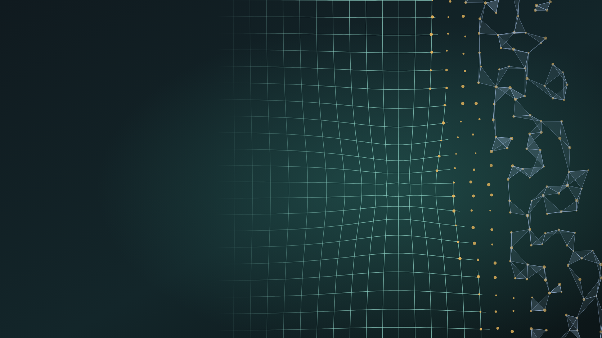

# CON-002 — ¿Es fundamental el espacio-tiempo?

> **Alcance:** este expediente audita qué dice la física publicada sobre si el espacio-tiempo es fundamental. Se evalúa con la física, independientemente de cualquier teoría de la conciencia. No decide si la conciencia es lo fundamental (CON-003) ni audita el puente entre agentes conscientes y amplitudes de dispersión (CON-004) (`CLAIM-CON-ST-SCOPE-001`).

## Pregunta central

¿Es el espacio-tiempo uno de los ingredientes básicos de la realidad, o es una descripción que surge de algo más profundo, como la temperatura surge del movimiento de moléculas?

## Respuesta breve

**No lo sabemos.** Hay razones teóricas serias, y no de una sola escuela, para esperar que la descripción del espacio-tiempo como un continuo liso deje de ser adecuada cerca de la escala de Planck (unos 10⁻³⁵ metros). La entropía de los agujeros negros crece con el área y no con el volumen. Juntar gravedad y mecánica cuántica impide medir distancias arbitrariamente pequeñas. Además, existen modelos matemáticos concretos donde la geometría se *calcula* a partir de algo que no es geometría (`CLAIM-CON-ST-BH-ENTROPY-001`, `CLAIM-CON-ST-MEASUREMENT-001`).

El ejemplo mejor desarrollado, la correspondencia AdS/CFT, es una conjetura con muchísimas verificaciones. Pero vale para un universo con constante cosmológica negativa, y el nuestro la tiene positiva (`CLAIM-CON-ST-ADS-NOT-OURS-001`).

El programa del amplituedro, el que suele citarse con la frase «el espacio-tiempo está condenado», muestra algo real y bello. En una teoría cuántica de campos concreta, la localidad y la unitariedad pueden derivarse de una geometría positiva en lugar de ponerse al inicio. Esa teoría no describe la naturaleza. Sus datos de entrada siguen siendo momentos de partículas en un espacio-tiempo plano lejano. Y hasta ahora da las mismas predicciones que el cálculo usual (`CLAIM-CON-ST-AMPLITUHEDRON-SCOPE-001`, `CLAIM-CON-ST-SAME-PREDICTIONS-001`).

Ninguna observación ha mostrado que el espacio-tiempo no sea fundamental. Las pruebas que existen llegan a la escala de Planck en algunos casos y no encuentran desviación. Con eso descartan modelos concretos de «espacio pixelado», pero no la idea general (`CLAIM-CON-ST-LORENTZ-001`, `CLAIM-CON-ST-NO-OBSERVATION-001`).

Hay dos cosas que **no se siguen** de esto. «Emergente» no significa «ilusorio» (`CLAIM-CON-ST-EMERGENT-REAL-001`). Y lo que reemplaza al espacio-tiempo en esos programas son estructuras matemáticas, no agentes conscientes (`CLAIM-CON-ST-HOFFMAN-LEAP-001`, `CLAIM-CON-ST-VERDICT-001`).

## LO PREGUNTADO

### 1. Qué significa «fundamental»

La pregunta mezcla al menos cuatro sentidos que no son equivalentes (`CLAIM-CON-ST-SENSES-001`):

| Sentido | Qué afirma | Ejemplo análogo | Qué la desmentiría |
|---|---|---|---|
| exacto a toda escala | la descripción continua vale hasta distancias arbitrariamente pequeñas | la mecánica de fluidos aplicada a una molécula | una desviación medida a corta distancia o alta energía |
| no derivable | no puede calcularse a partir de algo más básico | la temperatura sí se deriva de energías moleculares | un modelo que reproduzca la geometría desde otros ingredientes |
| ontológicamente básico | figura entre los ingredientes de la teoría final | ¿son las partículas o los campos lo básico? | una teoría final sin espacio-tiempo entre sus términos primitivos |
| real | existe y describe correctamente algo del mundo | la temperatura es real aunque sea emergente | nada en física apunta a esto |

Casi todo lo que la física de frontera discute toca los tres primeros sentidos. Ningún programa serio niega el cuarto: la geometría emergente sigue describiendo con exactitud la escala donde emerge. Pasar de «no es fundamental» a «no es real» es el error más frecuente en la divulgación del tema.

### 2. Qué parte del espacio-tiempo

«Espacio-tiempo» agrupa rasgos que pueden separarse: continuidad, número de dimensiones, métrica (distancias y duraciones), orden causal (qué puede influir en qué), localidad (las influencias viajan de punto a punto) y un tiempo global. Los programas no tratan igual estos rasgos (`CLAIM-CON-ST-FEATURES-001`). Los conjuntos causales conservan el orden causal y vuelven discreta la continuidad. AdS/CFT deriva una dimensión espacial y la gravedad, pero conserva el tiempo. El amplituedro deriva la localidad y la unitariedad, pero conserva las direcciones y energías de las partículas que llegan y salen.

### 3. Productos distintos, también en física

El contrato de la serie ([`ESTANDAR_EVIDENCIA_CONCIENCIA.md`](ESTANDAR_EVIDENCIA_CONCIENCIA.md)) separa teorema, simulación, hallazgo empírico, interpretación y tesis metafísica. En física de frontera hace falta un matiz: una **conjetura con verificaciones** (como AdS/CFT) no es un teorema, pero tampoco es especulación libre. Este expediente distingue derivación dentro de un modelo, conjetura verificada en casos, cálculo numérico, observación, interpretación programática y tesis metafísica (`CLAIM-CON-ST-PRODUCTS-001`).

## LAS RAZONES TEÓRICAS PARA DUDAR

### 4. Los agujeros negros cuentan por área

Bekenstein propuso en 1973 que un agujero negro tiene entropía proporcional al área de su horizonte. Hawking mostró en 1975 que, con campos cuánticos sobre la geometría de la relatividad general, un agujero negro radia como un cuerpo caliente. Eso fijó la constante: la entropía es un cuarto del área medida en unidades de Planck (`CLAIM-CON-ST-BH-ENTROPY-001`). La entropía mide cuántos estados microscópicos son compatibles con lo que se ve desde fuera. Que escale con el área y no con el volumen sugiere que los grados de libertad de una región no se cuentan punto por punto del espacio.

Límite: es un resultado semiclásico, con gravedad clásica y materia cuántica. La radiación de Hawking de agujeros negros astrofísicos no se ha observado; es demasiado débil.

### 5. El principio holográfico

’t Hooft y Susskind generalizaron la idea: la información máxima en una región está acotada por el área de una superficie que la rodea. Bousso dio una forma covariante de la cota, la verificó en una gama amplia de ejemplos y la llamó una relación universal entre geometría e información «que todavía no ha sido explicada». Según él, su origen debe estar en el número de grados de libertad fundamentales de una teoría que unifique espacio-tiempo y materia (`CLAIM-CON-ST-HOLOGRAPHY-001`). Es un principio guía con apoyo semiclásico, no una ley derivada de una teoría completa.

### 6. No se puede medir por debajo de cierta escala

Varios argumentos independientes llegan a lo mismo. Doplicher, Fredenhagen y Roberts, y la revisión de Garay, combinan el principio de incertidumbre con la gravedad. Para localizar un suceso en una región muy pequeña hace falta concentrar mucha energía, y por debajo de la longitud de Planck esa energía formaría un horizonte que oculta lo que se quería medir (`CLAIM-CON-ST-MEASUREMENT-001`). Arkani-Hamed y Trnka usan el mismo argumento en el artículo del amplituedro. Con gravedad no hay observables locales precisos dentro del espacio-tiempo; sólo los hay en sus fronteras, como las correlaciones en el borde de AdS o la matriz de dispersión en espacio plano.

Límite: son argumentos operacionales y heurísticos. Muestran que el *concepto* de distancia pierde significado operativo, no qué lo reemplaza.

### 7. La gravedad como ecuación de estado

Jacobson derivó en 1995 las ecuaciones de Einstein suponiendo dos cosas. La primera, que la entropía es proporcional al área en todo horizonte local. La segunda, que se cumple la relación termodinámica δQ = T dS. Concluyó que esas ecuaciones podrían ser una «ecuación de estado», como la de un gas, y que quizá no convenga cuantizarlas directamente, igual que no se cuantiza la ecuación del sonido en el aire (`CLAIM-CON-ST-JACOBSON-001`). La derivación es correcta bajo sus supuestos. La lectura emergentista es una interpretación sugerente, no una consecuencia.

## LO DERIVADO EN MODELOS

### 8. AdS/CFT: el primer ejemplo funcional de espacio emergente

Maldacena propuso en 1997 (publicado en 1998) que una teoría de cuerdas con gravedad en un espacio anti-de Sitter (AdS) de cinco dimensiones equivale a una teoría cuántica de campos sin gravedad que vive en su frontera de cuatro dimensiones. Witten precisó el diccionario entre ambas. En esa correspondencia, una dimensión espacial completa y la gravedad no están en la descripción de la frontera: aparecen en la otra (`CLAIM-CON-ST-ADSCFT-001`).

Es una **conjetura**: no hay demostración general. Pero ha pasado numerosas verificaciones cuantitativas en los casos donde ambas caras pueden calcularse. Es lo más cercano que tiene la física a un ejemplo funcional de espacio y gravedad emergentes. Arkani-Hamed y Trnka la llaman así, «un primer ejemplo funcional de espacio y gravedad emergentes».

### 9. Geometría a partir de entrelazamiento

Dentro de AdS/CFT, varios resultados ligan geometría y entrelazamiento cuántico:

- **Ryu y Takayanagi (2006):** la entropía de entrelazamiento de una región de la frontera se calcula con el área de una superficie mínima en el interior (`CLAIM-CON-ST-ENTANGLEMENT-001`).
- **Van Raamsdonk (2010):** si se reduce el entrelazamiento entre dos mitades de la frontera, las regiones correspondientes del interior se separan y terminan por desconectarse. La conexión espacial depende del entrelazamiento.
- **Swingle (2012):** ciertas redes de tensores que describen estados entrelazados se parecen a una geometría hiperbólica discreta, una especie de «esqueleto» del espacio emergente.
- **Maldacena y Susskind (2013):** propusieron que pares entrelazados y puentes geométricos (agujeros de gusano) son dos descripciones de lo mismo (ER = EPR). Es una conjetura.
- **Almheiri, Dong y Harlow (2015):** la localidad del interior se comporta como un **código cuántico de corrección de errores**. La información de un punto del interior está codificada de forma redundante en la frontera (`CLAIM-CON-ST-QEC-001`).

Entre 2019 y 2020, cálculos con «superficies extremales cuánticas» reprodujeron la curva de Page en modelos de agujeros negros que se evaporan. Esa curva describe cómo la información sale de un agujero negro de modo compatible con la mecánica cuántica (`CLAIM-CON-ST-ISLANDS-001`). Son resultados notables, pero se obtuvieron en modelos de baja dimensión o con condiciones de frontera especiales, como en la revisión de Almheiri y colaboradores (2021).

### 10. El problema de que el nuestro no es AdS

Las observaciones de supernovas de 1998 y 1999 mostraron que la expansión del universo se acelera, compatible con una constante cosmológica **positiva**. AdS tiene constante negativa. El ejemplo mejor desarrollado de espacio emergente, entonces, no describe nuestro universo (`CLAIM-CON-ST-ADS-NOT-OURS-001`). El propio artículo del amplituedro lo reconoce. La correspondencia «sigue siendo una equivalencia entre sistemas físicos ordinarios, con un tiempo que corre del pasado infinito al futuro infinito», y eso la vuelve «inaplicable a nuestro universo para preguntas cosmológicas». Una descripción holográfica de un universo como el nuestro (de Sitter) sigue abierta.

### 11. Amplitudes: menos diagramas, más geometría

Una amplitud de dispersión da la probabilidad de que unas partículas que chocan salgan con ciertas direcciones y energías. Se calcula sumando diagramas de Feynman, que suponen desde el inicio localidad (las interacciones ocurren en puntos) y unitariedad (las probabilidades suman uno). En 1986, Parke y Taylor encontraron que ciertas amplitudes de gluones, que requieren miles de diagramas, se reducen a una fórmula de una línea. En 2005, Britto, Cachazo, Feng y Witten demostraron relaciones de recursión que construyen amplitudes sin diagramas (`CLAIM-CON-ST-AMPLITUDES-SIMPLE-001`).

Arkani-Hamed y Trnka propusieron en 2013 (publicado en 2014) que, en la teoría de Yang-Mills supersimétrica N = 4 en el límite planar, las amplitudes son el «volumen» (la forma canónica) de un objeto geométrico, el **amplituedro**. Su frase central: «la localidad y la unitariedad emergen juntas de la geometría positiva» (`CLAIM-CON-ST-AMPLITUHEDRON-001`). Después vinieron la definición general de geometrías positivas y sus formas canónicas (2017), una descripción combinatoria del amplituedro (2018) y un asociaedro en el espacio de momentos para una teoría escalar sin supersimetría (2018). En 2025 apareció una fórmula a todos los órdenes de lazos para escalares con color, calculada como «un problema de conteo», sin diagramas de Feynman (`CLAIM-CON-ST-ASSOCIAHEDRON-001`).

### 12. Qué muestra exactamente el amplituedro

Leído completo, el artículo de 2014 establece tres cosas y deja tres límites.

**Lo que establece:**
1. En N = 4 SYM planar, una geometría definida por condiciones de positividad da las amplitudes. Con ellas, localidad y unitariedad aparecen como consecuencias, no como puntos de partida.
2. Esto separa conceptualmente dos principios que en la formulación usual están en tensión y obligan a introducir redundancias (de norma).
3. Los autores lo presentan como un primer paso hacia una formulación donde el espacio-tiempo no aparezca.

**Lo que no establece** (`CLAIM-CON-ST-AMPLITUHEDRON-SCOPE-001`):
1. **La teoría no es la nuestra.** N = 4 SYM planar es un modelo de juguete de enorme valor matemático. No describe partículas reales, no incluye gravedad y el límite planar ignora contribuciones que sí existen en la naturaleza.
2. **Las entradas siguen siendo espacio-temporales.** La sección de notación lo dice: los datos externos son variables de espinor-helicidad que determinan momentos nulos de partículas sin masa. La geometría se construye con esos datos. Lo que desaparece es el *interior* del cálculo: los puntos donde ocurren las interacciones. No desaparecen las partículas que llegan y se van en un espacio-tiempo plano lejano.
3. **Las predicciones son las mismas.** El amplituedro reproduce amplitudes que también se obtienen con la teoría de campos usual. Hasta ahora es una reformulación equivalente, no una teoría empíricamente distinta (`CLAIM-CON-ST-SAME-PREDICTIONS-001`). Los autores lo llaman «nuestra conjetura» y dicen que queda mucho por hacer «para establecerla».

### 13. El argumento de «el espacio-tiempo está condenado»

La frase circula sobre todo por conferencias y divulgación. En el artículo de 2014 el argumento tiene dos piezas (`CLAIM-CON-ST-DOOMED-ARGUMENT-001`):

- **La física:** con gravedad no hay observables precisos dentro del espacio-tiempo (sección 6). Por eso debería existir una forma de calcular los observables de frontera sin referirse al interior.
- **La analogía:** el principio de mínima acción, que no es determinista en apariencia, anticipaba la mecánica cuántica mejor que las leyes de Newton. Del mismo modo, una formulación donde localidad y unitariedad sean derivadas podría anticipar la teoría más profunda.

La primera pieza es un argumento físico serio. La segunda es una heurística histórica: puede ser fecunda, pero una reformulación equivalente no prueba que lo reformulado deje de ser fundamental. La mecánica de Newton y la de Lagrange son equivalentes, y ninguna de las dos dejó de ser válida cuando llegó la cuántica. La frase es una **apuesta programática** respetable de investigadores de primer nivel, no un resultado.

### 14. Otros programas: espacio discreto, dimensiones que cambian, tiempo que falta

- **Gravedad cuántica de lazos.** Rovelli y Smolin (1995) mostraron que, en esa teoría, los operadores de área y volumen tienen espectros discretos (`CLAIM-CON-ST-LQG-001`). La revisión de Ashtekar y Lewandowski (2004) resume el programa. Es un resultado dentro del formalismo. La discreción no se ha observado.
- **Conjuntos causales.** Bombelli, Lee, Meyer y Sorkin (1987) propusieron que el espacio-tiempo es, en el fondo, un conjunto discreto de sucesos con un orden causal. La geometría continua se recuperaría a gran escala (`CLAIM-CON-ST-CAUSAL-SET-001`).
- **Triangulaciones dinámicas causales.** En simulaciones numéricas que suman geometrías hechas de piezas simples, Ambjørn, Jurkiewicz y Loll (2004) obtuvieron un mundo de cuatro dimensiones a gran escala sin imponerlo (`CLAIM-CON-ST-CDT-001`).
- **Dimensión espectral.** Carlip (2017) revisa cómo enfoques muy distintos coinciden en que, a distancias muy cortas, el espacio-tiempo se comporta como si tuviera unas dos dimensiones (`CLAIM-CON-ST-SPECTRAL-001`). La coincidencia entre programas independientes es una pista interesante, no una medición.
- **Campos de grupo.** Oriti (2014) describe el espacio-tiempo continuo como un «condensado» de átomos pregeométricos que surgiría en una transición de fase.
- **El problema del tiempo.** En la cuantización canónica de la gravedad, la ecuación de Wheeler-DeWitt (DeWitt, 1967) no tiene un parámetro de tiempo externo. Rovelli (1991) discutió qué es observable en esas condiciones. Page y Wootters (1983) mostraron que, en un estado global estático, un subsistema puede «ver» evolucionar a otro si usa un tercero como reloj. Moreva y colaboradores (2014) ilustraron ese mecanismo con dos fotones (`CLAIM-CON-ST-TIME-001`). Es una ilustración del mecanismo, no una prueba de que el tiempo de la gravedad funcione así.
- **Gravedad entrópica.** Verlinde (2011) derivó la ley de Newton de argumentos de entropía y holografía. Su versión de 2016, que intenta explicar sin materia oscura el exceso de gravedad en galaxias, pasó una primera prueba con lentes gravitacionales débiles sin parámetros libres (Brouwer y colaboradores, 2017). Los propios autores advierten que la teoría no está desarrollada lo bastante para considerarse probada (`CLAIM-CON-ST-VERLINDE-001`). Es una línea minoritaria y abierta.

## LO OBSERVADO

### 15. Pruebas que llegan a la escala de Planck

Que la escala de Planck esté lejos de los aceleradores no significa que sea intocable. Si el espacio fuera granular de cierta manera, la velocidad de la luz podría depender un poco de la energía del fotón. A lo largo de miles de millones de años luz, esa diferencia se acumularía.

- **GRB 090510 (Fermi, 2009).** Un fotón de 31 GeV llegó casi junto con los de baja energía. Eso obliga a que una violación lineal de la invariancia de Lorentz aparezca, si existe, por encima de la masa de Planck.
- **Cuatro estallidos de Fermi (Vasileiou y colaboradores, 2013).** El análisis subió el límite a 7.6 veces la energía de Planck y desfavoreció toda clase de modelos que requieran esa violación lineal a la escala de Planck o por debajo (`CLAIM-CON-ST-LORENTZ-001`).
- **GW170817 (LIGO, Virgo y Fermi, 2017).** La fusión de dos estrellas de neutrones mostró que la gravedad y la luz viajan a la misma velocidad con una diferencia menor que unas partes en 10¹⁵.
- **Revisiones.** Mattingly (2005) y Amelino-Camelia (2013) reúnen el panorama: muchas firmas posibles, todas acotadas, ninguna detectada.

### 16. El Holometer

En Fermilab, dos interferómetros de 40 metros buscaron un «ruido holográfico»: temblores correlacionados de posición que ciertos modelos de geometría cuántica predecían. Las mediciones alcanzaron una sensibilidad por debajo del tiempo de Planck en densidad espectral. No encontraron la señal y acotaron con fuerza los parámetros de esos modelos de ruido con simetría de cizalla (`CLAIM-CON-ST-HOLOMETER-001`). Excluye un tipo concreto de propuesta, no la emergencia en general.

### 17. Lo que no se ha visto

A la fecha de corte **ninguna observación muestra que el espacio-tiempo no sea fundamental** (`CLAIM-CON-ST-NO-OBSERVATION-001`). Las pruebas que hay acotan modelos concretos, sobre todo los que rompen la invariancia de Lorentz a baja energía. Los programas que la conservan siguen sin firma observable. Hay propuestas para probar si la gravedad puede entrelazar dos masas (Bose y colaboradores; Marletto y Vedral, 2017). Aún no se realizan con éxito, y su resultado diría si la gravedad es cuántica, no si el espacio-tiempo es fundamental (`CLAIM-CON-ST-GRAVITY-ENTANGLEMENT-001`).

### 18. Control: Bell no es esto

Los experimentos de Bell sin lagunas, como el de Hensen y colaboradores (2015), con electrones separados 1.3 km, excluyen teorías realistas locales. En ese experimento, la probabilidad de que un modelo realista local produjera una violación tan grande era de 0.039. Esto se cita a veces como prueba de que «el espacio no existe», y no lo es. Lo que se descarta es una combinación de localidad y realismo en las correlaciones. El espacio-tiempo de la relatividad sigue intacto, y la mecánica cuántica estándar, que viola Bell, se formula sobre él (`CLAIM-CON-ST-BELL-001`).

## LO FILOSÓFICO

### 19. ¿Puede confirmarse una teoría sin espacio-tiempo?

Huggett y Wüthrich (2013) formulan la objeción de la **incoherencia empírica**: una teoría es empíricamente incoherente si su verdad socava la justificación empírica para creerla. Todas nuestras observaciones son de cosas localizadas en espacio-tiempo. Si una teoría niega que el espacio-tiempo exista en el fondo, debe mostrar cómo recupera esas cosas localizadas, o se queda sin la evidencia que la apoyaba (`CLAIM-CON-ST-INCOHERENCE-001`). Su respuesta, desarrollada en *Out of Nowhere* (2025), es un **funcionalismo**: basta con que la teoría fundamental recupere lo que el espacio-tiempo *hace* (ordenar, separar, localizar) a la escala donde observamos. Crowther (2016) defiende algo afín: el espacio-tiempo como una teoría efectiva, válida en su dominio.

Es el mismo problema que CON-001 encontró con la percepción, una vuelta más arriba: quien duda de la base debe decir en qué se apoya su duda.

### 20. Emergente no es ilusorio

La temperatura emerge de energías moleculares y es real: un termómetro la mide y un sartén quema. Un fluido emerge de moléculas y sus ecuaciones son exactas a su escala. Si el espacio-tiempo emerge, la relatividad general sigue siendo la descripción correcta allí donde se ha probado, y cualquier teoría más profunda debe reproducirla (`CLAIM-CON-ST-EMERGENT-REAL-001`).

## EL USO EN LA TESIS DE LA CONCIENCIA

### 21. «Los físicos dicen que el espacio-tiempo está condenado»

Hoffman, Prakash y Prentner abren «Fusions of Consciousness» (2023) con un argumento explícito: los físicos dicen que el espacio-tiempo no puede ser fundamental; «hacemos caso a los físicos» y suponemos que sujetos y experiencias son entidades más allá del espacio-tiempo. Luego proponen un mapa de cadenas de Markov a permutaciones decoradas, los objetos que en el programa de amplitudes codifican procesos de dispersión.

La auditoría separa tres pasos (`CLAIM-CON-ST-HOFFMAN-LEAP-001`):

1. **«El espacio-tiempo no puede ser fundamental».** Así formulado es más fuerte que lo que la física publicada sostiene. Hay razones para esperar que la descripción continua no sea la última palabra, y programas concretos que derivan rasgos del espacio-tiempo. No hay una teoría establecida de nuestro universo sin él, ni una observación que lo muestre (secciones 4 a 17).
2. **«Por lo tanto, sujetos y experiencias están más allá del espacio-tiempo».** No se sigue. Lo que reemplaza al espacio-tiempo en física son estructuras matemáticas: teorías de campos en una frontera, entrelazamiento, geometrías positivas, órdenes causales, redes de espín. Nada en esos programas introduce sujetos ni experiencias. Elegir agentes conscientes como sustrato es una tesis metafísica nueva que debe defenderse por sí misma (CON-003).
3. **«El mapa de Markov a permutaciones decoradas conecta ambas cosas».** Un mapa matemático entre dos estructuras muestra que existe una correspondencia formal. Que la correspondencia sea la física requiere predicciones que la física usual no haga. Eso se audita en CON-004.

## LO QUE IMPLICA PARA ESTE PROYECTO

### 22. Las escalas donde trabaja Vida-Tierra

Todas las investigaciones de este repositorio operan en escalas donde el espacio-tiempo continuo está probado con extraordinaria precisión: fechados radiométricos, astronomía, geología, genética. Cualquier teoría que lo haga emergente debe reproducir la relatividad general y la teoría cuántica de campos en esos regímenes, o queda refutada por las mismas mediciones que el proyecto usa (`CLAIM-CON-ST-PROJECT-001`). Una emergencia a 10⁻³⁵ metros no cambia ni la edad de la Tierra ni la cronología de una cueva.

## Casos y controles de interpretación

| Caso | Producto | Lo establecido | Inferencia permitida | Límite |
|---|---|---|---|---|
| entropía de agujeros negros (1973–1975) | derivación semiclásica | la entropía crece con el área del horizonte | los grados de libertad no se cuentan punto por punto | semiclásica; radiación de Hawking no observada |
| AdS/CFT (1998) | conjetura con verificaciones | gravedad en AdS equivale a una teoría de campos en la frontera | una dimensión y la gravedad pueden emerger | constante cosmológica negativa; no es nuestro universo |
| geometría y entrelazamiento (2006–2015) | derivación dentro de la correspondencia | áreas del interior calculan entrelazamiento de la frontera | la conexión espacial depende del entrelazamiento | vale dentro de AdS/CFT |
| amplituedro (2014) | conjetura con verificaciones | amplitudes de N = 4 SYM planar como geometría positiva | localidad y unitariedad pueden derivarse | teoría no realista; entradas espacio-temporales; mismas predicciones |
| triangulaciones causales (2004) | cálculo numérico | cuatro dimensiones emergen a gran escala | la dimensión no tiene que ponerse a mano | simulación con supuestos de discretización |
| pruebas de Lorentz (2009–2017) | observación | ninguna dispersión ni diferencia de velocidad detectada | descarta modelos con violación lineal a la escala de Planck | no prueba que el espacio-tiempo sea fundamental |
| Bell sin lagunas (2015) | observación | se viola la desigualdad de Bell | excluye el realismo local | no dice que el espacio-tiempo sea derivado |
| «Fusions of Consciousness» (2023) | interpretación | propone agentes conscientes más allá del espacio-tiempo | es una hipótesis metafísica con un mapa formal | no se sigue de la física citada |

## LO OBSERVADO

Se observan la expansión acelerada del universo, la coincidencia en tiempo de llegada de fotones de distinta energía a distancias cosmológicas, la llegada casi simultánea de ondas gravitacionales y rayos gamma, la ausencia de ruido correlacionado de posición en interferómetros y violaciones de la desigualdad de Bell. También se observan demostraciones, cálculos y verificaciones publicadas en modelos teóricos. «El espacio-tiempo no es fundamental» no es una observación.

## LO MEDIDO

Se miden retrasos de llegada de fotones y su dependencia con la energía, la diferencia entre la velocidad de la gravedad y la de la luz, densidades espectrales de ruido de posición, perfiles de lentes gravitacionales débiles y correlaciones entre espines separados. Dentro de los modelos se calculan entropías, áreas de superficies extremales, amplitudes y dimensiones espectrales.

## LO INFERIDO

Se infiere que la combinación de gravedad y mecánica cuántica hace esperar que la descripción continua no sea exacta a la escala de Planck. Se infiere también que existen modelos matemáticos donde rasgos del espacio-tiempo se derivan de algo no geométrico, y que las pruebas actuales no detectan granularidad y descartan modelos concretos. No se infiere que el espacio-tiempo sea irreal ni que la conciencia lo sustituya.

## LOS SUPUESTOS

En los argumentos semiclásicos: que la relatividad general y los campos cuánticos se combinan como se supone cerca de los horizontes. En AdS/CFT: constante cosmológica negativa, supersimetría y límites de N grande. En el amplituedro: N = 4 SYM planar, teoría de perturbaciones y datos externos en espacio plano asintótico. En los programas discretos: la elección de los ingredientes pregeométricos. En las pruebas de Lorentz: que la emisión de los fotones de alta y baja energía fue simultánea o puede acotarse.

## LAS INCERTIDUMBRES

Si existe una descripción holográfica de un universo con constante positiva. Si las geometrías positivas se extienden a la gravedad y a teorías realistas con predicciones nuevas. Cuál de los programas de gravedad cuántica, si alguno, describe la naturaleza. Si la discreción del espacio, de existir, conserva la invariancia de Lorentz. Cómo se resuelve el problema del tiempo. Si la gravedad puede entrelazar masas.

## LAS ALTERNATIVAS

Espacio-tiempo fundamental y continuo, con la gravedad cuantizada como un campo más. Espacio-tiempo emergente de entrelazamiento o de una teoría en la frontera (holografía). Espacio-tiempo discreto fundamental (lazos, conjuntos causales). Reformulaciones geométricas en las que localidad y unitariedad son derivadas (amplitudes). Gravedad como ecuación de estado o fenómeno entrópico. Funcionalismo, que acepta la emergencia y conserva la realidad del espacio-tiempo a su escala.

## LAS CONTROVERSIAS

Siguen abiertas: qué sentido de «fundamental» está en juego; si la holografía se extiende a nuestro universo; si el amplituedro muestra algo sobre el espacio-tiempo o sólo sobre la forma de calcular; si el espacio es discreto; si el tiempo es fundamental; si una teoría sin espacio-tiempo puede confirmarse; si la gravedad emergente explica lo que se atribuye a la materia oscura; y si de todo esto se sigue algo sobre la conciencia. Se indexan en `CONTROVERSIES.md`.

## QUÉ PODRÍA FALSARLO

Esta síntesis deberá revisarse si:

- se detecta una dependencia de la velocidad de la luz con la energía, o un ruido de posición correlacionado, que no tenga explicación astrofísica o instrumental;
- se publica una descripción holográfica consistente de un universo con constante cosmológica positiva;
- una geometría positiva o un programa sin espacio-tiempo hace una predicción nueva, distinta de la teoría de campos usual, y se confirma;
- se demuestra que la gravedad no puede entrelazar masas, o que sí puede, y eso cambia qué programas siguen en pie;
- un programa de gravedad cuántica recupera la relatividad general y el Modelo Estándar a baja energía y predice algo medible a alta energía.

## NIVEL DE CONFIANZA

**A:** la expansión acelerada; los límites a la violación lineal de Lorentz y a la diferencia de velocidad entre gravedad y luz; la violación de Bell; que ninguna observación ha mostrado que el espacio-tiempo no sea fundamental. **A dentro del modelo:** la entropía semiclásica de los agujeros negros, las derivaciones de Jacobson, Rovelli y Smolin, la dimensión emergente en las triangulaciones causales y la curva de Page en modelos de baja dimensión. **A-SEM:** los sentidos de «fundamental», la separación de productos, que emergente no es ilusorio y que el paso a la conciencia no se sigue. **B:** AdS/CFT como conjetura con verificaciones extensas; el amplituedro en N = 4 SYM planar; que hasta ahora las geometrías positivas son reformulaciones con las mismas predicciones. **C:** que la descripción continua deje de ser adecuada cerca de la escala de Planck. **D:** que el espacio-tiempo no sea fundamental en nuestro universo; la gravedad entrópica. **E:** que la conciencia ocupe el lugar que el espacio-tiempo deja.

## QUÉ SABEMOS REALMENTE

Sabemos que la relatividad general y la teoría cuántica, juntas, hacen esperar algo nuevo a la escala de Planck. Sabemos que hay modelos matemáticos donde una dimensión, la gravedad, la localidad o el número de dimensiones se derivan de otra cosa. Sabemos que las pruebas actuales llegan en algunos casos a la escala de Planck y no ven desviaciones. Y sabemos que el espacio-tiempo continuo describe con precisión extraordinaria todo lo que hemos medido.

## QUÉ TODAVÍA NO SABEMOS

No sabemos qué es el espacio-tiempo a la escala de Planck ni si es fundamental en nuestro universo. Tampoco sabemos si la holografía se extiende a un universo como el nuestro, si las geometrías positivas llevarán a predicciones nuevas, cuál programa de gravedad cuántica, si alguno, es correcto, ni qué es el tiempo en una teoría cuántica de la gravedad. Desde aquí no sabemos nada sobre si la conciencia es lo fundamental: esa pregunta pertenece a CON-003.

## Conclusión

«El espacio-tiempo está condenado» es una frase que condensa una apuesta seria de la física teórica, no un resultado. Detrás hay argumentos sólidos de que la descripción continua no puede ser la última palabra. Hay también modelos donde la geometría se calcula a partir de otra cosa, y una reformulación de las amplitudes donde localidad y unitariedad son consecuencias en lugar de supuestos. Pero ningún modelo describe aún nuestro universo, y ninguna observación lo exige.

La respuesta rigurosa no es «el espacio-tiempo no existe» ni «el espacio-tiempo es la base de todo». Es esta: el espacio-tiempo es una descripción extraordinariamente bien probada, y probablemente no es la más profunda; qué hay debajo es una pregunta abierta de la física. Si emerge, sigue siendo real a su escala, y lo que lo sustituya en las ecuaciones tendrá que ganarse su lugar con predicciones, no con analogías.

## Fuentes y fecha de corte

Fuentes auditadas en `SOURCES.md`. Corte: `2026-10-27`. Las 55 fuentes se verificaron contra Crossref: título, año, volumen y páginas. Se leyeron completos el artículo del amplituedro (Arkani-Hamed y Trnka, preimpresión arXiv:1312.2007, versión 1) y el de Huggett y Wüthrich (2013, arXiv:1206.6290). Las demás fuentes se revisaron por resumen, metadatos y contenido estándar de su campo, y así se declara en cada una. De «Fusions of Consciousness» (2023) se revisó el resumen publicado; el texto completo del editor no pudo descargarse al corte.
