# CON-003 — ¿Puede la conciencia ser lo fundamental?

> **Alcance:** este expediente compara las posturas que hacen de la conciencia algo fundamental —panpsiquismo, idealismo y realismo consciente— con el fisicalismo, y con las teorías científicas de la conciencia que más se citan en el debate. No decide qué es la conciencia. No audita el puente matemático entre agentes conscientes y física de partículas (CON-005) ni los psicodélicos (CON-006) (`CLAIM-CON-CF-SCOPE-001`).

## Pregunta central

¿Es la conciencia un producto tardío de cerebros en un universo físico, o es uno de los ingredientes básicos de la realidad, quizá el único?

## Respuesta breve

**No lo sabemos, y los datos actuales no pueden decidirlo por sí solos.** Lo que está establecido con solidez es que la experiencia, tal como la conocemos, depende de manera estrecha y manipulable de la actividad del cerebro. Los anestésicos la apagan, y un índice de complejidad cerebral distingue en una persona sola la vigilia del sueño profundo y del coma (`CLAIM-CON-CF-ANESTHESIA-001`, `CLAIM-CON-CF-PCI-001`).

Esa dependencia no decide la metafísica. El fisicalismo dice que el cerebro produce la experiencia. El panpsiquismo dice que la materia ya tiene un aspecto experiencial que el cerebro organiza. El idealismo dice que el cerebro es la apariencia externa de un proceso mental. Las tres posturas aceptan los mismos datos y difieren en lo que dicen que hay debajo (`CLAIM-CON-CF-EQUIVALENCE-001`, `CLAIM-CON-CF-DEPENDENCE-001`).

Por eso la pregunta se juzga hoy por las deudas que deja cada postura sin pagar (`CLAIM-CON-CF-DEBTS-001`):

- el fisicalismo debe explicar por qué hay algo que se siente (el «problema difícil»);
- el panpsiquismo, cómo micro-experiencias se combinan en una mente;
- el idealismo, por qué el mundo que aparece sigue leyes tan regulares y compartidas;
- el realismo consciente, derivar la física que promete.

Las teorías científicas de la conciencia tampoco han convergido. La primera prueba adversarial preregistrada entre dos de ellas, publicada en 2025, cuestionó supuestos centrales de las dos (`CLAIM-CON-CF-ADVERSARIAL-001`).

Lo que **no se sigue**: ni CON-001 ni CON-002 establecen que la conciencia sea fundamental (`CLAIM-CON-CF-CHAIN-001`). La mecánica cuántica no demuestra que la conciencia cree la realidad (`CLAIM-CON-CF-WIGNER-001`). Y que la mayoría de los filósofos se incline por una postura no es evidencia a favor de ella (`CLAIM-CON-CF-SURVEY-001`).

## LO PREGUNTADO

### 1. Qué significa «la conciencia es fundamental»

La frase se usa al menos en cuatro sentidos que no son equivalentes (`CLAIM-CON-CF-SENSES-001`):

| Sentido | Qué afirma | Quién lo sostiene | Qué no implica |
|---|---|---|---|
| irreductible | la experiencia no se explica por completo desde la física | dualistas, muchos panpsiquistas, algunos fisicalistas no reductivos | que la conciencia exista sin cerebros |
| ubicua | algún grado o forma de experiencia está en la materia básica | panpsiquismo; IIT en su versión más amplia | que las piedras piensen o tengan una mente |
| única | sólo existe lo mental; lo físico es su apariencia | idealismo (Kastrup) | que el mundo sea un sueño individual o arbitrario |
| primaria | la física se deriva de interacciones entre agentes conscientes | realismo consciente (Hoffman) | que esa derivación ya exista |

### 2. Las posturas que se comparan

- **Fisicalismo:** todo lo que existe es físico o depende de lo físico. Incluye al ilusionismo, que acepta que hay experiencia, pero niega que tenga las propiedades misteriosas que la introspección le atribuye (`CLAIM-CON-CF-ILLUSIONISM-001`).
- **Panpsiquismo y monismo russelliano:** la física describe lo que la materia *hace*, no lo que *es*; ese «qué es» podría ser experiencial.
- **Idealismo analítico:** una conciencia no localizada es lo único primitivo; los organismos son disociaciones de ella.
- **Realismo consciente:** el mundo está hecho de agentes conscientes que interactúan; espacio-tiempo y objetos son su interfaz (CON-001) y su proyección (CON-002, CON-005).

El dualismo clásico entra en el debate, pero ninguno de los programas que inspiran esta serie lo defiende. Se menciona sólo donde hace falta (`CLAIM-CON-CF-POSITIONS-001`).

### 3. Productos distintos

El contrato de la serie ([`ESTANDAR_EVIDENCIA_CONCIENCIA.md`](ESTANDAR_EVIDENCIA_CONCIENCIA.md)) se adapta así (`CLAIM-CON-CF-PRODUCTS-001`):

- **argumento filosófico:** el problema difícil, el murciélago, Mary;
- **hallazgo empírico:** anestesia, índices de complejidad, pacientes sin respuesta, correlatos neurales, la colaboración adversarial;
- **teoría científica:** espacio de trabajo global, orden superior, información integrada;
- **modelo formal:** las redes de agentes conscientes;
- **tesis metafísica:** fisicalismo, panpsiquismo, idealismo, realismo consciente.

Hay un sexto producto que no es evidencia: el **dato sociológico**, lo que opinan los especialistas.

## LO QUE MOTIVA LA PREGUNTA

### 4. El problema difícil

Nagel (1974) señaló que hay «algo que es ser» un murciélago, y que una descripción física completa de su sonar no parece decirnos qué es. Jackson (1982) imaginó a Mary, una científica que sabe todo lo físico sobre el color sin haberlo visto nunca, y preguntó si aprende algo nuevo al ver rojo. Chalmers (1995) separó los problemas «fáciles» del problema «difícil» (`CLAIM-CON-CF-HARD-PROBLEM-001`, `CLAIM-CON-CF-SUBJECTIVE-001`):

- **los fáciles:** explicar discriminación, reporte, atención e integración;
- **el difícil:** explicar por qué todo eso va acompañado de experiencia.

Son **argumentos**, no datos. Muestran que una explicación funcional no parece cerrar la pregunta de por qué hay experiencia. No muestran que la experiencia no sea física. Cada respuesta posible tiene defensores serios: los fisicalistas niegan la brecha o la llaman epistémica; los ilusionistas dicen que la intuición misma es el fenómeno por explicar; los panpsiquistas e idealistas toman la brecha como pista de que la física está incompleta.

### 5. Qué opinan los especialistas, y por qué eso no decide

En la encuesta PhilPapers de 2020, el 62.4 % de los filósofos que respondieron aceptan o se inclinan a que hay un problema difícil (N = 998). Sobre la mente, el 51.9 % se inclina por el fisicalismo y el 32.1 % por el no fisicalismo (N = 1733). Sobre la conciencia, el 33.0 % elige funcionalismo, el 22.0 % dualismo, el 13.3 % teoría de la identidad, el 7.6 % panpsiquismo y el 4.5 % eliminativismo (N = 1020). Sobre el mundo externo, el 6.6 % se inclina por el idealismo (N = 1764) (`CLAIM-CON-CF-SURVEY-001`). Las cifras corresponden a todos los encuestados en la página de resultados.

Es un mapa de opiniones de especialistas, útil para saber qué es mayoritario. No es evidencia de qué es verdad, y la serie no la usa como tal.

## LO OBSERVADO

### 6. La experiencia depende del cerebro de forma estrecha y manipulable

- **Anestesia.** Alkire, Hudetz y Tononi (2008) revisan cómo los anestésicos producen inconsciencia: interrumpen la comunicación entre regiones corticales posteriores o vuelven las respuestas estereotipadas (`CLAIM-CON-CF-ANESTHESIA-001`). La conciencia puede apagarse y encenderse con dosis químicas.
- **Índice de complejidad perturbacional.** Casali y colaboradores (2013) estimularon la corteza con pulsos magnéticos y midieron qué tan compleja era la respuesta. El índice distinguió, en individuos aislados, la vigilia del sueño sin sueños, de tres anestésicos y de pacientes que salían del coma (`CLAIM-CON-CF-PCI-001`).
- **Conciencia oculta.** Owen y colaboradores (2006) pidieron a una paciente diagnosticada en estado vegetativo que imaginara jugar tenis o recorrer su casa. Su cerebro activó las mismas áreas que el de voluntarios sanos. La ausencia de respuesta no es ausencia de experiencia, y la experiencia puede leerse en la actividad cerebral (`CLAIM-CON-CF-COVERT-001`). Es un solo caso en ese artículo.
- **Correlatos neurales.** Koch y colaboradores (2016) revisan la búsqueda de los mecanismos mínimos suficientes para cada experiencia. Proponen una «zona caliente» cortical posterior y advierten que varios marcadores resultaron ilusorios (`CLAIM-CON-CF-NCC-001`).

### 7. Qué establece y qué no la dependencia

Que la experiencia cambie cuando cambia el cerebro, y que se apague con anestesia, es de lo más sólido que tiene la ciencia de la conciencia. Pero dependencia no es identidad ni producción (`CLAIM-CON-CF-DEPENDENCE-001`). Cada postura metafísica la lee a su manera:

- **el fisicalismo:** el cerebro produce la experiencia;
- **el panpsiquismo:** el cerebro organiza experiencia que ya estaba en la materia;
- **el idealismo:** el cerebro es la imagen externa de un proceso mental, como un remolino es la imagen de un patrón del agua.

Los datos fijan **la estructura** de la relación —qué cambia con qué— y dejan abierta **la naturaleza** de lo que se relaciona. Esto vale en las dos direcciones. La dependencia no demuestra el fisicalismo. Tampoco es fácil para el idealismo: tiene que explicar por qué la mente parece tan atada a un órgano.

## LAS TEORÍAS CIENTÍFICAS

### 8. Varias teorías, ningún consenso

Seth y Bayne (2022) revisan cuatro familias (`CLAIM-CON-CF-THEORIES-001`):

- **espacio de trabajo global** (Dehaene y Changeux, 2011; Mashour y colaboradores, 2020): una información se vuelve consciente cuando «enciende» una red frontoparietal y queda disponible para muchos sistemas;
- **orden superior** (Brown, Lau y LeDoux, 2019): un estado es consciente cuando otro estado lo representa;
- **reentrada y procesamiento predictivo**;
- **información integrada (IIT).**

Explican aspectos distintos, tienen compromisos neuronales distintos y, según los propios revisores, no está claro que puedan separarse empíricamente sin trabajo adicional.

### 9. La información integrada empieza por la experiencia

IIT parte de propiedades que considera evidentes en toda experiencia (axiomas) y deduce qué debe cumplir un sustrato físico para tenerla (postulados) (Tononi, 2004; Tononi y colaboradores, 2016; Albantakis y colaboradores, 2023). En su versión 4.0, la conciencia **es** una estructura de causa y efecto máximamente irreducible, y en principio puede calcularse para cualquier sistema (`CLAIM-CON-CF-IIT-AXIOMS-001`). Es la teoría científica más cercana a hacer de la conciencia algo intrínseco a la materia organizada. Tononi y Koch (2015) sacan la consecuencia: la conciencia podría estar «aquí, allá y en todas partes» donde haya integración, aunque no en cualquier agregado (`CLAIM-CON-CF-IIT-PANPSYCHISM-001`).

### 10. Las críticas a IIT

- **Identidad equivocada.** Merker, Williford y Rudrauf (2022) argumentan que Φ mide la eficacia de la transferencia global de información. Identificarlo con la conciencia obliga a atribuirla a redes eléctricas, redes de regulación genética y algunas placas electrónicas. IIT acepta esa consecuencia en lugar de tratarla como refutación.
- **El argumento del despliegue.** Doerig y colaboradores (2019) usan teoremas de computación. Para cualquier sistema con retroalimentación existe uno sin ella con la misma conducta. Si la conciencia depende de la estructura causal y no de la función, la teoría es falsa o queda fuera de la ciencia (`CLAIM-CON-CF-UNFOLDING-001`).
- **¿Pseudociencia?** En 2023, una carta abierta firmada por numerosos investigadores calificó a IIT de pseudociencia por la forma en que se presentó al público. La carta generó réplicas. Es una preimpresión y una disputa sobre estatus científico, no un resultado; este expediente no la usa para sostener nada más allá de que la disputa existe (`CLAIM-CON-CF-IIT-DISPUTE-001`).

### 11. La prueba adversarial

Melloni y colaboradores (2021) propusieron un método nuevo para el campo: que los proponentes de teorías rivales acuerden de antemano qué resultado contaría en contra de cada una. El Consorcio Cogitate publicó en *Nature* (2025) la primera prueba de este tipo entre IIT y el espacio de trabajo global (`CLAIM-CON-CF-ADVERSARIAL-001`):

- **diseño:** 256 participantes, tres técnicas (resonancia funcional, magnetoencefalografía y electroencefalografía intracraneal), predicciones preregistradas;
- **qué se encontró:** información sobre el contenido consciente en cortezas visual, ventrotemporal y frontal inferior;
- **contra IIT:** no apareció la sincronización sostenida dentro de la corteza posterior que la teoría predecía;
- **contra el espacio de trabajo global:** faltó en general la «ignición» al terminar el estímulo, y la corteza prefrontal representó poco algunas dimensiones conscientes.

Los autores concluyen que los resultados coinciden con algunas predicciones de ambas teorías y cuestionan supuestos centrales de las dos. Los proponentes del espacio de trabajo global publicaron una réplica que discute la interpretación (Naccache y colaboradores, 2025).

### 12. El problema de probar teorías de la conciencia

- **Sesgo metodológico.** La base ConTraSt reunió 412 experimentos interpretados a la luz de cuatro teorías. Qué teoría «apoyaba» un estudio podía predecirse sólo con sus decisiones metodológicas, sin mirar resultados, y la mayoría interpretó sus hallazgos a posteriori (`CLAIM-CON-CF-CONTRAST-001`).
- **Dilema de la falsación.** Kleiner y Hoel (2021) muestran que, si lo que predice una teoría es independiente de lo que inferimos por reporte o conducta, toda teoría mínimamente informativa queda falsada automáticamente. Si depende estrictamente, la teoría es infalsable (`CLAIM-CON-CF-FALSIFICATION-001`).

Esto pesa sobre cualquier intento de decidir empíricamente si la conciencia es fundamental: la única ventana directa a la experiencia sigue siendo el reporte de quien la tiene.

## LAS POSTURAS METAFÍSICAS

### 13. Fisicalismo e ilusionismo

El fisicalismo es la postura mayoritaria y la que mejor encaja con la dependencia cerebral. Su deuda es el problema difícil: decir por qué ciertos procesos físicos se sienten de algún modo. El ilusionismo (Frankish, 2022) responde de forma radical. Lo que hay que explicar no es una propiedad fenoménica misteriosa, sino por qué el cerebro se representa a sí mismo como si la tuviera (`CLAIM-CON-CF-ILLUSIONISM-001`). No niega que sintamos dolor. Niega que el dolor tenga las propiedades no físicas que la intuición le atribuye. Sus críticos responden que eso no explica la experiencia: la niega.

### 14. Panpsiquismo y el problema de la combinación

Strawson (2006, reimpreso en 2008) argumenta que un fisicalismo realista sobre la experiencia, sin emergencia mágica, implica panpsiquismo. Goff (2017) defiende un monismo russelliano. La física describe estructuras y disposiciones, y la experiencia podría ser la naturaleza intrínseca que esas estructuras no describen (`CLAIM-CON-CF-PANPSYCHISM-001`).

La deuda es el **problema de la combinación**. Chalmers (2016) lo sistematiza: ¿cómo se combinan micro-sujetos o micro-experiencias en una sola experiencia unificada, como la tuya ahora? Chalmers lo considera el problema más serio del panpsiquismo y explora el panprotopsiquismo, propiedades que no son experiencia, pero la constituyen al combinarse. Ninguna solución es aceptada de forma general (`CLAIM-CON-CF-COMBINATION-001`).

### 15. Idealismo analítico

Kastrup (2017) propone que una conciencia no localizada es el único primitivo de la naturaleza. Los organismos serían sus «alteridades disociadas», como en el trastorno de identidad disociativo, y el mundo físico sería la apariencia externa de esa actividad mental. Afirma evitar a la vez el problema difícil y el de la combinación (`CLAIM-CON-CF-IDEALISM-001`).

Sus deudas son otras: explicar la disociación, y por qué lo que aparece sigue leyes matemáticas regulares, compartidas por todos los observadores y anteriores a cualquier organismo. El argumento descansa en parsimonia y poder explicativo, no en una predicción que el fisicalismo no haga.

### 16. Realismo consciente

Hoffman y Prakash (2014) definen un «agente consciente» formal con percepción, decisión y acción como núcleos de Markov, y estudian cómo interactúan. Proponen que objetos y espacio-tiempo emergen de esa dinámica. Señalan que la función de onda de una partícula cuántica libre tiene la misma forma que ciertas funciones armónicas de sus cadenas (`CLAIM-CON-CF-CONSCIOUS-AGENTS-001`). Fields, Hoffman, Prakash y Singh (2018) analizan formalmente redes de estos agentes. En 2023 se agregó el mapa hacia permutaciones decoradas auditado en CON-002.

Es la única postura de las cuatro que **promete** derivar física desde la conciencia, y por eso la única que podría ganar terreno con una predicción. Al corte, la coincidencia de forma con la función de onda es una analogía matemática, y no se ha publicado una predicción física nueva confirmada (`CLAIM-CON-CF-AGENTS-PREDICTION-001`). La derivación se audita en CON-005.

## LA FÍSICA CUÁNTICA COMO ATAJO

### 17. Microtúbulos y decoherencia

Hameroff y Penrose (2014) actualizan su propuesta: la conciencia dependería de procesos cuánticos coherentes en los microtúbulos de las neuronas, que terminan en una «reducción objetiva» ligada a la geometría del espacio-tiempo. Concluyen que la conciencia tiene un papel intrínseco en el universo (`CLAIM-CON-CF-ORCH-OR-001`). Tegmark (2000) calculó que la decoherencia en el cerebro ocurre en 10⁻¹³ a 10⁻²⁰ segundos, mucho más rápido que la dinámica neuronal relevante (10⁻³ a 10⁻¹ segundos). Por eso los grados de libertad cognitivos se comportarían como un sistema clásico (`CLAIM-CON-CF-DECOHERENCE-001`). Los defensores de Orch OR han discutido esos números; la propuesta sigue siendo minoritaria y sin confirmación directa.

### 18. El amigo de Wigner no es una persona

Proietti y colaboradores (2019) realizaron con seis fotones una versión del experimento mental del «amigo de Wigner» y violaron una desigualdad tipo Bell por cinco desviaciones estándar. Bong y colaboradores (2020) demostraron un teorema más fuerte del mismo tipo. Estos resultados dicen que, si se mantienen localidad y libre elección, los hechos registrados por distintos «observadores» no pueden ser todos absolutos (`CLAIM-CON-CF-WIGNER-001`).

En los experimentos, los «observadores» son sistemas físicos simples: fotones y sus caminos, no personas conscientes. No muestran que la conciencia cause el colapso de la función de onda ni que cree la realidad. Lo que discuten es la objetividad de los registros en mecánica cuántica.

## QUÉ PODRÍA DECIDIR LA PREGUNTA

### 19. Equivalencia empírica y deudas

El análisis central de este expediente es éste. Fisicalismo, panpsiquismo e idealismo, en sus versiones serias, **aceptan los mismos datos**: anestesia, lesiones, correlatos, reportes. Difieren en qué dicen que hay en el fondo, no en qué esperan observar (`CLAIM-CON-CF-EQUIVALENCE-001`). Mientras eso sea así, ningún experimento de neurociencia decide entre ellas, y se comparan por virtudes teóricas. Cada una deja una deuda (`CLAIM-CON-CF-DEBTS-001`):

| Postura | Lo que explica con facilidad | Su deuda principal | Qué podría pagarla |
|---|---|---|---|
| fisicalismo | dependencia cerebral, evolución, éxito de la física | por qué hay experiencia (problema difícil) | una explicación que haga transparente el paso de función a experiencia, o un ilusionismo que convenza |
| panpsiquismo | por qué hay experiencia sin emergencia mágica | combinación de micro-experiencias en una mente | un modelo de combinación con consecuencias comprobables |
| idealismo | por qué hay experiencia; sin combinación | disociación y regularidad compartida del mundo físico | derivar por qué la apariencia sigue leyes matemáticas estables |
| realismo consciente | promete unificar percepción y física | derivar física desde agentes | una predicción física nueva confirmada (CON-005) |

Hay dos excepciones a la equivalencia. **IIT** hace predicciones neuronales concretas, y la prueba adversarial ya cuestionó una central. El **realismo consciente** promete predicciones físicas. Donde una postura arriesga una predicción, la evidencia puede morder. Donde no, la discusión es filosófica y debe presentarse así.

### 20. Lo que no hereda de CON-001 y CON-002

CON-001 mostró que la evolución no garantiza percepciones verídicas, pero que de ahí no se sigue que los objetos no existan. CON-002 mostró que hay razones para esperar que el espacio-tiempo no sea fundamental, pero que lo que lo reemplaza en física son estructuras matemáticas. Ninguno de los dos aporta evidencia a favor de que la conciencia sea fundamental (`CLAIM-CON-CF-CHAIN-001`). Sumar «la percepción es una interfaz» y «el espacio-tiempo emerge» no da «la conciencia es lo básico». Hace falta, además, el argumento metafísico de este expediente, que no está decidido.

## LO QUE IMPLICA PARA ESTE PROYECTO

### 21. El método no depende de la metafísica

Las investigaciones de Vida-Tierra se apoyan en observaciones repetibles, instrumentos calibrados y convergencia entre líneas independientes. Ninguna de las cuatro posturas niega esas regularidades. Todas aceptan que hay un mundo, o una apariencia de mundo, con leyes estables y compartido por todos los observadores (`CLAIM-CON-CF-PROJECT-001`). Si la conciencia fuera fundamental, la edad de una roca y la secuencia de un genoma seguirían siendo las mismas mediciones con las mismas incertidumbres. Lo que cambiaría es la respuesta a qué son, en el fondo, esas regularidades.

## Casos y controles de interpretación

| Caso | Producto | Lo establecido | Inferencia permitida | Límite |
|---|---|---|---|---|
| problema difícil (1995) | argumento filosófico | una explicación funcional no parece cerrar por qué hay experiencia | hay una brecha explicativa que toda postura debe tratar | no demuestra que la experiencia no sea física |
| anestesia y complejidad (2008–2013) | hallazgo empírico | la experiencia se apaga y se mide con índices de complejidad cortical | la experiencia depende estrechamente del cerebro | dependencia no es identidad ni producción |
| prueba adversarial (2025) | hallazgo empírico | resultados preregistrados cuestionan supuestos de IIT y del espacio de trabajo | ninguna de las dos teorías salió confirmada | una tarea visual; los proponentes discuten la lectura |
| IIT 4.0 (2023) | teoría científica | la conciencia se identifica con una estructura de causa y efecto irreducible | la conciencia podría ser intrínseca a la materia organizada | identidad discutida; atribuye conciencia a sistemas inesperados |
| panpsiquismo | tesis metafísica | la experiencia como naturaleza intrínseca de la materia | evita la emergencia de experiencia desde lo no experiencial | problema de la combinación sin solución aceptada |
| idealismo analítico | tesis metafísica | una conciencia no localizada como único primitivo | evita problema difícil y combinación | disociación y regularidad del mundo sin derivar |
| agentes conscientes (2014–2023) | modelo formal | dinámica de agentes como núcleos de Markov | una matemática de agentes es posible | sin predicción física nueva confirmada |
| amigo de Wigner (2019–2020) | hallazgo empírico | los registros de «observadores» cuánticos no pueden ser todos absolutos | la objetividad de los hechos cuánticos es discutible | los observadores son fotones; no dice nada de la conciencia |

## LO OBSERVADO

Se observan la pérdida y recuperación de la experiencia con anestésicos y en el sueño, respuestas eléctricas de la corteza a estímulos magnéticos, actividad cerebral ante instrucciones en pacientes sin respuesta, patrones de actividad que acompañan contenidos conscientes y violaciones de desigualdades en experimentos cuánticos con fotones. También se observan los reportes de quienes tienen experiencias. «La conciencia es fundamental» no es una observación.

## LO MEDIDO

Se miden índices de complejidad de respuestas corticales, señales de resonancia funcional, magnetoencefalografía y registros intracraneales, la decodificación del contenido consciente, tiempos de decoherencia calculados y violaciones de desigualdades cuánticas en desviaciones estándar. En las teorías se calcula Φ en sistemas pequeños. En la encuesta se miden proporciones de opinión.

## LO INFERIDO

Se infiere que la experiencia humana depende estrechamente de la actividad cerebral y que puede detectarse sin conducta. Se infiere también que ninguna teoría científica de la conciencia está confirmada, y que fisicalismo, panpsiquismo e idealismo son empíricamente equivalentes frente a los datos actuales. No se infiere que la conciencia sea fundamental ni que no lo sea.

## LOS SUPUESTOS

Que el reporte y la conducta sean una ventana aceptable a la experiencia. Que la experiencia humana en vigilia sea representativa de la conciencia en general. Que los índices neuronales midan presencia de experiencia y no sólo capacidad de procesar. En las posturas metafísicas, que la parsimonia y el poder explicativo sean criterios legítimos para elegir entre teorías empíricamente equivalentes.

## LAS INCERTIDUMBRES

Si el problema difícil es un problema real o una intuición que se disolverá. Si existe una solución al problema de la combinación. Cómo explicaría el idealismo la regularidad del mundo físico. Si alguna teoría científica de la conciencia sobrevivirá a pruebas adversariales. Cómo atribuir conciencia a sistemas sin reporte: pacientes, animales, máquinas. Si el realismo consciente derivará una predicción física.

## LAS ALTERNATIVAS

Fisicalismo reductivo, fisicalismo no reductivo, ilusionismo, monismo russelliano, panpsiquismo, panprotopsiquismo, idealismo analítico, realismo consciente, dualismo de propiedades y misterianismo (la posibilidad de que la respuesta esté fuera del alcance humano).

## LAS CONTROVERSIAS

Siguen abiertas: si el problema difícil es real; si IIT es una teoría científica; cómo leer la prueba adversarial entre IIT y el espacio de trabajo global; si el problema de la combinación tiene solución; cómo explica el idealismo la regularidad del mundo; si la mecánica cuántica tiene algo que ver con la conciencia; si los agentes conscientes pueden derivar física; y cómo atribuir conciencia a sistemas sin reporte. Se indexan en `CONTROVERSIES.md`.

## QUÉ PODRÍA FALSARLO

Esta síntesis deberá revisarse si:

- una teoría científica de la conciencia supera pruebas adversariales preregistradas que sus rivales no superan;
- una explicación fisicalista hace transparente por qué un proceso físico se siente de cierto modo, de forma aceptada fuera de sus defensores;
- se propone un modelo del problema de la combinación con consecuencias comprobables que se confirman;
- el idealismo o el realismo consciente derivan una regularidad física que la física actual no explica, y se confirma;
- aparece evidencia de procesos cuánticos coherentes en el cerebro a escalas de tiempo relevantes para la cognición.

## NIVEL DE CONFIANZA

**A:** que la experiencia depende estrechamente de la actividad cerebral (anestesia, complejidad, conciencia oculta); que la prueba adversarial cuestionó supuestos centrales de las dos teorías; que los experimentos del amigo de Wigner usan fotones como observadores. **A-SEM:** los sentidos de «fundamental», la separación de productos, que dependencia no es identidad, que las posturas son empíricamente equivalentes frente a los datos actuales y que CON-001 y CON-002 no establecen la tesis. **B:** el sesgo metodológico del campo; el dilema de la falsación dentro de su marco formal; la decoherencia rápida en el cerebro. **C:** la disputa sobre el estatus científico de IIT. **D:** que la conciencia sea o no fundamental. **E:** que la ciencia haya demostrado cualquiera de las cuatro posturas.

## QUÉ SABEMOS REALMENTE

Sabemos que la experiencia humana depende de forma estrecha, medible y manipulable de la actividad del cerebro, y que puede detectarse incluso cuando no hay conducta. Sabemos que las teorías científicas de la conciencia no han convergido y que la primera prueba adversarial seria cuestionó a las dos teorías que enfrentó. Sabemos que hay un problema filosófico real sobre por qué existe la experiencia, y que fisicalismo, panpsiquismo e idealismo ofrecen respuestas coherentes con deudas distintas.

## QUÉ TODAVÍA NO SABEMOS

No sabemos qué es la conciencia ni si es fundamental. No sabemos si el problema difícil se disolverá, si el de la combinación tiene solución o si el idealismo puede derivar la regularidad del mundo. No sabemos cómo atribuir conciencia sin reporte. Tampoco sabemos, desde aquí, si los agentes conscientes pueden derivar la física de partículas: esa pregunta pertenece a CON-005.

## Conclusión

«La conciencia es fundamental» es una tesis metafísica seria, defendida por filósofos y científicos rigurosos, y no está refutada. Tampoco está demostrada, y no se sigue de la teoría de la interfaz ni de un espacio-tiempo emergente. Lo que la ciencia ha establecido con fuerza, la dependencia de la experiencia respecto del cerebro, es compatible con todas las posturas en juego.

La respuesta rigurosa no es «la ciencia demostró que todo es conciencia» ni «el cerebro produce la conciencia y ya». Es ésta: sabemos mucho sobre cómo la experiencia depende del cerebro y muy poco sobre qué es. Elegir entre fisicalismo, panpsiquismo e idealismo es hoy elegir qué deuda se prefiere cargar. Sólo una predicción arriesgada que se confirme podrá mover la balanza con evidencia.

## Fuentes y fecha de corte

Fuentes auditadas en `SOURCES.md`. Corte: `2026-10-27`. Las fuentes con DOI se verificaron contra Crossref: título, año, volumen y páginas. Los resúmenes se revisaron en Europe PMC o Crossref. Las cifras de la encuesta PhilPapers 2020 se tomaron de la página pública de resultados para todos los encuestados. Chalmers (1995) se cita por su reimpresión de 2010 y Strawson (2006) por la de 2008. La carta sobre IIT (2023) es una preimpresión y no sostiene por sí sola ninguna afirmación con letra superior a C. Ningún texto completo de este expediente se leyó íntegro: las afirmaciones se limitan a lo que dicen resúmenes, metadatos y contenido estándar del campo, y así se declara en cada fuente.
