# CON-004 — John C. Lilly: ¿qué queda de su obra?

> **Alcance:** este expediente audita la obra de John C. Lilly (1915–2001) como caso histórico de la serie: un científico que pasó de mediciones publicadas en *Science* a autoexperimentos con drogas y a una metafísica personal. Separa cada línea de su trabajo y la contrasta con lo que otros midieron después. No recomienda el uso de sustancias, del aislamiento sensorial ni de ninguna práctica. Los psicodélicos como herramienta de investigación se auditan aparte en CON-006 (`CLAIM-CON-LILLY-SCOPE-001`).

## Pregunta central

¿Qué parte del trabajo de John C. Lilly resiste la evidencia, qué parte anticipó preguntas que la ciencia retomó después, y qué parte nunca dejó de ser una visión personal?

## Respuesta breve

La obra de Lilly no es un solo bloque. Tiene al menos cinco líneas que deben juzgarse por separado (`CLAIM-CON-LILLY-LINES-001`):

1. **Neurofisiología (años cincuenta).** Publicó en *Science* una forma de onda eléctrica breve para estimular el cerebro sin lesionarlo. Es trabajo técnico serio, de su etapa más convencional (`CLAIM-CON-LILLY-STIMULATION-001`).
2. **Aislamiento sensorial.** Inventó el tanque de flotación y describió en primera persona lo que sentía al flotar sin estímulos. Décadas después, estudios con grupo de comparación encontraron reducciones de estrés y ansiedad tras sesiones de flotación. Esos estudios tienen límites serios: muestras chicas, sin cegamiento y con expectativas (`CLAIM-CON-LILLY-REST-001`, `CLAIM-CON-LILLY-REST-LIMITS-001`).
3. **Delfines.** Sus artículos en *Science* (1961–1965) describieron sonidos, intercambios vocales, una llamada de auxilio e imitación de ráfagas de voz humana. Su tesis de que los delfines podrían aprender a hablar con humanos no se cumplió. Investigaciones posteriores sí confirmaron una cognición rica en otro sentido: comprensión de frases en lenguajes artificiales, autorreconocimiento en el espejo y silbidos que funcionan como nombres (`CLAIM-CON-LILLY-VINDICATION-001`).
4. **El laboratorio de St. Thomas.** El experimento de 1965, en que Margaret Howe vivió con el delfín Peter, terminó con el laboratorio cerrado por recorte de fondos y con la muerte del animal tras su traslado. Es un caso de estudio de fallas éticas y de bienestar animal (`CLAIM-CON-LILLY-HOWE-001`, `CLAIM-CON-LILLY-WELFARE-001`).
5. **Autoexperimentación y metafísica.** Lilly se administró LSD y después ketamina, y escribió sobre «metaprogramar» la mente y sobre entidades cósmicas. Esos textos son informes de experiencias, no evidencia de lo que describen. La investigación controlada posterior con ketamina midió otra cosa: efectos disociativos y un efecto antidepresivo rápido (`CLAIM-CON-LILLY-REPORTS-001`, `CLAIM-CON-LILLY-KETAMINE-CONTROLLED-001`).

El balance: Lilly fue un buen formulador de preguntas y un mal juez de sus propias respuestas. Lo que sobrevive es lo que otros pudieron medir (`CLAIM-CON-LILLY-VERDICT-001`).

## LO PREGUNTADO

### 1. Por qué Lilly entra en esta serie

La serie CON audita el paso de un resultado a una tesis sobre lo que existe. Lilly recorrió esa cadena entera en una sola vida: de la medición con electrodos a la convicción de que la mente puede programarse a sí misma y de que hay inteligencias más allá de lo físico. Por eso sirve como caso de control para los demás expedientes (`CLAIM-CON-LILLY-CHAIN-001`):

- **CON-001:** la percepción es construida; Lilly lo llevó a «lo que crees se vuelve verdad»;
- **CON-003:** la conciencia como fundamento; su metafísica tardía;
- **CON-006:** los psicodélicos como herramienta.

### 2. Productos distintos

El contrato de la serie ([`ESTANDAR_EVIDENCIA_CONCIENCIA.md`](ESTANDAR_EVIDENCIA_CONCIENCIA.md)) se aplica así (`CLAIM-CON-LILLY-PRODUCTS-001`):

- **método o hallazgo publicado:** la forma de onda, los sonidos de delfín, la imitación de ráfagas;
- **informe en primera persona:** el tanque, las drogas;
- **réplica o prueba posterior de otros:** estudios de flotación, cognición de delfines, ketamina controlada;
- **interpretación:** el tamaño del cerebro y el lenguaje, la «metaprogramación»;
- **tesis metafísica:** sus entidades cósmicas.

Además hay **historia documentada**, que se apoya en la historia de la ciencia y en periodismo, no en artículos científicos.

## LA NEUROFISIOLOGÍA

### 3. Estimular el cerebro sin dañarlo

En 1955, Lilly, Hughes, Alvord y Galkin publicaron en *Science* una «forma de onda eléctrica breve y no lesiva» para estimular el cerebro (`CLAIM-CON-LILLY-STIMULATION-001`). Su preocupación era técnica y válida: la estimulación prolongada con corriente puede dañar el tejido, y un pulso diseñado para no dejarlo dañado permite estudiar el cerebro en animales despiertos durante más tiempo. Es la etapa en que Lilly trabajaba con los métodos de la neurofisiología de su época.

Límite de este expediente: del artículo de 1955 sólo se revisaron los metadatos. No se afirma aquí cuál fue su influencia posterior.

## EL AISLAMIENTO SENSORIAL

### 4. El tanque

A mediados de los años cincuenta, Lilly construyó un tanque en el que una persona flota en agua tibia, en oscuridad y silencio, con la mínima estimulación posible. Su informe de 1956 describe lo que experimentó al flotar (`CLAIM-CON-LILLY-ISOLATION-REPORT-001`). Es un informe en primera persona, no un experimento controlado.

### 5. El contexto: McGill y los usos del aislamiento

Lilly no fue el único. En la Universidad McGill, Bexton, Heron y Scott (1954) pagaron a estudiantes para permanecer días en un ambiente de estimulación reducida. Reportaron dificultad para pensar y experiencias perceptivas inusuales (`CLAIM-CON-LILLY-MCGILL-001`). Shurley, quien trabajó en el tanque del NIMH, publicó en 1992 una retrospectiva crítica de 35 años que conecta esa investigación con su uso en la tortura política (`CLAIM-CON-LILLY-ISOLATION-ETHICS-001`). El aislamiento sensorial tiene una historia doble: herramienta de investigación y método de coerción.

### 6. La flotación hoy

La flotación con estimulación ambiental reducida (REST) se volvió un tema de investigación clínica (`CLAIM-CON-LILLY-REST-001`):

- **Metaanálisis (2005):** van Dierendonck y Te Nijenhuis reunieron estudios de flotación como manejo del estrés y encontraron efectos favorables.
- **Ensayo aleatorizado piloto (2014):** Kjellgren y Westman asignaron a 65 personas sanas a flotar doce veces o a una lista de espera. El grupo que flotó redujo estrés, depresión, ansiedad y dolor, y mejoró optimismo y sueño; el control no cambió.
- **Estudio abierto (2018):** Feinstein y colaboradores observaron en 50 personas con trastornos de ansiedad y estrés una reducción grande de la ansiedad de estado tras una hora de flotación.

Límites (`CLAIM-CON-LILLY-REST-LIMITS-001`): no hay cegamiento posible, el control suele ser lista de espera y no una intervención que genere las mismas expectativas, las muestras son chicas y los efectos se miden sobre todo inmediatamente después. La flotación parece relajar. No se ha mostrado que haga algo distinto de otras intervenciones de relajación, ni nada sobre la naturaleza de la conciencia.

## LOS DELFINES

### 7. Lo que Lilly midió

Entre 1961 y 1965, Lilly publicó en *Science* cuatro artículos sobre el delfín nariz de botella:

- **Sonidos (1961, con Miller):** tres clases de emisiones: silbidos de 4 000 a 18 000 ciclos por segundo, clics y sonidos complejos de gran amplitud (`CLAIM-CON-LILLY-DOLPHIN-SOUNDS-001`).
- **Intercambios vocales (1961, con Miller):** alternancias, «duetos» y «monólogos» entre parejas de delfines. Los autores escribieron que los portadores de significado estaban «por determinar» (`CLAIM-CON-LILLY-DOLPHIN-EXCHANGES-001`).
- **Llamada de auxilio (1963):** un par de silbidos cortos se asociaba con angustia física y llevaba a otros animales a empujar al afectado a la superficie para respirar (`CLAIM-CON-LILLY-DISTRESS-001`).
- **Imitación vocal (1965):** delfines entrenados emitieron en el aire ráfagas que igualaban, con un margen de una, el número de ráfagas de una persona en el 92 % de los intercambios (`CLAIM-CON-LILLY-MIMICRY-001`).

Son descripciones acústicas y conductuales, con animales cautivos y a veces sujetos.

### 8. Lo que Lilly interpretó

Lilly llevó esos datos mucho más lejos. En *Man and Dolphin* (1961) y en «Critical brain size and language» (1963) sostuvo que un cerebro grande como el del delfín tendría capacidad de lenguaje, y que podría establecerse comunicación con los humanos (`CLAIM-CON-LILLY-BRAIN-SIZE-001`, `CLAIM-CON-LILLY-LANGUAGE-CLAIM-001`). Contar ráfagas no es entender palabras. El tamaño del cerebro solo no predice lenguaje, y ningún delfín aprendió a hablar con humanos.

### 9. Lo que otros midieron después

Las preguntas de Lilly sí resultaron fecundas, con otros métodos (`CLAIM-CON-LILLY-VINDICATION-001`):

- **Comprensión de frases (1984):** Herman, Richards y Wolz enseñaron a dos delfines lenguajes artificiales, uno de gestos y otro de sonidos. Los animales entendían frases en las que el orden de las palabras cambiaba el significado. Es comprensión de un lenguaje artificial, no habla humana (`CLAIM-CON-LILLY-COMPREHENSION-001`).
- **Espejo (2001):** Reiss y Marino mostraron que dos delfines usaban un espejo para inspeccionar marcas en su cuerpo. Era una capacidad que hasta entonces sólo tenía evidencia convincente en humanos y grandes simios (`CLAIM-CON-LILLY-MIRROR-001`).
- **Silbidos firma (2006 y 2013):** Janik y colaboradores mostraron que la forma del silbido identifica al individuo. King y Janik encontraron que delfines salvajes responden cuando escuchan una copia de su propio silbido firma, y no la de otro: una etiqueta aprendida que funciona como nombre (`CLAIM-CON-LILLY-SIGNATURE-001`).

Lilly tuvo razón en que los delfines tenían una vida cognitiva y vocal compleja. Se equivocó en la forma: no es habla humana, y no llegó por el camino que él eligió.

## EL LABORATORIO DE ST. THOMAS

### 10. El experimento de 1965

Según la reconstrucción periodística de Riley (2014), basada en entrevistas y archivos, Lilly abrió en 1963 un laboratorio en St. Thomas, Islas Vírgenes, con apoyo de la NASA y otras agencias del gobierno. El antropólogo Gregory Bateson lo dirigió por un tiempo (`CLAIM-CON-LILLY-ST-THOMAS-001`). En el verano de 1965, Margaret Howe vivió con el delfín Peter en una casa inundada parcialmente, para enseñarle a pronunciar palabras humanas (`CLAIM-CON-LILLY-HOWE-001`). Burnett (2012) sitúa a Lilly en la historia de la ciencia de cetáceos del siglo XX.

### 11. Cómo terminó

Siempre según Riley, para el otoño de 1966 el interés de Lilly se había desplazado al LSD, con el que había empezado a experimentar durante el proyecto. Su actitud hacia el bienestar de los animales alejó a Bateson y contribuyó a que se cortaran los fondos. El laboratorio cerró. Peter fue trasladado a un lugar con poca luz, se deterioró y murió semanas después. Lilly le comunicó a Howe que el delfín se había «suicidado» (`CLAIM-CON-LILLY-WELFARE-001`). Esa palabra es la interpretación de Lilly y de quienes la repitieron, no una causa de muerte establecida.

Límites: la cronología viene de periodismo y de testimonios dados décadas después, y las fechas varían entre fuentes. El expediente la registra como historia documentada, no como hallazgo científico.

## LA AUTOEXPERIMENTACIÓN Y LA METAFÍSICA

### 12. LSD, ketamina y el tanque

En *The Center of the Cyclone* (1972) y *The Scientist* (1978), Lilly describió sesiones en las que combinaba el tanque con LSD y, después, con ketamina, y narró encuentros con lo que llamó entidades y una red de control cósmica (`CLAIM-CON-LILLY-SELF-EXPERIMENT-001`). Son autobiografía, sin controles, sin cegamiento y con un solo sujeto que era también el intérprete.

### 13. Lo que midió la investigación controlada

La ketamina sí se estudió después con métodos controlados, y lo que se midió es distinto de lo que Lilly narró (`CLAIM-CON-LILLY-KETAMINE-CONTROLLED-001`):

- **Krystal y colaboradores (1994):** en un estudio doble ciego con 19 personas sanas, dosis bajas produjeron alteraciones perceptivas, síntomas parecidos a los de la psicosis y estados disociativos medibles con escalas.
- **Zarate y colaboradores (2006):** en un ensayo doble ciego cruzado con 18 personas con depresión resistente, una infusión produjo una mejoría significativa en horas.

Esos estudios muestran que la ketamina altera la experiencia de formas reproducibles. No muestran que lo experimentado exista fuera de quien lo vive (`CLAIM-CON-LILLY-REPORTS-001`). Un informe de una entidad durante una disociación es evidencia de la experiencia, no de la entidad.

### 14. «Metaprogramar» la mente

En *Programming and Metaprogramming in the Human Biocomputer* (1968), Lilly describió el cerebro como una computadora biológica y las creencias como programas que la propia mente puede reescribir (`CLAIM-CON-LILLY-METAPROGRAMMING-001`). Es una metáfora de su época, anterior a la ciencia cognitiva moderna, con un núcleo razonable: las expectativas moldean la percepción, como discute CON-001.

Lilly fue más lejos con una máxima que se le atribuye con frecuencia: en el ámbito de la mente, lo que uno cree verdadero es verdadero o llega a serlo, dentro de ciertos límites. La máxima confunde verdad de la experiencia con verdad del mundo (`CLAIM-CON-LILLY-BELIEF-001`). Creer que una pared no está no la quita del camino. Que una creencia cambie lo que se siente no la vuelve verdadera fuera de quien la tiene.

## LO QUE IMPLICA PARA ESTA SERIE

### 15. Un control para todos los expedientes

Lilly ilustra en un solo caso cada salto que la serie pide no dar (`CLAIM-CON-LILLY-SERIES-001`):

- de imitar el número de ráfagas de una voz a «lenguaje»;
- de una experiencia bajo ketamina a «entidades que existen»;
- de «la percepción es construida» a «lo que creo se vuelve verdad»;
- de «la mente es poderosa» a «la conciencia es lo fundamental».

También muestra lo contrario: preguntas audaces pueden ser fecundas cuando otros las ponen a prueba con controles.

## Casos y controles de interpretación

| Caso | Producto | Lo establecido | Inferencia permitida | Límite |
|---|---|---|---|---|
| forma de onda (1955) | método publicado | un pulso eléctrico breve diseñado para no lesionar | trabajo técnico de neurofisiología | sólo metadatos revisados |
| tanque (1956) | informe en primera persona | Lilly describió sus experiencias al flotar sin estímulos | el aislamiento altera la experiencia | sin controles |
| flotación hoy (2005–2018) | réplica posterior | reducciones de estrés y ansiedad tras flotar | la flotación relaja a corto plazo | sin cegamiento; lista de espera; muestras chicas |
| sonidos e imitación (1961–1965) | hallazgo publicado | clases de sonidos, intercambios, llamada de auxilio, imitación de ráfagas | los delfines tienen vocalización compleja y aprendizaje vocal | contar ráfagas no es entender palabras |
| lenguaje con humanos (1961–1963) | interpretación | un cerebro grande tendría capacidad de lenguaje | ninguna más allá de una hipótesis | no se cumplió |
| cognición posterior (1984–2013) | réplica posterior | comprensión de frases artificiales, espejo, silbidos como nombres | cognición rica, distinta del habla humana | pocos animales en varios estudios |
| St. Thomas (1963–1966) | historia documentada | convivencia de 1965, cierre y muerte de Peter | fallas éticas y de bienestar animal | periodismo y testimonios tardíos |
| ketamina (1970s; 1994–2006) | informe frente a ensayo controlado | disociación medible; efecto antidepresivo rápido | la sustancia altera la experiencia de forma reproducible | no muestra que lo experimentado exista |

## LO OBSERVADO

Se observan emisiones acústicas de delfines registradas con hidrófonos, intercambios vocales entre animales, respuestas a una llamada de auxilio, conteos de ráfagas imitadas, respuestas de delfines a frases en lenguajes artificiales, a espejos y a silbidos firma reproducidos. También se observan cambios en escalas de estrés y ansiedad tras flotar y en escalas de disociación y depresión tras ketamina. Los informes de Lilly sobre entidades son observaciones de su experiencia, no de las entidades.

## LO MEDIDO

Se miden frecuencias de silbidos, amplitudes, proporciones de ráfagas igualadas, puntuaciones en escalas de ansiedad de estado, estrés y depresión, escalas de estados disociativos y de síntomas psicóticos, y tasas de respuesta de delfines salvajes a silbidos reproducidos.

## LO INFERIDO

Se infiere que los delfines nariz de botella tienen aprendizaje vocal, silbidos que identifican individuos y capacidad de comprender lenguajes artificiales. Se infiere también que la flotación reduce estrés y ansiedad a corto plazo, con evidencia de calidad limitada, y que la ketamina altera la experiencia de forma reproducible. No se infiere que los delfines puedan hablar con humanos, que las entidades descritas por Lilly existan ni que las creencias se vuelvan verdaderas fuera de quien las tiene.

## LOS SUPUESTOS

Que los registros acústicos de animales cautivos representen su comunicación natural. Que las escalas de autorreporte midan cambios reales y no sólo expectativas. Que la reconstrucción periodística de St. Thomas sea fiel, aunque se apoye en testimonios dados décadas después. Que los libros autobiográficos de Lilly describan sus experiencias de buena fe, sin que eso las vuelva evidencia de su contenido.

## LAS INCERTIDUMBRES

Cuánto del efecto de la flotación se debe a expectativas. Qué tan general es la cognición de delfines medida en pocos individuos. Cuál fue exactamente la cronología de St. Thomas y qué agencias financiaron cada etapa. Qué influencia técnica tuvo la forma de onda de 1955. Cuánto de la imagen pública de Lilly proviene de sus propios libros.

## LAS ALTERNATIVAS

Leer a Lilly como pionero adelantado a su tiempo; como científico que abandonó el método; como figura de la contracultura más que de la ciencia; o, como propone este expediente, como un caso con líneas de calidad muy distinta que deben juzgarse por separado.

## LAS CONTROVERSIAS

Siguen abiertas: si la flotación tiene efectos específicos o sólo de relajación y expectativa; cuánto anticipó Lilly la cognición de delfines y cuánto la distorsionó; cómo juzgar la ética de St. Thomas con los criterios de su época y de la nuestra; si los informes en primera persona bajo sustancias pueden ser datos científicos; y cuánto del interés actual por la ketamina y el aislamiento le debe a Lilly. Se indexan en `CONTROVERSIES.md`.

## QUÉ PODRÍA FALSARLO

Esta síntesis deberá revisarse si:

- un ensayo de flotación con control activo creíble y cegamiento de evaluadores no encuentra efecto, o encuentra uno específico;
- aparecen documentos primarios del laboratorio de St. Thomas que contradigan la cronología periodística;
- se demuestra que algún delfín produce habla humana con significado, más allá de la imitación;
- un estudio controlado obtiene, bajo una sustancia, información verificable que el participante no podía conocer.

## NIVEL DE CONFIANZA

**A:** los resultados acústicos publicados por Lilly; la comprensión de frases artificiales, el autorreconocimiento y los silbidos firma en delfines, como datos; los efectos disociativos y antidepresivos de la ketamina en ensayos controlados. **A-SEM:** la separación de líneas y productos, y que informe no es evidencia del contenido informado. **B:** la cronología de St. Thomas y el cierre del laboratorio, como historia documentada por periodismo y testimonios. **C:** que la flotación reduzca estrés y ansiedad por algo más que relajación y expectativa. **E:** que los delfines puedan hablar con humanos, que las entidades descritas existan y que las creencias se vuelvan verdaderas por creerlas.

## QUÉ SABEMOS REALMENTE

Lilly publicó trabajo técnico y acústico serio, inventó el tanque de flotación y planteó preguntas sobre la mente de los delfines que la investigación posterior respondió en parte. También dirigió un experimento con fallas éticas graves y pasó de la medición a una metafísica personal sustentada sólo en su experiencia.

## QUÉ TODAVÍA NO SABEMOS

No sabemos si la flotación tiene efectos que vayan más allá de la relajación, ni cuánto se generaliza la cognición medida en pocos delfines. Desconocemos la cronología exacta del laboratorio de St. Thomas y la influencia técnica de su trabajo con electrodos. Tampoco sabemos, desde aquí, qué pueden enseñar los psicodélicos sobre la percepción: esa pregunta pertenece a CON-006.

## Conclusión

John C. Lilly hizo preguntas mejores que sus respuestas. ¿Qué pasa con la mente cuando se apagan los sentidos? ¿Qué tan compleja es la comunicación de un delfín? ¿Qué hace una sustancia a la experiencia? Son preguntas legítimas, y otras personas las retomaron con controles. Sus respuestas —delfines que hablarían, entidades cósmicas, creencias que se vuelven verdad— se quedaron en su experiencia.

La lección para este proyecto es la misma de toda la serie, contada como biografía: la audacia sirve para preguntar, y sólo la prueba controlada sirve para saber.

## Fuentes y fecha de corte

Fuentes auditadas en `SOURCES.md`. Corte: `2026-10-27`. Los artículos con DOI se verificaron contra Crossref: título, año, volumen y páginas. Los resúmenes se revisaron en Europe PMC o Crossref cuando existían. La historia de St. Thomas se apoya en el reportaje de Riley (*The Guardian*, 2014), revisado en línea, y en la obra de Burnett (2012), registrada por sus metadatos. El informe de 1956 y los libros de Lilly (1961, 1968, 1972, 1978) se registran por datos bibliográficos estándar, sin revisión de ejemplar. Ninguna afirmación sobre entidades o estados místicos se trata como dato. Este expediente no recomienda el uso de sustancias, el aislamiento sensorial ni ninguna práctica.
