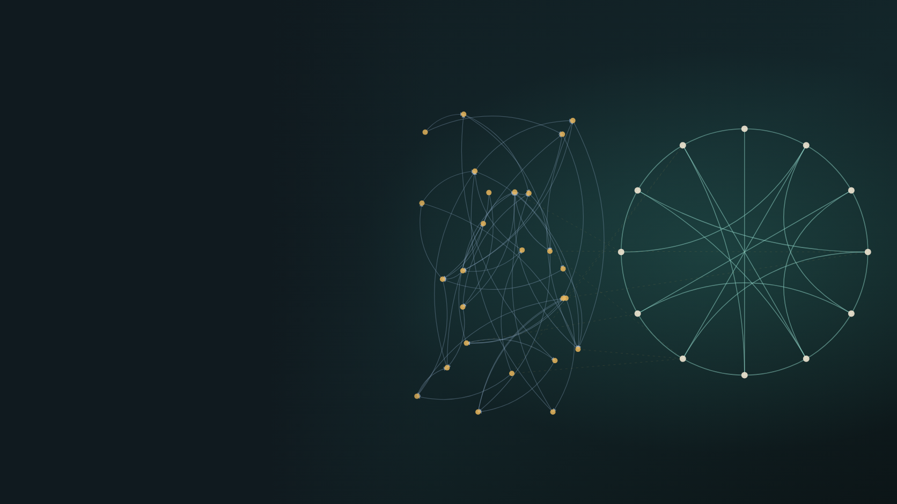

# CON-005 — ¿Qué conecta agentes conscientes y física de partículas?

> **Alcance:** este expediente audita el puente matemático que Hoffman y sus colaboradores proponen entre la dinámica de agentes conscientes y la física de partículas. Separa lo demostrado (un mapa definido entre estructuras matemáticas) de lo prometido (derivar la física y predecir algo). No vuelve a auditar si la conciencia es fundamental (CON-003) ni si el espacio-tiempo lo es (CON-002) (`CLAIM-CON-AP-SCOPE-001`).

## Pregunta central

¿Existe hoy una conexión demostrada entre una teoría de agentes conscientes y la física de partículas, o sólo una correspondencia entre dos estructuras matemáticas?

## Respuesta breve

**Existe un mapa matemático bien definido, y es mucho más débil de lo que su presentación sugiere.** En «Fusions of Consciousness» (2023), Hoffman, Prakash y Prentner definen una regla que asigna a cada cadena de Markov una «permutación decorada». Ese mismo objeto combinatorio etiqueta piezas de la geometría que se usa para calcular amplitudes de dispersión. Este expediente implementó la regla de forma independiente y reprodujo fila por fila la tabla del artículo (`CLAIM-CON-AP-MAP-REPRODUCED-001`).

Lo que la reproducción muestra:

1. **La regla sólo mira qué transiciones son posibles, no sus probabilidades.** Con tres estados, los 343 patrones de transición caen en 14 etiquetas; el espacio de seis dimensiones de dinámicas posibles se reduce a 14 casillas (`CLAIM-CON-AP-GRAPH-ONLY-001`, `CLAIM-CON-AP-COLLAPSE-001`).
2. **La regla sirve para cualquier grafo dirigido.** Los propios autores la generalizan así. No usa nada propio de agentes ni de conciencia (`CLAIM-CON-AP-ANY-GRAPH-001`).
3. **El texto contiene una errata verificable.** Dice que los 27 vértices del caso de tres agentes dan 17 permutaciones distintas. Su propia tabla, y la reproducción, dan 14; el total posible para tres elementos es 16 (`CLAIM-CON-AP-ERRATUM-001`).
4. **Las mismas permutaciones etiquetan sistemas que nada tienen que ver con partículas.** Los autores citan un proceso de exclusión y las ondas solitarias en aguas someras. Compartir combinatoria no es compartir física (`CLAIM-CON-AP-SHARED-COMBINATORICS-001`).
5. **Una permutación decorada no calcula una amplitud.** Hacen falta además los momentos de las partículas, las helicidades y saber qué piezas sumar, y todo eso vale en la teoría de juguete de CON-002 (`CLAIM-CON-AP-AMPLITUDE-NEEDS-001`).

La «correspondencia entre agentes y partículas» es, en palabras de los autores, una **conjetura**. Al corte no hay una predicción física derivada de ella (`CLAIM-CON-AP-CONJECTURE-001`, `CLAIM-CON-AP-NO-PREDICTION-001`). El veredicto: el puente existe como etiqueta, no como explicación (`CLAIM-CON-AP-VERDICT-001`).

## LO PREGUNTADO

### 1. Qué significaría «conectar» agentes y partículas

La palabra admite al menos cuatro sentidos de fuerza creciente (`CLAIM-CON-AP-BRIDGE-SENSES-001`):

| Sentido | Qué exige | Ejemplo |
|---|---|---|
| etiqueta compartida | que un mismo objeto combinatorio pueda asignarse a ambas cosas | una permutación decorada para una cadena de Markov y para un diagrama |
| correspondencia estructural | que el mapa conserve operaciones: composición, dinámica, probabilidades | que combinar agentes corresponda a combinar diagramas |
| derivación | que la física conocida salga del modelo sin ponerla a mano | obtener las amplitudes, masas y espines conocidos |
| predicción | que el modelo diga algo nuevo y medible que la física actual no diga | un resultado de dispersión distinto, confirmado |

Hoy sólo se cumple el primero.

### 2. Productos distintos

El contrato de la serie ([`ESTANDAR_EVIDENCIA_CONCIENCIA.md`](ESTANDAR_EVIDENCIA_CONCIENCIA.md)) se aplica así (`CLAIM-CON-AP-PRODUCTS-001`):

- **definición matemática:** el modelo de agentes y el mapa;
- **resultado matemático:** propiedades del mapa;
- **resultado de física matemática:** el papel de las permutaciones en las amplitudes;
- **conjetura:** la correspondencia entre agentes y partículas;
- **propuesta de prueba:** la ruta hacia pruebas con datos de dispersión;
- **tesis metafísica:** las partículas como proyección de agentes conscientes.

## EL MODELO Y EL MAPA

### 3. Agentes como cadenas de Markov

En el modelo de Hoffman y Prakash (2014), un agente consciente tiene percepción, decisión y acción descritas por núcleos de Markov: matrices que dan la probabilidad de pasar de un estado a otro (`CLAIM-CON-AP-AGENT-MODEL-001`). Fields y colaboradores (2018) y Prakash (2019) desarrollaron el formalismo. La interacción de agentes se describe como una cadena de Markov y las dinámicas posibles de n estados forman un «politopo de Markov».

### 4. La regla del mapa

La definición 2 de «Fusions of Consciousness» (2023) asigna a cada núcleo una permutación decorada a partir de su estructura de clases comunicantes (`CLAIM-CON-AP-MAP-DEFINED-001`):

- **estado transitorio:** queda fijo;
- **estado absorbente:** queda fijo con la otra «decoración»;
- **estado recurrente en una clase mayor:** se envía al primer estado que, recorriendo en círculo, completa su clase.

Los autores dicen que el mapa entre cadenas de Markov y permutaciones decoradas «era un problema abierto» y lo resuelven con esta definición. Es una definición correcta y consistente.

### 5. La reproducción

Este expediente implementó la definición en [`scripts/markov-decorated-permutations.mjs`](https://github.com/CesarMg91/vida-tierra/blob/main/scripts/markov-decorated-permutations.mjs) y la probó en [`tests/markov-decorated-permutations.test.mts`](https://github.com/CesarMg91/vida-tierra/blob/main/tests/markov-decorated-permutations.test.mts) (`CLAIM-CON-AP-MAP-REPRODUCED-001`):

- **las 27 filas** del apéndice B coinciden exactamente con la implementación;
- **con dos estados** hay cuatro celdas, como dice el artículo;
- **con tres estados** hay 14 permutaciones distintas, tanto entre los 27 vértices como entre los 343 patrones de transición posibles;
- **el total** de permutaciones decoradas de tres elementos es 16.

### 6. Lo que la regla descarta

La regla sólo usa qué transiciones son posibles: el grafo dirigido. Las probabilidades no intervienen (`CLAIM-CON-AP-GRAPH-ONLY-001`). Un agente que intercambia sus dos estados de forma determinista y uno que salta al azar entre ellos con cualquier proporción reciben la misma etiqueta; el propio artículo lo señala al describir la celda que comparten. Con tres estados, el politopo de dinámicas tiene seis dimensiones y la regla lo reduce a 14 casillas (`CLAIM-CON-AP-COLLAPSE-001`). Casi toda la dinámica, que es lo que el modelo usa para describir a los agentes, se pierde en el paso.

### 7. Lo que la regla no necesita

La definición 3 del mismo artículo extiende la regla a cualquier grafo: componentes fuertemente conexas en lugar de clases comunicantes (`CLAIM-CON-AP-ANY-GRAPH-001`). Una red de carreteras, una red de citas o un grafo de dependencias de software reciben una permutación decorada igual de bien. El mapa no usa nada que distinga a un agente consciente de cualquier otro sistema con flechas.

### 8. Una errata verificable

El artículo dice que el apéndice B presenta «las 17 permutaciones decoradas distintas» de los 27 vértices del caso de tres agentes. La tabla del propio apéndice contiene 14, y la reproducción independiente también da 14. Además, el número total de permutaciones decoradas posibles de tres elementos es 16, así que 17 es imposible (`CLAIM-CON-AP-ERRATUM-001`). Es probablemente un error de redacción y no cambia la definición. Sí muestra que el cálculo no fue revisado contra su tabla, y el número se repite en divulgación.

## EL LADO DE LA FÍSICA

### 9. Qué son las permutaciones decoradas en matemáticas

Postnikov (2006) mostró que las permutaciones decoradas clasifican las celdas de la Grassmanniana no negativa, un espacio de subespacios con coordenadas positivas. Postnikov, Speyer y Williams (2009), y Knutson, Lam y Speyer (2013) desarrollaron esa clasificación, que hoy es matemática estándar (`CLAIM-CON-AP-POSITROIDS-001`). Williams (2023) la resume en su conferencia del Congreso Internacional de Matemáticos.

### 10. Qué papel tienen en las amplitudes

En la teoría N = 4 SYM planar, los diagramas «en capa de masas» que sirven para construir amplitudes se etiquetan con permutaciones decoradas. El amplituedro es la imagen de la Grassmanniana positiva bajo un mapa lineal (`CLAIM-CON-AP-ONSHELL-001`). Esto vale en la teoría de juguete que CON-002 auditó: sin gravedad, sin masas, en el límite planar.

### 11. La misma combinatoria en sistemas sin relación

El propio artículo de 2023 cita que esas celdas aparecen en la distribución estacionaria del proceso de exclusión asimétrico (Corteel y Williams, 2007) y en los patrones de ondas solitarias de la ecuación KP, que describe aguas someras (Kodama y Williams, 2014). Los autores lo leen como una pista de que su correspondencia es profunda. La lectura opuesta es más simple: la Grassmanniana positiva es una estructura matemática muy general que aparece donde hay positividad y orden circular. Que agentes, partículas, partículas que se excluyen y olas reciban las mismas etiquetas no los vuelve la misma cosa (`CLAIM-CON-AP-SHARED-COMBINATORICS-001`).

### 12. Lo que hace falta además de una permutación

Una permutación decorada etiqueta una pieza. Para obtener una amplitud hacen falta también los datos de las partículas que chocan (momentos, en forma de espinores o twistores), sus helicidades y la regla que dice qué piezas sumar y con qué signo (`CLAIM-CON-AP-AMPLITUDE-NEEDS-001`).

El artículo afirma que las permutaciones, junto con helicidades o masas y espines, codifican toda la información física que se usa para calcular amplitudes. Para masas y espines cita a Arkani-Hamed, Huang y Huang (2021). Ese trabajo construye un formalismo de espinores para partículas con masa; su resumen no trata de permutaciones decoradas (`CLAIM-CON-AP-MASSES-SPINS-001`). La frase del artículo junta dos programas distintos como si fueran uno.

## LO PROMETIDO

### 13. La conjetura

El artículo es explícito: propone una «correspondencia entre agentes y partículas» como conjetura. Una partícula sería un aspecto de la proyección de la dinámica de una clase comunicante de agentes sobre una cara del amplituedro. Los autores conjeturan que dos tipos de flujo en el politopo de tres agentes corresponden a las dos amplitudes de tres partículas. Escriben que será interesante ver cómo surgen la masa, el momento y el espín (`CLAIM-CON-AP-CONJECTURE-001`). Es decir: no se derivan.

### 14. La función de onda de 2014

Hoffman y Prakash (2014) señalaron que la función de onda de una partícula cuántica libre tiene la misma forma que ciertas funciones armónicas de sus cadenas (`CLAIM-CON-AP-WAVEFUNCTION-001`). Es una coincidencia de forma entre soluciones de ecuaciones parecidas, no una derivación de la mecánica cuántica.

### 15. La ruta hacia pruebas

En «Traces of Consciousness» (2024, preimpresión), Hoffman, Prakash y Chattopadhyay describen la observación con un nuevo orden entre cadenas de Markov. Dicen proponer «una ruta hacia pruebas empíricas» con datos de experimentos de dispersión de partículas (`CLAIM-CON-AP-TRACES-001`). La preimpresión no estaba accesible al corte y sólo se revisó su resumen. Una ruta hacia una prueba no es una prueba. Al corte no hay una predicción física publicada que distinga la teoría de la física estándar ni que se haya confirmado (`CLAIM-CON-AP-NO-PREDICTION-001`).

## CONTROLES: CÓMO SE VE UNA DERIVACIÓN

### 16. Reconstruir la mecánica cuántica

Hay programas que sí derivan física conocida desde principios más simples (`CLAIM-CON-AP-RECONSTRUCTION-BAR-001`):

- **Hardy (2001)** obtuvo la teoría cuántica de cinco axiomas razonables. Si se quita la palabra «continua» del quinto, sale la probabilidad clásica.
- **Chiribella, D'Ariano y Perinotti (2011)** la obtuvieron de principios sobre procesamiento de información.
- **Masanes y Müller (2011)** la obtuvieron de cinco requisitos físicos sobre preparaciones, transformaciones y mediciones.

Ésa es la vara: reproducir completa la teoría que se quiere explicar y mostrar qué supuesto la distingue de las alternativas. Ninguno de estos programas necesita conciencia.

### 17. Un precedente: difusión y Schrödinger

Nelson (1966) derivó la ecuación de Schrödinger de un proceso de difusión, un programa cercano en espíritu a «física desde procesos de Markov». Wallstrom (1994) mostró que las ecuaciones hidrodinámicas emparentadas con ese enfoque no son equivalentes a la ecuación de Schrödinger (`CLAIM-CON-AP-STOCHASTIC-PRECEDENT-001`). Incluso una derivación técnica y publicada de este tipo resultó más delicada de lo que parecía. El programa de agentes todavía no ha llegado a ese punto.

### 18. El observador sin conciencia

El QBismo, que Hoffman y Prakash citan, pone al agente en el centro de la mecánica cuántica: los estados cuánticos serían creencias de quien apuesta. Fuchs, Mermin y Schack (2014) lo presentan como una interpretación, no como una derivación de la física desde la conciencia (`CLAIM-CON-AP-QBISM-001`). Que el agente importe para interpretar la teoría no significa que la teoría salga del agente.

## LO QUE LA CONCIENCIA APORTA AL MAPA

### 19. Una premisa ociosa

En el mapa de 2023, la palabra «consciente» no entra en ninguna operación. Lo que se mapea son grafos de transiciones, y el resultado sería el mismo si los estados fueran de una máquina o de una red de neuronas artificiales (`CLAIM-CON-AP-CONSCIOUSNESS-IDLE-001`). Esto no refuta la tesis metafísica de CON-003. Muestra que este mapa, por sí mismo, no la apoya: es neutral respecto de qué son los estados.

### 20. Qué contaría

Para que el puente avance más allá de una etiqueta compartida haría falta, en orden (`CLAIM-CON-AP-WHAT-WOULD-COUNT-001`):

1. un mapa que use la dinámica completa, no sólo el grafo, y que conserve operaciones (combinar agentes ↔ combinar diagramas);
2. obtener desde ese mapa las amplitudes conocidas, con sus momentos, helicidades, masas y espines;
3. hacerlo para teorías realistas, no sólo N = 4 SYM planar;
4. derivar algo nuevo y medible que la física estándar no diga, y confirmarlo.

## LO QUE IMPLICA PARA ESTE PROYECTO

### 21. Matemática no es física

Este expediente es el primero de la serie que reproduce un cálculo en lugar de sólo citarlo. La lección para el proyecto es concreta: un mapa entre dos estructuras puede ser correcto y aun así no explicar nada, y una cifra repetida en divulgación puede estar mal en el original (`CLAIM-CON-AP-PROJECT-001`). Cuando una investigación del proyecto dependa de un cálculo verificable, conviene reproducirlo.

## Casos y controles de interpretación

| Caso | Producto | Lo establecido | Inferencia permitida | Límite |
|---|---|---|---|---|
| agentes como Markov (2014–2019) | definición matemática | percepción, decisión y acción como núcleos de Markov | un formalismo de agentes es posible | que sean conscientes es un supuesto |
| mapa de 2023 | resultado matemático | regla bien definida de núcleos a permutaciones decoradas | existe una etiqueta compartida | sólo usa el grafo; vale para cualquier grafo |
| reproducción (este expediente) | resultado matemático | 27 filas coinciden; 14 permutaciones distintas, no 17 | el cálculo es reproducible y tiene una errata | errata de texto, no de definición |
| permutaciones en amplitudes | física matemática | etiquetan diagramas en capa de masas de N = 4 SYM planar | la combinatoria aparece en amplitudes | teoría de juguete; faltan momentos y helicidades |
| exclusión y ondas solitarias | física matemática | las mismas celdas aparecen en sistemas sin relación | la Grassmanniana positiva es muy general | compartir combinatoria no es compartir física |
| correspondencia agente-partícula | conjetura | dos flujos ↔ dos amplitudes de tres partículas | hipótesis de trabajo | masa, momento y espín no se derivan |
| ruta a pruebas (2024) | propuesta de prueba | se propone usar datos de dispersión | hay intención de prueba | preimpresión; sin predicción publicada |
| reconstrucciones de la cuántica | control | la teoría cuántica completa sale de axiomas | así se ve una derivación | no usan conciencia |

## LO OBSERVADO

Se observan definiciones y tablas publicadas, la salida de una implementación independiente de esas definiciones y la literatura matemática y física sobre permutaciones decoradas y amplitudes. No se observa ninguna medición física asociada al modelo de agentes.

## LO MEDIDO

Se cuentan permutaciones decoradas: 27 vértices, 14 distintas, 343 patrones de soporte, 16 posibles para tres elementos; y, para comprobar, cuatro celdas con dos estados y 51 con cuatro. No hay magnitudes físicas medidas en este expediente.

## LO INFERIDO

Se infiere que el mapa de 2023 es correcto como definición, que depende sólo del grafo de transiciones, que no usa nada específico de la conciencia y que el texto contiene una errata en su conteo. Se infiere también que la correspondencia con la física es una conjetura sin derivación ni predicción. No se infiere que la teoría sea falsa: se infiere que todavía no conecta con la física en el sentido fuerte.

## LOS SUPUESTOS

Que la implementación reproduce fielmente la definición 2 (lo respaldan las 27 filas coincidentes y el caso de dos estados). Que el resumen de la preimpresión de 2024 refleja su contenido. Que las fuentes de física matemática describen correctamente el papel de las permutaciones decoradas en las amplitudes.

## LAS INCERTIDUMBRES

Qué contiene exactamente la propuesta de prueba de 2024. Si existe una versión del mapa que use la dinámica completa. Si la conjetura de dos flujos para tres partículas puede formularse con precisión. Si hay trabajos posteriores al corte que deriven masas, momentos o espines.

## LAS ALTERNATIVAS

Leer el mapa como el inicio de una derivación de la física desde agentes; como una correspondencia entre dos usos de una estructura matemática muy general; o como una analogía heurística que puede inspirar matemática sin decir nada sobre la física.

## LAS CONTROVERSIAS

Siguen abiertas: si una etiqueta combinatoria compartida indica una relación profunda; si el mapa puede reforzarse para conservar la dinámica; qué predicción podría derivarse; y qué peso tiene la conciencia en un modelo cuya matemática no la usa. Se indexan en `CONTROVERSIES.md`.

## QUÉ PODRÍA FALSARLO

Esta síntesis deberá revisarse si:

- se publica un mapa que use las probabilidades y conserve la composición de agentes y de diagramas;
- el programa deriva amplitudes conocidas con sus momentos, helicidades, masas y espines;
- se publica una predicción física concreta que distinga la teoría de la física estándar y se confirma;
- una corrección del artículo de 2023 cambia la definición o el conteo.

## NIVEL DE CONFIANZA

**A:** que la definición 2 produce exactamente la tabla del apéndice B; que hay 14 permutaciones distintas, no 17; que el mapa depende sólo del grafo y se extiende a cualquier grafo; que las permutaciones decoradas clasifican celdas de la Grassmanniana no negativa. **A-SEM:** los sentidos de «conectar», la separación de productos y que la conciencia no interviene en el mapa. **B:** que una permutación no basta para calcular una amplitud; que la cita sobre masas y espines no trata de permutaciones; que al corte no hay predicción publicada. **E:** que las partículas sean proyecciones de agentes conscientes.

## QUÉ SABEMOS REALMENTE

Sabemos que existe una regla bien definida que asigna a cada cadena de Markov una permutación decorada, y que esas permutaciones etiquetan piezas de la geometría de las amplitudes en una teoría de juguete. Sabemos que la regla ignora las probabilidades, sirve para cualquier grafo y que el artículo cuenta mal sus propios casos. Sabemos cómo se ve una derivación real de la física desde principios, y que el programa de agentes no ha llegado ahí.

## QUÉ TODAVÍA NO SABEMOS

No sabemos si el programa logrará un mapa que conserve la dinámica, ni si derivará alguna propiedad física o una predicción. Tampoco conocemos el contenido completo de la propuesta de prueba de 2024. Desde aquí no sabemos nada sobre qué enseñan los psicodélicos sobre la percepción: esa pregunta pertenece a CON-006.

## Conclusión

Entre la teoría de agentes conscientes y la física de partículas hay hoy un puente de una sola tabla: una etiqueta combinatoria que ambas pueden recibir. La tabla es real, está bien construida y otros pueden reproducirla. Pero la misma etiqueta la reciben las olas y las partículas que se excluyen, no usa lo que el modelo dice de los agentes, y no basta para calcular nada de la física.

La respuesta rigurosa no es «la física de partículas salió de la conciencia» ni «es un fraude matemático». Es ésta: hay una correspondencia formal correcta y débil, presentada como el inicio de una derivación que todavía no existe. Que exista dependerá de algo que el programa aún no ha publicado: una predicción.

## Fuentes y fecha de corte

Fuentes auditadas en `SOURCES.md`. Corte: `2026-10-27`. «Fusions of Consciousness» (2023) se leyó completo, incluida la tabla del apéndice B, en su versión de Europe PMC (PMC9858210). Las fuentes con DOI se verificaron contra Crossref. «Traces of Consciousness» (2024) es una preimpresión cuyo texto no estaba accesible al corte; sólo se revisó su resumen. Postnikov (2006) y Hardy (2001) se citan por sus preimpresiones de arXiv, leídas por resumen. La reproducción del mapa está en `scripts/markov-decorated-permutations.mjs` y su prueba en `tests/markov-decorated-permutations.test.mts`.
