# CON-006 — ¿Qué enseñan los psicodélicos sobre percepción y conciencia?

> **Alcance:** este expediente audita qué se ha medido con psicodélicos clásicos (psilocibina, LSD, DMT, mescalina) y con MDMA, y qué se puede inferir de eso sobre la percepción y la conciencia. Separa mecanismo, correlato cerebral, hallazgo en animales, ensayo clínico, informe en primera persona y tesis metafísica. No vuelve a auditar si la conciencia es fundamental (CON-003) ni la obra de John C. Lilly (CON-004) (`CLAIM-CON-PSY-SCOPE-001`).

> **Lo que este expediente no es:** no es una guía de uso ni una recomendación. No da dosis, formas de preparación, formas de obtención ni consejos para «hacerlo con seguridad». Las dosis que aparecen en los ensayos citados se omiten a propósito. Fuera de la investigación autorizada, estas sustancias son ilegales en la mayor parte del mundo; en México la única excepción penal es el uso ceremonial de pueblos indígenas y afromexicanos. Además, tienen riesgos documentados. Quien esté pensando en usarlas por un problema de salud mental debe hablarlo con un profesional de la salud (`CLAIM-CON-PSY-NOT-ADVICE-001`).

## Pregunta central

¿Qué aprendemos de la percepción y de la conciencia cuando una molécula las altera de forma reproducible, y qué de eso se ha confundido con una revelación o con una cura?

## Respuesta breve

**Los psicodélicos son una herramienta experimental valiosa y una terapia todavía no demostrada.** Enseñan cosas concretas y acotadas:

1. **Hay un interruptor farmacológico identificado.** Bloquear el receptor de serotonina 5-HT2A con ketanserina suprime los efectos subjetivos de la psilocibina y del LSD, y la intensidad de la experiencia sigue a la ocupación de ese receptor medida con PET (`CLAIM-CON-PSY-RECEPTOR-001`).
2. **La experiencia alterada tiene correlatos cerebrales medibles,** sobre todo en la red neuronal por defecto: menos acoplamiento interno, más comunicación entre redes que normalmente se separan y una «desincronización» que sigue la intensidad de la experiencia (`CLAIM-CON-PSY-DMN-001`, `CLAIM-CON-PSY-INTEGRATION-001`, `CLAIM-CON-PSY-DESYNC-001`). Pero el campo descansa en pocos conjuntos de datos y analiza cada uno de forma distinta (`CLAIM-CON-PSY-REPLICATION-001`).
3. **Hay teorías que organizan esos datos,** como el «cerebro entrópico» y REBUS, que leen el efecto como una relajación de las expectativas del cerebro. Son interpretaciones con predicciones, no resultados (`CLAIM-CON-PSY-REBUS-001`).
4. **En animales, una dosis produce cambios de plasticidad** y reabre en ratones un periodo crítico de aprendizaje social. Que eso explique un efecto clínico en personas es una hipótesis (`CLAIM-CON-PSY-PLASTICITY-001`, `CLAIM-CON-PSY-CRITICAL-PERIOD-001`).
5. **Los ensayos clínicos son prometedores y frágiles.** Psilocibina en depresión y MDMA en estrés postraumático superaron al control en ensayos aleatorizados, pero el cegamiento es difícil de mantener porque los efectos son inconfundibles, casi nunca se mide, las expectativas son altas y las muestras son pequeñas. En 2024, la FDA no aprobó la terapia con MDMA y pidió otro ensayo de fase 3 (`CLAIM-CON-PSY-BLINDING-001`, `CLAIM-CON-PSY-FDA-2024-001`).

Lo que **no** enseñan: que la experiencia psicodélica revele una realidad más verdadera, que la conciencia sea fundamental o que una mayor «diversidad» de la señal cerebral sea «más conciencia». Una experiencia vívida es evidencia de la experiencia, no de lo que la experiencia representa (`CLAIM-CON-PSY-REPORT-CONTENT-001`, `CLAIM-CON-PSY-VERDICT-001`).

## LO PREGUNTADO

### 1. Qué significaría que los psicodélicos «enseñan» algo sobre la conciencia

La frase admite al menos cuatro sentidos de fuerza creciente (`CLAIM-CON-PSY-TEACH-SENSES-001`):

| Sentido | Qué exige | Ejemplo |
|---|---|---|
| perturbación | que una intervención controlada cambie la experiencia de forma reproducible | bloquear un receptor y que el efecto desaparezca |
| correlato | que el cambio en la experiencia covaríe con un cambio cerebral medido | menos acoplamiento en la red por defecto cuando se informa «disolución del yo» |
| explicación | que un mecanismo prediga qué experiencia aparece, no sólo que algo cambia | un modelo que anticipe qué percepciones se alteran y cuáles no |
| revelación | que la experiencia informe algo verdadero del mundo que no se sabía | información verificable obtenida en el estado alterado |

Hoy se cumplen los dos primeros, el tercero está en construcción y el cuarto no tiene ningún dato a favor.

### 2. Productos distintos

El contrato de la serie ([`ESTANDAR_EVIDENCIA_CONCIENCIA.md`](ESTANDAR_EVIDENCIA_CONCIENCIA.md)) se aplica así (`CLAIM-CON-PSY-PRODUCTS-001`):

- **hallazgo farmacológico:** el papel del receptor 5-HT2A;
- **hallazgo en animales:** plasticidad sináptica y periodos críticos en roedores;
- **correlato cerebral:** imágenes y señales del cerebro humano durante el efecto;
- **interpretación:** el cerebro entrópico y REBUS;
- **ensayo clínico:** psilocibina en depresión y MDMA en estrés postraumático;
- **informe en primera persona:** experiencias «místicas», disolución del yo y entidades;
- **marco legal:** tratados, leyes y regulación sanitaria;
- **tesis metafísica:** que la experiencia psicodélica muestra la naturaleza de la realidad.

## EL MECANISMO

### 3. El receptor 5-HT2A

Tres tipos de experimento apuntan al mismo receptor (`CLAIM-CON-PSY-RECEPTOR-001`):

- **Bloqueo en personas (1998).** Vollenweider y colaboradores mostraron que la ketanserina, que bloquea el receptor 5-HT2A, impedía en voluntarios sanos, de forma dependiente de la dosis, los efectos parecidos a la psicosis que produce la psilocibina; el haloperidol, que bloquea dopamina, no los impedía.
- **Bloqueo y significado (2017).** Preller y colaboradores encontraron que la ketanserina bloqueaba por completo los efectos subjetivos generales del LSD y también la tendencia a atribuir relevancia personal a estímulos que antes no la tenían.
- **Ocupación medida (2019).** Madsen y colaboradores midieron con PET cuánto receptor ocupaba la psilocina en ocho voluntarios. La intensidad subjetiva siguió a la ocupación y a la concentración en sangre.

Es la parte más sólida del expediente: una intervención, un bloqueo que la anula y una relación dosis-ocupación-experiencia.

### 4. Lo que se puede y no se puede medir en animales

En ratones, González-Maeso y colaboradores (2007) mostraron que basta con que el receptor 5-HT2A esté en neuronas de la corteza para que los alucinógenos produzcan su firma de señalización y una conducta característica (sacudidas de la cabeza). Un fármaco que activa el mismo receptor sin ser alucinógeno, la lisurida, activa otra combinación de vías (`CLAIM-CON-PSY-ANIMAL-MODEL-001`).

El límite es de principio: a un ratón no se le puede preguntar qué ve. La conducta en animales es un marcador de que la molécula actúa como un alucinógeno, no un registro de su experiencia. Es el mismo problema que CON-003 dejó abierto en [`OPEN-CON-CF-ATTRIBUTION-001`](../17_preguntas_abiertas/PREGUNTAS_MAESTRAS.md): sin reporte, atribuir experiencia depende de la teoría.

## LOS CORRELATOS CEREBRALES

### 5. La red por defecto

La red neuronal por defecto es un conjunto de regiones que se activan juntas cuando una persona no atiende a una tarea externa y que se ha relacionado con el pensamiento sobre uno mismo.

- **Psilocibina (2012).** Carhart-Harris y colaboradores sólo encontraron disminuciones de flujo sanguíneo y de señal en centros de conexión como el tálamo y las cortezas cinguladas, y un menor acoplamiento entre la corteza prefrontal medial y la cingulada posterior. Cuanto mayor la disminución, más intensos los efectos subjetivos (`CLAIM-CON-PSY-DMN-001`). Fueron 15 voluntarios por técnica.
- **LSD (2016).** Con tres técnicas distintas, el aumento de la conectividad de la corteza visual primaria siguió a la intensidad de las alucinaciones visuales, y la pérdida de conexión entre el parahipocampo y la corteza retroesplenial siguió a la «disolución del yo» (`CLAIM-CON-PSY-VISUAL-001`).

### 6. Integración entre redes

Tagliazucchi y colaboradores (2016) encontraron con LSD un aumento de la conectividad global en cortezas de asociación y en el tálamo: redes que normalmente están separadas se comunican más. Esas áreas coincidían con el mapa de densidad del receptor 5-HT2A, y el aumento covariaba con los informes de disolución del yo (`CLAIM-CON-PSY-INTEGRATION-001`).

### 7. Desincronización

Siegel y colaboradores (2024) siguieron a un grupo pequeño de adultos sanos con unas 18 resonancias por persona, antes, durante y semanas después de una dosis alta de psilocibina, con metilfenidato como control activo. La psilocibina alteró la conectividad funcional más de tres veces que el control, sobre todo en la red por defecto, porque desincronizó la actividad: se borraron las fronteras entre redes. Las diferencias individuales en ese cambio siguieron a la experiencia subjetiva, y hacer una tarea perceptiva lo reducía. Una disminución de la conexión entre el hipocampo anterior y la red por defecto duró semanas (`CLAIM-CON-PSY-DESYNC-001`).

### 8. El problema de la replicación

Un grupo amplio de investigadores del propio campo revisó en 2022 los estudios de resonancia en reposo con psicodélicos: 42 artículos basados en sólo 17 estudios. Dos conjuntos de datos sostenían más de la mitad de la literatura, casi cada estudio procesaba los datos de otra forma y términos como «conectividad» se usaban con sentidos distintos (`CLAIM-CON-PSY-REPLICATION-001`). Que la red por defecto «se apague», «se desorganice» o «se desincronice» puede ser la misma observación contada con métodos distintos o tres observaciones diferentes. Todavía no hay una firma cerebral replicada y única del estado psicodélico.

### 9. ¿Más diversidad es más conciencia?

Schartner y colaboradores (2017) midieron la diversidad de la señal magnetoencefalográfica, la misma familia de medidas que baja en la anestesia y que CON-003 revisó como índice de nivel de conciencia (Casali y colaboradores, 2013). Con psilocibina, ketamina y LSD, la diversidad fue mayor que en la vigilia normal (`CLAIM-CON-PSY-DIVERSITY-001`). Los autores lo leyeron como un «nivel elevado de conciencia».

Ese paso no se sigue (`CLAIM-CON-PSY-LEVEL-LEAP-001`). Las medidas de diversidad se validaron para separar estar consciente de no estarlo. Que suban por encima de la vigilia muestra que el estado es distinto y más variable, no que haya «más» experiencia ni una experiencia más verdadera. Es la misma advertencia que deja abierta [`OPEN-CON-CF-THEORY-001`](../17_preguntas_abiertas/PREGUNTAS_MAESTRAS.md): ninguna teoría de la conciencia ha pasado pruebas adversariales que permitan convertir un índice en una escala de cantidad de conciencia (Cogitate, 2025).

## LAS INTERPRETACIONES

### 10. El cerebro entrópico y REBUS

En 2014, Carhart-Harris y colaboradores propusieron que el estado psicodélico es un estado de mayor entropía en ciertos aspectos de la actividad cerebral, y que la vigilia normal la mantiene restringida. En 2019, Carhart-Harris y Friston lo unieron al principio de energía libre en el modelo REBUS («creencias relajadas bajo psicodélicos»): el fármaco reduciría la confianza que el cerebro deposita en sus expectativas de alto nivel y dejaría pasar más información de abajo hacia arriba (`CLAIM-CON-PSY-REBUS-001`).

Es una interpretación que organiza muchos datos y que hace predicciones contrastables: por ejemplo, que otros estados «primarios», como el sueño REM o la psicosis temprana, compartan la misma firma. El propio artículo de 2019 la extiende a la revisión de creencias políticas, religiosas o filosóficas. Ese último paso ya no se apoya en datos cerebrales.

### 11. La conexión con CON-001

REBUS usa el marco del procesamiento predictivo (Clark, 2013), el mismo que CON-001 revisó: el cerebro percibe combinando lo que espera con lo que recibe (`CLAIM-CON-PSY-PREDICTIVE-001`). Los psicodélicos sirven como experimento sobre ese marco, porque alteran el peso de las expectativas. Pero no lo prueban: un modelo flexible puede acomodar casi cualquier cambio después de observarlo, y CON-001 dejó abierta la falta de una predicción discriminante para teorías de la percepción ([`OPEN-CON-PERC-PREDICTION-001`](../17_preguntas_abiertas/PREGUNTAS_MAESTRAS.md)). Además, «construido no es falso»: que la percepción cambie cuando se altera el peso de las expectativas no demuestra que la percepción normal sea una ilusión.

## LA PLASTICIDAD Y LOS PERIODOS CRÍTICOS

### 12. Cambios en las neuronas

En cultivos celulares y en roedores, Ly y colaboradores (2018) encontraron que varios psicodélicos aumentan la formación de prolongaciones y espinas dendríticas y el número de sinapsis. Shao y colaboradores (2021) vieron en ratones que una sola dosis de psilocibina aumentaba alrededor de un 10 % el tamaño y la densidad de espinas dendríticas en la corteza frontal en 24 horas, y que el cambio persistía un mes (`CLAIM-CON-PSY-PLASTICITY-001`).

### 13. Reabrir una ventana de aprendizaje

Un periodo crítico es una etapa del desarrollo en la que el cerebro aprende algo con especial facilidad y que después se cierra. Nardou y colaboradores (2023) mostraron en ratones adultos que varias sustancias psicodélicas reabren el periodo crítico del aprendizaje de recompensa social, y que la duración de la reapertura era proporcional a la duración de los efectos agudos que se describen en personas (`CLAIM-CON-PSY-CRITICAL-PERIOD-001`).

Es un hallazgo elegante y es de ratones. Que una ventana de plasticidad explique el efecto clínico en personas es la hipótesis que estos estudios motivan, no algo que muestren.

### 14. ¿Hace falta la experiencia?

La pregunta más interesante para una serie sobre conciencia es si la experiencia subjetiva es necesaria para el efecto duradero (`CLAIM-CON-PSY-SUBJECTIVE-ROLE-001`):

- **Olson (2021)** sostiene que quizá no: compuestos diseñados para no ser alucinógenos, como la tabernantalogía derivada de la ibogaína, promueven plasticidad y tienen efectos de tipo antidepresivo en roedores (Cameron y colaboradores, 2021).
- **Yaden y Griffiths (2021)** sostienen que sí: en estudios humanos, ciertos efectos subjetivos predicen el resultado aun controlando la intensidad general.

La evidencia de ambos lados es, sobre todo, correlacional o animal. Si un compuesto sin efectos subjetivos igualara en personas a uno con efectos, la experiencia sería prescindible para el tratamiento. Si no, sería parte del mecanismo. Al corte no hay un ensayo humano que lo decida.

## LA EXPERIENCIA Y SUS INFORMES

### 15. Experiencias «místicas» en el laboratorio

Griffiths y colaboradores (2006) compararon en un estudio doble ciego la psilocibina con metilfenidato en 30 adultos sin experiencia previa con alucinógenos. La psilocibina aumentó las puntuaciones en cuestionarios de experiencia mística, produjo también ansiedad en algunos participantes y, dos meses después, los voluntarios la calificaron como muy significativa; observadores de su entorno notaron cambios de conducta (`CLAIM-CON-PSY-MYSTICAL-001`).

Lo establecido es que la experiencia puede inducirse de forma prospectiva y estudiarse. No que su contenido sea verdadero.

### 16. Las creencias cambian

Timmermann y colaboradores (2021) encuestaron en línea a personas antes y después de usar psicodélicos por su cuenta, y confirmaron el resultado en un ensayo clínico. Después del uso, las creencias se alejaron del materialismo y se acercaron al panpsiquismo, un cambio que duró al menos seis meses (`CLAIM-CON-PSY-BELIEFS-001`).

Es un hallazgo sobre quien cree, no sobre el mundo. Que una sustancia vuelva a alguien más proclive al panpsiquismo es un dato de psicología de las creencias; no es un argumento a favor ni en contra del panpsiquismo, que CON-003 evaluó con otros criterios. La muestra era autoseleccionada y el efecto pudo depender del contexto cultural de quienes usan psicodélicos.

### 17. Informe no es contenido

CON-004 estableció que un informe bajo ketamina es evidencia de la experiencia, no de lo informado (`CLAIM-CON-LILLY-REPORTS-001`). Lo mismo vale aquí: la sensación de unidad, de disolución del yo o de contacto con entidades es un dato sobre la experiencia (`CLAIM-CON-PSY-REPORT-CONTENT-001`). La pregunta de si esos informes son datos científicos válidos sigue abierta en `CONT-CON-LILLY-FIRST-PERSON-001`. La prueba que separaría experiencia de revelación es la misma que CON-004 propuso: obtener, en el estado alterado, información verificable que la persona no podía conocer. No existe tal resultado.

## LOS ENSAYOS CLÍNICOS

### 18. Psilocibina en depresión

Los ensayos aleatorizados con psilocibina y acompañamiento psicológico muestran resultados favorables y llenos de matices (`CLAIM-CON-PSY-DEPRESSION-TRIALS-001`):

- **Contra lista de espera (2021).** Davis y colaboradores asignaron a 24 personas con depresión mayor a tratamiento inmediato o diferido. El grupo tratado mejoró mucho más. El control no recibió nada que generara expectativas parecidas.
- **Contra escitalopram (2021).** Carhart-Harris y colaboradores compararon psilocibina con un antidepresivo de uso común en 59 personas. En la medida principal, a las seis semanas, **no hubo diferencia significativa**. Varias medidas secundarias favorecieron a la psilocibina, sin corrección por comparaciones múltiples.
- **Contra placebo activo (2023).** Raison y colaboradores asignaron a 104 personas a psilocibina o a niacina, una vitamina que produce rubor para imitar un efecto. La psilocibina redujo los síntomas durante seis semanas, sin eventos adversos graves, aunque con más eventos adversos en total y más eventos intensos.

### 19. Depresión resistente

Goodwin y colaboradores (2022) hicieron el ensayo más grande: 233 personas con depresión resistente a tratamiento, asignadas a tres dosis de psilocibina, la más baja como control. La dosis alta redujo los síntomas a las tres semanas más que el control; la intermedia, no. A las 12 semanas, la respuesta sostenida fue de 20 % con la dosis alta y de 10 % con el control, una diferencia **que no fue estadísticamente significativa**; y como la dosis intermedia falló primero en el orden de pruebas previsto, los autores advierten que de ninguna medida secundaria se pueden sacar conclusiones firmes. Hubo eventos adversos en el 77 % de los participantes, también en el 72 % del grupo control. Hubo ideación suicida o autolesiones en los tres grupos, algo más frecuentes con las dosis activas, y tres personas del grupo de dosis alta tuvieron conducta suicida después de la tercera semana; las tres tenían antecedentes y no habían respondido al tratamiento (`CLAIM-CON-PSY-TRD-001`). Los autores concluyeron que hacían falta ensayos más grandes y largos, comparados con los tratamientos existentes.

### 20. Lo que dice el conjunto

Metaxa y Clarke (2024) reunieron en el *BMJ* los ensayos aleatorizados de psilocibina contra placebo o fármacos no psicoactivos: 436 participantes de seis ensayos (siete informes). El efecto promedio fue favorable y de tamaño moderado (g de Hedges de 0.66). En análisis que los propios autores llaman exploratorios, el efecto fue **mayor en los estudios que medían con una escala de autoinforme, el inventario de Beck, y las tasas de respuesta y remisión fueron mayores donde más participantes ya habían usado psicodélicos** (`CLAIM-CON-PSY-META-001`). Con matices: los estudios con el inventario de Beck eran también los de personas con enfermedades graves, la otra escala de autoinforme dio el efecto más pequeño y el uso previo no se asoció con el cambio en las puntuaciones. Aun así, ambos moderadores son los que esperaría quien sospecha de las expectativas: quien ya conoce el efecto lo reconoce y quien sabe qué recibió puede informar mejoría. Todos los estudios tenían riesgo de sesgo moderado, por el cegamiento y por conflictos de interés, y los autores calificaron como moderada la certeza de la evidencia. No detectaron sesgo por estudios pequeños en el cambio de las puntuaciones ni en la remisión, pero sí en la tasa de respuesta; con tan pocos estudios, esas pruebas tienen poca potencia.

### 21. MDMA en estrés postraumático

La MDMA no es un psicodélico clásico: actúa sobre todo liberando serotonina y otras monoaminas, y se le llama entactógeno. Se incluye porque es la sustancia que más cerca estuvo de una aprobación.

Dos ensayos de fase 3, de Mitchell y colaboradores (2021, 90 participantes; 2023, 104 participantes), compararon la MDMA con placebo, ambos dentro de la misma psicoterapia. Los síntomas de estrés postraumático bajaron más con MDMA. En los dos, el grupo de placebo con terapia también mejoró de forma importante (`CLAIM-CON-PSY-MDMA-TRIALS-001`).

### 22. La decisión de la FDA en 2024

El 4 de junio de 2024, el comité asesor de psicofármacos de la FDA votó 9 contra 2 que los datos no mostraban que la terapia con MDMA fuera eficaz, y 10 contra 1 que sus beneficios no superaban sus riesgos. Los panelistas señalaron vacíos en los datos, dudas sobre la duración del beneficio y acusaciones de mala conducta de terapeutas en los ensayos. El 9 de agosto de 2024, la FDA emitió una carta de respuesta completa: no aprobó la solicitud con los datos presentados y pidió un ensayo de fase 3 adicional (`CLAIM-CON-PSY-FDA-2024-001`).

No fue una declaración de que la MDMA no funcione. Fue una decisión de que la evidencia no alcanzaba la vara regulatoria, por razones que son las mismas de la sección siguiente.

## LOS LÍMITES DE LA EVIDENCIA

### 23. El cegamiento roto

En un ensayo doble ciego, ni el participante ni el evaluador deberían saber quién recibió qué. Con psicodélicos eso es muy difícil de lograr: los efectos son inconfundibles para quien los vive. Muthukumaraswamy, Forsyth y Lumley (2021) revisaron los ensayos publicados y encontraron que casi ninguno medía las expectativas previas ni si el cegamiento había funcionado. Concluyeron que los tamaños de efecto probablemente están sobreestimados (`CLAIM-CON-PSY-BLINDING-001`). Un placebo activo como la niacina o el metilfenidato ayuda, pero no imita la experiencia.

### 24. La fuerza de la expectativa

Szigeti y colaboradores (2021) organizaron un estudio en el que 191 personas que ya usaban microdosis por su cuenta se asignaban a ciegas, sin saber si tomaban la sustancia o un placebo. Ambos grupos mejoraron en todas las medidas psicológicas, sin diferencia significativa entre ellos; las pequeñas diferencias agudas se explicaban por quienes adivinaron qué tomaban (`CLAIM-CON-PSY-EXPECTANCY-001`). El estudio no evalúa dosis terapéuticas ni ensayos clínicos. Muestra cuánto puede producir la expectativa por sí sola cuando el beneficio se mide con autoinforme.

### 25. Muestras pequeñas, pocos grupos y entusiasmo

Van Elk y Fried (2023) agruparon diez problemas que se repiten en la ciencia psicodélica y que amenazan su validez interna (el efecto se debe a otra cosa), externa (no se generaliza), de constructo (el mecanismo no está claro) y estadística (las conclusiones no se siguen de los datos). Señalaron que suelen aparecer juntos y que el optimismo del campo se refleja en inversiones, patentes, cobertura mediática y cambios legislativos (`CLAIM-CON-PSY-QUALITY-001`). A eso se suman, en las fuentes de este expediente, muestras pequeñas y participantes que en muchos estudios ya habían usado psicodélicos (Breeksema y colaboradores, 2022). El sesgo de publicación —que los estudios negativos se publiquen menos— no está demostrado en este campo, pero con pocos estudios tampoco puede descartarse. Que varios equipos de investigación sean a la vez promotores de la terapia es un conflicto que debe declararse, no un motivo para descartar sus datos.

## LOS RIESGOS

### 26. Riesgos documentados

Los riesgos que la literatura documenta son reales y no se reducen al momento del efecto (`CLAIM-CON-PSY-RISKS-001`):

- **Angustia aguda intensa.** Es el riesgo más frecuente según las guías de seguridad de investigación de Johnson, Richards y Griffiths (2008), y puede llevar a conductas peligrosas.
- **Psicosis prolongada desencadenada por la sustancia.** Menos frecuente, según las mismas guías.
- **Trastorno perceptivo persistente por alucinógenos.** Halpern y Pope (2003) lo describieron como genuino pero poco común, a veces durante meses o años, y peor estudiado de lo que debería.
- **En ensayos clínicos:** dolor de cabeza, náusea, ansiedad y fatiga son frecuentes; en el ensayo de Goodwin hubo ideación suicida o autolesiones en todos los grupos, algo más con las dosis activas, y conducta suicida en tres participantes con la dosis alta. Breeksema y colaboradores (2022) encontraron que los eventos adversos se registran mal y probablemente se subestiman.
- **Interacciones y contexto.** Los ensayos retiran antes otros fármacos psiquiátricos. Fuera de un ensayo no hay control de qué sustancia ni cuánta se consume, de su pureza ni de quién acompaña.

### 27. Contraindicaciones

Lo que los ensayos excluyen dice a quién se considera en mayor riesgo (`CLAIM-CON-PSY-CONTRAINDICATIONS-001`): antecedentes personales o familiares de trastornos psicóticos u otros trastornos psiquiátricos graves (guías de 2008), antecedentes de psicosis o manía, consumo activo de sustancias e ideación suicida activa con intención (Raison y colaboradores, 2023), e intentos de suicidio graves u hospitalizaciones (Davis y colaboradores, 2021). Las guías de 2008 piden además preparar a cada participante, un entorno seguro y al menos dos monitores durante la sesión. Que una persona cumpla esos criterios en un estudio no significa que el uso fuera de él sea seguro: los ensayos seleccionan, preparan y vigilan precisamente para reducir riesgos que fuera no se controlan.

## EL MARCO LEGAL

### 28. En el mundo

El Convenio sobre Sustancias Sicotrópicas de las Naciones Unidas (1971) incluye en su Lista I, la más restrictiva, al LSD, la psilocibina, la psilocina, la mescalina, la DMT y la MDMA. Para esas sustancias, los Estados deben prohibir todo uso excepto el científico y un uso médico muy limitado, con autorización y supervisión. El mismo convenio permite reservas para plantas silvestres usadas tradicionalmente por grupos determinados en ritos mágicos o religiosos (`CLAIM-CON-PSY-LEGAL-INTL-001`).

### 29. En México

Al corte (Ley General de Salud con última reforma publicada en el DOF el 15 de enero de 2026; Código Penal Federal con última reforma del 13 de marzo de 2026) (`CLAIM-CON-PSY-LEGAL-MX-001`):

- El **artículo 245, fracción I, de la Ley General de Salud** clasifica como psicotrópicos de «valor terapéutico escaso o nulo» y problema «especialmente grave» para la salud pública, entre otros, a la psilocibina y los hongos alucinantes, la psilocina, el LSD, la MDMA, la mescalina (incluido el peyote) y la DMT.
- El **artículo 248** prohíbe todo acto con esas sustancias (siembra, cultivo, cosecha, elaboración, adquisición, posesión, comercio, transporte, prescripción, suministro, uso y consumo, entre otros).
- El **artículo 249** permite que la Secretaría de Salud autorice su adquisición sólo para investigación científica, con un protocolo aprobado.
- El **artículo 195 bis del Código Penal Federal** sanciona la posesión sin autorización. Su fracción II establece que el Ministerio Público no procederá por la posesión de peyote u hongos alucinógenos cuando pueda presumirse que se usarán en ceremonias, usos y costumbres de pueblos y comunidades indígenas y afromexicanas reconocidos por sus autoridades propias. Es una excepción acotada al uso tradicional de esas comunidades, no una legalización general.

Este expediente no es asesoría legal. La ley cambia, y su aplicación depende de los hechos y de la autoridad.

### 30. Excepciones reguladas

Desde el 1 de julio de 2023, Australia permite que psiquiatras autorizados prescriban psilocibina para depresión resistente y MDMA para estrés postraumático, según la descripción de Nutt y colaboradores (2024), autores que participaron en la campaña a favor del cambio (`CLAIM-CON-PSY-LEGAL-EXCEPTIONS-001`). Es una decisión regulatoria para casos acotados y bajo supervisión, tomada antes de que la evidencia de la sección 23 se resolviera. Que un regulador permita algo en condiciones controladas no lo vuelve demostrado ni seguro fuera de ellas.

## LO QUE HARÍA FALTA

### 31. Qué contaría

Para que los psicodélicos enseñen algo más fuerte sobre la conciencia o se establezcan como terapia, haría falta (`CLAIM-CON-PSY-WHAT-WOULD-COUNT-001`):

1. **una firma cerebral replicada** con datos nuevos, métodos preregistrados y análisis comunes;
2. **ensayos que midan el cegamiento y las expectativas**, con placebos activos que imiten mejor la experiencia y evaluadores independientes;
3. **seguimiento largo y registro sistemático de eventos adversos**, con participantes sin experiencia previa;
4. **una prueba de la necesidad de la experiencia**: comparar en personas un compuesto con efectos subjetivos y uno sin ellos, o bloquear el receptor y medir el efecto clínico;
5. **predicciones discriminantes**: que REBUS o el cerebro entrópico anticipen algo que otro modelo no anticipe, y que se confirme;
6. **para cualquier tesis de revelación**: información verificable obtenida en el estado alterado, que la persona no pudiera conocer.

## LO QUE IMPLICA PARA ESTE PROYECTO

### 32. Una herramienta, no una conclusión

Este expediente cierra la serie CON con su lección más práctica: una intervención que altera la experiencia de forma reproducible es una herramienta poderosa para estudiar la percepción, y por eso mismo es fácil confundir el instrumento con el resultado (`CLAIM-CON-PSY-PROJECT-001`). En el resto del proyecto vale la misma regla: un efecto robusto sobre lo que alguien informa no dice, por sí solo, qué hay en el mundo; y un ensayo con efectos grandes, sin cegamiento creíble, es una hipótesis prometedora, no un tratamiento demostrado.

## Casos y controles de interpretación

| Caso | Producto | Lo establecido | Inferencia permitida | Límite |
|---|---|---|---|---|
| bloqueo con ketanserina (1998, 2017) | hallazgo farmacológico | sin receptor 5-HT2A disponible, no hay efecto subjetivo | el receptor es necesario para la experiencia | no dice cómo surge la experiencia |
| ocupación con PET (2019) | hallazgo farmacológico | intensidad ligada a ocupación del receptor | relación dosis-experiencia | ocho voluntarios |
| ratones (2007–2023) | hallazgo en animales | firma de señalización, plasticidad, periodo crítico | el fármaco cambia circuitos y aprendizaje | no hay reporte; no se traslada solo a personas |
| red por defecto e integración (2012–2024) | correlato cerebral | cambios que siguen a la experiencia | hay correlatos medibles | pocos conjuntos de datos y métodos dispares |
| diversidad de señal (2017) | correlato cerebral | mayor que en vigilia | el estado es distinto y más variable | no es «más conciencia» |
| REBUS (2019) | interpretación | marco que organiza los datos | hipótesis con predicciones | no probada por discriminación |
| experiencia mística (2006) | informe en primera persona | puede inducirse y medirse con cuestionarios | la experiencia es estudiable | no prueba su contenido |
| psilocibina en depresión (2021–2024) | ensayo clínico | mejoría mayor que control en varios ensayos | posible tratamiento | cegamiento roto; respuesta sostenida a 12 semanas sin diferencia significativa en el mayor ensayo |
| MDMA en estrés postraumático (2021–2024) | ensayo clínico y regulación | mejoría mayor que placebo con terapia; FDA no aprobó | posible tratamiento | durabilidad, cegamiento y calidad de datos cuestionados |
| microdosis autocegadas (2021) | control de expectativa | placebo y sustancia mejoran igual | la expectativa produce mejoría | no evalúa dosis terapéuticas |

## LO OBSERVADO

Se observan cambios en informes y cuestionarios de experiencia, en escalas clínicas de depresión y estrés postraumático, en señales de resonancia magnética, magnetoencefalografía y PET, en la conducta y las espinas dendríticas de roedores, y en las tasas de eventos adversos de los ensayos. También se observan textos legales vigentes y decisiones regulatorias. No se observa nada de lo que los informes en primera persona describen como contenido: entidades, unidad cósmica o realidad oculta.

## LO MEDIDO

Se miden ocupación del receptor 5-HT2A, flujo sanguíneo cerebral, conectividad funcional, diversidad de señal, densidad y tamaño de espinas dendríticas, puntuaciones de escalas de depresión (MADRS, QIDS, GRID-HAMD) y de estrés postraumático (CAPS-5), puntuaciones de cuestionarios de experiencia mística y de creencias, frecuencias de eventos adversos y, en el metaanálisis, tamaños de efecto con sus moderadores. Este expediente no mide nada propio: reúne y compara lo publicado.

## LO INFERIDO

Se infiere que el receptor 5-HT2A es necesario para los efectos subjetivos de los psicodélicos clásicos; que esos efectos tienen correlatos cerebrales medibles, sobre todo en la red por defecto, aunque sin firma replicada; que en roedores inducen plasticidad y reabren un periodo crítico; y que en ensayos clínicos se asocian con mejoría frente a controles, con efectos probablemente inflados por el cegamiento roto y las expectativas. No se infiere que revelen la realidad, que aumenten la cantidad de conciencia, que curen la depresión o el estrés postraumático, ni que su uso fuera de un ensayo sea seguro.

## LOS SUPUESTOS

Que los cuestionarios de experiencia y las escalas clínicas miden lo que dicen medir. Que la conducta de roedores es un marcador útil de la acción alucinógena. Que los resúmenes revisados reflejan los artículos. Que las fuentes periodísticas describen fielmente la decisión de la FDA, cuya carta no se revisó. Que el texto legal consultado en el sitio de la Cámara de Diputados corresponde al vigente al corte.

## LAS INCERTIDUMBRES

Cuánto del efecto clínico sobrevive a un cegamiento creíble. Si el beneficio dura más de unas semanas. Si la experiencia subjetiva es necesaria. Qué firma cerebral es real y cuál es un efecto del método de análisis. Con qué frecuencia ocurren los eventos adversos graves fuera de poblaciones seleccionadas. Cómo cambiará la regulación en México y en otros países.

## LAS ALTERNATIVAS

Leer los psicodélicos como una ventana privilegiada a la conciencia; como una herramienta farmacológica más, comparable a la anestesia o a la estimulación cerebral; como tratamientos que funcionan sobre todo por la psicoterapia, la expectativa y el contexto; o, como propone este expediente, como una herramienta útil para estudiar la percepción cuyas promesas terapéuticas y metafísicas deben juzgarse por separado.

## LAS CONTROVERSIAS

Siguen abiertas: qué firma cerebral define el estado psicodélico; si una mayor diversidad de señal significa algo sobre el nivel de conciencia; si la experiencia subjetiva es necesaria para el efecto terapéutico; cuánto del efecto clínico es expectativa; y si la experiencia psicodélica dice algo sobre la naturaleza de la realidad. Se indexan en `CONTROVERSIES.md`. Las preguntas abiertas que deja este expediente son `OPEN-CON-PSY-SUBJECTIVE-001`, `OPEN-CON-PSY-BLINDING-001` y `OPEN-CON-PSY-SIGNATURE-001`.

## QUÉ PODRÍA FALSARLO

Esta síntesis deberá revisarse si:

- un ensayo grande, con cegamiento medido y conservado, no encuentra diferencia entre psicodélico y placebo activo, o la encuentra con un efecto duradero;
- un compuesto sin efectos subjetivos iguala en personas el efecto clínico de uno con efectos, o un bloqueo del receptor anula ambos;
- un análisis preregistrado con datos nuevos replica, o no, la firma de la red por defecto;
- la FDA u otro regulador aprueba una de estas terapias con datos nuevos;
- un estudio obtiene, en el estado alterado, información verificable que la persona no podía conocer;
- cambia la Ley General de Salud o el Código Penal Federal en lo relativo a estas sustancias.

## NIVEL DE CONFIANZA

**A:** que el receptor 5-HT2A es necesario para los efectos subjetivos de los psicodélicos clásicos; los resultados publicados de los ensayos y del metaanálisis, como datos; la plasticidad y la reapertura del periodo crítico en roedores; el texto del convenio de 1971 y de las leyes mexicanas al corte. **A-SEM:** los sentidos de «enseñar», la separación de productos y que un informe no prueba su contenido. **B:** los correlatos cerebrales como firma general del estado; la decisión de la FDA, conocida por periodismo y un editorial; que los efectos clínicos estén sobreestimados por el cegamiento roto; el cambio de creencias. **C:** que la plasticidad o el periodo crítico expliquen el efecto clínico en personas; que REBUS sea el mecanismo. **E:** que los psicodélicos revelen una realidad oculta, aumenten la cantidad de conciencia o muestren que la conciencia es fundamental.

## QUÉ SABEMOS REALMENTE

Sabemos que una molécula que activa el receptor 5-HT2A altera la percepción, el sentido del yo y la atribución de significado de forma reproducible, y que bloquear el receptor lo impide. Sabemos que esos cambios se acompañan de cambios cerebrales medibles y que en roedores producen plasticidad. Sabemos que en ensayos aleatorizados la psilocibina y la MDMA superaron a sus controles, que esos ensayos tienen límites serios y que la FDA no aprobó la MDMA en 2024. Sabemos que estas sustancias tienen riesgos y que en México están prohibidas salvo para investigación autorizada y el uso tradicional de pueblos indígenas y afromexicanos.

## QUÉ TODAVÍA NO SABEMOS

No sabemos cuánto del beneficio clínico es efecto del fármaco y cuánto de la expectativa y la terapia, ni si dura. No sabemos si la experiencia es necesaria para el efecto, cuál es la firma cerebral del estado ni si REBUS es correcto. Desde ninguna de estas mediciones sabemos qué es la conciencia ni si es fundamental: esas preguntas siguen donde las dejó CON-003.

## Conclusión

Los psicodélicos son, para la ciencia de la conciencia, lo que una lente deformante es para la óptica: al alterar la imagen de forma controlada, muestran cómo se forma. Así enseñaron que un receptor concreto es necesario para la experiencia, que la red por defecto se reorganiza cuando se disuelve el sentido del yo y que, en ratones, una ventana de aprendizaje cerrada puede volver a abrirse.

La respuesta rigurosa no es «los psicodélicos revelan la verdadera realidad» ni «son sólo drogas». Es ésta: son una herramienta experimental valiosa y una terapia prometedora que todavía no pasó la prueba de un cegamiento creíble. Lo que muestran de la conciencia es cómo depende del cerebro, no qué hay más allá de él.

## Fuentes y fecha de corte

Fuentes auditadas en `SOURCES.md`. Corte: `2026-11-20`. Las fuentes con DOI se verificaron contra Crossref: título, año, volumen y páginas. Los resúmenes de los artículos biomédicos se revisaron en PubMed; los textos completos no se revisaron salvo cuando se indica. El 2026-11-21 se leyeron en texto completo el ensayo de Goodwin y colaboradores (2022), en el artículo publicado, y el metaanálisis de Metaxa y Clarke (2024), en PubMed Central; sus cifras se corrigieron contra ese texto. El convenio de 1971 se revisó en el texto publicado por la UNODC. La Ley General de Salud y el Código Penal Federal se revisaron en las versiones publicadas por la Cámara de Diputados, con sus fechas de última reforma. La decisión de la FDA de 2024 se conoce por un editorial de *JAMA*, revisado sólo en su primera página, y por reportajes de CBS News, PharmExec y STAT; la carta de la FDA no se revisó. La descripción del cambio en Australia viene de autores que participaron en la campaña a su favor. Las dosis de los ensayos se omiten a propósito. Este expediente no recomienda el uso de ninguna sustancia y no es asesoría médica ni legal.
