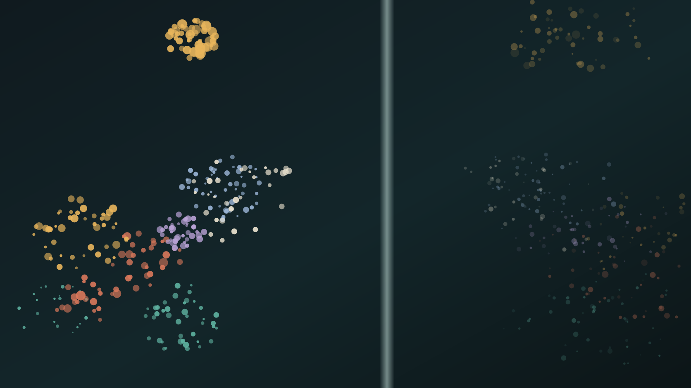
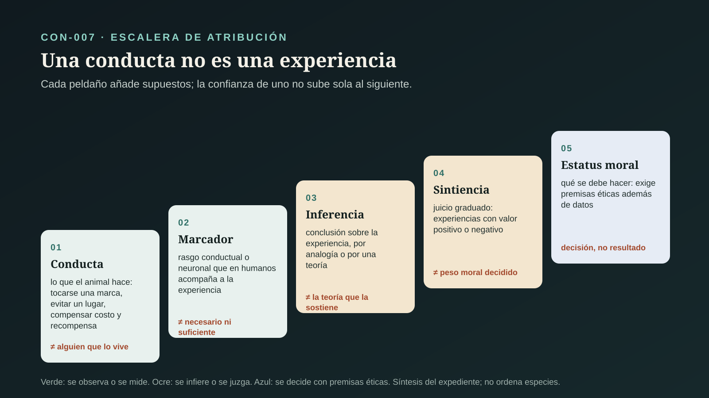
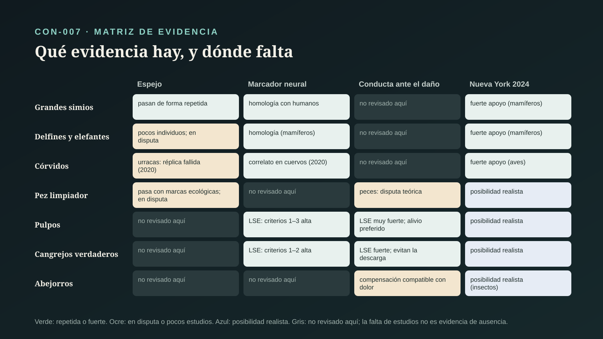

# CON-007 — ¿Qué podemos saber de la conciencia de otros animales?

> **Alcance:** este expediente audita cómo se ha estudiado la conciencia de animales no humanos: la prueba del espejo y sus críticas, los marcadores conductuales y neuronales, las declaraciones de Cambridge (2012) y de Nueva York (2024), la evidencia en invertebrados y peces, y el informe de la London School of Economics (LSE) de 2021 sobre pulpos, calamares, cangrejos y langostas. Separa cinco cosas que suelen mezclarse: **conducta**, **marcador**, **inferencia**, **sintiencia** y **estatus moral**. No vuelve a auditar si la conciencia es fundamental (CON-003), la obra de John C. Lilly con delfines (CON-004) ni la conciencia de máquinas, y no es una guía de bienestar animal ni una recomendación de política pública (`CLAIM-CON-ANI-SCOPE-001`).

## Pregunta central

¿Qué podemos saber, y con qué grado de confianza, de si otros animales tienen experiencias, cuando ninguno puede decirnos qué siente?

## Respuesta breve

**Podemos saber bastante sobre conductas y marcadores, algo menos sobre experiencias, y nada sobre estatus moral sin premisas éticas.** El campo avanzó cuando dejó de buscar una prueba única y empezó a separar niveles:

1. **La conducta se observa; la experiencia se infiere.** Que un animal se toque una marca frente al espejo, aprenda a evitar un lugar donde sufrió daño o cambie lo que hace según el costo y la recompensa son hechos reproducibles. Que esa conducta vaya acompañada de experiencia es una inferencia que depende de una teoría o de una analogía con los humanos, que sí pueden informar (`CLAIM-CON-ANI-FIVE-LEVELS-001`, `CLAIM-CON-ANI-NO-REPORT-001`).
2. **La prueba del espejo mide algo más estrecho de lo que se cree.** La pasan de forma repetida los chimpancés y otros grandes simios; en delfines, elefantes y urracas los resultados se basan en pocos individuos, y la réplica con urracas de 2020 no confirmó el hallazgo. Un pez limpiador la pasa con marcas ecológicamente relevantes, monos entrenados aprenden a pasarla y muchos niños de zonas rurales no occidentales no muestran la conducta esperada. Pasarla no prueba conciencia y no pasarla no prueba su ausencia (`CLAIM-CON-ANI-MIRROR-REPLICATION-001`, `CLAIM-CON-ANI-MIRROR-NOT-CONSCIOUSNESS-001`).
3. **Hay marcadores mejores que el espejo,** sobre todo los que separan procesamiento consciente e inconsciente dentro del mismo animal: monos con lesión visual que se comportan como en la «visión ciega» humana, y neuronas de cuervo cuya actividad tardía sigue a lo que el ave informa haber visto (`CLAIM-CON-ANI-BLINDSIGHT-001`, `CLAIM-CON-ANI-CORVID-001`).
4. **Las declaraciones son juicios de expertos, no experimentos.** Cambridge (2012) afirmó que mamíferos, aves y otros animales como el pulpo tienen los sustratos neurológicos de la conciencia; Nueva York (2024) distinguió «fuerte apoyo científico» en mamíferos y aves de una «posibilidad realista» en todos los vertebrados y muchos invertebrados. Ninguna de las dos aporta datos nuevos (`CLAIM-CON-ANI-CAMBRIDGE-LIMITS-001`, `CLAIM-CON-ANI-NEW-YORK-LIMITS-001`).
5. **La sintiencia se evalúa con criterios graduados.** El informe LSE de 2021 aplicó ocho criterios a más de 300 estudios: encontró evidencia muy fuerte en pulpos, fuerte en cangrejos verdaderos y sustancial en calamares, sepias, cangrejos anomuros, langostas y cangrejos de río, y advirtió que la falta de evidencia en grupos poco estudiados no es evidencia de que no sientan (`CLAIM-CON-ANI-LSE-2021-001`, `CLAIM-CON-ANI-LSE-ABSENCE-001`).

Lo que **no** se sigue: que pasar el espejo vuelva a un animal «más consciente», que un nociceptor sea dolor, que una declaración firmada demuestre algo, ni que la evidencia de sintiencia dicte por sí sola qué se debe hacer. Del dato a la obligación hay un paso ético que la ciencia informa pero no da (`CLAIM-CON-ANI-MORAL-STATUS-001`, `CLAIM-CON-ANI-VERDICT-001`).

## LO PREGUNTADO

### 1. Cinco niveles que no se heredan

El contrato de la serie ([`ESTANDAR_EVIDENCIA_CONCIENCIA.md`](ESTANDAR_EVIDENCIA_CONCIENCIA.md)) se aplica aquí como una escalera de cinco peldaños (`CLAIM-CON-ANI-FIVE-LEVELS-001`):

| Nivel | Qué es | Ejemplo | Qué no hereda |
|---|---|---|---|
| conducta | lo que el animal hace, medido en condiciones controladas | se raspa una marca frente al espejo; evita un lugar asociado a una descarga | que haya alguien que lo vive |
| marcador | rasgo conductual o neuronal que en humanos acompaña al procesamiento consciente | aprendizaje flexible, compensación entre costo y recompensa, actividad neuronal que sigue al informe perceptivo | que el marcador sea necesario o suficiente para la experiencia |
| inferencia | conclusión sobre la experiencia, apoyada en una teoría o una analogía | «probablemente siente dolor» | la teoría que la sostiene |
| sintiencia | capacidad de tener experiencias con valor positivo o negativo, como el dolor o el placer | juicio graduado sobre un grupo de animales | qué peso moral tiene esa experiencia |
| estatus moral | si el animal cuenta, y cuánto, en lo que se debe hacer | protección legal, reglas de sacrificio | se apoya en premisas éticas, no sólo en datos |

Un marcador puede estar bien medido y la inferencia seguir abierta; una inferencia de sintiencia puede ser razonable y el estatus moral seguir en disputa.

### 2. El problema de fondo: no hay reporte

En humanos, la ciencia de la conciencia se apoya en el informe: la persona dice si vio o no vio el estímulo. En animales no hay informe verbal. Nagel (1974) lo planteó como la pregunta de cómo es ser un murciélago; Edelman y Seth (2009) propusieron un marco que integra anatomía, fisiología y conducta y que usa la evidencia humana con reporte como referencia (`CLAIM-CON-ANI-NO-REPORT-001`). Es la pregunta que CON-003 dejó abierta en [`OPEN-CON-CF-ATTRIBUTION-001`](../17_preguntas_abiertas/PREGUNTAS_MAESTRAS.md): sin reporte, la atribución depende de la teoría. Este expediente no la cierra; muestra qué métodos la estrechan.

### 3. La parsimonia no es neutral

El canon de Morgan, una regla clásica de la psicología animal, pide no interpretar una conducta como resultado de una facultad superior si puede explicarse por una inferior. Fitzpatrick (2008) sostuvo que el canon no está justificado y que hay una regla mejor: elegir entre explicaciones según la evidencia, no según cuál parezca más «baja» (`CLAIM-CON-ANI-PARSIMONY-001`). El punto importa aquí porque hay dos errores posibles: atribuir experiencia de más y negarla de más. La parsimonia sólo protege contra el primero.

## LA PRUEBA DEL ESPEJO

### 4. Origen

Gallup (1970) expuso chimpancés a su reflejo durante un periodo prolongado y luego, bajo anestesia, les pintó una marca roja en zonas que sólo podían ver en el espejo. Al despertar, se tocaban la marca mirándose en el espejo. Los monos no mostraron esa capacidad (`CLAIM-CON-ANI-MIRROR-ORIGIN-001`). Nació así la «prueba de la marca», que durante décadas se leyó como un indicador de autoconciencia.

### 5. Más especies, pocos individuos

- **Delfines (2001).** Reiss y Marino expusieron a dos delfines a superficies reflejantes; ambos mostraron respuestas compatibles con usar el espejo para inspeccionar partes marcadas de su cuerpo. CON-004 ya registró este resultado (`CLAIM-CON-LILLY-MIRROR-001`).
- **Elefantes (2006).** Plotnik, de Waal y Reiss expusieron a tres elefantas asiáticas a un espejo grande y aplicaron marcas visibles y marcas falsas invisibles. Informaron un estudio exitoso y paralelos en la progresión de respuestas con simios y delfines. El resumen no dice cuántas de las tres pasaron; ese detalle no se verificó aquí.
- **Urracas (2008).** Prior, Schwarz y Güntürkün encontraron conducta dirigida a la marca en presencia del espejo; en el texto completo, dos de cinco aves la mostraron de forma significativa. Fue la primera evidencia publicada en un animal no mamífero (`CLAIM-CON-ANI-MIRROR-SPECIES-001`).

### 6. La réplica que no salió

Soler y colaboradores (2020) repitieron el experimento de las urracas con una muestra mayor y un protocolo muy parecido. Las aves mostraron más conducta social y dirigida a sí mismas frente al espejo que frente a un cartón, pero en la prueba de la marca la conducta dirigida a sí mismas fue **más frecuente frente al cartón que frente al espejo**. La réplica no confirmó el resultado; los autores aclaran que no lo refuta, pero pide cautela (`CLAIM-CON-ANI-MIRROR-REPLICATION-001`).

Gallup, el creador de la prueba, y Anderson (2018) fueron más lejos: sostuvieron que ni perros, elefantes, delfines, urracas, caballos, mantarrayas, calamares ni hormigas han dado evidencia convincente y reproducible de autorreconocimiento en ninguna modalidad. Es la postura más restrictiva del campo, sostenida por quien diseñó la prueba.

Hay una ironía documental: la Declaración de Cambridge de 2012 citó a las urracas como ejemplo de autorreconocimiento, ocho años antes de que la réplica fallara (§16).

### 7. Un pez que se raspa la garganta

Kohda y colaboradores (2019) informaron que el lábrido limpiador *Labroides dimidiatus* recorre las fases de la prueba: reacciones sociales al reflejo, conductas repetidas e idiosincrásicas frente al espejo y observación frecuente de su imagen. Con una marca de color en la garganta, intentaba quitársela raspándose contra el fondo, pero sólo frente al espejo; no lo hacía con marcas transparentes ni sin espejo. El artículo planteó el dilema de frente: o los peces tienen autoconciencia, o la prueba no mide lo que se creía (`CLAIM-CON-ANI-MIRROR-FISH-001`).

En 2022, el mismo grupo respondió a las críticas: 14 de 14 peces nuevos se rasparon la garganta con una marca café, siempre en presencia del espejo; las marcas azules o verdes no provocaron raspado; ver a otro pez con la misma marca no lo provocó. Pero inyectar la marca más profundo bajo la piel **sí provocó raspado sin espejo**, lo que confirma que la marca puede irritar. Los autores concluyeron que el pez pasa la prueba sólo con marcas ecológicamente relevantes, que parecen parásitos. En 2023 mostraron que, después de pasar la prueba, los peces dejaban de atacar fotografías de su propia cara y seguían atacando las de desconocidos, y propusieron que el mecanismo es una imagen mental de la propia cara.

### 8. La crítica al pez

De Waal (2019), editor académico del artículo de 2019, publicó junto a él un comentario: la conducta es ambigua, las marcas usadas eran físicamente irritantes y el resultado se queda corto como autorreconocimiento; sugiere un nivel intermedio de comprensión del espejo, más cercano al de los monos que al de los homínidos. Propuso abandonar la visión binaria —una especie tiene o no tiene autoconciencia— por una gradual (`CLAIM-CON-ANI-MIRROR-FISH-CRITIQUE-001`). La revista señaló que el artículo recibió revisiones positivas y negativas.

### 9. Lo que el espejo mide, y lo que no

Tres resultados obligan a estrechar la lectura de la prueba:

- **Se puede entrenar.** Chang y colaboradores (2015) entrenaron monos rhesus durante dos a cinco semanas a tocar un punto de luz láser que les irritaba la cara frente al espejo. Después, cinco de siete monos entrenados mostraron conductas típicas de autorreconocimiento en su jaula; cuatro monos de control, con la misma exposición al espejo pero sin entrenamiento, no pasaron ninguna prueba (`CLAIM-CON-ANI-MIRROR-TRAINING-001`).
- **Depende de la cultura.** Broesch y colaboradores (2011) aplicaron una versión simplificada de la prueba a niños. En Kenia, 82 niños de 18 a 72 meses mostraron una marcada ausencia de conducta espontánea hacia la marca. En Fiyi, Santa Lucía, Granada y Perú, muchos menos niños que en Canadá y Estados Unidos la mostraron. Los autores cuestionaron la validez de la prueba como índice universal del concepto de sí mismo (`CLAIM-CON-ANI-MIRROR-CULTURE-001`). Si niños humanos, que sin duda son conscientes, «fallan», el fallo no puede leerse como ausencia.
- **Depende del medio.** Suddendorf y Butler (2013) revisaron que reconocerse en un espejo, en una fotografía o en un video produce respuestas conductuales y cerebrales distintas, y propusieron que el autorreconocimiento visual de humanos y grandes simios es un subproducto de una capacidad general de cotejar representaciones, que no tiene por qué indicar otros aspectos de la autoconciencia (`CLAIM-CON-ANI-MIRROR-MEASURES-001`).

La conclusión de esta parte es acotada (`CLAIM-CON-ANI-MIRROR-NOT-CONSCIOUSNESS-001`): la prueba del espejo mide, en el mejor caso, si un animal usa su reflejo para explorar su propio cuerpo. No mide conciencia en general ni sintiencia. Pasarla no demuestra experiencia; no pasarla tampoco demuestra su ausencia, porque muchos animales dependen más del olfato que de la vista, no tienen extremidades para tocarse o no tienen motivo para quitarse una marca.

## LOS MARCADORES

### 10. Marcadores conductuales

Los marcadores conductuales que se usan hoy no buscan autoconciencia, sino rasgos que en humanos acompañan a la experiencia de dolor o de placer. El marco de Crump, Browning, Schnell, Burn y Birch (2022), derivado del informe LSE, usa ocho criterios; cinco son conductuales (`CLAIM-CON-ANI-BEHAVIOR-MARKERS-001`):

- respuestas modificadas por posibles anestésicos locales o analgésicos;
- compensaciones motivacionales: equilibrar una amenaza contra la oportunidad de una recompensa;
- conductas flexibles de autoprotección ante la lesión o la amenaza;
- aprendizaje asociativo que va más allá de la habituación y la sensibilización;
- conducta que muestra que el animal valora un anestésico o analgésico cuando está herido.

Ninguno es una «prueba irrefutable» por sí solo; el propio informe lo dice.

### 11. Marcadores neuronales

Los otros tres criterios son neuronales: tener nociceptores (receptores que detectan estímulos que dañan los tejidos), regiones cerebrales que integran información de muchas fuentes y conexiones entre ambos (`CLAIM-CON-ANI-NEURAL-MARKERS-001`). El informe advierte que el primero puede cumplirlo con facilidad un animal no sintiente. Boly y colaboradores (2013) reseñaron avances en el estudio de la conciencia en humanos y en otros animales, como el papel de la conectividad frontoparietal y del tálamo de orden superior, y Edelman y Seth (2009) aplicaron un marco de homologías y analogías neuronales a aves y cefalópodos.

### 12. El mejor tipo de marcador: separar lo consciente de lo no consciente en el mismo animal

Los marcadores más informativos no comparan especies, sino estados dentro del mismo animal:

- **Visión ciega en monos (1995).** Las personas con destrucción de la corteza visual primaria pueden señalar estímulos que dicen no ver: es la «visión ciega». Los monos con la misma lesión también localizan y distinguen estímulos en la zona dañada, pero no se sabía si los veían. Cowey y Stoerig los pusieron en una tarea con ensayos en blanco, sin estímulo: los monos clasificaron los estímulos presentados en la zona dañada como ensayos en blanco. Es decir, se comportaron como pacientes con visión ciega y no como animales con visión degradada (`CLAIM-CON-ANI-BLINDSIGHT-001`). El método convierte una conducta en algo parecido a un informe: «no hubo nada».
- **Cuervos (2020).** Nieder, Wagener y Rinnert registraron neuronas del palio de cuervos entrenados a informar si habían visto un estímulo cerca del umbral. La actividad tenía dos etapas: la primera seguía sobre todo a la intensidad física del estímulo y la segunda predecía lo que el ave informaba haber visto. Los autores lo propusieron como marcador empírico de conciencia sensorial en un cerebro sin corteza en capas (`CLAIM-CON-ANI-CORVID-001`).

Ambos estudios separan, dentro de un animal, el procesamiento del estímulo y su acceso al informe, que es lo que la ciencia de la conciencia humana usa como correlato. Lo que no hacen es cerrar el paso a la experiencia: un informe entrenado también es conducta.

### 13. ¿Hace falta la corteza?

La interpretación de esos marcadores depende de una disputa teórica abierta (`CLAIM-CON-ANI-CORTEX-DEBATE-001`):

- **Merker (2007)** reunió evidencia comparada, experimental y clínica para sostener que un sistema del tronco encefálico superior es parte constitutiva del estado consciente, lo que explicaría la conducta dirigida a metas de mamíferos sin corteza y la evidencia de que niños nacidos sin corteza son conscientes. Si tiene razón, la ausencia de corteza no descarta la experiencia.
- **LeDoux (2012)** propuso estudiar los «circuitos de supervivencia» que comparten humanos y otros animales sin suponer que en ellos haya sentimientos conscientes, y **LeDoux y Brown (2017)** defendieron una teoría de orden superior: las experiencias conscientes, también las emocionales, surgen de una red cortical general de la cognición, y los circuitos subcorticales aportan entradas no conscientes. Si tienen razón, muchas conductas «emocionales» en animales no implican sentimientos.

Seth y Bayne (2022) muestran que las teorías principales de la conciencia hacen compromisos neurobiológicos distintos y que todavía no está claro cómo separarlas empíricamente. Como cada teoría dicta qué animales califican, la atribución de experiencia hereda la incertidumbre de la teoría.

### 14. Una salida: teoría ligera y dimensiones

- **Teoría ligera.** Birch (2020, en línea; volumen de 2022) distinguió tres enfoques para la conciencia en invertebrados: los que parten de una teoría completa, los que pretenden no usar ninguna y uno intermedio. Propuso el intermedio con un compromiso mínimo, compatible con muchas teorías: que percibir un estímulo de forma consciente facilita, frente a percibirlo de forma inconsciente, un conjunto de capacidades cognitivas. Lo que haría falta, según él, es buscar esas capacidades, ver si se agrupan y si desaparecen con el enmascaramiento (`CLAIM-CON-ANI-THEORY-LIGHT-001`).
- **Dimensiones.** Birch, Schnell y Clayton (2020) propusieron que la conciencia varía entre especies en al menos cinco dimensiones: riqueza perceptiva, riqueza evaluativa, integración en un momento, integración a lo largo del tiempo y conciencia de sí. Cada especie tendría su propio perfil; no hay una sola escala en la que ordenar a las especies como más o menos conscientes (`CLAIM-CON-ANI-DIMENSIONS-001`, `CLAIM-CON-ANI-NO-SCALE-001`).
- **Pruebas de conciencia.** Bayne y colaboradores (2024) revisaron las «pruebas de conciencia» propuestas para personas sin reporte, fetos, animales, organoides y sistemas de inteligencia artificial: la mayoría tiene un uso limitado y no hay pruebas para muchas de las poblaciones donde más se necesitan. Propusieron una clasificación y estrategias para validarlas (`CLAIM-CON-ANI-C-TESTS-001`).

## LAS DECLARACIONES

### 15. Cambridge, 2012

El 7 de julio de 2012, en la Conferencia Francis Crick sobre la conciencia en animales humanos y no humanos, en la Universidad de Cambridge, se proclamó una declaración escrita por Philip Low y editada por Jaak Panksepp, Diana Reiss, David Edelman, Bruno van Swinderen, el propio Low y Christof Koch; los participantes la firmaron esa noche. Su texto enumera observaciones sobre circuitos homólogos, emociones con sustratos subcorticales, aves como caso de evolución paralela —con los loros grises africanos, el sueño REM en aves y las urracas frente al espejo— y alucinógenos. Su conclusión: la ausencia de neocorteza no parece impedir estados afectivos; animales no humanos, incluidos todos los mamíferos y aves y muchos otros, como el pulpo, poseen los sustratos neurológicos que generan la conciencia (`CLAIM-CON-ANI-CAMBRIDGE-2012-001`).

### 16. Lo que Cambridge no es

Es una declaración de expertos que se publicó en el sitio de la conferencia, no un artículo revisado por pares ni un experimento (`CLAIM-CON-ANI-CAMBRIDGE-LIMITS-001`). Afirma que sus observaciones pueden enunciarse «de forma inequívoca», aunque varias son interpretaciones; una de sus pruebas, el autorreconocimiento de las urracas, no se confirmó en la réplica de 2020; y su conclusión habla de **sustratos**, no de experiencias demostradas. Tener los sustratos que en humanos acompañan a la conciencia es un argumento por analogía: fuerte para mamíferos, plausible para aves y más débil cuanto más lejana es la anatomía.

### 17. Nueva York, 2024

El 19 de abril de 2024 se presentó en la Universidad de Nueva York una declaración cuyos primeros firmantes son Kristin Andrews, Jonathan Birch y Jeff Sebo. Tiene tres puntos (`CLAIM-CON-ANI-NEW-YORK-2024-001`):

1. hay **fuerte apoyo científico** para atribuir experiencia consciente a otros mamíferos y a las aves;
2. la evidencia empírica indica **al menos una posibilidad realista** de experiencia consciente en todos los vertebrados —reptiles, anfibios y peces incluidos— y en muchos invertebrados, como mínimo moluscos cefalópodos, crustáceos decápodos e insectos;
3. cuando hay una posibilidad realista de experiencia consciente en un animal, es irresponsable ignorarla en decisiones que lo afectan; hay que considerar los riesgos para su bienestar y usar la evidencia para decidir la respuesta.

La página de la declaración mostraba 617 firmas al consultarla el 26 de noviembre de 2026. En 2025, sus tres primeros firmantes presentaron en *Science* el estudio de la conciencia animal como un campo emergente que muestra cómo pueden estudiarse científicamente los sentimientos de los animales (Andrews, Birch y Sebo, 2025).

### 18. Lo que Nueva York sí cambia y lo que no

Nueva York es más cuidadosa que Cambridge: gradúa la confianza (fuerte apoyo frente a posibilidad realista), no afirma que los peces o los insectos sean conscientes y separa explícitamente el juicio científico del punto ético (`CLAIM-CON-ANI-NEW-YORK-LIMITS-001`). Pero sigue siendo una declaración: el número de firmas no es un dato sobre los animales, «posibilidad realista» es un umbral de decisión y no una medida, y el tercer punto es una premisa ética, no un resultado. Su fuerza es la de un consenso informado que puede cambiar; su límite, que no sustituye a los estudios que cita.

## LOS INVERTEBRADOS Y LOS PECES

### 19. Pulpos

Mather (2008) reunió evidencia conductual de que los cefalópodos, sobre todo los pulpos, aprenden de forma flexible con señales visuales y táctiles, forman conceptos simples y recuerdan zonas de forrajeo recientes, y propuso que podrían tener una forma de conciencia primaria. Crook (2021) dio un paso más preciso: en pruebas de preferencia de lugar condicionada, los pulpos evitaron el lugar donde sufrieron una inyección dolorosa, prefirieron el lugar donde recibieron alivio y no mostraron preferencia sin dolor. El acicalamiento del sitio de la inyección ocurrió en todos los animales y desapareció con anestesia local. La autora concluyó que los pulpos probablemente experimentan el componente afectivo del dolor (`CLAIM-CON-ANI-OCTOPUS-001`).

### 20. Cangrejos

Magee y Elwood (2013) pusieron cangrejos de costa en una cámara iluminada con dos refugios oscuros; uno daba una descarga. Los cangrejos que recibían descarga cambiaban de refugio en el siguiente ensayo y muchos salieron del refugio con descarga hacia la zona iluminada, que normalmente evitan. Cuando se cambiaba su orientación, volvían al refugio con descarga: habían aprendido por dirección de movimiento, no por señales visuales. Los autores lo consideraron compatible con un criterio clave de dolor: aprendizaje rápido de evitación, más allá de un reflejo (`CLAIM-CON-ANI-CRAB-001`).

### 21. Abejas

- **Compensación ante el daño (2022).** Gibbons y colaboradores ofrecieron a abejorros comederos con agua azucarada, unos calentados a una temperatura nociva y otros no, marcados con colores. Evitaban los calientes si los fríos tenían mucha azúcar, pero los usaban cada vez más cuando bajaba el azúcar de los fríos. Como la decisión se basaba en colores aprendidos, la compensación ocurre en el cerebro, no sólo en la periferia. Los autores lo consideraron compatible con una capacidad de experiencia de dolor. El artículo tiene una fe de erratas de 2025 que no se revisó aquí (`CLAIM-CON-ANI-BEES-001`).
- **Estados parecidos a emociones (2016).** Abejorros que recibían una gota inesperada de azúcar respondían de forma más «optimista» a señales ambiguas y volvían antes a forrajear tras un ataque simulado; el efecto desaparecía con un antagonista de la dopamina.
- **Reconocimiento entre sentidos (2020).** Abejorros entrenados a distinguir cubos y esferas sólo al tacto, en la oscuridad, los distinguían luego sólo con la vista, y al revés. Los autores concluyen que integran la información en representaciones que no dependen de un solo sentido.

### 22. La propuesta teórica para insectos

Barron y Klein (2016) sostuvieron que en los vertebrados la experiencia subjetiva depende de estructuras del mesencéfalo que crean una simulación integrada del animal en el espacio, que el cerebro de los insectos tiene estructuras con funciones análogas y que, por tanto, los insectos tendrían capacidad de experiencia subjetiva, con orígenes que se remontarían al Cámbrico (`CLAIM-CON-ANI-INSECT-THEORY-001`). Es un argumento que depende de una teoría concreta —la de Merker—; si esa teoría falla, falla el argumento. Recibió tres respuestas publicadas en la misma revista.

### 23. Peces: la disputa del dolor

Los peces muestran la disputa en su forma más pura (`CLAIM-CON-ANI-FISH-PAIN-001`):

- **A favor.** Sneddon, Braithwaite y Gentle (2003) registraron en la trucha arcoíris nociceptores polimodales con propiedades parecidas a los de otros vertebrados y mostraron que una sustancia nociva en los labios aumentaba la frecuencia respiratoria, retrasaba la vuelta a comer y producía conductas anómalas durante un periodo prolongado, lo que sugería malestar.
- **En contra.** Key (2016) sostuvo que la estructura determina la función y que los peces carecen de la citoarquitectura, los microcircuitos y la conectividad que, en humanos, procesan el dolor sentido. Rose y colaboradores (2012, en línea; volumen de 2014) revisaron los estudios a favor y encontraron deficiencias para separar la detección inconsciente del daño (nocicepción) del dolor consciente, resultados mal interpretados o no replicables, y concluyeron que es poco probable que los peces experimenten dolor.

Los dos bandos coinciden en los datos de nocicepción y discrepan en la teoría: si la experiencia de dolor exige una estructura parecida a la corteza humana o si puede surgir de otra organización. Es la disputa de §13 en un caso concreto.

## EL INFORME LSE DE 2021

### 24. Ocho criterios, más de 300 estudios

En noviembre de 2021, Birch, Burn, Schnell, Browning y Crump entregaron al Departamento de Medio Ambiente, Alimentación y Asuntos Rurales del Reino Unido (Defra), por medio de LSE Consulting, una revisión de la evidencia de sintiencia en moluscos cefalópodos y crustáceos decápodos. Definieron sintiencia como la capacidad de tener sentimientos, como dolor, placer, hambre, sed, calor, alegría, comodidad o excitación, y aplicaron los ocho criterios de §10 y §11 a más de 300 estudios, con seis niveles de confianza por criterio (`CLAIM-CON-ANI-LSE-2021-001`). El esquema de calificación fue aproximado: confianza alta o muy alta en siete o más criterios es evidencia **muy fuerte**; en cinco o más, **fuerte**; en tres o más, **sustancial**.

| Grupo | Criterios con confianza alta o muy alta | Resultado |
|---|---|---|
| pulpos | 1, 2, 3, 4, 6, 7 y 8 (confianza media en 5) | evidencia muy fuerte |
| otros cefalópodos coleoideos (calamares y sepias) | 1, 2, 3 y 7 | evidencia sustancial |
| cangrejos verdaderos (braquiuros) | 1, 2, 4, 6 y 7 | evidencia fuerte |
| cangrejos anomuros | 1, 2 y 6 (confianza media en 5) | evidencia sustancial |
| langostas y cangrejos de río (astácidos) | 1, 2 y 4 | evidencia sustancial |
| nautiloideos y camarones peneidos | apenas estudiados | evidencia insuficiente para calificar |

### 25. La regla de la ausencia

El informe hizo tres advertencias que son el centro epistemológico del expediente (`CLAIM-CON-ANI-LSE-ABSENCE-001`):

- **confianza baja no es improbabilidad:** significa que la evidencia en un sentido u otro es escasa o de baja calidad;
- **no hubo ningún caso** en que se tuviera confianza alta o muy alta de que un grupo **no** cumple un criterio; cuando no se alcanzó confianza alta fue por falta de evidencia positiva;
- **la evidencia sigue a la atención:** pulpos y cangrejos verdaderos se han estudiado mucho, nautiloideos y camarones peneidos casi nada. Los autores aclaran también que eligieron estos grupos porque eran candidatos plausibles y que con otros animales, como las medusas, quizá habrían encontrado criterios claramente incumplidos.

### 26. De la evidencia a la ley

La recomendación central fue considerar sintientes a **todos** los cefalópodos y decápodos para la ley británica de bienestar animal, sin restringirla a los grupos mejor estudiados, por la misma razón por la que la ley protege a todos los vertebrados a partir de especies de laboratorio. El informe añadió recomendaciones sobre prácticas comerciales, como no hervir vivos a los decápodos cuando existe un método más humano y no arrancarles las pinzas. Este expediente las registra como contenido del informe, no como recomendaciones propias.

La Ley de Bienestar Animal (Sintiencia) de 2022 del Reino Unido, con sanción real del 28 de abril de 2022, define como «animal», para sus fines, a cualquier vertebrado distinto del ser humano, a cualquier molusco cefalópodo y a cualquier crustáceo decápodo, y crea un Comité de Sintiencia Animal para que el gobierno rinda cuentas al Parlamento sobre cómo sus políticas consideran el bienestar de los animales como seres sintientes (`CLAIM-CON-ANI-UK-LAW-001`). La ley reconoce y obliga a considerar; no prohíbe por sí misma las prácticas que el informe señalaba. El texto de la ley se conoce aquí por un resumen oficial del gobierno británico y por sus notas explicativas; la página de la ley no pudo descargarse.

## DE LA SINTIENCIA AL ESTATUS MORAL

### 27. Dos sentidos de «sintiencia»

Browning y Birch (2022) señalan que «sintiencia» se usa en dos sentidos: la capacidad de tener cualquier experiencia subjetiva o la capacidad de tener experiencias con valor positivo o negativo, como el dolor o el placer. Este expediente usa el segundo, que es el del informe LSE y el que importa para el bienestar. Es distinto de la conciencia de sí que la prueba del espejo intenta medir: un animal podría sentir dolor sin reconocerse en un espejo, y al revés (`CLAIM-CON-ANI-SENTIENCE-DEF-001`).

### 28. Lo que la ciencia no decide

Que un animal probablemente sienta dolor no dice, por sí solo, cuánto debe pesar ese dolor frente a otros intereses ni qué reglas deben seguirse (`CLAIM-CON-ANI-MORAL-STATUS-001`). Hacen falta premisas éticas: que el sufrimiento importa moralmente, cómo se comparan intereses, qué riesgos se aceptan con incertidumbre. Birch (2024) propone un marco precautorio para decidir con incertidumbre sobre la sintiencia, y el tercer punto de Nueva York es una versión de esa premisa. Son propuestas éticas razonadas que usan la ciencia; no son hallazgos científicos. El error tiene dos direcciones: convertir «probablemente sintiente» en un veredicto moral cerrado, y convertir «no demostrado» en permiso para ignorarlo.

### 29. No hay una escala única

Una consecuencia del marco de dimensiones es que la pregunta «¿qué animal es más consciente?» está mal planteada (`CLAIM-CON-ANI-NO-SCALE-001`). Un pulpo puede tener un perfil rico en integración perceptiva y pobre en conciencia de sí; un chimpancé, otro. Pasar la prueba del espejo no coloca a un animal más arriba en una escala de experiencia, ni a un pez por encima de un perro que no la pasa.

## LO QUE HARÍA FALTA

### 30. Qué contaría

Para pasar de marcadores a una atribución de experiencia mejor fundada haría falta (`CLAIM-CON-ANI-WHAT-WOULD-COUNT-001`):

1. **marcadores validados en humanos con reporte** que luego se busquen en animales, como la separación entre procesamiento consciente e inconsciente con enmascaramiento;
2. **réplicas independientes** de los hallazgos de espejo y de dolor con muestras mayores y protocolos preregistrados;
3. **estudios en grupos poco atendidos** —camarones peneidos, nautiloideos, peces de cultivo, insectos distintos de las abejas— para que la falta de evidencia deje de confundirse con evidencia de ausencia;
4. **pruebas discriminantes entre teorías** de la conciencia, porque cada teoría dicta qué animales califican;
5. **para el estatus moral,** discusión explícita de las premisas éticas y de cómo decidir con incertidumbre, separada de los resultados.

## LO QUE IMPLICA PARA ESTE PROYECTO

### 31. Atribuir sin reporte

Este expediente aplica a los animales la lección que la serie aplicó a la percepción, a la física y a las sustancias (`CLAIM-CON-ANI-PROJECT-001`): una medición sólida no hereda la interpretación que se le pone encima. En el resto del proyecto vale igual: cuando se lea que «los peces sienten dolor» o que «los peces no pueden sentir dolor», la pregunta útil es en qué nivel está la afirmación —conducta, marcador, inferencia, sintiencia o estatus moral— y qué teoría la sostiene.

## Casos y controles de interpretación

| Caso | Nivel | Lo establecido | Inferencia permitida | Límite |
|---|---|---|---|---|
| chimpancés frente al espejo (1970) | conducta | se tocan una marca que sólo ven reflejada | usan el espejo para explorar su cuerpo | no mide conciencia en general |
| urracas (2008) y su réplica (2020) | conducta | dos de cinco aves en 2008; la réplica no lo confirmó | resultado por confirmar | muestras pequeñas |
| lábrido limpiador (2019–2023) | conducta | se raspa marcas parecidas a parásitos frente al espejo | pasa la prueba en contexto ecológico | marcas profundas provocan raspado sin espejo |
| monos entrenados (2015) y niños de varias culturas (2011) | control | la prueba se aprende y depende de la cultura | la prueba mide una conducta aprendible | fallar no es ausencia de conciencia |
| visión ciega en monos (1995) | marcador | estímulos en la zona dañada clasificados como «nada» | disociación como en humanos | conducta entrenada, no informe verbal |
| cuervos (2020) | marcador | actividad tardía que predice el informe perceptivo | correlato de conciencia sensorial sin corteza en capas | depende de que el informe entrenado refleje experiencia |
| pulpos (2021) | marcador de sintiencia | evitación del lugar del dolor y preferencia por el alivio | probable componente afectivo | pocos animales; un laboratorio |
| abejorros (2016–2022) | marcador de sintiencia | compensación entre daño y recompensa, estados parecidos a emociones | compatible con dolor | compatible no es demostrado |
| peces (2003–2016) | disputa teórica | nocicepción y conducta alterada | depende de la teoría | la corteza como requisito sigue en disputa |
| Cambridge (2012) y Nueva York (2024) | declaración | juicio de expertos firmado | consenso informado | no aporta datos; una prueba citada no se replicó |
| informe LSE (2021) | sintiencia | criterios graduados por grupo | proteger a todos los cefalópodos y decápodos | la evidencia sigue a la atención |
| ley británica de 2022 | estatus moral y legal | cefalópodos y decápodos incluidos | reconocimiento legal | no prohíbe prácticas por sí misma |

## LO OBSERVADO

Se observan conductas frente a espejos, fotografías y marcas; elecciones entre comederos, refugios y compartimentos; respuestas a sustancias nocivas y a anestésicos; actividad de neuronas y de nervios periféricos; frecuencias respiratorias y tiempos de alimentación; y textos: dos declaraciones firmadas, un informe técnico y una ley. No se observa, en ningún caso, la experiencia de un animal.

## LO MEDIDO

Se miden frecuencias de conducta dirigida a una marca y de conductas sociales ante el reflejo, proporciones de individuos que pasan o no una prueba, preferencias de lugar condicionadas, elecciones en compensaciones entre costo y recompensa, respuestas de nociceptores a presión, calor y ácido, actividad de neuronas individuales en relación con el informe perceptivo, y, en el informe LSE, niveles de confianza por criterio y por grupo. Este expediente no mide nada propio: reúne y compara lo publicado.

## LO INFERIDO

Se infiere que la prueba del espejo mide el uso del reflejo para explorar el propio cuerpo, que es entrenable, depende de la cultura y del medio, y que no mide conciencia en general; que hay marcadores mejores que separan procesamiento consciente e inconsciente dentro del mismo animal; que en mamíferos y aves la evidencia de experiencia es fuerte; que en pulpos y cangrejos verdaderos la evidencia de sintiencia es muy fuerte o fuerte según criterios explícitos; que en peces e insectos la conclusión depende de la teoría; y que el estatus moral requiere premisas éticas adicionales. No se infiere que algún animal sea «más consciente» que otro en una escala única, ni que una declaración demuestre algo, ni que la falta de estudios sea evidencia de que un animal no siente.

## LOS SUPUESTOS

Que los resúmenes revisados reflejan los artículos. Que los marcadores que acompañan a la experiencia en humanos tienen algún valor como indicio en otros animales. Que la conducta entrenada de informar «visto» o «no visto» refleja algo parecido a un informe. Que el informe LSE resume con fidelidad los estudios que revisó. Que el resumen oficial del gobierno británico describe con fidelidad la ley.

## LAS INCERTIDUMBRES

Qué teoría de la conciencia es correcta, y con ella qué estructuras son necesarias. Si los hallazgos de espejo en delfines, elefantes, urracas y peces se replican con muestras mayores. Si los marcadores de dolor en insectos y peces se deben a experiencia o a procesamiento no consciente. Cómo se distribuye la sintiencia en los grupos casi no estudiados. Cómo traducir una probabilidad de sintiencia en decisiones, que es una pregunta ética.

## LAS ALTERNATIVAS

Leer la conciencia animal como un todo o nada que la prueba del espejo detecta; como una propiedad exclusiva de animales con corteza parecida a la humana; como una capacidad extendida por casi todo el reino animal con estructuras distintas; o, como propone este expediente, como un conjunto de capacidades graduadas en varias dimensiones, que se atribuye por niveles con confianza decreciente y cuya consecuencia moral se decide aparte.

## LAS CONTROVERSIAS

Siguen abiertas: qué mide la prueba del espejo; si el lábrido limpiador la pasa en el mismo sentido que los grandes simios; si la experiencia exige una corteza o algo equivalente; si los insectos tienen experiencia; y qué umbral de evidencia basta para proteger a un grupo de animales. Se indexan en `CONTROVERSIES.md`. Las preguntas abiertas que deja este expediente son `OPEN-CON-ANI-MARKERS-001`, `OPEN-CON-ANI-INVERTEBRATE-001` y `OPEN-CON-ANI-CORTEX-001`.

## QUÉ PODRÍA FALSARLO

Esta síntesis deberá revisarse si:

- una réplica independiente y preregistrada confirma o descarta el autorreconocimiento en urracas, elefantes, delfines o peces limpiadores;
- un marcador validado con reporte en humanos se encuentra, o se busca con rigor y no se encuentra, en peces, cefalópodos o insectos;
- una prueba discriminante entre teorías de la conciencia decide si la corteza o una estructura equivalente es necesaria;
- estudios en grupos poco atendidos encuentran evidencia clara de que no cumplen criterios de sintiencia, o de que sí;
- cambia la ley británica o se adoptan leyes que incluyan o excluyan a otros invertebrados.

## NIVEL DE CONFIANZA

**A:** los resultados publicados de las pruebas del espejo, de su réplica fallida, del entrenamiento en monos y de las diferencias culturales en niños, como datos; la disociación de visión ciega en monos y el correlato en cuervos, como datos; el contenido de las dos declaraciones, del informe LSE y de la definición legal británica. **A-SEM:** la separación entre conducta, marcador, inferencia, sintiencia y estatus moral; que el espejo no mide conciencia en general; que una declaración no es una prueba; que no hay una escala única. **B:** que mamíferos y aves tienen experiencia consciente; que los pulpos y los cangrejos verdaderos son sintientes; que el lábrido limpiador pasa la prueba en un sentido comparable al de los simios. **C:** que los peces y los insectos sienten dolor, o que no lo sienten. **E:** que pasar el espejo vuelva a un animal más consciente, o que la falta de estudios demuestre que un animal no siente.

## QUÉ SABEMOS REALMENTE

Sabemos que los grandes simios usan el espejo para explorar su cuerpo y que otras especies dan resultados en pocos individuos que no siempre se replican. Sabemos que esa prueba se puede entrenar y depende de la cultura y del medio. Sabemos que hay marcadores que separan procesamiento consciente e inconsciente dentro de un mismo animal y que se han encontrado en monos y en cuervos. Sabemos que pulpos, cangrejos y abejorros hacen cosas que, en humanos, acompañan al dolor sentido, y que con ocho criterios explícitos la evidencia de sintiencia es muy fuerte en pulpos y fuerte en cangrejos verdaderos. Sabemos que dos declaraciones de expertos y una ley británica recogieron ese estado de la evidencia.

## QUÉ TODAVÍA NO SABEMOS

No sabemos qué teoría de la conciencia es correcta ni, por tanto, qué estructuras hacen falta. No sabemos si los peces y los insectos sienten. No sabemos casi nada de los grupos que nadie ha estudiado. Y la ciencia, por sí sola, no puede decirnos cuánto debe pesar el posible sufrimiento de un animal: esa es una pregunta ética que los datos informan sin resolver.

## Conclusión

Durante medio siglo, la prueba del espejo fue la pregunta y la respuesta: quien se reconocía, era consciente. Hoy sabemos que mide algo más estrecho y más frágil, y que la conciencia animal se estudia mejor por niveles: lo que el animal hace, los rasgos que en humanos acompañan a la experiencia, la inferencia que une ambos, el juicio sobre si siente, y la decisión sobre qué le debemos.

La respuesta rigurosa no es «todos los animales son conscientes» ni «sólo los que se reconocen en el espejo». Es ésta: en mamíferos y aves la evidencia de experiencia es fuerte; en pulpos y cangrejos la evidencia de sintiencia es fuerte por criterios explícitos; en peces e insectos la respuesta depende de una teoría que aún no se decide; y lo que se haga con esa incertidumbre es una decisión ética, no un resultado de laboratorio (`CLAIM-CON-ANI-VERDICT-001`).

## Fuentes y fecha de corte

Fuentes auditadas en `SOURCES.md`. Corte: `2026-11-26`. Las fuentes con DOI se verificaron contra Crossref: título, año, autores, revista, volumen y páginas. Los resúmenes de los artículos se revisaron en PubMed o, cuando PubMed no los tenía, en el resumen registrado en Crossref o en Semantic Scholar; los textos completos no se revisaron salvo el de las urracas (2008), en PubMed Central, para contar cuántas aves pasaron la prueba. La Declaración de Cambridge se leyó completa en una copia en PDF del texto de 2012 alojada en la Universidad de California en Berkeley; la Declaración de Nueva York, en su página oficial, el 26 de noviembre de 2026; el informe LSE, en su texto publicado por la LSE (resumen ejecutivo y prólogo completos). La ley británica se conoce por un resumen oficial del gobierno y por sus notas explicativas; la página de la ley no se pudo descargar. El libro de Birch (2024) se revisó sólo en su resumen. El nombre de la primera autora de dos estudios con abejorros aparece en Crossref y PubMed como Solvi; se cita así. Este expediente no es una guía de bienestar animal ni una recomendación de política pública.
