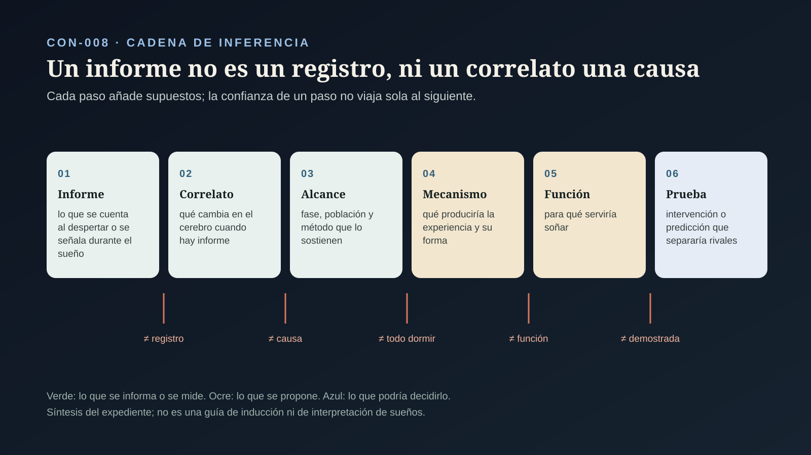
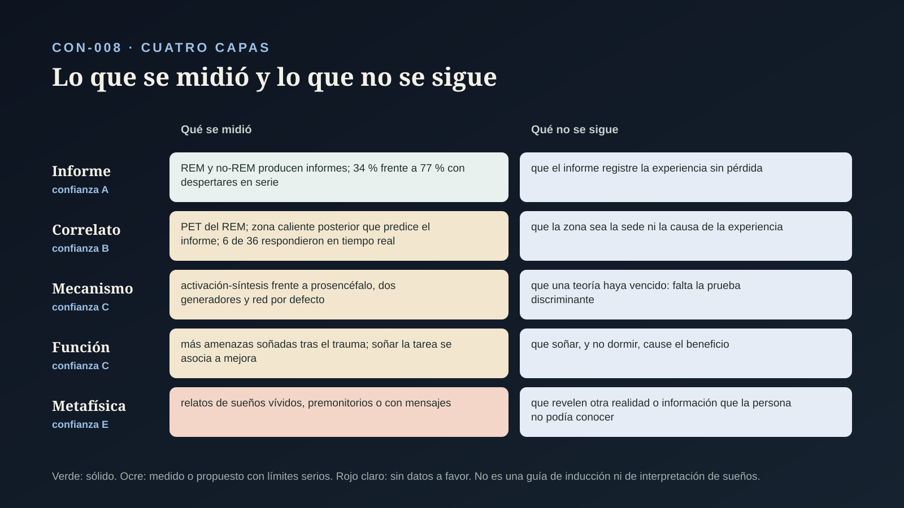

# CON-008 — ¿Qué sabemos de los sueños y del sueño lúcido?

> **Alcance:** este expediente audita qué se ha medido sobre los sueños y el sueño lúcido desde el descubrimiento del sueño REM (1953) hasta la comunicación en tiempo real con soñadores (2021) y sus continuaciones al corte. Separa cuatro capas que suelen mezclarse: el **informe** (lo que alguien dice al despertar), el **correlato** (qué cambia en el cerebro cuando hay informe), el **mecanismo** (qué produce la experiencia) y la **función** (para qué serviría soñar). No vuelve a auditar si la conciencia es fundamental (CON-003) ni los estados alterados por sustancias (CON-006) (`CLAIM-CON-DREAM-SCOPE-001`).

> **Lo que este expediente no es:** no es una guía para inducir sueños lúcidos, ni para interpretar sueños, ni un tratamiento de pesadillas o de trastornos del sueño. Las técnicas de inducción se nombran sólo como objeto de estudio y no se describen sus pasos; los fármacos que aparecen en los estudios se mencionan sin dosis. Las pesadillas frecuentes, el insomnio, la parálisis del sueño o la somnolencia diurna son motivos para hablar con un profesional de la salud, no para experimentar por cuenta propia (`CLAIM-CON-DREAM-NOT-ADVICE-001`).

## Pregunta central

¿Qué podemos saber de una experiencia que ocurre mientras la persona no puede contarla, y qué parte de lo que se dice de los sueños es informe, qué parte correlato, qué parte mecanismo y qué parte una función todavía no demostrada?

## Respuesta breve

**Soñar es una experiencia real y medible por sus informes; su mecanismo y su función siguen en disputa** (`CLAIM-CON-DREAM-VERDICT-001`). Lo que la evidencia sostiene:

1. **El sueño REM no es lo mismo que soñar.** El REM se descubrió en 1953 y despertar a la gente en esa fase produce informes de sueños con mucha frecuencia; pero también hay informes en el sueño no-REM: alrededor de la mitad de los despertares no-REM en el promedio de la literatura, y 34 % frente a 77 % en un estudio con despertares en serie (`CLAIM-CON-DREAM-NREM-MENTATION-001`, `CLAIM-CON-DREAM-SERIAL-AWAKENING-001`).
2. **Todo lo que sabemos del contenido pasa por un informe** dado después, con olvido y distorsión. El informe es un dato sobre la experiencia, no un registro de ella (`CLAIM-CON-DREAM-REPORT-LIMITS-001`).
3. **Hay correlatos replicables en su dirección general:** en REM se desactivan regiones prefrontales y parietales de asociación y se activan regiones límbicas y sensoriales; en 2017, la presencia de un sueño, en REM y en no-REM, se asoció con menos actividad lenta en una «zona caliente» de la corteza posterior, y vigilar esa zona permitió predecir el informe (`CLAIM-CON-DREAM-PET-REM-001`, `CLAIM-CON-DREAM-HOT-ZONE-001`). Un correlato no es un mecanismo, y si la conciencia «vive» atrás o adelante sigue en disputa (`CLAIM-CON-DREAM-FRONT-BACK-001`).
4. **El mecanismo sigue sin decidir.** La activación-síntesis de Hobson y McCarley (1977) ponía el motor en el tallo cerebral; las teorías cognitivas y neuropsicológicas lo ponen en el prosencéfalo y en la continuidad con el pensamiento despierto. Las dos explican parte de los datos (`CLAIM-CON-DREAM-THEORIES-UNRESOLVED-001`).
5. **El sueño lúcido existe y se puede verificar desde fuera.** Desde 1981, soñadores lúcidos señalan con los ojos durante un REM comprobado; en 2021, cuatro laboratorios independientes les hicieron preguntas durante el sueño y obtuvieron respuestas correctas 29 veces en 6 de 36 personas (`CLAIM-CON-DREAM-LUCID-VERIFIED-1981-001`, `CLAIM-CON-DREAM-REALTIME-2021-001`).
6. **La inducción funciona a veces y en pocos.** Ninguna técnica induce sueños lúcidos de forma fiable; los estudios son pequeños, con voluntarios interesados y con autoinforme, y los riesgos están poco estudiados (`CLAIM-CON-DREAM-INDUCTION-REVIEW-2012-001`, `CLAIM-CON-DREAM-INDUCTION-LIMITS-001`).
7. **La función de soñar no está demostrada.** Simular amenazas, consolidar memoria o evitar el «sobreajuste» son hipótesis con datos parciales y, sobre todo, correlacionales (`CLAIM-CON-DREAM-FUNCTION-NOT-SETTLED-001`).

## LO PREGUNTADO

### 1. Cuatro capas que no se heredan

La pregunta «¿qué son los sueños?» mezcla cuatro preguntas de fuerza distinta (`CLAIM-CON-DREAM-FOUR-LAYERS-001`):

| Capa | Qué pregunta | Qué la sostiene | Qué no puede decir por sí sola |
|---|---|---|---|
| informe | ¿qué dice la persona que vivió? | despertares en laboratorio, diarios, cuestionarios, señales durante el sueño lúcido | qué pasó exactamente mientras dormía |
| correlato | ¿qué cambia en el cerebro cuando hay informe? | electroencefalografía, PET, resonancia, decodificación | qué produce la experiencia |
| mecanismo | ¿qué genera la experiencia y su forma? | lesiones, fármacos, estimulación, modelos | para qué sirve |
| función | ¿qué beneficio aporta soñar? | correlaciones entre contenido y desempeño, contenido en poblaciones, modelos evolutivos o computacionales | que la experiencia de soñar, y no el sueño fisiológico, cause el beneficio |

Cada capa necesita la anterior, pero ninguna se sigue de la anterior.

### 2. Productos distintos

Con el contrato de la serie ([`ESTANDAR_EVIDENCIA_CONCIENCIA.md`](ESTANDAR_EVIDENCIA_CONCIENCIA.md)), los productos de este expediente son (`CLAIM-CON-DREAM-PRODUCTS-001`):

- **informe en primera persona:** relatos al despertar y escalas de contenido;
- **hallazgo empírico:** fases del sueño, señales oculares, respuestas a preguntas, desempeño en tareas;
- **correlato cerebral:** PET, EEG de alta densidad, resonancia y decodificación;
- **mecanismo propuesto:** activación-síntesis, el modelo de tres dimensiones de Hobson, el mecanismo prosencefálico de Solms, la red por defecto;
- **intervención:** técnicas cognitivas, estimulación eléctrica o sensorial y fármacos usados para inducir lucidez;
- **hipótesis de función:** simulación de amenazas, memoria, protoconciencia, generalización;
- **tesis metafísica:** que los sueños revelan otra realidad o comunican algo fuera de quien sueña. No hay datos a favor, y este expediente no la desarrolla.

## EL INFORME

### 3. El descubrimiento del REM

En 1953, Aserinsky y Kleitman describieron periodos regulares de movimientos oculares rápidos durante el sueño y los fenómenos que los acompañan (`CLAIM-CON-DREAM-REM-1953-001`). En 1957, Dement y Kleitman propusieron un método objetivo: despertar a las personas durante esos periodos producía informes de sueños con alta frecuencia, y despertarlas en otros momentos, con baja frecuencia (`CLAIM-CON-DREAM-REM-RECALL-1957-001`). Se abrió así la investigación de laboratorio sobre los sueños. Las cifras exactas de aquellos primeros despertares no se revisaron en el texto original y no se repiten aquí.

### 4. También se sueña fuera del REM

La identificación «REM = sueño» duró poco. En 1962, Foulkes publicó informes de distintas fases del sueño, incluidas las no-REM. En 2000, Nielsen revisó la literatura acumulada: la actividad mental en el no-REM se ha replicado muchas veces, con una tasa promedio de recuerdo de alrededor del 50 %, que además subió con los años (`CLAIM-CON-DREAM-NREM-MENTATION-001`). Los informes no-REM tienden a ser más parecidos al pensamiento y los REM, más alucinatorios (Hobson y colaboradores, 2000; Fosse y colaboradores, 2001). La diferencia es de grado y de frecuencia, no de todo o nada.

### 5. Despertares en serie

Siclari y colaboradores (2013) despertaron a siete personas, a lo largo de 44 noches, cada 15 a 30 minutos sin importar la fase, y les preguntaron si estaban experimentando algo. De 778 preguntas, el recuerdo con contenido apareció en el 34 % de los despertares no-REM y en el 77 % de los REM. El recuerdo «sin contenido» («estaba experimentando algo pero no sé qué») se contó aparte (`CLAIM-CON-DREAM-SERIAL-AWAKENING-001`). Es la forma más directa de comparar fases dentro de una misma persona, y es la base de los estudios de correlatos de la sección 12.

### 6. Pensar y alucinar

Fosse, Stickgold y Hobson (2001) muestrearon experiencias en casa, con registro del sueño, desde la vigilia hasta el REM. Los pensamientos disminuyeron de forma gradual y llegaron a su mínimo en el REM; las alucinaciones aumentaron en la misma dirección (`CLAIM-CON-DREAM-THOUGHT-HALLUCINATION-001`). Es un hallazgo sobre informes, no sobre neurotransmisores: los autores proponen una relación con los cambios químicos del sueño, que el estudio no midió.

### 7. De dónde sale el contenido

Picard-Deland y colaboradores (2023) despertaron a veinte personas unas doce veces en una noche, en todas las fases, y a la mañana siguiente les pidieron identificar y fechar los recuerdos de la vigilia relacionados con cada sueño. Los recuerdos recientes aparecieron más en N1 y en REM; a medida que avanzaba la noche, en todas las fases, los sueños usaban recuerdos más lejanos (`CLAIM-CON-DREAM-MEMORY-SOURCES-001`). El contenido de los sueños no es aleatorio respecto de la vida despierta, pero quien identifica la fuente es la propia persona, después.

### 8. Los límites del informe

Todo lo anterior descansa en informes dados al despertar. Los propios investigadores de la comunicación en tiempo real lo dicen: los informes retrospectivos están sujetos a distorsión y olvido (Konkoly y colaboradores, 2021). Despertar a alguien interrumpe lo que se quiere medir; la persona traduce una experiencia visual y emocional a palabras; lo que recuerda depende de cuánto tarda en contarlo y de lo que le preguntan; y no hay forma de comparar el informe con la experiencia original (`CLAIM-CON-DREAM-REPORT-LIMITS-001`). Es la misma advertencia de CON-004 y CON-006: un informe es evidencia de que hubo una experiencia y de cómo la recuerda quien la vivió, no un registro fiel de ella ni de lo que representa.

## EL MECANISMO

### 9. Activación-síntesis (1977)

Hobson y McCarley propusieron en 1977 que el sueño está determinado fisiológicamente por un mecanismo neuronal del tallo cerebral, periódico y automático, que activa el prosencéfalo; que la activación intensa y esporádica de circuitos sensoriomotores del tallo moldearía las imágenes del sueño; y que el prosencéfalo, así activado, «sintetiza» el sueño comparando esa información con la memoria. El cambio en el balance de neurotransmisores explicaría la amnesia del sueño (`CLAIM-CON-DREAM-ACTIVATION-SYNTHESIS-001`).

La hipótesis tuvo dos méritos: unió la forma de los sueños a una fisiología medible y propuso un modelo matemático. Su versión popular —«los sueños son ruido del tallo cerebral sin sentido»— va más allá de lo que el artículo afirma: el prosencéfalo sintetiza, y lo hace con la memoria.

### 10. Las versiones posteriores de Hobson

En 2000, Hobson, Pace-Schott y Stickgold revisaron diferencias cuantitativas claras entre la actividad mental del REM, del no-REM y de la vigilia, sostuvieron que hay isomorfismos entre la fenomenología y la fisiología del sueño, y propusieron un modelo de tres dimensiones para ubicar estados de conciencia normales y alterados (`CLAIM-CON-DREAM-AIM-001`). En 2009, Hobson propuso que el REM sería un estado de «protoconciencia» que ofrece un modelo de realidad virtual útil para desarrollar y mantener la conciencia despierta; en 2012, con Friston, lo unió al principio de energía libre y planteó predicciones que podrían contrastarse con modelos de señales eléctricas (`CLAIM-CON-DREAM-PROTOCONSCIOUSNESS-001`). Son interpretaciones con ambición explicativa; no hay al corte una prueba que las separe de sus rivales.

### 11. Las críticas: prosencéfalo, dos generadores y continuidad

- **Solms (2000)** reunió evidencia de que soñar y el REM son disociables: lesiones focales en una vía del prosencéfalo, probablemente dopaminérgica, suprimen los sueños sin cambiar la frecuencia, la duración ni la densidad del REM; fármacos dopaminérgicos alteran los sueños sin cambiar el REM; y hay sueños provocados por estimulación o por crisis epilépticas del prosencéfalo durante el no-REM. Concluyó que el mecanismo del REM es sólo uno de varios disparadores de un mecanismo prosencefálico de soñar (`CLAIM-CON-DREAM-FOREBRAIN-001`).
- **Nielsen (2000)** comparó el modelo de un solo generador (la misma actividad mental en todas las fases) con el de dos generadores (REM y no-REM producen experiencias cualitativamente distintas). La evidencia favorecía en gran parte, pero no por completo, a los dos generadores, y propuso que procesos de REM «encubierto» durante el no-REM explicarían muchos sueños no-REM (`CLAIM-CON-DREAM-TWO-GENERATORS-001`).
- **Domhoff (2011) y Domhoff y Fox (2015)** propusieron una teoría neurocognitiva: soñar sería una forma intensa de simulación, continua con el pensamiento despierto, sostenida por un subsistema de la red neuronal por defecto (la misma red que CON-006 revisó), aumentada con cortezas visuales y sensoriomotoras secundarias. Plantearon una prueba: pedir informes en momentos de alta actividad de esa red, también despiertos (`CLAIM-CON-DREAM-COGNITIVE-CONTINUITY-001`).

### 12. Lo que queda sin decidir

Hobson y McCarley frente a las teorías cognitivas no es un caso cerrado. La activación-síntesis explica bien la periodicidad y la ligazón con el REM; las teorías prosencefálicas y cognitivas explican mejor los sueños no-REM, las lesiones que suprimen los sueños sin tocar el REM y la continuidad del contenido con la vida despierta (`CLAIM-CON-DREAM-THEORIES-UNRESOLVED-001`). Las propias versiones de Hobson se movieron hacia el prosencéfalo y la predicción. Lo que falta es una prueba discriminante: una observación que una teoría prediga y la otra prohíba.

## LOS CORRELATOS

### 13. El cerebro en REM

Dos estudios con PET fijaron el patrón general. Maquet y colaboradores (1996), con siete personas que mantuvieron REM estable en el escáner y recordaron sueños, encontraron más flujo sanguíneo en el tegmento pontino, el tálamo izquierdo, las amígdalas, la cingulada anterior y el opérculo parietal derecho, y menos en la corteza prefrontal dorsolateral, el parietal inferior, la cingulada posterior y el precúneo. Braun y colaboradores (1997), con 37 voluntarios a lo largo de una noche, encontraron que la desactivación de las cortezas de asociación de orden superior es el rasgo común del no-REM y del REM, y que el REM activa además regiones límbicas y sensoriales (`CLAIM-CON-DREAM-PET-REM-001`). Encaja con la fenomenología: emociones intensas y visión vívida con poca reflexión. Pero es un patrón de grupo, con pocas personas en REM dentro del escáner.

### 14. Leer imágenes del sueño

Horikawa y colaboradores (2013) entrenaron modelos de aprendizaje automático con la actividad de la corteza visual mientras las personas veían imágenes despiertas, y los usaron para predecir el contenido visual que informaban al ser despertadas en el **inicio del sueño**. Los modelos clasificaron, detectaron e identificaron contenidos mejor que el azar (`CLAIM-CON-DREAM-DECODING-001`). Muestra que la imaginería del sueño usa patrones compartidos con la percepción. No es «leer sueños»: se hizo en la transición a dormir y no en el REM, y el modelo predice categorías definidas a partir de lo que la persona dijo. Nir y Tononi (2010) resumían así las preguntas que estos datos abren: cómo se relaciona la experiencia del sueño con la actividad cerebral, por qué el soñador está desconectado del ambiente y si soñar se parece más a imaginar o a percibir.

### 15. La «zona caliente» posterior (2017)

Siclari y colaboradores (2017) usaron electroencefalografía de alta densidad y compararon los momentos en que había informe de sueño con los momentos sin experiencia. En el no-REM y en el REM, los informes de sueño se asociaron con una disminución local de la actividad de baja frecuencia en regiones corticales posteriores; la actividad de alta frecuencia en esas regiones se correlacionó con contenidos concretos del sueño; y vigilar esa zona en tiempo real permitió predecir si una persona, despertada en no-REM, iba a informar un sueño o ninguna experiencia (`CLAIM-CON-DREAM-HOT-ZONE-001`).

Es el resultado más fuerte del expediente en la capa del correlato: funciona dentro de la misma fase, separa experiencia de fase de sueño y predice el informe antes de pedirlo.

### 16. La zona caliente en el debate sobre la conciencia

El resultado no llegó solo. Koch, Massimini, Boly y Tononi (2016) habían revisado la búsqueda de correlatos neurales de la conciencia y concluido que estaban sobre todo en una zona caliente cortical posterior, más que en la red frontoparietal ligada a vigilar y reportar; el mismo grupo había propuesto la teoría de la información integrada que CON-003 revisó (`CLAIM-CON-DREAM-HOT-ZONE-CONTEXT-001`, `CLAIM-CON-CF-NCC-001`).

En 2017, el *Journal of Neuroscience* publicó el debate en dos artículos. Boly y colaboradores defendieron que la evidencia clínica y de imagen apunta a la corteza posterior. Odegaard, Knight y Lau respondieron que unos pocos resultados nulos no falsan las teorías prefrontales: las lesiones prefrontales sí alteran la percepción subjetiva, la actividad prefrontal sí refleja contenidos y su participación no se debe sólo a la necesidad de reportar (`CLAIM-CON-DREAM-FRONT-BACK-001`). La prueba adversarial de 2025 (Cogitate) no cerró la discusión: coincidió con algunas predicciones y cuestionó supuestos centrales de las dos teorías que puso a prueba ([`OPEN-CON-CF-THEORY-001`](../17_preguntas_abiertas/PREGUNTAS_MAESTRAS.md)).

### 17. Correlato no es mecanismo

Que la presencia de un sueño se asocie con cambios en la corteza posterior no dice qué produce la experiencia, ni que esa zona sea «la sede» de la conciencia, ni que basten esas regiones (`CLAIM-CON-DREAM-CORRELATE-NOT-MECHANISM-001`). El estudio predice un informe a partir de una señal; para hablar de mecanismo haría falta intervenir —estimular o inhibir la zona— y ver que cambia la experiencia de forma específica. Además, el correlato sigue anclado al informe de la sección 8: lo que se correlaciona es haber dicho «soñé», no la experiencia sin mediación.

## EL SUEÑO LÚCIDO

### 18. Qué es y cuántos lo tienen

Un sueño lúcido es un sueño en el que la persona se da cuenta de que está soñando mientras sigue soñando. Saunders y colaboradores (2016) reunieron 50 años de encuestas: en 34 estudios, el 55 % (intervalo de 49 % a 62 %) dijo haber tenido al menos uno en la vida; en 25 estudios, el 23 % (20 % a 25 %) dijo tenerlos al menos una vez al mes (`CLAIM-CON-DREAM-LUCID-PREVALENCE-001`). Son cifras de autoinforme en encuestas con definiciones variables. La mayoría de los sueños lúcidos, además, no se acompaña de control sobre lo que ocurre en el sueño (Soffer-Dudek, 2020).

### 19. La verificación de 1981

LaBerge, Nagel, Dement y Zarcone (1981) verificaron el sueño lúcido en cinco personas seleccionadas: según lo acordado antes de dormir, al darse cuenta de que soñaban hacían acciones dentro del sueño con correlatos observables —movimientos oculares— durante un REM inequívoco (`CLAIM-CON-DREAM-LUCID-VERIFIED-1981-001`). Fue un cambio de método: por primera vez, el soñador marcaba el momento de un evento del sueño mientras ocurría, sin esperar al despertar.

### 20. ¿Qué cambia en el cerebro?

Los correlatos de la lucidez son menos firmes que su verificación:

- **Voss y colaboradores (2009)**, con seis estudiantes entrenados y EEG de 19 canales, encontraron potencia parecida al REM en las bandas lentas y mayor en la gamma, con un pico cerca de 40 Hz en regiones frontales, y una coherencia global parecida a la de la vigilia (`CLAIM-CON-DREAM-LUCID-EEG-2009-001`).
- **Dresler y colaboradores (2012)** registraron EEG y resonancia en cuatro soñadores lúcidos experimentados; sólo uno tuvo dos episodios lúcidos verificados analizables. En ellos se activaron precúneo, cúneo, lóbulos parietales y cortezas prefrontales y occipitotemporales respecto del REM no lúcido (`CLAIM-CON-DREAM-LUCID-FMRI-2012-001`).
- **Baird y colaboradores (2018)** compararon a 14 personas con tres o más sueños lúcidos por semana con controles: tenían más conectividad funcional en reposo entre la corteza prefrontal anterior izquierda y regiones temporoparietales, sin diferencias estructurales (`CLAIM-CON-DREAM-LUCID-CONNECTIVITY-2018-001`).
- **Demirel y colaboradores (2025)** reunieron datos de varios laboratorios con un preprocesamiento diseñado para quitar artefactos de los movimientos oculares. A nivel de sensores, las diferencias entre sueño lúcido y REM no lúcido fueron mínimas; a nivel de fuentes, encontraron menos potencia beta en regiones centrales y parietales derechas, incluida la unión temporoparietal, y más conectividad gamma entre regiones (`CLAIM-CON-DREAM-LUCID-EEG-2025-001`).

La revisión de Baird, Mota-Rolim y Dresler (2019) resumía el campo así: la mayoría de los estudios de EEG tienen poca potencia y resultados mixtos, la neuroimagen es escasa y los indicios apuntan a regiones prefrontales y parietales (`CLAIM-CON-DREAM-LUCID-SIGNATURE-OPEN-001`). El estudio de 2025, con datos combinados de varios laboratorios, matiza el «gamma frontal» de 2009: con muestras más grandes y mejor control de artefactos, el cambio a nivel de sensores casi desaparece. No hay todavía una firma cerebral replicada de la lucidez.

### 21. Comunicación en tiempo real (2021)

Konkoly y colaboradores (2021) llevaron el método de 1981 a un diálogo. Cuatro grupos independientes, en Estados Unidos, Francia, Alemania y los Países Bajos, aplicaron procedimientos de comunicación de ida y vuelta durante un REM verificado por polisomnografía en 36 personas: algunas casi sin experiencia en sueños lúcidos, otras soñadoras lúcidas frecuentes y una paciente con narcolepsia. Durante el sueño, las personas analizaron información nueva que se les presentaba, la mantuvieron en memoria, calcularon respuestas simples y respondieron con movimientos oculares o contracciones de músculos faciales. Hubo respuestas correctas en 29 ocasiones en 6 de las personas estudiadas (`CLAIM-CON-DREAM-REALTIME-2021-001`).

### 22. Lo que muestra y lo que no

Muestra que la cognición del sueño se puede interrogar mientras ocurre, con una señal objetiva y sin depender sólo del recuerdo posterior. Que lo hayan documentado cuatro laboratorios independientes con el mismo resultado general es una fortaleza poco común en este campo.

Sus límites también son claros (`CLAIM-CON-DREAM-REALTIME-LIMITS-001`): respondieron correctamente sólo 6 de 36 personas, los participantes estaban seleccionados o entrenados, las preguntas eran sencillas y las respuestas, binarias o numéricas. No es una conversación abierta, no se registró el sueño completo y lo que la persona experimentó se conoce, otra vez, por su informe al despertar.

Tampoco fue la primera vez que un soñador se comunicó con el exterior. Baird, LaBerge y Tononi (2021) recordaron que los soñadores lúcidos llevan unos 40 años usando movimientos oculares para informar en tiempo real, y que la entrada sensorial no se suprime por completo durante el sueño (`CLAIM-CON-DREAM-REALTIME-PRECEDENT-001`). La novedad de 2021 fue la dirección contraria: preguntas nuevas que entran y respuestas que salen.

### 23. Más allá del sueño lúcido

Türker y colaboradores (2023) pidieron a 49 personas que durmieran la siesta (27 con narcolepsia y 22 voluntarios sanos) mientras escuchaban palabras reales e inventadas en una tarea de decisión léxica: debían fruncir el ceño o sonreír según el tipo de palabra. Hubo respuestas correctas en la mayoría de las fases del sueño en los dos grupos, salvo en el sueño de ondas lentas de los voluntarios sanos, y las respuestas fueron más frecuentes cuando el EEG previo indicaba un estado cognitivo más alto (`CLAIM-CON-DREAM-SLEEP-RESPONSIVENESS-2023-001`). El sueño no es una desconexión total del mundo: hay ventanas breves de reactividad, incluso sin lucidez. Eso amplía lo que se puede preguntar, y también advierte que «dormido» no es una categoría homogénea.

## LA INDUCCIÓN Y SUS LÍMITES

Esta parte describe qué se ha probado y con qué resultado. No describe cómo hacerlo, ni lo recomienda.

### 24. Lo que dice la revisión sistemática

Stumbrys, Erlacher, Schädlich y Schredl (2012) revisaron 35 estudios de inducción de sueños lúcidos (11 de laboratorio y 24 de campo): 26 usaban técnicas cognitivas, 11 estimulación externa y uno un fármaco. La calidad metodológica fue relativamente baja, y **ninguna técnica se verificó como capaz de inducir sueños lúcidos de forma fiable y consistente**, aunque algunas parecían prometedoras (`CLAIM-CON-DREAM-INDUCTION-REVIEW-2012-001`).

### 25. Estimulación eléctrica

Voss y colaboradores (2014) aplicaron estimulación eléctrica de baja intensidad en la banda gamma baja sobre regiones frontales durante el REM e informaron que inducía conciencia autorreflexiva en los sueños; otras frecuencias no tuvieron efecto (`CLAIM-CON-DREAM-INDUCTION-STIM-2014-001`). Stumbrys, Erlacher y Schredl (2013), con 19 participantes y estimulación con corriente directa sobre la corteza prefrontal dorsolateral, sólo encontraron un aumento débil de la lucidez autocalificada y sólo en soñadores lúcidos frecuentes. Seis años después, la revisión de 2019 consideraba todavía incierto que la estimulación eléctrica sirva para inducir sueños lúcidos (`CLAIM-CON-DREAM-INDUCTION-STIM-LIMIT-001`).

### 26. Técnicas cognitivas

El estudio internacional de inducción de Aspy (publicado con el apellido Adventure-Heart, 2020) comparó cinco combinaciones de técnicas cognitivas con nombre propio en 355 participantes interesados en el tema, durante una semana de práctica tras una semana de registro. Dos técnicas resultaron igual de eficaces y la combinación de ambas no añadió nada; el éxito se asoció con un buen recuerdo habitual de los sueños y con conciliar el sueño rápido; no se encontró un efecto adverso sobre la calidad del sueño en quienes tuvieron éxito (`CLAIM-CON-DREAM-INDUCTION-COGNITIVE-2020-001`). No hubo grupo control sin técnica, los participantes eran voluntarios motivados y tanto la lucidez como la calidad del sueño fueron autoinformadas.

### 27. Un fármaco

LaBerge, LaMarca y Baird (2018) asignaron a 121 personas con buen recuerdo de los sueños e interés en la lucidez a placebo o a dos dosis de galantamina, un inhibidor de la acetilcolinesterasa que se usa con receta, combinadas con una técnica cognitiva, en un diseño cruzado y doble ciego. El porcentaje de personas que informó un sueño lúcido pasó de 14 % con el procedimiento de placebo a 27 % y 42 % con las dos dosis (`CLAIM-CON-DREAM-INDUCTION-DRUG-2018-001`). Es un efecto grande, en una muestra seleccionada, de un solo grupo de investigación vinculado a un instituto dedicado a la lucidez, y con un fármaco de prescripción. Este expediente omite las dosis a propósito y no recomienda su uso.

### 28. Señales sensoriales en casa (2024)

Konkoly y colaboradores (2024) asociaron, antes de dormir, ciertos sonidos con una actitud de examinar con cuidado la experiencia presente, y luego reprodujeron esos sonidos durante el sueño. Pasaron el procedimiento del laboratorio a un teléfono, sin polisomnografía. En un primer experimento, los participantes informaron más sueños lúcidos que la semana previa; en un segundo, más lucidez que en noches de control con procedimientos cegados; las señales funcionaron cuando eran los mismos sonidos del entrenamiento (`CLAIM-CON-DREAM-INDUCTION-TLR-2024-001`). Sin polisomnografía, no se sabe en qué fase llegaron las señales, y la lucidez es autoinformada.

### 29. Los límites comunes

Los estudios de inducción comparten problemas que no se resuelven con más entusiasmo (`CLAIM-CON-DREAM-INDUCTION-LIMITS-001`):

- **muestras pequeñas y autoseleccionadas:** personas interesadas, con buen recuerdo de los sueños o ya lúcidas;
- **medida autoinformada:** fuera del laboratorio, la lucidez casi nunca se verifica con señales oculares;
- **expectativa:** quien practica una técnica para tener un sueño lúcido está atento a tenerlo y a informarlo, el mismo problema de cegamiento que CON-006 documentó con los psicodélicos;
- **efectos modestos y variables:** incluso en el estudio con el fármaco, más de la mitad de los participantes no informó ningún sueño lúcido con la dosis mayor;
- **poco seguimiento:** casi no hay datos de semanas o meses.

### 30. Los riesgos, poco estudiados

Soffer-Dudek (2020) advirtió que la evidencia de que los sueños lúcidos favorezcan la salud mental es ambigua, y que la inducción deliberada y frecuente podría, en teoría, perjudicar la calidad del sueño y desdibujar la frontera entre realidad y fantasía; pidió estudiar los riesgos y no sólo los beneficios. Mallett y colaboradores (2022) analizaron publicaciones de un foro grande sobre el tema: los sueños lúcidos pueden terminar pesadillas y evitar que se repitan, pero también pueden inducir sueños angustiosos, y los resultados negativos se asociaron sobre todo con intentos fallidos de inducción o con sueños lúcidos de poco control (`CLAIM-CON-DREAM-INDUCTION-RISKS-001`). Son datos observacionales de una población que busca estas experiencias. Ninguno de los dos trabajos alcanza para dar una tasa de riesgo, y por eso este expediente no la da.

### 31. «Ingeniería de sueños»

Carr y colaboradores (2020) propusieron usar estímulos sensoriales —táctiles, de temperatura, vestibulares, olfativos y auditivos— para modular el contenido de los sueños, y discutieron la ética de un mundo en el que dirigir sueños y manipular el sueño sea factible (`CLAIM-CON-DREAM-ENGINEERING-ETHICS-001`). Es una perspectiva, no un resultado. La pregunta ética que plantea es real: quién decide qué entra en el sueño de otra persona, con qué consentimiento y con qué datos.

## LA FUNCIÓN

### 32. Simular amenazas

Revonsuo (2000) propuso que la función biológica de soñar es simular situaciones amenazantes y ensayar su percepción y su evitación, porque el contenido de los sueños no es aleatorio: sobrerrepresenta ciertos elementos, en especial las amenazas. Valli y colaboradores (2005) compararon niños kurdos muy traumatizados, menos traumatizados y niños finlandeses sin trauma: los más traumatizados informaron más sueños, con más amenazas y más graves (`CLAIM-CON-DREAM-FUNCTION-THREAT-001`). Que el contenido amenazante aumente con la amenaza vivida es compatible con la hipótesis; no demuestra que simular amenazas haya aumentado alguna vez la supervivencia, que es lo que la hipótesis afirma.

### 33. Memoria

Stickgold, Hobson, R. Fosse y M. Fosse (2001) revisaron el papel del sueño en la consolidación de la memoria y los métodos para manipular el contenido de los sueños al inicio del sueño. Wamsley y colaboradores (2010) entrenaron a voluntarios en una tarea de navegación virtual y los volvieron a evaluar cinco horas después: la mejora se asoció con haber soñado algo relacionado con la tarea durante una siesta intermedia, mientras que pensar en la tarea despiertos no predijo la mejora (`CLAIM-CON-DREAM-FUNCTION-MEMORY-001`). Es una asociación: los sueños relacionados con la tarea podrían ser un efecto secundario del procesamiento de la memoria durante el sueño, no su causa.

### 34. Generalizar

Hoel (2021) propuso, por analogía con las redes neuronales artificiales, que los sueños evolucionaron para evitar que el cerebro se «sobreajuste» a lo aprendido durante el día: entradas extrañas y corrompidas ayudarían a generalizar. Planteó predicciones contrastables en personas y en simulaciones (`CLAIM-CON-DREAM-FUNCTION-OVERFIT-001`). Al corte es una hipótesis con predicciones, no un resultado.

### 35. Por qué la función sigue abierta

Las propuestas de función comparten un problema de diseño (`CLAIM-CON-DREAM-FUNCTION-NOT-SETTLED-001`):

- **sueño no es soñar:** muchas funciones atribuidas al sueño (consolidar memoria, regular emociones) podrían cumplirse sin experiencia; demostrar una función de *soñar* exige separar la experiencia de la fisiología que la acompaña;
- **correlación, no intervención:** casi todos los datos asocian contenido y resultado; no hay manera ética y limpia de quitarle a alguien los sueños sin quitarle el sueño;
- **teorías que no compiten:** cada hipótesis se apoya en un tipo de dato distinto (contenido amenazante, desempeño, analogía computacional), y ninguna se ha puesto a prueba contra las otras con una predicción discriminante.

## LA CONEXIÓN CON LA SERIE

### 36. El cerebro que predice, también dormido

Hobson y Friston (2012) leyeron el sueño REM con el principio de energía libre, el mismo marco del procesamiento predictivo que CON-001 revisó con Clark (2013) y que CON-006 encontró detrás de REBUS: el cerebro generaría un modelo del mundo y, al dormir, lo ajustaría sin entrada sensorial (`CLAIM-CON-DREAM-PREDICTIVE-001`). Los sueños serían, en ese marco, el modelo funcionando sin el mundo que lo corrige. Es una lectura sugerente y coherente con que el contenido del sueño se parezca a la percepción (sección 14). Pero comparte el problema que CON-001 dejó abierto ([`OPEN-CON-PERC-PREDICTION-001`](../17_preguntas_abiertas/PREGUNTAS_MAESTRAS.md)): un marco tan flexible puede acomodar casi cualquier dato después de observarlo.

### 37. Una experiencia sin informe simultáneo

Los sueños son el caso más cotidiano del problema que CON-003 dejó abierto en [`OPEN-CON-CF-ATTRIBUTION-001`](../17_preguntas_abiertas/PREGUNTAS_MAESTRAS.md): saber si hay experiencia cuando la persona no puede decirlo en el momento. La comunicación en tiempo real con soñadores lúcidos y la predicción del informe desde la zona caliente posterior son, hasta ahora, las dos mejores respuestas parciales: una consigue un informe simultáneo en pocas personas entrenadas; la otra, una señal que anticipa el informe posterior.

## LO QUE HARÍA FALTA

### 38. Qué contaría

Para avanzar de una capa a la siguiente haría falta (`CLAIM-CON-DREAM-WHAT-WOULD-COUNT-001`):

1. **del informe al registro:** comunicación en tiempo real con más personas, menos seleccionadas y con preguntas sobre el contenido, comparada con el informe posterior para medir cuánto se pierde;
2. **del correlato al mecanismo:** intervenir en la zona caliente posterior o en regiones prefrontales durante el sueño y ver un cambio específico en la experiencia informada, con controles cegados;
3. **de la lucidez a su firma:** estudios grandes y preregistrados, con datos compartidos entre laboratorios, que repliquen un correlato de la lucidez distinto del REM no lúcido;
4. **de la inducción a una intervención confiable:** ensayos con verificación objetiva de la lucidez, grupos control, cegamiento de la hipótesis y seguimiento de efectos adversos;
5. **de la función propuesta a la función demostrada:** una predicción que una hipótesis de función haga y las otras prohíban, y que se confirme separando la experiencia de soñar del sueño fisiológico.

## LO QUE IMPLICA PARA ESTE PROYECTO

### 39. Un informe con fecha, un correlato con alcance

Este expediente agrega a la serie CON su caso más común: cada noche, todas las personas producen una experiencia que sólo pueden contar después (`CLAIM-CON-DREAM-PROJECT-001`). En el resto del proyecto vale la misma regla: un informe es un dato con fecha, contexto y pérdida; un correlato es una señal que predice ese informe, no la experiencia misma; y una función se demuestra con una predicción discriminante, no con un relato verosímil de para qué serviría algo.

## Casos y controles de interpretación

| Caso | Capa | Lo establecido | Inferencia permitida | Límite |
|---|---|---|---|---|
| REM (1953–1957) | informe | despertar en REM produce informes de sueño con frecuencia | el REM es un momento privilegiado para soñar | no es el único: hay informes no-REM |
| despertares en serie (2013) | informe | 34 % no-REM, 77 % REM con contenido | soñar ocurre en todas las fases con frecuencias distintas | siete personas; informe posterior |
| fuentes de memoria (2023) | informe | recuerdos recientes en N1 y REM, más lejanos al avanzar la noche | el contenido se liga a la vida despierta | la persona identifica la fuente después |
| activación-síntesis (1977) | mecanismo | modelo del tallo cerebral que activa el prosencéfalo | hipótesis con fisiología medible | no explica sueños no-REM ni lesiones que los suprimen sin tocar el REM |
| lesiones prosencefálicas (2000) | mecanismo | sueños suprimidos sin cambio en el REM | soñar y REM son disociables | casos clínicos; mecanismo dopaminérgico propuesto |
| PET en REM (1996–1997) | correlato | prefrontal y parietal desactivados; límbico y sensorial activados | patrón de grupo compatible con la fenomenología | pocas personas en REM dentro del escáner |
| zona caliente posterior (2017) | correlato | menos actividad lenta posterior con informe de sueño en REM y no-REM; predicción del informe | correlato de la experiencia dentro de la fase | no es mecanismo; debate adelante-atrás abierto |
| verificación de la lucidez (1981) | hallazgo empírico | señales oculares acordadas durante un REM inequívoco | el sueño lúcido es real y verificable | cinco personas seleccionadas |
| comunicación en tiempo real (2021) | hallazgo empírico | respuestas correctas 29 veces en 6 de 36 personas en cuatro laboratorios | la cognición del sueño puede interrogarse en el momento | pocos respondedores; preguntas simples |
| firma de la lucidez (2009–2025) | correlato | resultados mixtos; mínima diferencia de sensores con datos combinados (2025) | hay indicios prefrontales y parietales | sin firma replicada |
| inducción (2012–2024) | intervención | ninguna técnica fiable; efectos en muestras seleccionadas | algunas técnicas aumentan la frecuencia en algunos | autoinforme, expectativa, riesgos poco estudiados |
| simulación de amenazas y memoria (2000–2010) | función | contenido amenazante con trauma; sueño de la tarea asociado a mejora | compatibles con una función | correlacional; sueño no es soñar |

## LO OBSERVADO

Se observan informes de sueño al despertar en distintas fases y momentos de la noche; señales oculares y faciales acordadas durante el REM; respuestas a preguntas y palabras durante el sueño; cambios en el flujo sanguíneo cerebral, en el EEG y en la resonancia funcional; contenido de sueños en poblaciones con y sin trauma; desempeño en tareas antes y después de dormir; y el número de personas que dicen haber tenido sueños lúcidos o lograrlos con una técnica. No se observa la experiencia del sueño de forma directa: se observa lo que la persona hace o dice sobre ella.

## LO MEDIDO

Se miden la fase del sueño por polisomnografía; las tasas de recuerdo con y sin contenido por fase; la frecuencia de pensamientos y alucinaciones informados; las fuentes de memoria fechadas por la persona; el flujo sanguíneo regional (PET), la potencia y la conectividad del EEG y la conectividad funcional en reposo; el desempeño de modelos de decodificación; la proporción de respuestas correctas en tiempo real; la prevalencia de sueños lúcidos en encuestas; la proporción de participantes que informan lucidez con cada procedimiento; y el contenido amenazante y el desempeño en tareas. Este expediente no mide nada propio: reúne y compara lo publicado.

## LO INFERIDO

Se infiere que soñar ocurre en el REM y en el no-REM con frecuencias y características distintas; que el informe es la vía principal y limitada hacia el contenido; que hay correlatos cerebrales replicables en su dirección general, entre ellos un cambio en la corteza posterior que predice el informe; que el sueño lúcido es un estado real, verificable desde fuera y, en pocas personas, interrogable en tiempo real; que la inducción tiene efectos modestos e inconsistentes; y que las funciones propuestas tienen apoyo parcial y correlacional. No se infiere que el REM sea lo mismo que soñar, que la zona caliente posterior sea la sede de la conciencia, que el sueño lúcido tenga una firma cerebral conocida, que la inducción sea fiable o inocua, ni que soñar tenga una función demostrada.

## LOS SUPUESTOS

Que un informe dado al despertar conserva algo de la experiencia previa. Que la polisomnografía identifica la fase del sueño con suficiente precisión. Que las señales oculares acordadas indican lucidez y no un microdespertar. Que los resúmenes revisados reflejan los artículos. Que las encuestas de prevalencia usan definiciones comparables de sueño lúcido. Que las cifras de los primeros estudios del REM, conocidas por la literatura posterior, no se reproducen aquí porque sus textos no se revisaron.

## LAS INCERTIDUMBRES

Cuánto se pierde o se transforma entre la experiencia y el informe. Si la zona caliente posterior se replicará en otros grupos y si basta, o hace falta la corteza prefrontal. Qué distingue en el cerebro un sueño lúcido de uno no lúcido. Si la comunicación en tiempo real funciona en personas no seleccionadas y con preguntas sobre el contenido. Qué tan frecuentes son los efectos adversos de intentar inducir sueños lúcidos. Si soñar, y no sólo dormir, tiene alguna función.

## LAS ALTERNATIVAS

Leer los sueños como ruido del tallo cerebral sin significado; como simulaciones continuas con el pensamiento despierto; como un modelo del mundo que el cerebro ajusta sin entrada sensorial; como mensajes con significado oculto que alguien debe interpretar; o, como propone este expediente, como experiencias reales que se conocen por su informe, cuyos correlatos empiezan a medirse y cuyo mecanismo y función siguen abiertos.

## LAS CONTROVERSIAS

Siguen abiertas: si el REM y el soñar tienen un mismo generador; si la activación-síntesis o las teorías cognitivas explican mejor los sueños; si los correlatos de la experiencia están atrás o adelante en la corteza; si hay una firma cerebral de la lucidez; si inducir sueños lúcidos trae más beneficios que riesgos; y si soñar tiene una función propia. Se indexan en `CONTROVERSIES.md`. Las preguntas abiertas que deja este expediente son `OPEN-CON-DREAM-FUNCTION-001`, `OPEN-CON-DREAM-HOTZONE-001` y `OPEN-CON-DREAM-LUCID-SIGNATURE-001`.

## QUÉ PODRÍA FALSARLO

Esta síntesis deberá revisarse si:

- un estudio con despertares en serie y otro equipo no reproduce la asociación entre actividad posterior e informe de sueño, o la reproduce sólo en la corteza prefrontal;
- una intervención durante el sueño en la zona posterior cambia de forma específica la experiencia informada (sería el paso de correlato a mecanismo);
- un estudio grande y preregistrado encuentra una firma de la lucidez que se replica en otros laboratorios, o confirma que no la hay;
- la comunicación en tiempo real se logra en una mayoría de personas no seleccionadas;
- un ensayo con lucidez verificada, grupo control y cegamiento muestra una inducción fiable, o efectos adversos frecuentes;
- una predicción discriminante sobre la función de soñar se confirma separando la experiencia del sueño fisiológico.

## NIVEL DE CONFIANZA

**A:** que despertar en REM produce informes de sueño con frecuencia y que también hay informes no-REM; las tasas de recuerdo por fase en los estudios citados; la verificación del sueño lúcido con señales oculares; las respuestas correctas en tiempo real como datos; los patrones de PET en REM como datos de grupo; la prevalencia de sueños lúcidos como cifra de encuesta. **A-SEM:** la separación entre informe, correlato, mecanismo y función, y que un informe no es un registro. **B:** la zona caliente posterior como correlato general de soñar; que la inducción tenga efectos modestos en poblaciones seleccionadas; los correlatos de la lucidez. **C:** la activación-síntesis, la protoconciencia, el mecanismo prosencefálico y la continuidad cognitiva como explicaciones completas; cualquier función propuesta de soñar. **E:** que los sueños revelen otra realidad o información que la persona no podía conocer.

## QUÉ SABEMOS REALMENTE

Sabemos que todas las personas sueñan, en el REM y fuera de él, y que lo sabemos por lo que cuentan al despertar. Sabemos que ese relato pierde y transforma, y que es la única ventana al contenido. Sabemos que en REM el cerebro desactiva regiones de asociación y activa regiones emocionales y sensoriales, y que en 2017 una señal de la corteza posterior predijo si alguien iba a contar un sueño. Sabemos que el sueño lúcido existe, que se verifica con señales acordadas y que, en pocas personas, se le puede preguntar algo al soñador y obtener una respuesta correcta. Sabemos que ninguna técnica induce sueños lúcidos de forma fiable.

## QUÉ TODAVÍA NO SABEMOS

No sabemos qué produce la experiencia de soñar ni si la activación-síntesis o las teorías cognitivas aciertan. No sabemos si los correlatos de la experiencia están en la corteza posterior, en la prefrontal o en ambas. No sabemos qué distingue en el cerebro a un sueño lúcido. No sabemos si soñar tiene una función propia, distinta de la del sueño. Y, como en el resto de la serie, desde estas mediciones no sabemos qué es la conciencia: sabemos un poco mejor cuándo aparece y cómo se informa.

## Conclusión

Los sueños son el experimento de conciencia que la naturaleza repite cada noche: un cerebro casi desconectado del mundo genera un mundo entero, y la persona sólo puede contarlo después. La investigación aprendió a despertar a la gente en el momento justo, a separar el informe de la fase del sueño, a encontrar una señal que anticipa el informe y a preguntarle algo a quien sueña mientras sueña.

La respuesta rigurosa no es «los sueños son ruido» ni «los sueños esconden mensajes». Es ésta: son experiencias reales que conocemos por sus informes, con correlatos que empiezan a medirse, un mecanismo en disputa y una función todavía sin demostrar. Y el sueño lúcido no es una puerta a otra realidad: es la mejor herramienta que hay para hacerle preguntas a la experiencia mientras ocurre.

## Fuentes y fecha de corte

Fuentes auditadas en `SOURCES.md`. Corte: `2026-11-25`. Las 45 fuentes nuevas tienen DOI y se verificaron contra Crossref el 2026-11-26: título, autores, año, volumen y páginas. Los resúmenes se revisaron en PubMed o en Crossref; los textos completos no se revisaron. Tres artículos fundacionales (Aserinsky y Kleitman, 1953; Dement y Kleitman, 1957; Foulkes, 1962) no tienen resumen publicado: se usan por su papel histórico y sin las cifras que la literatura posterior les atribuye. La perspectiva de Soffer-Dudek (2020) no tiene resumen en PubMed y se leyó en su primera parte publicada. Los fármacos que aparecen en los estudios se mencionan sin dosis, y las técnicas de inducción se nombran sin describir sus pasos. Este expediente no es una guía de inducción ni de interpretación de sueños y no es asesoría médica.
