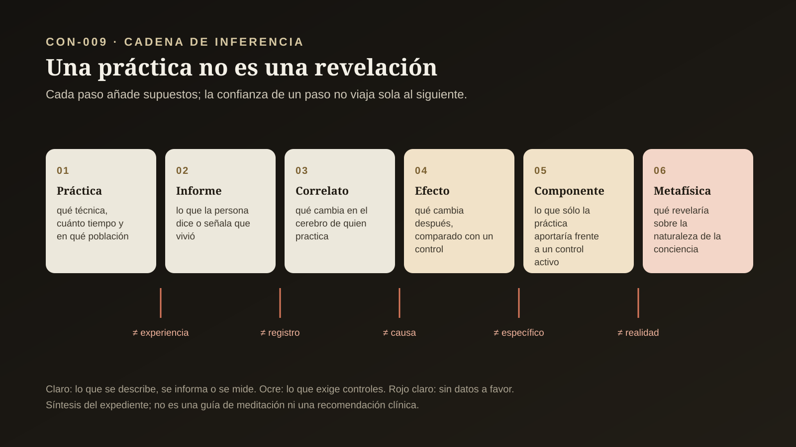
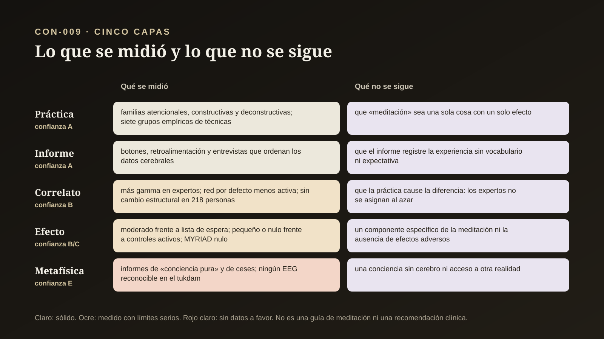

# CON-009 — ¿Qué sabemos de la meditación?

> **Alcance:** este expediente audita qué miden los estudios de meditación sobre atención, percepción y conciencia, desde los primeros registros fisiológicos de los años sesenta hasta los estudios de «cese» de la conciencia publicados al corte. Separa cinco capas que suelen mezclarse: la **práctica** (qué hace la persona), el **informe** (qué dice que vivió), el **correlato** (qué cambia en el cerebro mientras practica o en quien practica mucho), el **efecto** (qué cambia, comparado con un control, después de practicar) y la **afirmación metafísica** (qué diría todo eso sobre la naturaleza de la conciencia). No vuelve a auditar si la conciencia es fundamental (CON-003) ni los estados alterados por sustancias (CON-006) (`CLAIM-CON-MEDIT-SCOPE-001`).

> **Lo que este expediente no es:** no es una guía de meditación, no describe cómo practicar ninguna técnica y no recomienda practicar ni dejar de practicar. Tampoco es una recomendación clínica: los ensayos se citan para auditar qué miden y contra qué se comparan, no para indicar un tratamiento. La ansiedad, la depresión, el dolor crónico o una experiencia perturbadora durante o después de meditar son motivos para hablar con un profesional de la salud (`CLAIM-CON-MEDIT-NOT-ADVICE-001`).

## Pregunta central

¿Qué pueden medir los estudios de meditación sobre la atención, la percepción y la conciencia, y qué parte de lo que se dice de la meditación es práctica, qué parte informe, qué parte correlato, qué parte efecto comprobado contra un control y qué parte afirmación metafísica?

## Respuesta breve

**La meditación es un conjunto de prácticas que producen informes ricos, correlatos medibles y algunos efectos modestos; la evidencia no sostiene que revele la naturaleza de la conciencia** (`CLAIM-CON-MEDIT-VERDICT-001`). Lo que la evidencia sostiene:

1. **«Meditación» no nombra una sola cosa.** Las clasificaciones distinguen familias atencionales, constructivas y deconstructivas, o siete grupos empíricos de técnicas; un resultado de una práctica no vale para todas (`CLAIM-CON-MEDIT-FAMILIES-001`, `CLAIM-CON-MEDIT-CLASSIFICATION-001`).
2. **El informe en primera persona es indispensable y frágil.** La neurofenomenología mostró que usar los informes para ordenar los datos cerebrales revela patrones que el promedio borra; pero un informe sigue siendo un dato sobre la experiencia, no un registro de ella (`CLAIM-CON-MEDIT-NEUROPHEN-2002-001`, `CLAIM-CON-MEDIT-REPORT-LIMITS-001`).
3. **Hay correlatos replicados en su dirección general,** como más actividad gamma en meditadores expertos y menos actividad de la red neuronal por defecto durante la práctica; pero casi todos vienen de comparar expertos con novatos, no de asignar la práctica al azar (`CLAIM-CON-MEDIT-GAMMA-2017-001`, `CLAIM-CON-MEDIT-DMN-MEDITATORS-2011-001`, `CLAIM-CON-MEDIT-STATE-TRAIT-001`).
4. **Los efectos se encogen cuando el control se vuelve activo.** Contra lista de espera, los programas de atención plena mejoran la ansiedad, la depresión y el malestar; contra controles activos específicos, la ventaja se reduce o desaparece, y un ensayo escolar con 8,376 participantes no encontró superioridad (`CLAIM-CON-MEDIT-CONTROL-GRADIENT-001`, `CLAIM-CON-MEDIT-SCHOOLS-2022-001`).
5. **El cerebro no «crece» por un curso de ocho semanas, según el ensayo más grande:** 218 personas asignadas al azar, sin cambios estructurales frente a ningún control (`CLAIM-CON-MEDIT-STRUCTURE-NULL-2022-001`).
6. **Hay efectos adversos documentados.** Sus frecuencias dependen de cómo se pregunte: 8.3 % en una revisión sistemática, 25.6 % de experiencias particularmente desagradables en una encuesta y efectos duraderos en una minoría de un programa clínico (`CLAIM-CON-MEDIT-ADVERSE-REVIEW-2020-001`, `CLAIM-CON-MEDIT-ADVERSE-MBP-2021-001`).
7. **El «cese» es un estado informado por muy pocas personas,** estudiado sobre todo en casos únicos con muestreo intensivo; tiene correlatos en el EEG y en la resonancia, pero lo que se mide es lo que ocurre alrededor de un vacío que la persona sólo puede señalar después (`CLAIM-CON-MEDIT-CESSATION-LIMITS-001`).
8. **Ningún dato de meditación muestra conciencia sin cerebro ni acceso a otra realidad** (`CLAIM-CON-MEDIT-METAPHYSICS-001`).

## LO PREGUNTADO

### 1. Cinco capas que no se heredan

La pregunta «¿qué hace la meditación?» mezcla cinco preguntas de fuerza distinta (`CLAIM-CON-MEDIT-FIVE-LAYERS-001`):

| Capa | Qué pregunta | Qué la sostiene | Qué no puede decir por sí sola |
|---|---|---|---|
| práctica | ¿qué hace la persona? | descripciones de las tradiciones, manuales de los programas, clasificaciones | qué vive ni qué cambia en ella |
| informe | ¿qué dice la persona que vivió? | entrevistas, cuestionarios, botones durante la práctica, entrevistas fenomenológicas | qué ocurrió exactamente en su experiencia |
| correlato | ¿qué cambia en el cerebro mientras practica, o en quien practica mucho? | EEG, MEG, resonancia funcional y estructural | que la práctica cause ese cambio, ni qué produce la experiencia |
| efecto | ¿qué cambia después de practicar, comparado con un control? | ensayos aleatorizados con controles pasivos y activos, metaanálisis | qué componente produce el cambio, ni que valga para cualquier práctica o persona |
| afirmación metafísica | ¿qué revela la meditación sobre la naturaleza de la conciencia? | argumentos filosóficos y lecturas de tradiciones | confirmación empírica: ningún dato de esta lista la decide |

Cada capa necesita la anterior, pero ninguna se sigue de la anterior.

### 2. Productos distintos

Con el contrato de la serie ([`ESTANDAR_EVIDENCIA_CONCIENCIA.md`](ESTANDAR_EVIDENCIA_CONCIENCIA.md)), los productos de este expediente son (`CLAIM-CON-MEDIT-PRODUCTS-001`):

- **práctica descrita:** familias y clasificaciones de técnicas;
- **informe en primera persona:** relatos, escalas, señales durante la práctica y entrevistas;
- **hallazgo empírico:** desempeño en tareas de atención y percepción, prevalencia de efectos adversos;
- **correlato cerebral:** EEG, MEG, resonancia funcional y estructural;
- **efecto de intervención:** diferencias frente a controles en ensayos aleatorizados;
- **interpretación:** modelos de lo que la meditación hace con la atención, el yo o la predicción;
- **tesis metafísica:** que la meditación revela una conciencia pura, independiente del cerebro, o una realidad más allá de la experiencia ordinaria. No hay datos a favor, y este expediente la registra sin desarrollarla.

## LA PRÁCTICA

### 3. «Meditación» no es una sola cosa

En 2008, Lutz, Slagter, Dunne y Davidson propusieron entender la meditación como una familia de regímenes de entrenamiento de la regulación de la atención y de la emoción, y distinguieron los dos estilos más estudiados: la **atención focalizada** en un objeto elegido y la **monitorización abierta**, en la que se observa sin reaccionar el contenido de la experiencia momento a momento. En 2015, Dahl, Lutz y Davidson ampliaron la clasificación a tres familias según su mecanismo cognitivo principal: **atencionales, constructivas y deconstructivas** (`CLAIM-CON-MEDIT-FAMILIES-001`).

Matko y Sedlmeier (2019) llegaron por otro camino a la misma advertencia. De 309 técnicas identificadas redujeron la lista a las 20 más populares y pidieron a 100 meditadores experimentados que calificaran su parecido. Encontraron dos dimensiones —activación y orientación al cuerpo— y siete grupos de técnicas, y concluyeron que no hay «meditación» como tal sino grupos de técnicas que podrían tener efectos distintos; su clasificación pone en duda incluso la división entre atención focalizada y monitorización abierta (`CLAIM-CON-MEDIT-CLASSIFICATION-001`).

Lutz, Jha, Dunne y Saron (2015) renunciaron a una definición única de *mindfulness* y la describieron como un continuo de prácticas que se pueden situar en una matriz fenomenológica de varias dimensiones (`CLAIM-CON-MEDIT-MATRIX-001`). La consecuencia para este expediente es directa: cada resultado se lee con su práctica, su dosis de práctica y su población. «La meditación hace X» casi nunca es una afirmación bien formada.

### 4. Los primeros registros de laboratorio

- **1966.** Kasamatsu y Hirai publicaron un estudio electroencefalográfico de la meditación zen (*zazen*), uno de los primeros registros fisiológicos de meditadores de una tradición (`CLAIM-CON-MEDIT-HISTORY-ZAZEN-1966-001`). El artículo no tiene resumen publicado y no se revisó su texto: se usa por su papel histórico y sin las cifras que la literatura posterior le atribuye.
- **1970.** Wallace registró consumo de oxígeno, frecuencia cardiaca, resistencia de la piel y EEG antes, durante y después de la meditación trascendental, y encontró cambios en todas las medidas; concluyó que el estado parecía distinto de los estados de conciencia habituales (`CLAIM-CON-MEDIT-HISTORY-TM-1970-001`). La comparación era contra un periodo de control de las mismas personas, sin un grupo que descansara con los ojos cerrados: no separa la meditación del reposo.
- **1982.** Kabat-Zinn describió un programa ambulatorio de diez semanas basado en la atención plena para 51 pacientes con dolor crónico que no habían mejorado con la atención médica habitual: a las diez semanas, el 65 % mostró una reducción de al menos un tercio en un índice de dolor. El propio artículo discute los límites de un estudio sin grupo control (`CLAIM-CON-MEDIT-HISTORY-MBSR-1982-001`). De ahí salió el programa de reducción del estrés basado en la atención plena (MBSR), el más estudiado después.

Desde el principio, la investigación cargó con dos preguntas que este expediente sigue: ¿contra qué se compara?, y ¿quién informa qué?

## EL INFORME

### 5. Lo que sólo la persona puede decir

Lo que la meditación hace con la experiencia sólo se conoce por lo que la persona informa: en entrevistas, cuestionarios, escalas o señales durante la práctica. Davidson y Kaszniak (2015) pusieron este problema en el primer lugar de las dificultades metodológicas del campo: cómo estudiar la experiencia en primera persona y qué se puede y qué no se puede inferir de las medidas de autoinforme (`CLAIM-CON-MEDIT-REPORT-LIMITS-001`). Es la misma advertencia de CON-006 y CON-008 ([`CLAIM-CON-DREAM-REPORT-LIMITS-001`](../CLAIMS.md)): un informe es evidencia de que hubo una experiencia y de cómo la recuerda y la describe quien la vivió, no un registro fiel de ella ni de lo que representa.

En la meditación el problema tiene un giro propio: las prácticas entrenan precisamente la observación de la propia experiencia y, con frecuencia, enseñan un vocabulario para describirla. Eso puede mejorar los informes y también moldearlos según lo que la tradición o el programa esperan que se informe.

### 6. Neurofenomenología: usar el informe para ordenar el cerebro

La neurofenomenología, el programa que Francisco Varela impulsó en los años noventa, propone tratar la experiencia en primera persona con métodos rigurosos y usarla para guiar el análisis de los datos cerebrales. Su prueba de concepto más citada no fue con meditadores: Lutz, Lachaux, Martinerie y Varela (2002) presentaron una ilusión tridimensional, registraron el EEG y pidieron a las personas que describieran su estado de preparación en cada ensayo. Al agrupar los ensayos según esos informes aparecieron patrones de sincronía frontal antes del estímulo que dependían del grado de preparación informado, que se mantenían entre sesiones y que modulaban la respuesta posterior: los datos en primera persona servían para detectar e interpretar procesos neurales que el promedio habría tratado como ruido (`CLAIM-CON-MEDIT-NEUROPHEN-2002-001`).

Con meditadores, el método tomó varias formas:

- **Marcar el momento.** Hasenkamp y colaboradores (2012) pidieron a 14 practicantes, dentro de un resonador, que apretaran un botón cada vez que se dieran cuenta de que su mente se había ido de la respiración. Alrededor de esas pulsaciones construyeron cuatro intervalos: divagación, darse cuenta, reorientar la atención y sostenerla. La divagación se asoció con regiones de la red por defecto; darse cuenta, con la red de saliencia; reorientar y sostener, con elementos de la red ejecutiva, y la experiencia de práctica modulaba esas activaciones (`CLAIM-CON-MEDIT-MIND-WANDERING-2012-001`).
- **Ver la propia señal.** Garrison y colaboradores (2013) mostraron a meditadores y no meditadores, en tiempo real, la actividad de la corteza cingulada posterior durante una tarea de atención focalizada. Ambos grupos informaron correspondencia entre la gráfica y su experiencia de atención o de divagación; al pedirles bajar la gráfica, sólo los meditadores desactivaron esa región, y el resultado se replicó en otro grupo de meditadores que no sabía de antemano qué relación esperar (`CLAIM-CON-MEDIT-RTFMRI-2013-001`).
- **Guiar el análisis con la fenomenología.** Berkovich-Ohana y colaboradores (2013) pidieron a 12 meditadores de largo plazo producir estados de «fuera del tiempo» y «fuera del espacio» durante una magnetoencefalografía, con estados de control que exigían memoria o imaginación («entonces», «allá»). Los estados de control coincidieron en regiones de memoria autobiográfica e imaginería; los estados de alteración, en una red ligada al sentido del cuerpo, sobre todo en la banda theta (`CLAIM-CON-MEDIT-SELF-MEG-2013-001`).
- **Entrevistar con método.** Trautwein y colaboradores (2024), en un estudio preregistrado, pidieron a 46 meditadores de largo plazo atenuar su experiencia de sí mismos como cuerpo durante una magnetoencefalografía y los entrevistaron con un protocolo fenomenológico. Hubo reducciones de la actividad beta alta en regiones frontoparietales y en la corteza medial posterior; las de esta última las impulsó un subgrupo que describió disrupciones radicales, como la suspensión de la agencia. Los cambios neurales se correlacionaron con la práctica acumulada y con los cambios derivados de las entrevistas, **pero no con los autoinformes clásicos** (`CLAIM-CON-MEDIT-SELF-MEG-2024-001`).

Lutz y colaboradores (2025) revisaron el estado del programa: herramientas de muestreo de la experiencia con varias dimensiones, estudios que usan la pericia de meditadores para descomponer el dolor y los procesos ligados al yo, y un marco computacional que intenta formalizar la propia fenomenología (`CLAIM-CON-MEDIT-NEUROPHEN-REVIEW-2025-001`).

### 7. Lo que el informe gana y lo que no

La neurofenomenología mejora la relación entre informe y cerebro: reduce el ruido, encuentra subgrupos y, como muestra el estudio de 2024, puede detectar lo que un cuestionario estándar no detecta. No resuelve el problema de fondo. Sigue dependiendo de personas seleccionadas por su pericia, entrenadas en un vocabulario, que saben qué se estudia; y el informe sigue llegando después, traducido a palabras. Lo que se correlaciona con el cerebro es lo que la persona dijo, no su experiencia sin mediación.

## EL CORRELATO

### 8. El EEG de los meditadores

Cahn y Polich (2006) revisaron los estudios eléctricos y de imagen de la meditación disponibles entonces. El EEG mostraba en general un enlentecimiento tras meditar, con más actividad theta y alfa ligada a la pericia; los potenciales evocados sugerían cambios en la asignación de la atención; y los estudios de imagen apuntaban a la cingulada anterior y a regiones prefrontales dorsolaterales. Pero los efectos de estado (durante la práctica) y de rasgo (en quien practica mucho) eran **variables** y apenas empezaban a mostrar resultados consistentes (`CLAIM-CON-MEDIT-EEG-REVIEW-2006-001`).

### 9. La gamma de los expertos

Lutz, Greischar, Rawlings, Ricard y Davidson (2004) registraron a practicantes budistas de largo plazo y encontraron que, durante la meditación, inducían oscilaciones gamma de gran amplitud y sincronía de fase, distintas de las de los controles, sobre todo en electrodos frontoparietales laterales; la proporción entre actividad gamma y actividad lenta ya era mayor en reposo antes de meditar y seguía elevada después (`CLAIM-CON-MEDIT-GAMMA-2004-001`).

Braboszcz, Cahn, Levy, Fernández y Delorme (2017) compararon a practicantes de tres tradiciones distintas (Vipassana, yoga del Himalaya e Isha Shoonya) con controles durante la meditación y durante una divagación instruida. Todos los grupos de meditadores mostraron más amplitud gamma de 60 a 110 Hz en regiones parieto-occipitales que los controles, como efecto de rasgo; esa potencia se correlacionó con la experiencia de práctica; y el análisis de componentes independientes indicó que no provenía de artefactos oculares o musculares (`CLAIM-CON-MEDIT-GAMMA-2017-001`).

Dos grupos, distintas tradiciones y bandas que no coinciden exactamente: la dirección general se replica. Lo que no se sigue es que la gamma sea «conciencia superior», que la práctica la haya causado (los expertos no se asignaron al azar a meditar durante décadas) ni que indique qué experimenta la persona.

### 10. La U invertida y el mapa de las prácticas

Brefczynski-Lewis y colaboradores (2007) compararon con resonancia funcional a meditadores expertos y novatos de la misma edad durante una meditación de concentración. La activación de la red de atención sostenida dibujó una U invertida: los expertos con un promedio de 19,000 horas de práctica activaron más que los novatos, pero los de 44,000 horas activaron menos; ante sonidos distractores, los expertos activaron menos las regiones ligadas al pensamiento discursivo y a la emoción (`CLAIM-CON-MEDIT-INVERTED-U-2007-001`). Es un resultado transversal: los dos grupos de expertos son personas distintas.

Fox y colaboradores (2016) revisaron 78 estudios de neuroimagen funcional y metaanalizaron 31 experimentos con 527 participantes. Encontraron patrones de activación y desactivación disociables para cuatro estilos —atención focalizada, recitación de mantras, monitorización abierta y compasión— y diferencias sugestivas para otros tres. Algunas regiones aparecían en varias técnicas, como la ínsula y la corteza frontopolar, pero **la convergencia fue la excepción y no la regla**, y los autores señalaron muchas preocupaciones metodológicas (`CLAIM-CON-MEDIT-FMRI-META-2016-001`). El mapa confirma la sección 3: no hay un «cerebro meditando» único.

### 11. Estado, rasgo y quién llega a experto

Casi todos los correlatos de esta sección vienen de dos diseños: medir a la misma persona meditando y sin meditar (efecto de estado), o comparar a meditadores de muchos años con personas que no meditan (efecto de rasgo). Ninguno de los dos asigna la práctica al azar. Quien medita durante décadas difiere de quien no lo hace en temperamento, motivación, estilo de vida, cultura y, a veces, en la propia razón por la que empezó. Una diferencia de rasgo es compatible con un efecto de la práctica, con una autoselección o con las dos cosas (`CLAIM-CON-MEDIT-STATE-TRAIT-001`). Las correlaciones con las horas de práctica ayudan, pero no separan esas lecturas: quien encuentra la práctica más fácil o gratificante también tiende a acumular más horas.

### 12. La red neuronal por defecto

Raichle y colaboradores (2001) describieron con PET un estado basal del cerebro adulto en reposo y un grupo de regiones que disminuyen su actividad, respecto de ese estado, durante una gran variedad de conductas dirigidas a un objetivo: un «modo por defecto» del funcionamiento cerebral que se suspende durante las tareas (`CLAIM-CON-MEDIT-DMN-DEFINITION-001`). La red se asoció después con la divagación mental y con el procesamiento referido a uno mismo; CON-008 la encontró en las teorías de los sueños ([`SRC-CON-DREAM-DOMHOFF-FOX-2015`](../SOURCES.md)).

Brewer y colaboradores (2011) compararon a meditadores experimentados con controles sin experiencia mientras hacían tres meditaciones distintas. Los nodos principales de la red por defecto (corteza prefrontal medial y cingulada posterior) estuvieron relativamente desactivados en los meditadores en las tres prácticas, y la cingulada posterior se acoplaba más con regiones de control cognitivo, en reposo y meditando. Los autores lo leyeron como compatible con menos divagación mental (`CLAIM-CON-MEDIT-DMN-MEDITATORS-2011-001`).

Lo que no se sigue es que «apagar la red por defecto» sea la firma de la meditación ni la disolución del yo (`CLAIM-CON-MEDIT-DMN-NOT-SPECIFIC-001`). Esa red se desactiva por definición durante casi cualquier tarea dirigida; CON-006 registró cambios en la misma red con psilocibina ([`CLAIM-CON-PSY-DMN-001`](../CLAIMS.md)); y su relación con la divagación y con el yo es una asociación funcional, no una identidad. Una desactivación compartida por la concentración, una tarea cognitiva y una sustancia no distingue entre ellas.

### 13. ¿Cambia la estructura del cerebro?

- **Hölzel y colaboradores (2011)** compararon a 16 personas antes y después del curso de ocho semanas con 17 en lista de espera, y encontraron aumentos de la concentración de sustancia gris en el hipocampo izquierdo, la cingulada posterior, la unión temporoparietal y el cerebelo (`CLAIM-CON-MEDIT-STRUCTURE-2011-001`).
- **Fox y colaboradores (2014)** metaanalizaron 21 estudios morfométricos con unos 300 meditadores: ocho regiones aparecían alteradas con consistencia y el tamaño del efecto global era mediano (d de Cohen alrededor de 0.46), pero los autores advirtieron que el sesgo de publicación y los límites metodológicos eran preocupaciones fuertes (`CLAIM-CON-MEDIT-STRUCTURE-META-2014-001`).
- **Kral y colaboradores (2022)** combinaron dos ensayos aleatorizados de tres brazos con 218 personas sin experiencia: lista de espera, el curso de ocho semanas o un control activo validado y equiparado. No encontraron evidencia de cambios en volumen o densidad de sustancia gris ni en grosor cortical frente a ninguno de los dos controles, ni en el cerebro completo ni en las regiones de los estudios previos (`CLAIM-CON-MEDIT-STRUCTURE-NULL-2022-001`).

El estudio más grande y mejor controlado no replicó el hallazgo que más circulaba. Esto no descarta cambios con prácticas más largas o más intensas, pero sí la afirmación popular de que un curso de ocho semanas «hace crecer» el cerebro.

## EL EFECTO

### 14. Atención

- **Jha, Krompinger y Baime (2007)** midieron tres subsistemas de la atención —alerta, orientación y control del conflicto— con la Prueba de Redes Atencionales. Quienes hicieron el curso de ocho semanas mejoraron la orientación; quienes hicieron un retiro intensivo de un mes mejoraron la detección de estímulos externos; los grupos no difirieron en control del conflicto al final (`CLAIM-CON-MEDIT-ATTENTION-ANT-2007-001`). El grupo control no recibió ningún entrenamiento.
- **Slagter y colaboradores (2007)** usaron el «parpadeo atencional», la dificultad para ver un segundo objetivo que llega muy poco después del primero. Tras tres meses de entrenamiento intensivo, el parpadeo fue menor y la respuesta cerebral al primer objetivo también; quienes más redujeron esa respuesta más redujeron el parpadeo (`CLAIM-CON-MEDIT-ATTENTION-BLINK-2007-001`).
- **Tang y colaboradores (2007)** asignaron al azar a 40 estudiantes a cinco días de un entrenamiento integrador de cuerpo y mente, de 20 minutos al día, o a un entrenamiento de relajación: el primer grupo mejoró más en la puntuación de conflicto atencional y en medidas de ánimo y de cortisol (`CLAIM-CON-MEDIT-ATTENTION-SHORT-2007-001`). Tuvo un control activo, pero fue breve, en una sola población y con un método que mezcla varias prácticas.

### 15. Percepción

- **Brown, Forte y Dysart (1984)** midieron umbrales visuales en practicantes antes y después de un retiro de tres meses de práctica intensiva, con el personal del centro como grupo control. Después del retiro, los practicantes detectaban destellos más breves y necesitaban menos intervalo para separar dos destellos sucesivos; el control no cambió (`CLAIM-CON-MEDIT-PERCEPTION-1984-001`). Los autores leyeron los resultados como apoyo a lo que dicen los textos budistas sobre los cambios en la percepción; el diseño no permite separar la práctica de la expectativa de quien sabe que medita para percibir mejor.
- **MacLean y colaboradores (2010)** asignaron al azar a 60 personas a recibir primero o después tres meses de entrenamiento, de unas cinco horas diarias, de atención sostenida en un estímulo como la respiración. El entrenamiento mejoró la discriminación visual, ligada a un aumento de la sensibilidad perceptiva, y la vigilancia sostenida (`CLAIM-CON-MEDIT-PERCEPTION-2010-001`).

### 16. Lo que valen esos efectos

Los estudios de atención y percepción son de los mejores del campo: tareas objetivas, a veces asignación al azar y efectos con sentido teórico. Sus límites son comunes (`CLAIM-CON-MEDIT-ATTENTION-LIMITS-001`): controles de lista de espera o sin entrenamiento, retiros intensivos que cambian a la vez el sueño, la dieta, el aislamiento y la vida social, participantes motivados que saben qué se espera de ellos, muestras pequeñas y poca replicación independiente de cada tarea. Muestran que la atención y algunos umbrales perceptivos son entrenables; no muestran que la meditación sea mejor que otro entrenamiento atencional de igual intensidad, ni que el cambio dure.

### 17. El control activo

MacCoon y colaboradores (2012) diseñaron y validaron un control activo para el curso de ocho semanas, el Programa de Mejora de la Salud (HEP): mismas horas, mismo formato de grupo y mismas expectativas, con actividad física, nutrición y música en lugar de atención plena. En 63 personas asignadas al azar, las dos intervenciones mejoraron por igual el malestar, la ansiedad, la hostilidad y los síntomas médicos informados por los participantes; sólo una tarea de dolor térmico, en la condición con instrucciones de atención plena, favoreció al curso. Los autores concluyeron que, en las medidas informadas por los participantes, el curso no fue más eficaz que un control activo riguroso (`CLAIM-CON-MEDIT-ACTIVE-CONTROL-2012-001`).

Zeidan y colaboradores (2015) asignaron al azar a 75 voluntarios sanos a cuatro días de atención plena, de condicionamiento con una crema placebo, de una «atención plena simulada» o de escuchar un libro, y midieron dolor experimental con resonancia. Las tres manipulaciones cognitivas redujeron el dolor frente al reposo y al control; la atención plena lo redujo más que el placebo y más que la simulación, y se asoció con regiones de modulación cognitiva del dolor distintas de las del placebo (`CLAIM-CON-MEDIT-SHAM-2015-001`). Es uno de los pocos diseños con una simulación de la práctica; también muestra cuánto efecto producen el placebo y la práctica simulada por sí solos.

### 18. Lo que dicen los metaanálisis

- **Goyal y colaboradores (2014)** revisaron sólo ensayos con controles activos para el efecto placebo: 47 ensayos con 3,515 participantes. Los programas de atención plena tuvieron evidencia moderada de mejorar la ansiedad (tamaño del efecto 0.38 a las ocho semanas), la depresión (0.30) y el dolor (0.33), y evidencia baja, nula o insuficiente para otras medidas, **incluida la atención**. No hubo evidencia de que fueran mejores que ningún tratamiento activo, como fármacos, ejercicio u otras terapias conductuales (`CLAIM-CON-MEDIT-TRIALS-META-2014-001`).
- **Goldberg y colaboradores (2018)** reunieron 142 muestras con 12,005 participantes con trastornos psiquiátricos y clasificaron los controles por su fuerza. Al terminar el tratamiento, las intervenciones superaron a no tratar (d = 0.55), al tratamiento mínimo (0.37), a los controles activos inespecíficos (0.35) y a los específicos (0.23), y no difirieron de los tratamientos basados en evidencia (`CLAIM-CON-MEDIT-TRIALS-META-2018-001`).
- **Galante y colaboradores (2021)**, con un protocolo preregistrado, reunieron 136 ensayos con 11,605 adultos en entornos no clínicos. Frente a no intervenir, los programas mejoraron en promedio la ansiedad, la depresión, el malestar y el bienestar; frente a controles activos inespecíficos sólo mejoraron la depresión; frente a controles activos específicos **no hubo evidencia de superioridad**; y la confianza en los resultados fue de moderada a muy baja (`CLAIM-CON-MEDIT-TRIALS-NONCLINICAL-2021-001`).
- **Galante y colaboradores (2023)** analizaron datos individuales de 13 ensayos con 2,371 participantes frente a controles pasivos: los programas grupales guiados por un instructor redujeron el malestar con un efecto pequeño a moderado (diferencia de medias estandarizada −0.32), con alta confianza, entre adultos que se ofrecieron a recibirlos (`CLAIM-CON-MEDIT-TRIALS-IPD-2023-001`).

### 19. La escuela como prueba de escala

El ensayo MYRIAD (Kuyken y colaboradores, 2022) asignó al azar 85 escuelas del Reino Unido a un programa escolar de diez lecciones de psicoeducación y prácticas de atención plena o a la enseñanza socioemocional habitual. Con 8,376 participantes de 11 a 14 años analizados, no hubo evidencia de que el programa fuera superior al año en riesgo de depresión, funcionamiento socioemocional o bienestar; las diferencias fueron prácticamente cero (`CLAIM-CON-MEDIT-SCHOOLS-2022-001`). Es el ensayo más grande del expediente y su resultado es nulo frente a un control activo.

### 20. El gradiente del control

Leídos juntos, los ensayos dibujan un patrón que es el hallazgo metodológico central de esta parte (`CLAIM-CON-MEDIT-CONTROL-GRADIENT-001`): **cuanto más activo y específico es el control, menor es la ventaja de la meditación**. Contra la lista de espera aparecen efectos moderados; contra un control que equipara tiempo, grupo, instructor y expectativa, el efecto se reduce o deja de distinguirse. Eso no dice que la meditación no haga nada: dice que buena parte de su efecto medido lo comparten otras intervenciones con la misma estructura, y que el componente específico —lo que sólo la atención plena aportaría— está mucho peor establecido que el efecto total.

El problema se agrava porque **la meditación no se puede cegar** (`CLAIM-CON-MEDIT-BLINDING-001`). Quien medita sabe que medita, y casi siempre sabe qué se espera de ello; Davidson y Kaszniak (2015) lo enumeraron entre los problemas propios del campo, y es el mismo problema que CON-006 documentó en los ensayos con psicodélicos ([`CLAIM-CON-PSY-BLINDING-001`](../CLAIMS.md), [`SRC-CON-PSY-MUTHUKUMARASWAMY-2021`](../SOURCES.md)). Cuando la medida principal es un cuestionario que la persona responde sobre sí misma, la expectativa entra directamente en el resultado.

## LA CRÍTICA

### 21. «Mind the hype» (2018)

Van Dam y otros catorce investigadores del propio campo publicaron en 2018 una evaluación crítica y una agenda para la investigación sobre la atención plena y la meditación (`CLAIM-CON-MEDIT-VAN-DAM-2018-001`). Partieron de un diagnóstico: en dos décadas, la atención plena pasó de tema marginal a sustituto ocasional de la psicoterapia, herramienta de bienestar corporativo y práctica educativa extendida, mientras la desinformación y la metodología pobre de muchos estudios podían dañar, engañar y decepcionar al público. Sus puntos:

- **definición:** «mindfulness» designa a la vez una práctica, un estado, un rasgo, una intervención y una tradición, y los estudios no siempre dicen cuál;
- **medición:** los cuestionarios de rasgo dependen del autoinforme y de cómo cada persona entiende las palabras;
- **diseño:** controles débiles, muestras pequeñas y falta de cegamiento;
- **efectos adversos:** casi no se buscaban;
- **neuroimagen:** imágenes del cerebro usadas como prueba de beneficio más allá de lo que muestran.

Su objetivo declarado fue informar a científicos, medios y público, reducir el daño, frenar las malas prácticas de investigación y detener la desinformación sobre beneficios y costos.

### 22. La respuesta

Davidson y Dahl (2018) respondieron en el mismo número que estaban de acuerdo con todos los puntos clave, y añadieron cinco (`CLAIM-CON-MEDIT-VAN-DAM-REPLY-2018-001`): muchos problemas metodológicos no son exclusivos de la meditación; la investigación se concentró casi sólo en uno o dos tipos de práctica; estas prácticas no se desarrollaron para tratar enfermedades; la duración, la intensidad y la distribución de la práctica casi no se han estudiado; y harán falta estudios muy grandes, con tecnología móvil, para estandarizar entre sitios y estudiar diferencias individuales. Es un adversario que comparte el diagnóstico: el desacuerdo es de énfasis, no de hechos.

### 23. Lo que no se publica

Coronado-Montoya y colaboradores (2016) revisaron 124 ensayos publicados de terapias basadas en la atención plena: 108 (87 %) informaron al menos un resultado positivo en el resumen, 1.6 veces más de lo esperable con el tamaño de efecto que asumieron (65.7 ensayos positivos esperados). De 21 registros de ensayos, 13 (62 %) seguían sin publicarse 30 meses después de terminar, y ninguno especificaba bien una única medida principal con su momento de evaluación. Ninguna de 36 revisiones sistemáticas había concluido que el sesgo de publicación inflara los efectos (`CLAIM-CON-MEDIT-PUBLICATION-BIAS-2016-001`). Es una alerta sobre la literatura clínica que llegaba hasta 2015; los metaanálisis posteriores con protocolos preregistrados (sección 18) son en parte la respuesta.

## LOS EFECTOS ADVERSOS

### 24. Lo que se encontró al preguntar

Lindahl y colaboradores (2017) entrevistaron a practicantes occidentales de tradiciones theravada, zen y tibetana, y a maestros de esas tradiciones, sobre experiencias difíciles, angustiosas o que afectaron su funcionamiento. Construyeron una taxonomía de 59 experiencias en siete dominios —cognitivo, perceptivo, afectivo, somático, conativo, sentido del yo y social— y 26 categorías de factores que influyen en ellas. Experiencias de fenomenología parecida se interpretaron y se vivieron de forma muy distinta, de muy positiva a muy negativa, y de transitoria a grave y duradera (`CLAIM-CON-MEDIT-ADVERSE-VARIETIES-2017-001`).

### 25. ¿Con qué frecuencia?

Las cifras dependen de quién responde y de cómo se pregunta:

- **encuesta internacional:** de 1,232 meditadores regulares, 315 (25.6 %) dijeron haber tenido experiencias particularmente desagradables que creían causadas por su práctica; fueron más probables con pensamiento negativo repetitivo, con prácticas sólo deconstructivas y en quienes habían asistido a un retiro (Schlosser y colaboradores, 2019) (`CLAIM-CON-MEDIT-ADVERSE-PREVALENCE-2019-001`);
- **revisión sistemática:** en 83 estudios con 6,703 participantes, la prevalencia total de eventos adversos fue de 8.3 %: 3.7 % en los estudios experimentales y 33.2 % en los observacionales; los más comunes fueron la ansiedad, la depresión y las anomalías cognitivas, y aparecieron también en personas sin antecedentes de salud mental (Farias y colaboradores, 2020) (`CLAIM-CON-MEDIT-ADVERSE-REVIEW-2020-001`);
- **programa clínico con entrevista dedicada:** con una entrevista de 44 preguntas aplicada por un evaluador independiente a 96 participantes de un programa de ocho semanas, el 83 % informó al menos un efecto secundario relacionado con la meditación; el 58 %, alguno de valencia negativa; el 37 %, alguno con impacto negativo en el funcionamiento; y entre el 6 % y el 14 %, efectos negativos duraderos, ligados a signos de activación desregulada. Los autores concluyeron que las tasas son parecidas a las de otros tratamientos psicológicos (Britton y colaboradores, 2021) (`CLAIM-CON-MEDIT-ADVERSE-MBP-2021-001`);
- **muestra poblacional:** de 434 adultos estadounidenses que alguna vez meditaron, el 32.3 % respondió afirmativamente a una pregunta general y el 50 % a al menos una pregunta específica sobre efectos adversos; el 10.4 % los tuvo un mes o más, el 10.6 % informó algún deterioro funcional y el 1.2 %, deterioro de un mes o más. Quienes los tuvieron estaban igual de contentos de haber meditado (Goldberg y colaboradores, 2022) (`CLAIM-CON-MEDIT-ADVERSE-POPULATION-2022-001`).

### 26. Por qué las cifras no coinciden

Baer, Crane, Miller y Kuyken (2019) advirtieron que la literatura sobre daños en los programas de atención plena era todavía demasiado pequeña para una revisión sistemática y que hacía falta claridad conceptual: qué cuenta como daño, cómo se distingue de una molestia esperable en cualquier tratamiento y qué factores del programa, del participante y del instructor influyen (`CLAIM-CON-MEDIT-ADVERSE-MEASUREMENT-001`). Las diferencias de la sección 25 se explican en buena parte por eso: los ensayos que no preguntan activamente encuentran poco; las encuestas a practicantes de muchos años encuentran más; las entrevistas detalladas encuentran casi siempre algo, la mayor parte leve y transitorio. Este expediente no da una tasa única de riesgo porque la evidencia no la da.

## LOS ESTADOS LÍMITE

### 27. El «cese»

Algunos practicantes muy avanzados informan que, durante la meditación, su conciencia se interrumpe por completo y vuelve después, una experiencia que la tradición budista llama *nirodha* y, en su forma prolongada, *nirodha samāpatti*. Laukkonen, Sacchet, Barendregt, Devaney, Chowdhury y Slagter (2023) resumieron esas descripciones —ausencia total de conciencia que, según los practicantes, podría durar hasta siete días, que se induciría de forma consistente, que sería distinta del sueño porque no se puede «despertar» a quien está en ella y que dejaría una claridad posterior—, presentaron datos preliminares de dos laboratorios y propusieron una agenda de investigación (`CLAIM-CON-MEDIT-CESSATION-REPORTS-001`). Las duraciones y las propiedades son lo que dicen los practicantes y la tradición, no mediciones.

### 28. Lo que se midió

- **EEG de un caso.** Chowdhury y colaboradores (2023) muestrearon de forma intensiva a un solo meditador avanzado, con más de 23,000 horas de práctica, y analizaron 37 ceses en 29 sesiones de EEG entre noviembre de 2019 y marzo de 2020. Los eventos se marcaron por una disminución amplia de la potencia alfa que empezaba unos 40 segundos antes y que era mínima justo después; hubo aumentos modestos de theta antes del evento (`CLAIM-CON-MEDIT-CESSATION-EEG-2023-001`).
- **Redes en el mismo caso.** Van Lutterveld y colaboradores (2024) analizaron la conectividad de esos mismos 37 eventos: desde 21 segundos antes hubo una disminución lineal de las interacciones funcionales en la banda alfa en todo el cerebro, que volvieron a su nivel en los 40 segundos siguientes, sin cambios en la integración de la red (`CLAIM-CON-MEDIT-CESSATION-NETWORK-2024-001`). El resumen describe al participante con más de 6,000 horas de retiro, una medida distinta de la del estudio anterior; no se revisó el texto completo para conciliarlas.
- **Resonancia de 7 teslas en tres personas.** Yang y colaboradores (2026) estudiaron el cese prolongado en tres participantes con resonancia de ultra alta resolución y muestreo denso dentro de cada persona. Encontraron más actividad en cortezas sensoriales primarias y en núcleos viscerosensoriales del tallo, y menos en regiones transmodales, subcorticales y del tallo; interpretaron que la pérdida de experiencia no exige una supresión neural global (`CLAIM-CON-MEDIT-CESSATION-7T-2026-001`).

### 29. Lo que esos datos pueden y no pueden decir

Los estudios del cese son pocos, recientes, de un mismo grupo de investigación y sus colaboradores, y casi todos de una a tres personas muy seleccionadas que esperan producir el estado (`CLAIM-CON-MEDIT-CESSATION-LIMITS-001`). Tienen un problema adicional que ningún otro estado de este expediente tiene: **lo que se estudia es la ausencia de experiencia, y la ausencia no se puede informar mientras ocurre**. El practicante señala o cuenta después que hubo un hueco. Con los datos al corte no se puede distinguir con seguridad entre una interrupción de la conciencia, una interrupción de la memoria de lo vivido, un microsueño o una forma de desconexión parecida a la anestesia ligera. Los correlatos describen qué ocurre en el cerebro antes, durante y después de lo que la persona señala; no muestran que en ese intervalo no hubiera experiencia.

Lieberman y Sacchet (2026) propusieron usar la meditación avanzada —la absorción concentrativa llamada *jhāna* y los ceses— como un programa para aislar los rasgos más simples de la conciencia, en el marco de un «modelo mínimo» (`CLAIM-CON-MEDIT-ADVANCED-PROGRAM-2026-001`). Es una propuesta de investigación, no un resultado: su valor depende de que esos estados sean, como dicen los autores, precisos, replicables y tratables experimentalmente, y eso es lo que todavía falta mostrar en más de unas pocas personas.

### 30. La «conciencia pura»

Metzinger (2020) desarrolló el concepto de «experiencia fenoménica mínima» a partir de informes de «conciencia pura» en la meditación: seis restricciones semánticas extraídas de la literatura y dieciséis casos fenomenológicos. Propuso como hipótesis empírica que el prototipo de esos informes es el contenido de un modelo predictivo, una representación bayesiana de la alerta tónica (`CLAIM-CON-MEDIT-MPE-2020-001`). Gamma y Metzinger (2021) llevaron el concepto a un cuestionario de 92 preguntas en cinco idiomas: de 3,627 respuestas, 1,403 fueron utilizables y un modelo de 12 factores explicó el 44 % de la varianza, con un ajuste moderado (`CLAIM-CON-MEDIT-MPE-QUESTIONNAIRE-2021-001`).

Este trabajo es ejemplar en un sentido: toma en serio los informes y los convierte en una hipótesis naturalista contrastable, en lugar de en una tesis sobre una conciencia sin contenido ni soporte. Pero lo que mide es la estructura de lo que se informa, en meditadores que respondieron una encuesta en línea, mayoritariamente en alemán; no mide una conciencia «pura» independiente del cerebro.

### 31. Después de la muerte

El caso más extremo de afirmación sobre la meditación es el *tukdam*, un estado meditativo que algunos practicantes tibetanos cultivarían después de la muerte clínica y en el que la descomposición se retrasaría. Lott y colaboradores (2021), con el grupo de la Universidad de Wisconsin en la India, registraron EEG, negatividad de disparidad y respuesta auditiva del tallo cerebral en personas vivas y en casos de *tukdam*. Los vivos mostraron respuestas bien definidas; **en ninguno de los casos de *tukdam* se distinguió una onda reconocible del EEG** (`CLAIM-CON-MEDIT-TUKDAM-2021-001`). El estudio no evalúa la descomposición ni la experiencia: dice que, con ese método y en esas condiciones de campo, no hubo actividad eléctrica detectable.

## LA AFIRMACIÓN METAFÍSICA

### 32. Lo que los datos no deciden

Que la práctica modifique la atención, que los expertos tengan más gamma, que la red por defecto se desactive o que algunas personas informen huecos en su experiencia no dice que la conciencia exista sin cerebro, que sea fundamental, que la meditación dé acceso a una realidad distinta de la ordinaria ni que «despertar» tenga un contenido verdadero sobre el mundo (`CLAIM-CON-MEDIT-METAPHYSICS-001`). Esas tesis pueden tener interés filosófico o religioso, y CON-003 compara las posturas sobre si la conciencia puede ser lo fundamental; pero ningún dato de esta lista las confirma. Los estudios más ambiciosos sobre estados límite van, de hecho, en la dirección contraria: buscan correlatos neurales de la ausencia de experiencia o modelos predictivos de la «conciencia pura», es decir, explicaciones dentro del cerebro.

## LA CONEXIÓN CON LA SERIE

### 33. El observador que se entrena

CON-001 preguntó si la percepción refleja la realidad; CON-006 perturbó la percepción con sustancias; CON-008 estudió la experiencia que el cerebro produce sin el mundo. La meditación es el caso en que el propio observador entrena su atención para observar su experiencia. Eso la vuelve valiosa para la ciencia de la conciencia —los meditadores pueden dar informes más finos, marcar momentos y modular estados a voluntad— y la expone a un riesgo propio: el instrumento de medida y el objeto medido son la misma persona, que además tiene un marco para interpretar lo que encuentra. Por eso la neurofenomenología y los controles activos importan aquí más que en ningún otro expediente de la serie. El problema que CON-003 dejó abierto en [`OPEN-CON-CF-ATTRIBUTION-001`](../17_preguntas_abiertas/PREGUNTAS_MAESTRAS.md) —cómo atribuir experiencia sin informe simultáneo— reaparece en el cese en su forma más pura.

## LO QUE HARÍA FALTA

### 34. Qué contaría

Para avanzar de una capa a la siguiente haría falta (`CLAIM-CON-MEDIT-WHAT-WOULD-COUNT-001`):

1. **de la práctica al resultado:** ensayos que comparen prácticas distintas entre sí, con la práctica descrita y su dosis medida, en lugar de «meditación» contra nada;
2. **del informe al dato compartido:** protocolos fenomenológicos preregistrados que predigan un correlato antes de medirlo, aplicados por equipos que no sean los que proponen la práctica;
3. **del correlato al efecto:** estudios longitudinales con asignación al azar y seguimiento largo, que muestren que un cambio cerebral aparece con la práctica y no antes;
4. **del efecto total al componente específico:** controles activos equiparados en tiempo, grupo, instructor y expectativa, y medidas que no sean sólo autoinformes;
5. **de los efectos adversos a una tasa:** búsqueda activa y estandarizada de efectos adversos en todos los ensayos, con seguimiento;
6. **del cese a la ausencia de experiencia:** más personas, más laboratorios independientes y medidas que distingan entre ausencia de experiencia, ausencia de memoria y sueño;
7. **de cualquier dato a la metafísica:** una predicción que una tesis metafísica haga y el naturalismo prohíba, y que se confirme. No hay ninguna propuesta así en la literatura revisada.

## LO QUE IMPLICA PARA ESTE PROYECTO

### 35. Una práctica con nombre, un control con nombre

Este expediente agrega a la serie CON su caso más difundido fuera del laboratorio (`CLAIM-CON-MEDIT-PROJECT-001`). En el resto del proyecto vale la misma regla: una práctica se nombra con su técnica, su dosis y su población; un informe es un dato con fecha y vocabulario; un correlato en expertos no es un efecto de la práctica; un efecto se dice junto a su control; y un estado extraordinario se estudia como experiencia informada, no como prueba de lo que la persona cree que reveló.

## Casos y controles de interpretación

| Caso | Capa | Lo establecido | Inferencia permitida | Límite |
|---|---|---|---|---|
| familias y clasificaciones (2008–2019) | práctica | familias atencionales, constructivas y deconstructivas; siete grupos empíricos | un resultado vale para una práctica, no para «la meditación» | clasificaciones propuestas, no consensuadas |
| neurofenomenología (2002–2025) | informe | agrupar ensayos por el informe revela patrones neurales | el informe ordena datos que el promedio borra | personas seleccionadas y entrenadas; informe posterior |
| autoexperiencia corporal (2024) | informe y correlato | menos beta en la corteza medial posterior, ligada a entrevistas y no a cuestionarios | las entrevistas detectan lo que los cuestionarios no | meditadores de largo plazo; un grupo |
| gamma de expertos (2004–2017) | correlato | más gamma en expertos de varias tradiciones | rasgo asociado a la práctica larga | transversal; autoselección |
| red por defecto (2001–2011) | correlato | desactivación relativa en meditadores | compatible con menos divagación | la red se desactiva en casi cualquier tarea y con psilocibina |
| estructura (2011–2022) | correlato | estudios pequeños positivos; ensayo de 218 nulo | sin evidencia de cambio estructural tras ocho semanas | no evalúa prácticas largas |
| atención y percepción (1984–2010) | efecto | menor parpadeo atencional; mejor discriminación y vigilancia | la atención y algunos umbrales son entrenables | controles débiles; retiros intensivos |
| controles activos (2012–2023) | efecto | ventaja que se reduce o desaparece con controles activos específicos | efecto total moderado; componente específico incierto | sin cegamiento; autoinforme |
| escuelas (2022) | efecto | 8,376 participantes, sin superioridad | un programa escolar universal no superó a la enseñanza habitual | una forma de programa y una edad |
| efectos adversos (2017–2022) | hallazgo empírico | de 8.3 % a más de la mitad según cómo se pregunte; minoría con efectos duraderos | los efectos adversos existen y deben buscarse | sin tasa única; muestras distintas |
| cese (2023–2026) | informe y correlato | cambios del EEG y de la resonancia alrededor de huecos informados | estado informado con correlatos medibles | una a tres personas; ausencia no informable en el momento |
| *tukdam* (2021) | correlato | sin EEG reconocible tras la muerte clínica | no se detectó actividad cerebral con ese método | condiciones de campo; no evalúa la experiencia |

## LO OBSERVADO

Se observan personas que practican técnicas distintas de meditación y lo que dicen haber vivido: informes, respuestas a cuestionarios, pulsaciones de botón al darse cuenta de una distracción, señales al terminar un cese y entrevistas fenomenológicas. Se observan su desempeño en tareas de atención y percepción, sus respuestas en ensayos frente a controles, su actividad eléctrica y magnética y su señal en la resonancia funcional y estructural. Se observan también los efectos adversos que informan cuando se les pregunta. No se observa la experiencia de nadie de forma directa: se observa lo que la persona hace o dice sobre ella.

## LO MEDIDO

Se miden la potencia y la sincronía del EEG por bandas, la actividad de la magnetoencefalografía, la activación y la conectividad en la resonancia funcional, la sustancia gris y el grosor cortical; el parpadeo atencional, los subsistemas de la atención, los umbrales de detección visual, la discriminación perceptiva y la vigilancia; el dolor experimental; la ansiedad, la depresión, el malestar y el bienestar en ensayos, con tamaños de efecto frente a controles pasivos y activos; la proporción de ensayos con resultados positivos y de registros sin publicar; la prevalencia de efectos adversos con distintos instrumentos; y los cambios cerebrales alrededor de los ceses informados. Este expediente no mide nada propio: reúne y compara lo publicado.

## LO INFERIDO

Se infiere que «meditación» designa prácticas distintas con correlatos distintos; que el informe en primera persona, usado con método, mejora la lectura de los datos cerebrales sin dejar de ser un informe; que hay diferencias replicadas en su dirección general entre expertos y novatos, cuya causa no está separada de la autoselección; que la atención y algunos umbrales perceptivos son entrenables; que los programas de atención plena tienen efectos moderados frente a no hacer nada y una ventaja pequeña, nula o incierta frente a controles activos específicos; que un curso de ocho semanas no mostró cambios estructurales en el ensayo más grande; que los efectos adversos existen y su frecuencia depende de cómo se buscan; y que el cese es un estado informado con correlatos, todavía estudiado en muy pocas personas. No se infiere que la meditación sea una sola cosa, que sus correlatos sean su efecto, que sea mejor que otras intervenciones, que no tenga riesgos ni que revele la naturaleza de la conciencia.

## LOS SUPUESTOS

Que los informes de los meditadores conservan algo de su experiencia, aunque estén moldeados por un vocabulario. Que los métodos de control de artefactos del EEG eliminan la contribución muscular y ocular en los estudios de gamma. Que los controles activos llamados «equiparados» lo son en expectativa y no sólo en horas. Que los resúmenes revisados reflejan los artículos. Que los metaanálisis clasificaron los controles de manera comparable. Que los estudios del cese registraron lo que el practicante señaló sin seleccionar sólo los eventos que mejor encajaban. Que el artículo de 1966, cuyo resumen no existe y cuyo texto no se revisó, se usa sólo por su papel histórico.

## LAS INCERTIDUMBRES

Qué componente de los programas de atención plena produce el efecto que sobrevive a los controles activos, si alguno lo hace. Si las diferencias de los expertos son efecto de la práctica o de quién llega a experto. Si prácticas largas e intensivas producen cambios estructurales que un curso breve no produce. Con qué frecuencia la meditación produce efectos adversos duraderos y en quién. Qué es el cese: una ausencia de experiencia, una ausencia de memoria, un microsueño o algo distinto. Si los informes de «conciencia pura» describen un estado con estructura propia o una forma de describir la alerta sin contenido.

## LAS ALTERNATIVAS

Leer la meditación como una técnica de relajación sin efecto específico; como un entrenamiento de la atención y de la regulación emocional comparable a otros; como una práctica cuyos efectos dependen sobre todo de la expectativa, el grupo y el instructor; como una vía de acceso privilegiado a la estructura de la experiencia; como prueba de una conciencia independiente del cerebro; o, como propone este expediente, como un conjunto de prácticas que producen informes valiosos, correlatos medibles y efectos modestos, cuyos componentes específicos y riesgos siguen poco establecidos y que no deciden la metafísica de la conciencia.

## LAS CONTROVERSIAS

Siguen abiertas: si la gamma y otros correlatos de rasgo son efecto de la práctica o de la autoselección; si la desactivación de la red por defecto es específica de la meditación; si la meditación tiene un componente específico más allá de los factores comunes de un grupo con instructor; si la práctica cambia la estructura cerebral; con qué frecuencia produce efectos adversos duraderos; y qué es el cese. Se indexan en `CONTROVERSIES.md`. Las preguntas abiertas que deja este expediente son `OPEN-CON-MEDIT-INGREDIENT-001`, `OPEN-CON-MEDIT-CESSATION-001` y `OPEN-CON-MEDIT-HARM-001`.

## QUÉ PODRÍA FALSARLO

Esta síntesis deberá revisarse si:

- un ensayo grande y preregistrado, con control activo equiparado en expectativa y medidas no autoinformadas, encuentra una ventaja clara y replicada de una práctica específica;
- un estudio longitudinal con asignación al azar muestra que la gamma de rasgo o la desactivación de la red por defecto aparecen con la práctica en personas que no la habían elegido;
- un ensayo de prácticas largas e intensivas, con controles, encuentra cambios estructurales que se replican en otros laboratorios;
- la búsqueda estandarizada de efectos adversos en ensayos grandes encuentra tasas de efectos duraderos claramente mayores o menores que las de otros tratamientos psicológicos;
- los estudios del cese, en más personas y en laboratorios independientes, distinguen con medidas convergentes la ausencia de experiencia de la ausencia de memoria o del sueño;
- una predicción derivada de una tesis metafísica sobre la meditación, y prohibida por las explicaciones neurales, se confirma.

## NIVEL DE CONFIANZA

**A:** que «meditación» agrupa prácticas distintas con correlatos distintos; las cifras de los ensayos, metaanálisis y encuestas citados como datos; que el ensayo de 218 personas no encontró cambios estructurales y que el ensayo escolar de 8,376 no encontró superioridad; que hay efectos adversos documentados. **A-SEM:** la separación entre práctica, informe, correlato, efecto y afirmación metafísica; que un informe no es un registro y que un correlato de rasgo no es un efecto. **B:** la gamma y la desactivación de la red por defecto como correlatos generales de la práctica experta; la mejora de la atención y de algunos umbrales perceptivos con entrenamiento intensivo; el gradiente del efecto según el control; los correlatos del cese. **C:** cualquier componente específico de la atención plena por encima de controles activos equiparados; el cese como ausencia de experiencia; la experiencia fenoménica mínima como modelo de la alerta tónica. **E:** que la meditación demuestre una conciencia independiente del cerebro o dé acceso a otra realidad.

## QUÉ SABEMOS REALMENTE

Sabemos que «meditación» es un nombre para muchas prácticas, y que cada una produce patrones cerebrales en parte distintos. Sabemos que los meditadores pueden dar informes finos de su experiencia y que, usados con método, esos informes ayudan a leer el cerebro. Sabemos que los expertos difieren de los novatos en la gamma y en la red por defecto, sin saber cuánto de eso causa la práctica. Sabemos que la atención y algunos umbrales perceptivos mejoran con entrenamiento intensivo. Sabemos que los programas de atención plena tienen efectos moderados frente a no hacer nada y mucho menores, o nulos, frente a controles activos específicos, y que un curso de ocho semanas no cambió la estructura cerebral en el ensayo más grande. Sabemos que la meditación puede tener efectos adversos y que se encuentran más cuando se buscan.

## QUÉ TODAVÍA NO SABEMOS

No sabemos qué componente de la meditación, si alguno, produce efectos que no produce cualquier intervención con la misma estructura. No sabemos si las diferencias de los expertos son causa o selección. No sabemos con qué frecuencia la práctica produce daños duraderos ni en quién. No sabemos qué ocurre en un cese ni si en él hay ausencia de experiencia. Y, como en el resto de la serie, desde estas mediciones no sabemos qué es la conciencia: sabemos un poco mejor cómo se entrena la atención y cómo se informa lo que se vive.

## Conclusión

La meditación ofrece a la ciencia de la conciencia algo que pocas situaciones ofrecen: personas que dedican miles de horas a observar su propia experiencia y que pueden describirla, marcarla y modularla en el laboratorio. Esa misma condición es su límite: quien observa y lo observado son la misma persona, que llega con un vocabulario y una expectativa, y que no puede ignorar que medita.

La respuesta rigurosa no es «la meditación transforma el cerebro y revela la conciencia» ni «la meditación es sólo relajación». Es ésta: son prácticas distintas que producen informes ricos, correlatos replicables en su dirección general, efectos modestos que se encogen frente a controles activos y efectos adversos que hay que buscar; y los estados más extraordinarios que informan los practicantes avanzados son objetos de estudio, no pruebas de una realidad más allá del cerebro.

## Fuentes y fecha de corte

Fuentes auditadas en `SOURCES.md`. Corte: `2026-11-25`. Las 53 fuentes nuevas tienen DOI y se verificaron contra Crossref el 2026-11-26: título, autores, año, revista, volumen y páginas. Los resúmenes se revisaron en PubMed, salvo el de Metzinger (2020), leído en Crossref; los textos completos no se revisaron. El artículo de Kasamatsu y Hirai (1966) no tiene resumen publicado: se usa por su papel histórico y sin las cifras que la literatura posterior le atribuye. Se reutilizan tres fuentes de CON-006 y CON-008. Las técnicas de meditación se nombran sin describir cómo practicarlas, y los ensayos clínicos se citan para auditar su diseño, no para indicar un tratamiento. Este expediente no es una guía de meditación y no es asesoría médica.
